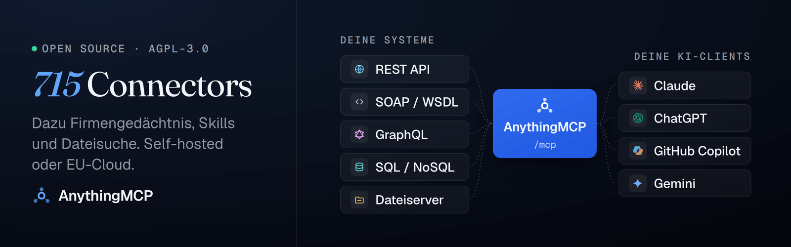

<p align="center">
  
</p>

<h1 align="center">AnythingMCP: das Open-Source-MCP-Gateway, das zum Gehirn deines Unternehmens wird</h1>

<p align="center">
  <a href="https://www.star-history.com/helpcode-ai/anythingmcp">
    <picture>
      <source media="(prefers-color-scheme: dark)" srcset="https://api.star-history.com/badge?repo=HelpCode-ai/anythingmcp&type=trending&theme=dark" />
      
    </picture>
  </a>
</p>

<p align="center">
  <a href="README.md">English</a> · <a href="README.de.md">Deutsch</a> · <a href="README.zh-CN.md">简体中文</a> · <a href="README.ja.md">日本語</a>
</p>

<p align="center">
  <strong>AnythingMCP ist ein quelloffenes, selbst gehostetes MCP-Gateway, das Claude, ChatGPT, Copilot und Gemini mit der Software deines Unternehmens und mit den Dokumenten auf deinen Fileservern verbindet, ohne dass du einen MCP-Server programmierst.</strong><br/>
  Auf dem Gateway baut es das Gehirn deines Unternehmens auf: einen Knowledge Graph, der zeigt, wie deine Systeme zusammenhängen, dazu KI-Skills und ein Firmengedächtnis. Jeder KI-Client nutzt dasselbe, jeweils begrenzt durch die Rolle der Person.<br/>
  697 fertige Connectors mit über 12.000 Tools, darunter SAP, Odoo, weclapp und Amazon Seller; 35 davon kommen ohne API-Schlüssel aus.
</p>

<p align="center">
  <a href="https://claude.ai/directory/anythingmcp"></a>
  <a href="https://github.com/HelpCode-ai/anythingmcp/stargazers"></a>
  <a href="https://github.com/HelpCode-ai/anythingmcp/releases"></a>
  <a href="https://github.com/HelpCode-ai/anythingmcp/blob/main/LICENSE"></a>
  <a href="https://hub.docker.com/r/helpcodeai/anythingmcp"></a>
</p>

<p align="center">
  <strong>Über 16.000 Workspaces in der AnythingMCP Cloud</strong> · <strong>über 1,5 Mio. KI-Tool-Aufrufe im Monat</strong> · <strong>im offiziellen Claude-Verzeichnis gelistet</strong>
</p>

<p align="center">
  <a href="https://cloud.anythingmcp.com/login?mode=register"><strong>Die Cloud 7 Tage kostenlos testen</strong></a> · <a href="https://claude.ai/directory/anythingmcp">Zu Claude hinzufügen</a> · <a href="#run-it-yourself">Selbst betreiben</a> · <a href="docs/guides.md">Doku</a> · <a href="https://anythingmcp.com/de/guides">Connector-Anleitungen</a> · <a href="https://github.com/HelpCode-ai/anythingmcp/discussions">Discussions</a>
</p>

**Eine Frage in Claude, beantwortet aus Etsy, SAP und einer Logistik-API.**

https://github.com/user-attachments/assets/cc8c9ef3-11cf-4eab-aa4d-98472dc554b3

---

<a id="what-your-ai-gets"></a>

## Was deine KI bekommt

Ein Gateway reicht Aufrufe weiter. Ein Firmengehirn weiß außerdem, wo deine Dokumente liegen, wie deine Systeme zusammenhängen und was dein Unternehmen schon entschieden hat. AnythingMCP gibt jedem KI-Client beides, über einen einzigen MCP-Endpunkt:

| | Was es macht | Edition |
|---|---|---|
| **Jedes System, ein Endpunkt** | 697 Connectors aus dem Katalog oder deine eigene REST-/OpenAPI-, SOAP-, GraphQL-, OData-, SQL-, IMAP/SMTP- oder MCP-Quelle. Tools werden zur Laufzeit registriert. [Connectors](#connect-any-api-soap-service-or-database) | Alle |
| **File Search** | Indexiert SFTP, FTP/FTPS, WebDAV (Nextcloud, NAS), S3 oder eine Netzwerkfreigabe: jede PDF-Seite, Excel-Zeilen mit ihren Spaltennamen, Word, PowerPoint, Outlook-Mails mit Anhängen. Die KI antwortet mit Datei, Seite und Datum. [File Search](docs/connectors/file-search.md) | Cloud; selbst gehostet Enterprise |
| **File Share** | Befristete Download-Links für Dateien aus deinen Ordnern oder für Dateien, die die KI erstellt (einen CSV-Export, einen Bericht), intern oder öffentlich, mit Ablaufdatum und Widerruf. [File Share](docs/connectors/file-search.md) | Cloud; selbst gehostet Enterprise |
| **Firmengedächtnis** | Fakten und Vorlieben, in einem KI-Client gespeichert und in jedem anderen wiedergefunden: einmal in Claude gesagt, von Copilot genutzt. Persönlicher und firmenweiter Bereich, mit Ordnern und Rollengrenzen. [Gedächtnis](docs/memory.md) | Enterprise |
| **KI-Skills** | Die Abläufe, denen deine Agenten folgen, von Hand geschrieben oder aus echten Anfragen und behobenen Fehlern gelernt und von einem Admin freigegeben. [KI-Skills](docs/knowledge-graph.md#ai-skills) | Alle |
| **Knowledge Graph** | Wie deine Systeme zusammenhängen, damit der Agent einen Kunden im einen System mit seinen Aufträgen im anderen verknüpft, ohne dass man es ihm sagen muss. [Knowledge Graph](docs/knowledge-graph.md) | Alle |
| **Code Mode** | Ein kurzes Programm ruft mehrere Tools in einer isolierten Sandbox auf, ohne Secrets und ohne Netzwerk; aus einer Abfrage in fünf Schritten wird so ein einziger Aufruf. [Code Mode](docs/code-mode.md) | Alle; Schreibzugriff Enterprise |
| **Governance** | Rollen und Berechtigungen pro Tool, Response-Mapping, das Felder entfernt, bevor sie das Modell erreichen, und ein Audit-Log jedes Aufrufs. SSO und SCIM aus deinem Verzeichnis. [Sicherheit](#security-and-governance) | Alle; SSO/SCIM Enterprise |

Die selbst gehostete Community-Edition ist unter AGPL-3.0 für jede Nutzung kostenlos, auch kommerziell, für bis zu 3 aktive Nutzer und mit unbegrenzt vielen Connectors und MCP-Servern. Mehr Nutzer, Single Sign-On, SCIM, File Search nach dem 30-tägigen Test und Support gibt es mit Enterprise, auf Anfrage: [Kontakt](https://anythingmcp.com/contact?plan=enterprise). Administratoren können Single Sign-On und SCIM unter **Settings → License** 30 Tage lang testen. Bestehende Starter- und Team-Lizenzschlüssel funktionieren weiter.

---

<a id="run-it-yourself"></a>

## Selbst betreiben

Voraussetzungen: Docker 24+ und `openssl`; unter macOS vorher Docker Desktop starten. Klonen ist nicht nötig:

```bash
mkdir anythingmcp && cd anythingmcp
curl -fsSLo docker-compose.yml \
  https://raw.githubusercontent.com/HelpCode-ai/anythingmcp/main/docker-compose.quickstart.yml
printf 'JWT_SECRET=%s\nENCRYPTION_KEY=%s\n' "$(openssl rand -hex 32)" "$(openssl rand -hex 32)" > .env
docker compose up -d
```

<http://localhost:3000> öffnen und registrieren: **Das erste Konto wird Admin.** Der MCP-Endpunkt ist `http://localhost:4000/mcp`, die API-Doku liegt unter `http://localhost:4000/api/docs`.

> **Bewahre die erzeugte `.env` auf.** Mit dem `ENCRYPTION_KEY` werden deine gespeicherten Zugangsdaten entschlüsselt. Geht er verloren, musst du jeden Connector neu mit Zugangsdaten versehen.

Auf amd64 ist das Image in etwa 30 s geladen, 24 s später ist die API bereit. Das Image gibt es vorerst nur für amd64; die Compose-Datei legt die Plattform fest, sodass es auf Apple Silicon per Emulation läuft.

Der Quickstart bindet absichtlich nur an `127.0.0.1`, weil davor nichts TLS terminiert. **Für eine Instanz, die andere Personen oder ein Cloud-KI-Client erreichen sollen**, klonst du das Repository und startest `./setup.sh`: Es fragt nach einer Domain, holt Zertifikate über Caddy, erzeugt die Secrets und setzt den MCP-Auth-Modus. Siehe [Deployment-Anleitung](docs/deployment.md).

<details>
<summary><strong>Weitere Betriebsarten:</strong> Managed Cloud, Railway, DigitalOcean</summary>

<br/>

[**AnythingMCP Cloud**](https://cloud.anythingmcp.com) ist derselbe AGPL-Code, von uns in **Frankfurt** betrieben, mit 7 Tagen kostenlosem Test. Probier es dort mit deinen eigenen APIs aus und hol es ins eigene Haus, sobald die Zugangsdaten nicht mehr reisen sollen; die Connectors bleiben dieselben. AVV/DPA auf Anfrage über [info@helpcode.ai](mailto:info@helpcode.ai). SSO und SCIM gibt es nur selbst gehostet, mit Enterprise-Lizenz.

[](https://railway.com/deploy/8-X4WD?referralCode=k30bPV&utm_medium=integration&utm_source=template&utm_campaign=generic)
&nbsp;
[](https://marketplace.digitalocean.com/apps/anythingmcp)

</details>

---

<a id="how-it-works"></a>

## So funktioniert es

1. **Connector anlegen.** Installiere einen **Adapter** aus dem Katalog (eine fertige JSON-Definition für SAP, Odoo, DHL und viele weitere) oder gib AnythingMCP deine eigene OpenAPI-Spezifikation, WSDL, deinen GraphQL-Endpunkt, eine Postman-Collection oder eine Datenbank. In deinem Workspace konfiguriert, ist das ein **Connector**, und jede seiner Operationen ist ein MCP-Tool.
2. **Festlegen, was das Modell sieht.** Tools im visuellen Editor umbenennen und beschreiben, Felder entfernen, die dein Netz nicht verlassen dürfen, und bestimmen, welche Rollen welche Tools aufrufen dürfen.
3. **Eine URL an den KI-Client geben.** Ein **MCP-Server** ist der Endpunkt, den du in Claude, ChatGPT, Copilot, Gemini oder Cursor einträgst. Er stellt nur die Connectors bereit, die du ihm zuweist.

---

<a id="connect-any-api-soap-service-or-database"></a>

## Jede API, jeden SOAP-Dienst und jede Datenbank anbinden

Die meisten Unternehmen haben noch keine MCP-Server. Sie haben eine REST-API, ein ERP, einen SOAP-Dienst von 2009 und eine Datenbank. Aus jedem davon werden MCP-Tools:

| Quelle | Was du bekommst | Doku |
|---|---|---|
| **OpenAPI / Swagger (REST)** | Spezifikation per URL importieren oder einfügen; jede Operation wird ein Tool, Parameter, Auth und Endpunkt-Mapping sind schon ausgefüllt | [REST](docs/connectors/rest.md) · [Anleitung](https://anythingmcp.com/de/guides/rest-api-to-mcp) · [Demo: openapi-to-mcp](https://github.com/HelpCode-ai/openapi-to-mcp) |
| **Postman-Collection, cURL** | Ordner, Auth, Body-Modi und `{{variables}}` werden übernommen; jeder Request wird ein Tool | [Postman-Import](docs/connectors/rest.md#from-postman-collection) |
| **SOAP / WSDL** | Jede Operation wird ein Tool; Envelopes, Parameterreihenfolge und WCF-Dienste übernimmt AnythingMCP | [SOAP](docs/connectors/soap.md) · [Anleitung](https://anythingmcp.com/de/guides/soap-to-mcp) · [Demo: soap-to-mcp](https://github.com/HelpCode-ai/soap-to-mcp) |
| **GraphQL** | Introspection macht aus Queries und Mutations Tools, oder du definierst die Operationen selbst | [GraphQL](docs/connectors/graphql.md) · [Anleitung](https://anythingmcp.com/de/guides/graphql-to-mcp) |
| **OData** (inklusive SAP Gateway) | Liest das `$metadata` jedes Dienstes, sodass das Modell Entitätsmengen, Schlüssel und die fachlichen SAP-Bezeichnungen sieht; V2 und V4 | [OData](docs/connectors/odata.md) · [Anleitung](https://anythingmcp.com/de/guides/odata-to-mcp) |
| **SQL und MongoDB** | PostgreSQL, MySQL, MariaDB, SQL Server, Oracle, SAP HANA, SQLite und MongoDB: Schema-, Beispiel- und Abfrage-Tools, standardmäßig nur lesend | [Datenbank](docs/connectors/database.md) · [SAP HANA](docs/connectors/sap-hana.md) · [Anleitung](https://anythingmcp.com/de/guides/database-to-mcp) · [Demo: sql-to-mcp](https://github.com/HelpCode-ai/sql-to-mcp) |
| **E-Mail (IMAP/SMTP)** | Jedes Postfach (IONOS, Strato, GMX, T-Online, Gmail mit App-Passwort, eigener Mailserver): Ordner auflisten, suchen, mit Anhängen lesen, markieren, verschieben, Entwürfe speichern und senden | [E-Mail](docs/connectors/email.md) |
| **Ein anderer MCP-Server** | Seine Tools erkennen und neben deinen eigenen bereitstellen, hinter derselben Authentifizierung und demselben Audit | [MCP-Bridge](docs/connectors/mcp-bridge.md) |

Tools werden zur Laufzeit registriert, ohne Neustart. `{{VAR}}`-Werte pro Connector werden auf dem Server eingesetzt und der KI nie gezeigt.

---

<a id="connector-catalog"></a>

## Connector-Katalog

697 Adapter mit über 12.000 Tools. Zu jedem gibt es eine Einrichtungsanleitung auf [anythingmcp.com/de/guides](https://anythingmcp.com/de/guides), in sieben Sprachen.

| Kategorie | Beispiele |
|---|---|
| 💼 ERP, Buchhaltung &amp; Rechnungen | SAP Business One, SAP S/4HANA, Odoo, weclapp, Xentral, Dynamics NAV, Lexware Office, sevDesk, Exact Online, bexio |
| 🛍️ E-Commerce &amp; Marktplätze | Amazon Seller, WooCommerce, Shopware 6, Magento, eBay, Etsy, Kaufland, OTTO, Oxomi |
| 📦 Logistik &amp; Versand | Deutsche Bahn, DHL, DPD, GLS, Shipcloud, Sendcloud |
| 👥 HR &amp; Außendienst | Personio, HRWorks, Kenjo, MFR Mobile Field Report |
| 🏛️ Behörden &amp; offene Daten | VIES-USt-IdNr., Handelsregister, UK Companies House, DESTATIS, Bundesbank, OpenPLZ, NINA |
| 🏦 Banking &amp; Zahlungen | Revolut Business, Wise, PAYONE, Razorpay, Paystack |
| 💬 Messaging | WhatsApp, LINE, TeamViewer |
| 📈 Werbung &amp; Analytics | Google Ads, Google Analytics 4, Google Search Console, Matomo |
| 🧠 KI-Entscheidungsmodelle | Jev von TypeSafe: Ja/Nein, Klassifikation und Scoring mit Wahrscheinlichkeiten, in etwa 300 ms |

<a id="erp-connectors"></a>
<details>
<summary><strong>ERP-Connectors</strong>: 18 Systeme mit Tools und Märkten</summary>

<br/>

| System | Markt | Tools | Was die KI damit kann |
|---|---|---|---|
| [SAP Business One](https://anythingmcp.com/de/guides/connect-sap-business-one-to-claude) | Weltweit | 12 | Geschäftspartner, Artikel, Aufträge, Rechnungen, Angebote, Lieferungen; Kundenaufträge anlegen |
| [SAP S/4HANA Cloud](https://anythingmcp.com/de/guides/connect-sap-s4hana-cloud-to-claude) | Weltweit | 15 | Geschäftspartner, Kundenaufträge und Bestellungen, Fakturen, Lieferungen, Buchungsbelege |
| [SAP S/4HANA (HANA SQL)](https://anythingmcp.com/de/guides/connect-sap-hana-to-claude) | Weltweit | 10 | S/4HANA On-Premise und Private Cloud direkt aus HANA gelesen, mit SAPs Data Dictionary und CDS-Views als Tools; nur lesend |
| [SAP S/4HANA (OData)](https://anythingmcp.com/de/guides/odata-to-mcp) † | Weltweit | 7 | OData-Services des Gateways mit SAPs Bezeichnungen: Buchungszeilen, Fakturen, Kundenaufträge, Geschäftspartner, Bestand, Produkte |
| [Odoo](https://anythingmcp.com/de/guides/connect-odoo-to-claude) | Weltweit | 11 | Jedes Modell: Partner, Kundenaufträge, Rechnungen, Produkte; anlegen und ändern |
| [Microsoft Dynamics NAV](https://anythingmcp.com/de/guides/connect-dynamics-nav-to-claude) | Weltweit | 6 | Jede veröffentlichte OData-Seite: Kunden, Artikel, Kundenaufträge; anlegen und ändern |
| [ERPNext](https://anythingmcp.com/de/guides/connect-erpnext-to-claude) | Weltweit | 11 | Jeder DocType: Kunden, Kundenaufträge, Rechnungen, Artikel, Lagerbestand |
| [Dolibarr](https://anythingmcp.com/de/guides/connect-dolibarr-to-claude) | Weltweit | 10 | Geschäftspartner, Rechnungen, Aufträge, Angebote, Produkte, Lagerbestand |
| [JTL-Wawi](https://anythingmcp.com/de/guides/connect-jtl-wawi-to-claude) † | DE | 9 | Artikel, Bestand pro Lager, Kunden, Kundenaufträge, Lieferungen |
| [Xentral](https://anythingmcp.com/de/guides/connect-xentral-to-claude) | DE | 7 | Artikel, Kunden, Kundenaufträge, Rechnungen, Lagerbestand |
| [weclapp](https://anythingmcp.com/de/guides/connect-weclapp-to-claude) | DACH | 11 | Kunden, Kundenaufträge, Rechnungen, Artikel, Angebote, Verkaufschancen |
| [Sage 100](https://anythingmcp.com/de/guides/connect-sage-100-to-claude) † | DE | 6 | Adressen, Artikel, Verkaufsbelege, jede Entität der Web API |
| [Haufe X360](https://anythingmcp.com/de/guides/connect-haufe-x360-to-claude) † | DE | 7 | Kunden, Lagerartikel, Kundenaufträge, Rechnungen, Lieferungen |
| [ScopeVisio](https://anythingmcp.com/de/guides/connect-scopevisio-to-claude) | DE | 6 | Kontakte, Rechnungen, Projekte, Aufgaben |
| [AFAS Profit](https://anythingmcp.com/de/guides/connect-afas-profit-to-claude) † | NL | 6 | Jeder GetConnector: Debitoren, Rechnungen, Mitarbeitende |
| [Zucchetti](https://anythingmcp.com/de/guides/connect-zucchetti-to-claude) † | IT | 6 | Anagrafiche (Stammdaten), Belege, Artikel |
| [TeamSystem](https://anythingmcp.com/de/guides/connect-teamsystem-to-claude) † | IT | 6 | Kunden, Lieferanten, Rechnungen, Artikel |
| [Axonaut](https://anythingmcp.com/de/guides/connect-axonaut-to-claude) † | FR | 9 | Unternehmen, Rechnungen, Angebote, Ausgaben, Produkte, Projekte |

† Auf Basis der veröffentlichten API-Dokumentation des Herstellers erstellt und noch nicht mit einem echten Mandanten getestet. Wenn du eines dieser Systeme einsetzt, freuen wir uns sehr über einen Erfahrungsbericht oder einen Fix.

**Repositories:** [erp-mcp-server](https://github.com/HelpCode-ai/erp-mcp-server) · [weclapp-mcp-server](https://github.com/kochfreiburg/weclapp-mcp-server) · [sap-mcp-server](https://github.com/HelpCode-ai/sap-mcp-server) · [sap-hana-mcp-server](https://github.com/HelpCode-ai/sap-hana-mcp-server) · [sap-business-one-mcp-server](https://github.com/HelpCode-ai/sap-business-one-mcp-server) · [xentral-mcp-server](https://github.com/kochfreiburg/xentral-mcp-server)

</details>

<a id="e-commerce--marketplace-connectors"></a>
<details>
<summary><strong>E-Commerce- &amp; Marktplatz-Connectors</strong>: 13 Shops und Marktplätze</summary>

<br/>

| System | Markt | Tools | Was die KI damit kann |
|---|---|---|---|
| [Amazon Seller Central](https://anythingmcp.com/de/guides/connect-amazon-seller-to-claude) | Weltweit | 15 | Bestellungen, Katalog, FBA-Bestand, Angebote, Gebühren, Finanzereignisse, Berichte |
| [WooCommerce](https://anythingmcp.com/de/guides/connect-woocommerce-to-claude) | Weltweit | 49 | Produkte, Varianten, Lagerbestand, Bestellungen, Erstattungen, Kunden, Berichte |
| [Shopware 6](https://anythingmcp.com/de/guides/connect-shopware-6-to-claude) | DACH | 6 | Storefront-Katalog über die Store API: Produkte, Kategorien, Cross-Selling |
| [Magento 2 / Adobe Commerce](https://anythingmcp.com/de/guides/connect-magento-to-claude) | Weltweit | 12 | Produkte, Lagerbestand, Bestellungen, Kunden |
| [BigCommerce](https://anythingmcp.com/de/guides/connect-bigcommerce-to-claude) | Weltweit | 14 | Produkte, Varianten, Bestand, Bestellungen, Kunden |
| [eBay Sell](https://anythingmcp.com/de/guides/connect-ebay-sell-to-claude) | Weltweit | 10 | Bestand, Angebote, Bestellungen, Streitfälle, Preisänderungen |
| [Etsy](https://anythingmcp.com/de/guides/connect-etsy-to-claude) | Weltweit | 9 | Listings, Belege (Bestellungen), Bewertungen |
| [Ecwid](https://anythingmcp.com/de/guides/connect-ecwid-to-claude) | Weltweit | 10 | Produkte, Kategorien, Bestellungen, Kunden |
| [Kaufland Marketplace](https://anythingmcp.com/de/guides/connect-kaufland-to-claude) | DE | 8 | Bestellungen und Bestelleinheiten, Sendungen, Tickets, Storefronts |
| [OTTO Market](https://anythingmcp.com/de/guides/connect-otto-market-to-claude) † | DE | 8 | Bestellungen, Produkte, Retouren, Bestands- und Preisänderungen |
| [Zalando Direct Ship](https://anythingmcp.com/de/guides/connect-zalando-zds-to-claude) † | EU | 7 | Bestellungen, Sendungen, Retouren, Bestand, Preise |
| [Billbee](https://anythingmcp.com/guides/connect-billbee-to-claude) | DACH | 8 | Bestellungen, Produkte, Kunden, Versanddienstleister |
| [Mercado Libre](https://anythingmcp.com/de/guides/connect-mercado-libre-to-claude) | LATAM | 4 | Artikelsuche, Verkäuferbestellungen |

† Auf Basis der veröffentlichten API-Dokumentation des Herstellers erstellt und noch nicht mit einem echten Verkäuferkonto getestet.

**Repositories:** [ecommerce-mcp-server](https://github.com/HelpCode-ai/ecommerce-mcp-server) · [billbee-mcp-server](https://github.com/kochfreiburg/billbee-mcp-server) · [shopware-mcp-server](https://github.com/kochfreiburg/shopware-mcp-server) · [kaufland-mcp-server](https://github.com/kochfreiburg/kaufland-mcp-server) · [otto-market-mcp-server](https://github.com/kochfreiburg/otto-market-mcp-server)

</details>

**Ein Adapter ist eine einzige JSON-Datei.** Deshalb ist der Katalog so groß, und deshalb ist ein neuer Adapter ein guter erster Beitrag. Deiner fehlt? [Wünsch ihn dir](https://github.com/HelpCode-ai/anythingmcp/issues/new?template=adapter_request.yml) (wir priorisieren nach 👍) oder [bau ihn](.github/CONTRIBUTING.md). Dein ERP ist nicht dabei oder eine Eigenentwicklung? Binde seine REST-API, seine SOAP-Dienste oder direkt seine SQL-Datenbank an, nur lesend.

---

<a id="security-and-governance"></a>

## Sicherheit und Governance

Alles läuft auf deiner Infrastruktur, du entscheidest also, was sie verlässt. OAuth2, Rollen, Berechtigungen pro Tool, Response-Mapping und das Audit-Log sind in jeder Edition enthalten; SSO und SCIM brauchen eine Enterprise-Lizenz (ein 30-tägiger Test ist eingebaut).

- **Response-Mapping.** Jedes Tool legt fest, welche Felder das Modell erreichen: die IBAN eines Kunden oder das Gehalt einer Mitarbeiterin entfernen, oder die Felder benennen, die bleiben. Der Editor zeigt Vorher und Nachher an einer echten Antwort; ein mitgelieferter Adapter schrumpft von 12.172 B auf 1.072 B (−91 %), du zahlst diese Felder also auch nicht im Kontextfenster. Ein fehlerhaftes Mapping liefert standardmäßig die Rohantwort; setze `"fallbackToRaw": false` bei Tools, deren Felder niemals rausgehen dürfen, dann schlägt der Aufruf stattdessen fehl.
- **Nur lesend, wo es darauf ankommt.** Jedes Tool trägt MCP-Annotationen (`readOnlyHint`, `destructiveHint`), aus der Operation abgeleitet und pro Tool überschreibbar. Mit rollenbasierten Tool-Whitelists veröffentlichst du einen MCP-Server, der nur lesen kann; so sollten die meisten mit einem ERP anfangen. Datenbank-Abfrage-Tools führen ein einzelnes SELECT aus und blockieren Schreibzugriffe und verkettete Statements.
- **Jedes Auth-Verfahren, das dir begegnet.** OAuth2 (PKCE und Client Credentials), Bearer, API-Key, Basic, HMAC-Request-Signing, [LOGIN_TOKEN](docs/connectors/login-token-auth.md) und OAuth 1.0a. Zugangsdaten werden mit AES-256-GCM verschlüsselt gespeichert.
- **Audit-Log.** Jeder Tool-Aufruf wird mit Eingabe, Ausgabe, Dauer und Status in deiner eigenen Datenbank protokolliert, einschließlich der vollständigen Antwort des Quellsystems, die das Modell nie gesehen hat.
- **[SSO](docs/sso.md) und [SCIM](docs/scim-entra-setup.md)** (Enterprise). Entra ID, Google, Okta, Auth0 oder jeder OIDC-Anbieter. Rollen werden bei jeder Anmeldung aus deinen Verzeichnisgruppen übernommen; wer im Verzeichnis deaktiviert wird, verliert Workspace-Zugang und MCP-API-Keys gleich mit.

```json
{
  "transform": {
    "mode": "select",
    "fallbackToRaw": false,
    "exclude": ["customer.iban", "customer.taxId"],
    "select": { "order": "$.id", "total": "$.amounts.gross", "status": "$.state" }
  }
}
```

[Referenz zum Response-Mapping](docs/tool-definition.md#3-response-mapping-optional)

---

<a id="use-it-from-claude-chatgpt-copilot-and-gemini"></a>

## Mit Claude, ChatGPT, Copilot und Gemini nutzen

Derselbe MCP-Server funktioniert in jedem Client, der MCP spricht; du baust einen Connector also nur einmal:

- **Claude.** Trag die Server-URL als **benutzerdefinierten Connector** unter *Customize → Connectors* ein; danach funktioniert er in Claude.ai, Claude Desktop und Claude Code. OAuth 2.0 wird direkt unterstützt. Mit AnythingMCP Cloud geht es auch mit einem Klick über das [Claude-Verzeichnis](https://claude.ai/directory/anythingmcp). [Claude einrichten](docs/integrations/claude.md)
- **ChatGPT.** Apps in ChatGPT basieren auf MCP. Füge den Server in ChatGPT unter *Plugins* hinzu (*+ → Add custom MCP server*) oder nutze ihn als Tool-Schicht einer Apps-SDK-App. [ChatGPT einrichten](docs/integrations/chatgpt.md)
- **Meta Muse.** Öffne in Muse *Settings → Connectors → Add custom connector*, füge die Server-URL ein und melde dich bei AnythingMCP an. [Muse einrichten](docs/integrations/muse.md)
- **Copilot, Gemini, Cursor** und andere MCP-Clients: [Anleitungen zur Client-Einrichtung](docs/guides.md).

---

<a id="company-brain-knowledge-graph-ai-skills-and-memory"></a>

## Firmengehirn: Knowledge Graph, KI-Skills und Firmengedächtnis

Wer Aufrufe nur weiterreicht, überlässt dem Agenten den schwierigen Teil: zu wissen, welches Tool als Nächstes dran ist und was dein Unternehmen mit „offener Auftrag" meint. AnythingMCP lernt beides und gibt es als Kontext zurück, nicht als zusätzliche Tool-Aufrufe.

- **Knowledge Graph.** Eine Karte pro Workspace mit Entitäten (Kunden, Aufträge, Produkte) und ihren Beziehungen über Connectors hinweg, aufgebaut aus Tool-Definitionen und echten Aufrufen und von Hand bearbeitbar. Gespeichert werden Feldnamen und Beziehungen, nie Werte. Jeder Server stellt ihn über ein Tool `kg_how_to_obtain` bereit, damit der Agent fragen kann, wie er von einer Shopware-Bestellung zur DHL-Sendungsnummer kommt.
- **KI-Skills.** Wiederkehrende Nutzung wird zu kleinen Regeln („der heutige Umsatz umfasst die Auftragsstatus 2, 3 und 4") und zu Abläufen Schritt für Schritt, von Hand geschrieben oder aus echten Anfragen und behobenen Fehlern gelernt. Sie sind versioniert und werden von einem Admin freigegeben, bevor sie in die Anweisungen des Servers einfließen.
- **Firmengedächtnis** (Enterprise). KI-Clients speichern Fakten, Vorlieben und Notizen mit `memory_save` und finden sie mit `memory_search` wieder, in jedem Client, der mit dem Workspace verbunden ist. *Mein Gedächtnis* bleibt privat für eine Person; das *Firmengedächtnis* („STAMMKUNDE heißt: Kunde mit Rahmenvertrag") gilt für alle, in Ordnern, die nach Rolle begrenzt sind. Es wird als von Menschen geschriebene Information ausgeliefert, nie als Anweisung. [Anleitung zum Gedächtnis](docs/memory.md)

Wechsle den Assistenten, behalte das Gehirn: heute Copilot, morgen Claude, heute Nacht ein n8n-Agent, und alle finden denselben Graph, dieselben Skills und dasselbe Gedächtnis.

Die KI-Durchläufe sind standardmäßig aus und nutzen deinen eigenen Schlüssel für OpenAI, OpenRouter oder Anthropic; Graph, Editor und MCP-Tool funktionieren auch ohne. [Anleitung zum Knowledge Graph](docs/knowledge-graph.md)

---

<a id="where-it-fits"></a>

## Wo es hineinpasst

Die meisten MCP-Gateways bündeln und sichern MCP-Server, die du schon hast. AnythingMCP setzt einen Schritt früher an: Es erzeugt die MCP-Server aus den APIs, ERPs und Datenbanken, die du bereits betreibst, und stellt sie dann hinter einem Endpunkt bereit, mit Berechtigungen und Audit. Sind deine Tools schon MCP-Server und brauchst du nur die Bündelung, reicht womöglich ein reines Gateway. Direkte Vergleiche: [anythingmcp.com/de/vs](https://anythingmcp.com/de/vs).

---

<a id="faq"></a>

## FAQ

### Was ist ein MCP-Gateway?
Ein einzelner MCP-Endpunkt vor vielen Tools, der Authentifizierung, Zugriffskontrolle und Audit für alle übernimmt. KI-Clients wie Claude und ChatGPT verbinden sich mit dem Gateway statt mit jedem einzelnen System. AnythingMCP ist ein Gateway, das die Tools zusätzlich selbst erzeugt, aus APIs und Datenbanken, die keinen eigenen MCP-Server haben.

### Wie verbinde ich mein ERP (SAP, Odoo, Xentral …) mit Claude oder ChatGPT?
Installiere den Adapter deines ERP aus dem [Katalog](#connector-catalog), trage die API-Zugangsdaten ein und füge die URL deines MCP-Servers in Claude als benutzerdefinierten Connector oder in ChatGPT als App hinzu. Gibt es keinen Adapter, bindest du die REST- oder SOAP-API oder die SQL-Datenbank direkt an. Fang mit einer Rolle an, die nur lesen darf.

### Wie mache ich aus einer OpenAPI-Spezifikation einen MCP-Server?
Leg einen REST-Connector an und importiere die Spezifikation per URL oder durch Einfügen. Jede Operation wird ein MCP-Tool auf dem `/mcp`-Endpunkt deines Servers, ohne Code. [So funktioniert es](docs/connectors/rest.md#from-openapi--swagger)

### Kann ich einen SOAP-/WSDL-Dienst mit Claude verbinden?
Ja. AnythingMCP liest die WSDL, macht aus jeder Operation ein Tool und baut bei jedem Aufruf den SOAP-Envelope, auch für WCF-Dienste. Authentifiziert wird per HTTP Basic, Bearer, API-Key-Header oder WS-Security-UsernameToken; signierte WS-Security-Nachrichten werden noch nicht unterstützt. [SOAP-Connector](docs/connectors/soap.md)

### Kann Claude meine SQL-Server-, Oracle- oder PostgreSQL-Datenbank sicher abfragen?
Abfrage-Tools sind standardmäßig nur lesend. Zusätzlich: einen Datenbankbenutzer nur mit SELECT-Rechten verwenden, statische Abfragen bevorzugen, bei denen das Modell nur die Parameter liefert, und die Tools pro Rolle freigeben. Das Response-Mapping entfernt Spalten, die das Modell nicht erreichen dürfen, und jede Abfrage landet in deinem Audit-Log.

### Wie lasse ich Claude oder ChatGPT die Dokumente auf unserem Fileserver durchsuchen?
Leg einen **File Search**-Connector an und verbinde ihn per SFTP, FTP/FTPS, WebDAV (Nextcloud, ownCloud, Synology- oder QNAP-NAS), S3 oder über eine eingebundene Netzwerkfreigabe mit dem Ordner. AnythingMCP indexiert PDFs Seite für Seite, Excel-Zeilen mit ihren Spaltennamen, Word, PowerPoint und Outlook-Mails, hält den Index aktuell und gibt jedem KI-Client die Tools `search`, `find`, `grep` und `read`, die mit Datei, Seite und Datum antworten. Ordnerberechtigungen pro Rolle gibt es mit Enterprise. [Doku zu File Search](docs/connectors/file-search.md)

### Können ChatGPT, Claude und Copilot dasselbe Firmengedächtnis nutzen?
Ja. Mit dem Workspace-Gedächtnis (Enterprise) finden die anderen KI-Clients alles, was in einem davon gespeichert wurde, denn das Gedächtnis liegt in AnythingMCP und nicht im Client. Persönliche Einträge sieht nur, wer sie angelegt hat; Firmeneinträge werden innerhalb der Ordner- und Rollengrenzen geteilt. [Doku zum Gedächtnis](docs/memory.md)

### Was ist ein Firmengehirn für KI-Agenten?
Das Wissen, das eine KI über den reinen Tool-Zugriff hinaus braucht: wo deine Dokumente liegen, wie deine Systeme verknüpft sind (der Knowledge Graph), wie dein Unternehmen arbeitet (KI-Skills) und was es entschieden hat (Firmengedächtnis). AnythingMCP hält all das in deiner eigenen Instanz und stellt es jedem MCP-Client bereit, jeweils im Rahmen der Rolle der Person.

### Kann ein KI-Agent sicher Code gegen meine Tools ausführen?
Mit Code Mode ruft ein kurzes JavaScript-Programm mehrere Tools in einem Schritt auf. Es läuft in einem eigenen Code-Runner-Container ohne Dateisystem, Netzwerk, Umgebungsvariablen oder Secrets; es kann nur die Tools aufrufen, die die Person ohnehin nutzen darf, und jeder innere Aufruf wird wie ein direkter Aufruf geprüft und protokolliert. Es bleibt aus, bis ein Betreiber es einschaltet. [Doku zu Code Mode](docs/code-mode.md)

### Wie verbinde ich Shopware, WooCommerce oder Amazon Seller Central mit Claude?
Installiere den [E-Commerce-Adapter](#e-commerce--marketplace-connectors) für deinen Shop oder Marktplatz und autorisiere ihn. WooCommerce bringt 49 Tools mit, Amazon Seller Central nutzt die offizielle Selling Partner API, und der Shopware-6-Adapter liest den Storefront-Katalog über die Store API.

---

## Community und Unterstützung

**Im produktiven Einsatz bei [KOCH Freiburg GmbH](https://www.kochfreiburg.de/)**: Dort verbindet AnythingMCP KI-Assistenten mit mehr als 15 internen Systemen, von ERP und CRM bis zu SOAP-Diensten und lokalen Datenbanken. [helpcode.ai](https://helpcode.ai) hat es aus diesem System herausgelöst und als Open Source veröffentlicht, weil ein Adapterkatalog in einer Community schneller wächst als im Alleingang.

- 💬 **Fragen und Ideen:** [GitHub Discussions](https://github.com/HelpCode-ai/anythingmcp/discussions). Stimm über den nächsten Adapter ab und zeig, was du gebaut hast.
- 🐛 **Fehler und Wünsche:** [Issues](https://github.com/HelpCode-ai/anythingmcp/issues) · [Support](.github/SUPPORT.md)
- 👥 **Anwender:** [wer AnythingMCP produktiv einsetzt](docs/ADOPTERS.md) und wie du dich einträgst
- 🔐 **Sicherheit:** bitte kein öffentliches Issue öffnen, sondern der [Sicherheitsrichtlinie](.github/SECURITY.md) folgen
- 🤖 **Für KI-Agenten und Crawler:** [anythingmcp.com/llms.txt](https://anythingmcp.com/llms.txt)
- 🤖 **Repository-Dokumentation für KI-Agenten:** [llms.txt](llms.txt) · [Volltext](llms-full.txt)
- 🏢 Entwickelt von [helpcode.ai](https://helpcode.ai) in Freiburg. KI-gestützt entwickelt, von Menschen geprüft: [AUTHORS.md](docs/AUTHORS.md) erklärt, welche Teile und wie.

## Mitwirken

Lies vor einem PR die [Contributing-Anleitung](.github/CONTRIBUTING.md). Der einfachste nützliche Beitrag ist ein Adapter: eine JSON-Datei, und es gibt ein [Walkthrough-Issue](https://github.com/HelpCode-ai/anythingmcp/issues/982) dazu.

## License

**Open Source** unter der [GNU Affero General Public License v3](LICENSE) (AGPL-3.0-only). Kommerzielle Nutzung im eigenen Unternehmen ist erlaubt und war es schon immer; die Copyleft-Pflicht beginnt erst, wenn du AnythingMCP veränderst und die veränderte Version anderen über ein Netzwerk anbietest. Code unter `ee/` (Cloud-Betrieb, die Sync-Engine von File Search, Edition-Lizenzierung) steht unter der AnythingMCP Commercial License und ist für den Betrieb des Gateways nicht nötig; siehe [Lizenz-FAQ](docs/license-faq.md).
