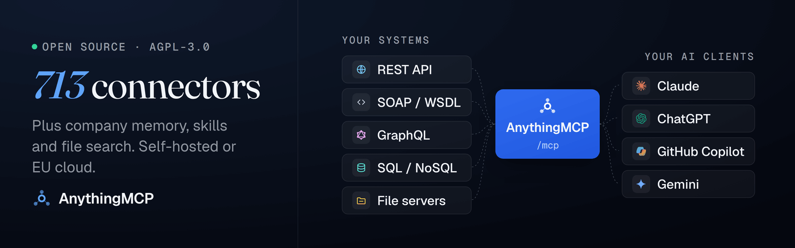

<p align="center">
  
</p>

<h1 align="center">AnythingMCP: the open-source MCP gateway that becomes your company brain</h1>

<p align="center">
  <a href="https://www.star-history.com/helpcode-ai/anythingmcp">
    <picture>
      <source media="(prefers-color-scheme: dark)" srcset="https://api.star-history.com/badge?repo=HelpCode-ai/anythingmcp&type=trending&theme=dark" />
      
    </picture>
  </a>
</p>

<p align="center">
  <a href="README.md">English</a> · <a href="README.de.md">Deutsch</a> · <a href="README.zh-CN.md">简体中文</a> · <a href="README.ja.md">日本語</a>
</p>

<p align="center">
  <strong>AnythingMCP is an open-source, self-hosted MCP gateway that connects Claude, ChatGPT, Copilot and Gemini to the software your company runs and to the documents on your file servers, without writing an MCP server.</strong><br/>
  On top of the gateway it keeps your company brain: a knowledge graph of how your systems connect, AI skills and company memory, shared by every AI client and limited by each user's role.<br/>
  714 ready connectors with 12,000+ tools, among them SAP, Odoo, weclapp and Amazon Seller; 35 need no API key.
</p>

<p align="center">
  <a href="https://claude.ai/directory/anythingmcp"></a>
  <a href="https://chatgpt.com/plugins/plugin_asdk_app_6ade03541ce08191b35bbad1dc5b4121"></a>
  <a href="https://github.com/HelpCode-ai/anythingmcp/stargazers"></a>
  <a href="https://github.com/HelpCode-ai/anythingmcp/releases"></a>
  <a href="https://github.com/HelpCode-ai/anythingmcp/blob/main/LICENSE"></a>
  <a href="https://hub.docker.com/r/helpcodeai/anythingmcp"></a>
</p>

<p align="center">
  <strong>16,000+ workspaces on AnythingMCP Cloud</strong> · <strong>1.5M+ AI tool calls a month</strong> · <strong>listed in the official Claude directory and the ChatGPT Plugin Directory</strong>
</p>

<p align="center">
  <a href="https://cloud.anythingmcp.com/login?mode=register"><strong>Try the Cloud free for 7 days</strong></a> · <a href="https://claude.ai/directory/anythingmcp">Add to Claude</a> · <a href="https://chatgpt.com/plugins/plugin_asdk_app_6ade03541ce08191b35bbad1dc5b4121">Add to ChatGPT</a> · <a href="#run-it-yourself">Run it yourself</a> · <a href="docs/guides.md">Docs</a> · <a href="https://anythingmcp.com/guides">Connector guides</a> · <a href="https://github.com/HelpCode-ai/anythingmcp/discussions">Discussions</a>
</p>

**One question in Claude, answered from Etsy, SAP and a logistics API.**

https://github.com/user-attachments/assets/cc8c9ef3-11cf-4eab-aa4d-98472dc554b3

---

## What your AI gets

A gateway forwards calls. A company brain also knows where your documents are, how your systems connect and what your company has already decided. AnythingMCP gives every AI client both, through one MCP endpoint:

| | What it does | Edition |
|---|---|---|
| **Every system, one endpoint** | 696 catalog connectors, or your own REST/OpenAPI, SOAP, GraphQL, OData, SQL, IMAP/SMTP or MCP source. Tools register at runtime. [Connectors](#connect-any-api-soap-service-or-database) | All |
| **File Search** | Indexes SFTP, FTP/FTPS, WebDAV (Nextcloud, NAS), S3 or a network share: every PDF page, Excel rows with their column names, Word, PowerPoint, Outlook mails with attachments. The AI answers with file, page and date. [File Search](docs/connectors/file-search.md) | Cloud; self-hosted Enterprise |
| **File Share** | Temporary download links for files from your folders, or for files the AI writes (a CSV export, a report), internal or public, with expiry and revoke. [File Share](docs/connectors/file-search.md) | Cloud; self-hosted Enterprise |
| **Company memory** | Facts and preferences saved from one AI client and found again in any other: said once in Claude, used by Copilot. Personal and company scopes, with folders and role limits. [Memory](docs/memory.md) | Enterprise |
| **AI skills** | The procedures your agents follow, written by hand or learned from real requests and fixed errors, approved by an admin. [AI skills](docs/knowledge-graph.md#ai-skills) | All |
| **Knowledge graph** | How your systems connect, so the agent links a customer in one system to their orders in another without being told. [Knowledge Graph](docs/knowledge-graph.md) | All |
| **Code Mode** | One short program that calls several tools in an isolated sandbox with no secrets and no network, so a five-step lookup becomes one call. [Code Mode](docs/code-mode.md) | All; write access Enterprise |
| **Governance** | Roles and per-tool permissions, response mapping that drops fields before they reach the model, an audit log of every call. SSO and SCIM from your directory. [Security](#security-and-governance) | All; SSO/SCIM Enterprise |

The self-hosted Community edition is free under AGPL-3.0 for any use, including commercial use, for up to 3 active users, with unlimited connectors and MCP servers. More users, single sign-on, SCIM, File Search beyond the 30-day trial and support come with Enterprise, on request: [contact us](https://anythingmcp.com/contact?plan=enterprise). Administrators can try single sign-on and SCIM for 30 days under **Settings → License**. Existing Starter and Team licence keys keep working.

---

## Run it yourself

Requires Docker 24+ and `openssl`; on macOS, start Docker Desktop first. No clone needed:

```bash
mkdir anythingmcp && cd anythingmcp
curl -fsSLo docker-compose.yml \
  https://raw.githubusercontent.com/HelpCode-ai/anythingmcp/main/docker-compose.quickstart.yml
printf 'JWT_SECRET=%s\nENCRYPTION_KEY=%s\n' "$(openssl rand -hex 32)" "$(openssl rand -hex 32)" > .env
docker compose up -d
```

Open <http://localhost:3000> and register: **the first account becomes admin**. Your MCP endpoint is `http://localhost:4000/mcp`, the API docs are at `http://localhost:4000/api/docs`.

> **Keep the generated `.env`.** `ENCRYPTION_KEY` decrypts the credentials you store. Lose it and every connector has to be re-credentialed.

On amd64 the image pulls in about 30 s and the API is healthy 24 s later. The image is amd64 only for now; the compose file pins the platform, so it also runs on Apple Silicon under emulation.

The quickstart binds to `127.0.0.1` on purpose, because nothing in front of it terminates TLS. **For an instance other people or a cloud AI client can reach**, clone the repo and run `./setup.sh`: it asks for a domain, gets certificates through Caddy, generates the secrets and sets the MCP auth mode. See the [Deployment Guide](docs/deployment.md).

<details>
<summary><strong>Other ways to run it:</strong> managed cloud, Railway, DigitalOcean</summary>

<br/>

[**AnythingMCP Cloud**](https://cloud.anythingmcp.com) is the same AGPL code, operated by us in **Frankfurt, Germany**, with a 7-day free trial. Start there to try it on your own APIs, and move it in-house when you want the credentials to stop travelling; the connectors are the same either way. DPA/AVV on request via [info@helpcode.ai](mailto:info@helpcode.ai). SSO and SCIM are self-hosted only, with an Enterprise licence.

[](https://railway.com/deploy/8-X4WD?referralCode=k30bPV&utm_medium=integration&utm_source=template&utm_campaign=generic)
&nbsp;
[](https://marketplace.digitalocean.com/apps/anythingmcp)

</details>

---

## How it works

1. **Add a connector.** Install an **adapter** from the catalog (a ready JSON definition for SAP, Odoo, DHL and the rest), or point AnythingMCP at your own OpenAPI spec, WSDL, GraphQL endpoint, Postman collection or database. Once configured in your workspace it is a **connector**, and each of its operations is an MCP tool.
2. **Decide what the model sees.** Rename and describe the tools in the visual editor, drop the fields that must not leave your network, and choose which roles may call which tools.
3. **Hand one URL to your AI client.** An **MCP server** is the endpoint you add to Claude, ChatGPT, Copilot, Gemini or Cursor. It exposes the connectors you assign to it, and nothing else.

---

## Connect any API, SOAP service or database

Most companies have no MCP servers yet. They have a REST API, an ERP, a SOAP service from 2009 and a database. Each of them becomes a set of MCP tools:

| Source | What you get | Docs |
|---|---|---|
| **OpenAPI / Swagger (REST)** | Import a spec by URL or paste it; every operation becomes a tool with parameters, auth and endpoint mapping filled in | [REST](docs/connectors/rest.md) · [guide](https://anythingmcp.com/guides/rest-api-to-mcp) · [demo: openapi-to-mcp](https://github.com/HelpCode-ai/openapi-to-mcp) |
| **Postman collection, cURL** | Folders, auth, body modes and `{{variables}}` carry over; every request becomes a tool | [Postman import](docs/connectors/rest.md#from-postman-collection) |
| **SOAP / WSDL** | Each operation becomes a tool; envelopes, parameter order and WCF services are handled for you | [SOAP](docs/connectors/soap.md) · [guide](https://anythingmcp.com/guides/soap-to-mcp) · [demo: soap-to-mcp](https://github.com/HelpCode-ai/soap-to-mcp) |
| **GraphQL** | Introspection turns queries and mutations into tools, or you define the operations yourself | [GraphQL](docs/connectors/graphql.md) · [guide](https://anythingmcp.com/guides/graphql-to-mcp) |
| **OData** (SAP Gateway included) | Reads each service's `$metadata`, so the model sees entity sets, keys and SAP's business labels; V2 and V4 | [OData](docs/connectors/odata.md) · [guide](https://anythingmcp.com/guides/odata-to-mcp) |
| **SQL and MongoDB** | PostgreSQL, MySQL, MariaDB, SQL Server, Oracle, SAP HANA, SQLite and MongoDB: schema, example and query tools, read-only by default | [Database](docs/connectors/database.md) · [SAP HANA](docs/connectors/sap-hana.md) · [guide](https://anythingmcp.com/guides/database-to-mcp) · [demo: sql-to-mcp](https://github.com/HelpCode-ai/sql-to-mcp) |
| **Email (IMAP/SMTP)** | Any mailbox (IONOS, Strato, GMX, T-Online, Gmail with an app password, your own mail server): list folders, search, read with attachments, flag, move, save drafts and send | [Email](docs/connectors/email.md) |
| **Another MCP server** | Discover its tools and serve them next to your own, behind the same auth and audit | [MCP bridge](docs/connectors/mcp-bridge.md) |

Tools register at runtime, without a restart. Per-connector `{{VAR}}` values are interpolated on the server and never shown to the AI.

---

## Connector catalog

714 adapters, exposing 12,000+ tools. Every one has a setup guide on [anythingmcp.com/guides](https://anythingmcp.com/guides), in seven languages. The [full catalog by category](docs/catalog/README.md) lists every Cloud connector with links to its guides for Claude, ChatGPT, Copilot, Cursor and Gemini.

| Category | Examples |
|---|---|
| 💼 ERP, accounting &amp; invoicing | SAP Business One, SAP S/4HANA, Odoo, weclapp, Xentral, Dynamics NAV, Lexware Office, sevDesk, Exact Online, bexio |
| 🛍️ E-commerce &amp; marketplaces | Amazon Seller, WooCommerce, Shopware 6, Magento, eBay, Etsy, Kaufland, OTTO, Oxomi |
| 📦 Logistics &amp; shipping | Deutsche Bahn, DHL, DPD, GLS, Shipcloud, Sendcloud |
| 👥 HR &amp; field service | Personio, HRWorks, Kenjo, MFR Mobile Field Report |
| 🏛️ Government &amp; public data | VIES VAT, Handelsregister, UK Companies House, DESTATIS, Bundesbank, OpenPLZ, NINA |
| 🏦 Banking &amp; payments | Revolut Business, Wise, PAYONE, Razorpay, Paystack |
| 💬 Messaging | WhatsApp, LINE, TeamViewer |
| 📈 Advertising &amp; analytics | Google Ads, Google Analytics 4, Google Search Console, Matomo |
| 🧠 AI decision models | Jev by TypeSafe: yes/no, classification and scoring with probabilities, in about 300 ms |

<a name="erp-connectors"></a>
<details>
<summary><strong>ERP connectors</strong>: 18 systems, with tools and markets</summary>

<br/>

| System | Market | Tools | What the AI can do |
|---|---|---|---|
| [SAP Business One](https://anythingmcp.com/guides/connect-sap-business-one-to-claude) | Global | 24 | Business partners, items, sales documents, A/P invoices, payments, journal entries, chart of accounts, bank reconciliations; create sales orders |
| [SAP S/4HANA Cloud](https://anythingmcp.com/guides/connect-sap-s4hana-cloud-to-claude) | Global | 15 | Business partners, sales and purchase orders, billing documents, deliveries, journal entries |
| [SAP S/4HANA (HANA SQL)](https://anythingmcp.com/guides/connect-sap-hana-to-claude) | Global | 10 | S/4HANA on-premise and Private Cloud read straight from HANA, with SAP's data dictionary and CDS views as tools; read-only |
| [SAP S/4HANA (OData)](https://anythingmcp.com/guides/odata-to-mcp) † | Global | 7 | Gateway OData services with SAP's labels: journal entry items, billing documents, sales orders, business partners, stock, products |
| [Odoo](https://anythingmcp.com/guides/connect-odoo-to-claude) | Global | 11 | Any model: partners, sales orders, invoices, products; create and update |
| [Microsoft Dynamics NAV](https://anythingmcp.com/guides/connect-dynamics-nav-to-claude) | Global | 6 | Any published OData page: customers, items, sales orders; create and update |
| [ERPNext](https://anythingmcp.com/guides/connect-erpnext-to-claude) | Global | 11 | Any DocType: customers, sales orders, invoices, items, stock |
| [Dolibarr](https://anythingmcp.com/guides/connect-dolibarr-to-claude) | Global | 10 | Third parties, invoices, orders, proposals, products, stock |
| [JTL-Wawi](https://anythingmcp.com/guides/connect-jtl-wawi-to-claude) † | DE | 10 | Items, stock per warehouse, customers, sales orders, shipments |
| [Xentral](https://anythingmcp.com/guides/connect-xentral-to-claude) † | DE | 30 | Products, stock per warehouse and bin, customers, suppliers, sales orders, delivery notes, invoices with payment status, credit notes, purchase orders; create order drafts |
| [weclapp](https://anythingmcp.com/guides/connect-weclapp-to-claude) | DACH | 11 | Customers, sales orders, invoices, articles, quotations, opportunities |
| [Sage 100](https://anythingmcp.com/guides/connect-sage-100-to-claude) † | DE | 6 | Addresses, items, sales documents, any Web API entity |
| [Haufe X360](https://anythingmcp.com/guides/connect-haufe-x360-to-claude) † | DE | 7 | Customers, stock items, sales orders, invoices, shipments |
| [ScopeVisio](https://anythingmcp.com/guides/connect-scopevisio-to-claude) | DE | 12 | Contacts, invoices, projects, tasks |
| [AFAS Profit](https://anythingmcp.com/guides/connect-afas-profit-to-claude) † | NL | 6 | Any GetConnector: debtors, invoices, employees |
| [Zucchetti](https://anythingmcp.com/guides/connect-zucchetti-to-claude) † | IT | 6 | Anagrafiche, documents, items |
| [TeamSystem](https://anythingmcp.com/guides/connect-teamsystem-to-claude) † | IT | 6 | Customers, suppliers, invoices, items |
| [Axonaut](https://anythingmcp.com/guides/connect-axonaut-to-claude) † | FR | 9 | Companies, invoices, quotations, expenses, products, projects |

† Built from the vendor's published API documentation and not yet exercised against a live tenant. If you run one of these, a report or a fix is very welcome.

**Repositories:** [erp-mcp-server](https://github.com/HelpCode-ai/erp-mcp-server) · [weclapp-mcp-server](https://github.com/kochfreiburg/weclapp-mcp-server) · [sap-mcp-server](https://github.com/HelpCode-ai/sap-mcp-server) · [sap-hana-mcp-server](https://github.com/HelpCode-ai/sap-hana-mcp-server) · [sap-business-one-mcp-server](https://github.com/HelpCode-ai/sap-business-one-mcp-server) · [xentral-mcp-server](https://github.com/kochfreiburg/xentral-mcp-server)

</details>

<a name="e-commerce--marketplace-connectors"></a>
<details>
<summary><strong>E-commerce &amp; marketplace connectors</strong>: 13 shops and marketplaces</summary>

<br/>

| System | Market | Tools | What the AI can do |
|---|---|---|---|
| [Amazon Seller Central](https://anythingmcp.com/guides/connect-amazon-seller-to-claude) | Global | 15 | Orders, catalog, FBA inventory, offers, fees, financial events, reports |
| [WooCommerce](https://anythingmcp.com/guides/connect-woocommerce-to-claude) | Global | 49 | Products, variations, stock, orders, refunds, customers, reports |
| [Shopware 6](https://anythingmcp.com/guides/connect-shopware-6-to-claude) | DACH | 6 | Storefront catalog via the Store API: products, categories, cross-sells |
| [Magento 2 / Adobe Commerce](https://anythingmcp.com/guides/connect-magento-to-claude) | Global | 13 | Products, stock, orders, customers |
| [BigCommerce](https://anythingmcp.com/guides/connect-bigcommerce-to-claude) | Global | 14 | Products, variants, inventory, orders, customers |
| [eBay Sell](https://anythingmcp.com/guides/connect-ebay-sell-to-claude) | Global | 10 | Inventory, offers, orders, disputes, price updates |
| [Etsy](https://anythingmcp.com/guides/connect-etsy-to-claude) | Global | 22 | Listings, receipts (orders), reviews |
| [Ecwid](https://anythingmcp.com/guides/connect-ecwid-to-claude) | Global | 10 | Products, categories, orders, customers |
| [Kaufland Marketplace](https://anythingmcp.com/guides/connect-kaufland-to-claude) | DE | 7 | Orders and units, tickets, storefronts, warehouses |
| [OTTO Market](https://anythingmcp.com/guides/connect-otto-market-to-claude) † | DE | 8 | Orders, products, returns, stock and price updates |
| [Zalando Direct Ship](https://anythingmcp.com/guides/connect-zalando-zds-to-claude) † | EU | 5 | Orders, shipments, returns, stock, prices |
| [Billbee](https://anythingmcp.com/guides/connect-billbee-to-claude) | DACH | 8 | Orders, products, customers, shipping providers |
| [Mercado Libre](https://anythingmcp.com/guides/connect-mercado-libre-to-claude) | LATAM | 4 | Item search, seller orders |

† Built from the vendor's published API documentation and not yet exercised against a live seller account.

**Repositories:** [ecommerce-mcp-server](https://github.com/HelpCode-ai/ecommerce-mcp-server) · [billbee-mcp-server](https://github.com/kochfreiburg/billbee-mcp-server) · [shopware-mcp-server](https://github.com/kochfreiburg/shopware-mcp-server) · [kaufland-mcp-server](https://github.com/kochfreiburg/kaufland-mcp-server) · [otto-market-mcp-server](https://github.com/kochfreiburg/otto-market-mcp-server)

</details>

**An adapter is a single JSON file.** That is why the catalog is this size, and why adding one is a reasonable first contribution. Missing yours? [Request it](https://github.com/HelpCode-ai/anythingmcp/issues/new?template=adapter_request.yml) (we prioritise by 👍) or [build it](.github/CONTRIBUTING.md). Your ERP isn't listed, or it's a custom build? Connect its REST API, its SOAP services or its SQL database directly, read-only.

---

## Security and governance

Everything runs on your infrastructure, so you decide what leaves it. OAuth2, roles, per-tool permissions, response mapping and the audit log are in every edition; SSO and SCIM need an Enterprise licence (a 30-day trial is built in).

- **Response mapping.** Each tool declares exactly which fields reach the model: drop a customer's IBAN or an employee's salary, or name the fields to keep. The editor shows the before/after on a real response; a shipped adapter goes from 12,172 B to 1,072 B (−91%), so you also stop paying for those fields in the context window. A broken mapping returns the raw response by default; set `"fallbackToRaw": false` on tools whose fields must never travel, and the call fails instead.
- **Read-only where it matters.** Every tool carries MCP annotations (`readOnlyHint`, `destructiveHint`), derived from the operation and overridable per tool. Role-based tool whitelisting lets you publish an MCP server that can only read, which is how most people should start with an ERP. Database query tools run a single SELECT and block writes and stacked statements.
- **Every auth scheme you will meet.** OAuth2 (PKCE and Client Credentials), Bearer, API key, Basic, HMAC request signing, [LOGIN_TOKEN](docs/connectors/login-token-auth.md) and OAuth 1.0a. Credentials are encrypted at rest with AES-256-GCM.
- **Audit log.** Every tool call is recorded with input, output, duration and status in your own database, including the full upstream response the model never saw.
- **[SSO](docs/sso.md) and [SCIM](docs/scim-entra-setup.md)** (Enterprise). Entra ID, Google, Okta, Auth0 or any OIDC provider. Roles sync from your directory groups on every sign-in; disable someone in the directory and their workspace access and MCP API keys go with it.

```json
{
  "transform": {
    "mode": "select",
    "fallbackToRaw": false,
    "exclude": ["customer.iban", "customer.taxId"],
    "select": { "order": "$.id", "total": "$.amounts.gross", "status": "$.state" }
  }
}
```

[Response mapping reference](docs/tool-definition.md#3-response-mapping-optional)

---

## Use it from Claude, ChatGPT, Copilot and Gemini

The same MCP server works in every client that speaks MCP, so you build a connector once:

- **Claude.** Add the server URL as a **custom connector** under *Customize → Connectors*; it then works in Claude.ai, Claude Desktop and Claude Code. OAuth 2.0 is supported out of the box. On AnythingMCP Cloud you can also add it in one click from the [Claude Directory](https://claude.ai/directory/anythingmcp). [Claude setup](docs/integrations/claude.md)
- **ChatGPT.** On AnythingMCP Cloud, the [AnythingMCP plugin in the ChatGPT Plugin Directory](https://chatgpt.com/plugins/plugin_asdk_app_6ade03541ce08191b35bbad1dc5b4121) answers questions from your company databases, read-only. For every connector, add the server under *Plugins* in ChatGPT (*Add → Add custom MCP server*), or use it as the tool layer of an Apps SDK app. [ChatGPT setup](docs/integrations/chatgpt.md)
- **Meta Muse.** In Muse, open *Settings → Connectors → Add custom connector*, paste the server URL and sign in to AnythingMCP. [Muse setup](docs/integrations/muse.md)
- **Copilot, Gemini, Cursor** and other MCP clients: [client setup guides](docs/guides.md).

---

## Company brain: knowledge graph, AI skills and memory

Forwarding calls leaves the hard part to the agent: knowing which tool to call next, and what your business means by "open order". AnythingMCP learns both and hands them back as context, not as extra tool calls.

- **Knowledge Graph.** A per-workspace map of entities (customers, orders, products) and how they relate across connectors, built from tool definitions and real calls, and editable by hand. It stores field names and relationships, never values. Each server exposes it through a `kg_how_to_obtain` tool, so the agent can ask how to get from a Shopware order to a DHL tracking number.
- **AI skills.** Recurring usage turned into small rules ("today's revenue includes order statuses 2, 3 and 4") and step-by-step procedures, written by hand or learned from real requests and fixed errors, versioned, and approved by an admin before they are composed into the server's instructions.
- **Company memory** (Enterprise). AI clients save facts, preferences and notes with `memory_save` and find them again with `memory_search`, in any client connected to the workspace. *My memory* stays private to one user; *company memory* ("STAMMKUNDE means a customer with a framework agreement") is for everyone, in folders limited by role. It is served as information written by people, never as instructions. [Memory guide](docs/memory.md)

Change the assistant, keep the brain: Copilot today, Claude tomorrow, an n8n agent tonight all find the same graph, skills and memory.

The AI passes are off by default and use your own OpenAI, OpenRouter or Anthropic key; the graph, the editor and the MCP tool work without one. [Knowledge Graph guide](docs/knowledge-graph.md)

---

## Where it fits

Most MCP gateways federate and secure MCP servers you already have. AnythingMCP starts one step earlier: it creates the MCP servers from the APIs, ERPs and databases you already run, then serves, scopes and audits them behind one endpoint. If your tools are already MCP servers and all you need is federation, a pure gateway may be enough. Side-by-side comparisons: [anythingmcp.com/vs](https://anythingmcp.com/vs).

---

## FAQ

### What is an MCP gateway?
A single MCP endpoint in front of many tools, which handles authentication, access control and audit for all of them. AI clients such as Claude and ChatGPT connect to the gateway instead of to each system. AnythingMCP is a gateway that also generates the tools, from APIs and databases that have no MCP server of their own.

### How do I connect my ERP (SAP, Odoo, Xentral…) to Claude or ChatGPT?
Install the ERP's adapter from the [catalog](#connector-catalog), enter the API credentials, and add your MCP server URL to Claude as a custom connector or to ChatGPT as an app. If your ERP has no adapter, connect its REST or SOAP API or its SQL database directly. Start with a role that can only read.

### How do I turn an OpenAPI spec into an MCP server?
Create a REST connector and import the spec by URL or by pasting it. Every operation becomes an MCP tool on your server's `/mcp` endpoint, with no code. [How it works](docs/connectors/rest.md#from-openapi--swagger)

### Can I connect a SOAP/WSDL service to Claude?
Yes. AnythingMCP parses the WSDL, turns each operation into a tool and builds the SOAP envelope on every call, WCF services included. It authenticates with HTTP Basic, Bearer, an API-key header or a WS-Security UsernameToken; signed WS-Security messages are not supported yet. [SOAP connector docs](docs/connectors/soap.md)

### Can Claude query my SQL Server, Oracle or PostgreSQL database safely?
Query tools are read-only by default. On top of that, use a database user with SELECT rights only, prefer static queries where the model supplies just the parameters, and whitelist the tools per role. Response mapping drops the columns that must not reach the model, and every query lands in your audit log.

### How do I let Claude or ChatGPT search the documents on our file server?
Add a **File Search** connector and point it at the folder over SFTP, FTP/FTPS, WebDAV (Nextcloud, ownCloud, Synology or QNAP NAS), S3 or a mounted network share. AnythingMCP indexes PDFs page by page, Excel rows with their column names, Word, PowerPoint and Outlook mails, keeps the index in sync, and gives every AI client `search`, `find`, `grep` and `read` tools that answer with file, page and date. Folder permissions per role are available on Enterprise. [File Search docs](docs/connectors/file-search.md)

### Can ChatGPT, Claude and Copilot share the same company memory?
Yes. With workspace memory (Enterprise), anything saved from one AI client is found by the others, because the memory lives in AnythingMCP, not in the client. Personal items stay private to their author; company items are shared within folder and role limits. [Memory docs](docs/memory.md)

### What is a company brain for AI agents?
The knowledge an AI needs beyond tool access: where your documents are, how your systems link (the knowledge graph), how your company works (AI skills) and what it has decided (company memory). AnythingMCP keeps all of it in your own instance and serves it to every MCP client within each user's role.

### Can an AI agent run code against my tools safely?
With Code Mode, a short JavaScript program calls several tools in one step. It runs in a separate code-runner container with no filesystem, network, environment or secrets; it can only call the tools the user may already use, and every inner call is governed and audited like a direct one. It is off until an operator enables it. [Code Mode docs](docs/code-mode.md)

### How do I connect Shopware, WooCommerce or Amazon Seller Central to Claude?
Install the [e-commerce adapter](#e-commerce--marketplace-connectors) for your shop or marketplace and authorise it. WooCommerce comes with 49 tools, Amazon Seller Central uses the official Selling Partner API, and the Shopware 6 adapter reads the storefront catalog through the Store API.

---

## Community and support

**In production at [KOCH Freiburg GmbH](https://www.kochfreiburg.de/)**, where it connects AI assistants to 15+ internal systems: ERP, CRM, SOAP services and on-prem databases. [helpcode.ai](https://helpcode.ai) extracted it from that system and open-sourced it, because an adapter catalog grows faster as a community than as a product.

- 💬 **Questions and ideas:** [GitHub Discussions](https://github.com/HelpCode-ai/anythingmcp/discussions). Vote on the next adapter, share what you've built.
- 🐛 **Bugs and features:** [Issues](https://github.com/HelpCode-ai/anythingmcp/issues) · [Support](.github/SUPPORT.md)
- 👥 **Adopters:** [who runs AnythingMCP in production](docs/ADOPTERS.md), and how to add yourself
- 🔐 **Security:** please do not open a public issue; follow the [security policy](.github/SECURITY.md)
- 🤖 **For AI agents and crawlers:** [anythingmcp.com/llms.txt](https://anythingmcp.com/llms.txt)
- 🤖 **Repository documentation for AI agents:** [llms.txt](llms.txt) · [Full text](llms-full.txt)
- 🏢 Built by [helpcode.ai](https://helpcode.ai) in Freiburg, Germany. AI-assisted development, human-reviewed: [AUTHORS.md](docs/AUTHORS.md) says which parts and how.

## Contributing

Read the [Contributing guide](.github/CONTRIBUTING.md) before opening a PR. The easiest useful contribution is an adapter: one JSON file, and there is a [walkthrough issue](https://github.com/HelpCode-ai/anythingmcp/issues/982) for it.

## License

**Open source** under the [GNU Affero General Public License v3](LICENSE) (AGPL-3.0-only). Commercial use inside your own company is included and always was; the copyleft obligation only starts if you modify AnythingMCP and offer the modified version to others over a network. Code under `ee/` (Cloud operations, the File Search sync engine, edition licensing) is under the AnythingMCP Commercial License and is not required to run the gateway; see the [License FAQ](docs/license-faq.md).
