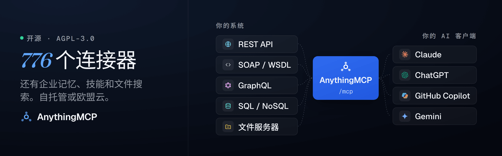

<p align="center">
  
</p>

<h1 align="center">AnythingMCP：成为你企业大脑的开源 MCP 网关</h1>

<p align="center">
  <a href="https://www.star-history.com/helpcode-ai/anythingmcp">
    <picture>
      <source media="(prefers-color-scheme: dark)" srcset="https://api.star-history.com/badge?repo=HelpCode-ai/anythingmcp&type=trending&theme=dark" />
      
    </picture>
  </a>
</p>

<p align="center">
  <a href="README.md">English</a> · <a href="README.de.md">Deutsch</a> · <a href="README.zh-CN.md">简体中文</a> · <a href="README.ja.md">日本語</a>
</p>

<p align="center">
  <strong>AnythingMCP 是一个开源、可自行托管的 MCP 网关，无需编写 MCP 服务器，即可将 Claude、ChatGPT、Copilot 和 Gemini 连接到你公司运行的软件以及文件服务器上的文档。</strong><br/>
  在网关之上，它还为你维护企业大脑：一张描述各系统如何关联的知识图谱、AI 技能和企业记忆，由所有 AI 客户端共享，并按每个用户的角色限制访问。<br/>
  776 个现成连接器，提供 12,000 多个工具，涵盖 SAP、Odoo、weclapp 和 Amazon Seller 等；其中 45 个无需 API 密钥。
</p>

<p align="center">
  <a href="https://claude.ai/directory/anythingmcp"></a>
  <a href="https://chatgpt.com/plugins/plugin_asdk_app_6ade03541ce08191b35bbad1dc5b4121"></a>
  <a href="https://github.com/HelpCode-ai/anythingmcp/stargazers"></a>
  <a href="https://github.com/HelpCode-ai/anythingmcp/releases"></a>
  <a href="https://github.com/HelpCode-ai/anythingmcp/blob/main/LICENSE"></a>
  <a href="https://hub.docker.com/r/helpcodeai/anythingmcp"></a>
</p>

<p align="center">
  <strong>AnythingMCP Cloud 上有 16,000 多个工作区</strong> · <strong>每月 150 万次以上 AI 工具调用</strong> · <strong>已收录于 Claude 官方目录</strong>
</p>

<p align="center">
  <a href="https://cloud.anythingmcp.com/login?mode=register"><strong>免费试用云版 7 天</strong></a> · <a href="https://claude.ai/directory/anythingmcp">添加到 Claude</a> · <a href="https://chatgpt.com/plugins/plugin_asdk_app_6ade03541ce08191b35bbad1dc5b4121">添加到 ChatGPT</a> · <a href="#run-it-yourself">自己运行</a> · <a href="docs/guides.md">文档</a> · <a href="https://anythingmcp.com/zh/guides">连接器指南</a> · <a href="https://github.com/HelpCode-ai/anythingmcp/discussions">Discussions</a>
</p>

**在 Claude 中提一个问题，答案来自 Etsy、SAP 和一个物流 API。**

https://github.com/user-attachments/assets/cc8c9ef3-11cf-4eab-aa4d-98472dc554b3

---

<a id="what-your-ai-gets"></a>

## 你的 AI 能得到什么

网关只负责转发调用。企业大脑还知道你的文档放在哪里、各个系统如何关联，以及公司已经做过哪些决定。AnythingMCP 通过同一个 MCP 端点，把这两者都交给每个 AI 客户端：

| | 作用 | 版本 |
|---|---|---|
| **所有系统，一个端点** | 696 个目录连接器，或你自己的 REST/OpenAPI、SOAP、GraphQL、OData、SQL、IMAP/SMTP 或 MCP 数据源。工具在运行时注册。[连接器](#connect-any-api-soap-service-or-database) | 全部 |
| **File Search（文件搜索）** | 为 SFTP、FTP/FTPS、WebDAV（Nextcloud、NAS）、S3 或网络共享建立索引：PDF 的每一页、带列名的 Excel 行、Word、PowerPoint，以及带附件的 Outlook 邮件。AI 回答时会注明文件、页码和日期。[File Search](docs/connectors/file-search.md) | Cloud；自行托管需 Enterprise |
| **File Share（文件分享）** | 为你文件夹中的文件或 AI 生成的文件（CSV 导出、报告）创建临时下载链接，可选内部或公开，支持过期时间和撤销。[File Share](docs/connectors/file-search.md) | Cloud；自行托管需 Enterprise |
| **企业记忆** | 在一个 AI 客户端中保存的事实和偏好，可以在任何其他客户端中再次找到：在 Claude 里说过一次，Copilot 也能用上。分为个人和公司两种范围，支持文件夹和角色限制。[记忆](docs/memory.md) | Enterprise |
| **AI 技能** | 智能体遵循的操作流程，可以手动编写，也可以从真实请求和已修复的错误中学习，并由管理员批准。[AI 技能](docs/knowledge-graph.md#ai-skills) | 全部 |
| **知识图谱** | 描述各系统如何关联，让智能体无需提示就能把一个系统中的客户与另一个系统中的订单对应起来。[知识图谱](docs/knowledge-graph.md) | 全部 |
| **Code Mode** | 一段在隔离沙箱中调用多个工具的简短程序，沙箱中没有任何密钥，也无法访问网络，五步查询因此变成一次调用。[Code Mode](docs/code-mode.md) | 全部；写入权限需 Enterprise |
| **治理** | 角色和按工具设置的权限、在字段到达模型之前将其删除的响应映射，以及记录每次调用的审计日志。从你的目录服务接入 SSO 和 SCIM。[安全](#security-and-governance) | 全部；SSO/SCIM 需 Enterprise |

自行托管的 Community 版基于 AGPL-3.0，可免费用于任何用途，包括商业用途，最多 3 名活跃用户，连接器和 MCP 服务器数量不限。更多用户、单点登录、SCIM、30 天试用之后的 File Search 以及技术支持由 Enterprise 提供，需联系我们获取报价：[联系我们](https://anythingmcp.com/contact?plan=enterprise)。管理员可以在 **Settings → License** 中试用单点登录和 SCIM 30 天。现有的 Starter 和 Team 许可证密钥仍可继续使用。

---

<a id="run-it-yourself"></a>

## 自己运行

需要 Docker 24+ 和 `openssl`；在 macOS 上请先启动 Docker Desktop。无需克隆仓库：

```bash
mkdir anythingmcp && cd anythingmcp
curl -fsSLo docker-compose.yml \
  https://raw.githubusercontent.com/HelpCode-ai/anythingmcp/main/docker-compose.quickstart.yml
printf 'JWT_SECRET=%s\nENCRYPTION_KEY=%s\n' "$(openssl rand -hex 32)" "$(openssl rand -hex 32)" > .env
docker compose up -d
```

打开 <http://localhost:3000> 并注册：**第一个账户会成为管理员**。MCP 端点为 `http://localhost:4000/mcp`，API 文档位于 `http://localhost:4000/api/docs`。

> **请保存生成的 `.env`。** `ENCRYPTION_KEY` 用于解密你存储的凭据。一旦丢失，每个连接器都必须重新填写凭据。

在 amd64 上，镜像拉取约需 30 秒，之后 24 秒 API 即可就绪。镜像目前仅提供 amd64 版本；compose 文件固定了平台，因此在 Apple Silicon 上也能通过模拟运行。

快速启动有意只绑定到 `127.0.0.1`，因为前面没有任何组件终止 TLS。**如果实例需要被其他人或云端 AI 客户端访问**，请克隆仓库并运行 `./setup.sh`：它会询问域名、通过 Caddy 获取证书、生成密钥并设置 MCP 认证模式。参见[部署指南](docs/deployment.md)。

<details>
<summary><strong>其他运行方式：</strong>托管云、Railway、DigitalOcean</summary>

<br/>

[**AnythingMCP Cloud**](https://cloud.anythingmcp.com) 使用同一套 AGPL 代码，由我们在德国**法兰克福**运营，可免费试用 7 天。你可以先在云端用自己的 API 试用，当你希望凭据不再离开内网时再迁回自有环境；连接器完全相同。如需 DPA/AVV，请联系 [info@helpcode.ai](mailto:info@helpcode.ai)。SSO 和 SCIM 仅在自行托管版本中提供，并需要 Enterprise 许可证。

[](https://railway.com/deploy/8-X4WD?referralCode=k30bPV&utm_medium=integration&utm_source=template&utm_campaign=generic)
&nbsp;
[](https://marketplace.digitalocean.com/apps/anythingmcp)

</details>

---

<a id="how-it-works"></a>

## 工作原理

1. **添加连接器。** 从目录安装一个**适配器**（为 SAP、Odoo、DHL 等准备好的 JSON 定义），或者把你自己的 OpenAPI 规范、WSDL、GraphQL 端点、Postman 集合或数据库交给 AnythingMCP。在工作区中配置完成后，它就是一个**连接器**，其中的每个操作都是一个 MCP 工具。
2. **决定模型能看到什么。** 在可视化编辑器中重命名并描述工具，删除不能离开你网络的字段，并决定哪些角色可以调用哪些工具。
3. **把一个 URL 交给 AI 客户端。** **MCP 服务器**就是你添加到 Claude、ChatGPT、Copilot、Gemini 或 Cursor 中的端点。它只公开分配给它的连接器。

---

<a id="connect-any-api-soap-service-or-database"></a>

## 连接任意 API、SOAP 服务或数据库

大多数公司还没有 MCP 服务器。他们有的是一个 REST API、一套 ERP、一个 2009 年的 SOAP 服务和一个数据库。它们都能变成 MCP 工具：

| 来源 | 你将得到 | 文档 |
|---|---|---|
| **OpenAPI / Swagger（REST）** | 通过 URL 导入或直接粘贴规范；每个操作都会变成一个工具，参数、认证和端点映射已自动填好 | [REST](docs/connectors/rest.md) · [指南](https://anythingmcp.com/zh/guides/rest-api-to-mcp) · [演示：openapi-to-mcp](https://github.com/HelpCode-ai/openapi-to-mcp) |
| **Postman 集合、cURL** | 文件夹、认证、请求体模式和 `{{variables}}` 都会保留；每个请求都会变成一个工具 | [Postman 导入](docs/connectors/rest.md#from-postman-collection) |
| **SOAP / WSDL** | 每个操作变成一个工具；信封、参数顺序和 WCF 服务都会自动处理 | [SOAP](docs/connectors/soap.md) · [指南](https://anythingmcp.com/zh/guides/soap-to-mcp) · [演示：soap-to-mcp](https://github.com/HelpCode-ai/soap-to-mcp) |
| **GraphQL** | 通过内省把查询和变更转化为工具，也可以自行定义操作 | [GraphQL](docs/connectors/graphql.md) · [指南](https://anythingmcp.com/zh/guides/graphql-to-mcp) |
| **OData**（包括 SAP Gateway） | 读取每个服务的 `$metadata`，让模型看到实体集、键和 SAP 的业务标签；支持 V2 和 V4 | [OData](docs/connectors/odata.md) · [指南](https://anythingmcp.com/zh/guides/odata-to-mcp) |
| **SQL 和 MongoDB** | PostgreSQL、MySQL、MariaDB、SQL Server、Oracle、SAP HANA、SQLite 和 MongoDB：结构、示例和查询工具，默认只读 | [数据库](docs/connectors/database.md) · [SAP HANA](docs/connectors/sap-hana.md) · [指南](https://anythingmcp.com/zh/guides/database-to-mcp) · [演示：sql-to-mcp](https://github.com/HelpCode-ai/sql-to-mcp) |
| **电子邮件（IMAP/SMTP）** | 任意邮箱（IONOS、Strato、GMX、T-Online、使用应用专用密码的 Gmail、自建邮件服务器）：列出文件夹、搜索、阅读邮件及附件、标记、移动、保存草稿和发送 | [电子邮件](docs/connectors/email.md) |
| **另一个 MCP 服务器** | 发现它的工具，并与你自己的工具一起提供，共用同一套认证和审计 | [MCP 桥接](docs/connectors/mcp-bridge.md) |

工具在运行时注册，无需重启。每个连接器的 `{{VAR}}` 值在服务器端替换，不会展示给 AI。

---

<a id="connector-catalog"></a>

## 连接器目录

共 776 个适配器，提供 12,000 多个工具。每个适配器都在 [anythingmcp.com/zh/guides](https://anythingmcp.com/zh/guides) 上提供七种语言的配置指南。

| 类别 | 示例 |
|---|---|
| 💼 ERP、会计与开票 | SAP Business One、SAP S/4HANA、Odoo、weclapp、Xentral、Dynamics NAV、Lexware Office、sevDesk、Exact Online、bexio |
| 🛍️ 电子商务与电商平台 | Amazon Seller、WooCommerce、Shopware 6、Magento、eBay、Etsy、Kaufland、OTTO、Oxomi |
| 📦 物流与运输 | Deutsche Bahn、DHL、DPD、GLS、Shipcloud、Sendcloud |
| 👥 人力资源与现场服务 | Personio、HRWorks、Kenjo、MFR Mobile Field Report |
| 🏛️ 政府与公共数据 | VIES 增值税号、Handelsregister、UK Companies House、DESTATIS、Bundesbank、OpenPLZ、NINA |
| 🏦 银行与支付 | Revolut Business、Wise、PAYONE、Razorpay、Paystack |
| 💬 即时通讯 | WhatsApp、LINE、TeamViewer |
| 📈 广告与分析 | Google Ads、Google Analytics 4、Google Search Console、Matomo |
| 🧠 AI 决策模型 | TypeSafe 的 Jev：是/否判断、分类和带概率的评分，约 300 毫秒 |

<a id="erp-connectors"></a>
<details>
<summary><strong>ERP 连接器</strong>：18 个系统，含工具数和市场</summary>

<br/>

| 系统 | 市场 | 工具数 | AI 可以做什么 |
|---|---|---|---|
| [SAP Business One](https://anythingmcp.com/zh/guides/connect-sap-business-one-to-claude) | 全球 | 12 | 业务伙伴、物料、订单、发票、报价单、交货单；创建销售订单 |
| [SAP S/4HANA Cloud](https://anythingmcp.com/zh/guides/connect-sap-s4hana-cloud-to-claude) | 全球 | 15 | 业务伙伴、销售订单和采购订单、开票凭证、交货单、会计分录 |
| [SAP S/4HANA (HANA SQL)](https://anythingmcp.com/guides/connect-sap-hana-to-claude) | 全球 | 10 | 直接从 HANA 读取本地部署和 Private Cloud 的 S/4HANA，以 SAP 数据字典和 CDS 视图作为工具；只读 |
| [SAP S/4HANA (OData)](https://anythingmcp.com/guides/odata-to-mcp) † | 全球 | 7 | 带 SAP 标签的 Gateway OData 服务：会计分录行、开票凭证、销售订单、业务伙伴、库存、产品 |
| [Odoo](https://anythingmcp.com/zh/guides/connect-odoo-to-claude) | 全球 | 11 | 任意模型：合作伙伴、销售订单、发票、产品；可创建和更新 |
| [Microsoft Dynamics NAV](https://anythingmcp.com/zh/guides/connect-dynamics-nav-to-claude) | 全球 | 6 | 任意已发布的 OData 页面：客户、物料、销售订单；可创建和更新 |
| [ERPNext](https://anythingmcp.com/zh/guides/connect-erpnext-to-claude) | 全球 | 11 | 任意 DocType：客户、销售订单、发票、物料、库存 |
| [Dolibarr](https://anythingmcp.com/zh/guides/connect-dolibarr-to-claude) | 全球 | 10 | 第三方、发票、订单、商业提案、产品、库存 |
| [JTL-Wawi](https://anythingmcp.com/zh/guides/connect-jtl-wawi-to-claude) † | DE | 9 | 商品、各仓库库存、客户、销售订单、发货 |
| [Xentral](https://anythingmcp.com/zh/guides/connect-xentral-to-claude) | DE | 7 | 商品、客户、销售订单、发票、库存 |
| [weclapp](https://anythingmcp.com/zh/guides/connect-weclapp-to-claude) | DACH | 11 | 客户、销售订单、发票、商品、报价单、销售机会 |
| [Sage 100](https://anythingmcp.com/zh/guides/connect-sage-100-to-claude) † | DE | 6 | 地址、物料、销售单据、任意 Web API 实体 |
| [Haufe X360](https://anythingmcp.com/zh/guides/connect-haufe-x360-to-claude) † | DE | 7 | 客户、库存物料、销售订单、发票、发货 |
| [ScopeVisio](https://anythingmcp.com/zh/guides/connect-scopevisio-to-claude) | DE | 6 | 联系人、发票、项目、任务 |
| [AFAS Profit](https://anythingmcp.com/zh/guides/connect-afas-profit-to-claude) † | NL | 6 | 任意 GetConnector：应收客户、发票、员工 |
| [Zucchetti](https://anythingmcp.com/zh/guides/connect-zucchetti-to-claude) † | IT | 6 | 主数据（Anagrafiche）、单据、物料 |
| [TeamSystem](https://anythingmcp.com/zh/guides/connect-teamsystem-to-claude) † | IT | 6 | 客户、供应商、发票、物料 |
| [Axonaut](https://anythingmcp.com/zh/guides/connect-axonaut-to-claude) † | FR | 9 | 公司、发票、报价单、费用、产品、项目 |

† 根据供应商公开的 API 文档构建，尚未在实际运行的租户上测试。如果你正在使用其中某个系统，非常欢迎提交问题反馈或修复。

**代码仓库:** [erp-mcp-server](https://github.com/HelpCode-ai/erp-mcp-server) · [weclapp-mcp-server](https://github.com/kochfreiburg/weclapp-mcp-server) · [sap-mcp-server](https://github.com/HelpCode-ai/sap-mcp-server) · [sap-hana-mcp-server](https://github.com/HelpCode-ai/sap-hana-mcp-server) · [sap-business-one-mcp-server](https://github.com/HelpCode-ai/sap-business-one-mcp-server) · [xentral-mcp-server](https://github.com/kochfreiburg/xentral-mcp-server)

</details>

<a id="e-commerce--marketplace-connectors"></a>
<details>
<summary><strong>电子商务与电商平台连接器</strong>：13 个商店和平台</summary>

<br/>

| 系统 | 市场 | 工具数 | AI 可以做什么 |
|---|---|---|---|
| [Amazon Seller Central](https://anythingmcp.com/zh/guides/connect-amazon-seller-to-claude) | 全球 | 15 | 订单、商品目录、FBA 库存、报价、费用、财务事件、报表 |
| [WooCommerce](https://anythingmcp.com/zh/guides/connect-woocommerce-to-claude) | 全球 | 49 | 商品、变体、库存、订单、退款、客户、报表 |
| [Shopware 6](https://anythingmcp.com/zh/guides/connect-shopware-6-to-claude) | DACH | 6 | 通过 Store API 读取店面商品目录：商品、分类、交叉销售 |
| [Magento 2 / Adobe Commerce](https://anythingmcp.com/zh/guides/connect-magento-to-claude) | 全球 | 12 | 商品、库存、订单、客户 |
| [BigCommerce](https://anythingmcp.com/zh/guides/connect-bigcommerce-to-claude) | 全球 | 14 | 商品、变体、库存、订单、客户 |
| [eBay Sell](https://anythingmcp.com/zh/guides/connect-ebay-sell-to-claude) | 全球 | 10 | 库存、报价、订单、纠纷、价格更新 |
| [Etsy](https://anythingmcp.com/zh/guides/connect-etsy-to-claude) | 全球 | 9 | 商品刊登、收据（订单）、评价 |
| [Ecwid](https://anythingmcp.com/zh/guides/connect-ecwid-to-claude) | 全球 | 10 | 商品、分类、订单、客户 |
| [Kaufland Marketplace](https://anythingmcp.com/zh/guides/connect-kaufland-to-claude) | DE | 8 | 订单及订单单元、发货、工单、店铺 |
| [OTTO Market](https://anythingmcp.com/zh/guides/connect-otto-market-to-claude) † | DE | 8 | 订单、商品、退货、库存和价格更新 |
| [Zalando Direct Ship](https://anythingmcp.com/zh/guides/connect-zalando-zds-to-claude) † | EU | 7 | 订单、发货、退货、库存、价格 |
| [Billbee](https://anythingmcp.com/guides/connect-billbee-to-claude) | DACH | 8 | 订单、商品、客户、物流服务商 |
| [Mercado Libre](https://anythingmcp.com/zh/guides/connect-mercado-libre-to-claude) | LATAM | 4 | 商品搜索、卖家订单 |

† 根据供应商公开的 API 文档构建，尚未在实际运行的卖家账户上测试。

**代码仓库:** [ecommerce-mcp-server](https://github.com/HelpCode-ai/ecommerce-mcp-server) · [billbee-mcp-server](https://github.com/kochfreiburg/billbee-mcp-server) · [shopware-mcp-server](https://github.com/kochfreiburg/shopware-mcp-server) · [kaufland-mcp-server](https://github.com/kochfreiburg/kaufland-mcp-server) · [otto-market-mcp-server](https://github.com/kochfreiburg/otto-market-mcp-server)

</details>

**一个适配器就是一个 JSON 文件。** 这正是目录能有这么大规模的原因，也让新增适配器成为很合适的第一次贡献。没有你需要的？[提出需求](https://github.com/HelpCode-ai/anythingmcp/issues/new?template=adapter_request.yml)（我们按 👍 数排序）或[自己构建](.github/CONTRIBUTING.md)。你的 ERP 不在列表中，或者是定制系统？直接以只读方式连接它的 REST API、SOAP 服务或 SQL 数据库。

---

<a id="security-and-governance"></a>

## 安全与治理

所有组件都运行在你自己的基础设施上，因此由你决定哪些数据可以离开。OAuth2、角色、按工具设置的权限、响应映射和审计日志包含在所有版本中；SSO 和 SCIM 需要 Enterprise 许可证（内置 30 天试用）。

- **响应映射。** 每个工具都声明哪些字段可以到达模型：删除客户的 IBAN 或员工的薪资，或者只列出要保留的字段。编辑器会基于真实响应显示前后对比；某个内置适配器从 12,172 B 减少到 1,072 B（−91%），这些字段也就不再占用上下文窗口。映射出错时默认返回原始响应；对于字段绝不能外传的工具，请设置 `"fallbackToRaw": false`，此时调用会直接失败。
- **关键处只读。** 每个工具都带有 MCP 注解（`readOnlyHint`、`destructiveHint`），由操作自动推断，并可按工具覆盖。基于角色的工具白名单可以发布一个只能读取的 MCP 服务器，大多数人接入 ERP 时都应从这里开始。数据库查询工具只执行单条 SELECT，并阻止写入和堆叠语句。
- **支持你会遇到的各种认证方式。** OAuth2（PKCE 和 Client Credentials）、Bearer、API Key、Basic、HMAC 请求签名、[LOGIN_TOKEN](docs/connectors/login-token-auth.md) 和 OAuth 1.0a。凭据以 AES-256-GCM 加密存储。
- **审计日志。** 每次工具调用都会连同输入、输出、耗时和状态记录在你自己的数据库中，包括模型从未看到的完整上游响应。
- **[SSO](docs/sso.md) 和 [SCIM](docs/scim-entra-setup.md)**（Enterprise）。Entra ID、Google、Okta、Auth0 或任意 OIDC 提供方。每次登录时从目录组同步角色；在目录中停用某人后，其工作区访问权限和 MCP API 密钥也会一并失效。

```json
{
  "transform": {
    "mode": "select",
    "fallbackToRaw": false,
    "exclude": ["customer.iban", "customer.taxId"],
    "select": { "order": "$.id", "total": "$.amounts.gross", "status": "$.state" }
  }
}
```

[响应映射参考](docs/tool-definition.md#3-response-mapping-optional)

---

<a id="use-it-from-claude-chatgpt-copilot-and-gemini"></a>

## 在 Claude、ChatGPT、Copilot 和 Gemini 中使用

同一个 MCP 服务器适用于所有支持 MCP 的客户端，因此连接器只需构建一次：

- **Claude。** 在 *Customize → Connectors* 中把服务器 URL 添加为**自定义连接器**，即可在 Claude.ai、Claude Desktop 和 Claude Code 中使用。开箱即支持 OAuth 2.0。使用 AnythingMCP Cloud 时，也可以从 [Claude 目录](https://claude.ai/directory/anythingmcp)一键添加。[Claude 配置](docs/integrations/claude.md)
- **ChatGPT。** ChatGPT 中的应用基于 MCP。在 ChatGPT 的 *Plugins* 中添加服务器（*Add → Add custom MCP server*），或将其作为 Apps SDK 应用的工具层。[ChatGPT 配置](docs/integrations/chatgpt.md)
- **Meta Muse。** 在 Muse 中打开 *Settings → Connectors → Add custom connector*，粘贴服务器 URL，然后登录 AnythingMCP。[Muse 配置](docs/integrations/muse.md)
- **Copilot、Gemini、Cursor** 及其他 MCP 客户端：[客户端配置指南](docs/guides.md)。

---

<a id="company-brain-knowledge-graph-ai-skills-and-memory"></a>

## 企业大脑：知识图谱、AI 技能和记忆

只转发调用，会把最难的部分留给智能体：知道下一步该调用哪个工具，以及你的业务所说的"未完成订单"究竟指什么。AnythingMCP 会学习这两者，并以上下文的形式交还给客户端，而不是增加额外的工具调用。

- **知识图谱。** 每个工作区一张图，记录实体（客户、订单、产品）及其跨连接器的关系，根据工具定义和真实调用构建，也可以手动编辑。它只存储字段名和关系，从不存储值。每个服务器都通过 `kg_how_to_obtain` 工具提供图谱，智能体可以询问如何从一个 Shopware 订单找到 DHL 运单号。
- **AI 技能。** 把反复出现的使用方式变成简短规则（例如"今日营收包含订单状态 2、3 和 4"）和分步操作流程。技能可以手动编写，也可以从真实请求和已修复的错误中学习，带有版本记录，经管理员批准后才会写入服务器的指令中。
- **企业记忆**（Enterprise）。AI 客户端通过 `memory_save` 保存事实、偏好和笔记，再通过 `memory_search` 找回，适用于连接到该工作区的任何客户端。*我的记忆*只对单个用户可见；*企业记忆*（例如"STAMMKUNDE 指签有框架协议的客户"）面向所有人，存放在按角色限制访问的文件夹中。它以"由人编写的信息"的形式提供，从不作为指令。[记忆指南](docs/memory.md)

换掉助手，大脑依然在：今天用 Copilot，明天用 Claude，今晚用 n8n 智能体，它们找到的都是同一张图谱、同一套技能和同一份记忆。

AI 处理默认关闭，使用你自己的 OpenAI、OpenRouter 或 Anthropic 密钥；图谱、编辑器和 MCP 工具在没有密钥时也能使用。[知识图谱指南](docs/knowledge-graph.md)

---

<a id="where-it-fits"></a>

## 适用场景

大多数 MCP 网关负责聚合和保护你已有的 MCP 服务器。AnythingMCP 往前多走一步：它从你已经在运行的 API、ERP 和数据库生成 MCP 服务器，再通过一个端点统一提供，并带有权限控制和审计。如果你的工具已经是 MCP 服务器，只需要聚合，那么纯网关可能就够了。详细对比：[anythingmcp.com/zh/vs](https://anythingmcp.com/zh/vs)。

---

<a id="faq"></a>

## 常见问题

### 什么是 MCP 网关？
位于多个工具前面的单一 MCP 端点，统一负责认证、访问控制和审计。Claude、ChatGPT 等 AI 客户端连接网关，而不是分别连接每个系统。AnythingMCP 是一种还能自行生成工具的网关，工具来自那些没有自己 MCP 服务器的 API 和数据库。

### 如何把我的 ERP（SAP、Odoo、Xentral……）连接到 Claude 或 ChatGPT？
从[目录](#connector-catalog)安装对应 ERP 的适配器，填写 API 凭据，然后把 MCP 服务器 URL 作为自定义连接器添加到 Claude，或作为应用添加到 ChatGPT。如果没有对应适配器，可以直接连接它的 REST 或 SOAP API，或 SQL 数据库。建议先从只读角色开始。

### 如何把 OpenAPI 规范变成 MCP 服务器？
创建一个 REST 连接器，通过 URL 或粘贴方式导入规范。每个操作都会成为服务器 `/mcp` 端点上的一个 MCP 工具，无需编写代码。[工作原理](docs/connectors/rest.md#from-openapi--swagger)

### 能把 SOAP/WSDL 服务连接到 Claude 吗？
可以。AnythingMCP 解析 WSDL，把每个操作变成工具，并在每次调用时构建 SOAP 信封，也支持 WCF 服务。认证方式为 HTTP Basic、Bearer、API Key 请求头或 WS-Security UsernameToken；尚不支持签名的 WS-Security 消息。[SOAP 连接器文档](docs/connectors/soap.md)

### Claude 能安全地查询我的 SQL Server、Oracle 或 PostgreSQL 数据库吗？
查询工具默认只读。此外，请使用仅有 SELECT 权限的数据库用户，优先使用由模型只提供参数的静态查询，并按角色设置工具白名单。响应映射会删除不能到达模型的列，每次查询都会记录在你的审计日志中。

### 如何让 Claude 或 ChatGPT 搜索我们文件服务器上的文档？
添加一个 **File Search** 连接器，通过 SFTP、FTP/FTPS、WebDAV（Nextcloud、ownCloud、Synology 或 QNAP NAS）、S3 或已挂载的网络共享指向相应文件夹。AnythingMCP 会逐页索引 PDF，连同列名索引 Excel 行，并索引 Word、PowerPoint 和 Outlook 邮件，保持索引同步，同时为每个 AI 客户端提供 `search`、`find`、`grep` 和 `read` 工具，回答时注明文件、页码和日期。Enterprise 版支持按角色设置文件夹权限。[File Search 文档](docs/connectors/file-search.md)

### ChatGPT、Claude 和 Copilot 能共享同一份企业记忆吗？
可以。启用工作区记忆（Enterprise）后，从一个 AI 客户端保存的内容可以被其他客户端找到，因为记忆存放在 AnythingMCP 中，而不是客户端里。个人条目只对作者本人可见；公司条目在文件夹和角色限制范围内共享。[记忆文档](docs/memory.md)

### 什么是面向 AI 智能体的企业大脑？
指 AI 在工具访问之外还需要的知识：你的文档放在哪里、各系统如何关联（知识图谱）、公司如何运作（AI 技能），以及公司做过哪些决定（企业记忆）。AnythingMCP 把这些全部保存在你自己的实例中，并在每个用户的角色范围内提供给所有 MCP 客户端。

### AI 智能体能安全地针对我的工具运行代码吗？
借助 Code Mode，一段简短的 JavaScript 程序可以在一步内调用多个工具。它运行在单独的 code-runner 容器中，没有文件系统、网络、环境变量或密钥；它只能调用该用户本来就有权使用的工具，每个内部调用都与直接调用一样受到权限控制和审计。在运维人员启用之前，它处于关闭状态。[Code Mode 文档](docs/code-mode.md)

### 如何把 Shopware、WooCommerce 或 Amazon Seller Central 连接到 Claude？
为你的商店或平台安装对应的[电子商务适配器](#e-commerce--marketplace-connectors)并完成授权。WooCommerce 提供 49 个工具，Amazon Seller Central 使用官方 Selling Partner API，Shopware 6 适配器通过 Store API 读取店面目录。

---

## 社区与支持

**[KOCH Freiburg GmbH](https://www.kochfreiburg.de/) 已在生产环境使用 AnythingMCP**，将 AI 助手连接到 15 个以上的内部系统，包括 ERP、CRM、SOAP 服务和本地数据库。[helpcode.ai](https://helpcode.ai) 将它从该系统中提取出来并开源，因为适配器目录由社区共同建设，比作为单一产品发展得更快。

- 💬 **问题与想法：**[GitHub Discussions](https://github.com/HelpCode-ai/anythingmcp/discussions)。为下一个适配器投票，分享你的成果。
- 🐛 **缺陷与功能请求：**[Issues](https://github.com/HelpCode-ai/anythingmcp/issues) · [支持](.github/SUPPORT.md)
- 👥 **用户：**[哪些团队在生产环境中使用 AnythingMCP](docs/ADOPTERS.md)，以及如何添加你自己
- 🔐 **安全：**请不要公开提交 issue，请遵循[安全策略](.github/SECURITY.md)
- 🤖 **面向 AI 智能体和爬虫：**[anythingmcp.com/llms.txt](https://anythingmcp.com/llms.txt)
- 🤖 **面向 AI 智能体的仓库文档：**[llms.txt](llms.txt) · [完整文本](llms-full.txt)
- 🏢 由德国弗赖堡的 [helpcode.ai](https://helpcode.ai) 开发。AI 辅助开发，人工审核：[AUTHORS.md](docs/AUTHORS.md) 说明了哪些部分以及如何进行。

## 参与贡献

提交 PR 前请阅读[贡献指南](.github/CONTRIBUTING.md)。最简单也最有用的贡献是一个适配器：只需一个 JSON 文件，并且有一个[分步说明 issue](https://github.com/HelpCode-ai/anythingmcp/issues/982)。

## License

基于 [GNU Affero General Public License v3](LICENSE)（AGPL-3.0-only）**开源**。在你自己公司内部的商业使用始终包含在内；只有当你修改 AnythingMCP 并通过网络向他人提供修改后的版本时，才会产生 copyleft 义务。`ee/` 下的代码（云运营、File Search 同步引擎、版本许可）采用 AnythingMCP Commercial License，运行网关时并不需要；参见[许可证 FAQ](docs/license-faq.md)。
