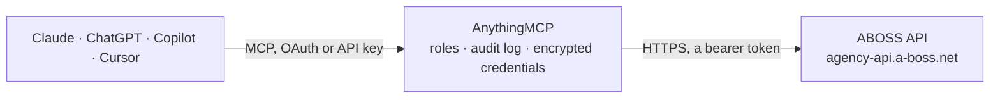

<!-- Generated by scripts/export-github-catalog.mjs in the anythingmcp-website repository. Do not edit by hand. -->

# ABOSS MCP connector

ABOSS booking agency software for the live music industry: events and tour dates, deals and fees, projects (artists), venues, travel, contacts, invoices, contracts and advancing, read through the ABOSS Agency API v1. The AnythingMCP connector gives Claude, ChatGPT, Microsoft Copilot, Cursor and Gemini 18 MCP tools for ABOSS, all read-only.

**Category:** [CRM](../crm.md) · **Tools:** 18 · **Setup guide:** [anythingmcp.com](https://anythingmcp.com/guides/a-boss-to-mcp) · [Deutsch](https://anythingmcp.com/de/guides/a-boss-to-mcp) · [Italiano](https://anythingmcp.com/it/guides/a-boss-to-mcp) · [Español](https://anythingmcp.com/es/guides/a-boss-to-mcp) · [日本語](https://anythingmcp.com/ja/guides/a-boss-to-mcp) · [Русский](https://anythingmcp.com/ru/guides/a-boss-to-mcp) · [中文](https://anythingmcp.com/zh/guides/a-boss-to-mcp)

## Start without code

No installation and no terminal: AnythingMCP Cloud runs the ABOSS connector for you, operated by helpcode.ai in Frankfurt, Germany.

1. **Click the button above** and create an account or sign in. The ABOSS connector opens, ready to install.
2. **Paste the API key or token from your ABOSS account.** Every click is in the [step-by-step guide](https://anythingmcp.com/guides/a-boss-to-mcp).
3. **Click Install.** AnythingMCP shows the address of your MCP server.
4. **Add that address to your assistant:** [Claude](https://anythingmcp.com/guides/connect-a-boss-to-claude) · [ChatGPT](https://anythingmcp.com/guides/connect-a-boss-to-chatgpt) · [Microsoft Copilot](https://anythingmcp.com/guides/connect-a-boss-to-copilot) · [Cursor](https://anythingmcp.com/guides/connect-a-boss-to-cursor) · [Gemini CLI](https://anythingmcp.com/guides/connect-a-boss-to-gemini) · [Meta Muse](https://anythingmcp.com/guides/connect-a-boss-to-muse).
5. **Ask your first question**, for example: *Find project Luna & The Waves and give its project id and archived status*

Prefer help with the setup? [Talk to us](https://anythingmcp.com/contact).

## How it works

- **The AI client** speaks MCP (Streamable HTTP) to AnythingMCP and only sees tool names, descriptions and results. It never gets the ABOSS credentials.
- **AnythingMCP** checks the client's role, builds the call from the tool definition, adds the credentials (a bearer token), calls ABOSS, logs the call and returns the result.
- **ABOSS** sees an ordinary API client with the rights of the account the credentials belong to.

## Tools

| Tool | What it does | Access |
|---|---|---|
| [`a_boss_list_events`](#a_boss_list_events) | List events (shows, holds, blocks) with title, start and end, status, project, location, client contact, deal, advancing, invoices and contracts. | read |
| [`a_boss_get_event`](#a_boss_get_event) | Return one event by id with its project, location, contacts, deal, advancing, invoices, contracts, notes and responsible agents. | read |
| [`a_boss_list_deals`](#a_boss_list_deals) | List deals (the financial terms of an event): fee, currency, deal type, costs, buyouts and the linked event. | read |
| [`a_boss_get_deal`](#a_boss_get_deal) | Return one deal by id with fee, currency, costs, settlement details, notes and billing notes. | read |
| [`a_boss_list_projects`](#a_boss_list_projects) | List projects (the artists or acts the agency books) with title and archived flag. | read |
| [`a_boss_get_project`](#a_boss_get_project) | Return one project (artist or act) by id with its title, archived flag and details. | read |
| [`a_boss_list_locations`](#a_boss_list_locations) | List locations (venues and other places) with title, address, city, country and capacity details. | read |
| [`a_boss_get_location`](#a_boss_get_location) | Return one location (venue) by id with address, contact details and venue information. | read |
| [`a_boss_list_travels`](#a_boss_list_travels) | List travel items (flights, trains, cars, hotels) with start and end, type, booking details and linked event and project. | read |
| [`a_boss_get_travel`](#a_boss_get_travel) | Return one travel item by id with times, places, booking reference, passengers and the linked event. | read |
| [`a_boss_list_contacts`](#a_boss_list_contacts) | List contacts (promoters, venue staff, crew, artists) with name, type, company, e-mail, phone and address. | read |
| [`a_boss_get_contact`](#a_boss_get_contact) | Return one contact by id with name, company, e-mail, phone, address, labels and travel preferences. | read |
| [`a_boss_list_invoices`](#a_boss_list_invoices) | List invoices with number, date, due date, amounts excluding and including VAT, currency, and the ready-to-send, sent and paid flags. | read |
| [`a_boss_get_invoice`](#a_boss_get_invoice) | Return one invoice by id with its lines, amounts, VAT, contact, linked events and payment status. | read |
| [`a_boss_list_contracts`](#a_boss_list_contracts) | List contracts with their status, dates and linked event and contacts. | read |
| [`a_boss_get_contract`](#a_boss_get_contract) | Return one contract by id with status, parties, dates and the linked event. | read |
| [`a_boss_list_advancings`](#a_boss_list_advancings) | List advancing items (show preparation: schedule, hospitality, technical and logistics details agreed with the venue), optionally for one event. | read |
| [`a_boss_get_advancing`](#a_boss_get_advancing) | Return one advancing item by id with all its sections for the linked event. | read |

## Tool reference

Every parameter as the AI client sees it in `tools/list`. Source: [`packages/backend/src/adapters/de/a-boss.json`](../../../packages/backend/src/adapters/de/a-boss.json).

### `a_boss_list_events`

List events (shows, holds, blocks) with title, start and end, status, project, location, client contact, deal, advancing, invoices and contracts. Filter by date range, status, project or venue to build a tour schedule.

**Access:** read · **Call:** `GET /v1/events`

| Parameter | Type | Required | Description |
|---|---|---|---|
| `start_from` | string | no | Only items whose start is on or after this time, ISO 8601 without zone, e.g. 2026-10-01T00:00:00. |
| `start_to` | string | no | Only items whose start is on or before this time, ISO 8601 without zone, e.g. 2026-12-31T23:59:59. |
| `end_from` | string | no | Only items whose end is on or after this time, ISO 8601 without zone, e.g. 2026-10-01T00:00:00. |
| `end_to` | string | no | Only items whose end is on or before this time, ISO 8601 without zone, e.g. 2026-12-31T23:59:59. |
| `status` | `unknown` \| `interest` \| `option` \| `confirmed` \| `cancelled`[] | no | Only events with these statuses: unknown, interest, option, confirmed, cancelled. |
| `mode` | `project_event` \| `user_event` \| `agency_event`[] | no | Only these event modes: project_event (an artist's show), user_event (personal), agency_event (agency-internal). |
| `group` | `event` \| `block`[] | no | event for single events, block for blocks spanning several days (tours, holds). |
| `project_ids` | integer[] | no | Only events of these projects (artists or acts), ids from a_boss_list_projects. |
| `location_id` | integer | no | Only events at this location (venue), id from a_boss_list_locations. |
| `client_contact_id` | integer | no | Only events with this client (promoter) contact. |
| `contract_contact_id` | integer | no | Only events with this contract contact. |
| `invoice_contact_id` | integer | no | Only events with this invoice contact. |
| `include_shared` | boolean | no | Also return items another agency or an artist shares with your agency. Shared items have access "shared" and private fields set to null. |
| `ids` | integer[] | no | Only these event ids. |
| `updated_at_from` | string | no | Only items whose last change is on or after this time, ISO 8601 without zone, e.g. 2026-10-01T00:00:00. |
| `updated_at_to` | string | no | Only items whose last change is on or before this time, ISO 8601 without zone, e.g. 2026-12-31T23:59:59. |
| `page` | integer | no | Page number, starting at 1. pagination.next in the answer is the next page. |
| `limit` | integer | no | Items per page, default 25, maximum 200. |

### `a_boss_get_event`

Return one event by id with its project, location, contacts, deal, advancing, invoices, contracts, notes and responsible agents.

**Access:** read · **Call:** `GET /v1/events/{id}`

| Parameter | Type | Required | Description |
|---|---|---|---|
| `id` | integer | yes | Event id, from a_boss_list_events or from a linked object. |
| `include_shared` | boolean | no | Also return items another agency or an artist shares with your agency. Shared items have access "shared" and private fields set to null. |

### `a_boss_list_deals`

List deals (the financial terms of an event): fee, currency, deal type, costs, buyouts and the linked event. Shared deals are never listed; read them with a_boss_get_deal. Narrow with updated_at_from or ids: an unfiltered list can take over a minute.

**Access:** read · **Call:** `GET /v1/deals`

| Parameter | Type | Required | Description |
|---|---|---|---|
| `ids` | integer[] | no | Only these deal ids. |
| `updated_at_from` | string | no | Only items whose last change is on or after this time, ISO 8601 without zone, e.g. 2026-10-01T00:00:00. |
| `updated_at_to` | string | no | Only items whose last change is on or before this time, ISO 8601 without zone, e.g. 2026-12-31T23:59:59. |
| `page` | integer | no | Page number, starting at 1. pagination.next in the answer is the next page. |
| `limit` | integer | no | Items per page, default 25, maximum 200. |

### `a_boss_get_deal`

Return one deal by id with fee, currency, costs, settlement details, notes and billing notes. Use include_shared to read a deal shared by another agency.

**Access:** read · **Call:** `GET /v1/deals/{id}`

| Parameter | Type | Required | Description |
|---|---|---|---|
| `id` | integer | yes | Deal id, from a_boss_list_deals or from a linked object. |
| `include_shared` | boolean | no | Also return items another agency or an artist shares with your agency. Shared items have access "shared" and private fields set to null. |

### `a_boss_list_projects`

List projects (the artists or acts the agency books) with title and archived flag. Start here to get project ids for filtering events and travel.

**Access:** read · **Call:** `GET /v1/projects`

| Parameter | Type | Required | Description |
|---|---|---|---|
| `title` | string | no | Only projects whose title contains this text. |
| `archived` | boolean | no | true for archived projects only, false for active ones only. |
| `ids` | integer[] | no | Only these project ids. |
| `updated_at_from` | string | no | Only items whose last change is on or after this time, ISO 8601 without zone, e.g. 2026-10-01T00:00:00. |
| `updated_at_to` | string | no | Only items whose last change is on or before this time, ISO 8601 without zone, e.g. 2026-12-31T23:59:59. |
| `page` | integer | no | Page number, starting at 1. pagination.next in the answer is the next page. |
| `limit` | integer | no | Items per page, default 25, maximum 200. |

### `a_boss_get_project`

Return one project (artist or act) by id with its title, archived flag and details.

**Access:** read · **Call:** `GET /v1/projects/{id}`

| Parameter | Type | Required | Description |
|---|---|---|---|
| `id` | integer | yes | Project id, from a_boss_list_projects or from a linked object. |

### `a_boss_list_locations`

List locations (venues and other places) with title, address, city, country and capacity details. Filter by name, city or country.

**Access:** read · **Call:** `GET /v1/locations`

| Parameter | Type | Required | Description |
|---|---|---|---|
| `title` | string | no | Only locations whose title contains this text. |
| `city` | string | no | Only locations whose city contains this text. |
| `country` | string | no | Only locations whose country contains this text. |
| `ids` | integer[] | no | Only these location ids. |
| `updated_at_from` | string | no | Only items whose last change is on or after this time, ISO 8601 without zone, e.g. 2026-10-01T00:00:00. |
| `updated_at_to` | string | no | Only items whose last change is on or before this time, ISO 8601 without zone, e.g. 2026-12-31T23:59:59. |
| `page` | integer | no | Page number, starting at 1. pagination.next in the answer is the next page. |
| `limit` | integer | no | Items per page, default 25, maximum 200. |

### `a_boss_get_location`

Return one location (venue) by id with address, contact details and venue information.

**Access:** read · **Call:** `GET /v1/locations/{id}`

| Parameter | Type | Required | Description |
|---|---|---|---|
| `id` | integer | yes | Location id, from a_boss_list_locations or from a linked object. |

### `a_boss_list_travels`

List travel items (flights, trains, cars, hotels) with start and end, type, booking details and linked event and project. Filter by date, project or event for a day sheet. Always pass a start range: an unfiltered list can time out.

**Access:** read · **Call:** `GET /v1/travels`

| Parameter | Type | Required | Description |
|---|---|---|---|
| `start_from` | string | no | Only items whose start is on or after this time, ISO 8601 without zone, e.g. 2026-10-01T00:00:00. |
| `start_to` | string | no | Only items whose start is on or before this time, ISO 8601 without zone, e.g. 2026-12-31T23:59:59. |
| `end_from` | string | no | Only items whose end is on or after this time, ISO 8601 without zone, e.g. 2026-10-01T00:00:00. |
| `end_to` | string | no | Only items whose end is on or before this time, ISO 8601 without zone, e.g. 2026-12-31T23:59:59. |
| `project_ids` | integer[] | no | Only travel of these projects. |
| `location_id` | integer | no | Only travel linked to this location. |
| `event_id` | integer | no | Only travel linked to this event. |
| `ids` | integer[] | no | Only these travel item ids. |
| `updated_at_from` | string | no | Only items whose last change is on or after this time, ISO 8601 without zone, e.g. 2026-10-01T00:00:00. |
| `updated_at_to` | string | no | Only items whose last change is on or before this time, ISO 8601 without zone, e.g. 2026-12-31T23:59:59. |
| `page` | integer | no | Page number, starting at 1. pagination.next in the answer is the next page. |
| `limit` | integer | no | Items per page, default 25, maximum 200. |

### `a_boss_get_travel`

Return one travel item by id with times, places, booking reference, passengers and the linked event.

**Access:** read · **Call:** `GET /v1/travels/{id}`

| Parameter | Type | Required | Description |
|---|---|---|---|
| `id` | integer | yes | Travel item id, from a_boss_list_travels or from a linked object. |

### `a_boss_list_contacts`

List contacts (promoters, venue staff, crew, artists) with name, type, company, e-mail, phone and address. Use name for a wildcard search.

**Access:** read · **Call:** `GET /v1/contacts`

| Parameter | Type | Required | Description |
|---|---|---|---|
| `name` | string | no | Wildcard search on the contact's name. |
| `type` | string | no | Contact type, e.g. person. |
| `ids` | integer[] | no | Only these contact ids. |
| `updated_at_from` | string | no | Only items whose last change is on or after this time, ISO 8601 without zone, e.g. 2026-10-01T00:00:00. |
| `updated_at_to` | string | no | Only items whose last change is on or before this time, ISO 8601 without zone, e.g. 2026-12-31T23:59:59. |
| `page` | integer | no | Page number, starting at 1. pagination.next in the answer is the next page. |
| `limit` | integer | no | Items per page, default 25, maximum 200. |

### `a_boss_get_contact`

Return one contact by id with name, company, e-mail, phone, address, labels and travel preferences.

**Access:** read · **Call:** `GET /v1/contacts/{id}`

| Parameter | Type | Required | Description |
|---|---|---|---|
| `id` | integer | yes | Contact id, from a_boss_list_contacts or from a linked object. |

### `a_boss_list_invoices`

List invoices with number, date, due date, amounts excluding and including VAT, currency, and the ready-to-send, sent and paid flags. Filter for unpaid or overdue invoices.

**Access:** read · **Call:** `GET /v1/invoices`

| Parameter | Type | Required | Description |
|---|---|---|---|
| `date_from` | string | no | Only invoices dated on or after this time, ISO 8601, e.g. 2026-01-01T00:00:00. |
| `date_to` | string | no | Only invoices dated on or before this time. |
| `due_date_to` | string | no | Only invoices due on or before this time; with paid=false this lists overdue invoices. |
| `ready_to_send` | boolean | no | Only invoices marked ready to send (true) or not (false). |
| `sent` | boolean | no | Only sent (true) or unsent (false) invoices. |
| `paid` | boolean | no | Only paid (true) or unpaid (false) invoices. |
| `contact_id` | integer | no | Only invoices for this contact. |
| `ids` | integer[] | no | Only these invoice ids. |
| `updated_at_from` | string | no | Only items whose last change is on or after this time, ISO 8601 without zone, e.g. 2026-10-01T00:00:00. |
| `updated_at_to` | string | no | Only items whose last change is on or before this time, ISO 8601 without zone, e.g. 2026-12-31T23:59:59. |
| `page` | integer | no | Page number, starting at 1. pagination.next in the answer is the next page. |
| `limit` | integer | no | Items per page, default 25, maximum 200. |

### `a_boss_get_invoice`

Return one invoice by id with its lines, amounts, VAT, contact, linked events and payment status.

**Access:** read · **Call:** `GET /v1/invoices/{id}`

| Parameter | Type | Required | Description |
|---|---|---|---|
| `id` | integer | yes | Invoice id, from a_boss_list_invoices or from a linked object. |

### `a_boss_list_contracts`

List contracts with their status, dates and linked event and contacts. Narrow with updated_at_from or ids on large accounts.

**Access:** read · **Call:** `GET /v1/contracts`

| Parameter | Type | Required | Description |
|---|---|---|---|
| `ids` | integer[] | no | Only these contract ids. |
| `updated_at_from` | string | no | Only items whose last change is on or after this time, ISO 8601 without zone, e.g. 2026-10-01T00:00:00. |
| `updated_at_to` | string | no | Only items whose last change is on or before this time, ISO 8601 without zone, e.g. 2026-12-31T23:59:59. |
| `page` | integer | no | Page number, starting at 1. pagination.next in the answer is the next page. |
| `limit` | integer | no | Items per page, default 25, maximum 200. |

### `a_boss_get_contract`

Return one contract by id with status, parties, dates and the linked event.

**Access:** read · **Call:** `GET /v1/contracts/{id}`

| Parameter | Type | Required | Description |
|---|---|---|---|
| `id` | integer | yes | Contract id, from a_boss_list_contracts or from a linked object. |

### `a_boss_list_advancings`

List advancing items (show preparation: schedule, hospitality, technical and logistics details agreed with the venue), optionally for one event. Narrow with event_id or updated_at_from on large accounts.

**Access:** read · **Call:** `GET /v1/advancings`

| Parameter | Type | Required | Description |
|---|---|---|---|
| `event_id` | integer | no | Only the advancing of this event. |
| `ids` | integer[] | no | Only these advancing item ids. |
| `updated_at_from` | string | no | Only items whose last change is on or after this time, ISO 8601 without zone, e.g. 2026-10-01T00:00:00. |
| `updated_at_to` | string | no | Only items whose last change is on or before this time, ISO 8601 without zone, e.g. 2026-12-31T23:59:59. |
| `page` | integer | no | Page number, starting at 1. pagination.next in the answer is the next page. |
| `limit` | integer | no | Items per page, default 25, maximum 200. |

### `a_boss_get_advancing`

Return one advancing item by id with all its sections for the linked event.

**Access:** read · **Call:** `GET /v1/advancings/{id}`

| Parameter | Type | Required | Description |
|---|---|---|---|
| `id` | integer | yes | Advancing item id, from a_boss_list_advancings or from a linked object. |

## Run it yourself

AnythingMCP is open source (AGPL-3.0). [Run it with Docker](../../../README.md#run-it-yourself), open **Connectors → Store**, pick **ABOSS** and enter `ABOSS_API_KEY`, then add your MCP server URL to the AI client.

[← CRM connectors](../crm.md) · [All categories](../README.md)
