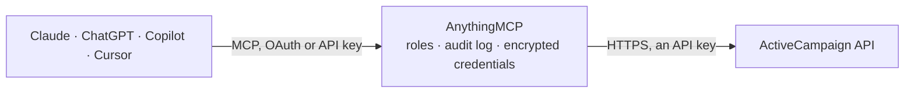

<!-- Generated by scripts/export-github-catalog.mjs in the anythingmcp-website repository. Do not edit by hand. -->

# ActiveCampaign MCP connector

Drive ActiveCampaign (marketing automation + CRM) from any AI agent: contacts, lists, tags, deals, pipelines, campaigns, automations. 16 tools. The AnythingMCP connector gives Claude, ChatGPT, Microsoft Copilot, Cursor and Gemini 16 MCP tools for ActiveCampaign: 9 read and 7 can change data.

**Category:** [Marketing Automation](../marketing-automation.md) · **Tools:** 16 · **Setup guide:** [anythingmcp.com](https://anythingmcp.com/guides/activecampaign-to-mcp) · [Deutsch](https://anythingmcp.com/de/guides/activecampaign-to-mcp) · [Italiano](https://anythingmcp.com/it/guides/activecampaign-to-mcp) · [Español](https://anythingmcp.com/es/guides/activecampaign-to-mcp) · [日本語](https://anythingmcp.com/ja/guides/activecampaign-to-mcp) · [Русский](https://anythingmcp.com/ru/guides/activecampaign-to-mcp) · [中文](https://anythingmcp.com/zh/guides/activecampaign-to-mcp)

## Start without code

No installation and no terminal: AnythingMCP Cloud runs the ActiveCampaign connector for you, operated by helpcode.ai in Frankfurt, Germany.

1. **Click the button above** and create an account or sign in. The ActiveCampaign connector opens, ready to install.
2. **Paste the API key or token from your ActiveCampaign account.** Every click is in the [step-by-step guide](https://anythingmcp.com/guides/activecampaign-to-mcp).
3. **Click Install.** AnythingMCP shows the address of your MCP server.
4. **Add that address to your assistant:** [Claude](https://anythingmcp.com/guides/connect-activecampaign-to-claude) · [ChatGPT](https://anythingmcp.com/guides/connect-activecampaign-to-chatgpt) · [Microsoft Copilot](https://anythingmcp.com/guides/connect-activecampaign-to-copilot) · [Cursor](https://anythingmcp.com/guides/connect-activecampaign-to-cursor) · [Gemini CLI](https://anythingmcp.com/guides/connect-activecampaign-to-gemini) · [Meta Muse](https://anythingmcp.com/guides/connect-activecampaign-to-muse).
5. **Ask your first question**, for example: *Find contact for purchasing at HelioWorks GmbH, email anna.meyer@helioworks.de and show list memberships*

Prefer help with the setup? [Talk to us](https://anythingmcp.com/contact).

## How it works

- **The AI client** speaks MCP (Streamable HTTP) to AnythingMCP and only sees tool names, descriptions and results. It never gets the ActiveCampaign credentials.
- **AnythingMCP** checks the client's role, builds the call from the tool definition, adds the credentials (an API key), calls ActiveCampaign, logs the call and returns the result.
- **ActiveCampaign** sees an ordinary API client with the rights of the account the credentials belong to.

## Tools

| Tool | What it does | Access |
|---|---|---|
| [`activecampaign_list_contacts`](#activecampaign_list_contacts) | List contacts with optional filters. | read |
| [`activecampaign_get_contact`](#activecampaign_get_contact) | Fetch a contact by ID with relationships (contactLists, contactTags, fieldValues, etc.). | read |
| [`activecampaign_sync_contact`](#activecampaign_sync_contact) | Upsert a contact by email (creates if missing, updates if exists). | write |
| [`activecampaign_update_contact`](#activecampaign_update_contact) | Update an existing contact by ID. | write |
| [`activecampaign_delete_contact`](#activecampaign_delete_contact) | Permanently delete a contact (GDPR right-to-be-forgotten). | write |
| [`activecampaign_subscribe_contact_to_list`](#activecampaign_subscribe_contact_to_list) | Add a contact to a list with the given status. | read |
| [`activecampaign_list_lists`](#activecampaign_list_lists) | List all subscriber lists. | read |
| [`activecampaign_list_tags`](#activecampaign_list_tags) | List tags. | read |
| [`activecampaign_add_tag_to_contact`](#activecampaign_add_tag_to_contact) | Attach a tag to a contact (creates a contactTag join). | write |
| [`activecampaign_remove_tag_from_contact`](#activecampaign_remove_tag_from_contact) | Remove a tag→contact join (NOT delete the tag itself). | write |
| [`activecampaign_list_deals`](#activecampaign_list_deals) | List CRM deals with optional filters. | read |
| [`activecampaign_create_deal`](#activecampaign_create_deal) | Create a CRM deal. | write |
| [`activecampaign_update_deal`](#activecampaign_update_deal) | Update a deal — common: change stage_id (move pipeline), set status=1 (won) or 2 (lost), update value. | write |
| [`activecampaign_list_pipelines`](#activecampaign_list_pipelines) | List deal pipelines (each pipeline has multiple stages). | read |
| [`activecampaign_list_pipeline_stages`](#activecampaign_list_pipeline_stages) | List stages, optionally filtered to a pipeline. | read |
| [`activecampaign_list_custom_fields`](#activecampaign_list_custom_fields) | List custom fields defined on contacts. | read |

## Tool reference

Every parameter as the AI client sees it in `tools/list`. Source: [`packages/backend/src/adapters/intl/activecampaign.json`](../../../packages/backend/src/adapters/intl/activecampaign.json).

### `activecampaign_list_contacts`

List contacts with optional filters. Each contact returns id, email, firstName, lastName, phone, cdate (created), udate (updated), fieldValues[].

**Access:** read · **Call:** `GET /contacts`

| Parameter | Type | Required | Description |
|---|---|---|---|
| `email` | string | no | Exact email filter. |
| `email_like` | string | no | Substring match on email. |
| `listid` | integer | no | Filter to contacts on this list. |
| `tagid` | integer | no | Filter to contacts with this tag. |
| `status` | integer | no | Filter by membership status: 1=Active, 2=Unsubscribed, 3=Bounced, 0=Pending. |
| `search` | string | no | Free-text search across name + email. |
| `limit` | integer | no | Per page (default 20, max 100). |
| `offset` | integer | no | Pagination offset. |
| `orders_email` | string | no | Sort by email asc/desc. |

### `activecampaign_get_contact`

Fetch a contact by ID with relationships (contactLists, contactTags, fieldValues, etc.).

**Access:** read · **Call:** `GET /contacts/{contactId}`

| Parameter | Type | Required | Description |
|---|---|---|---|
| `contactId` | integer | yes | Contact ID. |
| `include` | string | no | Side-load: contactLists,contactTags,fieldValues,contactDeals (comma-separated). |

### `activecampaign_sync_contact`

Upsert a contact by email (creates if missing, updates if exists). The preferred way to onboard contacts — avoids the 422 'duplicate' error of POST /contacts.

**Access:** write · **Call:** `POST /contact/sync`

| Parameter | Type | Required | Description |
|---|---|---|---|
| `contact` | object | yes | {email, firstName?, lastName?, phone?, fieldValues?: [{field, value}]}. Wrap inside {contact: {...}}. |

### `activecampaign_update_contact`

Update an existing contact by ID. Use sync if you don't know whether the contact exists yet.

**Access:** write · **Call:** `PUT /contacts/{contactId}`

| Parameter | Type | Required | Description |
|---|---|---|---|
| `contactId` | integer | yes | Contact ID. |
| `contact` | object | yes | {email?, firstName?, lastName?, phone?}. Wrap inside {contact: {...}}. |

### `activecampaign_delete_contact`

Permanently delete a contact (GDPR right-to-be-forgotten). Irreversible.

**Access:** write · **Call:** `DELETE /contacts/{contactId}`

| Parameter | Type | Required | Description |
|---|---|---|---|
| `contactId` | integer | yes | Contact ID. |

### `activecampaign_subscribe_contact_to_list`

Add a contact to a list with the given status. status=1 = Active (skips double-opt-in), 2=Unsubscribed.

**Access:** read · **Call:** `POST /contactLists`

| Parameter | Type | Required | Description |
|---|---|---|---|
| `contactList` | object | yes | {list: LIST_ID, contact: CONTACT_ID, status: 1\|2\|0}. Wrap inside {contactList: {...}}. |

### `activecampaign_list_lists`

List all subscriber lists. Each returns id, name, subscriber_count, created.

**Access:** read · **Call:** `GET /lists`

| Parameter | Type | Required | Description |
|---|---|---|---|
| `limit` | integer | no | Per page. |
| `offset` | integer | no | Pagination offset. |

### `activecampaign_list_tags`

List tags. Each tag has id, tag (the name), tagType (contact/template), created.

**Access:** read · **Call:** `GET /tags`

| Parameter | Type | Required | Description |
|---|---|---|---|
| `search` | string | no | Substring search on tag name. |
| `limit` | integer | no | Per page. |
| `offset` | integer | no | Pagination offset. |

### `activecampaign_add_tag_to_contact`

Attach a tag to a contact (creates a contactTag join).

**Access:** write · **Call:** `POST /contactTags`

| Parameter | Type | Required | Description |
|---|---|---|---|
| `contactTag` | object | yes | {contact: CONTACT_ID, tag: TAG_ID}. Wrap inside {contactTag: {...}}. |

### `activecampaign_remove_tag_from_contact`

Remove a tag→contact join (NOT delete the tag itself).

**Access:** write · **Call:** `DELETE /contactTags/{contactTagId}`

| Parameter | Type | Required | Description |
|---|---|---|---|
| `contactTagId` | integer | yes | contactTag ID (NOT the tag ID — get it from contactTags list under the contact). |

### `activecampaign_list_deals`

List CRM deals with optional filters.

**Access:** read · **Call:** `GET /deals`

| Parameter | Type | Required | Description |
|---|---|---|---|
| `stage` | integer | no | Filter by pipeline stage ID. |
| `status` | integer | no | 0=Open, 1=Won, 2=Lost. |
| `search` | string | no | Search title. |
| `limit` | integer | no | Per page. |
| `offset` | integer | no | Offset. |

### `activecampaign_create_deal`

Create a CRM deal. Required: title, value (in cents), currency, group (pipeline ID), stage (stage ID), owner (user ID). Contact link via `contact` field.

**Access:** write · **Call:** `POST /deals`

| Parameter | Type | Required | Description |
|---|---|---|---|
| `deal` | object | yes | {title, description?, value: cents, currency:'usd', group: PIPELINE_ID, stage: STAGE_ID, owner: USER_ID, contact: CONTACT_ID?, fields?:[{customFieldId, fieldValue}]}. Wrap inside {deal: {...}}. |

### `activecampaign_update_deal`

Update a deal — common: change stage_id (move pipeline), set status=1 (won) or 2 (lost), update value.

**Access:** write · **Call:** `PUT /deals/{dealId}`

| Parameter | Type | Required | Description |
|---|---|---|---|
| `dealId` | integer | yes | Deal ID. |
| `deal` | object | yes | {title?, value?, stage?, status?, owner?, fields?}. Wrap inside {deal: {...}}. |

### `activecampaign_list_pipelines`

List deal pipelines (each pipeline has multiple stages). Returns id, title, currency, allow_html_descriptions.

**Access:** read · **Call:** `GET /dealGroups`

No parameters.

### `activecampaign_list_pipeline_stages`

List stages, optionally filtered to a pipeline. Each stage has id, title, color, width, order, group (pipeline ID).

**Access:** read · **Call:** `GET /dealStages`

| Parameter | Type | Required | Description |
|---|---|---|---|
| `d_groupid` | integer | no | Filter by pipeline ID. |

### `activecampaign_list_custom_fields`

List custom fields defined on contacts. Returns id, title, type (text/dropdown/date/...), perstag (the merge tag name).

**Access:** read · **Call:** `GET /fields`

| Parameter | Type | Required | Description |
|---|---|---|---|
| `limit` | integer | no | Per page. |
| `offset` | integer | no | Pagination offset. |

## Run it yourself

AnythingMCP is open source (AGPL-3.0). [Run it with Docker](../../../README.md#run-it-yourself), open **Connectors → Store**, pick **ActiveCampaign** and enter `ACTIVECAMPAIGN_API_URL`, `ACTIVECAMPAIGN_API_KEY`, then add your MCP server URL to the AI client.

[← Marketing Automation connectors](../marketing-automation.md) · [All categories](../README.md)
