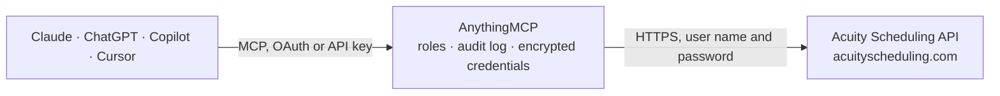

<!-- Generated by scripts/export-github-catalog.mjs in the anythingmcp-website repository. Do not edit by hand. -->

# Acuity Scheduling MCP connector

Drive Acuity Scheduling (Squarespace-owned booking SaaS) from any AI agent: appointments, availability, appointment types, calendars, clients, products. 12 tools, Basic-auth. The AnythingMCP connector gives Claude, ChatGPT, Microsoft Copilot, Cursor and Gemini 12 MCP tools for Acuity Scheduling: 9 read and 3 can change data.

**Category:** [Scheduling](../scheduling.md) · **Tools:** 12 · **Setup guide:** [anythingmcp.com](https://anythingmcp.com/guides/acuity-scheduling-to-mcp) · [Deutsch](https://anythingmcp.com/de/guides/acuity-scheduling-to-mcp) · [Italiano](https://anythingmcp.com/it/guides/acuity-scheduling-to-mcp) · [Español](https://anythingmcp.com/es/guides/acuity-scheduling-to-mcp) · [日本語](https://anythingmcp.com/ja/guides/acuity-scheduling-to-mcp) · [Русский](https://anythingmcp.com/ru/guides/acuity-scheduling-to-mcp) · [中文](https://anythingmcp.com/zh/guides/acuity-scheduling-to-mcp)

## Start without code

No installation and no terminal: AnythingMCP Cloud runs the Acuity Scheduling connector for you, operated by helpcode.ai in Frankfurt, Germany.

1. **Click the button above** and create an account or sign in. The Acuity Scheduling connector opens, ready to install.
2. **Paste the API key or token from your Acuity Scheduling account.** Every click is in the [step-by-step guide](https://anythingmcp.com/guides/acuity-scheduling-to-mcp).
3. **Click Install.** AnythingMCP shows the address of your MCP server.
4. **Add that address to your assistant:** [Claude](https://anythingmcp.com/guides/connect-acuity-scheduling-to-claude) · [ChatGPT](https://anythingmcp.com/guides/connect-acuity-scheduling-to-chatgpt) · [Microsoft Copilot](https://anythingmcp.com/guides/connect-acuity-scheduling-to-copilot) · [Cursor](https://anythingmcp.com/guides/connect-acuity-scheduling-to-cursor) · [Gemini CLI](https://anythingmcp.com/guides/connect-acuity-scheduling-to-gemini) · [Meta Muse](https://anythingmcp.com/guides/connect-acuity-scheduling-to-muse).
5. **Ask your first question**, for example: *Find the appointment for client sofia.martin@wellnesspad.ltd on 2026-07-14 and show details.*

Prefer help with the setup? [Talk to us](https://anythingmcp.com/contact).

## How it works

- **The AI client** speaks MCP (Streamable HTTP) to AnythingMCP and only sees tool names, descriptions and results. It never gets the Acuity Scheduling credentials.
- **AnythingMCP** checks the client's role, builds the call from the tool definition, adds the credentials (user name and password), calls Acuity Scheduling, logs the call and returns the result.
- **Acuity Scheduling** sees an ordinary API client with the rights of the account the credentials belong to.

## Tools

| Tool | What it does | Access |
|---|---|---|
| [`acuity_get_me`](#acuity_get_me) | Return account info: name, email, country, timezone. | read |
| [`acuity_list_appointment_types`](#acuity_list_appointment_types) | List appointment types defined in the account. | read |
| [`acuity_list_calendars`](#acuity_list_calendars) | List calendars (staff/resources). | read |
| [`acuity_list_available_dates`](#acuity_list_available_dates) | List dates with available slots in a month, for a given appointmentTypeID and optional calendarID. | read |
| [`acuity_list_available_times`](#acuity_list_available_times) | List specific time slots for a date. | read |
| [`acuity_list_appointments`](#acuity_list_appointments) | List appointments with filtering. | read |
| [`acuity_get_appointment`](#acuity_get_appointment) | Fetch a single appointment with client + forms + payment details. | read |
| [`acuity_create_appointment`](#acuity_create_appointment) | Book an appointment. | write |
| [`acuity_reschedule_appointment`](#acuity_reschedule_appointment) | Move an appointment to a new datetime/calendar. | write |
| [`acuity_cancel_appointment`](#acuity_cancel_appointment) | Cancel an appointment. | write |
| [`acuity_list_clients`](#acuity_list_clients) | List clients (people who have booked). | read |
| [`acuity_list_forms`](#acuity_list_forms) | List intake forms (custom forms). | read |

## Tool reference

Every parameter as the AI client sees it in `tools/list`. Source: [`packages/backend/src/adapters/intl/acuity-scheduling.json`](../../../packages/backend/src/adapters/intl/acuity-scheduling.json).

### `acuity_get_me`

Return account info: name, email, country, timezone. Health check.

**Access:** read · **Call:** `GET /me`

No parameters.

### `acuity_list_appointment_types`

List appointment types defined in the account. Each has id, name, duration, price, color, calendarIDs[], active.

**Access:** read · **Call:** `GET /appointment-types`

No parameters.

### `acuity_list_calendars`

List calendars (staff/resources). Each has id, name, email, location, description, timezone.

**Access:** read · **Call:** `GET /calendars`

No parameters.

### `acuity_list_available_dates`

List dates with available slots in a month, for a given appointmentTypeID and optional calendarID.

**Access:** read · **Call:** `GET /availability/dates`

| Parameter | Type | Required | Description |
|---|---|---|---|
| `appointmentTypeID` | integer | yes | Appointment type ID. |
| `month` | string | yes | YYYY-MM month to scan. |
| `calendarID` | integer | no | Optional calendar ID — limit to this staff/resource. |
| `timezone` | string | no | TZ database name (e.g. 'America/New_York'). Default uses account's. |

### `acuity_list_available_times`

List specific time slots for a date.

**Access:** read · **Call:** `GET /availability/times`

| Parameter | Type | Required | Description |
|---|---|---|---|
| `appointmentTypeID` | integer | yes | Appointment type ID. |
| `date` | string | yes | YYYY-MM-DD. |
| `calendarID` | integer | no | Optional calendar ID. |
| `timezone` | string | no | Timezone for the returned times. |

### `acuity_list_appointments`

List appointments with filtering.

**Access:** read · **Call:** `GET /appointments`

| Parameter | Type | Required | Description |
|---|---|---|---|
| `minDate` | string | no | ISO 8601 — appointments at/after. |
| `maxDate` | string | no | ISO 8601 — at/before. |
| `calendarID` | integer | no | Filter by calendar. |
| `appointmentTypeID` | integer | no | Filter by type. |
| `canceled` | boolean | no | If true, only canceled. Default excludes canceled. |
| `max` | integer | no | Max results (default 50). |

### `acuity_get_appointment`

Fetch a single appointment with client + forms + payment details.

**Access:** read · **Call:** `GET /appointments/{appointmentId}`

| Parameter | Type | Required | Description |
|---|---|---|---|
| `appointmentId` | integer | yes | Appointment ID. |

### `acuity_create_appointment`

Book an appointment. Required: datetime + appointmentTypeID + firstName + lastName + email.

**Access:** write · **Call:** `POST /appointments`

| Parameter | Type | Required | Description |
|---|---|---|---|
| `datetime` | string | yes | ISO 8601 datetime of the slot. |
| `appointmentTypeID` | integer | yes | Appointment type ID. |
| `calendarID` | integer | no | Optional calendar (round-robin if omitted). |
| `firstName` | string | yes | Client first name. |
| `lastName` | string | yes | Client last name. |
| `email` | string | yes | Client email. |
| `phone` | string | no | Client phone. |
| `fields` | any[] | no | Custom form fields: [{id, value}]. |
| `smsOptIn` | boolean | no | Opt in to SMS reminders. |
| `noEmail` | boolean | no | If true, skip the confirmation email. |
| `labels` | any[] | no | [{id}] — apply labels. |
| `addonIDs` | any[] | no | Add-on IDs. |
| `certificate` | string | no | Coupon/cert code. |

### `acuity_reschedule_appointment`

Move an appointment to a new datetime/calendar.

**Access:** write · **Call:** `PUT /appointments/{appointmentId}/reschedule`

| Parameter | Type | Required | Description |
|---|---|---|---|
| `appointmentId` | integer | yes | Appointment ID. |
| `datetime` | string | yes | New ISO 8601 datetime. |
| `calendarID` | integer | no | Optional new calendar. |

### `acuity_cancel_appointment`

Cancel an appointment. Irreversible.

**Access:** write · **Call:** `PUT /appointments/{appointmentId}/cancel`

| Parameter | Type | Required | Description |
|---|---|---|---|
| `appointmentId` | integer | yes | Appointment ID. |
| `noEmail` | boolean | no | If true, skip the cancellation email. |
| `cancelNote` | string | no | Reason note. |

### `acuity_list_clients`

List clients (people who have booked). Search by name or email.

**Access:** read · **Call:** `GET /clients`

| Parameter | Type | Required | Description |
|---|---|---|---|
| `search` | string | no | Name or email substring. |

### `acuity_list_forms`

List intake forms (custom forms). Each has id, name, fields[]. Use field IDs in appointment create's `fields` param.

**Access:** read · **Call:** `GET /forms`

No parameters.

## Run it yourself

AnythingMCP is open source (AGPL-3.0). [Run it with Docker](../../../README.md#run-it-yourself), open **Connectors → Store**, pick **Acuity Scheduling** and enter `ACUITY_USER_ID`, `ACUITY_API_KEY`, then add your MCP server URL to the AI client.

[← Scheduling connectors](../scheduling.md) · [All categories](../README.md)
