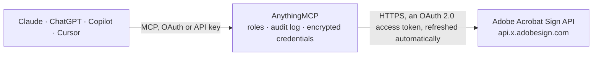

<!-- Generated by scripts/export-github-catalog.mjs in the anythingmcp-website repository. Do not edit by hand. -->

# Adobe Acrobat Sign MCP connector

Let your AI work with Adobe Acrobat Sign: find agreements and check who has signed, read participants, events, form data, signing links, the signed PDF and audit trail, send documents or library … The AnythingMCP connector gives Claude, ChatGPT, Microsoft Copilot, Cursor and Gemini 33 MCP tools for Adobe Acrobat Sign: 28 read and 5 can change data.

**Category:** [E-Signature](../e-signature.md) · **Tools:** 33 · **Setup guide:** [anythingmcp.com](https://anythingmcp.com/guides/adobe-acrobat-sign-to-mcp) · [Deutsch](https://anythingmcp.com/de/guides/adobe-acrobat-sign-to-mcp) · [Italiano](https://anythingmcp.com/it/guides/adobe-acrobat-sign-to-mcp) · [Español](https://anythingmcp.com/es/guides/adobe-acrobat-sign-to-mcp) · [日本語](https://anythingmcp.com/ja/guides/adobe-acrobat-sign-to-mcp) · [Русский](https://anythingmcp.com/ru/guides/adobe-acrobat-sign-to-mcp) · [中文](https://anythingmcp.com/zh/guides/adobe-acrobat-sign-to-mcp)

## Start without code

No installation and no terminal: AnythingMCP Cloud runs the Adobe Acrobat Sign connector for you, operated by helpcode.ai in Frankfurt, Germany.

1. **Click the button above** and create an account or sign in. The Adobe Acrobat Sign connector opens, ready to install.
2. **Sign in with your Adobe Acrobat Sign account** when AnythingMCP asks. The first time, an admin creates a small app in the Adobe Acrobat Sign developer console. Every click is in the [step-by-step guide](https://anythingmcp.com/guides/adobe-acrobat-sign-to-mcp).
3. **Click Install.** AnythingMCP shows the address of your MCP server.
4. **Add that address to your assistant:** [Claude](https://anythingmcp.com/guides/connect-adobe-acrobat-sign-to-claude) · [ChatGPT](https://anythingmcp.com/guides/connect-adobe-acrobat-sign-to-chatgpt) · [Microsoft Copilot](https://anythingmcp.com/guides/connect-adobe-acrobat-sign-to-copilot) · [Cursor](https://anythingmcp.com/guides/connect-adobe-acrobat-sign-to-cursor) · [Gemini CLI](https://anythingmcp.com/guides/connect-adobe-acrobat-sign-to-gemini) · [Meta Muse](https://anythingmcp.com/guides/connect-adobe-acrobat-sign-to-muse).
5. **Ask your first question**, for example: *What is the current status of agreement AGR-2026-114 for Solaris GmbH and who still must sign?*

Prefer help with the setup? [Talk to us](https://anythingmcp.com/contact).

## How it works

- **The AI client** speaks MCP (Streamable HTTP) to AnythingMCP and only sees tool names, descriptions and results. It never gets the Adobe Acrobat Sign credentials.
- **AnythingMCP** checks the client's role, builds the call from the tool definition, adds the credentials (an OAuth 2.0 access token, refreshed automatically), calls Adobe Acrobat Sign, logs the call and returns the result.
- **Adobe Acrobat Sign** sees an ordinary API client with the rights of the account the credentials belong to.

## Tools

| Tool | What it does | Access |
|---|---|---|
| [`adobe_acrobat_sign_get_base_uris`](#adobe_acrobat_sign_get_base_uris) | The API and web hosts of the account (apiAccessPoint, webAccessPoint), e.g. https://api.na1.adobesign.com/. | read |
| [`adobe_acrobat_sign_get_user`](#adobe_acrobat_sign_get_user) | Read a user of the account: id, email, name, company, accountType, status, isAccountAdmin and primary group. | read |
| [`adobe_acrobat_sign_list_agreements`](#adobe_acrobat_sign_list_agreements) | List the agreements of the signed-in user, newest first: id, name, status (OUT_FOR_SIGNATURE, SIGNED, APPROVED, CANCELLED, EXPIRED, DRAFT, AUTHORING, ...),… | read |
| [`adobe_acrobat_sign_search_agreements`](#adobe_acrobat_sign_search_agreements) | Search agreements, web forms and library documents the user can see, by text (names, participant emails and names, messages, external ids, field content)… | read |
| [`adobe_acrobat_sign_get_agreement`](#adobe_acrobat_sign_get_agreement) | Read one agreement: name, status, sender, participant sets (role, order, members and their status), cc list, message, created and expiration dates,… | read |
| [`adobe_acrobat_sign_get_agreement_members`](#adobe_acrobat_sign_get_agreement_members) | Who is on an agreement and where they stand: participant sets with role, order and status, each member with participant id, email and status (e.g.… | read |
| [`adobe_acrobat_sign_list_agreement_events`](#adobe_acrobat_sign_list_agreement_events) | The audit events of an agreement in order: created, sent, emailed, viewed, signed, delegated, reminder sent, completed, with date, actor email, participant… | read |
| [`adobe_acrobat_sign_get_agreement_form_data`](#adobe_acrobat_sign_get_agreement_form_data) | The values participants entered in the form fields of an agreement, as CSV text (one row per participant, one column per field). | read |
| [`adobe_acrobat_sign_get_signing_urls`](#adobe_acrobat_sign_get_signing_urls) | The e-sign page links of the participants who must act now (signingUrlSetInfos with email and esignUrl). | read |
| [`adobe_acrobat_sign_get_combined_document_url`](#adobe_acrobat_sign_get_combined_document_url) | A temporary download URL of the agreement as one PDF (signed copy once completed), optionally with the audit report and supporting documents attached. | read |
| [`adobe_acrobat_sign_download_combined_document`](#adobe_acrobat_sign_download_combined_document) | Download the agreement as one PDF file (the signed copy once completed), handed over as a file attachment, not as text. | read |
| [`adobe_acrobat_sign_list_agreement_documents`](#adobe_acrobat_sign_list_agreement_documents) | List the documents of an agreement: document id, name, mimeType, number of pages, and supporting documents uploaded by participants with their field names. | read |
| [`adobe_acrobat_sign_download_audit_trail`](#adobe_acrobat_sign_download_audit_trail) | Download the audit trail report of an agreement as a PDF file attachment (who did what and when, with IP addresses and the transaction id). | read |
| [`adobe_acrobat_sign_list_reminders`](#adobe_acrobat_sign_list_reminders) | List the reminders set on an agreement: reminder id, recipients (participant ids), frequency, status, last and next send date, note. | read |
| [`adobe_acrobat_sign_list_library_documents`](#adobe_acrobat_sign_list_library_documents) | List the library documents (reusable templates) the user can use: id, name, templateTypes (DOCUMENT, FORM_FIELD_LAYER), sharingMode (USER, GROUP, ACCOUNT,… | read |
| [`adobe_acrobat_sign_get_library_document`](#adobe_acrobat_sign_get_library_document) | Read one library document (template): name, owner, sharing mode, template types, status, created date and the files it contains. | read |
| [`adobe_acrobat_sign_list_library_document_form_fields`](#adobe_acrobat_sign_list_library_document_form_fields) | List the form fields of a library document: name, inputType (TEXT_FIELD, SIGNATURE, CHECKBOX, DATE, ...), assignee (which participant fills it), required,… | read |
| [`adobe_acrobat_sign_list_web_forms`](#adobe_acrobat_sign_list_web_forms) | List the web forms (widgets): id, name, status (ACTIVE, AUTHORING, DRAFT), the public url signers open, javascript embed code and modified date. | read |
| [`adobe_acrobat_sign_get_web_form`](#adobe_acrobat_sign_get_web_form) | Read one web form: name, status, public url, participants, completion and verification settings, and the documents it uses. | read |
| [`adobe_acrobat_sign_get_web_form_form_data`](#adobe_acrobat_sign_get_web_form_form_data) | The data signers entered in a web form, as CSV text (one row per submission). | read |
| [`adobe_acrobat_sign_list_web_form_agreements`](#adobe_acrobat_sign_list_web_form_agreements) | List the agreements created when people filled in and signed a web form: id, name, status, participant email and date. | read |
| [`adobe_acrobat_sign_list_users`](#adobe_acrobat_sign_list_users) | List the users of the Acrobat Sign account: id, email, name, company, isAccountAdmin. | read |
| [`adobe_acrobat_sign_list_groups`](#adobe_acrobat_sign_list_groups) | List the groups of the account: id, name, createdDate and whether it is the default group. | read |
| [`adobe_acrobat_sign_list_group_users`](#adobe_acrobat_sign_list_group_users) | List the users of one group: id, email, name, and whether they are group admins. | read |
| [`adobe_acrobat_sign_list_workflows`](#adobe_acrobat_sign_list_workflows) | List the custom send workflows available to the user: id, name, displayName, status, scope and modified date. | read |
| [`adobe_acrobat_sign_get_workflow`](#adobe_acrobat_sign_get_workflow) | Read one workflow: its recipients list (roles, order, editable or fixed emails), documents, cc, expiration and authentication settings. | read |
| [`adobe_acrobat_sign_list_webhooks`](#adobe_acrobat_sign_list_webhooks) | List the webhooks of the account or user: id, name, scope, state (ACTIVE or INACTIVE), subscribed events, resource type and target URL. | read |
| [`adobe_acrobat_sign_get_webhook`](#adobe_acrobat_sign_get_webhook) | Read one webhook: name, scope, state, subscribed events, URL, and the conditional parameters that decide what the notification carries. | read |
| [`adobe_acrobat_sign_upload_transient_document`](#adobe_acrobat_sign_upload_transient_document) | Upload a file (PDF, Word, Excel, image, ...) from a URL as a transient document and get its transientDocumentId, to use in… | write |
| [`adobe_acrobat_sign_create_agreement`](#adobe_acrobat_sign_create_agreement) | Create an agreement from a transient document, a library document (template) or a file URL. | write |
| [`adobe_acrobat_sign_send_agreement`](#adobe_acrobat_sign_send_agreement) | Send a DRAFT or AUTHORING agreement for signature (state IN_PROCESS): the first recipients get their emails. | write |
| [`adobe_acrobat_sign_cancel_agreement`](#adobe_acrobat_sign_cancel_agreement) | Cancel an agreement that is out for signature (state CANCELLED). | write |
| [`adobe_acrobat_sign_create_reminder`](#adobe_acrobat_sign_create_reminder) | Remind participants who have not acted yet: send a reminder now (frequency ONCE) or on a schedule until they sign. | write |

## Tool reference

Every parameter as the AI client sees it in `tools/list`. Source: [`packages/backend/src/adapters/intl/adobe-acrobat-sign.json`](../../../packages/backend/src/adapters/intl/adobe-acrobat-sign.json).

### `adobe_acrobat_sign_get_base_uris`

The API and web hosts of the account (apiAccessPoint, webAccessPoint), e.g. https://api.na1.adobesign.com/. Use it to check the connection and that ADOBE_SIGN_SHARD is right.

**Access:** read · **Call:** `GET /baseUris`

No parameters.

### `adobe_acrobat_sign_get_user`

Read a user of the account: id, email, name, company, accountType, status, isAccountAdmin and primary group. user_id "me" returns the user who authorized the connector.

**Access:** read · **Call:** `GET /users/{user_id}`

| Parameter | Type | Required | Description |
|---|---|---|---|
| `user_id` | string | yes | User id from adobe_acrobat_sign_list_users, or me for the signed-in user. |

### `adobe_acrobat_sign_list_agreements`

List the agreements of the signed-in user, newest first: id, name, status (OUT_FOR_SIGNATURE, SIGNED, APPROVED, CANCELLED, EXPIRED, DRAFT, AUTHORING, ...), displayDate, participants and groupId. Filter by externalId or group. For text search, status and date filters use adobe_acrobat_sign_search_agreements.

**Access:** read · **Call:** `GET /agreements`

| Parameter | Type | Required | Description |
|---|---|---|---|
| `external_id` | string | no | Only agreements created with this external id (case-sensitive). |
| `group_id` | string | no | Only agreements of this group, from adobe_acrobat_sign_list_groups. |
| `show_hidden` | boolean | no | true includes agreements the user has hidden. |
| `cursor` | string | no | Paging cursor: page.nextCursor of the previous answer. Leave it out for the first page; when nextCursor is missing there is nothing more. |
| `page_size` | integer | no | Items per page (the account default applies when left out). |

### `adobe_acrobat_sign_search_agreements`

Search agreements, web forms and library documents the user can see, by text (names, participant emails and names, messages, external ids, field content) and filters: status, role, type, created or modified date, participant email. Sorted and paged with start_index. Read-only, although it is a POST.

**Access:** read · **Call:** `POST /search`

| Parameter | Type | Required | Description |
|---|---|---|---|
| `query` | string | no | Text to look for; leave empty to filter only. |
| `status` | string[] | no | Statuses, e.g. ["OUT_FOR_SIGNATURE", "WAITING_FOR_MY_SIGNATURE", "SIGNED", "CANCELLED", "EXPIRED", "DRAFT"]. |
| `role` | string[] | no | Roles of the user on the agreement, e.g. ["SENDER"] or ["SIGNER"]. |
| `type` | string[] | no | Asset types: AGREEMENT, MEGASIGN_PARENT, MEGASIGN_CHILD, WIDGET, WIDGET_INSTANCE, LIBRARY_TEMPLATE. |
| `participant_email` | string[] | no | Only agreements with these participant emails. |
| `external_id` | string[] | no | Only agreements with these external ids. |
| `created_date` | object | no | Created-date range as ISO 8601: {"range": {"gt": "2026-10-01T00:00:00Z", "lt": "2026-11-01T00:00:00Z"}} (or min and max; do not mix the two styles). |
| `modified_date` | object | no | Modified-date range, same shape as created_date. |
| `queryable_fields` | string[] | no | Search the text only in these fields: title, note, message, originalFileName, email, fullName, companyName, externalId, agreementId, textFieldContent, ... |
| `sort_by_field` | `CREATED_DATE` \| `MODIFIED_DATE` \| `EXPIRATION_DATE` \| `NAME` \| `STATUS` \| `SENDER` | no | Sort field. |
| `sort_order` | `ASC` \| `DESC` | no | Sort order. |
| `start_index` | integer | no | 0-based offset of the first result (below 10,000). Use searchPageInfo.nextIndex of the previous answer. |
| `page_size` | integer | no | Results per page, 1 to 100 (default 50). |

### `adobe_acrobat_sign_get_agreement`

Read one agreement: name, status, sender, participant sets (role, order, members and their status), cc list, message, created and expiration dates, signatureType, locale, externalId and the documents it was made from.

**Access:** read · **Call:** `GET /agreements/{agreement_id}`

| Parameter | Type | Required | Description |
|---|---|---|---|
| `agreement_id` | string | yes | Agreement id, from adobe_acrobat_sign_list_agreements, adobe_acrobat_sign_search_agreements or adobe_acrobat_sign_create_agreement. |

### `adobe_acrobat_sign_get_agreement_members`

Who is on an agreement and where they stand: participant sets with role, order and status, each member with participant id, email and status (e.g. WAITING_FOR_MY_SIGNATURE, COMPLETED), plus the sender and cc members. Use the participant ids for reminders.

**Access:** read · **Call:** `GET /agreements/{agreement_id}/members`

| Parameter | Type | Required | Description |
|---|---|---|---|
| `agreement_id` | string | yes | Agreement id, from adobe_acrobat_sign_list_agreements, adobe_acrobat_sign_search_agreements or adobe_acrobat_sign_create_agreement. |
| `include_next_participant_set` | boolean | no | true also returns the participants who act next. |

### `adobe_acrobat_sign_list_agreement_events`

The audit events of an agreement in order: created, sent, emailed, viewed, signed, delegated, reminder sent, completed, with date, actor email, participant and description.

**Access:** read · **Call:** `GET /agreements/{agreement_id}/events`

| Parameter | Type | Required | Description |
|---|---|---|---|
| `agreement_id` | string | yes | Agreement id, from adobe_acrobat_sign_list_agreements, adobe_acrobat_sign_search_agreements or adobe_acrobat_sign_create_agreement. |

### `adobe_acrobat_sign_get_agreement_form_data`

The values participants entered in the form fields of an agreement, as CSV text (one row per participant, one column per field). Only the sender can read it; by default only for completed agreements.

**Access:** read · **Call:** `GET /agreements/{agreement_id}/formData`

| Parameter | Type | Required | Description |
|---|---|---|---|
| `agreement_id` | string | yes | Agreement id, from adobe_acrobat_sign_list_agreements, adobe_acrobat_sign_search_agreements or adobe_acrobat_sign_create_agreement. |
| `allow_in_process` | boolean | no | true also returns data of agreements still in process. |
| `participant_id` | string | no | Only the data of this participant (id from adobe_acrobat_sign_get_agreement_members). |

### `adobe_acrobat_sign_get_signing_urls`

The e-sign page links of the participants who must act now (signingUrlSetInfos with email and esignUrl). Available a few seconds after an agreement is sent; until then Adobe answers AGREEMENT_NOT_EXPOSED: wait and ask again.

**Access:** read · **Call:** `GET /agreements/{agreement_id}/signingUrls`

| Parameter | Type | Required | Description |
|---|---|---|---|
| `agreement_id` | string | yes | Agreement id, from adobe_acrobat_sign_list_agreements, adobe_acrobat_sign_search_agreements or adobe_acrobat_sign_create_agreement. |
| `expiry` | integer | no | Link lifetime in seconds (30 to 315360000); the account setting applies when left out. |

### `adobe_acrobat_sign_get_combined_document_url`

A temporary download URL of the agreement as one PDF (signed copy once completed), optionally with the audit report and supporting documents attached.

**Access:** read · **Call:** `GET /agreements/{agreement_id}/combinedDocument/url`

| Parameter | Type | Required | Description |
|---|---|---|---|
| `agreement_id` | string | yes | Agreement id, from adobe_acrobat_sign_list_agreements, adobe_acrobat_sign_search_agreements or adobe_acrobat_sign_create_agreement. |
| `attach_audit_report` | boolean | no | true appends the audit report (default false). |
| `attach_supporting_documents` | boolean | no | true attaches the supporting documents participants uploaded (default true). |
| `version_id` | string | no | A specific version of the agreement (latestVersionId and earlier); the latest by default. |
| `participant_id` | string | no | The document as this participant sees it; the caller's view by default. |

### `adobe_acrobat_sign_download_combined_document`

Download the agreement as one PDF file (the signed copy once completed), handed over as a file attachment, not as text. Use adobe_acrobat_sign_get_combined_document_url for a link instead.

**Access:** read · **Call:** `GET /agreements/{agreement_id}/combinedDocument`

| Parameter | Type | Required | Description |
|---|---|---|---|
| `agreement_id` | string | yes | Agreement id, from adobe_acrobat_sign_list_agreements, adobe_acrobat_sign_search_agreements or adobe_acrobat_sign_create_agreement. |
| `attach_audit_report` | boolean | no | true appends the audit report (default false). |
| `attach_supporting_documents` | boolean | no | true attaches the supporting documents (default true). |

### `adobe_acrobat_sign_list_agreement_documents`

List the documents of an agreement: document id, name, mimeType, number of pages, and supporting documents uploaded by participants with their field names.

**Access:** read · **Call:** `GET /agreements/{agreement_id}/documents`

| Parameter | Type | Required | Description |
|---|---|---|---|
| `agreement_id` | string | yes | Agreement id, from adobe_acrobat_sign_list_agreements, adobe_acrobat_sign_search_agreements or adobe_acrobat_sign_create_agreement. |
| `version_id` | string | no | A specific version of the agreement; the latest by default. |
| `participant_id` | string | no | The documents as this participant sees them. |

### `adobe_acrobat_sign_download_audit_trail`

Download the audit trail report of an agreement as a PDF file attachment (who did what and when, with IP addresses and the transaction id).

**Access:** read · **Call:** `GET /agreements/{agreement_id}/auditTrail`

| Parameter | Type | Required | Description |
|---|---|---|---|
| `agreement_id` | string | yes | Agreement id, from adobe_acrobat_sign_list_agreements, adobe_acrobat_sign_search_agreements or adobe_acrobat_sign_create_agreement. |

### `adobe_acrobat_sign_list_reminders`

List the reminders set on an agreement: reminder id, recipients (participant ids), frequency, status, last and next send date, note.

**Access:** read · **Call:** `GET /agreements/{agreement_id}/reminders`

| Parameter | Type | Required | Description |
|---|---|---|---|
| `agreement_id` | string | yes | Agreement id, from adobe_acrobat_sign_list_agreements, adobe_acrobat_sign_search_agreements or adobe_acrobat_sign_create_agreement. |
| `status` | string | no | Comma-separated statuses to return: ACTIVE, CANCELED, COMPLETE. |

### `adobe_acrobat_sign_list_library_documents`

List the library documents (reusable templates) the user can use: id, name, templateTypes (DOCUMENT, FORM_FIELD_LAYER), sharingMode (USER, GROUP, ACCOUNT, GLOBAL), status and modified date. Use an id in adobe_acrobat_sign_create_agreement.

**Access:** read · **Call:** `GET /libraryDocuments`

| Parameter | Type | Required | Description |
|---|---|---|---|
| `group_id` | string | no | Only library documents of this group. |
| `show_hidden` | boolean | no | true includes hidden library documents. |
| `cursor` | string | no | Paging cursor: page.nextCursor of the previous answer. Leave it out for the first page; when nextCursor is missing there is nothing more. |
| `page_size` | integer | no | Items per page (the account default applies when left out). |

### `adobe_acrobat_sign_get_library_document`

Read one library document (template): name, owner, sharing mode, template types, status, created date and the files it contains.

**Access:** read · **Call:** `GET /libraryDocuments/{library_document_id}`

| Parameter | Type | Required | Description |
|---|---|---|---|
| `library_document_id` | string | yes | Library document (template) id, from adobe_acrobat_sign_list_library_documents. |

### `adobe_acrobat_sign_list_library_document_form_fields`

List the form fields of a library document: name, inputType (TEXT_FIELD, SIGNATURE, CHECKBOX, DATE, ...), assignee (which participant fills it), required, default value and position. Field names are what mergeFieldInfo pre-fills.

**Access:** read · **Call:** `GET /libraryDocuments/{library_document_id}/formFields`

| Parameter | Type | Required | Description |
|---|---|---|---|
| `library_document_id` | string | yes | Library document (template) id, from adobe_acrobat_sign_list_library_documents. |

### `adobe_acrobat_sign_list_web_forms`

List the web forms (widgets): id, name, status (ACTIVE, AUTHORING, DRAFT), the public url signers open, javascript embed code and modified date.

**Access:** read · **Call:** `GET /widgets`

| Parameter | Type | Required | Description |
|---|---|---|---|
| `group_id` | string | no | Only web forms of this group. |
| `show_hidden` | boolean | no | true includes hidden web forms. |
| `cursor` | string | no | Paging cursor: page.nextCursor of the previous answer. Leave it out for the first page; when nextCursor is missing there is nothing more. |
| `page_size` | integer | no | Items per page (the account default applies when left out). |

### `adobe_acrobat_sign_get_web_form`

Read one web form: name, status, public url, participants, completion and verification settings, and the documents it uses.

**Access:** read · **Call:** `GET /widgets/{widget_id}`

| Parameter | Type | Required | Description |
|---|---|---|---|
| `widget_id` | string | yes | Web form (widget) id, from adobe_acrobat_sign_list_web_forms. |

### `adobe_acrobat_sign_get_web_form_form_data`

The data signers entered in a web form, as CSV text (one row per submission).

**Access:** read · **Call:** `GET /widgets/{widget_id}/formData`

| Parameter | Type | Required | Description |
|---|---|---|---|
| `widget_id` | string | yes | Web form (widget) id, from adobe_acrobat_sign_list_web_forms. |
| `cursor` | string | no | Paging cursor: page.nextCursor of the previous answer. Leave it out for the first page; when nextCursor is missing there is nothing more. |
| `page_size` | integer | no | Items per page (the account default applies when left out). |

### `adobe_acrobat_sign_list_web_form_agreements`

List the agreements created when people filled in and signed a web form: id, name, status, participant email and date.

**Access:** read · **Call:** `GET /widgets/{widget_id}/agreements`

| Parameter | Type | Required | Description |
|---|---|---|---|
| `widget_id` | string | yes | Web form (widget) id, from adobe_acrobat_sign_list_web_forms. |
| `show_hidden` | boolean | no | true includes hidden agreements. |
| `cursor` | string | no | Paging cursor: page.nextCursor of the previous answer. Leave it out for the first page; when nextCursor is missing there is nothing more. |
| `page_size` | integer | no | Items per page (the account default applies when left out). |

### `adobe_acrobat_sign_list_users`

List the users of the Acrobat Sign account: id, email, name, company, isAccountAdmin. Needs an account admin who authorized the user_read scope with the :account modifier; others get a permission error.

**Access:** read · **Call:** `GET /users`

| Parameter | Type | Required | Description |
|---|---|---|---|
| `account_admin_filter` | `ADMIN_ONLY` \| `NON_ADMIN_ONLY` \| `ALL` | no | Only admins, only non-admins, or all (default). |
| `cursor` | string | no | Paging cursor: page.nextCursor of the previous answer. Leave it out for the first page; when nextCursor is missing there is nothing more. |
| `page_size` | integer | no | Items per page (the account default applies when left out). |

### `adobe_acrobat_sign_list_groups`

List the groups of the account: id, name, createdDate and whether it is the default group. Group ids filter agreements, templates and web forms.

**Access:** read · **Call:** `GET /groups`

| Parameter | Type | Required | Description |
|---|---|---|---|
| `cursor` | string | no | Paging cursor: page.nextCursor of the previous answer. Leave it out for the first page; when nextCursor is missing there is nothing more. |
| `page_size` | integer | no | Items per page (the account default applies when left out). |

### `adobe_acrobat_sign_list_group_users`

List the users of one group: id, email, name, and whether they are group admins.

**Access:** read · **Call:** `GET /groups/{group_id}/users`

| Parameter | Type | Required | Description |
|---|---|---|---|
| `group_id` | string | yes | Group id, from adobe_acrobat_sign_list_groups. |
| `cursor` | string | no | Paging cursor: page.nextCursor of the previous answer. Leave it out for the first page; when nextCursor is missing there is nothing more. |
| `page_size` | integer | no | Items per page (the account default applies when left out). |

### `adobe_acrobat_sign_list_workflows`

List the custom send workflows available to the user: id, name, displayName, status, scope and modified date.

**Access:** read · **Call:** `GET /workflows`

| Parameter | Type | Required | Description |
|---|---|---|---|
| `group_id` | string | no | Only workflows of this group. |
| `include_draft` | boolean | no | true includes draft workflows. |
| `include_inactive` | boolean | no | true includes inactive workflows. |

### `adobe_acrobat_sign_get_workflow`

Read one workflow: its recipients list (roles, order, editable or fixed emails), documents, cc, expiration and authentication settings.

**Access:** read · **Call:** `GET /workflows/{workflow_id}`

| Parameter | Type | Required | Description |
|---|---|---|---|
| `workflow_id` | string | yes | Workflow id, from adobe_acrobat_sign_list_workflows. |
| `group_id` | string | no | Group the workflow belongs to, when needed. |

### `adobe_acrobat_sign_list_webhooks`

List the webhooks of the account or user: id, name, scope, state (ACTIVE or INACTIVE), subscribed events, resource type and target URL.

**Access:** read · **Call:** `GET /webhooks`

| Parameter | Type | Required | Description |
|---|---|---|---|
| `show_inactive` | boolean | no | true includes inactive webhooks. |
| `scope` | `ACCOUNT` \| `GROUP` \| `USER` \| `RESOURCE` | no | Only webhooks of this scope. |
| `resource_type` | `AGREEMENT` \| `WIDGET` \| `MEGASIGN` \| `LIBRARY_DOCUMENT` | no | Only webhooks on this resource type. |
| `cursor` | string | no | Paging cursor: page.nextCursor of the previous answer. Leave it out for the first page; when nextCursor is missing there is nothing more. |
| `page_size` | integer | no | Items per page (the account default applies when left out). |

### `adobe_acrobat_sign_get_webhook`

Read one webhook: name, scope, state, subscribed events, URL, and the conditional parameters that decide what the notification carries.

**Access:** read · **Call:** `GET /webhooks/{webhook_id}`

| Parameter | Type | Required | Description |
|---|---|---|---|
| `webhook_id` | string | yes | Webhook id, from adobe_acrobat_sign_list_webhooks. |

### `adobe_acrobat_sign_upload_transient_document`

Upload a file (PDF, Word, Excel, image, ...) from a URL as a transient document and get its transientDocumentId, to use in adobe_acrobat_sign_create_agreement within 7 days. AnythingMCP downloads the URL and sends the bytes (up to 10 MB).

**Access:** write · **Call:** `POST /transientDocuments`

| Parameter | Type | Required | Description |
|---|---|---|---|
| `file_url` | string | yes | Public or pre-signed URL of the file to upload. |
| `file_name` | string | yes | File name with extension, e.g. contract.pdf. Adobe shows it as the document name. |
| `mime_type` | string | no | MIME type, e.g. application/pdf; Adobe guesses it from the name when left out. |

### `adobe_acrobat_sign_create_agreement`

Create an agreement from a transient document, a library document (template) or a file URL. state IN_PROCESS sends it for signature at once (emails go out); DRAFT keeps it unsent; AUTHORING lets the sender place fields in Acrobat Sign first. Confirm the documents, recipients and their order with the user before sending. Returns the agreement id.

**Access:** write · **Call:** `POST /agreements`

| Parameter | Type | Required | Description |
|---|---|---|---|
| `name` | string | yes | Agreement name, shown to recipients in emails and on the signing page. |
| `file_infos` | object[] | yes | Documents, each one of: {"transientDocumentId": "..."} (from adobe_acrobat_sign_upload_transient_document), {"libraryDocumentId": "..."} (a template), or {"urlFileInfo": {"url": "https://...", "name": "contract.pdf", "mimeType": "application/pdf"}}. |
| `participant_sets` | object[] | yes | Recipients in signing order, e.g. [{"order": 1, "role": "SIGNER", "memberInfos": [{"email": "anna@example.com"}]}, {"order": 2, "role": "APPROVER", "memberInfos": [{"email": "boss@example.com"}]}]. Roles: SIGNER, APPROVER, ACCEPTOR, CERTIFIED_RECIPIENT, FORM_FILLER, DELEGATE_TO_SIGNER, ... Several members in one set means any one of them may act. Sets with the same order act in parallel. |
| `state` | `IN_PROCESS` \| `DRAFT` \| `AUTHORING` | yes | IN_PROCESS sends now; DRAFT saves without sending; AUTHORING opens it for field placement. |
| `signature_type` | `ESIGN` \| `WRITTEN` | no | ESIGN (default) for electronic signatures, WRITTEN for wet-ink signatures uploaded back. |
| `message` | string | no | Message to the recipients, shown in the email and on the signing page. |
| `ccs` | object[] | no | People who get a copy, e.g. [{"email": "legal@example.com"}]. |
| `expiration_time` | string | no | Deadline to sign, ISO 8601 with Z, e.g. 2026-11-30T18:00:00Z. Counts from sending. |
| `reminder_frequency` | `DAILY_UNTIL_SIGNED` \| `WEEKDAILY_UNTIL_SIGNED` \| `EVERY_OTHER_DAY_UNTIL_SIGNED` \| `EVERY_THIRD_DAY_UNTIL_SIGNED` \| `EVERY_FIFTH_DAY_UNTIL_SIGNED` \| `WEEKLY_UNTIL_SIGNED` \| `ONCE` | no | Automatic reminders to recipients who have not acted. |
| `merge_field_info` | object[] | no | Pre-fill form fields of the documents, e.g. [{"fieldName": "CustomerName", "defaultValue": "ACME Ltd"}]. Field names from adobe_acrobat_sign_list_library_document_form_fields. |
| `external_id` | object | no | Your own reference, {"id": "ORDER-1234"}; visible to participants through the API, so no secrets. |
| `group_id` | string | no | Send on behalf of this group (its settings and branding apply). |
| `locale` | string | no | Language of emails and the signing page, e.g. en_US, de_DE, it_IT, fr_FR. |

### `adobe_acrobat_sign_send_agreement`

Send a DRAFT or AUTHORING agreement for signature (state IN_PROCESS): the first recipients get their emails. Confirm with the user first.

**Access:** write · **Call:** `PUT /agreements/{agreement_id}/state`

| Parameter | Type | Required | Description |
|---|---|---|---|
| `agreement_id` | string | yes | Agreement id, from adobe_acrobat_sign_list_agreements, adobe_acrobat_sign_search_agreements or adobe_acrobat_sign_create_agreement. |

### `adobe_acrobat_sign_cancel_agreement`

Cancel an agreement that is out for signature (state CANCELLED). Recipients can no longer sign; with notify_others they get an email with the comment. Cannot be undone: confirm with the user first.

**Access:** write · **Call:** `PUT /agreements/{agreement_id}/state`

| Parameter | Type | Required | Description |
|---|---|---|---|
| `agreement_id` | string | yes | Agreement id, from adobe_acrobat_sign_list_agreements, adobe_acrobat_sign_search_agreements or adobe_acrobat_sign_create_agreement. |
| `comment` | string | no | Reason for the cancellation, shown to recipients when they are notified. |
| `notify_others` | boolean | no | true emails the recipients about the cancellation (default false). |

### `adobe_acrobat_sign_create_reminder`

Remind participants who have not acted yet: send a reminder now (frequency ONCE) or on a schedule until they sign. Participant ids from adobe_acrobat_sign_get_agreement_members.

**Access:** write · **Call:** `POST /agreements/{agreement_id}/reminders`

| Parameter | Type | Required | Description |
|---|---|---|---|
| `agreement_id` | string | yes | Agreement id, from adobe_acrobat_sign_list_agreements, adobe_acrobat_sign_search_agreements or adobe_acrobat_sign_create_agreement. |
| `participant_ids` | string[] | yes | Participant ids to remind (members of the current participant set). |
| `note` | string | no | Personal note included in the reminder email. |
| `frequency` | `ONCE` \| `DAILY_UNTIL_SIGNED` \| `WEEKDAILY_UNTIL_SIGNED` \| `EVERY_OTHER_DAY_UNTIL_SIGNED` \| `EVERY_THIRD_DAY_UNTIL_SIGNED` \| `EVERY_FIFTH_DAY_UNTIL_SIGNED` \| `WEEKLY_UNTIL_SIGNED` | no | ONCE (default) or a repeating schedule until signed. |
| `first_reminder_delay` | integer | no | Hours before the first reminder is sent (0 or empty: now). |

## Run it yourself

AnythingMCP is open source (AGPL-3.0). [Run it with Docker](../../../README.md#run-it-yourself), open **Connectors → Store**, pick **Adobe Acrobat Sign** and enter `ADOBE_SIGN_SHARD`, `ADOBE_SIGN_CLIENT_ID`, `ADOBE_SIGN_CLIENT_SECRET`, then add your MCP server URL to the AI client.

[← E-Signature connectors](../e-signature.md) · [All categories](../README.md)
