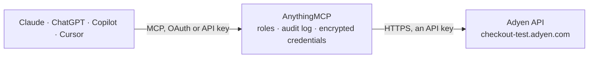

<!-- Generated by scripts/export-github-catalog.mjs in the anythingmcp-website repository. Do not edit by hand. -->

# Adyen MCP connector

Drive Adyen (global payment processor) checkout + payments + balance platform from any AI agent. 10 tools, API-key auth, separate live and test environments. The AnythingMCP connector gives Claude, ChatGPT, Microsoft Copilot, Cursor and Gemini 10 MCP tools for Adyen: 1 read and 9 can change data.

**Category:** [Payments](../payments.md) · **Tools:** 10 · **Setup guide:** [anythingmcp.com](https://anythingmcp.com/guides/adyen-to-mcp) · [Deutsch](https://anythingmcp.com/de/guides/adyen-to-mcp) · [Italiano](https://anythingmcp.com/it/guides/adyen-to-mcp) · [Español](https://anythingmcp.com/es/guides/adyen-to-mcp) · [日本語](https://anythingmcp.com/ja/guides/adyen-to-mcp) · [Русский](https://anythingmcp.com/ru/guides/adyen-to-mcp) · [中文](https://anythingmcp.com/zh/guides/adyen-to-mcp)

## Start without code

No installation and no terminal: AnythingMCP Cloud runs the Adyen connector for you, operated by helpcode.ai in Frankfurt, Germany.

1. **Click the button above** and create an account or sign in. The Adyen connector opens, ready to install.
2. **Paste the API key or token from your Adyen account.** Every click is in the [step-by-step guide](https://anythingmcp.com/guides/adyen-to-mcp).
3. **Click Install.** AnythingMCP shows the address of your MCP server.
4. **Add that address to your assistant:** [Claude](https://anythingmcp.com/guides/connect-adyen-to-claude) · [ChatGPT](https://anythingmcp.com/guides/connect-adyen-to-chatgpt) · [Microsoft Copilot](https://anythingmcp.com/guides/connect-adyen-to-copilot) · [Cursor](https://anythingmcp.com/guides/connect-adyen-to-cursor) · [Gemini CLI](https://anythingmcp.com/guides/connect-adyen-to-gemini) · [Meta Muse](https://anythingmcp.com/guides/connect-adyen-to-muse).
5. **Ask your first question**, for example: *Check session result for session ID sess_9a7b-INV117 for merchant GreenMarket GmbH; what was resultCode and pspReference?*

Prefer help with the setup? [Talk to us](https://anythingmcp.com/contact).

## How it works

- **The AI client** speaks MCP (Streamable HTTP) to AnythingMCP and only sees tool names, descriptions and results. It never gets the Adyen credentials.
- **AnythingMCP** checks the client's role, builds the call from the tool definition, adds the credentials (an API key), calls Adyen, logs the call and returns the result.
- **Adyen** sees an ordinary API client with the rights of the account the credentials belong to.

## Tools

| Tool | What it does | Access |
|---|---|---|
| [`adyen_payment_methods`](#adyen_payment_methods) | List available payment methods for a given currency / country / amount. | write |
| [`adyen_create_payment`](#adyen_create_payment) | Create a payment. | write |
| [`adyen_payments_details`](#adyen_payments_details) | Finalize a payment with the action result (3DS challenge result, redirect result, etc.). | write |
| [`adyen_payments_capture`](#adyen_payments_capture) | Capture an authorised payment (manual-capture flow). | write |
| [`adyen_payments_refund`](#adyen_payments_refund) | Refund a captured payment. | write |
| [`adyen_payments_cancel`](#adyen_payments_cancel) | Cancel an authorisation that hasn't been captured yet. | write |
| [`adyen_payments_reversal`](#adyen_payments_reversal) | Reverse an authorisation (handles capture + refund as one atomic op if needed). | write |
| [`adyen_sessions_create`](#adyen_sessions_create) | Create a payment session (used by Drop-in v5+). | write |
| [`adyen_session_get_result`](#adyen_session_get_result) | Get the result of a session (after the shopper has completed payment in Drop-in). | read |
| [`adyen_origin_keys`](#adyen_origin_keys) | Get origin keys for web-Drop-in (deprecated since 2023 in favor of clientKey — included for legacy integrations). | write |

## Tool reference

Every parameter as the AI client sees it in `tools/list`. Source: [`packages/backend/src/adapters/intl/adyen.json`](../../../packages/backend/src/adapters/intl/adyen.json).

### `adyen_payment_methods`

List available payment methods for a given currency / country / amount. Returns the methods array that the Adyen Drop-in/Components SDKs render.

**Access:** write · **Call:** `POST /paymentMethods`

| Parameter | Type | Required | Description |
|---|---|---|---|
| `merchantAccount` | string | yes | Merchant account name (use ADYEN_MERCHANT_ACCOUNT). |
| `amount` | object | no | {currency:'EUR', value:1099} — minor units. |
| `countryCode` | string | no | ISO 3166-1 alpha-2 country (e.g. 'DE', 'US'). |
| `shopperLocale` | string | no | Locale (e.g. 'en-US', 'de-DE'). |
| `channel` | string | no | iOS, Android, Web. |
| `shopperReference` | string | no | Shopper unique ID — required for showing stored payment methods. |

### `adyen_create_payment`

Create a payment. paymentMethod object varies by method type (card, ideal, paypal, etc.) — usually you get an opaque `paymentMethod` object from the client-side Drop-in. Returns resultCode + action (if 3DS/redirect needed).

**Access:** write · **Call:** `POST /payments`

| Parameter | Type | Required | Description |
|---|---|---|---|
| `merchantAccount` | string | yes | Merchant account name. |
| `amount` | object | yes | {currency, value (minor units)}. |
| `reference` | string | yes | Your unique reference for this payment (shown on reports). |
| `paymentMethod` | object | yes | Method-specific payload, e.g. {type:'scheme', encryptedCardNumber:..., encryptedExpiryMonth:..., encryptedExpiryYear:..., encryptedSecurityCode:..., holderName:...}. From Drop-in/Components. |
| `returnUrl` | string | no | Where to return shopper after redirect-based payments (3DS, iDEAL). |
| `shopperReference` | string | no | Stable shopper ID for storing payment methods. |
| `shopperEmail` | string | no | Email. |
| `shopperIP` | string | no | Shopper IP (for risk scoring). |
| `shopperInteraction` | string | no | Ecommerce (default) or ContAuth (recurring). |
| `recurringProcessingModel` | string | no | CardOnFile, Subscription, UnscheduledCardOnFile — required for storing payment methods. |
| `storePaymentMethod` | boolean | no | If true and shopperReference is set, store the payment method for future use. |
| `billingAddress` | object | no | {street, houseNumberOrName, postalCode, city, country, stateOrProvince?}. |
| `channel` | string | no | Web, iOS, Android. |

### `adyen_payments_details`

Finalize a payment with the action result (3DS challenge result, redirect result, etc.). Called after the shopper completes the action returned by create_payment.

**Access:** write · **Call:** `POST /payments/details`

| Parameter | Type | Required | Description |
|---|---|---|---|
| `details` | object | yes | Action-specific details (e.g. {redirectResult:'...'} for redirect, {threeDSResult:'...'} for 3DS1). |
| `paymentData` | string | no | paymentData string from the create response. |

### `adyen_payments_capture`

Capture an authorised payment (manual-capture flow). For instant capture, set captureDelayHours=0 on create_payment instead.

**Access:** write · **Call:** `POST /payments/{paymentPspReference}/captures`

| Parameter | Type | Required | Description |
|---|---|---|---|
| `paymentPspReference` | string | yes | The pspReference from a prior successful payment authorisation. |
| `merchantAccount` | string | yes | Merchant account name. |
| `amount` | object | yes | {currency, value} — must match authorisation currency. Smaller value = partial capture. |
| `reference` | string | no | Your reference for the capture. |

### `adyen_payments_refund`

Refund a captured payment. Partial refunds OK (smaller amount).

**Access:** write · **Call:** `POST /payments/{paymentPspReference}/refunds`

| Parameter | Type | Required | Description |
|---|---|---|---|
| `paymentPspReference` | string | yes | Original payment pspReference. |
| `merchantAccount` | string | yes | Merchant account. |
| `amount` | object | yes | {currency, value}. |
| `reference` | string | no | Your refund reference. |

### `adyen_payments_cancel`

Cancel an authorisation that hasn't been captured yet.

**Access:** write · **Call:** `POST /payments/{paymentPspReference}/cancels`

| Parameter | Type | Required | Description |
|---|---|---|---|
| `paymentPspReference` | string | yes | Payment pspReference. |
| `merchantAccount` | string | yes | Merchant account. |
| `reference` | string | no | Your reference. |

### `adyen_payments_reversal`

Reverse an authorisation (handles capture + refund as one atomic op if needed).

**Access:** write · **Call:** `POST /payments/{paymentPspReference}/reversals`

| Parameter | Type | Required | Description |
|---|---|---|---|
| `paymentPspReference` | string | yes | Payment pspReference. |
| `merchantAccount` | string | yes | Merchant account. |
| `reference` | string | no | Your reference. |

### `adyen_sessions_create`

Create a payment session (used by Drop-in v5+). Returns a session ID + sessionData the client uses to initialise the SDK.

**Access:** write · **Call:** `POST /sessions`

| Parameter | Type | Required | Description |
|---|---|---|---|
| `merchantAccount` | string | yes | Merchant account. |
| `amount` | object | yes | {currency, value}. |
| `reference` | string | yes | Your unique reference. |
| `returnUrl` | string | yes | Return URL. |
| `countryCode` | string | no | ISO country. |
| `shopperLocale` | string | no | Shopper locale. |
| `channel` | string | no | Web, iOS, Android. |

### `adyen_session_get_result`

Get the result of a session (after the shopper has completed payment in Drop-in).

**Access:** read · **Call:** `GET /sessions/{sessionId}`

| Parameter | Type | Required | Description |
|---|---|---|---|
| `sessionId` | string | yes | Session ID from sessions_create. |
| `sessionResult` | string | yes | sessionResult string from Drop-in's onPaymentCompleted. |

### `adyen_origin_keys`

Get origin keys for web-Drop-in (deprecated since 2023 in favor of clientKey — included for legacy integrations).

**Access:** write · **Call:** `POST /originKeys`

| Parameter | Type | Required | Description |
|---|---|---|---|
| `originDomains` | any[] | yes | Array of URLs (e.g. ['https://shop.acme.com']). |

## Run it yourself

AnythingMCP is open source (AGPL-3.0). [Run it with Docker](../../../README.md#run-it-yourself), open **Connectors → Store**, pick **Adyen** and enter `ADYEN_API_KEY`, `ADYEN_MERCHANT_ACCOUNT`, then add your MCP server URL to the AI client.

[← Payments connectors](../payments.md) · [All categories](../README.md)
