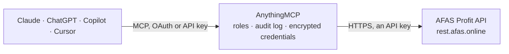

<!-- Generated by scripts/export-github-catalog.mjs in the anythingmcp-website repository. Do not edit by hand. -->

# AFAS Profit MCP connector

AFAS Profit — Dutch ERP and HR: read any published GetConnector, list what is available, and inspect a connector's metadata. The AnythingMCP connector gives Claude, ChatGPT, Microsoft Copilot, Cursor and Gemini 6 MCP tools for AFAS Profit, all read-only.

**Category:** [ERP](../erp.md) · **Tools:** 6 · **Setup guide:** [anythingmcp.com](https://anythingmcp.com/guides/afas-profit-to-mcp) · [Deutsch](https://anythingmcp.com/de/guides/afas-profit-to-mcp) · [Italiano](https://anythingmcp.com/it/guides/afas-profit-to-mcp) · [Español](https://anythingmcp.com/es/guides/afas-profit-to-mcp) · [日本語](https://anythingmcp.com/ja/guides/afas-profit-to-mcp) · [Русский](https://anythingmcp.com/ru/guides/afas-profit-to-mcp) · [中文](https://anythingmcp.com/zh/guides/afas-profit-to-mcp)

## Start without code

No installation and no terminal: AnythingMCP Cloud runs the AFAS Profit connector for you, operated by helpcode.ai in Frankfurt, Germany.

1. **Click the button above** and create an account or sign in. The AFAS Profit connector opens, ready to install.
2. **Paste the API key or token from your AFAS Profit account.** Every click is in the [step-by-step guide](https://anythingmcp.com/guides/afas-profit-to-mcp).
3. **Click Install.** AnythingMCP shows the address of your MCP server.
4. **Add that address to your assistant:** [Claude](https://anythingmcp.com/guides/connect-afas-profit-to-claude) · [ChatGPT](https://anythingmcp.com/guides/connect-afas-profit-to-chatgpt) · [Microsoft Copilot](https://anythingmcp.com/guides/connect-afas-profit-to-copilot) · [Cursor](https://anythingmcp.com/guides/connect-afas-profit-to-cursor) · [Gemini CLI](https://anythingmcp.com/guides/connect-afas-profit-to-gemini) · [Meta Muse](https://anythingmcp.com/guides/connect-afas-profit-to-muse).
5. **Ask your first question**, for example: *Show me the debtor record for debtor number 2003 (I need contact and credit limit).*

Prefer help with the setup? [Talk to us](https://anythingmcp.com/contact).

## How it works

- **The AI client** speaks MCP (Streamable HTTP) to AnythingMCP and only sees tool names, descriptions and results. It never gets the AFAS Profit credentials.
- **AnythingMCP** checks the client's role, builds the call from the tool definition, adds the credentials (an API key), calls AFAS Profit, logs the call and returns the result.
- **AFAS Profit** sees an ordinary API client with the rights of the account the credentials belong to.

## Tools

| Tool | What it does | Access |
|---|---|---|
| [`afas_profit_list_connectors`](#afas_profit_list_connectors) | List the GetConnectors and UpdateConnectors published to this app connector. | read |
| [`afas_profit_get_connector_metadata`](#afas_profit_get_connector_metadata) | Read one GetConnector's field definitions: the field ids, their types and lengths. | read |
| [`afas_profit_get_data`](#afas_profit_get_data) | Read rows from a GetConnector with AFAS's positional three-list filter. | read |
| [`afas_profit_get_debtors`](#afas_profit_get_debtors) | Read the standard Profit_Debtor GetConnector — customers with debtor number (DebtorId), name, address, e-mail, VAT and CoC number, payment condition and… | read |
| [`afas_profit_get_invoices`](#afas_profit_get_invoices) | Read the standard Profit_Debtor_Invoices GetConnector — outstanding debtor items: invoice number (InvoiceNr), debtor (DebtorId), voucher date… | read |
| [`afas_profit_get_employees`](#afas_profit_get_employees) | Read the standard Profit_Employees GetConnector — employees with their number (EmployeeId), person and employer id, name, contact and address data and… | read |

## Tool reference

Every parameter as the AI client sees it in `tools/list`. Source: [`packages/backend/src/adapters/nl/afas-profit.json`](../../../packages/backend/src/adapters/nl/afas-profit.json).

### `afas_profit_list_connectors`

List the GetConnectors and UpdateConnectors published to this app connector. Start here: anything not in this list does not exist as far as the API is concerned.

**Access:** read · **Call:** `GET /metainfo`

No parameters.

### `afas_profit_get_connector_metadata`

Read one GetConnector's field definitions: the field ids, their types and lengths. You need the field ids before any filter will work.

**Access:** read · **Call:** `GET /metainfo/get/{connectorName}`

| Parameter | Type | Required | Description |
|---|---|---|---|
| `connectorName` | string | yes | GetConnector name, e.g. Profit_Debtor. |

### `afas_profit_get_data`

Read rows from a GetConnector with AFAS's positional three-list filter. filterfieldids, filtervalues and operatortypes are read in parallel — keep them in step.

**Access:** read · **Call:** `GET /connectors/{connectorName}`

| Parameter | Type | Required | Description |
|---|---|---|---|
| `connectorName` | string | yes | GetConnector name as listed by afas_profit_list_connectors, e.g. Profit_Debtor_Invoices or your own custom connector. |
| `filterfieldids` | string | no | Comma-separated field ids to filter on, e.g. DebtorId,ExpDate (take them from afas_profit_get_connector_metadata). |
| `filtervalues` | string | no | Comma-separated values, positionally matched to filterfieldids. |
| `operatortypes` | string | no | Comma-separated operator codes, positionally matched to filterfieldids (use `;` instead of `,` between groups for OR). 1 =, 2 >=, 3 <=, 4 >, 5 <, 6 contains, 7 not equal, 8 is empty, 9 is not empty, 10 starts with, 11 does not contain, 12 does not start with, 13 ends with, 14 does not end with. Operators 8 and 9 still need a (possibly empty) value in filtervalues. |
| `skip` | number | no | Rows to skip, for paging (default 0). Always combine with orderbyfieldids so pages do not overlap. |
| `take` | number | no | Rows to return (AFAS default 100). Keep it modest; skip=-1 together with take=-1 returns everything, which AFAS strongly discourages. |
| `orderbyfieldids` | string | no | Comma-separated field ids to sort by; prefix with `-` for descending. AFAS requires a sort whenever you page with skip/take, otherwise rows can repeat or go missing between pages. |

### `afas_profit_get_debtors`

Read the standard Profit_Debtor GetConnector — customers with debtor number (DebtorId), name, address, e-mail, VAT and CoC number, payment condition and credit limit. Only works if it has been added to your app connector.

**Access:** read · **Call:** `GET /connectors/Profit_Debtor`

| Parameter | Type | Required | Description |
|---|---|---|---|
| `skip` | number | no | Rows to skip, for paging (default 0). Always combine with orderbyfieldids so pages do not overlap. |
| `take` | number | no | Rows to return (AFAS default 100). Keep it modest; skip=-1 together with take=-1 returns everything, which AFAS strongly discourages. |
| `filterfieldids` | string | no | Comma-separated field ids to filter on, e.g. DebtorId or DebtorName. |
| `filtervalues` | string | no | Comma-separated values, positionally matched. |
| `operatortypes` | string | no | Comma-separated operator codes, positionally matched to filterfieldids (use `;` instead of `,` between groups for OR). 1 =, 2 >=, 3 <=, 4 >, 5 <, 6 contains, 7 not equal, 8 is empty, 9 is not empty, 10 starts with, 11 does not contain, 12 does not start with, 13 ends with, 14 does not end with. Operators 8 and 9 still need a (possibly empty) value in filtervalues. |
| `orderbyfieldids` | string | no | Comma-separated field ids to sort by; prefix with `-` for descending. AFAS requires a sort whenever you page with skip/take, otherwise rows can repeat or go missing between pages. |

### `afas_profit_get_invoices`

Read the standard Profit_Debtor_Invoices GetConnector — outstanding debtor items: invoice number (InvoiceNr), debtor (DebtorId), voucher date (NookPieceDate), due date (ExpDate), invoice amount and open balance. It holds open items, not every invoice ever sent. Only works if it has been added to your app connector.

**Access:** read · **Call:** `GET /connectors/Profit_Debtor_Invoices`

| Parameter | Type | Required | Description |
|---|---|---|---|
| `skip` | number | no | Rows to skip, for paging (default 0). Always combine with orderbyfieldids so pages do not overlap. |
| `take` | number | no | Rows to return (AFAS default 100). Keep it modest; skip=-1 together with take=-1 returns everything, which AFAS strongly discourages. |
| `filterfieldids` | string | no | Comma-separated field ids to filter on, e.g. DebtorId or ExpDate. |
| `filtervalues` | string | no | Comma-separated values, positionally matched. |
| `operatortypes` | string | no | Comma-separated operator codes, positionally matched to filterfieldids (use `;` instead of `,` between groups for OR). 1 =, 2 >=, 3 <=, 4 >, 5 <, 6 contains, 7 not equal, 8 is empty, 9 is not empty, 10 starts with, 11 does not contain, 12 does not start with, 13 ends with, 14 does not end with. Operators 8 and 9 still need a (possibly empty) value in filtervalues. |
| `orderbyfieldids` | string | no | Comma-separated field ids to sort by; prefix with `-` for descending. AFAS requires a sort whenever you page with skip/take, otherwise rows can repeat or go missing between pages. |

### `afas_profit_get_employees`

Read the standard Profit_Employees GetConnector — employees with their number (EmployeeId), person and employer id, name, contact and address data and employment start. Only works if it has been added to your app connector.

**Access:** read · **Call:** `GET /connectors/Profit_Employees`

| Parameter | Type | Required | Description |
|---|---|---|---|
| `skip` | number | no | Rows to skip, for paging (default 0). Always combine with orderbyfieldids so pages do not overlap. |
| `take` | number | no | Rows to return (AFAS default 100). Keep it modest; skip=-1 together with take=-1 returns everything, which AFAS strongly discourages. |
| `filterfieldids` | string | no | Comma-separated field ids to filter on, e.g. EmployeeId or EmployerId. |
| `filtervalues` | string | no | Comma-separated values, positionally matched. |
| `operatortypes` | string | no | Comma-separated operator codes, positionally matched to filterfieldids (use `;` instead of `,` between groups for OR). 1 =, 2 >=, 3 <=, 4 >, 5 <, 6 contains, 7 not equal, 8 is empty, 9 is not empty, 10 starts with, 11 does not contain, 12 does not start with, 13 ends with, 14 does not end with. Operators 8 and 9 still need a (possibly empty) value in filtervalues. |
| `orderbyfieldids` | string | no | Comma-separated field ids to sort by; prefix with `-` for descending. AFAS requires a sort whenever you page with skip/take, otherwise rows can repeat or go missing between pages. |

## Run it yourself

AnythingMCP is open source (AGPL-3.0). [Run it with Docker](../../../README.md#run-it-yourself), open **Connectors → Store**, pick **AFAS Profit** and enter `AFAS_ENVIRONMENT`, `AFAS_TOKEN`, then add your MCP server URL to the AI client.

[← ERP connectors](../erp.md) · [All categories](../README.md)
