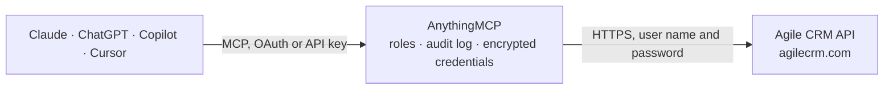

<!-- Generated by scripts/export-github-catalog.mjs in the anythingmcp-website repository. Do not edit by hand. -->

# Agile CRM MCP connector

Manage Agile CRM (contacts, deals, tasks, notes, campaigns) from any AI agent. 9 tools, basic-auth with email + API key. The AnythingMCP connector gives Claude, ChatGPT, Microsoft Copilot, Cursor and Gemini 9 MCP tools for Agile CRM: 4 read and 5 can change data.

**Category:** [CRM](../crm.md) · **Tools:** 9 · **Setup guide:** [anythingmcp.com](https://anythingmcp.com/guides/agilecrm-to-mcp) · [Deutsch](https://anythingmcp.com/de/guides/agilecrm-to-mcp) · [Italiano](https://anythingmcp.com/it/guides/agilecrm-to-mcp) · [Español](https://anythingmcp.com/es/guides/agilecrm-to-mcp) · [日本語](https://anythingmcp.com/ja/guides/agilecrm-to-mcp) · [Русский](https://anythingmcp.com/ru/guides/agilecrm-to-mcp) · [中文](https://anythingmcp.com/zh/guides/agilecrm-to-mcp)

## Start without code

No installation and no terminal: AnythingMCP Cloud runs the Agile CRM connector for you, operated by helpcode.ai in Frankfurt, Germany.

1. **Click the button above** and create an account or sign in. The Agile CRM connector opens, ready to install.
2. **Paste the API key or token from your Agile CRM account.** Every click is in the [step-by-step guide](https://anythingmcp.com/guides/agilecrm-to-mcp).
3. **Click Install.** AnythingMCP shows the address of your MCP server.
4. **Add that address to your assistant:** [Claude](https://anythingmcp.com/guides/connect-agilecrm-to-claude) · [ChatGPT](https://anythingmcp.com/guides/connect-agilecrm-to-chatgpt) · [Microsoft Copilot](https://anythingmcp.com/guides/connect-agilecrm-to-copilot) · [Cursor](https://anythingmcp.com/guides/connect-agilecrm-to-cursor) · [Gemini CLI](https://anythingmcp.com/guides/connect-agilecrm-to-gemini) · [Meta Muse](https://anythingmcp.com/guides/connect-agilecrm-to-muse).
5. **Ask your first question**, for example: *Who is the contact for invoice INV-2026-118? Email on file is finance@skovens.fi*

Prefer help with the setup? [Talk to us](https://anythingmcp.com/contact).

## How it works

- **The AI client** speaks MCP (Streamable HTTP) to AnythingMCP and only sees tool names, descriptions and results. It never gets the Agile CRM credentials.
- **AnythingMCP** checks the client's role, builds the call from the tool definition, adds the credentials (user name and password), calls Agile CRM, logs the call and returns the result.
- **Agile CRM** sees an ordinary API client with the rights of the account the credentials belong to.

## Tools

| Tool | What it does | Access |
|---|---|---|
| [`agilecrm_list_contacts`](#agilecrm_list_contacts) | List contacts. | read |
| [`agilecrm_get_contact`](#agilecrm_get_contact) | Get one contact by ID. | read |
| [`agilecrm_get_contact_by_email`](#agilecrm_get_contact_by_email) | Look up a contact by email — much faster than scanning the list. | read |
| [`agilecrm_create_contact`](#agilecrm_create_contact) | Create a contact. | write |
| [`agilecrm_update_contact`](#agilecrm_update_contact) | Update a contact — supply `id` and the `properties` to merge. | write |
| [`agilecrm_delete_contact`](#agilecrm_delete_contact) | Delete a contact by ID. | write |
| [`agilecrm_list_deals`](#agilecrm_list_deals) | List deals/opportunities. | read |
| [`agilecrm_create_deal`](#agilecrm_create_deal) | Create a deal. | write |
| [`agilecrm_create_task`](#agilecrm_create_task) | Create a task linked to one or more contacts. | write |

## Tool reference

Every parameter as the AI client sees it in `tools/list`. Source: [`packages/backend/src/adapters/intl/agilecrm.json`](../../../packages/backend/src/adapters/intl/agilecrm.json).

### `agilecrm_list_contacts`

List contacts. Cursor-paginated.

**Access:** read · **Call:** `GET /contacts`

| Parameter | Type | Required | Description |
|---|---|---|---|
| `page_size` | integer | no | Max 100. |
| `cursor` | string | no | Pagination cursor from previous response. |

### `agilecrm_get_contact`

Get one contact by ID.

**Access:** read · **Call:** `GET /contacts/{id}`

| Parameter | Type | Required | Description |
|---|---|---|---|
| `id` | string | yes | Contact ID. |

### `agilecrm_get_contact_by_email`

Look up a contact by email — much faster than scanning the list.

**Access:** read · **Call:** `GET /contacts/search/email/{email}`

| Parameter | Type | Required | Description |
|---|---|---|---|
| `email` | string | yes | Email address. |

### `agilecrm_create_contact`

Create a contact. Pass `properties` as the Agile CRM array shape.

**Access:** write · **Call:** `POST /contacts`

| Parameter | Type | Required | Description |
|---|---|---|---|
| `properties` | any[] | yes | Array of {name, value, type:'SYSTEM'\|'CUSTOM', subtype?} entries. |
| `tags` | any[] | no | Array of tag strings. |
| `lead_score` | integer | no | Initial lead score. |

### `agilecrm_update_contact`

Update a contact — supply `id` and the `properties` to merge.

**Access:** write · **Call:** `PUT /contacts/edit-properties`

| Parameter | Type | Required | Description |
|---|---|---|---|
| `id` | string | yes | Contact ID. |
| `properties` | any[] | yes | Properties array to merge. |

### `agilecrm_delete_contact`

Delete a contact by ID.

**Access:** write · **Call:** `DELETE /contacts/{id}`

| Parameter | Type | Required | Description |
|---|---|---|---|
| `id` | string | yes | Contact ID. |

### `agilecrm_list_deals`

List deals/opportunities.

**Access:** read · **Call:** `GET /opportunity`

| Parameter | Type | Required | Description |
|---|---|---|---|
| `page_size` | integer | no | Max 100. |

### `agilecrm_create_deal`

Create a deal.

**Access:** write · **Call:** `POST /opportunity`

| Parameter | Type | Required | Description |
|---|---|---|---|
| `name` | string | yes | Deal name. |
| `expected_value` | number | yes | Expected revenue. |
| `probability` | integer | no | 0-100 close probability. |
| `milestone` | string | yes | Pipeline stage name. |
| `close_date` | integer | no | Expected close UNIX epoch (seconds). |
| `contact_ids` | any[] | no | Array of contact ID strings to link. |

### `agilecrm_create_task`

Create a task linked to one or more contacts.

**Access:** write · **Call:** `POST /tasks`

| Parameter | Type | Required | Description |
|---|---|---|---|
| `subject` | string | yes | Task subject. |
| `type` | string | yes | CALL, EMAIL, FOLLOW_UP, MEETING, MILESTONE, SEND, TWEET, OTHER. |
| `priority_type` | string | no | HIGH, NORMAL, LOW. |
| `status` | string | no | YET_TO_START, IN_PROGRESS, COMPLETED. |
| `due` | integer | yes | Due UNIX epoch (seconds). |
| `contacts` | any[] | no | Array of contact ID strings. |

## Run it yourself

AnythingMCP is open source (AGPL-3.0). [Run it with Docker](../../../README.md#run-it-yourself), open **Connectors → Store**, pick **Agile CRM** and enter `AGILECRM_DOMAIN`, `AGILECRM_EMAIL`, `AGILECRM_API_KEY`, then add your MCP server URL to the AI client.

[← CRM connectors](../crm.md) · [All categories](../README.md)
