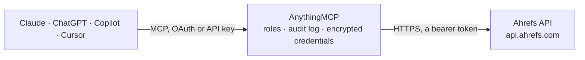

<!-- Generated by scripts/export-github-catalog.mjs in the anythingmcp-website repository. Do not edit by hand. -->

# Ahrefs MCP connector

Give your AI Ahrefs SEO data: Domain Rating, backlinks, referring domains, organic keywords, top pages, competitors, keyword volume, difficulty and ideas, SERP overview and batch comparisons, with … The AnythingMCP connector gives Claude, ChatGPT, Microsoft Copilot, Cursor and Gemini 18 MCP tools for Ahrefs, all read-only.

**Category:** [Analytics](../analytics.md) · **Tools:** 18 · **Setup guide:** [anythingmcp.com](https://anythingmcp.com/guides/ahrefs-to-mcp) · [Deutsch](https://anythingmcp.com/de/guides/ahrefs-to-mcp) · [Italiano](https://anythingmcp.com/it/guides/ahrefs-to-mcp) · [Español](https://anythingmcp.com/es/guides/ahrefs-to-mcp) · [日本語](https://anythingmcp.com/ja/guides/ahrefs-to-mcp) · [Русский](https://anythingmcp.com/ru/guides/ahrefs-to-mcp) · [中文](https://anythingmcp.com/zh/guides/ahrefs-to-mcp)

## Start without code

No installation and no terminal: AnythingMCP Cloud runs the Ahrefs connector for you, operated by helpcode.ai in Frankfurt, Germany.

1. **Click the button above** and create an account or sign in. The Ahrefs connector opens, ready to install.
2. **Paste the API key or token from your Ahrefs account.** Every click is in the [step-by-step guide](https://anythingmcp.com/guides/ahrefs-to-mcp).
3. **Click Install.** AnythingMCP shows the address of your MCP server.
4. **Add that address to your assistant:** [Claude](https://anythingmcp.com/guides/connect-ahrefs-to-claude) · [ChatGPT](https://anythingmcp.com/guides/connect-ahrefs-to-chatgpt) · [Microsoft Copilot](https://anythingmcp.com/guides/connect-ahrefs-to-copilot) · [Cursor](https://anythingmcp.com/guides/connect-ahrefs-to-cursor) · [Gemini CLI](https://anythingmcp.com/guides/connect-ahrefs-to-gemini) · [Meta Muse](https://anythingmcp.com/guides/connect-ahrefs-to-muse).
5. **Ask your first question**, for example: *What's Domain Rating and live backlinks/referring domains for bakerstreet-bakery.eu on 2026-11-01?*

Prefer help with the setup? [Talk to us](https://anythingmcp.com/contact).

## How it works

- **The AI client** speaks MCP (Streamable HTTP) to AnythingMCP and only sees tool names, descriptions and results. It never gets the Ahrefs credentials.
- **AnythingMCP** checks the client's role, builds the call from the tool definition, adds the credentials (a bearer token), calls Ahrefs, logs the call and returns the result.
- **Ahrefs** sees an ordinary API client with the rights of the account the credentials belong to.

## Tools

| Tool | What it does | Access |
|---|---|---|
| [`ahrefs_get_limits_and_usage`](#ahrefs_get_limits_and_usage) | Show the Ahrefs plan, the API units used and allowed this month for the key and the workspace, the reset date and the key's expiry. | read |
| [`ahrefs_domain_rating`](#ahrefs_domain_rating) | Domain Rating (0 to 100, strength of the backlink profile) and Ahrefs Rank of a domain on a date. | read |
| [`ahrefs_backlinks_stats`](#ahrefs_backlinks_stats) | Backlink totals of a domain or URL on a date: live and all-time backlinks and referring domains. | read |
| [`ahrefs_site_metrics`](#ahrefs_site_metrics) | Organic and paid search metrics of a domain or URL on a date: organic keywords (all and top 3), organic traffic and its value, paid keywords, pages and traffic. | read |
| [`ahrefs_metrics_history`](#ahrefs_metrics_history) | History of a domain's organic (and optionally paid) traffic and traffic value, grouped by month, week or day. | read |
| [`ahrefs_domain_rating_history`](#ahrefs_domain_rating_history) | History of a domain's Domain Rating, grouped by month, week or day. | read |
| [`ahrefs_backlinks`](#ahrefs_backlinks) | Backlinks of a domain or URL: linking page, target, anchor, Domain Rating of the source, dofollow, first and last seen. | read |
| [`ahrefs_referring_domains`](#ahrefs_referring_domains) | Domains linking to a domain or URL: Domain Rating, links to the target, dofollow links, first and last seen. | read |
| [`ahrefs_anchors`](#ahrefs_anchors) | Anchor texts of the links to a domain or URL with referring domains and link counts. | read |
| [`ahrefs_organic_keywords`](#ahrefs_organic_keywords) | Keywords a domain or URL ranks for in Google on a date: best position and ranking URL, volume, traffic, difficulty, CPC. | read |
| [`ahrefs_top_pages`](#ahrefs_top_pages) | Pages of a domain that bring the most organic traffic on a date, with traffic value, keyword count and top keyword. | read |
| [`ahrefs_organic_competitors`](#ahrefs_organic_competitors) | Domains competing with a target in organic search in one country: common keywords, their keywords, share and traffic. | read |
| [`ahrefs_keywords_overview`](#ahrefs_keywords_overview) | Metrics of one or more keywords in a country: search volume, Keyword Difficulty, CPC, traffic potential and parent topic. | read |
| [`ahrefs_matching_terms`](#ahrefs_matching_terms) | Keyword ideas that contain the words of the seed keywords (or questions with terms=questions), with volume, difficulty, CPC and traffic potential. | read |
| [`ahrefs_related_terms`](#ahrefs_related_terms) | Related keywords: terms the top-ranking pages also rank for or also mention, with volume, difficulty, CPC and traffic potential. | read |
| [`ahrefs_volume_history`](#ahrefs_volume_history) | Monthly search volume history of one keyword in a country. | read |
| [`ahrefs_serp_overview`](#ahrefs_serp_overview) | The Google results page Ahrefs recorded for a keyword in a country: position, URL, title, type, Domain Rating, URL Rating, backlinks, referring domains and… | read |
| [`ahrefs_batch_analysis`](#ahrefs_batch_analysis) | Compare up to 100 domains or URLs in one call: Domain Rating, backlinks, referring domains, organic keywords and traffic for each. | read |

## Tool reference

Every parameter as the AI client sees it in `tools/list`. Source: [`packages/backend/src/adapters/intl/ahrefs.json`](../../../packages/backend/src/adapters/intl/ahrefs.json).

### `ahrefs_get_limits_and_usage`

Show the Ahrefs plan, the API units used and allowed this month for the key and the workspace, the reset date and the key's expiry. Free: costs no API units.

**Access:** read · **Call:** `GET /subscription-info/limits-and-usage`

No parameters.

### `ahrefs_domain_rating`

Domain Rating (0 to 100, strength of the backlink profile) and Ahrefs Rank of a domain on a date. Costs 50 API units (the minimum per request); free for ahrefs.com, yep.com and firehose.com.

**Access:** read · **Call:** `GET /site-explorer/domain-rating`

| Parameter | Type | Required | Description |
|---|---|---|---|
| `target` | string | yes | Domain or URL to analyse, e.g. example.com, blog.example.com or https://example.com/page. |
| `date` | string | yes | Date to report on, YYYY-MM-DD. Use today's date for current data. |

### `ahrefs_backlinks_stats`

Backlink totals of a domain or URL on a date: live and all-time backlinks and referring domains. Costs 50 API units; free for ahrefs.com, yep.com and firehose.com.

**Access:** read · **Call:** `GET /site-explorer/backlinks-stats`

| Parameter | Type | Required | Description |
|---|---|---|---|
| `target` | string | yes | Domain or URL to analyse, e.g. example.com, blog.example.com or https://example.com/page. |
| `date` | string | yes | Date to report on, YYYY-MM-DD. Use today's date for current data. |
| `mode` | `exact` \| `prefix` \| `domain` \| `subdomains` | no | Scope of target: subdomains (default, the domain with all subdomains), domain (this host only), prefix (all URLs under a path), exact (one URL). |
| `protocol` | `both` \| `http` \| `https` | no | Protocol of the target. Default both. |

### `ahrefs_site_metrics`

Organic and paid search metrics of a domain or URL on a date: organic keywords (all and top 3), organic traffic and its value, paid keywords, pages and traffic. Costs 50 API units; free for ahrefs.com, yep.com and firehose.com. Traffic values are monthly visits, costs are in USD cents.

**Access:** read · **Call:** `GET /site-explorer/metrics`

| Parameter | Type | Required | Description |
|---|---|---|---|
| `target` | string | yes | Domain or URL to analyse, e.g. example.com, blog.example.com or https://example.com/page. |
| `date` | string | yes | Date to report on, YYYY-MM-DD. Use today's date for current data. |
| `country` | string | no | Two-letter country code in lower case, e.g. us, de, it. Leave out for all countries. |
| `mode` | `exact` \| `prefix` \| `domain` \| `subdomains` | no | Scope of target: subdomains (default, the domain with all subdomains), domain (this host only), prefix (all URLs under a path), exact (one URL). |
| `protocol` | `both` \| `http` \| `https` | no | Protocol of the target. Default both. |
| `volume_mode` | `monthly` \| `average` | no | Search volume basis for traffic: monthly (default) or average. |

### `ahrefs_metrics_history`

History of a domain's organic (and optionally paid) traffic and traffic value, grouped by month, week or day. Costs max(50, units per row x rows) API units; requests on ahrefs.com, yep.com or firehose.com as target are free test queries. Each row is one period; org_traffic and org_cost cost 10 units per row each.

**Access:** read · **Call:** `GET /site-explorer/metrics-history`

| Parameter | Type | Required | Description |
|---|---|---|---|
| `target` | string | yes | Domain or URL to analyse, e.g. example.com, blog.example.com or https://example.com/page. |
| `date_from` | string | yes | Start of the period, YYYY-MM-DD. |
| `date_to` | string | no | End of the period, YYYY-MM-DD. Default today. |
| `history_grouping` | `monthly` \| `weekly` \| `daily` | no | Period of each row. Default monthly; daily makes many rows. |
| `select` | string | no | Comma-separated columns to return. Default date,org_traffic,org_cost. Each column costs units per row (most 1, the ones marked here more): date, org_traffic (10), org_cost (10), paid_traffic (10), paid_cost (10). |
| `country` | string | no | Two-letter country code in lower case, e.g. us, de, it. Leave out for all countries. |
| `mode` | `exact` \| `prefix` \| `domain` \| `subdomains` | no | Scope of target: subdomains (default, the domain with all subdomains), domain (this host only), prefix (all URLs under a path), exact (one URL). |
| `protocol` | `both` \| `http` \| `https` | no | Protocol of the target. Default both. |

### `ahrefs_domain_rating_history`

History of a domain's Domain Rating, grouped by month, week or day. Costs 50 API units for up to 25 rows (2 units per row); free for ahrefs.com, yep.com and firehose.com.

**Access:** read · **Call:** `GET /site-explorer/domain-rating-history`

| Parameter | Type | Required | Description |
|---|---|---|---|
| `target` | string | yes | Domain or URL to analyse, e.g. example.com, blog.example.com or https://example.com/page. |
| `date_from` | string | yes | Start of the period, YYYY-MM-DD. |
| `date_to` | string | no | End of the period, YYYY-MM-DD. Default today. |
| `history_grouping` | `monthly` \| `weekly` \| `daily` | no | Period of each row. Default monthly. |

### `ahrefs_backlinks`

Backlinks of a domain or URL: linking page, target, anchor, Domain Rating of the source, dofollow, first and last seen. Costs max(50, units per row x rows) API units; requests on ahrefs.com, yep.com or firehose.com as target are free test queries. The default columns cost 8 units per row.

**Access:** read · **Call:** `GET /site-explorer/all-backlinks`

| Parameter | Type | Required | Description |
|---|---|---|---|
| `target` | string | yes | Domain or URL to analyse, e.g. example.com, blog.example.com or https://example.com/page. |
| `mode` | `exact` \| `prefix` \| `domain` \| `subdomains` | no | Scope of target: subdomains (default, the domain with all subdomains), domain (this host only), prefix (all URLs under a path), exact (one URL). |
| `select` | string | no | Comma-separated columns to return. Default url_from,url_to,anchor,title,domain_rating_source,is_dofollow,first_seen,last_seen. Each column costs units per row (most 1, the ones marked here more): url_from, url_to, anchor, title, domain_rating_source, url_rating_source, is_dofollow, is_nofollow, is_lost, first_seen, last_seen, lost_reason, links_external, traffic (10), refdomains_source (5), traffic_domain (10). |
| `limit` | integer | no | Rows to return (default 10). At 8 units per row the default costs the 50-unit minimum. Ahrefs returns 1,000 rows when left out, and plans cap rows per request. |
| `order_by` | string | no | Column and direction to sort by, e.g. first_seen:desc. Default domain_rating_source:desc. |
| `where` | string | no | Optional filter as Ahrefs JSON filter syntax, e.g. {"and":[{"field":"volume","is":["gte",100]}]}. Operators include eq, neq, gt, gte, lt, lte, substring, isubstring, prefix, suffix. Fields in the filter are billed like selected fields. |
| `history` | string | no | Which links: live (only current links), since:YYYY-MM-DD (current plus those lost since that date) or all_time (default, every link ever seen). |
| `aggregation` | `similar_links` \| `1_per_domain` \| `all` | no | Grouping: similar_links (default) groups near-identical links, 1_per_domain keeps one link per referring domain, all returns every link. |
| `protocol` | `both` \| `http` \| `https` | no | Protocol of the target. Default both. |

### `ahrefs_referring_domains`

Domains linking to a domain or URL: Domain Rating, links to the target, dofollow links, first and last seen. Costs max(50, units per row x rows) API units; requests on ahrefs.com, yep.com or firehose.com as target are free test queries. The default columns cost 6 units per row.

**Access:** read · **Call:** `GET /site-explorer/refdomains`

| Parameter | Type | Required | Description |
|---|---|---|---|
| `target` | string | yes | Domain or URL to analyse, e.g. example.com, blog.example.com or https://example.com/page. |
| `mode` | `exact` \| `prefix` \| `domain` \| `subdomains` | no | Scope of target: subdomains (default, the domain with all subdomains), domain (this host only), prefix (all URLs under a path), exact (one URL). |
| `select` | string | no | Comma-separated columns to return. Default domain,domain_rating,links_to_target,dofollow_links,first_seen,last_seen. Each column costs units per row (most 1, the ones marked here more): domain, domain_rating, links_to_target, dofollow_links, new_links, lost_links, first_seen, last_seen, is_spam, dofollow_refdomains (5), traffic_domain (10). |
| `limit` | integer | no | Rows to return (default 10). At 6 units per row the default costs the 50-unit minimum. Ahrefs returns 1,000 rows when left out, and plans cap rows per request. |
| `order_by` | string | no | Column and direction to sort by, e.g. links_to_target:desc. Default domain_rating:desc. |
| `where` | string | no | Optional filter as Ahrefs JSON filter syntax, e.g. {"and":[{"field":"volume","is":["gte",100]}]}. Operators include eq, neq, gt, gte, lt, lte, substring, isubstring, prefix, suffix. Fields in the filter are billed like selected fields. |
| `history` | string | no | Which links: live (only current links), since:YYYY-MM-DD (current plus those lost since that date) or all_time (default, every link ever seen). |
| `protocol` | `both` \| `http` \| `https` | no | Protocol of the target. Default both. |

### `ahrefs_anchors`

Anchor texts of the links to a domain or URL with referring domains and link counts. Costs max(50, units per row x rows) API units; requests on ahrefs.com, yep.com or firehose.com as target are free test queries. The default columns cost 10 units per row.

**Access:** read · **Call:** `GET /site-explorer/anchors`

| Parameter | Type | Required | Description |
|---|---|---|---|
| `target` | string | yes | Domain or URL to analyse, e.g. example.com, blog.example.com or https://example.com/page. |
| `mode` | `exact` \| `prefix` \| `domain` \| `subdomains` | no | Scope of target: subdomains (default, the domain with all subdomains), domain (this host only), prefix (all URLs under a path), exact (one URL). |
| `select` | string | no | Comma-separated columns to return. Default anchor,refdomains,links_to_target,dofollow_links,first_seen,last_seen. Each column costs units per row (most 1, the ones marked here more): anchor, refdomains (5), refpages, links_to_target, dofollow_links, new_links, lost_links, first_seen, last_seen, top_domain_rating. |
| `limit` | integer | no | Rows to return (default 10). At 10 units per row the default costs 100 units. Ahrefs returns 1,000 rows when left out, and plans cap rows per request. |
| `order_by` | string | no | Column and direction to sort by, e.g. links_to_target:desc. Default refdomains:desc. |
| `where` | string | no | Optional filter as Ahrefs JSON filter syntax, e.g. {"and":[{"field":"volume","is":["gte",100]}]}. Operators include eq, neq, gt, gte, lt, lte, substring, isubstring, prefix, suffix. Fields in the filter are billed like selected fields. |
| `history` | string | no | Which links: live (only current links), since:YYYY-MM-DD (current plus those lost since that date) or all_time (default, every link ever seen). |
| `protocol` | `both` \| `http` \| `https` | no | Protocol of the target. Default both. |

### `ahrefs_organic_keywords`

Keywords a domain or URL ranks for in Google on a date: best position and ranking URL, volume, traffic, difficulty, CPC. Costs max(50, units per row x rows) API units; requests on ahrefs.com, yep.com or firehose.com as target are free test queries. The default columns cost 34 units per row (volume, sum_traffic and keyword_difficulty 10 each).

**Access:** read · **Call:** `GET /site-explorer/organic-keywords`

| Parameter | Type | Required | Description |
|---|---|---|---|
| `target` | string | yes | Domain or URL to analyse, e.g. example.com, blog.example.com or https://example.com/page. |
| `date` | string | yes | Date to report on, YYYY-MM-DD. Use today's date for current data. |
| `country` | string | no | Two-letter country code in lower case, e.g. us, de, it. Leave out for all countries. |
| `mode` | `exact` \| `prefix` \| `domain` \| `subdomains` | no | Scope of target: subdomains (default, the domain with all subdomains), domain (this host only), prefix (all URLs under a path), exact (one URL). |
| `select` | string | no | Comma-separated columns to return. Default keyword,best_position,best_position_url,volume,sum_traffic,keyword_difficulty,cpc. Each column costs units per row (most 1, the ones marked here more): keyword, best_position, best_position_url, best_position_diff, cpc (USD cents), is_branded, is_commercial, is_informational, is_navigational, is_transactional, serp_features, words, volume (10), sum_traffic (10), keyword_difficulty (10). |
| `limit` | integer | no | Rows to return (default 10). At the default 34 units per row, 10 rows cost 340 units. Ahrefs returns 1,000 rows when left out, and plans cap rows per request. |
| `order_by` | string | no | Column and direction to sort by, e.g. volume:desc. Default sum_traffic:desc. |
| `where` | string | no | Optional filter as Ahrefs JSON filter syntax, e.g. {"and":[{"field":"volume","is":["gte",100]}]}. Operators include eq, neq, gt, gte, lt, lte, substring, isubstring, prefix, suffix. Fields in the filter are billed like selected fields. |
| `date_compared` | string | no | Optional earlier date, YYYY-MM-DD, to compare positions and traffic with (adds *_prev fields). |
| `protocol` | `both` \| `http` \| `https` | no | Protocol of the target. Default both. |

### `ahrefs_top_pages`

Pages of a domain that bring the most organic traffic on a date, with traffic value, keyword count and top keyword. Costs max(50, units per row x rows) API units; requests on ahrefs.com, yep.com or firehose.com as target are free test queries. The default columns cost 24 units per row.

**Access:** read · **Call:** `GET /site-explorer/top-pages`

| Parameter | Type | Required | Description |
|---|---|---|---|
| `target` | string | yes | Domain or URL to analyse, e.g. example.com, blog.example.com or https://example.com/page. |
| `date` | string | yes | Date to report on, YYYY-MM-DD. Use today's date for current data. |
| `country` | string | no | Two-letter country code in lower case, e.g. us, de, it. Leave out for all countries. |
| `mode` | `exact` \| `prefix` \| `domain` \| `subdomains` | no | Scope of target: subdomains (default, the domain with all subdomains), domain (this host only), prefix (all URLs under a path), exact (one URL). |
| `select` | string | no | Comma-separated columns to return. Default url,sum_traffic,value,keywords,top_keyword,top_keyword_best_position. Each column costs units per row (most 1, the ones marked here more): url, keywords, top_keyword, top_keyword_best_position, ur, status, sum_traffic (10), value (10, USD cents), top_keyword_volume (10), referring_domains (10). |
| `limit` | integer | no | Rows to return (default 10). At the default 24 units per row, 10 rows cost 240 units. Ahrefs returns 1,000 rows when left out, and plans cap rows per request. |
| `order_by` | string | no | Column and direction to sort by, e.g. keywords:desc. Default sum_traffic:desc. |
| `where` | string | no | Optional filter as Ahrefs JSON filter syntax, e.g. {"and":[{"field":"volume","is":["gte",100]}]}. Operators include eq, neq, gt, gte, lt, lte, substring, isubstring, prefix, suffix. Fields in the filter are billed like selected fields. |
| `protocol` | `both` \| `http` \| `https` | no | Protocol of the target. Default both. |

### `ahrefs_organic_competitors`

Domains competing with a target in organic search in one country: common keywords, their keywords, share and traffic. Costs max(50, units per row x rows) API units; requests on ahrefs.com, yep.com or firehose.com as target are free test queries. The default columns cost 15 units per row.

**Access:** read · **Call:** `GET /site-explorer/organic-competitors`

| Parameter | Type | Required | Description |
|---|---|---|---|
| `target` | string | yes | Domain or URL to analyse, e.g. example.com, blog.example.com or https://example.com/page. |
| `date` | string | yes | Date to report on, YYYY-MM-DD. Use today's date for current data. |
| `country` | string | yes | Two-letter country code in lower case, required here, e.g. us, de, it. |
| `mode` | `exact` \| `prefix` \| `domain` \| `subdomains` | no | Scope of target: subdomains (default, the domain with all subdomains), domain (this host only), prefix (all URLs under a path), exact (one URL). |
| `select` | string | no | Comma-separated columns to return. Default competitor_domain,keywords_common,keywords_competitor,share,traffic,domain_rating. Each column costs units per row (most 1, the ones marked here more): competitor_domain, competitor_url, keywords_common, keywords_competitor, keywords_target, share, domain_rating, pages, traffic (10), value (10). |
| `limit` | integer | no | Rows to return (default 10). At the default 15 units per row, 10 rows cost 150 units. Ahrefs returns 1,000 rows when left out, and plans cap rows per request. |
| `order_by` | string | no | Column and direction to sort by, e.g. share:desc. Default keywords_common:desc. |
| `where` | string | no | Optional filter as Ahrefs JSON filter syntax, e.g. {"and":[{"field":"volume","is":["gte",100]}]}. Operators include eq, neq, gt, gte, lt, lte, substring, isubstring, prefix, suffix. Fields in the filter are billed like selected fields. |
| `protocol` | `both` \| `http` \| `https` | no | Protocol of the target. Default both. |

### `ahrefs_keywords_overview`

Metrics of one or more keywords in a country: search volume, Keyword Difficulty, CPC, traffic potential and parent topic. Costs max(50, units per row x rows) API units; the keywords ahrefs, yep or firehose alone are free test queries. The default columns cost 33 units per keyword.

**Access:** read · **Call:** `GET /keywords-explorer/overview`

| Parameter | Type | Required | Description |
|---|---|---|---|
| `keywords` | string | yes | One keyword or several separated by commas, e.g. seo tools,keyword research. |
| `country` | string | yes | Two-letter country code in lower case (ISO 3166-1 alpha-2), e.g. us, de, it. |
| `select` | string | no | Comma-separated columns to return. Default keyword,volume,difficulty,cpc,traffic_potential,parent_topic. Each column costs units per row (most 1, the ones marked here more): keyword, cpc (USD cents), cps, parent_topic, serp_features, first_seen, volume (10), difficulty (10), traffic_potential (10), global_volume (10), intents (10). |
| `limit` | integer | no | Rows to return (default 10). One row per keyword. Ahrefs returns 1,000 rows when left out, and plans cap rows per request. |
| `order_by` | string | no | Column and direction to sort by, e.g. difficulty:asc. Default volume:desc. |
| `where` | string | no | Optional filter as Ahrefs JSON filter syntax, e.g. {"and":[{"field":"volume","is":["gte",100]}]}. Operators include eq, neq, gt, gte, lt, lte, substring, isubstring, prefix, suffix. Fields in the filter are billed like selected fields. |

### `ahrefs_matching_terms`

Keyword ideas that contain the words of the seed keywords (or questions with terms=questions), with volume, difficulty, CPC and traffic potential. Costs max(50, units per row x rows) API units; the keywords ahrefs, yep or firehose alone are free test queries. The default columns cost 32 units per row.

**Access:** read · **Call:** `GET /keywords-explorer/matching-terms`

| Parameter | Type | Required | Description |
|---|---|---|---|
| `keywords` | string | yes | One keyword or several separated by commas, e.g. seo tools,keyword research. |
| `country` | string | yes | Two-letter country code in lower case (ISO 3166-1 alpha-2), e.g. us, de, it. |
| `select` | string | no | Comma-separated columns to return. Default keyword,volume,difficulty,cpc,traffic_potential. Each column costs units per row (most 1, the ones marked here more): keyword, cpc (USD cents), cps, parent_topic, serp_features, first_seen, volume (10), difficulty (10), traffic_potential (10), global_volume (10), intents (10). |
| `limit` | integer | no | Rows to return (default 10). At the default 32 units per row, 10 rows cost 320 units. Ahrefs returns 1,000 rows when left out, and plans cap rows per request. |
| `order_by` | string | no | Column and direction to sort by, e.g. difficulty:asc. Default volume:desc. |
| `where` | string | no | Optional filter as Ahrefs JSON filter syntax, e.g. {"and":[{"field":"volume","is":["gte",100]}]}. Operators include eq, neq, gt, gte, lt, lte, substring, isubstring, prefix, suffix. Fields in the filter are billed like selected fields. |
| `terms` | `all` \| `questions` | no | all (default) for every idea, questions for ideas phrased as questions. |
| `match_mode` | `terms` \| `phrase` | no | terms (default): the words in any order; phrase: in the exact order. |

### `ahrefs_related_terms`

Related keywords: terms the top-ranking pages also rank for or also mention, with volume, difficulty, CPC and traffic potential. Costs max(50, units per row x rows) API units; the keywords ahrefs, yep or firehose alone are free test queries. The default columns cost 32 units per row.

**Access:** read · **Call:** `GET /keywords-explorer/related-terms`

| Parameter | Type | Required | Description |
|---|---|---|---|
| `keywords` | string | yes | One keyword or several separated by commas, e.g. seo tools,keyword research. |
| `country` | string | yes | Two-letter country code in lower case (ISO 3166-1 alpha-2), e.g. us, de, it. |
| `select` | string | no | Comma-separated columns to return. Default keyword,volume,difficulty,cpc,traffic_potential. Each column costs units per row (most 1, the ones marked here more): keyword, cpc (USD cents), cps, parent_topic, serp_features, first_seen, volume (10), difficulty (10), traffic_potential (10), global_volume (10), intents (10). |
| `limit` | integer | no | Rows to return (default 10). At the default 32 units per row, 10 rows cost 320 units. Ahrefs returns 1,000 rows when left out, and plans cap rows per request. |
| `order_by` | string | no | Column and direction to sort by, e.g. difficulty:asc. Default volume:desc. |
| `where` | string | no | Optional filter as Ahrefs JSON filter syntax, e.g. {"and":[{"field":"volume","is":["gte",100]}]}. Operators include eq, neq, gt, gte, lt, lte, substring, isubstring, prefix, suffix. Fields in the filter are billed like selected fields. |
| `terms` | `all` \| `also_rank_for` \| `also_talk_about` | no | also_rank_for, also_talk_about, or all (default) for both. |
| `view_for` | `top_10` \| `top_100` | no | Base the ideas on the top 10 (default) or top 100 ranking pages. |

### `ahrefs_volume_history`

Monthly search volume history of one keyword in a country. Costs 50 API units for up to 25 months (2 units per month); free for the keywords ahrefs, yep and firehose.

**Access:** read · **Call:** `GET /keywords-explorer/volume-history`

| Parameter | Type | Required | Description |
|---|---|---|---|
| `keyword` | string | yes | The keyword, e.g. running shoes. |
| `country` | string | yes | Two-letter country code in lower case (ISO 3166-1 alpha-2), e.g. us, de, it. |
| `date_from` | string | no | Optional start, YYYY-MM-DD. |
| `date_to` | string | no | Optional end, YYYY-MM-DD. |

### `ahrefs_serp_overview`

The Google results page Ahrefs recorded for a keyword in a country: position, URL, title, type, Domain Rating, URL Rating, backlinks, referring domains and traffic of each result. Costs max(50, units per row x rows) API units; the keywords ahrefs, yep or firehose alone are free test queries. The default columns cost 25 units per position.

**Access:** read · **Call:** `GET /serp-overview/serp-overview`

| Parameter | Type | Required | Description |
|---|---|---|---|
| `keyword` | string | yes | The keyword, e.g. running shoes. |
| `country` | string | yes | Two-letter country code in lower case (ISO 3166-1 alpha-2), e.g. us, de, it. |
| `select` | string | no | Comma-separated columns to return. Default position,url,title,type,domain_rating,url_rating,backlinks,refdomains,traffic. Each column costs units per row (most 1, the ones marked here more): position, url, title, type, domain_rating, url_rating, backlinks, keywords, top_keyword, page_type, update_date, refdomains (5), traffic (10), value (10), top_keyword_volume (10). |
| `top_positions` | integer | no | Number of top organic positions to return (default 10). |
| `date` | string | no | Optional timestamp YYYY-MM-DDThh:mm:ss for the last SERP recorded before it. Default the most recent. |

### `ahrefs_batch_analysis`

Compare up to 100 domains or URLs in one call: Domain Rating, backlinks, referring domains, organic keywords and traffic for each. Read-only, though it uses POST. Costs max(50, units per row x targets); refdomains cost 5 and org_traffic 10 units per row.

**Access:** read · **Call:** `POST /batch-analysis/batch-analysis`

| Parameter | Type | Required | Description |
|---|---|---|---|
| `targets` | object[] | yes | Targets to analyse, each {"url": "example.com", "mode": "subdomains", "protocol": "both"}. mode is exact, prefix, domain or subdomains; protocol is both, http or https. |
| `select` | string[] | no | Fields to return. Default url, domain_rating, backlinks, refdomains, org_keywords, org_traffic (17 units per target). Also: ahrefs_rank, url_rating, backlinks_dofollow, refdomains_dofollow (5), linked_domains, org_keywords_1_3, org_keywords_4_10, org_cost (10), paid_keywords, paid_traffic (10), paid_cost (10), refips, outgoing_links. |
| `country` | string | no | Two-letter country code in lower case, e.g. us, de, it. Leave out for all countries. |
| `order_by` | string[] | no | Optional sort, e.g. ["domain_rating:desc"]. |

## Run it yourself

AnythingMCP is open source (AGPL-3.0). [Run it with Docker](../../../README.md#run-it-yourself), open **Connectors → Store**, pick **Ahrefs** and enter `AHREFS_API_KEY`, then add your MCP server URL to the AI client.

[← Analytics connectors](../analytics.md) · [All categories](../README.md)
