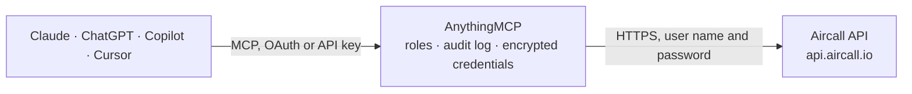

<!-- Generated by scripts/export-github-catalog.mjs in the anythingmcp-website repository. Do not edit by hand. -->

# Aircall MCP connector

Let your AI work with Aircall: look up calls, recordings and voicemails, read AI transcripts, summaries and sentiment, see who is available, add notes and tags to calls, manage shared contacts and … The AnythingMCP connector gives Claude, ChatGPT, Microsoft Copilot, Cursor and Gemini 32 MCP tools for Aircall: 24 read and 8 can change data.

**Category:** [Messaging](../messaging.md) · **Tools:** 32 · **Setup guide:** [anythingmcp.com](https://anythingmcp.com/guides/aircall-to-mcp) · [Deutsch](https://anythingmcp.com/de/guides/aircall-to-mcp) · [Italiano](https://anythingmcp.com/it/guides/aircall-to-mcp) · [Español](https://anythingmcp.com/es/guides/aircall-to-mcp) · [日本語](https://anythingmcp.com/ja/guides/aircall-to-mcp) · [Русский](https://anythingmcp.com/ru/guides/aircall-to-mcp) · [中文](https://anythingmcp.com/zh/guides/aircall-to-mcp)

## Start without code

No installation and no terminal: AnythingMCP Cloud runs the Aircall connector for you, operated by helpcode.ai in Frankfurt, Germany.

1. **Click the button above** and create an account or sign in. The Aircall connector opens, ready to install.
2. **Paste the API key or token from your Aircall account.** Every click is in the [step-by-step guide](https://anythingmcp.com/guides/aircall-to-mcp).
3. **Click Install.** AnythingMCP shows the address of your MCP server.
4. **Add that address to your assistant:** [Claude](https://anythingmcp.com/guides/connect-aircall-to-claude) · [ChatGPT](https://anythingmcp.com/guides/connect-aircall-to-chatgpt) · [Microsoft Copilot](https://anythingmcp.com/guides/connect-aircall-to-copilot) · [Cursor](https://anythingmcp.com/guides/connect-aircall-to-cursor) · [Gemini CLI](https://anythingmcp.com/guides/connect-aircall-to-gemini) · [Meta Muse](https://anythingmcp.com/guides/connect-aircall-to-muse).
5. **Ask your first question**, for example: *Find the call with customer 'Nordic Solar Oy' on 2026-08-12 and give me duration, agent and recording link*

Prefer help with the setup? [Talk to us](https://anythingmcp.com/contact).

## How it works

- **The AI client** speaks MCP (Streamable HTTP) to AnythingMCP and only sees tool names, descriptions and results. It never gets the Aircall credentials.
- **AnythingMCP** checks the client's role, builds the call from the tool definition, adds the credentials (user name and password), calls Aircall, logs the call and returns the result.
- **Aircall** sees an ordinary API client with the rights of the account the credentials belong to.

## Tools

| Tool | What it does | Access |
|---|---|---|
| [`aircall_ping`](#aircall_ping) | Check that the Aircall API ID and token work. | read |
| [`aircall_get_company`](#aircall_get_company) | Read the Aircall company this key belongs to: its name, the number of users and the number of phone numbers. | read |
| [`aircall_list_users`](#aircall_list_users) | List the users (agents and admins) of the Aircall company with id, name, email, extension, time zone, language and availability (available, custom by… | read |
| [`aircall_get_user`](#aircall_get_user) | Read one Aircall user by id or by email address: name, email, extension, time zone, language, wrap-up time and availability. | read |
| [`aircall_list_user_numbers`](#aircall_list_user_numbers) | List the Aircall phone numbers a user is assigned to, with id, name and digits. | read |
| [`aircall_get_user_availability`](#aircall_get_user_availability) | Read the live availability of one user: available, offline, do_not_disturb, in_call or after_call_work (wrapping up the last call). | read |
| [`aircall_list_user_availabilities`](#aircall_list_user_availabilities) | List the live availability of every user at once (available, offline, do_not_disturb, in_call, after_call_work), as shown in the Activity Feed of the… | read |
| [`aircall_list_teams`](#aircall_list_teams) | List the teams of the Aircall company with their members (id, name, email, availability and default number). | read |
| [`aircall_get_team`](#aircall_get_team) | Read one team by id with its name, creation date and the users in it. | read |
| [`aircall_list_numbers`](#aircall_list_numbers) | List the phone numbers (lines) of the Aircall company: id, name, digits, country, time zone, whether the line is open now, IVR and live recording settings. | read |
| [`aircall_get_number`](#aircall_get_number) | Read one Aircall phone number by id: name, digits, country, time zone, opening state, IVR and live recording settings. | read |
| [`aircall_list_calls`](#aircall_list_calls) | List the company's calls (oldest first unless order is desc; only the last six months, at most 10,000 per query) with direction, status, times, duration in… | read |
| [`aircall_search_calls`](#aircall_search_calls) | Search calls by direction, user, phone number, tags and time range (last six months only). | read |
| [`aircall_get_call`](#aircall_get_call) | Read one call by id: direction, status, missed_call_reason, start, answer and end times (UNIX seconds), duration, user, line, contact, teams, tags, notes,… | read |
| [`aircall_get_call_transcription`](#aircall_get_call_transcription) | Read the transcript of an ended call: language and every utterance with start and end second, text, and whether an agent (internal, with user_id) or the… | read |
| [`aircall_get_call_summary`](#aircall_get_call_summary) | Read the AI summary of an ended call (a short text). | read |
| [`aircall_get_call_sentiments`](#aircall_get_call_sentiments) | Read the AI sentiment of each participant of an ended call (POSITIVE, NEUTRAL or NEGATIVE, by phone number and type). | read |
| [`aircall_get_call_topics`](#aircall_get_call_topics) | Read the key topics the AI found in an ended call, as a list of short words (e.g. payment, billing). | read |
| [`aircall_get_call_action_items`](#aircall_get_call_action_items) | Read the action items of an ended call, written by the AI or by an agent (ai_generated tells which), each with its text and dates. | read |
| [`aircall_comment_call`](#aircall_comment_call) | Add a note (comment) to a call. | write |
| [`aircall_tag_call`](#aircall_tag_call) | Add one or more existing tags to a call (tag ids from aircall_list_tags). | write |
| [`aircall_archive_call`](#aircall_archive_call) | Mark a call as archived (archived: true). | write |
| [`aircall_list_contacts`](#aircall_list_contacts) | List the company's shared Aircall contacts with names, company, notes, phone numbers and email addresses. | read |
| [`aircall_search_contacts`](#aircall_search_contacts) | Find shared contacts by phone number or email address (exact match), e.g. to see who called. | read |
| [`aircall_get_contact`](#aircall_get_contact) | Read one shared contact by id with names, company, notes (information), phone numbers and email addresses. | read |
| [`aircall_create_contact`](#aircall_create_contact) | Create a contact shared with the whole company. | write |
| [`aircall_update_contact`](#aircall_update_contact) | Change the name, company or information of a shared contact; only the fields you pass change (phone numbers and emails are not changed by this tool). | write |
| [`aircall_delete_contact`](#aircall_delete_contact) | Delete a shared contact for the whole company. | write |
| [`aircall_list_tags`](#aircall_list_tags) | List the call tags of the company with id, name, color and description. | read |
| [`aircall_start_outbound_call`](#aircall_start_outbound_call) | Start a real phone call from a user's Aircall Workspace (desktop app) to a phone number, using one of the user's Aircall numbers. | write |
| [`aircall_dial_number`](#aircall_dial_number) | Put a phone number into a user's Aircall Workspace dialer (desktop app) without calling: the user then starts the call and picks the line. | write |
| [`aircall_list_webhooks`](#aircall_list_webhooks) | List the webhooks of the company: id, target URL, whether it is active and the events it receives. | read |

## Tool reference

Every parameter as the AI client sees it in `tools/list`. Source: [`packages/backend/src/adapters/intl/aircall.json`](../../../packages/backend/src/adapters/intl/aircall.json).

### `aircall_ping`

Check that the Aircall API ID and token work. Answers {"ping": "pong"} when they do; a 403 means Aircall refused the key. Use it first when other tools fail.

**Access:** read · **Call:** `GET /v1/ping`

No parameters.

### `aircall_get_company`

Read the Aircall company this key belongs to: its name, the number of users and the number of phone numbers.

**Access:** read · **Call:** `GET /v1/company`

No parameters.

### `aircall_list_users`

List the users (agents and admins) of the Aircall company with id, name, email, extension, time zone, language and availability (available, custom by working hours, or unavailable). Paged: meta.next_page_link is null on the last page.

**Access:** read · **Call:** `GET /v2/users`

| Parameter | Type | Required | Description |
|---|---|---|---|
| `from` | string | no | Only items created at or after this time, as a UNIX timestamp in seconds (e.g. 1760486400). |
| `to` | string | no | Only items created at or before this time, as a UNIX timestamp in seconds. |
| `order` | `asc` \| `desc` | no | Sort by creation time: asc (oldest first, the default) or desc (newest first). |
| `page` | integer | no | Page to read, starting at 1 (default 1). Follow meta.next_page_link: it is null on the last page. |
| `per_page` | integer | no | Results per page, 1 to 50 (default 20). |

### `aircall_get_user`

Read one Aircall user by id or by email address: name, email, extension, time zone, language, wrap-up time and availability.

**Access:** read · **Call:** `GET /v2/users/{user_id}`

| Parameter | Type | Required | Description |
|---|---|---|---|
| `user_id` | string | yes | The user id (e.g. 456) or the user's email address (e.g. john.doe@example.com). |

### `aircall_list_user_numbers`

List the Aircall phone numbers a user is assigned to, with id, name and digits. The number id is what aircall_start_outbound_call needs as number_id.

**Access:** read · **Call:** `GET /v2/users/{user_id}/numbers`

| Parameter | Type | Required | Description |
|---|---|---|---|
| `user_id` | integer | yes | The user id from aircall_list_users. |
| `order` | `asc` \| `desc` | no | Sort by creation time: asc (oldest first, the default) or desc (newest first). |
| `page` | integer | no | Page to read, starting at 1 (default 1). Follow meta.next_page_link: it is null on the last page. |
| `per_page` | integer | no | Results per page, 1 to 50 (default 20). |

### `aircall_get_user_availability`

Read the live availability of one user: available, offline, do_not_disturb, in_call or after_call_work (wrapping up the last call).

**Access:** read · **Call:** `GET /v1/users/{user_id}/availability`

| Parameter | Type | Required | Description |
|---|---|---|---|
| `user_id` | integer | yes | The user id from aircall_list_users. |

### `aircall_list_user_availabilities`

List the live availability of every user at once (available, offline, do_not_disturb, in_call, after_call_work), as shown in the Activity Feed of the Aircall Dashboard.

**Access:** read · **Call:** `GET /v1/users/availabilities`

| Parameter | Type | Required | Description |
|---|---|---|---|
| `from` | string | no | Only items created at or after this time, as a UNIX timestamp in seconds (e.g. 1760486400). |
| `to` | string | no | Only items created at or before this time, as a UNIX timestamp in seconds. |
| `order` | `asc` \| `desc` | no | Sort by creation time: asc (oldest first, the default) or desc (newest first). |
| `page` | integer | no | Page to read, starting at 1 (default 1). Follow meta.next_page_link: it is null on the last page. |
| `per_page` | integer | no | Results per page, 1 to 50 (default 20). |

### `aircall_list_teams`

List the teams of the Aircall company with their members (id, name, email, availability and default number). Inbound calls are routed to teams.

**Access:** read · **Call:** `GET /v1/teams`

| Parameter | Type | Required | Description |
|---|---|---|---|
| `order` | `asc` \| `desc` | no | Sort by creation time: asc (oldest first, the default) or desc (newest first). |
| `page` | integer | no | Page to read, starting at 1 (default 1). Follow meta.next_page_link: it is null on the last page. |
| `per_page` | integer | no | Results per page, 1 to 50 (default 20). |

### `aircall_get_team`

Read one team by id with its name, creation date and the users in it.

**Access:** read · **Call:** `GET /v1/teams/{team_id}`

| Parameter | Type | Required | Description |
|---|---|---|---|
| `team_id` | integer | yes | The team id from aircall_list_teams. |

### `aircall_list_numbers`

List the phone numbers (lines) of the Aircall company: id, name, digits, country, time zone, whether the line is open now, IVR and live recording settings.

**Access:** read · **Call:** `GET /v1/numbers`

| Parameter | Type | Required | Description |
|---|---|---|---|
| `from` | string | no | Only items created at or after this time, as a UNIX timestamp in seconds (e.g. 1760486400). |
| `to` | string | no | Only items created at or before this time, as a UNIX timestamp in seconds. |
| `order` | `asc` \| `desc` | no | Sort by creation time: asc (oldest first, the default) or desc (newest first). |
| `page` | integer | no | Page to read, starting at 1 (default 1). Follow meta.next_page_link: it is null on the last page. |
| `per_page` | integer | no | Results per page, 1 to 50 (default 20). |

### `aircall_get_number`

Read one Aircall phone number by id: name, digits, country, time zone, opening state, IVR and live recording settings.

**Access:** read · **Call:** `GET /v1/numbers/{number_id}`

| Parameter | Type | Required | Description |
|---|---|---|---|
| `number_id` | integer | yes | The number id from aircall_list_numbers. |

### `aircall_list_calls`

List the company's calls (oldest first unless order is desc; only the last six months, at most 10,000 per query) with direction, status, times, duration in seconds, the external number, user, line, tags, notes and recording or voicemail links (direct links work for 1 hour). Calls are personal data. To filter by direction, user, number or tag use aircall_search_calls.

**Access:** read · **Call:** `GET /v1/calls`

| Parameter | Type | Required | Description |
|---|---|---|---|
| `from` | string | no | Only items created at or after this time, as a UNIX timestamp in seconds (e.g. 1760486400). |
| `to` | string | no | Only items created at or before this time, as a UNIX timestamp in seconds. |
| `order` | `asc` \| `desc` | no | Sort by creation time: asc (oldest first, the default) or desc (newest first). |
| `fetch_contact` | boolean | no | Add the contact linked to each call (first and last name, company). Off by default. |
| `fetch_short_urls` | boolean | no | Add recording_short_url and voicemail_short_url, links that work for 3 hours (the direct links work for 1 hour). |
| `page` | integer | no | Page to read, starting at 1 (default 1). Follow meta.next_page_link: it is null on the last page. |
| `per_page` | integer | no | Results per page, 1 to 50 (default 20). |

### `aircall_search_calls`

Search calls by direction, user, phone number, tags and time range (last six months only). Returns the same shortened call records as aircall_list_calls, including recording and voicemail links. Calls are personal data: only look up what the user needs.

**Access:** read · **Call:** `GET /v1/calls/search`

| Parameter | Type | Required | Description |
|---|---|---|---|
| `from` | string | no | Only items created at or after this time, as a UNIX timestamp in seconds (e.g. 1760486400). |
| `to` | string | no | Only items created at or before this time, as a UNIX timestamp in seconds. |
| `order` | `asc` \| `desc` | no | Sort by creation time: asc (oldest first, the default) or desc (newest first). |
| `direction` | `inbound` \| `outbound` | no | Only inbound or only outbound calls. |
| `user_id` | integer | no | Only calls made or received by this user (id from aircall_list_users). |
| `phone_number` | string | no | Only calls to or from this phone number, e.g. +14155550123. |
| `tag_ids` | integer[] | no | Only calls that carry all of these tag ids (from aircall_list_tags). |
| `fetch_contact` | boolean | no | Add the contact linked to each call (first and last name, company). Off by default. |
| `fetch_short_urls` | boolean | no | Add recording_short_url and voicemail_short_url, links that work for 3 hours (the direct links work for 1 hour). |
| `page` | integer | no | Page to read, starting at 1 (default 1). Follow meta.next_page_link: it is null on the last page. |
| `per_page` | integer | no | Results per page, 1 to 50 (default 20). |

### `aircall_get_call`

Read one call by id: direction, status, missed_call_reason, start, answer and end times (UNIX seconds), duration, user, line, contact, teams, tags, notes, and the recording and voicemail links (direct links expire after 1 hour; request fetch_short_urls for 3-hour links). Recordings and voicemails are personal data: share links only with people allowed to hear them.

**Access:** read · **Call:** `GET /v1/calls/{call_id}`

| Parameter | Type | Required | Description |
|---|---|---|---|
| `call_id` | integer | yes | The call id, from aircall_list_calls or aircall_search_calls. |
| `fetch_contact` | boolean | no | Add the contact linked to each call (first and last name, company). Off by default. |
| `fetch_short_urls` | boolean | no | Add recording_short_url and voicemail_short_url, links that work for 3 hours (the direct links work for 1 hour). |

### `aircall_get_call_transcription`

Read the transcript of an ended call: language and every utterance with start and end second, text, and whether an agent (internal, with user_id) or the caller (external, with phone_number) spoke. Needs the Aircall AI add-on (AI Assist or AI Assist Pro); 404 means no transcript exists. Transcripts are personal data.

**Access:** read · **Call:** `GET /v1/calls/{call_id}/transcription`

| Parameter | Type | Required | Description |
|---|---|---|---|
| `call_id` | integer | yes | The call id, from aircall_list_calls or aircall_search_calls. |

### `aircall_get_call_summary`

Read the AI summary of an ended call (a short text). Needs the Aircall AI add-on (AI Assist or AI Assist Pro). Summaries describe a conversation and are personal data.

**Access:** read · **Call:** `GET /v1/calls/{call_id}/summary`

| Parameter | Type | Required | Description |
|---|---|---|---|
| `call_id` | integer | yes | The call id, from aircall_list_calls or aircall_search_calls. |

### `aircall_get_call_sentiments`

Read the AI sentiment of each participant of an ended call (POSITIVE, NEUTRAL or NEGATIVE, by phone number and type). Needs the Aircall AI add-on.

**Access:** read · **Call:** `GET /v1/calls/{call_id}/sentiments`

| Parameter | Type | Required | Description |
|---|---|---|---|
| `call_id` | integer | yes | The call id, from aircall_list_calls or aircall_search_calls. |

### `aircall_get_call_topics`

Read the key topics the AI found in an ended call, as a list of short words (e.g. payment, billing). Needs the Aircall AI add-on.

**Access:** read · **Call:** `GET /v1/calls/{call_id}/topics`

| Parameter | Type | Required | Description |
|---|---|---|---|
| `call_id` | integer | yes | The call id, from aircall_list_calls or aircall_search_calls. |

### `aircall_get_call_action_items`

Read the action items of an ended call, written by the AI or by an agent (ai_generated tells which), each with its text and dates. Needs the Aircall AI add-on.

**Access:** read · **Call:** `GET /v1/calls/{call_id}/action_items`

| Parameter | Type | Required | Description |
|---|---|---|---|
| `call_id` | integer | yes | The call id, from aircall_list_calls or aircall_search_calls. |

### `aircall_comment_call`

Add a note (comment) to a call. Notes cannot be edited or deleted afterwards and a call holds at most five (a sixth fails with 400), so show the user the exact text and call only after the user confirms. Notes posted through the API have no author. Emojis are removed.

**Access:** write · **Call:** `POST /v1/calls/{call_id}/comments`

| Parameter | Type | Required | Description |
|---|---|---|---|
| `call_id` | integer | yes | The call id, from aircall_list_calls or aircall_search_calls. |
| `content` | string | yes | The note text. |

### `aircall_tag_call`

Add one or more existing tags to a call (tag ids from aircall_list_tags). Agents and reports see the tags, so confirm the call and the tags with the user before calling.

**Access:** write · **Call:** `POST /v1/calls/{call_id}/tags`

| Parameter | Type | Required | Description |
|---|---|---|---|
| `call_id` | integer | yes | The call id, from aircall_list_calls or aircall_search_calls. |
| `tag_ids` | integer[] | yes | Tag ids to add, e.g. [545]. |

### `aircall_archive_call`

Mark a call as archived (archived: true). This only sets a flag on the call record: in Aircall Workspace it no longer changes what agents see. Confirm with the user before calling. Returns the updated call.

**Access:** write · **Call:** `PUT /v1/calls/{call_id}/archive`

| Parameter | Type | Required | Description |
|---|---|---|---|
| `call_id` | integer | yes | The call id, from aircall_list_calls or aircall_search_calls. |

### `aircall_list_contacts`

List the company's shared Aircall contacts with names, company, notes, phone numbers and email addresses. Contacts synced from CRM integrations are not included. Contacts are personal data.

**Access:** read · **Call:** `GET /v1/contacts`

| Parameter | Type | Required | Description |
|---|---|---|---|
| `from` | string | no | Only items created at or after this time, as a UNIX timestamp in seconds (e.g. 1760486400). |
| `to` | string | no | Only items created at or before this time, as a UNIX timestamp in seconds. |
| `order` | `asc` \| `desc` | no | Sort by creation time: asc (oldest first, the default) or desc (newest first). |
| `order_by` | `created_at` \| `updated_at` | no | Sort field: created_at (default) or updated_at. |
| `page` | integer | no | Page to read, starting at 1 (default 1). Follow meta.next_page_link: it is null on the last page. |
| `per_page` | integer | no | Results per page, 1 to 50 (default 20). |

### `aircall_search_contacts`

Find shared contacts by phone number or email address (exact match), e.g. to see who called. Returns the same contact records as aircall_list_contacts.

**Access:** read · **Call:** `GET /v1/contacts/search`

| Parameter | Type | Required | Description |
|---|---|---|---|
| `phone_number` | string | no | Phone number of the contact, e.g. +14155550123. |
| `email` | string | no | Email address of the contact. |
| `from` | string | no | Only items created at or after this time, as a UNIX timestamp in seconds (e.g. 1760486400). |
| `to` | string | no | Only items created at or before this time, as a UNIX timestamp in seconds. |
| `order` | `asc` \| `desc` | no | Sort by creation time: asc (oldest first, the default) or desc (newest first). |
| `order_by` | `created_at` \| `updated_at` | no | Sort field: created_at (default) or updated_at. |
| `page` | integer | no | Page to read, starting at 1 (default 1). Follow meta.next_page_link: it is null on the last page. |
| `per_page` | integer | no | Results per page, 1 to 50 (default 20). |

### `aircall_get_contact`

Read one shared contact by id with names, company, notes (information), phone numbers and email addresses.

**Access:** read · **Call:** `GET /v1/contacts/{contact_id}`

| Parameter | Type | Required | Description |
|---|---|---|---|
| `contact_id` | integer | yes | The contact id from aircall_list_contacts or aircall_search_contacts. |

### `aircall_create_contact`

Create a contact shared with the whole company. At least one phone number is required. Sending the same data twice creates a duplicate, so search first with aircall_search_contacts, show the user the contact and create it only after the user confirms.

**Access:** write · **Call:** `POST /v1/contacts`

| Parameter | Type | Required | Description |
|---|---|---|---|
| `phone_numbers` | object[] | yes | Phone numbers, each {"label": "Work", "value": "+14155550123"} (1 to 20). |
| `first_name` | string | no | First name (up to 255 characters). |
| `last_name` | string | no | Last name (up to 255 characters). |
| `company_name` | string | no | Company name (up to 255 characters). |
| `information` | string | no | Free text about the contact, e.g. an id in another system. |
| `emails` | object[] | no | Email addresses, each {"label": "Work", "value": "name@example.com"} (up to 20). |

### `aircall_update_contact`

Change the name, company or information of a shared contact; only the fields you pass change (phone numbers and emails are not changed by this tool). Show the user the changes and call only after the user confirms. Returns the updated contact.

**Access:** write · **Call:** `POST /v1/contacts/{contact_id}`

| Parameter | Type | Required | Description |
|---|---|---|---|
| `contact_id` | integer | yes | The contact id. |
| `first_name` | string | no | New first name. |
| `last_name` | string | no | New last name. |
| `company_name` | string | no | New company name. |
| `information` | string | no | New free text about the contact. |

### `aircall_delete_contact`

Delete a shared contact for the whole company. This cannot be undone. Installed switched off; an administrator turns it on deliberately. Show the user the contact and call only after the user confirms.

**Access:** write · **Call:** `DELETE /v1/contacts/{contact_id}`

| Parameter | Type | Required | Description |
|---|---|---|---|
| `contact_id` | integer | yes | The contact id to delete. |

### `aircall_list_tags`

List the call tags of the company with id, name, color and description. Use the ids with aircall_tag_call and aircall_search_calls.

**Access:** read · **Call:** `GET /v1/tags`

| Parameter | Type | Required | Description |
|---|---|---|---|
| `page` | integer | no | Page to read, starting at 1 (default 1). Follow meta.next_page_link: it is null on the last page. |
| `per_page` | integer | no | Results per page, 1 to 50 (default 20). |

### `aircall_start_outbound_call`

Start a real phone call from a user's Aircall Workspace (desktop app) to a phone number, using one of the user's Aircall numbers. The phone rings at the other end at once and outbound minutes may cost money, so show the user who will call whom from which number and call only after the user confirms. The user must be online, available, not on a call and assigned to the number (405 otherwise). Answers 204 with no body.

**Access:** write · **Call:** `POST /v1/users/{user_id}/calls`

| Parameter | Type | Required | Description |
|---|---|---|---|
| `user_id` | integer | yes | The Aircall user who makes the call (id from aircall_list_users). |
| `number_id` | integer | yes | The Aircall number to call from (id from aircall_list_user_numbers). |
| `to` | string | yes | The number to call in E.164 format, e.g. +14155550123. |

### `aircall_dial_number`

Put a phone number into a user's Aircall Workspace dialer (desktop app) without calling: the user then starts the call and picks the line. Confirm the user and the number first. The user must be available and not on a call (405 otherwise). Answers 204 with no body.

**Access:** write · **Call:** `POST /v1/users/{user_id}/dial`

| Parameter | Type | Required | Description |
|---|---|---|---|
| `user_id` | integer | yes | The Aircall user whose dialer gets the number. |
| `to` | string | yes | The number to dial in E.164 format, e.g. +14155550123. |

### `aircall_list_webhooks`

List the webhooks of the company: id, target URL, whether it is active and the events it receives. The signing token of each webhook is removed from the answer.

**Access:** read · **Call:** `GET /v1/webhooks`

| Parameter | Type | Required | Description |
|---|---|---|---|
| `order` | `asc` \| `desc` | no | Sort by creation time: asc (oldest first, the default) or desc (newest first). |
| `page` | integer | no | Page to read, starting at 1 (default 1). Follow meta.next_page_link: it is null on the last page. |
| `per_page` | integer | no | Results per page, 1 to 50 (default 20). |

## Run it yourself

AnythingMCP is open source (AGPL-3.0). [Run it with Docker](../../../README.md#run-it-yourself), open **Connectors → Store**, pick **Aircall** and enter `AIRCALL_API_ID`, `AIRCALL_API_TOKEN`, then add your MCP server URL to the AI client.

[← Messaging connectors](../messaging.md) · [All categories](../README.md)
