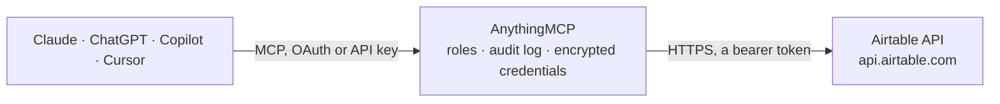

<!-- Generated by scripts/export-github-catalog.mjs in the anythingmcp-website repository. Do not edit by hand. -->

# Airtable MCP connector

Read Airtable bases, table schemas, and records from any AI agent. 4 read-only tools, Personal Access Token auth. The AnythingMCP connector gives Claude, ChatGPT, Microsoft Copilot, Cursor and Gemini 4 MCP tools for Airtable, all read-only.

**Category:** [Productivity](../productivity.md) · **Tools:** 4 · **Setup guide:** [anythingmcp.com](https://anythingmcp.com/guides/airtable-to-mcp) · [Deutsch](https://anythingmcp.com/de/guides/airtable-to-mcp) · [Italiano](https://anythingmcp.com/it/guides/airtable-to-mcp) · [Español](https://anythingmcp.com/es/guides/airtable-to-mcp) · [日本語](https://anythingmcp.com/ja/guides/airtable-to-mcp) · [Русский](https://anythingmcp.com/ru/guides/airtable-to-mcp) · [中文](https://anythingmcp.com/zh/guides/airtable-to-mcp)

## Start without code

No installation and no terminal: AnythingMCP Cloud runs the Airtable connector for you, operated by helpcode.ai in Frankfurt, Germany.

1. **Click the button above** and create an account or sign in. The Airtable connector opens, ready to install.
2. **Paste the API key or token from your Airtable account.** Every click is in the [step-by-step guide](https://anythingmcp.com/guides/airtable-to-mcp).
3. **Click Install.** AnythingMCP shows the address of your MCP server.
4. **Add that address to your assistant:** [Claude](https://anythingmcp.com/guides/connect-airtable-to-claude) · [ChatGPT](https://anythingmcp.com/guides/connect-airtable-to-chatgpt) · [Microsoft Copilot](https://anythingmcp.com/guides/connect-airtable-to-copilot) · [Cursor](https://anythingmcp.com/guides/connect-airtable-to-cursor) · [Gemini CLI](https://anythingmcp.com/guides/connect-airtable-to-gemini) · [Meta Muse](https://anythingmcp.com/guides/connect-airtable-to-muse).
5. **Ask your first question**, for example: *Show me invoice INV-2026-042 for customer 'Borealis Energie GmbH' — I need date, amount and payment status.*

Prefer help with the setup? [Talk to us](https://anythingmcp.com/contact).

## How it works

- **The AI client** speaks MCP (Streamable HTTP) to AnythingMCP and only sees tool names, descriptions and results. It never gets the Airtable credentials.
- **AnythingMCP** checks the client's role, builds the call from the tool definition, adds the credentials (a bearer token), calls Airtable, logs the call and returns the result.
- **Airtable** sees an ordinary API client with the rights of the account the credentials belong to.

## Tools

| Tool | What it does | Access |
|---|---|---|
| [`airtable_list_bases`](#airtable_list_bases) | List bases accessible to the Personal Access Token. | read |
| [`airtable_list_tables`](#airtable_list_tables) | List a base's table schemas, including table IDs, names, fields, and views. | read |
| [`airtable_list_records`](#airtable_list_records) | List records from a table. | read |
| [`airtable_get_record`](#airtable_get_record) | Get one record by ID from a table, for example record ID `recABC123DEF456`. | read |

## Tool reference

Every parameter as the AI client sees it in `tools/list`. Source: [`packages/backend/src/adapters/intl/airtable.json`](../../../packages/backend/src/adapters/intl/airtable.json).

### `airtable_list_bases`

List bases accessible to the Personal Access Token. Use this first to discover a base ID, for example `appABC123DEF456`.

**Access:** read · **Call:** `GET /meta/bases`

No parameters.

### `airtable_list_tables`

List a base's table schemas, including table IDs, names, fields, and views. Use this to discover a table ID such as `tblABC123DEF456` before reading records.

**Access:** read · **Call:** `GET /meta/bases/{baseId}/tables`

| Parameter | Type | Required | Description |
|---|---|---|---|
| `baseId` | string | yes | Base ID from `airtable_list_bases`, for example `appABC123DEF456`. |

### `airtable_list_records`

List records from a table. The response may include an `offset`; pass it to the next call until it is absent. To filter records, use Airtable formula syntax, for example `filterByFormula: {Status}="Active"`.

**Access:** read · **Call:** `GET /{baseId}/{tableIdOrName}`

| Parameter | Type | Required | Description |
|---|---|---|---|
| `baseId` | string | yes | Base ID, for example `appABC123DEF456`. |
| `tableIdOrName` | string | yes | Table ID or table name, for example `tblABC123DEF456` or `Tasks`. Prefer the table ID returned by `airtable_list_tables`. |
| `filterByFormula` | string | no | Airtable formula that records must satisfy, for example `{Status}="Active"`. Field names are wrapped in braces. |
| `view` | string | no | Saved view name or ID to apply its filters and sorting, for example `Active tasks`. |
| `pageSize` | integer | no | Records per response page, from 1 to 100. For example, `100`. |
| `maxRecords` | integer | no | Maximum total number of records Airtable should return, for example `250`. |
| `offset` | string | no | Pagination cursor from the previous response, for example `itrABC123DEF456`. Omit for the first page. |

### `airtable_get_record`

Get one record by ID from a table, for example record ID `recABC123DEF456`. Use `airtable_list_records` to find record IDs.

**Access:** read · **Call:** `GET /{baseId}/{tableIdOrName}/{recordId}`

| Parameter | Type | Required | Description |
|---|---|---|---|
| `baseId` | string | yes | Base ID, for example `appABC123DEF456`. |
| `tableIdOrName` | string | yes | Table ID or table name, for example `tblABC123DEF456` or `Tasks`. |
| `recordId` | string | yes | Record ID, for example `recABC123DEF456`. |

## Run it yourself

AnythingMCP is open source (AGPL-3.0). [Run it with Docker](../../../README.md#run-it-yourself), open **Connectors → Store**, pick **Airtable** and enter `AIRTABLE_PERSONAL_ACCESS_TOKEN`, then add your MCP server URL to the AI client.

[← Productivity connectors](../productivity.md) · [All categories](../README.md)
