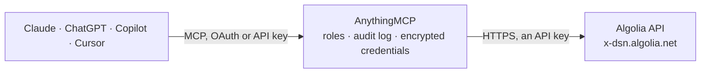

<!-- Generated by scripts/export-github-catalog.mjs in the anythingmcp-website repository. Do not edit by hand. -->

# Algolia MCP connector

Let your AI search and inspect your Algolia indices: list indices, search and browse records, read settings, synonyms and Rules, see top searches and searches without results and, with your … The AnythingMCP connector gives Claude, ChatGPT, Microsoft Copilot, Cursor and Gemini 14 MCP tools for Algolia: 11 read and 3 can change data.

**Category:** [Databases](../database.md) · **Tools:** 14 · **Setup guide:** [anythingmcp.com](https://anythingmcp.com/guides/algolia-to-mcp) · [Deutsch](https://anythingmcp.com/de/guides/algolia-to-mcp) · [Italiano](https://anythingmcp.com/it/guides/algolia-to-mcp) · [Español](https://anythingmcp.com/es/guides/algolia-to-mcp) · [日本語](https://anythingmcp.com/ja/guides/algolia-to-mcp) · [Русский](https://anythingmcp.com/ru/guides/algolia-to-mcp) · [中文](https://anythingmcp.com/zh/guides/algolia-to-mcp)

## Start without code

No installation and no terminal: AnythingMCP Cloud runs the Algolia connector for you, operated by helpcode.ai in Frankfurt, Germany.

1. **Click the button above** and create an account or sign in. The Algolia connector opens, ready to install.
2. **Paste the API key or token from your Algolia account.** Every click is in the [step-by-step guide](https://anythingmcp.com/guides/algolia-to-mcp).
3. **Click Install.** AnythingMCP shows the address of your MCP server.
4. **Add that address to your assistant:** [Claude](https://anythingmcp.com/guides/connect-algolia-to-claude) · [ChatGPT](https://anythingmcp.com/guides/connect-algolia-to-chatgpt) · [Microsoft Copilot](https://anythingmcp.com/guides/connect-algolia-to-copilot) · [Cursor](https://anythingmcp.com/guides/connect-algolia-to-cursor) · [Gemini CLI](https://anythingmcp.com/guides/connect-algolia-to-gemini) · [Meta Muse](https://anythingmcp.com/guides/connect-algolia-to-muse).
5. **Ask your first question**, for example: *Show me order #NL-2026-0421-789 for Hotel Aurora Oy — I need total, status and shipping date.*

Prefer help with the setup? [Talk to us](https://anythingmcp.com/contact).

## How it works

- **The AI client** speaks MCP (Streamable HTTP) to AnythingMCP and only sees tool names, descriptions and results. It never gets the Algolia credentials.
- **AnythingMCP** checks the client's role, builds the call from the tool definition, adds the credentials (an API key), calls Algolia, logs the call and returns the result.
- **Algolia** sees an ordinary API client with the rights of the account the credentials belong to.

## Tools

| Tool | What it does | Access |
|---|---|---|
| [`algolia_list_indices`](#algolia_list_indices) | List the indices of the application: name, number of records (entries), data and file size, last update and build time, and replica relations (primary,… | read |
| [`algolia_search`](#algolia_search) | Search one index the way the user's site or app does: full-text query with typo tolerance, filters, facets and paging. | read |
| [`algolia_browse`](#algolia_browse) | Read many records of an index in bulk, beyond the 1,000-hit limit of a search: returns up to hits_per_page records and a cursor; call again with that cursor… | read |
| [`algolia_get_object`](#algolia_get_object) | Get one record by its objectID, optionally only some attributes. | read |
| [`algolia_get_settings`](#algolia_get_settings) | Get an index's settings: searchable attributes, attributes for faceting, custom ranking, ranking criteria, typo tolerance, replicas, distinct and more. | read |
| [`algolia_search_synonyms`](#algolia_search_synonyms) | Search or list the synonyms of an index: objectID, type (synonym, onewaysynonym, altcorrection1/2, placeholder) and the words. | read |
| [`algolia_search_rules`](#algolia_search_rules) | Search or list the Rules of an index (merchandising and query rules): objectID, conditions (pattern, anchoring, context), consequence (promoted or hidden… | read |
| [`algolia_save_object`](#algolia_save_object) | Add a record, or replace an existing one entirely, under a given objectID. | write |
| [`algolia_partial_update_object`](#algolia_partial_update_object) | Change some attributes of a record, leaving the others as they are. | write |
| [`algolia_delete_object`](#algolia_delete_object) | Delete one record by objectID. | write |
| [`algolia_top_searches`](#algolia_top_searches) | The most frequent searches on an index over a period, with how often each was made and how many results it returned; with click_analytics also click-through… | read |
| [`algolia_no_result_searches`](#algolia_no_result_searches) | The most frequent searches on an index that returned no results, with their count and how many of them had filters applied. | read |
| [`algolia_top_hits`](#algolia_top_hits) | The records that appear most often in search results on an index (objectID and count), overall or for one search query; with click_analytics also clicks and… | read |
| [`algolia_search_count`](#algolia_search_count) | The number of searches on an index over a period, in total and per day. | read |

## Tool reference

Every parameter as the AI client sees it in `tools/list`. Source: [`packages/backend/src/adapters/intl/algolia.json`](../../../packages/backend/src/adapters/intl/algolia.json).

### `algolia_list_indices`

List the indices of the application: name, number of records (entries), data and file size, last update and build time, and replica relations (primary, replicas, virtual). Needs the listIndexes ACL. Read-only.

**Access:** read · **Call:** `GET /1/indexes`

| Parameter | Type | Required | Description |
|---|---|---|---|
| `page` | integer | no | Page number, starting at 0. |
| `hits_per_page` | integer | no | Indices per page (default 100). |

### `algolia_search`

Search one index the way the user's site or app does: full-text query with typo tolerance, filters, facets and paging. Returns hits (the records, without highlight markup), nbHits, page and nbPages, and facet counts when facets are asked for. 10 hits by default and never more than 100 per call. Searches made here are left out of the index's analytics unless record_analytics is true. Needs the search ACL. Read-only.

**Access:** read · **Call:** `POST /1/indexes/{index_name}/query`

| Parameter | Type | Required | Description |
|---|---|---|---|
| `index_name` | string | yes | Index name, exactly as listed by algolia_list_indices (case-sensitive), e.g. prod_products. |
| `query` | string | no | The search text, as a user would type it. Empty string returns all records (filtered). |
| `filters` | string | no | Filter expression, e.g. brand:Apple AND price < 500, or (category:shoes OR category:boots) AND NOT status:archived. Attributes must be set as attributesForFaceting (or numeric) in the index settings. |
| `facet_filters` | any[] | no | Facet filters as arrays, e.g. ["brand:Apple", ["color:red", "color:blue"]] (inner arrays are OR). |
| `numeric_filters` | any[] | no | Numeric filters, e.g. ["price >= 10", "price <= 50"]. |
| `facets` | string[] | no | Return value counts for these facet attributes, e.g. ["brand", "category"]; ["*"] for all. |
| `attributes_to_retrieve` | string[] | no | Only return these attributes of each hit, e.g. ["name", "price", "url"]. objectID is always returned. |
| `hits_per_page` | integer | no | Hits per page, 1 to 100 (default 10). |
| `page` | integer | no | Page number, starting at 0. |
| `record_analytics` | boolean | no | Count this search in the index's Algolia analytics. Default false, so AI searches do not skew the user's reports. |

### `algolia_browse`

Read many records of an index in bulk, beyond the 1,000-hit limit of a search: returns up to hits_per_page records and a cursor; call again with that cursor until it is missing. Unlike a search it applies no ranking, typo tolerance or analytics. Needs the browse ACL. Read-only.

**Access:** read · **Call:** `POST /1/indexes/{index_name}/browse`

| Parameter | Type | Required | Description |
|---|---|---|---|
| `index_name` | string | yes | Index name, exactly as listed by algolia_list_indices (case-sensitive), e.g. prod_products. |
| `query` | string | no | Optional search text to narrow the records. |
| `filters` | string | no | Optional filter expression, e.g. category:shoes AND stock > 0. |
| `attributes_to_retrieve` | string[] | no | Only return these attributes, e.g. ["name", "price"]. Keeps large exports readable. |
| `hits_per_page` | integer | no | Records per call, 1 to 200 (default 50). |
| `cursor` | string | no | The cursor from the previous call, to get the next batch. When set, the other options are taken from the first call. |

### `algolia_get_object`

Get one record by its objectID, optionally only some attributes. Needs the search ACL. Read-only.

**Access:** read · **Call:** `GET /1/indexes/{index_name}/{object_id}`

| Parameter | Type | Required | Description |
|---|---|---|---|
| `index_name` | string | yes | Index name, exactly as listed by algolia_list_indices (case-sensitive), e.g. prod_products. |
| `object_id` | string | yes | The record's objectID. |
| `attributes_to_retrieve` | string | no | Comma-separated attributes to return, e.g. name,price. Default: all retrievable attributes. |

### `algolia_get_settings`

Get an index's settings: searchable attributes, attributes for faceting, custom ranking, ranking criteria, typo tolerance, replicas, distinct and more. Read them to understand why results rank as they do and which attributes can be filtered. Needs the settings ACL. Read-only.

**Access:** read · **Call:** `GET /1/indexes/{index_name}/settings`

| Parameter | Type | Required | Description |
|---|---|---|---|
| `index_name` | string | yes | Index name, exactly as listed by algolia_list_indices (case-sensitive), e.g. prod_products. |

### `algolia_search_synonyms`

Search or list the synonyms of an index: objectID, type (synonym, onewaysynonym, altcorrection1/2, placeholder) and the words. An empty query lists them all, page by page. Needs the settings ACL. Read-only.

**Access:** read · **Call:** `POST /1/indexes/{index_name}/synonyms/search`

| Parameter | Type | Required | Description |
|---|---|---|---|
| `index_name` | string | yes | Index name, exactly as listed by algolia_list_indices (case-sensitive), e.g. prod_products. |
| `query` | string | no | Text to look for in the synonyms. Empty lists all. |
| `type` | `synonym` \| `onewaysynonym` \| `altcorrection1` \| `altcorrection2` \| `placeholder` | no | Only synonyms of this type. |
| `page` | integer | no | Page number, starting at 0. |
| `hits_per_page` | integer | no | Synonyms per page (default 20). |

### `algolia_search_rules`

Search or list the Rules of an index (merchandising and query rules): objectID, conditions (pattern, anchoring, context), consequence (promoted or hidden records, query changes, filters), enabled state and validity. An empty query lists them all. Needs the settings ACL. Read-only.

**Access:** read · **Call:** `POST /1/indexes/{index_name}/rules/search`

| Parameter | Type | Required | Description |
|---|---|---|---|
| `index_name` | string | yes | Index name, exactly as listed by algolia_list_indices (case-sensitive), e.g. prod_products. |
| `query` | string | no | Text to look for in rule patterns, descriptions and objectIDs. Empty lists all. |
| `anchoring` | `is` \| `startsWith` \| `endsWith` \| `contains` | no | Only rules whose condition uses this anchoring. |
| `context` | string | no | Only rules with this context (exact match). |
| `enabled` | boolean | no | true for enabled rules only, false for disabled ones; leave out for all. |
| `page` | integer | no | Page number, starting at 0. |
| `hits_per_page` | integer | no | Rules per page (default 20). |

### `algolia_save_object`

Add a record, or replace an existing one entirely, under a given objectID. Replacing removes every attribute not in the new record. Before calling, show the user the index, the objectID and the record and ask them to confirm; never call it without that confirmation. Indexing is asynchronous: the answer has a taskID and the change is searchable a moment later. Needs the addObject ACL.

**Access:** write · **Call:** `PUT https://{{ALGOLIA_APP_ID}}.algolia.net/1/indexes/{index_name}/{object_id}`

| Parameter | Type | Required | Description |
|---|---|---|---|
| `index_name` | string | yes | Index name, exactly as listed by algolia_list_indices (case-sensitive), e.g. prod_products. |
| `object_id` | string | yes | The objectID to create or replace. |
| `record` | object | yes | The complete record as a JSON object, e.g. {"name": "Red shoe", "price": 79.9}. objectID is taken from object_id. |

### `algolia_partial_update_object`

Change some attributes of a record, leaving the others as they are. Before calling, show the user the index, the objectID and the attributes that will change and ask them to confirm; never call it without that confirmation. By default it does nothing when the record does not exist. Asynchronous: the answer has a taskID. Needs the addObject ACL.

**Access:** write · **Call:** `POST https://{{ALGOLIA_APP_ID}}.algolia.net/1/indexes/{index_name}/{object_id}/partial`

| Parameter | Type | Required | Description |
|---|---|---|---|
| `index_name` | string | yes | Index name, exactly as listed by algolia_list_indices (case-sensitive), e.g. prod_products. |
| `object_id` | string | yes | The record's objectID. |
| `attributes` | object | yes | Only the attributes to change, e.g. {"price": 69.9, "stock": 12}. Built-in operations work too, e.g. {"stock": {"_operation": "Decrement", "value": 1}}. |
| `create_if_not_exists` | boolean | no | true creates the record when the objectID does not exist. Default false. |

### `algolia_delete_object`

Delete one record by objectID. It cannot be undone. Installed switched off; an admin turns it on deliberately. Before calling, show the user the index and the objectID and ask them to confirm; never call it without that confirmation. Needs the deleteObject ACL.

**Access:** write · **Call:** `DELETE https://{{ALGOLIA_APP_ID}}.algolia.net/1/indexes/{index_name}/{object_id}`

| Parameter | Type | Required | Description |
|---|---|---|---|
| `index_name` | string | yes | Index name, exactly as listed by algolia_list_indices (case-sensitive), e.g. prod_products. |
| `object_id` | string | yes | The record's objectID. |

### `algolia_top_searches`

The most frequent searches on an index over a period, with how often each was made and how many results it returned; with click_analytics also click-through and conversion rates. Needs the analytics ACL; data appears with a delay of up to a few hours. Read-only.

**Access:** read · **Call:** `GET https://analytics.{{ALGOLIA_ANALYTICS_REGION}}.algolia.com/2/searches`

| Parameter | Type | Required | Description |
|---|---|---|---|
| `index` | string | yes | Index name, exactly as listed by algolia_list_indices (case-sensitive), e.g. prod_products. |
| `start_date` | string | no | First day of the period, YYYY-MM-DD. Default: 8 days ago. |
| `end_date` | string | no | Last day of the period, YYYY-MM-DD. Default: yesterday. |
| `tags` | string | no | Only count searches with these analytics tags, e.g. device:mobile; combine with AND and OR. |
| `click_analytics` | boolean | no | Add click and conversion metrics (needs click events sent to Algolia). |
| `order_by` | `searchCount` \| `clickThroughRate` \| `conversionRate` \| `averageClickPosition` | no | Sort by this metric (anything but searchCount needs click_analytics). |
| `direction` | `asc` \| `desc` | no | Sort direction. |
| `limit` | integer | no | Number of rows, 1 to 1000 (default 10). |
| `offset` | integer | no | Rows to skip, for paging. |

### `algolia_no_result_searches`

The most frequent searches on an index that returned no results, with their count and how many of them had filters applied. The best list of missing products, synonyms or content. Needs the analytics ACL. Read-only.

**Access:** read · **Call:** `GET https://analytics.{{ALGOLIA_ANALYTICS_REGION}}.algolia.com/2/searches/noResults`

| Parameter | Type | Required | Description |
|---|---|---|---|
| `index` | string | yes | Index name, exactly as listed by algolia_list_indices (case-sensitive), e.g. prod_products. |
| `start_date` | string | no | First day of the period, YYYY-MM-DD. Default: 8 days ago. |
| `end_date` | string | no | Last day of the period, YYYY-MM-DD. Default: yesterday. |
| `tags` | string | no | Only count searches with these analytics tags, e.g. device:mobile; combine with AND and OR. |
| `limit` | integer | no | Number of rows, 1 to 1000 (default 10). |
| `offset` | integer | no | Rows to skip, for paging. |

### `algolia_top_hits`

The records that appear most often in search results on an index (objectID and count), overall or for one search query; with click_analytics also clicks and conversions. Needs the analytics ACL. Read-only.

**Access:** read · **Call:** `GET https://analytics.{{ALGOLIA_ANALYTICS_REGION}}.algolia.com/2/hits`

| Parameter | Type | Required | Description |
|---|---|---|---|
| `index` | string | yes | Index name, exactly as listed by algolia_list_indices (case-sensitive), e.g. prod_products. |
| `search` | string | no | Only for this search query, e.g. shoes. |
| `start_date` | string | no | First day of the period, YYYY-MM-DD. Default: 8 days ago. |
| `end_date` | string | no | Last day of the period, YYYY-MM-DD. Default: yesterday. |
| `tags` | string | no | Only count searches with these analytics tags, e.g. device:mobile; combine with AND and OR. |
| `click_analytics` | boolean | no | Add click and conversion metrics. |
| `limit` | integer | no | Number of rows, 1 to 1000 (default 10). |
| `offset` | integer | no | Rows to skip, for paging. |

### `algolia_search_count`

The number of searches on an index over a period, in total and per day. Needs the analytics ACL. Read-only.

**Access:** read · **Call:** `GET https://analytics.{{ALGOLIA_ANALYTICS_REGION}}.algolia.com/2/searches/count`

| Parameter | Type | Required | Description |
|---|---|---|---|
| `index` | string | yes | Index name, exactly as listed by algolia_list_indices (case-sensitive), e.g. prod_products. |
| `start_date` | string | no | First day of the period, YYYY-MM-DD. Default: 8 days ago. |
| `end_date` | string | no | Last day of the period, YYYY-MM-DD. Default: yesterday. |
| `tags` | string | no | Only count searches with these analytics tags, e.g. device:mobile; combine with AND and OR. |

## Run it yourself

AnythingMCP is open source (AGPL-3.0). [Run it with Docker](../../../README.md#run-it-yourself), open **Connectors → Store**, pick **Algolia** and enter `ALGOLIA_APP_ID`, `ALGOLIA_API_KEY`, `ALGOLIA_ANALYTICS_REGION`, then add your MCP server URL to the AI client.

[← Databases connectors](../database.md) · [All categories](../README.md)
