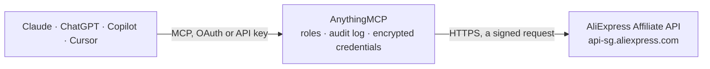

<!-- Generated by scripts/export-github-catalog.mjs in the anythingmcp-website repository. Do not edit by hand. -->

# AliExpress Affiliate MCP connector

Let your AI research AliExpress products for affiliate marketing: search and hot products with prices and commissions, product and SKU details, shipping cost, coupons, affiliate links with your … The AnythingMCP connector gives Claude, ChatGPT, Microsoft Copilot, Cursor and Gemini 12 MCP tools for AliExpress Affiliate, all read-only.

**Category:** [E-commerce](../e-commerce.md) · **Tools:** 12 · **Setup guide:** [anythingmcp.com](https://anythingmcp.com/guides/aliexpress-affiliate-to-mcp) · [Deutsch](https://anythingmcp.com/de/guides/aliexpress-affiliate-to-mcp) · [Italiano](https://anythingmcp.com/it/guides/aliexpress-affiliate-to-mcp) · [Español](https://anythingmcp.com/es/guides/aliexpress-affiliate-to-mcp) · [日本語](https://anythingmcp.com/ja/guides/aliexpress-affiliate-to-mcp) · [Русский](https://anythingmcp.com/ru/guides/aliexpress-affiliate-to-mcp) · [中文](https://anythingmcp.com/zh/guides/aliexpress-affiliate-to-mcp)

## Start without code

No installation and no terminal: AnythingMCP Cloud runs the AliExpress Affiliate connector for you, operated by helpcode.ai in Frankfurt, Germany.

1. **Click the button above** and create an account or sign in. The AliExpress Affiliate connector opens, ready to install.
2. **Paste the API key or token from your AliExpress Affiliate account.** Every click is in the [step-by-step guide](https://anythingmcp.com/guides/aliexpress-affiliate-to-mcp).
3. **Click Install.** AnythingMCP shows the address of your MCP server.
4. **Add that address to your assistant:** [Claude](https://anythingmcp.com/guides/connect-aliexpress-affiliate-to-claude) · [ChatGPT](https://anythingmcp.com/guides/connect-aliexpress-affiliate-to-chatgpt) · [Microsoft Copilot](https://anythingmcp.com/guides/connect-aliexpress-affiliate-to-copilot) · [Cursor](https://anythingmcp.com/guides/connect-aliexpress-affiliate-to-cursor) · [Gemini CLI](https://anythingmcp.com/guides/connect-aliexpress-affiliate-to-gemini) · [Meta Muse](https://anythingmcp.com/guides/connect-aliexpress-affiliate-to-muse).
5. **Ask your first question**, for example: *Show the affiliate order details for order id 2026-ALX-8743012 from 2026-08-10*

Prefer help with the setup? [Talk to us](https://anythingmcp.com/contact).

## How it works

- **The AI client** speaks MCP (Streamable HTTP) to AnythingMCP and only sees tool names, descriptions and results. It never gets the AliExpress Affiliate credentials.
- **AnythingMCP** checks the client's role, builds the call from the tool definition, adds the credentials (a signed request), calls AliExpress Affiliate, logs the call and returns the result.
- **AliExpress Affiliate** sees an ordinary API client with the rights of the account the credentials belong to.

## Tools

| Tool | What it does | Access |
|---|---|---|
| [`aliexpress_affiliate_list_categories`](#aliexpress_affiliate_list_categories) | List AliExpress product categories: category_id, category_name and parent_category_id for second-level ones. | read |
| [`aliexpress_affiliate_search_products`](#aliexpress_affiliate_search_products) | Search AliExpress products open to affiliates by keywords, category, price range, delivery time or promotion. | read |
| [`aliexpress_affiliate_list_hot_products`](#aliexpress_affiliate_list_hot_products) | Hot products: AliExpress items with a raised commission (hot_product_commission_rate), filtered like aliexpress_affiliate_search_products by keywords,… | read |
| [`aliexpress_affiliate_get_products`](#aliexpress_affiliate_get_products) | Details of up to 50 AliExpress products by id: title, prices, discount, commission rates, category, shop, images, video, promotion_link with your tracking… | read |
| [`aliexpress_affiliate_get_sku_details`](#aliexpress_affiliate_get_sku_details) | Every variant (SKU) of one AliExpress product for a destination country: sku_id, its properties (color, size), price in target_currency, stock and, on… | read |
| [`aliexpress_affiliate_get_shipping`](#aliexpress_affiliate_get_shipping) | Shipping options, cost and delivery time of one SKU to a country. | read |
| [`aliexpress_affiliate_get_promotions`](#aliexpress_affiliate_get_promotions) | Promotions and coupons that apply right now to up to 10 products in one country: coupon codes, face value, minimum spend and validity. | read |
| [`aliexpress_affiliate_generate_links`](#aliexpress_affiliate_generate_links) | Turn up to 50 AliExpress links (product, store or campaign URLs) into affiliate links that carry your tracking ID. | read |
| [`aliexpress_affiliate_list_featured_promos`](#aliexpress_affiliate_list_featured_promos) | List the featured promotions running now (for example Hot Product, New Arrival, Best Seller, weekly deals): promo_name, description and product count. | read |
| [`aliexpress_affiliate_list_promo_products`](#aliexpress_affiliate_list_promo_products) | Products of one featured promotion, with the same product fields as a search (prices, commission, promotion_link). | read |
| [`aliexpress_affiliate_list_orders`](#aliexpress_affiliate_list_orders) | Orders that came through your affiliate links in a time window, by status: order and sub-order ids, product, paid amount, estimated and paid commission,… | read |
| [`aliexpress_affiliate_get_orders`](#aliexpress_affiliate_get_orders) | Affiliate orders by order or sub-order id (comma-separated): product, amounts, commission, status and dates. | read |

## Tool reference

Every parameter as the AI client sees it in `tools/list`. Source: [`packages/backend/src/adapters/intl/aliexpress-affiliate.json`](../../../packages/backend/src/adapters/intl/aliexpress-affiliate.json).

### `aliexpress_affiliate_list_categories`

List AliExpress product categories: category_id, category_name and parent_category_id for second-level ones. No parameters. Use the ids to filter product searches and hot products.

**Access:** read · **Call:** `GET /sync`

No parameters.

### `aliexpress_affiliate_search_products`

Search AliExpress products open to affiliates by keywords, category, price range, delivery time or promotion. Each product has product_id, title, prices (sale, original, app price) in target_currency, discount, commission_rate, sales in the last 30 days (lastest_volume), rating, shop, images and a promotion_link that carries your tracking ID. Pages of up to 50.

**Access:** read · **Call:** `GET /sync`

| Parameter | Type | Required | Description |
|---|---|---|---|
| `keywords` | string | no | Search words, for example 'wireless earbuds'. |
| `category_ids` | string | no | Comma-separated category ids from aliexpress_affiliate_list_categories. |
| `min_sale_price` | integer | no | Lowest price, in cents of target_currency (1500 = 15.00). |
| `max_sale_price` | integer | no | Highest price, in cents of target_currency. |
| `sort` | `SALE_PRICE_ASC` \| `SALE_PRICE_DESC` \| `LAST_VOLUME_ASC` \| `LAST_VOLUME_DESC` | no | Sort order. |
| `platform_product_type` | `ALL` \| `PLAZA` \| `TMALL` | no | ALL (default), PLAZA or TMALL. |
| `delivery_days` | `3` \| `5` \| `7` \| `10` | no | Only products delivered within this many days: 3, 5, 7 or 10. |
| `promotion_name` | string | no | Only products of this featured promotion (a name from aliexpress_affiliate_list_featured_promos). |
| `ship_to_country` | string | no | Two-letter country the buyer is in (US, DE, FR, ES, IT, GB, ...). Only products that ship there are returned, with that country's prices and taxes. |
| `target_currency` | string | no | Currency for the prices in the answer, one of USD, GBP, CAD, EUR, UAH, MXN, TRY, RUB, BRL, AUD, INR, JPY, IDR, SEK, KRW, ILS, THB, CLP, VND. AliExpress uses USD when it is left out. |
| `target_language` | string | no | Language of titles and texts, upper case: EN, RU, PT, ES, FR, ID, IT, TH, JA, AR, VI, TR, DE, HE, KO, NL, PL, MX, CL, IN. EN when left out. |
| `page_no` | integer | no | Page number, from 1. |
| `page_size` | integer | no | Products per page, 1 to 50. Defaults to 20 here. |
| `fields` | string | no | Optional comma-separated list of the product fields to return (for example product_id,product_title,target_sale_price,commission_rate,promotion_link), to keep answers short. All fields when left out. |

### `aliexpress_affiliate_list_hot_products`

Hot products: AliExpress items with a raised commission (hot_product_commission_rate), filtered like aliexpress_affiliate_search_products by keywords, category, price, delivery time or promotion. Same product fields and paging.

**Access:** read · **Call:** `GET /sync`

| Parameter | Type | Required | Description |
|---|---|---|---|
| `keywords` | string | no | Search words, for example 'wireless earbuds'. |
| `category_ids` | string | no | Comma-separated category ids from aliexpress_affiliate_list_categories. |
| `min_sale_price` | integer | no | Lowest price, in cents of target_currency (1500 = 15.00). |
| `max_sale_price` | integer | no | Highest price, in cents of target_currency. |
| `sort` | `SALE_PRICE_ASC` \| `SALE_PRICE_DESC` \| `LAST_VOLUME_ASC` \| `LAST_VOLUME_DESC` | no | Sort order. |
| `platform_product_type` | `ALL` \| `PLAZA` \| `TMALL` | no | ALL (default), PLAZA or TMALL. |
| `delivery_days` | `3` \| `5` \| `7` \| `10` | no | Only products delivered within this many days: 3, 5, 7 or 10. |
| `promotion_name` | string | no | Only products of this featured promotion (a name from aliexpress_affiliate_list_featured_promos). |
| `ship_to_country` | string | no | Two-letter country the buyer is in (US, DE, FR, ES, IT, GB, ...). Only products that ship there are returned, with that country's prices and taxes. |
| `target_currency` | string | no | Currency for the prices in the answer, one of USD, GBP, CAD, EUR, UAH, MXN, TRY, RUB, BRL, AUD, INR, JPY, IDR, SEK, KRW, ILS, THB, CLP, VND. AliExpress uses USD when it is left out. |
| `target_language` | string | no | Language of titles and texts, upper case: EN, RU, PT, ES, FR, ID, IT, TH, JA, AR, VI, TR, DE, HE, KO, NL, PL, MX, CL, IN. EN when left out. |
| `page_no` | integer | no | Page number, from 1. |
| `page_size` | integer | no | Products per page, 1 to 50. Defaults to 20 here. |
| `fields` | string | no | Optional comma-separated list of the product fields to return (for example product_id,product_title,target_sale_price,commission_rate,promotion_link), to keep answers short. All fields when left out. |

### `aliexpress_affiliate_get_products`

Details of up to 50 AliExpress products by id: title, prices, discount, commission rates, category, shop, images, video, promotion_link with your tracking ID and any promo code. Ids come from the product URL (aliexpress.com/item/<product_id>.html) or from a search.

**Access:** read · **Call:** `GET /sync`

| Parameter | Type | Required | Description |
|---|---|---|---|
| `product_ids` | string | yes | Comma-separated product ids, at most 50. |
| `country` | string | no | Two-letter country the buyer is in (US, DE, FR, ES, IT, GB, ...). Only products that ship there are returned, with that country's prices and taxes. |
| `target_currency` | string | no | Currency for the prices in the answer, one of USD, GBP, CAD, EUR, UAH, MXN, TRY, RUB, BRL, AUD, INR, JPY, IDR, SEK, KRW, ILS, THB, CLP, VND. AliExpress uses USD when it is left out. |
| `target_language` | string | no | Language of titles and texts, upper case: EN, RU, PT, ES, FR, ID, IT, TH, JA, AR, VI, TR, DE, HE, KO, NL, PL, MX, CL, IN. EN when left out. |
| `fields` | string | no | Optional comma-separated list of the product fields to return (for example product_id,product_title,target_sale_price,commission_rate,promotion_link), to keep answers short. All fields when left out. |

### `aliexpress_affiliate_get_sku_details`

Every variant (SKU) of one AliExpress product for a destination country: sku_id, its properties (color, size), price in target_currency, stock and, on request, delivery options. At most 20 SKUs per call.

**Access:** read · **Call:** `GET /sync`

| Parameter | Type | Required | Description |
|---|---|---|---|
| `product_id` | string | yes | The product id. |
| `ship_to_country` | string | yes | Two-letter country the buyer is in (US, DE, FR, ES, IT, GB, ...). Only products that ship there are returned, with that country's prices and taxes. |
| `target_currency` | string | yes | Currency for the prices in the answer, one of USD, GBP, CAD, EUR, UAH, MXN, TRY, RUB, BRL, AUD, INR, JPY, IDR, SEK, KRW, ILS, THB, CLP, VND. AliExpress uses USD when it is left out. |
| `target_language` | string | yes | Language of titles and texts, upper case: EN, RU, PT, ES, FR, ID, IT, TH, JA, AR, VI, TR, DE, HE, KO, NL, PL, MX, CL, IN. EN when left out. |
| `sku_ids` | string | no | Optional comma-separated SKU ids; all SKUs of the product (up to 20) when left out. |
| `need_deliver_info` | `Yes` \| `No` | no | Yes to include delivery information (slower), No (default) to leave it out. |

### `aliexpress_affiliate_get_shipping`

Shipping options, cost and delivery time of one SKU to a country. Takes the sku_id, target_sale_price and tax_rate returned by a product search, detail or SKU call for the same country and currency.

**Access:** read · **Call:** `GET /sync`

| Parameter | Type | Required | Description |
|---|---|---|---|
| `product_id` | string | yes | The product id. |
| `sku_id` | string | yes | The SKU id (sku_id of a search result or of aliexpress_affiliate_get_sku_details). |
| `ship_to_country` | string | yes | Two-letter country the buyer is in (US, DE, FR, ES, IT, GB, ...). Only products that ship there are returned, with that country's prices and taxes. |
| `target_currency` | string | yes | Currency for the prices in the answer, one of USD, GBP, CAD, EUR, UAH, MXN, TRY, RUB, BRL, AUD, INR, JPY, IDR, SEK, KRW, ILS, THB, CLP, VND. AliExpress uses USD when it is left out. |
| `target_sale_price` | string | yes | The SKU's sale price in target_currency as returned (for example '12.34'). |
| `target_language` | string | yes | Language of titles and texts, upper case: EN, RU, PT, ES, FR, ID, IT, TH, JA, AR, VI, TR, DE, HE, KO, NL, PL, MX, CL, IN. EN when left out. |
| `tax_rate` | string | yes | The product's tax_rate as returned by the search (for example '0.1'). |

### `aliexpress_affiliate_get_promotions`

Promotions and coupons that apply right now to up to 10 products in one country: coupon codes, face value, minimum spend and validity. Supported countries: AT, BE, CH, CZ, HU, SE, PT, DE, FR, NL, ES, IT, PL, UK, JP, US, CL.

**Access:** read · **Call:** `GET /sync`

| Parameter | Type | Required | Description |
|---|---|---|---|
| `product_id` | string | yes | Comma-separated product ids, at most 10. |
| `ship_to_country` | string | yes | Two-letter destination country, one of AT, BE, CH, CZ, HU, SE, PT, DE, FR, NL, ES, IT, PL, UK, JP, US, CL. |
| `currency` | string | yes | ISO 4217 currency for coupon values, for example USD or EUR. |
| `target_language` | string | yes | Language: EN, FR, TH, HE, JA, PT, RU, KO, AR, UK, NL, ES, DE, IT, TR or PL. |

### `aliexpress_affiliate_generate_links`

Turn up to 50 AliExpress links (product, store or campaign URLs) into affiliate links that carry your tracking ID. Returns promotion_link per source_value. promotion_link_type 0 is the normal commission, 2 the hot-product commission (for products from aliexpress_affiliate_list_hot_products).

**Access:** read · **Call:** `POST /sync`

| Parameter | Type | Required | Description |
|---|---|---|---|
| `source_values` | string | yes | Comma-separated AliExpress URLs (or product ids), at most 50. |
| `promotion_link_type` | `0` \| `2` | no | 0 normal link (default), 2 hot-product link. |
| `ship_to_country` | string | no | Optional two-letter country you promote in. |

### `aliexpress_affiliate_list_featured_promos`

List the featured promotions running now (for example Hot Product, New Arrival, Best Seller, weekly deals): promo_name, description and product count. No parameters. Pass a promo_name to aliexpress_affiliate_list_promo_products or as promotion_name to a search.

**Access:** read · **Call:** `GET /sync`

No parameters.

### `aliexpress_affiliate_list_promo_products`

Products of one featured promotion, with the same product fields as a search (prices, commission, promotion_link). Optional category, time window and sort.

**Access:** read · **Call:** `GET /sync`

| Parameter | Type | Required | Description |
|---|---|---|---|
| `promotion_name` | string | yes | The promo_name from aliexpress_affiliate_list_featured_promos, for example 'Hot Product'. |
| `category_id` | string | no | Optional category id. |
| `promotion_start_time` | string | no | Optional start of the promotion window, 'YYYY-MM-DD HH:MM:SS' in Pacific time (PST/PDT). |
| `promotion_end_time` | string | no | Optional end of the promotion window, same format. |
| `sort` | `commissionAsc` \| `commissionDesc` \| `priceAsc` \| `priceDesc` \| `volumeAsc` \| `volumeDesc` \| `discountAsc` \| `discountDesc` \| `ratingAsc` \| `ratingDesc` \| `promotionTimeAsc` \| `promotionTimeDesc` | no | Sort order. |
| `country` | string | no | Two-letter country the buyer is in (US, DE, FR, ES, IT, GB, ...). Only products that ship there are returned, with that country's prices and taxes. |
| `target_currency` | string | no | Currency for the prices in the answer, one of USD, GBP, CAD, EUR, UAH, MXN, TRY, RUB, BRL, AUD, INR, JPY, IDR, SEK, KRW, ILS, THB, CLP, VND. AliExpress uses USD when it is left out. |
| `target_language` | string | no | Language of titles and texts, upper case: EN, RU, PT, ES, FR, ID, IT, TH, JA, AR, VI, TR, DE, HE, KO, NL, PL, MX, CL, IN. EN when left out. |
| `page_no` | integer | no | Page number, from 1. |
| `page_size` | integer | no | Products per page, 1 to 50. Defaults to 20 here. |
| `fields` | string | no | Optional comma-separated list of the product fields to return (for example product_id,product_title,target_sale_price,commission_rate,promotion_link), to keep answers short. All fields when left out. |

### `aliexpress_affiliate_list_orders`

Orders that came through your affiliate links in a time window, by status: order and sub-order ids, product, paid amount, estimated and paid commission, commission rate, tracking ID, order status and dates. Times are Pacific time. Pages of up to 50.

**Access:** read · **Call:** `GET /sync`

| Parameter | Type | Required | Description |
|---|---|---|---|
| `start_time` | string | yes | Start of the window, 'YYYY-MM-DD HH:MM:SS' in Pacific time (PST/PDT). |
| `end_time` | string | yes | End of the window, same format. |
| `status` | `Payment Completed` \| `Buyer Confirmed Receipt` \| `Completed Settlement` \| `Invalid` | yes | Order status. |
| `time_type` | `Payment Completed Time` \| `Buyer Confirmed Receipt Time` \| `Completed Settlement Time` | no | Which date the window applies to. Payment Completed Time when left out. |
| `locale_site` | string | no | Optional site: global, ru_site, es_site, it_site. |
| `page_no` | integer | no | Page number, from 1. |
| `page_size` | integer | no | Orders per page, 1 to 50. Defaults to 50 here. |
| `fields` | string | no | Optional comma-separated list of order fields to return. |

### `aliexpress_affiliate_get_orders`

Affiliate orders by order or sub-order id (comma-separated): product, amounts, commission, status and dates.

**Access:** read · **Call:** `GET /sync`

| Parameter | Type | Required | Description |
|---|---|---|---|
| `order_ids` | string | yes | Comma-separated order ids or sub-order ids. |
| `fields` | string | no | Optional comma-separated list of order fields to return. |

## Run it yourself

AnythingMCP is open source (AGPL-3.0). [Run it with Docker](../../../README.md#run-it-yourself), open **Connectors → Store**, pick **AliExpress Affiliate** and enter `ALIEXPRESS_APP_KEY`, `ALIEXPRESS_APP_SECRET`, `ALIEXPRESS_TRACKING_ID`, then add your MCP server URL to the AI client.

[← E-commerce connectors](../e-commerce.md) · [All categories](../README.md)
