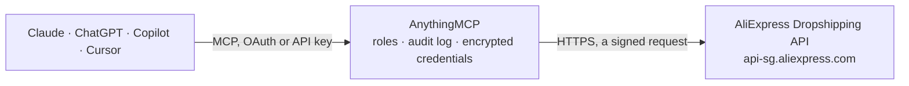

<!-- Generated by scripts/export-github-catalog.mjs in the anythingmcp-website repository. Do not edit by hand. -->

# AliExpress Dropshipping MCP connector

Let your AI source AliExpress products for your store: search with your dropshipper prices, product and SKU details, delivery options and cost, order status and tracking, with order placement available on request. The AnythingMCP connector gives Claude, ChatGPT, Microsoft Copilot, Cursor and Gemini 8 MCP tools for AliExpress Dropshipping: 7 read and 1 can change data.

**Category:** [E-commerce](../e-commerce.md) · **Tools:** 8 · **Setup guide:** [anythingmcp.com](https://anythingmcp.com/guides/aliexpress-dropshipping-to-mcp) · [Deutsch](https://anythingmcp.com/de/guides/aliexpress-dropshipping-to-mcp) · [Italiano](https://anythingmcp.com/it/guides/aliexpress-dropshipping-to-mcp) · [Español](https://anythingmcp.com/es/guides/aliexpress-dropshipping-to-mcp) · [日本語](https://anythingmcp.com/ja/guides/aliexpress-dropshipping-to-mcp) · [Русский](https://anythingmcp.com/ru/guides/aliexpress-dropshipping-to-mcp) · [中文](https://anythingmcp.com/zh/guides/aliexpress-dropshipping-to-mcp)

## Start without code

No installation and no terminal: AnythingMCP Cloud runs the AliExpress Dropshipping connector for you, operated by helpcode.ai in Frankfurt, Germany.

1. **Click the button above** and create an account or sign in. The AliExpress Dropshipping connector opens, ready to install.
2. **Paste the API key or token from your AliExpress Dropshipping account.** Every click is in the [step-by-step guide](https://anythingmcp.com/guides/aliexpress-dropshipping-to-mcp).
3. **Click Install.** AnythingMCP shows the address of your MCP server.
4. **Add that address to your assistant:** [Claude](https://anythingmcp.com/guides/connect-aliexpress-dropshipping-to-claude) · [ChatGPT](https://anythingmcp.com/guides/connect-aliexpress-dropshipping-to-chatgpt) · [Microsoft Copilot](https://anythingmcp.com/guides/connect-aliexpress-dropshipping-to-copilot) · [Cursor](https://anythingmcp.com/guides/connect-aliexpress-dropshipping-to-cursor) · [Gemini CLI](https://anythingmcp.com/guides/connect-aliexpress-dropshipping-to-gemini) · [Meta Muse](https://anythingmcp.com/guides/connect-aliexpress-dropshipping-to-muse).
5. **Ask your first question**, for example: *What's the status and payment amounts for AliExpress order 2026-ALX-17892 for customer Saarinen?*

Prefer help with the setup? [Talk to us](https://anythingmcp.com/contact).

## How it works

- **The AI client** speaks MCP (Streamable HTTP) to AnythingMCP and only sees tool names, descriptions and results. It never gets the AliExpress Dropshipping credentials.
- **AnythingMCP** checks the client's role, builds the call from the tool definition, adds the credentials (a signed request), calls AliExpress Dropshipping, logs the call and returns the result.
- **AliExpress Dropshipping** sees an ordinary API client with the rights of the account the credentials belong to.

## Tools

| Tool | What it does | Access |
|---|---|---|
| [`aliexpress_dropshipping_get_member_benefits`](#aliexpress_dropshipping_get_member_benefits) | The dropshipper benefits of the authorized AliExpress account (discount levels and their conditions). | read |
| [`aliexpress_dropshipping_list_categories`](#aliexpress_dropshipping_list_categories) | AliExpress category ids and names, in a language. | read |
| [`aliexpress_dropshipping_search_products`](#aliexpress_dropshipping_search_products) | Search AliExpress products for dropshipping by keyword and category, with prices for the destination country in your currency: product id, title, image,… | read |
| [`aliexpress_dropshipping_get_product`](#aliexpress_dropshipping_get_product) | Everything about one AliExpress product for a destination country, at the prices of your dropshipper account: title, description, images, store, every SKU… | read |
| [`aliexpress_dropshipping_get_freight`](#aliexpress_dropshipping_get_freight) | Delivery options for a quantity of one SKU to a country: carrier service name (the logistics_service_name an order needs), cost in your currency, delivery… | read |
| [`aliexpress_dropshipping_get_order`](#aliexpress_dropshipping_get_order) | One order of the authorized dropshipper account by AliExpress order id: status, amounts, products, logistics status and the store. | read |
| [`aliexpress_dropshipping_get_tracking`](#aliexpress_dropshipping_get_tracking) | Tracking of one dropshipping order: carrier, tracking number (mail_no), estimated arrival and the tracking events. | read |
| [`aliexpress_dropshipping_create_order`](#aliexpress_dropshipping_create_order) | Place an order on AliExpress for delivery to your customer. | write |

## Tool reference

Every parameter as the AI client sees it in `tools/list`. Source: [`packages/backend/src/adapters/intl/aliexpress-dropshipping.json`](../../../packages/backend/src/adapters/intl/aliexpress-dropshipping.json).

### `aliexpress_dropshipping_get_member_benefits`

The dropshipper benefits of the authorized AliExpress account (discount levels and their conditions). No parameters; the lightest call that uses the access token, so it also checks that the token is valid.

**Access:** read · **Call:** `GET /sync`

No parameters.

### `aliexpress_dropshipping_list_categories`

AliExpress category ids and names, in a language. Without category_id the top-level categories; with the id of a level 3 or 4 category, its parent.

**Access:** read · **Call:** `GET /sync`

| Parameter | Type | Required | Description |
|---|---|---|---|
| `category_id` | string | no | Optional category id. |
| `language` | string | no | Lower-case language code: en, de, fr, es, it, pt, ru, ko, ja, ar, tr, pl, nl, vi, th, id, he, uk, zh, hi. |

### `aliexpress_dropshipping_search_products`

Search AliExpress products for dropshipping by keyword and category, with prices for the destination country in your currency: product id, title, image, price, original price, discount, orders and rating. Pages of up to 50.

**Access:** read · **Call:** `GET /sync`

| Parameter | Type | Required | Description |
|---|---|---|---|
| `keyword` | string | yes | Search words, for example 'phone case'. |
| `country_code` | string | yes | Two-letter destination country, for example US or DE. |
| `currency` | string | yes | Currency for prices, for example USD or EUR. |
| `locale` | string | no | Language and region, for example en_US, de_DE, fr_FR. Defaults to en_US. |
| `category_id` | string | no | Optional category id from aliexpress_dropshipping_list_categories. |
| `sort_by` | `min_price,asc` \| `min_price,desc` \| `orders,asc` \| `orders,desc` \| `comments,asc` \| `comments,desc` | no | Sort order. |
| `page_index` | integer | no | Page number, from 1. |
| `page_size` | integer | no | Products per page, up to 50. Defaults to 20 here. |

### `aliexpress_dropshipping_get_product`

Everything about one AliExpress product for a destination country, at the prices of your dropshipper account: title, description, images, store, every SKU with its sku_attr (needed to order), price, stock and the logistics information.

**Access:** read · **Call:** `GET /sync`

| Parameter | Type | Required | Description |
|---|---|---|---|
| `product_id` | string | yes | The product id (aliexpress.com/item/<product_id>.html). |
| `ship_to_country` | string | yes | Two-letter destination country, for example US. |
| `target_currency` | string | no | Currency for prices, for example USD or EUR. |
| `target_language` | string | no | Lower-case language, for example en, de, fr. |
| `remove_personal_benefit` | boolean | no | true to see prices without the account's personal (crowd) promotions. |

### `aliexpress_dropshipping_get_freight`

Delivery options for a quantity of one SKU to a country: carrier service name (the logistics_service_name an order needs), cost in your currency, delivery time and whether tracking is included.

**Access:** read · **Call:** `POST /sync`

| Parameter | Type | Required | Description |
|---|---|---|---|
| `product_id` | string | yes | The product id. |
| `sku_id` | string | yes | The SKU id from aliexpress_dropshipping_get_product. |
| `quantity` | integer | yes | Number of items. |
| `ship_to_country` | string | yes | Two-letter destination country. |
| `currency` | string | yes | Currency for prices, for example USD or EUR. |
| `locale` | string | no | Language and region, for example en_US. |
| `language` | string | no | Language, for example en_US. |
| `province_code` | string | no | Optional province code, for local-to-local products. |
| `city_code` | string | no | Optional city code. |

### `aliexpress_dropshipping_get_order`

One order of the authorized dropshipper account by AliExpress order id: status, amounts, products, logistics status and the store.

**Access:** read · **Call:** `GET /sync`

| Parameter | Type | Required | Description |
|---|---|---|---|
| `order_id` | string | yes | The AliExpress order id (digits only). |

### `aliexpress_dropshipping_get_tracking`

Tracking of one dropshipping order: carrier, tracking number (mail_no), estimated arrival and the tracking events. Times are Unix milliseconds.

**Access:** read · **Call:** `GET /sync`

| Parameter | Type | Required | Description |
|---|---|---|---|
| `order_id` | string | yes | The AliExpress order id. |
| `language` | string | no | Language of the events, for example en_US. |

### `aliexpress_dropshipping_create_order`

Place an order on AliExpress for delivery to your customer. The order is created unpaid: pay it on AliExpress (My Orders) or with your payment setup there. Returns the new order numbers, or error_code and error_msg (an address AliExpress cannot validate gives B_DROPSHIPPER_DELIVERY_ADDRESS_VALIDATE_FAIL). Installed switched off.

**Access:** write · **Call:** `POST /sync`

| Parameter | Type | Required | Description |
|---|---|---|---|
| `logistics_address` | object | yes | Delivery address: country (two letters), province, city, address, zip, full_name, contact_person, phone_country (e.g. +1), mobile_no; optional address2, tax_number, cpf (Brazil), passport fields where the country needs them. |
| `product_items` | object[] | yes | The items: product_id, product_count, sku_attr (from aliexpress_dropshipping_get_product), logistics_service_name (from aliexpress_dropshipping_get_freight) and an optional order_memo. |
| `out_order_id` | string | no | Optional id of the order in your own shop. AliExpress uses it to refuse a duplicate. |

## Run it yourself

AnythingMCP is open source (AGPL-3.0). [Run it with Docker](../../../README.md#run-it-yourself), open **Connectors → Store**, pick **AliExpress Dropshipping** and enter `ALIEXPRESS_DS_APP_KEY`, `ALIEXPRESS_DS_APP_SECRET`, `ALIEXPRESS_DS_ACCESS_TOKEN`, then add your MCP server URL to the AI client.

[← E-commerce connectors](../e-commerce.md) · [All categories](../README.md)
