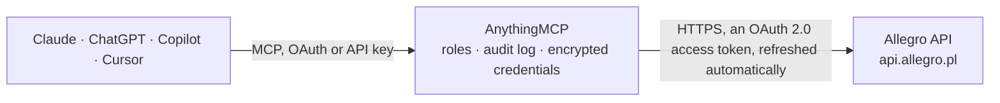

<!-- Generated by scripts/export-github-catalog.mjs in the anythingmcp-website repository. Do not edit by hand. -->

# Allegro MCP connector

Run an Allegro seller account (Poland's largest marketplace, also allegro.cz, .sk, .hu) from any AI agent: list, create and edit offers, change price, stock and status, process orders with … The AnythingMCP connector gives Claude, ChatGPT, Microsoft Copilot, Cursor and Gemini 53 MCP tools for Allegro: 37 read and 16 can change data.

**Category:** [E-commerce](../e-commerce.md) · **Tools:** 53 · **Setup guide:** [anythingmcp.com](https://anythingmcp.com/guides/allegro-to-mcp) · [Deutsch](https://anythingmcp.com/de/guides/allegro-to-mcp) · [Italiano](https://anythingmcp.com/it/guides/allegro-to-mcp) · [Español](https://anythingmcp.com/es/guides/allegro-to-mcp) · [日本語](https://anythingmcp.com/ja/guides/allegro-to-mcp) · [Русский](https://anythingmcp.com/ru/guides/allegro-to-mcp) · [中文](https://anythingmcp.com/zh/guides/allegro-to-mcp)

## Start without code

No installation and no terminal: AnythingMCP Cloud runs the Allegro connector for you, operated by helpcode.ai in Frankfurt, Germany.

1. **Click the button above** and create an account or sign in. The Allegro connector opens, ready to install.
2. **Sign in with your Allegro account** when AnythingMCP asks. The first time, an admin creates a small app in the Allegro developer console. Every click is in the [step-by-step guide](https://anythingmcp.com/guides/allegro-to-mcp).
3. **Click Install.** AnythingMCP shows the address of your MCP server.
4. **Add that address to your assistant:** [Claude](https://anythingmcp.com/guides/connect-allegro-to-claude) · [ChatGPT](https://anythingmcp.com/guides/connect-allegro-to-chatgpt) · [Microsoft Copilot](https://anythingmcp.com/guides/connect-allegro-to-copilot) · [Cursor](https://anythingmcp.com/guides/connect-allegro-to-cursor) · [Gemini CLI](https://anythingmcp.com/guides/connect-allegro-to-gemini) · [Meta Muse](https://anythingmcp.com/guides/connect-allegro-to-muse).
5. **Ask your first question**, for example: *Show invoice and payment status for order AL-2026-1129 from buyer katarzyna_w*

Prefer help with the setup? [Talk to us](https://anythingmcp.com/contact).

## How it works

- **The AI client** speaks MCP (Streamable HTTP) to AnythingMCP and only sees tool names, descriptions and results. It never gets the Allegro credentials.
- **AnythingMCP** checks the client's role, builds the call from the tool definition, adds the credentials (an OAuth 2.0 access token, refreshed automatically), calls Allegro, logs the call and returns the result.
- **Allegro** sees an ordinary API client with the rights of the account the credentials belong to.

## Tools

| Tool | What it does | Access |
|---|---|---|
| [`allegro_get_me`](#allegro_get_me) | The signed-in Allegro account: user id, login, name, email, company, base marketplace. | read |
| [`allegro_get_sales_quality`](#allegro_get_sales_quality) | Current sales quality score of the seller (points, grade, the metrics behind it) with up to 30 days of history. | read |
| [`allegro_list_offers`](#allegro_list_offers) | List the seller's own offers with id, title, price, stock, sold count, status and category. | read |
| [`allegro_get_offer`](#allegro_get_offer) | All data of one offer: title, category, product set, parameters, price, stock, delivery and shipping rates, after-sales policies, images, description,… | read |
| [`allegro_create_offer`](#allegro_create_offer) | Create an offer (POST /sale/product-offers), normally linked to a product from the Allegro catalogue. | write |
| [`allegro_edit_offer`](#allegro_edit_offer) | Change any fields of an existing offer (PATCH /sale/product-offers/{offerId}). | write |
| [`allegro_change_offer_price`](#allegro_change_offer_price) | Set the Buy Now price of an offer. | write |
| [`allegro_change_offer_quantity`](#allegro_change_offer_quantity) | Set how many items of an offer are available for sale (stock.available). | write |
| [`allegro_set_offer_status`](#allegro_set_offer_status) | Activate (ACTIVE) or end (ENDED) an offer. | write |
| [`allegro_get_offer_operation`](#allegro_get_offer_operation) | Processing status of an offer create or edit that Allegro answered with 202: still running (202), or finished (the offer). | read |
| [`allegro_delete_draft_offer`](#allegro_delete_draft_offer) | Delete a draft offer (status INACTIVE that was never published). | write |
| [`allegro_list_offer_events`](#allegro_list_offer_events) | Events about the seller's offers from the last 24 hours: activated, changed, ended, stock or price changed, archived, bids. | read |
| [`allegro_search_products`](#allegro_search_products) | Search the Allegro product catalogue by name, EAN/GTIN or MPN, to find the product id an offer is linked to. | read |
| [`allegro_get_product`](#allegro_get_product) | All data of one catalogue product: name, category, parameters (with ids and values), images and the categories it can be listed in. | read |
| [`allegro_list_categories`](#allegro_list_categories) | Browse the Allegro category tree: without parent_id the main categories, with parent_id its children. | read |
| [`allegro_get_category`](#allegro_get_category) | One category by id: name, parent, whether it is a leaf, and its options (e.g. whether a product is required). | read |
| [`allegro_get_category_parameters`](#allegro_get_category_parameters) | Parameters an offer in this category can or must have: id, name, type, required flag, unit, allowed dictionary values and their ids. | read |
| [`allegro_suggest_categories`](#allegro_suggest_categories) | Suggested categories for a product name, best match first. | read |
| [`allegro_list_shipping_rates`](#allegro_list_shipping_rates) | The seller's shipping rate sets (cenniki dostaw) with id and name, for delivery.shippingRates.id of an offer. | read |
| [`allegro_list_return_policies`](#allegro_list_return_policies) | The seller's return policies with id and name, for afterSalesServices.returnPolicy.id of an offer. | read |
| [`allegro_list_implied_warranties`](#allegro_list_implied_warranties) | The seller's implied warranty (rekojmia) conditions with id and name, for afterSalesServices.impliedWarranty.id of an offer. | read |
| [`allegro_list_orders`](#allegro_list_orders) | List orders (checkout forms), newest purchase first: id, status, seller fulfillment status, buyer login, payment, delivery method, line items with offer,… | read |
| [`allegro_get_order`](#allegro_get_order) | Full details of one order: buyer (name, email, phone, address), delivery address, method and pickup point, invoice data, payment, line items, discounts,… | read |
| [`allegro_set_order_fulfillment_status`](#allegro_set_order_fulfillment_status) | Set the seller status of an order (NEW, PROCESSING, READY_FOR_SHIPMENT, READY_FOR_PICKUP, SENT, PICKED_UP, CANCELLED, SUSPENDED, RETURNED). | write |
| [`allegro_list_order_shipments`](#allegro_list_order_shipments) | Parcel tracking numbers on an order: carrier, waybill, the line items each parcel holds and when it was added (also numbers added on the site or by the… | read |
| [`allegro_add_order_shipment`](#allegro_add_order_shipment) | Add a parcel tracking number to an order, for some or all of its line items. | write |
| [`allegro_list_carriers`](#allegro_list_carriers) | Shipping carriers Allegro knows, with the id to use in allegro_add_order_shipment and allegro_get_parcel_tracking. | read |
| [`allegro_get_parcel_tracking`](#allegro_get_parcel_tracking) | Tracking history (status events with time) of up to 20 parcels of one carrier. | read |
| [`allegro_list_order_events`](#allegro_list_order_events) | Order events (BOUGHT, FILLED_IN, READY_FOR_PROCESSING, BUYER_CANCELLED, FULFILLMENT_STATUS_CHANGED, AUTO_CANCELLED) with the order id, oldest first. | read |
| [`allegro_list_customer_returns`](#allegro_list_customer_returns) | Customer returns (zwroty): return id, order, buyer, returned items with reason, parcels and their status (CREATED, DISPATCHED, IN_TRANSIT, DELIVERED,… | read |
| [`allegro_get_customer_return`](#allegro_get_customer_return) | One customer return by id: items, reasons and buyer comments, parcels with waybills, refund and status history. | read |
| [`allegro_reject_customer_return`](#allegro_reject_customer_return) | Refuse the refund for a customer return, with a code (REFUND_REJECTED needs a reason). | write |
| [`allegro_list_refunds`](#allegro_list_refunds) | Payment refunds made to buyers: refund id, payment, order, amounts per line item, delivery and status (WAITING, IN_PROGRESS, SUCCESS, CANCELED, PARTIAL). | read |
| [`allegro_create_refund`](#allegro_create_refund) | Refund money to a buyer for an order paid through Allegro. | write |
| [`allegro_list_threads`](#allegro_list_threads) | Message center threads (buyer conversations), newest message first: thread id, interlocutor login, read flag, last message time. | read |
| [`allegro_get_thread`](#allegro_get_thread) | One message thread: interlocutor, read flag, last message time. | read |
| [`allegro_list_thread_messages`](#allegro_list_thread_messages) | Messages in a thread, newest first: id, author (login, whether it is you), text, attachments, related offer or order, time. | read |
| [`allegro_get_message`](#allegro_get_message) | One message by id with text, author, attachments and the offer or order it refers to. | read |
| [`allegro_reply_in_thread`](#allegro_reply_in_thread) | Send a message in an existing thread, as the seller, to the buyer. | write |
| [`allegro_send_message`](#allegro_send_message) | Start a new conversation with a buyer about one of their orders. | write |
| [`allegro_mark_thread_read`](#allegro_mark_thread_read) | Mark a message thread as read, so it no longer counts as unread in the Allegro message center. | write |
| [`allegro_list_issues`](#allegro_list_issues) | Post-purchase issues, newest first: disputes (dyskusje) and claims (reklamacje) with id, type, status, order, buyer, subject and deadlines. | read |
| [`allegro_get_issue`](#allegro_get_issue) | One dispute or claim: type, status, subject, order and items, the buyer expectations, deadlines and allowed seller actions. | read |
| [`allegro_list_issue_messages`](#allegro_list_issue_messages) | Messages and status changes in a dispute or claim, newest first. | read |
| [`allegro_add_issue_message`](#allegro_add_issue_message) | Write in a dispute or claim. | write |
| [`allegro_change_claim_status`](#allegro_change_claim_status) | Accept or reject a claim (reklamacja), with a message for the buyer; ACCEPTED_PARTIAL_REFUND also needs partial_refund. | write |
| [`allegro_list_billing_entries`](#allegro_list_billing_entries) | Allegro fees and charges (billing entries), newest first: type (commission, listing, promotion, delivery ...), amount with sign, tax, balance after, offer… | read |
| [`allegro_list_billing_types`](#allegro_list_billing_types) | All billing (fee) types with id and name, for the type_ids filter of allegro_list_billing_entries. | read |
| [`allegro_list_payment_operations`](#allegro_list_payment_operations) | Payment operations on the seller's Allegro wallet, newest first: buyer payments, refunds, payouts, deductions, blockades, with amount, wallet balance and… | read |
| [`allegro_list_ratings`](#allegro_list_ratings) | Ratings buyers gave the seller, last changed first: rating id, recommended or not, scores, comment, the seller answer, order and buyer. | read |
| [`allegro_get_rating`](#allegro_get_rating) | One rating by id with scores, comment, answer and whether removal can be requested. | read |
| [`allegro_answer_rating`](#allegro_answer_rating) | Publish the seller's public answer to a rating. | write |
| [`allegro_get_ratings_summary`](#allegro_get_ratings_summary) | Feedback statistics of any Allegro user (the seller's own id comes from allegro_get_me): recommend percentage, counts of positive and negative ratings,… | read |

## Tool reference

Every parameter as the AI client sees it in `tools/list`. Source: [`packages/backend/src/adapters/intl/allegro.json`](../../../packages/backend/src/adapters/intl/allegro.json).

### `allegro_get_me`

The signed-in Allegro account: user id, login, name, email, company, base marketplace. Use it to check the sign-in and to get your own user id for allegro_get_ratings_summary.

**Access:** read · **Call:** `GET /me`

No parameters.

### `allegro_get_sales_quality`

Current sales quality score of the seller (points, grade, the metrics behind it) with up to 30 days of history.

**Access:** read · **Call:** `GET /sale/quality`

No parameters.

### `allegro_list_offers`

List the seller's own offers with id, title, price, stock, sold count, status and category. Filter by title text, status, format, category, price range, external id (your SKU) or marketplace; page with offset and limit.

**Access:** read · **Call:** `GET /sale/offers`

| Parameter | Type | Required | Description |
|---|---|---|---|
| `name` | string | no | Text to search in the offer title. |
| `offer_ids` | string[] | no | Only these offer ids. |
| `publication_status` | `INACTIVE` \| `ACTIVATING` \| `ACTIVE` \| `ENDED`[] | no | Only offers with one of these statuses: INACTIVE (draft), ACTIVATING, ACTIVE, ENDED. |
| `selling_format` | `BUY_NOW` \| `AUCTION` \| `ADVERTISEMENT`[] | no | Only these selling formats. |
| `external_ids` | string[] | no | Only offers with these external ids (your own SKU or id set on the offer). |
| `category_id` | string | no | Only offers in this category id. |
| `marketplace` | string | no | Only offers listed on this marketplace, e.g. allegro-pl, allegro-cz, allegro-sk, allegro-hu. |
| `price_from` | number | no | Lowest Buy Now price. |
| `price_to` | number | no | Highest Buy Now price. |
| `sort` | `sellingMode.price.amount` \| `-sellingMode.price.amount` \| `stock.sold` \| `-stock.sold` \| `stock.available` \| `-stock.available` | no | Sort order; a leading minus means descending. Default: newest first. |
| `limit` | integer | no | Offers per page (at most 1000). |
| `offset` | integer | no | Number of items to skip, for paging. |

### `allegro_get_offer`

All data of one offer: title, category, product set, parameters, price, stock, delivery and shipping rates, after-sales policies, images, description, publication status and validation errors.

**Access:** read · **Call:** `GET /sale/product-offers/{offer_id}`

| Parameter | Type | Required | Description |
|---|---|---|---|
| `offer_id` | string | yes | Offer id (the number shown in the offer URL, e.g. 12345678901), from allegro_list_offers. |

### `allegro_create_offer`

Create an offer (POST /sale/product-offers), normally linked to a product from the Allegro catalogue. The offer object is sent as the request body. Minimal example: {"productSet": [{"product": {"id": "<product id from allegro_search_products>"}}], "sellingMode": {"price": {"amount": "99.00", "currency": "PLN"}}, "stock": {"available": 5}, "delivery": {"shippingRates": {"id": "<id from allegro_list_shipping_rates>"}}, "afterSalesServices": {"returnPolicy": {"id": "..."}, "impliedWarranty": {"id": "..."}}, "publication": {"status": "INACTIVE"}}. With publication.status ACTIVE the offer goes live at once; INACTIVE creates a draft. Allegro may answer 202 with a Location of an operation: check it with allegro_get_offer_operation. Show the user the offer and wait for a yes before creating an ACTIVE one.

**Access:** write · **Call:** `POST /sale/product-offers`

| Parameter | Type | Required | Description |
|---|---|---|---|
| `offer` | object | yes | The offer as Allegro documents it for POST /sale/product-offers: productSet, sellingMode, stock, delivery, afterSalesServices, publication, and optionally name, category, parameters, images, description, external, location, payments. |

### `allegro_edit_offer`

Change any fields of an existing offer (PATCH /sale/product-offers/{offerId}). Send only the fields to change, e.g. {"name": "New title"}, {"description": {...}}, {"parameters": [...]}, {"delivery": {"handlingTime": "PT24H"}}. For price, stock and status use the dedicated tools. Allegro may answer 202: check the result with allegro_get_offer_operation.

**Access:** write · **Call:** `PATCH /sale/product-offers/{offer_id}`

| Parameter | Type | Required | Description |
|---|---|---|---|
| `offer_id` | string | yes | Offer id (the number shown in the offer URL, e.g. 12345678901), from allegro_list_offers. |
| `changes` | object | yes | Only the offer fields to change, shaped as in allegro_get_offer. |

### `allegro_change_offer_price`

Set the Buy Now price of an offer. Buyers see the new price at once: confirm the amount with the user first.

**Access:** write · **Call:** `PATCH /sale/product-offers/{offer_id}`

| Parameter | Type | Required | Description |
|---|---|---|---|
| `offer_id` | string | yes | Offer id (the number shown in the offer URL, e.g. 12345678901), from allegro_list_offers. |
| `amount` | string | yes | New price as a decimal string with a dot, e.g. "129.99". |
| `currency` | string | no | ISO 4217 currency of the offer, e.g. PLN (allegro.pl), CZK, EUR, HUF. |

### `allegro_change_offer_quantity`

Set how many items of an offer are available for sale (stock.available). 0 is not accepted for an active offer: end it with allegro_set_offer_status instead.

**Access:** write · **Call:** `PATCH /sale/product-offers/{offer_id}`

| Parameter | Type | Required | Description |
|---|---|---|---|
| `offer_id` | string | yes | Offer id (the number shown in the offer URL, e.g. 12345678901), from allegro_list_offers. |
| `available` | integer | yes | New available quantity. |

### `allegro_set_offer_status`

Activate (ACTIVE) or end (ENDED) an offer. Ending takes it off sale; activating publishes it for buyers. Show the user which offer it is and wait for a yes.

**Access:** write · **Call:** `PATCH /sale/product-offers/{offer_id}`

| Parameter | Type | Required | Description |
|---|---|---|---|
| `offer_id` | string | yes | Offer id (the number shown in the offer URL, e.g. 12345678901), from allegro_list_offers. |
| `status` | `ACTIVE` \| `ENDED` | yes | ACTIVE to publish the offer, ENDED to end it. |

### `allegro_get_offer_operation`

Processing status of an offer create or edit that Allegro answered with 202: still running (202), or finished (the offer). The operation id is the last segment of the Location header or the id in the 202 answer.

**Access:** read · **Call:** `GET /sale/product-offers/{offer_id}/operations/{operation_id}`

| Parameter | Type | Required | Description |
|---|---|---|---|
| `offer_id` | string | yes | Offer id (the number shown in the offer URL, e.g. 12345678901), from allegro_list_offers. |
| `operation_id` | string | yes | Operation id from the create or edit answer. |

### `allegro_delete_draft_offer`

Delete a draft offer (status INACTIVE that was never published). Active or ended offers cannot be deleted. It cannot be undone: confirm with the user first. Installed switched off.

**Access:** write · **Call:** `DELETE /sale/offers/{offer_id}`

| Parameter | Type | Required | Description |
|---|---|---|---|
| `offer_id` | string | yes | Offer id (the number shown in the offer URL, e.g. 12345678901), from allegro_list_offers. |

### `allegro_list_offer_events`

Events about the seller's offers from the last 24 hours: activated, changed, ended, stock or price changed, archived, bids. Pass the last event id as from to get only newer events.

**Access:** read · **Call:** `GET /sale/offer-events`

| Parameter | Type | Required | Description |
|---|---|---|---|
| `from` | string | no | Id of the last event already seen. |
| `types` | `OFFER_ACTIVATED` \| `OFFER_CHANGED` \| `OFFER_ENDED` \| `OFFER_STOCK_CHANGED` \| `OFFER_PRICE_CHANGED` \| `OFFER_ARCHIVED` \| `OFFER_BID_PLACED` \| `OFFER_BID_CANCELED` \| `OFFER_TRANSLATION_UPDATED` \| `OFFER_VISIBILITY_CHANGED` \| `OFFER_DELIVERY_COUNTRIES_BLOCKED`[] | no | Only these event types. |
| `limit` | integer | no | Events per call (at most 1000). |

### `allegro_search_products`

Search the Allegro product catalogue by name, EAN/GTIN or MPN, to find the product id an offer is linked to. Results page with page_id (nextPage.id in the answer).

**Access:** read · **Call:** `GET /sale/products`

| Parameter | Type | Required | Description |
|---|---|---|---|
| `phrase` | string | yes | Search text: a product name, or an EAN/GTIN or MPN. |
| `mode` | `GTIN` \| `MPN` | no | GTIN to match only EAN/ISBN/UPC codes, MPN to match only manufacturer part numbers. Leave empty to search names, codes and parameters. |
| `language` | `pl-PL` \| `en-US` \| `cs-CZ` \| `sk-SK` \| `hu-HU` \| `uk-UA` | no | Language of the phrase. |
| `category_id` | string | no | Only products in this category (phrase searches only). |
| `page_id` | string | no | nextPage.id from the previous answer, for the next page. |

### `allegro_get_product`

All data of one catalogue product: name, category, parameters (with ids and values), images and the categories it can be listed in.

**Access:** read · **Call:** `GET /sale/products/{product_id}`

| Parameter | Type | Required | Description |
|---|---|---|---|
| `product_id` | string | yes | Product id (UUID) from allegro_search_products. |
| `category_id` | string | no | A similar category of the product, to get the parameters in that category context. |
| `language` | `pl-PL` \| `en-US` \| `cs-CZ` \| `sk-SK` \| `hu-HU` \| `uk-UA` | no | Language of the returned product data. |

### `allegro_list_categories`

Browse the Allegro category tree: without parent_id the main categories, with parent_id its children. Each has id, name, leaf (offers go into leaf categories) and options.

**Access:** read · **Call:** `GET /sale/categories`

| Parameter | Type | Required | Description |
|---|---|---|---|
| `parent_id` | string | no | Category id whose children to list. |

### `allegro_get_category`

One category by id: name, parent, whether it is a leaf, and its options (e.g. whether a product is required).

**Access:** read · **Call:** `GET /sale/categories/{category_id}`

| Parameter | Type | Required | Description |
|---|---|---|---|
| `category_id` | string | yes | Category id. |

### `allegro_get_category_parameters`

Parameters an offer in this category can or must have: id, name, type, required flag, unit, allowed dictionary values and their ids. Use them for the parameters of allegro_create_offer.

**Access:** read · **Call:** `GET /sale/categories/{category_id}/parameters`

| Parameter | Type | Required | Description |
|---|---|---|---|
| `category_id` | string | yes | Leaf category id. |

### `allegro_suggest_categories`

Suggested categories for a product name, best match first. Rate limited to 5 requests per second.

**Access:** read · **Call:** `GET /sale/matching-categories`

| Parameter | Type | Required | Description |
|---|---|---|---|
| `name` | string | yes | Product name or title. |

### `allegro_list_shipping_rates`

The seller's shipping rate sets (cenniki dostaw) with id and name, for delivery.shippingRates.id of an offer.

**Access:** read · **Call:** `GET /sale/shipping-rates`

| Parameter | Type | Required | Description |
|---|---|---|---|
| `marketplace` | string | no | Only rate sets valid on this marketplace, e.g. allegro-pl. |

### `allegro_list_return_policies`

The seller's return policies with id and name, for afterSalesServices.returnPolicy.id of an offer.

**Access:** read · **Call:** `GET /after-sales-service-conditions/return-policies`

| Parameter | Type | Required | Description |
|---|---|---|---|
| `limit` | integer | no | Items per page (at most 60). |
| `offset` | integer | no | Number of items to skip, for paging. |

### `allegro_list_implied_warranties`

The seller's implied warranty (rekojmia) conditions with id and name, for afterSalesServices.impliedWarranty.id of an offer.

**Access:** read · **Call:** `GET /after-sales-service-conditions/implied-warranties`

| Parameter | Type | Required | Description |
|---|---|---|---|
| `limit` | integer | no | Items per page (at most 60). |
| `offset` | integer | no | Number of items to skip, for paging. |

### `allegro_list_orders`

List orders (checkout forms), newest purchase first: id, status, seller fulfillment status, buyer login, payment, delivery method, line items with offer, quantity and price, total to pay. Buyer and delivery addresses are left out here: use allegro_get_order for them. Filter by status, fulfillment status, dates or buyer; page with offset and limit.

**Access:** read · **Call:** `GET /order/checkout-forms`

| Parameter | Type | Required | Description |
|---|---|---|---|
| `status` | `BOUGHT` \| `FILLED_IN` \| `READY_FOR_PROCESSING` \| `CANCELLED` | no | Purchase status: BOUGHT (no checkout yet), FILLED_IN (not paid yet), READY_FOR_PROCESSING (paid, ship it), CANCELLED. |
| `fulfillment_status` | `NEW` \| `PROCESSING` \| `READY_FOR_SHIPMENT` \| `READY_FOR_PICKUP` \| `SENT` \| `PICKED_UP` \| `CANCELLED` \| `SUSPENDED` \| `RETURNED` | no | Seller status of the order. |
| `line_items_sent` | `NONE` \| `SOME` \| `ALL` | no | Whether tracking numbers were added: NONE, SOME or ALL line items. |
| `bought_from` | string | no | Bought at or after, ISO 8601 date-time, e.g. 2026-10-01T00:00:00Z. |
| `bought_to` | string | no | Bought at or before, ISO 8601 date-time, e.g. 2026-10-01T00:00:00Z. |
| `updated_from` | string | no | Last changed at or after, ISO 8601 date-time, e.g. 2026-10-01T00:00:00Z. |
| `updated_to` | string | no | Last changed at or before, ISO 8601 date-time, e.g. 2026-10-01T00:00:00Z. |
| `buyer_login` | string | no | Only orders of this buyer login. |
| `marketplace_id` | string | no | Only orders from this marketplace, e.g. allegro-pl. |
| `sort` | `lineItems.boughtAt` \| `-lineItems.boughtAt` \| `updatedAt` \| `-updatedAt` | no | Sort order; a leading minus means descending. Default: newest purchase first. |
| `limit` | integer | no | Orders per page (at most 100). |
| `offset` | integer | no | Number of items to skip, for paging. |

### `allegro_get_order`

Full details of one order: buyer (name, email, phone, address), delivery address, method and pickup point, invoice data, payment, line items, discounts, fulfillment status, revision and totals.

**Access:** read · **Call:** `GET /order/checkout-forms/{order_id}`

| Parameter | Type | Required | Description |
|---|---|---|---|
| `order_id` | string | yes | Order (checkout form) id, a UUID from allegro_list_orders. |

### `allegro_set_order_fulfillment_status`

Set the seller status of an order (NEW, PROCESSING, READY_FOR_SHIPMENT, READY_FOR_PICKUP, SENT, PICKED_UP, CANCELLED, SUSPENDED, RETURNED). The buyer sees it. Pass the revision from allegro_get_order to avoid overwriting a newer change (409 when it no longer matches).

**Access:** write · **Call:** `PUT /order/checkout-forms/{order_id}/fulfillment`

| Parameter | Type | Required | Description |
|---|---|---|---|
| `order_id` | string | yes | Order (checkout form) id, a UUID from allegro_list_orders. |
| `status` | `NEW` \| `PROCESSING` \| `READY_FOR_SHIPMENT` \| `READY_FOR_PICKUP` \| `SENT` \| `PICKED_UP` \| `CANCELLED` \| `SUSPENDED` \| `RETURNED` | yes | New seller status. |
| `revision` | string | no | revision of the order from allegro_get_order (optional, recommended). |

### `allegro_list_order_shipments`

Parcel tracking numbers on an order: carrier, waybill, the line items each parcel holds and when it was added (also numbers added on the site or by the carrier).

**Access:** read · **Call:** `GET /order/checkout-forms/{order_id}/shipments`

| Parameter | Type | Required | Description |
|---|---|---|---|
| `order_id` | string | yes | Order (checkout form) id, a UUID from allegro_list_orders. |

### `allegro_add_order_shipment`

Add a parcel tracking number to an order, for some or all of its line items. The buyer is notified. carrier_id comes from allegro_list_carriers; use OTHER with carrier_name for a carrier not on the list.

**Access:** write · **Call:** `POST /order/checkout-forms/{order_id}/shipments`

| Parameter | Type | Required | Description |
|---|---|---|---|
| `order_id` | string | yes | Order (checkout form) id, a UUID from allegro_list_orders. |
| `carrier_id` | string | yes | Carrier id from allegro_list_carriers, e.g. INPOST, DPD, DHL, POCZTA_POLSKA, ALLEGRO, OTHER. |
| `waybill` | string | yes | Tracking (waybill) number, at most 64 characters. |
| `carrier_name` | string | no | Carrier name, only when carrier_id is OTHER (at most 30 characters). |
| `line_items` | object[] | no | Line items in this parcel, as [{"id": "<line item id from allegro_get_order>"}]. Leave empty for all line items. |

### `allegro_list_carriers`

Shipping carriers Allegro knows, with the id to use in allegro_add_order_shipment and allegro_get_parcel_tracking.

**Access:** read · **Call:** `GET /order/carriers`

No parameters.

### `allegro_get_parcel_tracking`

Tracking history (status events with time) of up to 20 parcels of one carrier.

**Access:** read · **Call:** `GET /order/carriers/{carrier_id}/tracking`

| Parameter | Type | Required | Description |
|---|---|---|---|
| `carrier_id` | string | yes | Carrier id from allegro_list_carriers or allegro_list_order_shipments. |
| `waybills` | string[] | yes | Tracking numbers, at most 20. |

### `allegro_list_order_events`

Order events (BOUGHT, FILLED_IN, READY_FOR_PROCESSING, BUYER_CANCELLED, FULFILLMENT_STATUS_CHANGED, AUTO_CANCELLED) with the order id, oldest first. Pass the last event id as from to get only newer ones; good for finding new paid orders.

**Access:** read · **Call:** `GET /order/events`

| Parameter | Type | Required | Description |
|---|---|---|---|
| `from` | string | no | Id of the last event already seen. |
| `types` | `BOUGHT` \| `FILLED_IN` \| `READY_FOR_PROCESSING` \| `BUYER_CANCELLED` \| `FULFILLMENT_STATUS_CHANGED` \| `AUTO_CANCELLED`[] | no | Only these event types. |
| `limit` | integer | no | Events per call (at most 1000). |

### `allegro_list_customer_returns`

Customer returns (zwroty): return id, order, buyer, returned items with reason, parcels and their status (CREATED, DISPATCHED, IN_TRANSIT, DELIVERED, FINISHED, REJECTED, ...). Filter by order, buyer, status or creation date.

**Access:** read · **Call:** `GET /order/customer-returns`

| Parameter | Type | Required | Description |
|---|---|---|---|
| `order_id` | string | no | Only returns of this order id. |
| `buyer_login` | string | no | Only returns of this buyer login. |
| `status` | string | no | Only returns in this status, e.g. CREATED, DISPATCHED, IN_TRANSIT, DELIVERED, FINISHED, REJECTED. |
| `created_from` | string | no | Created at or after, ISO 8601 date-time, e.g. 2026-10-01T00:00:00Z. |
| `created_to` | string | no | Created at or before, ISO 8601 date-time, e.g. 2026-10-01T00:00:00Z. |
| `limit` | integer | no | Returns per page (at most 1000). |
| `offset` | integer | no | Number of items to skip, for paging. |

### `allegro_get_customer_return`

One customer return by id: items, reasons and buyer comments, parcels with waybills, refund and status history.

**Access:** read · **Call:** `GET /order/customer-returns/{return_id}`

| Parameter | Type | Required | Description |
|---|---|---|---|
| `return_id` | string | yes | Customer return id from allegro_list_customer_returns. |

### `allegro_reject_customer_return`

Refuse the refund for a customer return, with a code (REFUND_REJECTED needs a reason). The buyer is told at once: confirm with the user first. Installed switched off.

**Access:** write · **Call:** `POST /order/customer-returns/{return_id}/rejection`

| Parameter | Type | Required | Description |
|---|---|---|---|
| `return_id` | string | yes | Customer return id. |
| `code` | `REFUND_REJECTED` \| `NEW_ITEM_SENT` \| `ITEM_FIXED` \| `MISSING_PART_SENT` \| `ITEM_MISMATCH` \| `BUSINESS_PURCHASE` \| `NO_RETURN_RIGHT` | yes | Why the refund is refused. |
| `reason` | string | no | Explanation for the buyer; required with REFUND_REJECTED. |

### `allegro_list_refunds`

Payment refunds made to buyers: refund id, payment, order, amounts per line item, delivery and status (WAITING, IN_PROGRESS, SUCCESS, CANCELED, PARTIAL).

**Access:** read · **Call:** `GET /payments/refunds`

| Parameter | Type | Required | Description |
|---|---|---|---|
| `order_id` | string | no | Only refunds of this order id. |
| `payment_id` | string | no | Only refunds of this payment id. |
| `status` | `WAITING` \| `IN_PROGRESS` \| `SUCCESS` \| `CANCELED` \| `PARTIAL`[] | no | Only refunds in these statuses. |
| `occurred_from` | string | no | At or after, ISO 8601 date-time, e.g. 2026-10-01T00:00:00Z. |
| `occurred_to` | string | no | At or before, ISO 8601 date-time, e.g. 2026-10-01T00:00:00Z. |
| `limit` | integer | no | Refunds per page (at most 100). |
| `offset` | integer | no | Number of items to skip, for paging. |

### `allegro_create_refund`

Refund money to a buyer for an order paid through Allegro. It moves money and cannot be taken back: show the user the order, the items and the amounts and wait for a yes. Installed switched off; needs the allegro:api:payments:write permission.

**Access:** write · **Call:** `POST /payments/refunds`

| Parameter | Type | Required | Description |
|---|---|---|---|
| `payment_id` | string | yes | payment.id of the order, from allegro_get_order. |
| `order_id` | string | yes | Order (checkout form) id, a UUID from allegro_list_orders. |
| `command_id` | string | yes | A new random UUID for this refund; resending the same UUID does not refund twice. |
| `reason` | `REFUND` \| `COMPLAINT` \| `PRODUCT_NOT_AVAILABLE` \| `PAID_VALUE_TOO_LOW` \| `OVERPAID` \| `CANCELLED_BY_BUYER` \| `NOT_COLLECTED` | yes | Refund reason. |
| `line_items` | object[] | no | Line items to refund: {"id": "<line item id>", "type": "QUANTITY", "quantity": 1} or {"id": "...", "type": "AMOUNT", "value": {"amount": "10.00", "currency": "PLN"}}. |
| `delivery` | object | no | Refund of the delivery cost: {"value": {"amount": "12.99", "currency": "PLN"}}. |
| `seller_comment` | string | no | Optional justification shown with the refund. |

### `allegro_list_threads`

Message center threads (buyer conversations), newest message first: thread id, interlocutor login, read flag, last message time. At most 20 per page.

**Access:** read · **Call:** `GET /messaging/threads`

| Parameter | Type | Required | Description |
|---|---|---|---|
| `limit` | integer | no | Threads per page (at most 20). |
| `offset` | integer | no | Number of items to skip, for paging. |

### `allegro_get_thread`

One message thread: interlocutor, read flag, last message time.

**Access:** read · **Call:** `GET /messaging/threads/{thread_id}`

| Parameter | Type | Required | Description |
|---|---|---|---|
| `thread_id` | string | yes | Thread id from allegro_list_threads. |

### `allegro_list_thread_messages`

Messages in a thread, newest first: id, author (login, whether it is you), text, attachments, related offer or order, time. At most 20 per page; page with offset, or with before/after dates.

**Access:** read · **Call:** `GET /messaging/threads/{thread_id}/messages`

| Parameter | Type | Required | Description |
|---|---|---|---|
| `thread_id` | string | yes | Thread id. |
| `limit` | integer | no | Messages per page (at most 20). |
| `offset` | integer | no | Number of items to skip, for paging. |
| `before` | string | no | Only messages created before this time (not with offset), ISO 8601 date-time, e.g. 2026-10-01T00:00:00Z. |
| `after` | string | no | Only messages created after this time, ISO 8601 date-time, e.g. 2026-10-01T00:00:00Z. |

### `allegro_get_message`

One message by id with text, author, attachments and the offer or order it refers to.

**Access:** read · **Call:** `GET /messaging/messages/{message_id}`

| Parameter | Type | Required | Description |
|---|---|---|---|
| `message_id` | string | yes | Message id. |

### `allegro_reply_in_thread`

Send a message in an existing thread, as the seller, to the buyer. It is delivered at once: show the user the thread and the exact text and wait for a yes. Allegro allows 1 message per second.

**Access:** write · **Call:** `POST /messaging/threads/{thread_id}/messages`

| Parameter | Type | Required | Description |
|---|---|---|---|
| `thread_id` | string | yes | Thread id. |
| `text` | string | yes | Message text. |

### `allegro_send_message`

Start a new conversation with a buyer about one of their orders. It is delivered at once: show the user the exact text and wait for a yes.

**Access:** write · **Call:** `POST /messaging/messages`

| Parameter | Type | Required | Description |
|---|---|---|---|
| `recipient_login` | string | yes | Buyer login, from allegro_get_order (buyer.login). |
| `order_id` | string | yes | Order (checkout form) id, a UUID from allegro_list_orders. |
| `text` | string | yes | Message text. |

### `allegro_mark_thread_read`

Mark a message thread as read, so it no longer counts as unread in the Allegro message center.

**Access:** write · **Call:** `PUT /messaging/threads/{thread_id}/read`

| Parameter | Type | Required | Description |
|---|---|---|---|
| `thread_id` | string | yes | Thread id. |

### `allegro_list_issues`

Post-purchase issues, newest first: disputes (dyskusje) and claims (reklamacje) with id, type, status, order, buyer, subject and deadlines.

**Access:** read · **Call:** `GET /sale/issues`

| Parameter | Type | Required | Description |
|---|---|---|---|
| `order_id` | string | no | Only issues of this order (checkout form) id. |
| `statuses` | `DISPUTE_CLOSED` \| `DISPUTE_ONGOING` \| `DISPUTE_UNRESOLVED` \| `CLAIM_SUBMITTED` \| `CLAIM_ACCEPTED` \| `CLAIM_REJECTED`[] | no | Only issues in these statuses. |
| `limit` | integer | no | Issues per page (at most 100). |
| `offset` | integer | no | Number of items to skip, for paging. |

### `allegro_get_issue`

One dispute or claim: type, status, subject, order and items, the buyer expectations, deadlines and allowed seller actions.

**Access:** read · **Call:** `GET /sale/issues/{issue_id}`

| Parameter | Type | Required | Description |
|---|---|---|---|
| `issue_id` | string | yes | Issue id from allegro_list_issues. |

### `allegro_list_issue_messages`

Messages and status changes in a dispute or claim, newest first.

**Access:** read · **Call:** `GET /sale/issues/{issue_id}/chat`

| Parameter | Type | Required | Description |
|---|---|---|---|
| `issue_id` | string | yes | Issue id. |
| `limit` | integer | no | Entries per page (at most 100). |
| `offset` | integer | no | Number of items to skip, for paging. |

### `allegro_add_issue_message`

Write in a dispute or claim. type REGULAR is a normal message; END_REQUEST (disputes only) asks the buyer to close it; the RETURN_* types (claims only) say whether and how the item must be sent back. The buyer sees it at once: show the user the exact text and wait for a yes.

**Access:** write · **Call:** `POST /sale/issues/{issue_id}/message`

| Parameter | Type | Required | Description |
|---|---|---|---|
| `issue_id` | string | yes | Issue id. |
| `text` | string | yes | Message text. |
| `type` | `REGULAR` \| `END_REQUEST` \| `RETURN_REQUIRED_SELLER_LABEL` \| `RETURN_REQUIRED_CUSTOM` \| `RETURN_NOT_REQUIRED` | no | Message type. |

### `allegro_change_claim_status`

Accept or reject a claim (reklamacja), with a message for the buyer; ACCEPTED_PARTIAL_REFUND also needs partial_refund. Not for disputes. It is a formal decision the buyer is told at once: confirm with the user first. Installed switched off.

**Access:** write · **Call:** `POST /sale/issues/{issue_id}/status`

| Parameter | Type | Required | Description |
|---|---|---|---|
| `issue_id` | string | yes | Claim id. |
| `status` | `ACCEPTED_REPAIR` \| `ACCEPTED_REFUND` \| `ACCEPTED_EXCHANGE` \| `ACCEPTED_PARTIAL_REFUND` \| `REJECTED_ADDITIONAL_REQUIREMENTS_NOT_COMPLETED` \| `REJECTED_PRODUCT_NOT_RETURNED` \| `REJECTED_PRODUCT_DAMAGED_BY_USER` \| `REJECTED_PRODUCT_CONFORMS_TO_CONTRACT` \| `REJECTED_MINOR_DEFECT` \| `REJECTED_OTHER` \| `REJECTED_CLAIM_WITHDRAWN_BY_BUYER` | yes | Decision. |
| `message` | string | yes | Explanation for the buyer. |
| `partial_refund` | object | no | Only for ACCEPTED_PARTIAL_REFUND: {"amount": "20.00", "currency": "PLN"}. |

### `allegro_list_billing_entries`

Allegro fees and charges (billing entries), newest first: type (commission, listing, promotion, delivery ...), amount with sign, tax, balance after, offer and order. Filter by date, type, offer or order; page with offset and limit.

**Access:** read · **Call:** `GET /billing/billing-entries`

| Parameter | Type | Required | Description |
|---|---|---|---|
| `occurred_from` | string | no | At or after, ISO 8601 date-time, e.g. 2026-10-01T00:00:00Z. |
| `occurred_to` | string | no | At or before, ISO 8601 date-time, e.g. 2026-10-01T00:00:00Z. |
| `type_ids` | string[] | no | Only these billing type ids, from allegro_list_billing_types (e.g. SUC for sale commission). |
| `offer_id` | string | no | Only entries for this offer. |
| `order_id` | string | no | Only entries for this order (UUID). |
| `marketplace_id` | string | no | Marketplace, e.g. allegro-pl (default: the account's own). |
| `limit` | integer | no | Entries per page (at most 100). |
| `offset` | integer | no | Entries to skip (at most 10000). |

### `allegro_list_billing_types`

All billing (fee) types with id and name, for the type_ids filter of allegro_list_billing_entries.

**Access:** read · **Call:** `GET /billing/billing-types`

No parameters.

### `allegro_list_payment_operations`

Payment operations on the seller's Allegro wallet, newest first: buyer payments, refunds, payouts, deductions, blockades, with amount, wallet balance and the payment and participant.

**Access:** read · **Call:** `GET /payments/payment-operations`

| Parameter | Type | Required | Description |
|---|---|---|---|
| `wallet_type` | `AVAILABLE` \| `WAITING` | no | AVAILABLE (default): available for payout; WAITING: temporarily held. |
| `groups` | `INCOME` \| `OUTCOME` \| `REFUND` \| `BLOCKADES`[] | no | Only these groups. |
| `occurred_from` | string | no | At or after, ISO 8601 date-time, e.g. 2026-10-01T00:00:00Z. |
| `occurred_to` | string | no | At or before, ISO 8601 date-time, e.g. 2026-10-01T00:00:00Z. |
| `payment_id` | string | no | Only operations of this payment id. |
| `participant_login` | string | no | Only operations with this buyer login. |
| `marketplace_id` | `allegro-pl` \| `allegro-cz` | no | Only this marketplace. |
| `currency` | string | no | Only this currency, e.g. PLN. |
| `limit` | integer | no | Operations per page (at most 50). |
| `offset` | integer | no | Operations to skip (at most 10000). |

### `allegro_list_ratings`

Ratings buyers gave the seller, last changed first: rating id, recommended or not, scores, comment, the seller answer, order and buyer.

**Access:** read · **Call:** `GET /sale/user-ratings`

| Parameter | Type | Required | Description |
|---|---|---|---|
| `recommended` | `true` \| `false` | no | true: only positive, false: only negative. |
| `changed_from` | string | no | Created or edited at or after, ISO 8601 date-time, e.g. 2026-10-01T00:00:00Z. |
| `changed_to` | string | no | Created or edited at or before, ISO 8601 date-time, e.g. 2026-10-01T00:00:00Z. |
| `limit` | integer | no | Ratings per page (at most 100). |
| `offset` | integer | no | Number of items to skip, for paging. |

### `allegro_get_rating`

One rating by id with scores, comment, answer and whether removal can be requested.

**Access:** read · **Call:** `GET /sale/user-ratings/{rating_id}`

| Parameter | Type | Required | Description |
|---|---|---|---|
| `rating_id` | string | yes | Rating id from allegro_list_ratings. |

### `allegro_answer_rating`

Publish the seller's public answer to a rating. Everyone on Allegro sees it: show the user the exact text and wait for a yes.

**Access:** write · **Call:** `PUT /sale/user-ratings/{rating_id}/answer`

| Parameter | Type | Required | Description |
|---|---|---|---|
| `rating_id` | string | yes | Rating id. |
| `message` | string | yes | Answer text. |

### `allegro_get_ratings_summary`

Feedback statistics of any Allegro user (the seller's own id comes from allegro_get_me): recommend percentage, counts of positive and negative ratings, average scores.

**Access:** read · **Call:** `GET /users/{user_id}/ratings-summary`

| Parameter | Type | Required | Description |
|---|---|---|---|
| `user_id` | string | yes | Allegro user id (number). |

## Run it yourself

AnythingMCP is open source (AGPL-3.0). [Run it with Docker](../../../README.md#run-it-yourself), open **Connectors → Store**, pick **Allegro** and enter `ALLEGRO_CLIENT_ID`, `ALLEGRO_CLIENT_SECRET`, then add your MCP server URL to the AI client.

[← E-commerce connectors](../e-commerce.md) · [All categories](../README.md)
