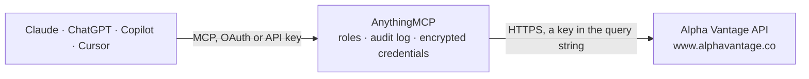

<!-- Generated by scripts/export-github-catalog.mjs in the anythingmcp-website repository. Do not edit by hand. -->

# Alpha Vantage MCP connector

Market data from Alpha Vantage: stock quotes and daily or intraday price history for global exchanges, company fundamentals and earnings, dividends, insider and institutional holdings, ETF profiles, … The AnythingMCP connector gives Claude, ChatGPT, Microsoft Copilot, Cursor and Gemini 30 MCP tools for Alpha Vantage, all read-only.

**Category:** [Finance](../finance.md) · **Tools:** 30 · **Setup guide:** [anythingmcp.com](https://anythingmcp.com/guides/alpha-vantage-to-mcp) · [Deutsch](https://anythingmcp.com/de/guides/alpha-vantage-to-mcp) · [Italiano](https://anythingmcp.com/it/guides/alpha-vantage-to-mcp) · [Español](https://anythingmcp.com/es/guides/alpha-vantage-to-mcp) · [日本語](https://anythingmcp.com/ja/guides/alpha-vantage-to-mcp) · [Русский](https://anythingmcp.com/ru/guides/alpha-vantage-to-mcp) · [中文](https://anythingmcp.com/zh/guides/alpha-vantage-to-mcp)

## Start without code

No installation and no terminal: AnythingMCP Cloud runs the Alpha Vantage connector for you, operated by helpcode.ai in Frankfurt, Germany.

1. **Click the button above** and create an account or sign in. The Alpha Vantage connector opens, ready to install.
2. **Paste the API key or token from your Alpha Vantage account.** Every click is in the [step-by-step guide](https://anythingmcp.com/guides/alpha-vantage-to-mcp).
3. **Click Install.** AnythingMCP shows the address of your MCP server.
4. **Add that address to your assistant:** [Claude](https://anythingmcp.com/guides/connect-alpha-vantage-to-claude) · [ChatGPT](https://anythingmcp.com/guides/connect-alpha-vantage-to-chatgpt) · [Microsoft Copilot](https://anythingmcp.com/guides/connect-alpha-vantage-to-copilot) · [Cursor](https://anythingmcp.com/guides/connect-alpha-vantage-to-cursor) · [Gemini CLI](https://anythingmcp.com/guides/connect-alpha-vantage-to-gemini) · [Meta Muse](https://anythingmcp.com/guides/connect-alpha-vantage-to-muse).
5. **Ask your first question**, for example: *What's the current quote for ENPH and the last trading day's close?*

Prefer help with the setup? [Talk to us](https://anythingmcp.com/contact).

## How it works

- **The AI client** speaks MCP (Streamable HTTP) to AnythingMCP and only sees tool names, descriptions and results. It never gets the Alpha Vantage credentials.
- **AnythingMCP** checks the client's role, builds the call from the tool definition, adds the credentials (a key in the query string), calls Alpha Vantage, logs the call and returns the result.
- **Alpha Vantage** sees an ordinary API client with the rights of the account the credentials belong to.

## Tools

| Tool | What it does | Access |
|---|---|---|
| [`alpha_vantage_get_quote`](#alpha_vantage_get_quote) | Get the latest quote of one stock or ETF (GLOBAL_QUOTE): price, open, high, low, volume, latest trading day, previous close, change and change percent. | read |
| [`alpha_vantage_get_bulk_quotes`](#alpha_vantage_get_bulk_quotes) | Get realtime quotes for up to 100 US symbols in one call (REALTIME_BULK_QUOTES), including extended hours. | read |
| [`alpha_vantage_get_time_series`](#alpha_vantage_get_time_series) | Get the daily, weekly or monthly price history (open, high, low, close, volume) of a stock or ETF, raw or adjusted for splits and dividends (adjusted close,… | read |
| [`alpha_vantage_get_intraday`](#alpha_vantage_get_intraday) | Get intraday price bars (open, high, low, close, volume) of a US stock at 1 to 60 minute intervals, for the latest days or a given month in the last 20… | read |
| [`alpha_vantage_search_symbols`](#alpha_vantage_search_symbols) | Find ticker symbols by company name or partial symbol (SYMBOL_SEARCH): symbol, name, type, region, market hours, time zone, currency and match score. | read |
| [`alpha_vantage_get_market_status`](#alpha_vantage_get_market_status) | Get whether the major stock, forex and crypto markets worldwide are open or closed right now, with their local opening and closing times. | read |
| [`alpha_vantage_get_top_movers`](#alpha_vantage_get_top_movers) | Get the top 20 gainers, top 20 losers and 20 most actively traded US tickers of the latest trading day, with price, change and volume. | read |
| [`alpha_vantage_get_news_sentiment`](#alpha_vantage_get_news_sentiment) | Get market news with AI sentiment scores (NEWS_SENTIMENT): articles from major outlets about given tickers (stocks, crypto CRYPTO:BTC, forex FOREX:USD) or… | read |
| [`alpha_vantage_get_company_overview`](#alpha_vantage_get_company_overview) | Get the profile and key metrics of a company (OVERVIEW): description, exchange, sector, industry, market capitalisation, EBITDA, P/E, PEG, book value,… | read |
| [`alpha_vantage_get_etf_profile`](#alpha_vantage_get_etf_profile) | Get an ETF profile and holdings (ETF_PROFILE): net assets, expense ratio, turnover, dividend yield, inception date, leverage, sector allocation and the… | read |
| [`alpha_vantage_get_income_statement`](#alpha_vantage_get_income_statement) | Get the annual and quarterly income statements (revenue, cost of revenue, gross profit, operating income, EBIT, EBITDA, interest, taxes, net income) of a… | read |
| [`alpha_vantage_get_balance_sheet`](#alpha_vantage_get_balance_sheet) | Get the annual and quarterly balance sheets (assets, current assets, cash, inventory, liabilities, debt, shareholder equity, shares outstanding) of a… | read |
| [`alpha_vantage_get_cash_flow`](#alpha_vantage_get_cash_flow) | Get the annual and quarterly cash flow statements (operating cash flow, capital expenditures, dividends paid, buybacks, financing and investing cash flows)… | read |
| [`alpha_vantage_get_earnings`](#alpha_vantage_get_earnings) | Get a company's annual and quarterly earnings per share (EARNINGS): reported EPS, estimated EPS, surprise and surprise percent, report date and time of day. | read |
| [`alpha_vantage_get_earnings_estimates`](#alpha_vantage_get_earnings_estimates) | Get analyst EPS and revenue estimates for upcoming fiscal quarters and years (EARNINGS_ESTIMATES): average, high and low estimates, number of analysts and… | read |
| [`alpha_vantage_get_corporate_actions`](#alpha_vantage_get_corporate_actions) | Get the dividend history and declared future dividends (DIVIDENDS: ex-dividend, declaration, record and payment dates and amount) or the stock split history… | read |
| [`alpha_vantage_get_shares_outstanding`](#alpha_vantage_get_shares_outstanding) | Get the quarterly number of basic and diluted shares outstanding of a company (SHARES_OUTSTANDING). | read |
| [`alpha_vantage_get_insider_transactions`](#alpha_vantage_get_insider_transactions) | Get insider transactions of a company's executives, directors and major holders (INSIDER_TRANSACTIONS): date, insider name and title, acquisition or… | read |
| [`alpha_vantage_get_institutional_holdings`](#alpha_vantage_get_institutional_holdings) | Get the institutional ownership of a stock (INSTITUTIONAL_HOLDINGS): the funds and institutions holding it, with shares held, value and change per reporting… | read |
| [`alpha_vantage_get_earnings_call_transcript`](#alpha_vantage_get_earnings_call_transcript) | Get the transcript of a company's earnings call for one fiscal quarter (EARNINGS_CALL_TRANSCRIPT), turn by turn with speaker, title and a sentiment score. | read |
| [`alpha_vantage_get_options`](#alpha_vantage_get_options) | Get a US option chain (premium): REALTIME_OPTIONS for the live chain with optional greeks and implied volatility, or HISTORICAL_OPTIONS for the chain of a… | read |
| [`alpha_vantage_get_index_data`](#alpha_vantage_get_index_data) | Get the daily, weekly or monthly open, high, low and close history of a market index (INDEX_DATA), e.g. DJI, SPX, COMP, NDX, VIX, RUT or one of 200+ indices… | read |
| [`alpha_vantage_list_indices`](#alpha_vantage_list_indices) | List the market index symbols supported by alpha_vantage_get_index_data with their full names (INDEX_CATALOG). | read |
| [`alpha_vantage_get_exchange_rate`](#alpha_vantage_get_exchange_rate) | Get the realtime exchange rate between two currencies, physical or crypto (CURRENCY_EXCHANGE_RATE): rate, bid, ask and last refresh time, e.g. EUR to USD or… | read |
| [`alpha_vantage_get_fx_time_series`](#alpha_vantage_get_fx_time_series) | Get the price history (open, high, low, close) of a currency pair: FX_DAILY, FX_WEEKLY, FX_MONTHLY, or FX_INTRADAY bars (premium). | read |
| [`alpha_vantage_get_crypto_time_series`](#alpha_vantage_get_crypto_time_series) | Get the price and volume history of a cryptocurrency in a market currency: DIGITAL_CURRENCY_DAILY, DIGITAL_CURRENCY_WEEKLY, DIGITAL_CURRENCY_MONTHLY… | read |
| [`alpha_vantage_get_commodity`](#alpha_vantage_get_commodity) | Get the price history of a commodity: crude oil WTI and Brent, natural gas (daily, weekly or monthly), copper, aluminum, wheat, corn, cotton, sugar, coffee… | read |
| [`alpha_vantage_get_precious_metals`](#alpha_vantage_get_precious_metals) | Get the live spot price of gold or silver (GOLD_SILVER_SPOT) or their daily, weekly or monthly price history (GOLD_SILVER_HISTORY). | read |
| [`alpha_vantage_get_economic_indicator`](#alpha_vantage_get_economic_indicator) | Get a US economic indicator series: real GDP and GDP per capita, treasury yields by maturity, federal funds rate, CPI, inflation, retail sales, durable… | read |
| [`alpha_vantage_get_technical_indicator`](#alpha_vantage_get_technical_indicator) | Compute a technical indicator over a stock's price history: moving averages (SMA, EMA, WMA, DEMA, TEMA, KAMA, MAMA, T3, VWAP), momentum and oscillators… | read |

## Tool reference

Every parameter as the AI client sees it in `tools/list`. Source: [`packages/backend/src/adapters/intl/alpha-vantage.json`](../../../packages/backend/src/adapters/intl/alpha-vantage.json).

### `alpha_vantage_get_quote`

Get the latest quote of one stock or ETF (GLOBAL_QUOTE): price, open, high, low, volume, latest trading day, previous close, change and change percent.

**Access:** read · **Call:** `GET /query`

| Parameter | Type | Required | Description |
|---|---|---|---|
| `symbol` | string | yes | Ticker symbol, e.g. IBM, AAPL, MSFT; for other exchanges add the suffix from alpha_vantage_search_symbols, e.g. TSCO.LON, SHOP.TRT, RELIANCE.BSE. |
| `entitlement` | `realtime` \| `delayed` | no | Premium plans only: realtime or delayed (15-minute) US data. Leave empty for the default end-of-day or historical data. |

### `alpha_vantage_get_bulk_quotes`

Get realtime quotes for up to 100 US symbols in one call (REALTIME_BULK_QUOTES), including extended hours. Premium: on a free key the answer is sample data marked as such and the call fails.

**Access:** read · **Call:** `GET /query`

| Parameter | Type | Required | Description |
|---|---|---|---|
| `symbol` | string | yes | Up to 100 comma-separated US symbols, e.g. MSFT,AAPL,IBM. |

### `alpha_vantage_get_time_series`

Get the daily, weekly or monthly price history (open, high, low, close, volume) of a stock or ETF, raw or adjusted for splits and dividends (adjusted close, dividend, split coefficient). 20+ years of history.

**Access:** read · **Call:** `GET /query`

| Parameter | Type | Required | Description |
|---|---|---|---|
| `function` | `TIME_SERIES_DAILY` \| `TIME_SERIES_DAILY_ADJUSTED` \| `TIME_SERIES_WEEKLY` \| `TIME_SERIES_WEEKLY_ADJUSTED` \| `TIME_SERIES_MONTHLY` \| `TIME_SERIES_MONTHLY_ADJUSTED` | yes | Which series: TIME_SERIES_DAILY (default, as traded), TIME_SERIES_DAILY_ADJUSTED (premium), TIME_SERIES_WEEKLY, TIME_SERIES_WEEKLY_ADJUSTED, TIME_SERIES_MONTHLY or TIME_SERIES_MONTHLY_ADJUSTED. |
| `symbol` | string | yes | Ticker symbol, e.g. IBM, AAPL, MSFT; for other exchanges add the suffix from alpha_vantage_search_symbols, e.g. TSCO.LON, SHOP.TRT, RELIANCE.BSE. |
| `outputsize` | `compact` \| `full` | no | Daily series only: compact (default) returns the latest 100 days, full the whole history (premium). |
| `entitlement` | `realtime` \| `delayed` | no | Premium plans only: realtime or delayed (15-minute) US data. Leave empty for the default end-of-day or historical data. |

### `alpha_vantage_get_intraday`

Get intraday price bars (open, high, low, close, volume) of a US stock at 1 to 60 minute intervals, for the latest days or a given month in the last 20 years, with or without extended hours. Premium for realtime data.

**Access:** read · **Call:** `GET /query`

| Parameter | Type | Required | Description |
|---|---|---|---|
| `symbol` | string | yes | US-listed ticker symbol, e.g. IBM, AAPL, MSFT. |
| `interval` | `1min` \| `5min` \| `15min` \| `30min` \| `60min` | yes | Bar length: 1min, 5min, 15min, 30min or 60min. |
| `adjusted` | boolean | no | false for raw as-traded prices; default true (adjusted for splits and dividends). |
| `extended_hours` | boolean | no | false for regular trading hours only; default true (4:00 to 20:00 Eastern time). |
| `month` | string | no | A month in history, YYYY-MM (since 2000-01). Leave empty for the latest days. |
| `outputsize` | `compact` \| `full` | no | compact (default) returns the latest 100 data points; full returns the whole history (premium for daily data, and can be large). |
| `entitlement` | `realtime` \| `delayed` | no | Premium plans only: realtime or delayed (15-minute) US data. Leave empty for the default end-of-day or historical data. |

### `alpha_vantage_search_symbols`

Find ticker symbols by company name or partial symbol (SYMBOL_SEARCH): symbol, name, type, region, market hours, time zone, currency and match score. Use it before any other tool when the exact symbol is unknown.

**Access:** read · **Call:** `GET /query`

| Parameter | Type | Required | Description |
|---|---|---|---|
| `keywords` | string | yes | Company name or symbol fragment, e.g. microsoft, tesco, BA. |

### `alpha_vantage_get_market_status`

Get whether the major stock, forex and crypto markets worldwide are open or closed right now, with their local opening and closing times. No parameters.

**Access:** read · **Call:** `GET /query`

No parameters.

### `alpha_vantage_get_top_movers`

Get the top 20 gainers, top 20 losers and 20 most actively traded US tickers of the latest trading day, with price, change and volume.

**Access:** read · **Call:** `GET /query`

| Parameter | Type | Required | Description |
|---|---|---|---|
| `entitlement` | `realtime` \| `delayed` | no | Premium plans only: realtime or delayed (15-minute) US data. Leave empty for the default end-of-day or historical data. |

### `alpha_vantage_get_news_sentiment`

Get market news with AI sentiment scores (NEWS_SENTIMENT): articles from major outlets about given tickers (stocks, crypto CRYPTO:BTC, forex FOREX:USD) or topics, with title, URL, time, summary, source, overall sentiment and per-ticker relevance and sentiment.

**Access:** read · **Call:** `GET /query`

| Parameter | Type | Required | Description |
|---|---|---|---|
| `tickers` | string | no | Comma-separated tickers the articles must all mention, e.g. AAPL or COIN,CRYPTO:BTC,FOREX:USD. |
| `topics` | string | no | Comma-separated topics: blockchain, earnings, ipo, mergers_and_acquisitions, financial_markets, economy_fiscal, economy_monetary, economy_macro, energy_transportation, finance, life_sciences, manufacturing, real_estate, retail_wholesale, technology. |
| `time_from` | string | no | Earliest publication time, YYYYMMDDTHHMM, e.g. 20260401T0130. |
| `time_to` | string | no | Latest publication time, YYYYMMDDTHHMM. |
| `sort` | `LATEST` \| `EARLIEST` \| `RELEVANCE` | no | LATEST (default), EARLIEST or RELEVANCE. |
| `limit` | integer | no | Number of articles, 1 to 1000. |

### `alpha_vantage_get_company_overview`

Get the profile and key metrics of a company (OVERVIEW): description, exchange, sector, industry, market capitalisation, EBITDA, P/E, PEG, book value, dividend per share and yield, EPS, margins, ROA, ROE, revenue, analyst target price and ratings, beta, 52-week range, moving averages, shares outstanding.

**Access:** read · **Call:** `GET /query`

| Parameter | Type | Required | Description |
|---|---|---|---|
| `symbol` | string | yes | Ticker symbol, e.g. IBM, AAPL, MSFT; for other exchanges add the suffix from alpha_vantage_search_symbols, e.g. TSCO.LON, SHOP.TRT, RELIANCE.BSE. |

### `alpha_vantage_get_etf_profile`

Get an ETF profile and holdings (ETF_PROFILE): net assets, expense ratio, turnover, dividend yield, inception date, leverage, sector allocation and the constituent holdings with weights.

**Access:** read · **Call:** `GET /query`

| Parameter | Type | Required | Description |
|---|---|---|---|
| `symbol` | string | yes | ETF symbol, e.g. QQQ, SPY, VTI. |

### `alpha_vantage_get_income_statement`

Get the annual and quarterly income statements (revenue, cost of revenue, gross profit, operating income, EBIT, EBITDA, interest, taxes, net income) of a company (INCOME_STATEMENT), mapped to US GAAP and IFRS. Values are strings in the reported currency, "None" when not reported.

**Access:** read · **Call:** `GET /query`

| Parameter | Type | Required | Description |
|---|---|---|---|
| `symbol` | string | yes | Ticker symbol, e.g. IBM, AAPL, MSFT; for other exchanges add the suffix from alpha_vantage_search_symbols, e.g. TSCO.LON, SHOP.TRT, RELIANCE.BSE. |

### `alpha_vantage_get_balance_sheet`

Get the annual and quarterly balance sheets (assets, current assets, cash, inventory, liabilities, debt, shareholder equity, shares outstanding) of a company (BALANCE_SHEET), mapped to US GAAP and IFRS. Values are strings in the reported currency, "None" when not reported.

**Access:** read · **Call:** `GET /query`

| Parameter | Type | Required | Description |
|---|---|---|---|
| `symbol` | string | yes | Ticker symbol, e.g. IBM, AAPL, MSFT; for other exchanges add the suffix from alpha_vantage_search_symbols, e.g. TSCO.LON, SHOP.TRT, RELIANCE.BSE. |

### `alpha_vantage_get_cash_flow`

Get the annual and quarterly cash flow statements (operating cash flow, capital expenditures, dividends paid, buybacks, financing and investing cash flows) of a company (CASH_FLOW), mapped to US GAAP and IFRS. Values are strings in the reported currency, "None" when not reported.

**Access:** read · **Call:** `GET /query`

| Parameter | Type | Required | Description |
|---|---|---|---|
| `symbol` | string | yes | Ticker symbol, e.g. IBM, AAPL, MSFT; for other exchanges add the suffix from alpha_vantage_search_symbols, e.g. TSCO.LON, SHOP.TRT, RELIANCE.BSE. |

### `alpha_vantage_get_earnings`

Get a company's annual and quarterly earnings per share (EARNINGS): reported EPS, estimated EPS, surprise and surprise percent, report date and time of day.

**Access:** read · **Call:** `GET /query`

| Parameter | Type | Required | Description |
|---|---|---|---|
| `symbol` | string | yes | Ticker symbol, e.g. IBM, AAPL, MSFT; for other exchanges add the suffix from alpha_vantage_search_symbols, e.g. TSCO.LON, SHOP.TRT, RELIANCE.BSE. |

### `alpha_vantage_get_earnings_estimates`

Get analyst EPS and revenue estimates for upcoming fiscal quarters and years (EARNINGS_ESTIMATES): average, high and low estimates, number of analysts and estimate revisions over the last 7 to 90 days.

**Access:** read · **Call:** `GET /query`

| Parameter | Type | Required | Description |
|---|---|---|---|
| `symbol` | string | yes | Ticker symbol, e.g. IBM, AAPL, MSFT; for other exchanges add the suffix from alpha_vantage_search_symbols, e.g. TSCO.LON, SHOP.TRT, RELIANCE.BSE. |

### `alpha_vantage_get_corporate_actions`

Get the dividend history and declared future dividends (DIVIDENDS: ex-dividend, declaration, record and payment dates and amount) or the stock split history (SPLITS: effective date and split factor) of a company.

**Access:** read · **Call:** `GET /query`

| Parameter | Type | Required | Description |
|---|---|---|---|
| `function` | `DIVIDENDS` \| `SPLITS` | yes | DIVIDENDS (default) or SPLITS. |
| `symbol` | string | yes | Ticker symbol, e.g. IBM, AAPL, MSFT; for other exchanges add the suffix from alpha_vantage_search_symbols, e.g. TSCO.LON, SHOP.TRT, RELIANCE.BSE. |

### `alpha_vantage_get_shares_outstanding`

Get the quarterly number of basic and diluted shares outstanding of a company (SHARES_OUTSTANDING).

**Access:** read · **Call:** `GET /query`

| Parameter | Type | Required | Description |
|---|---|---|---|
| `symbol` | string | yes | Ticker symbol, e.g. IBM, AAPL, MSFT; for other exchanges add the suffix from alpha_vantage_search_symbols, e.g. TSCO.LON, SHOP.TRT, RELIANCE.BSE. |

### `alpha_vantage_get_insider_transactions`

Get insider transactions of a company's executives, directors and major holders (INSIDER_TRANSACTIONS): date, insider name and title, acquisition or disposal, security type, shares and price. Codes P (open market purchase) and S (sale) matter most.

**Access:** read · **Call:** `GET /query`

| Parameter | Type | Required | Description |
|---|---|---|---|
| `symbol` | string | yes | US-listed ticker symbol, e.g. IBM, AAPL, MSFT. |
| `from` | string | no | Only transactions on or after this date, YYYY-MM-DD. |

### `alpha_vantage_get_institutional_holdings`

Get the institutional ownership of a stock (INSTITUTIONAL_HOLDINGS): the funds and institutions holding it, with shares held, value and change per reporting period.

**Access:** read · **Call:** `GET /query`

| Parameter | Type | Required | Description |
|---|---|---|---|
| `symbol` | string | yes | US-listed ticker symbol, e.g. IBM, AAPL, MSFT. |

### `alpha_vantage_get_earnings_call_transcript`

Get the transcript of a company's earnings call for one fiscal quarter (EARNINGS_CALL_TRANSCRIPT), turn by turn with speaker, title and a sentiment score. Quarters since 2010Q1.

**Access:** read · **Call:** `GET /query`

| Parameter | Type | Required | Description |
|---|---|---|---|
| `symbol` | string | yes | US-listed ticker symbol, e.g. IBM, AAPL, MSFT. |
| `quarter` | string | yes | Fiscal quarter, YYYYQN, e.g. 2026Q2. |

### `alpha_vantage_get_options`

Get a US option chain (premium): REALTIME_OPTIONS for the live chain with optional greeks and implied volatility, or HISTORICAL_OPTIONS for the chain of a past trading day (since 2008) with IV and greeks. Filter by expiration or one contract; a full chain is large.

**Access:** read · **Call:** `GET /query`

| Parameter | Type | Required | Description |
|---|---|---|---|
| `function` | `HISTORICAL_OPTIONS` \| `REALTIME_OPTIONS` | yes | HISTORICAL_OPTIONS (default; previous session unless date is set) or REALTIME_OPTIONS. |
| `symbol` | string | yes | US-listed ticker symbol, e.g. IBM, AAPL, MSFT. |
| `date` | string | no | HISTORICAL_OPTIONS only: trading day, YYYY-MM-DD (after 2008-01-01). Default: the previous session. |
| `expiration` | string | no | Only contracts expiring on this date, YYYY-MM-DD. |
| `contract` | string | no | One contract id, e.g. IBM270115C00390000. |
| `require_greeks` | boolean | no | REALTIME_OPTIONS only: true adds greeks and implied volatility. |

### `alpha_vantage_get_index_data`

Get the daily, weekly or monthly open, high, low and close history of a market index (INDEX_DATA), e.g. DJI, SPX, COMP, NDX, VIX, RUT or one of 200+ indices from alpha_vantage_list_indices.

**Access:** read · **Call:** `GET /query`

| Parameter | Type | Required | Description |
|---|---|---|---|
| `symbol` | string | yes | Index symbol, e.g. SPX (S&P 500), DJI, COMP (Nasdaq Composite), NDX, VIX, RUT. |
| `interval` | `daily` \| `weekly` \| `monthly` | yes | daily, weekly or monthly. |

### `alpha_vantage_list_indices`

List the market index symbols supported by alpha_vantage_get_index_data with their full names (INDEX_CATALOG). No parameters.

**Access:** read · **Call:** `GET /query`

No parameters.

### `alpha_vantage_get_exchange_rate`

Get the realtime exchange rate between two currencies, physical or crypto (CURRENCY_EXCHANGE_RATE): rate, bid, ask and last refresh time, e.g. EUR to USD or BTC to EUR.

**Access:** read · **Call:** `GET /query`

| Parameter | Type | Required | Description |
|---|---|---|---|
| `from_currency` | string | yes | Currency to convert from, e.g. EUR, USD, BTC, ETH. |
| `to_currency` | string | yes | Currency to convert to, e.g. USD, JPY, EUR. |

### `alpha_vantage_get_fx_time_series`

Get the price history (open, high, low, close) of a currency pair: FX_DAILY, FX_WEEKLY, FX_MONTHLY, or FX_INTRADAY bars (premium).

**Access:** read · **Call:** `GET /query`

| Parameter | Type | Required | Description |
|---|---|---|---|
| `function` | `FX_DAILY` \| `FX_WEEKLY` \| `FX_MONTHLY` \| `FX_INTRADAY` | yes | FX_DAILY (default), FX_WEEKLY, FX_MONTHLY or FX_INTRADAY (premium, needs interval). |
| `from_symbol` | string | yes | Three-letter base currency, e.g. EUR. |
| `to_symbol` | string | yes | Three-letter quote currency, e.g. USD. |
| `interval` | `1min` \| `5min` \| `15min` \| `30min` \| `60min` | no | FX_INTRADAY only: 1min, 5min, 15min, 30min or 60min. |
| `outputsize` | `compact` \| `full` | no | FX_DAILY and FX_INTRADAY: compact (default, latest 100 points) or full. |

### `alpha_vantage_get_crypto_time_series`

Get the price and volume history of a cryptocurrency in a market currency: DIGITAL_CURRENCY_DAILY, DIGITAL_CURRENCY_WEEKLY, DIGITAL_CURRENCY_MONTHLY (refreshed at midnight UTC), or CRYPTO_INTRADAY bars (premium).

**Access:** read · **Call:** `GET /query`

| Parameter | Type | Required | Description |
|---|---|---|---|
| `function` | `DIGITAL_CURRENCY_DAILY` \| `DIGITAL_CURRENCY_WEEKLY` \| `DIGITAL_CURRENCY_MONTHLY` \| `CRYPTO_INTRADAY` | yes | DIGITAL_CURRENCY_DAILY (default), DIGITAL_CURRENCY_WEEKLY, DIGITAL_CURRENCY_MONTHLY or CRYPTO_INTRADAY (premium, needs interval). |
| `symbol` | string | yes | Cryptocurrency, e.g. BTC, ETH, SOL. |
| `market` | string | yes | Market currency, e.g. USD, EUR. |
| `interval` | `1min` \| `5min` \| `15min` \| `30min` \| `60min` | no | CRYPTO_INTRADAY only: 1min, 5min, 15min, 30min or 60min. |
| `outputsize` | `compact` \| `full` | no | CRYPTO_INTRADAY only: compact (default, latest 100 points) or full. |

### `alpha_vantage_get_commodity`

Get the price history of a commodity: crude oil WTI and Brent, natural gas (daily, weekly or monthly), copper, aluminum, wheat, corn, cotton, sugar, coffee or the global commodity price index (monthly, quarterly or annual). Sourced from FRED and the IMF.

**Access:** read · **Call:** `GET /query`

| Parameter | Type | Required | Description |
|---|---|---|---|
| `function` | `WTI` \| `BRENT` \| `NATURAL_GAS` \| `COPPER` \| `ALUMINUM` \| `WHEAT` \| `CORN` \| `COTTON` \| `SUGAR` \| `COFFEE` \| `ALL_COMMODITIES` | yes | The commodity: WTI (default), BRENT, NATURAL_GAS, COPPER, ALUMINUM, WHEAT, CORN, COTTON, SUGAR, COFFEE or ALL_COMMODITIES (index). |
| `interval` | `daily` \| `weekly` \| `monthly` \| `quarterly` \| `annual` | no | WTI, BRENT and NATURAL_GAS: daily, weekly or monthly (default). The others: monthly (default), quarterly or annual. |

### `alpha_vantage_get_precious_metals`

Get the live spot price of gold or silver (GOLD_SILVER_SPOT) or their daily, weekly or monthly price history (GOLD_SILVER_HISTORY).

**Access:** read · **Call:** `GET /query`

| Parameter | Type | Required | Description |
|---|---|---|---|
| `function` | `GOLD_SILVER_SPOT` \| `GOLD_SILVER_HISTORY` | yes | GOLD_SILVER_SPOT (default) or GOLD_SILVER_HISTORY (needs interval). |
| `symbol` | `GOLD` \| `XAU` \| `SILVER` \| `XAG` | yes | GOLD or XAU for gold, SILVER or XAG for silver. |
| `interval` | `daily` \| `weekly` \| `monthly` | no | GOLD_SILVER_HISTORY only: daily, weekly or monthly. |

### `alpha_vantage_get_economic_indicator`

Get a US economic indicator series: real GDP and GDP per capita, treasury yields by maturity, federal funds rate, CPI, inflation, retail sales, durable goods orders, unemployment rate or nonfarm payrolls. Sourced from FRED; values are strings with a unit field.

**Access:** read · **Call:** `GET /query`

| Parameter | Type | Required | Description |
|---|---|---|---|
| `function` | `REAL_GDP` \| `REAL_GDP_PER_CAPITA` \| `TREASURY_YIELD` \| `FEDERAL_FUNDS_RATE` \| `CPI` \| `INFLATION` \| `RETAIL_SALES` \| `DURABLES` \| `UNEMPLOYMENT` \| `NONFARM_PAYROLL` | yes | The indicator: REAL_GDP (default), REAL_GDP_PER_CAPITA (quarterly), TREASURY_YIELD, FEDERAL_FUNDS_RATE, CPI, INFLATION (annual), RETAIL_SALES, DURABLES, UNEMPLOYMENT or NONFARM_PAYROLL (monthly). |
| `interval` | `daily` \| `weekly` \| `monthly` \| `quarterly` \| `semiannual` \| `annual` | no | REAL_GDP: quarterly or annual (default). TREASURY_YIELD and FEDERAL_FUNDS_RATE: daily, weekly or monthly (default). CPI: monthly (default) or semiannual. The others have one fixed frequency: leave empty. |
| `maturity` | `3month` \| `2year` \| `5year` \| `7year` \| `10year` \| `30year` | no | TREASURY_YIELD only: 3month, 2year, 5year, 7year, 10year (default) or 30year. |

### `alpha_vantage_get_technical_indicator`

Compute a technical indicator over a stock's price history: moving averages (SMA, EMA, WMA, DEMA, TEMA, KAMA, MAMA, T3, VWAP), momentum and oscillators (RSI, MACD, STOCH, STOCHRSI, WILLR, MOM, ROC, CCI, CMO, MFI, ULTOSC, APO, PPO), trend (ADX, AROON, SAR, DX), volatility (BBANDS, ATR, NATR, TRANGE), volume (OBV, AD, ADOSC) and Hilbert transform indicators. Returns one value set per date, newest first.

**Access:** read · **Call:** `GET /query`

| Parameter | Type | Required | Description |
|---|---|---|---|
| `function` | `SMA` \| `EMA` \| `WMA` \| `DEMA` \| `TEMA` \| `TRIMA` \| `KAMA` \| `MAMA` \| `VWAP` \| `T3` \| `MACD` \| `MACDEXT` \| `STOCH` \| `STOCHF` \| `RSI` \| `STOCHRSI` \| `WILLR` \| `ADX` \| `ADXR` \| `APO` \| `PPO` \| `MOM` \| `BOP` \| `CCI` \| `CMO` \| `ROC` \| `ROCR` \| `AROON` \| `AROONOSC` \| `MFI` \| `TRIX` \| `ULTOSC` \| `DX` \| `MINUS_DI` \| `PLUS_DI` \| `MINUS_DM` \| `PLUS_DM` \| `BBANDS` \| `MIDPOINT` \| `MIDPRICE` \| `SAR` \| `TRANGE` \| `ATR` \| `NATR` \| `AD` \| `ADOSC` \| `OBV` \| `HT_TRENDLINE` \| `HT_SINE` \| `HT_TRENDMODE` \| `HT_DCPERIOD` \| `HT_DCPHASE` \| `HT_PHASOR` | yes | The indicator, e.g. SMA (default), EMA, RSI, MACD, BBANDS, STOCH, ADX, ATR, OBV, VWAP (intraday only). MACD and VWAP are premium. |
| `symbol` | string | yes | Ticker symbol, e.g. IBM, AAPL, MSFT; for other exchanges add the suffix from alpha_vantage_search_symbols, e.g. TSCO.LON, SHOP.TRT, RELIANCE.BSE. |
| `interval` | `1min` \| `5min` \| `15min` \| `30min` \| `60min` \| `daily` \| `weekly` \| `monthly` | yes | 1min, 5min, 15min, 30min, 60min, daily (default), weekly or monthly. Weekly or monthly keep long histories small. |
| `time_period` | integer | no | Data points per calculation, e.g. 14 for RSI, 20 for BBANDS, 50 or 200 for moving averages. Required by most indicators. |
| `series_type` | `close` \| `open` \| `high` \| `low` | no | Price used: close, open, high or low. Required by moving averages, RSI, MACD, BBANDS and others. |
| `month` | string | no | Intraday intervals only: a month in history, YYYY-MM. |
| `fastperiod` | integer | no | MACD, MACDEXT, APO, PPO, ADOSC, STOCHRSI: fast period (MACD default 12). |
| `slowperiod` | integer | no | MACD, MACDEXT, APO, PPO, ADOSC: slow period (MACD default 26). |
| `signalperiod` | integer | no | MACD, MACDEXT: signal period (default 9). |
| `matype` | integer | no | BBANDS, APO, PPO: moving average type, 0 SMA (default), 1 EMA, 2 WMA, 3 DEMA, 4 TEMA, 5 TRIMA, 6 T3, 7 KAMA, 8 MAMA. |
| `nbdevup` | integer | no | BBANDS: standard deviations for the upper band (default 2). |
| `nbdevdn` | integer | no | BBANDS: standard deviations for the lower band (default 2). |
| `fastkperiod` | integer | no | STOCH, STOCHF, STOCHRSI: fast K period (default 5). |
| `slowkperiod` | integer | no | STOCH: slow K period (default 3). |
| `slowdperiod` | integer | no | STOCH: slow D period (default 3). |
| `fastdperiod` | integer | no | STOCHF, STOCHRSI: fast D period (default 3). |
| `acceleration` | number | no | SAR: acceleration factor (default 0.01). |
| `maximum` | number | no | SAR: maximum acceleration (default 0.20). |
| `entitlement` | `realtime` \| `delayed` | no | Premium plans only: realtime or delayed (15-minute) US data. Leave empty for the default end-of-day or historical data. |

## Run it yourself

AnythingMCP is open source (AGPL-3.0). [Run it with Docker](../../../README.md#run-it-yourself), open **Connectors → Store**, pick **Alpha Vantage** and enter `ALPHA_VANTAGE_API_KEY`, then add your MCP server URL to the AI client.

[← Finance connectors](../finance.md) · [All categories](../README.md)
