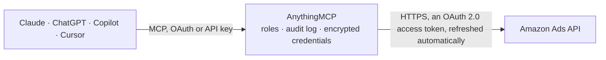

<!-- Generated by scripts/export-github-catalog.mjs in the anythingmcp-website repository. Do not edit by hand. -->

# Amazon Ads MCP connector

Read Amazon Ads (Sponsored Products) accounts: advertising profiles, campaigns, ad groups, product ads, keywords, negative keywords and targets, and request Reporting v3 performance reports for … The AnythingMCP connector gives Claude, ChatGPT, Microsoft Copilot, Cursor and Gemini 10 MCP tools for Amazon Ads: 9 read and 1 can change data.

**Category:** [Advertising](../advertising.md) · **Tools:** 10 · **Setup guide:** [anythingmcp.com](https://anythingmcp.com/guides/amazon-ads-to-mcp) · [Deutsch](https://anythingmcp.com/de/guides/amazon-ads-to-mcp) · [Italiano](https://anythingmcp.com/it/guides/amazon-ads-to-mcp) · [Español](https://anythingmcp.com/es/guides/amazon-ads-to-mcp) · [日本語](https://anythingmcp.com/ja/guides/amazon-ads-to-mcp) · [Русский](https://anythingmcp.com/ru/guides/amazon-ads-to-mcp) · [中文](https://anythingmcp.com/zh/guides/amazon-ads-to-mcp)

## Start without code

No installation and no terminal: AnythingMCP Cloud runs the Amazon Ads connector for you, operated by helpcode.ai in Frankfurt, Germany.

1. **Click the button above** and create an account or sign in. The Amazon Ads connector opens, ready to install.
2. **Sign in with your Amazon Ads account** when AnythingMCP asks. The first time, an admin creates a small app in the Amazon Ads developer console. Every click is in the [step-by-step guide](https://anythingmcp.com/guides/amazon-ads-to-mcp).
3. **Click Install.** AnythingMCP shows the address of your MCP server.
4. **Add that address to your assistant:** [Claude](https://anythingmcp.com/guides/connect-amazon-ads-to-claude) · [ChatGPT](https://anythingmcp.com/guides/connect-amazon-ads-to-chatgpt) · [Microsoft Copilot](https://anythingmcp.com/guides/connect-amazon-ads-to-copilot) · [Cursor](https://anythingmcp.com/guides/connect-amazon-ads-to-cursor) · [Gemini CLI](https://anythingmcp.com/guides/connect-amazon-ads-to-gemini) · [Meta Muse](https://anythingmcp.com/guides/connect-amazon-ads-to-muse).
5. **Ask your first question**, for example: *Show me active Sponsored Products ads for ASIN B07T4L9R2K in advertiser profile 9876543210, this month.*

Prefer help with the setup? [Talk to us](https://anythingmcp.com/contact).

## How it works

- **The AI client** speaks MCP (Streamable HTTP) to AnythingMCP and only sees tool names, descriptions and results. It never gets the Amazon Ads credentials.
- **AnythingMCP** checks the client's role, builds the call from the tool definition, adds the credentials (an OAuth 2.0 access token, refreshed automatically), calls Amazon Ads, logs the call and returns the result.
- **Amazon Ads** sees an ordinary API client with the rights of the account the credentials belong to.

## Tools

| Tool | What it does | Access |
|---|---|---|
| [`amazon_ads_list_profiles`](#amazon_ads_list_profiles) | List the advertising profiles the authorized Amazon account can reach in this region: profileId, countryCode, currencyCode, timezone, dailyBudget and… | read |
| [`amazon_ads_get_profile`](#amazon_ads_get_profile) | Get one advertising profile by id: marketplace (countryCode), currency, timezone, daily budget and the account it belongs to. | read |
| [`amazon_ads_list_sp_campaigns`](#amazon_ads_list_sp_campaigns) | List Sponsored Products campaigns of a profile: campaignId, name, state, targetingType (MANUAL or AUTO), budget, bidding strategy and placement adjustments,… | read |
| [`amazon_ads_list_sp_ad_groups`](#amazon_ads_list_sp_ad_groups) | List Sponsored Products ad groups of a profile with adGroupId, campaignId, name, state and default bid. | read |
| [`amazon_ads_list_sp_product_ads`](#amazon_ads_list_sp_product_ads) | List Sponsored Products product ads (the advertised ASINs or SKUs) with adId, adGroupId, campaignId, asin, sku and state. | read |
| [`amazon_ads_list_sp_keywords`](#amazon_ads_list_sp_keywords) | List Sponsored Products keywords with keywordId, adGroupId, campaignId, keywordText, matchType (EXACT, PHRASE, BROAD), bid and state. | read |
| [`amazon_ads_list_sp_negative_keywords`](#amazon_ads_list_sp_negative_keywords) | List Sponsored Products ad-group negative keywords with keywordId, adGroupId, campaignId, keywordText, matchType (NEGATIVE_EXACT, NEGATIVE_PHRASE) and state. | read |
| [`amazon_ads_list_sp_targets`](#amazon_ads_list_sp_targets) | List Sponsored Products targeting clauses (product, category and auto targets) with targetId, adGroupId, campaignId, expression, resolvedExpression,… | read |
| [`amazon_ads_create_report`](#amazon_ads_create_report) | Request an asynchronous performance report (Reporting v3) and get back its reportId with status PENDING. | write |
| [`amazon_ads_get_report`](#amazon_ads_get_report) | Get the status of a report requested with amazon_ads_create_report: PENDING, PROCESSING, COMPLETED or FAILED (with failureReason). | read |

## Tool reference

Every parameter as the AI client sees it in `tools/list`. Source: [`packages/backend/src/adapters/intl/amazon-ads.json`](../../../packages/backend/src/adapters/intl/amazon-ads.json).

### `amazon_ads_list_profiles`

List the advertising profiles the authorized Amazon account can reach in this region: profileId, countryCode, currencyCode, timezone, dailyBudget and accountInfo (seller or vendor or agency, marketplace, name). Start here: every other tool needs a profile_id from this list.

**Access:** read · **Call:** `GET /v2/profiles`

| Parameter | Type | Required | Description |
|---|---|---|---|
| `profile_type_filter` | string | no | Only profiles of these types, comma-separated: seller, vendor, agency. |
| `access_level` | `edit` \| `view` | no | Only profiles where the account has this access level for the campaign API (Amazon's default is edit). |
| `api_program` | `campaign` \| `report` \| `billing` \| `store` \| `account` \| `paymentMethod` | no | Only profiles with permission for this API program (Amazon's default is campaign). |

### `amazon_ads_get_profile`

Get one advertising profile by id: marketplace (countryCode), currency, timezone, daily budget and the account it belongs to. Use it to read the currency and timezone before interpreting report figures.

**Access:** read · **Call:** `GET /v2/profiles/{profile_id}`

| Parameter | Type | Required | Description |
|---|---|---|---|
| `profile_id` | string | yes | Profile id from amazon_ads_list_profiles. |

### `amazon_ads_list_sp_campaigns`

List Sponsored Products campaigns of a profile: campaignId, name, state, targetingType (MANUAL or AUTO), budget, bidding strategy and placement adjustments, startDate, endDate and portfolioId. Read-only (Amazon uses POST for list calls). Page with next_token.

**Access:** read · **Call:** `POST /sp/campaigns/list`

| Parameter | Type | Required | Description |
|---|---|---|---|
| `profile_id` | string | yes | Advertising profile id from amazon_ads_list_profiles (one per advertiser and marketplace). Sent as the Amazon-Advertising-API-Scope header. |
| `state_filter` | `ENABLED` \| `PAUSED` \| `ARCHIVED`[] | no | Only campaigns in these states. Default ENABLED and PAUSED. |
| `filters` | object | no | Optional extra filters, each an object with an include list: campaignIdFilter, portfolioIdFilter, nameFilter (with queryTermMatchType BROAD_MATCH or EXACT_MATCH). Example: {"campaignIdFilter": {"include": ["123456789"]}}. |
| `max_results` | integer | no | Items per page. Amazon uses its maximum page size when omitted. |
| `next_token` | string | no | nextToken from the previous answer, to read the next page. |
| `include_extended_data_fields` | boolean | no | true adds servingStatus, creationDateTime and lastUpdateDateTime to each item. |

### `amazon_ads_list_sp_ad_groups`

List Sponsored Products ad groups of a profile with adGroupId, campaignId, name, state and default bid. Filter by campaign with filters.campaignIdFilter. Read-only (Amazon uses POST for list calls). Page with next_token.

**Access:** read · **Call:** `POST /sp/adGroups/list`

| Parameter | Type | Required | Description |
|---|---|---|---|
| `profile_id` | string | yes | Advertising profile id from amazon_ads_list_profiles (one per advertiser and marketplace). Sent as the Amazon-Advertising-API-Scope header. |
| `state_filter` | `ENABLED` \| `PAUSED` \| `ARCHIVED`[] | no | Only ad groups in these states. Default ENABLED and PAUSED. |
| `filters` | object | no | Optional extra filters, each an object with an include list: campaignIdFilter, adGroupIdFilter, nameFilter (with queryTermMatchType BROAD_MATCH or EXACT_MATCH). campaignTargetingTypeFilter takes AUTO or MANUAL. Example: {"campaignIdFilter": {"include": ["123456789"]}}. |
| `max_results` | integer | no | Items per page. Amazon uses its maximum page size when omitted. |
| `next_token` | string | no | nextToken from the previous answer, to read the next page. |
| `include_extended_data_fields` | boolean | no | true adds servingStatus, creationDateTime and lastUpdateDateTime to each item. |

### `amazon_ads_list_sp_product_ads`

List Sponsored Products product ads (the advertised ASINs or SKUs) with adId, adGroupId, campaignId, asin, sku and state. Use it to see which products are advertised in which ad group. Read-only (POST list call). Page with next_token.

**Access:** read · **Call:** `POST /sp/productAds/list`

| Parameter | Type | Required | Description |
|---|---|---|---|
| `profile_id` | string | yes | Advertising profile id from amazon_ads_list_profiles (one per advertiser and marketplace). Sent as the Amazon-Advertising-API-Scope header. |
| `state_filter` | `ENABLED` \| `PAUSED` \| `ARCHIVED`[] | no | Only product ads in these states. Default ENABLED and PAUSED. |
| `filters` | object | no | Optional extra filters, each an object with an include list: campaignIdFilter, adGroupIdFilter, adIdFilter. Example: {"campaignIdFilter": {"include": ["123456789"]}}. |
| `max_results` | integer | no | Items per page. Amazon uses its maximum page size when omitted. |
| `next_token` | string | no | nextToken from the previous answer, to read the next page. |
| `include_extended_data_fields` | boolean | no | true adds servingStatus, creationDateTime and lastUpdateDateTime to each item. |

### `amazon_ads_list_sp_keywords`

List Sponsored Products keywords with keywordId, adGroupId, campaignId, keywordText, matchType (EXACT, PHRASE, BROAD), bid and state. Use it to review bids and match types in manual campaigns. Read-only (POST list call). Page with next_token.

**Access:** read · **Call:** `POST /sp/keywords/list`

| Parameter | Type | Required | Description |
|---|---|---|---|
| `profile_id` | string | yes | Advertising profile id from amazon_ads_list_profiles (one per advertiser and marketplace). Sent as the Amazon-Advertising-API-Scope header. |
| `state_filter` | `ENABLED` \| `PAUSED` \| `ARCHIVED`[] | no | Only keywords in these states. Default ENABLED and PAUSED. |
| `filters` | object | no | Optional extra filters, each an object with an include list: campaignIdFilter, adGroupIdFilter, keywordIdFilter, keywordTextFilter (also needs queryTermMatchType BROAD_MATCH or EXACT_MATCH). matchTypeFilter is a plain array such as ["EXACT","PHRASE"]. Example: {"campaignIdFilter": {"include": ["123456789"]}}. |
| `max_results` | integer | no | Items per page. Amazon uses its maximum page size when omitted. |
| `next_token` | string | no | nextToken from the previous answer, to read the next page. |
| `include_extended_data_fields` | boolean | no | true adds servingStatus, creationDateTime and lastUpdateDateTime to each item. |

### `amazon_ads_list_sp_negative_keywords`

List Sponsored Products ad-group negative keywords with keywordId, adGroupId, campaignId, keywordText, matchType (NEGATIVE_EXACT, NEGATIVE_PHRASE) and state. Use it before suggesting new negatives, to avoid duplicates. Read-only (POST list call).

**Access:** read · **Call:** `POST /sp/negativeKeywords/list`

| Parameter | Type | Required | Description |
|---|---|---|---|
| `profile_id` | string | yes | Advertising profile id from amazon_ads_list_profiles (one per advertiser and marketplace). Sent as the Amazon-Advertising-API-Scope header. |
| `state_filter` | `ENABLED` \| `PAUSED` \| `ARCHIVED`[] | no | Only negative keywords in these states. Default ENABLED and PAUSED. |
| `filters` | object | no | Optional extra filters, each an object with an include list: campaignIdFilter, adGroupIdFilter, negativeKeywordIdFilter, negativeKeywordTextFilter (also needs queryTermMatchType BROAD_MATCH or EXACT_MATCH). matchTypeFilter is a plain array such as ["NEGATIVE_EXACT"]. Example: {"campaignIdFilter": {"include": ["123456789"]}}. |
| `max_results` | integer | no | Items per page. Amazon uses its maximum page size when omitted. |
| `next_token` | string | no | nextToken from the previous answer, to read the next page. |
| `include_extended_data_fields` | boolean | no | true adds servingStatus, creationDateTime and lastUpdateDateTime to each item. |

### `amazon_ads_list_sp_targets`

List Sponsored Products targeting clauses (product, category and auto targets) with targetId, adGroupId, campaignId, expression, resolvedExpression, expressionType, bid and state. Use it for ASIN or category targeting reviews. Read-only (POST list call). Page with next_token.

**Access:** read · **Call:** `POST /sp/targets/list`

| Parameter | Type | Required | Description |
|---|---|---|---|
| `profile_id` | string | yes | Advertising profile id from amazon_ads_list_profiles (one per advertiser and marketplace). Sent as the Amazon-Advertising-API-Scope header. |
| `state_filter` | `ENABLED` \| `PAUSED` \| `ARCHIVED`[] | no | Only targeting clauses in these states. Default ENABLED and PAUSED. |
| `filters` | object | no | Optional extra filters, each an object with an include list: campaignIdFilter, adGroupIdFilter, targetIdFilter, asinFilter (with queryTermMatchType BROAD_MATCH or EXACT_MATCH), expressionTypeFilter (MANUAL or AUTO). Example: {"campaignIdFilter": {"include": ["123456789"]}}. |
| `max_results` | integer | no | Items per page. Amazon uses its maximum page size when omitted. |
| `next_token` | string | no | nextToken from the previous answer, to read the next page. |
| `include_extended_data_fields` | boolean | no | true adds servingStatus, creationDateTime and lastUpdateDateTime to each item. |

### `amazon_ads_create_report`

Request an asynchronous performance report (Reporting v3) and get back its reportId with status PENDING. This creates a report job on Amazon's side but changes no campaign. Then poll amazon_ads_get_report until status is COMPLETED. Typical: reportTypeId spCampaigns, groupBy ["campaign"], timeUnit DAILY.

**Access:** write · **Call:** `POST /reporting/reports`

| Parameter | Type | Required | Description |
|---|---|---|---|
| `profile_id` | string | yes | Profile id from amazon_ads_list_profiles. |
| `name` | string | no | Optional name for the report, shown in its status. |
| `start_date` | string | yes | First day, YYYY-MM-DD. Most report types look back at most 95 days. |
| `end_date` | string | yes | Last day, YYYY-MM-DD. At most 31 days after start_date for DAILY reports. |
| `ad_product` | `SPONSORED_PRODUCTS` \| `SPONSORED_BRANDS` \| `SPONSORED_DISPLAY` \| `SPONSORED_TELEVISION` \| `DEMAND_SIDE_PLATFORM` \| `ALL` | no | Advertising product the report covers. |
| `report_type_id` | string | no | Report type, e.g. spCampaigns, spTargeting, spSearchTerm, spAdvertisedProduct, spPurchasedProduct, sbCampaigns, sbSearchTerm, sdCampaigns, sdTargeting. |
| `group_by` | string[] | yes | Aggregation level allowed for the report type, e.g. ["campaign"], ["adGroup"], ["campaign","adGroup"], ["searchTerm"], ["targeting"], ["advertiser"]. |
| `columns` | string[] | yes | Columns to return. Example for spCampaigns: ["date","campaignId","campaignName","campaignStatus","impressions","clicks","cost","purchases7d","sales7d","acosClicks7d","roasClicks7d"]. Use date only with timeUnit DAILY. |
| `time_unit` | `DAILY` \| `SUMMARY` | no | DAILY for one row per day (include the date column), SUMMARY for totals over the range (startDate and endDate columns available). |
| `report_filters` | object[] | no | Optional filters as a list of {"field": "...", "values": ["..."]}, e.g. [{"field": "campaignStatus", "values": ["ENABLED"]}]. Allowed fields depend on the report type. |

### `amazon_ads_get_report`

Get the status of a report requested with amazon_ads_create_report: PENDING, PROCESSING, COMPLETED or FAILED (with failureReason). When COMPLETED, url is a pre-signed download link to the gzip-compressed JSON file, valid until urlExpiresAt (about one hour), plus fileSize.

**Access:** read · **Call:** `GET /reporting/reports/{report_id}`

| Parameter | Type | Required | Description |
|---|---|---|---|
| `profile_id` | string | yes | The profile id the report was requested for. |
| `report_id` | string | yes | reportId returned by amazon_ads_create_report. |

## Run it yourself

AnythingMCP is open source (AGPL-3.0). [Run it with Docker](../../../README.md#run-it-yourself), open **Connectors → Store**, pick **Amazon Ads** and enter `AMAZON_ADS_CLIENT_ID`, `AMAZON_ADS_CLIENT_SECRET`, `AMAZON_ADS_API_URL`, `AMAZON_ADS_AUTHORIZATION_URL`, `AMAZON_ADS_TOKEN_URL`, then add your MCP server URL to the AI client.

[← Advertising connectors](../advertising.md) · [All categories](../README.md)
