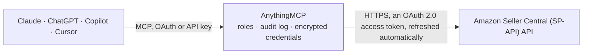

<!-- Generated by scripts/export-github-catalog.mjs in the anythingmcp-website repository. Do not edit by hand. -->

# Amazon Seller Central (SP-API) MCP connector

Query your Amazon Seller Central account through the official Selling Partner API: orders, order items, product catalog, FBA inventory, buy-box offers, fee estimates, financial events and reports, … The AnythingMCP connector gives Claude, ChatGPT, Microsoft Copilot, Cursor and Gemini 24 MCP tools for Amazon Seller Central (SP-API): 19 read and 5 can change data.

**Category:** [E-commerce](../e-commerce.md) · **Tools:** 24 · **Setup guide:** [anythingmcp.com](https://anythingmcp.com/guides/amazon-seller-to-mcp) · [Deutsch](https://anythingmcp.com/de/guides/amazon-seller-to-mcp) · [Italiano](https://anythingmcp.com/it/guides/amazon-seller-to-mcp) · [Español](https://anythingmcp.com/es/guides/amazon-seller-to-mcp) · [日本語](https://anythingmcp.com/ja/guides/amazon-seller-to-mcp) · [Русский](https://anythingmcp.com/ru/guides/amazon-seller-to-mcp) · [中文](https://anythingmcp.com/zh/guides/amazon-seller-to-mcp)

## Start without code

No installation and no terminal: AnythingMCP Cloud runs the Amazon Seller Central (SP-API) connector for you, operated by helpcode.ai in Frankfurt, Germany.

1. **Click the button above** and create an account or sign in. The Amazon Seller Central (SP-API) connector opens, ready to install.
2. **Sign in with your Amazon Seller Central (SP-API) account** when AnythingMCP asks. The first time, an admin creates a small app in the Amazon Seller Central (SP-API) developer console. Every click is in the [step-by-step guide](https://anythingmcp.com/guides/amazon-seller-to-mcp).
3. **Click Install.** AnythingMCP shows the address of your MCP server.
4. **Add that address to your assistant:** [Claude](https://anythingmcp.com/guides/connect-amazon-seller-to-claude) · [ChatGPT](https://anythingmcp.com/guides/connect-amazon-seller-to-chatgpt) · [Microsoft Copilot](https://anythingmcp.com/guides/connect-amazon-seller-to-copilot) · [Cursor](https://anythingmcp.com/guides/connect-amazon-seller-to-cursor) · [Gemini CLI](https://anythingmcp.com/guides/connect-amazon-seller-to-gemini) · [Meta Muse](https://anythingmcp.com/guides/connect-amazon-seller-to-muse).
5. **Ask your first question**, for example: *What's the status and totals for Amazon order 701-1234567-8901234?*

Prefer help with the setup? [Talk to us](https://anythingmcp.com/contact).

## How it works

- **The AI client** speaks MCP (Streamable HTTP) to AnythingMCP and only sees tool names, descriptions and results. It never gets the Amazon Seller Central (SP-API) credentials.
- **AnythingMCP** checks the client's role, builds the call from the tool definition, adds the credentials (an OAuth 2.0 access token, refreshed automatically), calls Amazon Seller Central (SP-API), logs the call and returns the result.
- **Amazon Seller Central (SP-API)** sees an ordinary API client with the rights of the account the credentials belong to.

## Tools

| Tool | What it does | Access |
|---|---|---|
| [`amazon_marketplace_ids`](#amazon_marketplace_ids) | Reference table of Amazon marketplace IDs and the regional SP-API endpoint that serves each. | read |
| [`amazon_marketplace_participations`](#amazon_marketplace_participations) | List the marketplaces this seller account participates in (id, country, currency, store name). | read |
| [`amazon_list_orders`](#amazon_list_orders) | List orders in the configured marketplace. | read |
| [`amazon_get_order`](#amazon_get_order) | Fetch a single order by its AmazonOrderId (format 3-7-7, e.g. 902-3159896-1390916). | read |
| [`amazon_get_order_items`](#amazon_get_order_items) | List the line items of an order: SellerSKU, ASIN, title, quantity ordered/shipped, item price, taxes, promotion discounts. | read |
| [`amazon_search_catalog`](#amazon_search_catalog) | Search the Amazon product catalog of the configured marketplace by keywords or identifiers (ASIN/EAN/GTIN/UPC/ISBN). | read |
| [`amazon_get_catalog_item`](#amazon_get_catalog_item) | Fetch a single catalog item by ASIN with the requested data sets (summaries, attributes, images, salesRanks, dimensions…). | read |
| [`amazon_fba_inventory`](#amazon_fba_inventory) | FBA inventory summaries for the configured marketplace: fulfillable, inbound, reserved, unfulfillable and researching quantities per SKU/ASIN. | read |
| [`amazon_get_item_offers`](#amazon_get_item_offers) | Current offers for an ASIN in the configured marketplace: buy-box winner, lowest prices by fulfillment channel, offer counts, shipping. | read |
| [`amazon_get_fees_estimate`](#amazon_get_fees_estimate) | Estimate the Amazon fees (referral fee, FBA fulfillment fee…) you would pay for an ASIN at a given selling price. | read |
| [`amazon_list_financial_events`](#amazon_list_financial_events) | Financial events (shipments settlements, refunds, fees, service charges, adjustments) posted in a date window. | read |
| [`amazon_get_listings_item`](#amazon_get_listings_item) | Fetch one of YOUR listings by seller SKU: summaries, attributes, issues (quality/compliance problems), offers and fulfillment availability. | read |
| [`amazon_create_report`](#amazon_create_report) | Request generation of a report (step 1 of 3). | write |
| [`amazon_get_report`](#amazon_get_report) | Check a report's processing status (step 2 of 3). | read |
| [`amazon_get_report_document`](#amazon_get_report_document) | Get the download descriptor of a finished report (step 3 of 3). | read |
| [`amazon_seller_search_listings_items`](#amazon_seller_search_listings_items) | Search YOUR listings in the connector's marketplace (Listings Items API searchListingsItems): by product identifiers (ASIN, EAN, UPC, GTIN, ISBN, SKU), by… | read |
| [`amazon_seller_patch_listings_item`](#amazon_seller_patch_listings_item) | Change part of one of YOUR listings (Listings Items API patchListingsItem): e.g. the price (purchasable_offer), the merchant-fulfilled quantity… | write |
| [`amazon_seller_put_listings_item`](#amazon_seller_put_listings_item) | Create a listing for a SKU, or fully replace an existing one (Listings Items API putListingsItem). | write |
| [`amazon_seller_delete_listings_item`](#amazon_seller_delete_listings_item) | Delete one of YOUR listings by SKU in the connector's marketplace (Listings Items API deleteListingsItem). | write |
| [`amazon_seller_get_listing_restrictions`](#amazon_seller_get_listing_restrictions) | Check whether YOUR seller account may list an ASIN in the connector's marketplace, and in which conditions (Listings Restrictions API getListingsRestrictions). | read |
| [`amazon_seller_get_solicitation_actions`](#amazon_seller_get_solicitation_actions) | List the solicitations you may send for an order right now (Solicitations API getSolicitationActionsForOrder). | read |
| [`amazon_seller_request_product_review`](#amazon_seller_request_product_review) | Ask the buyer of an order for a product review and seller feedback with Amazon's standard templated email (Solicitations API… | write |
| [`amazon_seller_search_product_types`](#amazon_seller_search_product_types) | Find the Amazon product types that fit a product in the connector's marketplace (Product Type Definitions API searchDefinitionsProductTypes), by keywords or… | read |
| [`amazon_seller_get_product_type_definition`](#amazon_seller_get_product_type_definition) | Get the definition of a product type for the connector's marketplace (Product Type Definitions API getDefinitionsProductType): the attribute groups, the… | read |

## Tool reference

Every parameter as the AI client sees it in `tools/list`. Source: [`packages/backend/src/adapters/intl/amazon-seller.json`](../../../packages/backend/src/adapters/intl/amazon-seller.json).

### `amazon_marketplace_ids`

Reference table of Amazon marketplace IDs and the regional SP-API endpoint that serves each. Use it to pick SPAPI_MARKETPLACE_ID / SPAPI_ENDPOINT or to interpret marketplace IDs found in responses. No API call is made.

**Access:** read · **Call:** `static SP-API marketplace IDs by region.

EUROPE — endpoint https://sellingpartnerapi-eu.amazon.com
  DE A1PA6795UKMFR9 | UK A1F83G8C2ARO7P | IT APJ6JRA9NG5V4 | FR A13V1IB3VIYZZH | ES A1RKKUPIHCS9HS | NL A1805IZSGTT6HS | SE A2NODRKZP88ZB9 | PL A1C3SOZRARQ6R3 | BE AMEN7PMS3EDWL | TR A33AVAJ2PDY3EV | AE A2VIGQ35RCS4UG | SA A17E79C6D8DWNP | EG ARBP9OOSHTCHU | IN A21TJRUUN4KGV | ZA AE08WJ6YKNBMC

NORTH AMERICA — endpoint https://sellingpartnerapi-na.amazon.com
  US ATVPDKIKX0DER | CA A2EUQ1WTGCTBG2 | MX A1AM78C64UM0Y8 | BR A2Q3Y263D00KWC

FAR EAST — endpoint https://sellingpartnerapi-fe.amazon.com
  JP A1VC38T7YXB528 | AU A39IBJ37TRP1C6 | SG A19VAU5U5O7RUS

Sandbox endpoints: prepend `sandbox.` to the regional host (e.g. https://sandbox.sellingpartnerapi-eu.amazon.com).`

No parameters.

### `amazon_marketplace_participations`

List the marketplaces this seller account participates in (id, country, currency, store name). Takes no parameters — use it as the FIRST call to verify credentials, region endpoint and marketplace setup.

**Access:** read · **Call:** `GET /sellers/v1/marketplaceParticipations`

No parameters.

### `amazon_list_orders`

List orders in the configured marketplace. Provide at least ONE of createdAfter / lastUpdatedAfter (ISO 8601, e.g. 2026-07-01T00:00:00Z). Returns non-PII order data: AmazonOrderId, status, purchase date, order totals, fulfillment channel. Paginate with nextToken.

**Access:** read · **Call:** `GET /orders/v0/orders`

| Parameter | Type | Required | Description |
|---|---|---|---|
| `createdAfter` | string | no | ISO 8601 date-time; orders created at or after this time. In the static sandbox pass `TEST_CASE_200`. |
| `lastUpdatedAfter` | string | no | ISO 8601 date-time; orders last updated at or after this time. Alternative to createdAfter. |
| `orderStatuses` | string | no | Optional comma-separated statuses: Pending, Unshipped, PartiallyShipped, Shipped, Canceled, Unfulfillable, InvoiceUnconfirmed, PendingAvailability. |
| `fulfillmentChannels` | string | no | Optional comma-separated: AFN (fulfilled by Amazon), MFN (fulfilled by seller). |
| `maxResultsPerPage` | integer | no | Page size 1-100 (default 100). |
| `nextToken` | string | no | Pagination token from the previous response. |

### `amazon_get_order`

Fetch a single order by its AmazonOrderId (format 3-7-7, e.g. 902-3159896-1390916). Returns the non-PII order header: status, totals, dates, channel, number of items.

**Access:** read · **Call:** `GET /orders/v0/orders/{orderId}`

| Parameter | Type | Required | Description |
|---|---|---|---|
| `orderId` | string | yes | The AmazonOrderId. In the static sandbox use `TEST_CASE_200`. |

### `amazon_get_order_items`

List the line items of an order: SellerSKU, ASIN, title, quantity ordered/shipped, item price, taxes, promotion discounts. Paginate with nextToken for very large orders.

**Access:** read · **Call:** `GET /orders/v0/orders/{orderId}/orderItems`

| Parameter | Type | Required | Description |
|---|---|---|---|
| `orderId` | string | yes | The AmazonOrderId. |
| `nextToken` | string | no | Pagination token from the previous response. |

### `amazon_search_catalog`

Search the Amazon product catalog of the configured marketplace by keywords or identifiers (ASIN/EAN/GTIN/UPC/ISBN). Returns matching items with ASIN and summary data (title, brand, classification). Max 20 results per page; paginate with pageToken.

**Access:** read · **Call:** `GET /catalog/2022-04-01/items`

| Parameter | Type | Required | Description |
|---|---|---|---|
| `keywords` | string | no | Comma-separated keywords to search for (e.g. 'espresso,machine'). Use either this OR identifiers. |
| `identifiers` | string | no | Comma-separated product identifiers (max 20). Use with identifiersType. Use either this OR keywords. |
| `identifiersType` | string | no | Type of the identifiers: ASIN, EAN, GTIN, ISBN, JAN, MINSAN, SKU, UPC. |
| `includedData` | string | no | Comma-separated data sets: summaries (default), attributes, classifications, dimensions, identifiers, images, productTypes, relationships, salesRanks. |
| `pageSize` | integer | no | Results per page, max 20 (default 10). |
| `pageToken` | string | no | Pagination token from the previous response. |

### `amazon_get_catalog_item`

Fetch a single catalog item by ASIN with the requested data sets (summaries, attributes, images, salesRanks, dimensions…).

**Access:** read · **Call:** `GET /catalog/2022-04-01/items/{asin}`

| Parameter | Type | Required | Description |
|---|---|---|---|
| `asin` | string | yes | The Amazon Standard Identification Number, e.g. B08N5WRWNW. |
| `includedData` | string | no | Comma-separated data sets: summaries (default), attributes, classifications, dimensions, identifiers, images, productTypes, relationships, salesRanks. |

### `amazon_fba_inventory`

FBA inventory summaries for the configured marketplace: fulfillable, inbound, reserved, unfulfillable and researching quantities per SKU/ASIN. Filter with sellerSkus or startDateTime; set details=true for the full quantity breakdown.

**Access:** read · **Call:** `GET /fba/inventory/v1/summaries`

| Parameter | Type | Required | Description |
|---|---|---|---|
| `details` | boolean | no | true returns the detailed quantity breakdown (inbound/reserved/unfulfillable buckets). Default false. |
| `sellerSkus` | string | no | Optional comma-separated list of seller SKUs (max 50) to fetch. |
| `startDateTime` | string | no | Optional ISO 8601; only items updated after this time. |
| `nextToken` | string | no | Pagination token from the previous response. |

### `amazon_get_item_offers`

Current offers for an ASIN in the configured marketplace: buy-box winner, lowest prices by fulfillment channel, offer counts, shipping. Use it to check your buy-box position and price competitiveness.

**Access:** read · **Call:** `GET /products/pricing/v0/items/{asin}/offers`

| Parameter | Type | Required | Description |
|---|---|---|---|
| `asin` | string | yes | The ASIN to get offers for. |
| `itemCondition` | `New` \| `Used` \| `Collectible` \| `Refurbished` \| `Club` | no | Condition filter. Amazon requires one; defaults to New. |

### `amazon_get_fees_estimate`

Estimate the Amazon fees (referral fee, FBA fulfillment fee…) you would pay for an ASIN at a given selling price. Essential for margin calculations before (re)pricing.

**Access:** read · **Call:** `POST /products/fees/v0/items/{asin}/feesEstimate`

| Parameter | Type | Required | Description |
|---|---|---|---|
| `asin` | string | yes | The ASIN to estimate fees for. |
| `price` | number | yes | The intended listing price (item price only, e.g. 29.99). |
| `currencyCode` | string | yes | ISO 4217 currency of the price, e.g. EUR, USD, GBP. |
| `isAmazonFulfilled` | boolean | no | true to include FBA fulfillment fees, false for merchant-fulfilled. Default true. |

### `amazon_list_financial_events`

Financial events (shipments settlements, refunds, fees, service charges, adjustments) posted in a date window. The money-side view of your account — use it for revenue/fee reconciliation. Paginate with nextToken.

**Access:** read · **Call:** `GET /finances/v0/financialEvents`

| Parameter | Type | Required | Description |
|---|---|---|---|
| `postedAfter` | string | yes | ISO 8601 date-time; events posted at or after this time. In the static sandbox pass `TEST_CASE_200`. |
| `postedBefore` | string | no | Optional ISO 8601 upper bound. |
| `maxResultsPerPage` | integer | no | Page size 1-100 (default 100). |
| `nextToken` | string | no | Pagination token from the previous response. |

### `amazon_get_listings_item`

Fetch one of YOUR listings by seller SKU: summaries, attributes, issues (quality/compliance problems), offers and fulfillment availability. The seller id is taken from SPAPI_SELLER_ID configured on this connector.

**Access:** read · **Call:** `GET /listings/2021-08-01/items/{{SPAPI_SELLER_ID}}/{sku}`

| Parameter | Type | Required | Description |
|---|---|---|---|
| `sku` | string | yes | Your seller SKU (as shown in Manage Inventory). |
| `includedData` | string | no | Comma-separated data sets: summaries (default), attributes, issues, offers, fulfillmentAvailability, procurement. |

### `amazon_create_report`

Request generation of a report (step 1 of 3). Common reportType values: GET_FLAT_FILE_OPEN_LISTINGS_DATA (active listings), GET_MERCHANT_LISTINGS_ALL_DATA, GET_FBA_MYI_UNSUPPRESSED_INVENTORY_DATA, GET_SALES_AND_TRAFFIC_REPORT, GET_V2_SETTLEMENT_REPORT_DATA_FLAT_FILE. Returns a reportId — poll it with amazon_get_report.

**Access:** write · **Call:** `POST /reports/2021-06-30/reports`

| Parameter | Type | Required | Description |
|---|---|---|---|
| `reportType` | string | yes | The report type identifier, e.g. GET_FLAT_FILE_OPEN_LISTINGS_DATA. Full list: https://developer-docs.amazon.com/sp-api/docs/report-type-values |
| `dataStartTime` | string | no | Optional ISO 8601 start of the data window (for date-ranged reports). |
| `dataEndTime` | string | no | Optional ISO 8601 end of the data window. |

### `amazon_get_report`

Check a report's processing status (step 2 of 3). Poll until processingStatus is DONE, then read reportDocumentId and pass it to amazon_get_report_document. Other statuses: IN_QUEUE, IN_PROGRESS, CANCELLED, FATAL.

**Access:** read · **Call:** `GET /reports/2021-06-30/reports/{reportId}`

| Parameter | Type | Required | Description |
|---|---|---|---|
| `reportId` | string | yes | The reportId returned by amazon_create_report. |

### `amazon_get_report_document`

Get the download descriptor of a finished report (step 3 of 3). Returns a pre-signed `url` (valid ~5 minutes; the file may be gzip-compressed — see compressionAlgorithm). Download that URL to read the report content.

**Access:** read · **Call:** `GET /reports/2021-06-30/documents/{reportDocumentId}`

| Parameter | Type | Required | Description |
|---|---|---|---|
| `reportDocumentId` | string | yes | The reportDocumentId from a DONE report. |

### `amazon_seller_search_listings_items`

Search YOUR listings in the connector's marketplace (Listings Items API searchListingsItems): by product identifiers (ASIN, EAN, UPC, GTIN, ISBN, SKU), by variation parent SKU, by creation or update date, by status or by issue severity. Returns each listing's SKU with the data sets asked for (summaries by default: ASIN, product type, status, item name, condition) plus numberOfResults and a pagination.nextToken. Leave the filters out to page through all listings.

**Access:** read · **Call:** `GET /listings/2021-08-01/items/{{SPAPI_SELLER_ID}}`

| Parameter | Type | Required | Description |
|---|---|---|---|
| `identifiers` | string | no | Comma-separated identifiers, up to 20, e.g. B0ABCD1234,B0EFGH5678. Needs identifiersType. |
| `identifiersType` | `ASIN` \| `EAN` \| `FNSKU` \| `GTIN` \| `ISBN` \| `JAN` \| `MINSAN` \| `SKU` \| `UPC` | no | Type of the values in identifiers. |
| `variationParentSku` | string | no | Only the variation children of this parent SKU. Not combinable with identifiers. |
| `createdAfter` | string | no | Only listings created at or after this ISO 8601 time. |
| `createdBefore` | string | no | Only listings created at or before this ISO 8601 time. |
| `lastUpdatedAfter` | string | no | Only listings updated at or after this ISO 8601 time. |
| `lastUpdatedBefore` | string | no | Only listings updated at or before this ISO 8601 time. |
| `withStatus` | string | no | Comma-separated statuses the listing must have: BUYABLE, DISCOVERABLE. |
| `withoutStatus` | string | no | Comma-separated statuses the listing must not have: BUYABLE, DISCOVERABLE. |
| `withIssueSeverity` | string | no | Only listings with issues of these severities: WARNING, ERROR. |
| `includedData` | string | no | Comma-separated data sets: summaries (default), attributes, issues, offers, fulfillmentAvailability, procurement, relationships, productTypes. |
| `sortBy` | `sku` \| `createdDate` \| `lastUpdatedDate` | no | Sort attribute (default lastUpdatedDate). |
| `sortOrder` | `ASC` \| `DESC` | no | Sort order (default DESC). |
| `pageSize` | integer | no | Results per page, 1-20 (default 10). |
| `pageToken` | string | no | pagination.nextToken from the previous page. |

### `amazon_seller_patch_listings_item`

Change part of one of YOUR listings (Listings Items API patchListingsItem): e.g. the price (purchasable_offer), the merchant-fulfilled quantity (fulfillment_availability), the title or bullet points, without resending the whole listing. Each patch is a JSON Patch operation (add, replace, merge, delete) on an attribute path of the product type. Answers ACCEPTED or INVALID with issues; Amazon applies accepted changes asynchronously. Set mode VALIDATION_PREVIEW to check a change without applying it.

**Access:** write · **Call:** `PATCH /listings/2021-08-01/items/{{SPAPI_SELLER_ID}}/{sku}`

| Parameter | Type | Required | Description |
|---|---|---|---|
| `sku` | string | yes | Your seller SKU. |
| `productType` | string | yes | Amazon product type of the listing, e.g. SHIRT or PRODUCT (from amazon_get_listings_item with includedData summaries). |
| `patches` | object[] | yes | JSON Patch operations, e.g. [{"op": "replace", "path": "/attributes/fulfillment_availability", "value": [{"fulfillment_channel_code": "DEFAULT", "quantity": 12}]}] or a purchasable_offer change with our_price. Paths and value shapes come from amazon_seller_get_product_type_definition. |
| `mode` | `VALIDATION_PREVIEW` | no | VALIDATION_PREVIEW validates the patch and returns issues without changing the listing. |
| `includedData` | string | no | Data sets in the response: issues (default), identifiers. |
| `issueLocale` | string | no | Locale for issue messages, e.g. en_US, de_DE. |

### `amazon_seller_put_listings_item`

Create a listing for a SKU, or fully replace an existing one (Listings Items API putListingsItem). All attributes are sent; attributes left out are removed from an existing listing, so prefer amazon_seller_patch_listings_item for partial changes. requirements LISTING creates product and offer, LISTING_OFFER_ONLY adds an offer to an existing ASIN (attributes then need merchant_suggested_asin, condition_type and purchasable_offer). Answers ACCEPTED or INVALID with issues; mode VALIDATION_PREVIEW only validates.

**Access:** write · **Call:** `PUT /listings/2021-08-01/items/{{SPAPI_SELLER_ID}}/{sku}`

| Parameter | Type | Required | Description |
|---|---|---|---|
| `sku` | string | yes | Your seller SKU for the listing. |
| `productType` | string | yes | Amazon product type, e.g. SHIRT; find it with amazon_seller_search_product_types. |
| `requirements` | `LISTING` \| `LISTING_PRODUCT_ONLY` \| `LISTING_OFFER_ONLY` | no | Which requirements the attributes meet (default LISTING). |
| `attributes` | object | yes | Attributes as the product type schema defines them, each an array of values with marketplace_id where needed, e.g. {"item_name": [{"value": "Mug", "language_tag": "en_US", "marketplace_id": "ATVPDKIKX0DER"}], "condition_type": [{"value": "new_new"}]}. |
| `mode` | `VALIDATION_PREVIEW` | no | VALIDATION_PREVIEW validates the listing and returns issues without saving it. |
| `includedData` | string | no | Data sets in the response: issues (default), identifiers. |
| `issueLocale` | string | no | Locale for issue messages, e.g. en_US, de_DE. |

### `amazon_seller_delete_listings_item`

Delete one of YOUR listings by SKU in the connector's marketplace (Listings Items API deleteListingsItem). The offer disappears from Amazon; the catalog product (ASIN) stays. Answers ACCEPTED, processed asynchronously. Cannot be undone; recreate with amazon_seller_put_listings_item.

**Access:** write · **Call:** `DELETE /listings/2021-08-01/items/{{SPAPI_SELLER_ID}}/{sku}`

| Parameter | Type | Required | Description |
|---|---|---|---|
| `sku` | string | yes | Your seller SKU. |
| `issueLocale` | string | no | Locale for issue messages, e.g. en_US, de_DE. |

### `amazon_seller_get_listing_restrictions`

Check whether YOUR seller account may list an ASIN in the connector's marketplace, and in which conditions (Listings Restrictions API getListingsRestrictions). An empty restrictions array means you can list it; otherwise each restriction names the condition, the reason (e.g. APPROVAL_REQUIRED, NOT_ELIGIBLE, ASIN_NOT_FOUND) and a link to request approval.

**Access:** read · **Call:** `GET /listings/2021-08-01/restrictions`

| Parameter | Type | Required | Description |
|---|---|---|---|
| `asin` | string | yes | The ASIN to check. |
| `conditionType` | string | no | Only this condition, e.g. new_new, used_like_new, used_very_good, used_good, used_acceptable, refurbished_refurbished, collectible_like_new. |
| `productType` | string | no | Product type of the item; with it Amazon also evaluates GTIN exemption restrictions. |
| `reasonLocale` | string | no | Locale for the reason text, e.g. en_US, de_DE. |

### `amazon_seller_get_solicitation_actions`

List the solicitations you may send for an order right now (Solicitations API getSolicitationActionsForOrder). If productReviewAndSellerFeedback appears under _links.actions, a review request can be sent with amazon_seller_request_product_review; an empty list means not (yet) allowed, e.g. outside the 5-30 days after delivery or already requested.

**Access:** read · **Call:** `GET /solicitations/v1/orders/{amazonOrderId}`

| Parameter | Type | Required | Description |
|---|---|---|---|
| `amazonOrderId` | string | yes | Amazon order id, e.g. 302-1234567-1234567. |

### `amazon_seller_request_product_review`

Ask the buyer of an order for a product review and seller feedback with Amazon's standard templated email (Solicitations API createProductReviewAndSellerFeedbackSolicitation), the same as the Request a Review button in Seller Central. Allowed once per order, 5 to 30 days after delivery; check with amazon_seller_get_solicitation_actions first. The email goes out at once and cannot be recalled.

**Access:** write · **Call:** `POST /solicitations/v1/orders/{amazonOrderId}/solicitations/productReviewAndSellerFeedback`

| Parameter | Type | Required | Description |
|---|---|---|---|
| `amazonOrderId` | string | yes | Amazon order id, e.g. 302-1234567-1234567. |

### `amazon_seller_search_product_types`

Find the Amazon product types that fit a product in the connector's marketplace (Product Type Definitions API searchDefinitionsProductTypes), by keywords or by an item title. Returns product type names (e.g. SHIRT, KITCHEN, HOME) with display names. Use the name in amazon_seller_get_product_type_definition and as productType when listing.

**Access:** read · **Call:** `GET /definitions/2020-09-01/productTypes`

| Parameter | Type | Required | Description |
|---|---|---|---|
| `keywords` | string | no | Comma-separated keywords, e.g. mug,ceramic. Not combinable with itemName. |
| `itemName` | string | no | A product title to get a product type recommendation for. Not combinable with keywords. |
| `locale` | string | no | Locale of the display names, e.g. en_US, de_DE. |
| `searchLocale` | string | no | Language of keywords or itemName, e.g. en_US. |

### `amazon_seller_get_product_type_definition`

Get the definition of a product type for the connector's marketplace (Product Type Definitions API getDefinitionsProductType): the attribute groups, the required attributes for the chosen requirements, and schema.link.resource, a pre-signed URL (valid a few minutes) to the full JSON Schema of the attributes. Read it before building attributes for amazon_seller_put_listings_item or patches.

**Access:** read · **Call:** `GET /definitions/2020-09-01/productTypes/{productType}`

| Parameter | Type | Required | Description |
|---|---|---|---|
| `productType` | string | yes | Product type name, e.g. SHIRT. |
| `requirements` | `LISTING` \| `LISTING_PRODUCT_ONLY` \| `LISTING_OFFER_ONLY` | no | Requirements set (default LISTING). |
| `requirementsEnforced` | `ENFORCED` \| `NOT_ENFORCED` | no | Whether the schema enforces the required attributes (default ENFORCED). |
| `locale` | string | no | Locale of labels, e.g. en_US, de_DE. |
| `productTypeVersion` | string | no | LATEST (default), RELEASE_CANDIDATE or a version id. |

## Run it yourself

AnythingMCP is open source (AGPL-3.0). [Run it with Docker](../../../README.md#run-it-yourself), open **Connectors → Store**, pick **Amazon Seller Central (SP-API)** and enter `SPAPI_CLIENT_ID`, `SPAPI_CLIENT_SECRET`, `SPAPI_REFRESH_TOKEN`, `SPAPI_ENDPOINT`, `SPAPI_MARKETPLACE_ID`, `SPAPI_SELLER_ID`, then add your MCP server URL to the AI client.

[← E-commerce connectors](../e-commerce.md) · [All categories](../README.md)
