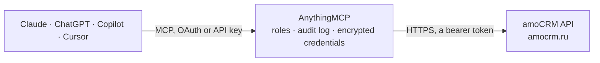

<!-- Generated by scripts/export-github-catalog.mjs in the anythingmcp-website repository. Do not edit by hand. -->

# amoCRM MCP connector

Let your AI work in amoCRM: find and update deals across pipelines, look up contacts and companies, read tasks, notes and the event log, and log new tasks and notes. The AnythingMCP connector gives Claude, ChatGPT, Microsoft Copilot, Cursor and Gemini 19 MCP tools for amoCRM: 14 read and 5 can change data.

**Category:** [CRM](../crm.md) · **Tools:** 19 · **Setup guide:** [anythingmcp.com](https://anythingmcp.com/guides/amocrm-to-mcp) · [Deutsch](https://anythingmcp.com/de/guides/amocrm-to-mcp) · [Italiano](https://anythingmcp.com/it/guides/amocrm-to-mcp) · [Español](https://anythingmcp.com/es/guides/amocrm-to-mcp) · [日本語](https://anythingmcp.com/ja/guides/amocrm-to-mcp) · [Русский](https://anythingmcp.com/ru/guides/amocrm-to-mcp) · [中文](https://anythingmcp.com/zh/guides/amocrm-to-mcp)

## Start without code

No installation and no terminal: AnythingMCP Cloud runs the amoCRM connector for you, operated by helpcode.ai in Frankfurt, Germany.

1. **Click the button above** and create an account or sign in. The amoCRM connector opens, ready to install.
2. **Paste the API key or token from your amoCRM account.** Every click is in the [step-by-step guide](https://anythingmcp.com/guides/amocrm-to-mcp).
3. **Click Install.** AnythingMCP shows the address of your MCP server.
4. **Add that address to your assistant:** [Claude](https://anythingmcp.com/guides/connect-amocrm-to-claude) · [ChatGPT](https://anythingmcp.com/guides/connect-amocrm-to-chatgpt) · [Microsoft Copilot](https://anythingmcp.com/guides/connect-amocrm-to-copilot) · [Cursor](https://anythingmcp.com/guides/connect-amocrm-to-cursor) · [Gemini CLI](https://anythingmcp.com/guides/connect-amocrm-to-gemini) · [Meta Muse](https://anythingmcp.com/guides/connect-amocrm-to-muse).
5. **Ask your first question**, for example: *Show me details for lead 4721 (Nordic Solar OÜ) so I can check the invoice amount and responsible person.*

Prefer help with the setup? [Talk to us](https://anythingmcp.com/contact).

## How it works

- **The AI client** speaks MCP (Streamable HTTP) to AnythingMCP and only sees tool names, descriptions and results. It never gets the amoCRM credentials.
- **AnythingMCP** checks the client's role, builds the call from the tool definition, adds the credentials (a bearer token), calls amoCRM, logs the call and returns the result.
- **amoCRM** sees an ordinary API client with the rights of the account the credentials belong to.

## Tools

| Tool | What it does | Access |
|---|---|---|
| [`amocrm_get_account`](#amocrm_get_account) | Get the amoCRM account: id, name, subdomain, current user id, country, currency, language, and with the default extras its task types (ids for tasks) and… | read |
| [`amocrm_list_leads`](#amocrm_list_leads) | List or search deals (leads in the API): id, name, price, pipeline and stage (status_id), responsible user, dates, tags, custom fields and, with… | read |
| [`amocrm_get_lead`](#amocrm_get_lead) | Get one lead by id with its name, price, pipeline, stage, responsible user, dates, tags, custom field values, linked company and, by default, linked contacts. | read |
| [`amocrm_create_lead`](#amocrm_create_lead) | Create a lead, optionally in a given pipeline and stage, with price, responsible user, custom fields, tags and links to existing contacts and a company. | write |
| [`amocrm_update_lead`](#amocrm_update_lead) | Change a lead: name, price, stage or pipeline (moving it through the funnel; Closed-won is status 142, Closed-lost 143), responsible user, loss reason,… | write |
| [`amocrm_list_contacts`](#amocrm_list_contacts) | List or search contacts: id, name, first and last name, responsible user, dates, tags, custom fields (phone and email are custom fields) and, with… | read |
| [`amocrm_get_contact`](#amocrm_get_contact) | Get one contact by id with names, responsible user, tags, custom field values (phones, emails, position), linked companies and, by default, linked leads. | read |
| [`amocrm_create_contact`](#amocrm_create_contact) | Create a contact with name, responsible user, phone, email and other custom fields, and tags. | write |
| [`amocrm_list_companies`](#amocrm_list_companies) | List or search companies: id, name, responsible user, dates, tags, custom fields and, with with=leads,contacts, linked leads and contacts. | read |
| [`amocrm_list_pipelines`](#amocrm_list_pipelines) | List the lead pipelines with their stages: pipeline id, name, whether main or archived, and per stage (in _embedded.statuses) its id, name, sort order,… | read |
| [`amocrm_list_loss_reasons`](#amocrm_list_loss_reasons) | List the account's loss reasons (причины отказа) for deals: id, name and sort order. | read |
| [`amocrm_list_custom_fields`](#amocrm_list_custom_fields) | List the custom fields of leads, contacts or companies: id, name, code (PHONE, EMAIL for contacts), type and, for select fields, the enum options with their… | read |
| [`amocrm_list_tasks`](#amocrm_list_tasks) | List tasks: id, text, type, deadline (complete_till), whether completed, result, responsible user and the lead, contact or company it belongs to. | read |
| [`amocrm_create_task`](#amocrm_create_task) | Create a task with a deadline, linked to a lead, contact or company, for a responsible user. | write |
| [`amocrm_list_notes`](#amocrm_list_notes) | Read the notes (timeline entries) of one lead, contact or company: id, type (common text note, call_in, call_out, sms, service messages, ...), params with… | read |
| [`amocrm_list_notes_by_type`](#amocrm_list_notes_by_type) | Read notes across all leads, contacts or companies at once, not just one record: id, entity_id of the record it belongs to, type (common text note, call_in,… | read |
| [`amocrm_add_note`](#amocrm_add_note) | Add a text note to the timeline of a lead, contact or company. | write |
| [`amocrm_list_users`](#amocrm_list_users) | List the account's users: id, name, email, language and rights, and with with=role,group their role and group. | read |
| [`amocrm_list_events`](#amocrm_list_events) | Read the account's event log: who did what and when. | read |

## Tool reference

Every parameter as the AI client sees it in `tools/list`. Source: [`packages/backend/src/adapters/intl/amocrm.json`](../../../packages/backend/src/adapters/intl/amocrm.json).

### `amocrm_get_account`

Get the amoCRM account: id, name, subdomain, current user id, country, currency, language, and with the default extras its task types (ids for tasks) and date and time settings.

**Access:** read · **Call:** `GET /account`

| Parameter | Type | Required | Description |
|---|---|---|---|
| `with` | string | no | Comma-separated extras: task_types, users_groups, datetime_settings, version, entity_names (default task_types,datetime_settings). |

### `amocrm_list_leads`

List or search deals (leads in the API): id, name, price, pipeline and stage (status_id), responsible user, dates, tags, custom fields and, with with=contacts, linked contacts. Free-text query, filters by pipeline, stage, responsible user and dates, sorting. Up to 250 per page; an empty answer means no more pages.

**Access:** read · **Call:** `GET /leads`

| Parameter | Type | Required | Description |
|---|---|---|---|
| `query` | string | no | Search text, matched against the lead's filled fields (name, custom fields, linked contact data). |
| `pipeline_id` | integer | no | Only leads in this pipeline. |
| `status_pipeline_id` | integer | no | With status_id: the pipeline of that stage. Filters one stage of one pipeline. |
| `status_id` | integer | no | With status_pipeline_id: only leads in this stage. |
| `responsible_user_ids` | integer[] | no | Only entries whose responsible user is one of these user ids. |
| `created_from` | integer | no | Created at or after this Unix time (seconds). |
| `created_to` | integer | no | Created at or before this Unix time (seconds). |
| `updated_from` | integer | no | Updated at or after this Unix time (seconds). |
| `updated_to` | integer | no | Updated at or before this Unix time (seconds). |
| `closed_from` | integer | no | Closed at or after this Unix time (seconds). |
| `closed_to` | integer | no | Closed at or before this Unix time (seconds). |
| `ids` | integer[] | no | Only these lead ids. |
| `order_by_updated_at` | `asc` \| `desc` | no | Sort by last update. |
| `order_by_created_at` | `asc` \| `desc` | no | Sort by creation. |
| `with` | string | no | Comma-separated extras: contacts, loss_reason, source, catalog_elements. |
| `page` | integer | no | Page number, starting at 1. |
| `limit` | integer | no | Entries per page, 1 to 250 (default 50). |

### `amocrm_get_lead`

Get one lead by id with its name, price, pipeline, stage, responsible user, dates, tags, custom field values, linked company and, by default, linked contacts.

**Access:** read · **Call:** `GET /leads/{lead_id}`

| Parameter | Type | Required | Description |
|---|---|---|---|
| `lead_id` | integer | yes | Lead id. |
| `with` | string | no | Comma-separated extras: contacts, loss_reason, source, catalog_elements (default contacts). |

### `amocrm_create_lead`

Create a lead, optionally in a given pipeline and stage, with price, responsible user, custom fields, tags and links to existing contacts and a company. Returns the new lead id. Show the user what will be created and wait for confirmation; never retry a successful create.

**Access:** write · **Call:** `POST /leads`

| Parameter | Type | Required | Description |
|---|---|---|---|
| `name` | string | yes | Lead name. |
| `price` | integer | no | Sale value in the account currency. |
| `pipeline_id` | integer | no | Pipeline id from amocrm_list_pipelines (default: main pipeline). |
| `status_id` | integer | no | Stage id in that pipeline (default: its first stage). |
| `responsible_user_id` | integer | no | Responsible user id from amocrm_list_users (default: the token's user). |
| `custom_fields_values` | object[] | no | Custom field values: [{"field_id": 123, "values": [{"value": "text or number"}]}]; select fields take [{"enum_id": 456}]; contact phone and email use {"field_code": "PHONE", "values": [{"value": "+1 555 0100", "enum_code": "WORK"}]}. Field ids from amocrm_list_custom_fields. |
| `tags` | object[] | no | Tags to add, e.g. [{"name": "vip"}] or [{"id": 12}]. |
| `contact_ids` | object[] | no | Contacts to link, e.g. [{"id": 123, "is_main": true}]. |
| `company_ids` | object[] | no | Company to link, e.g. [{"id": 456}] (a lead has at most one). |

### `amocrm_update_lead`

Change a lead: name, price, stage or pipeline (moving it through the funnel; Closed-won is status 142, Closed-lost 143), responsible user, loss reason, custom fields or tags. Only the given fields change. Confirm with the user before writing.

**Access:** write · **Call:** `PATCH /leads/{lead_id}`

| Parameter | Type | Required | Description |
|---|---|---|---|
| `lead_id` | integer | yes | Lead id. |
| `name` | string | no | New name. |
| `price` | integer | no | New sale value. |
| `pipeline_id` | integer | no | Pipeline id; send with status_id when moving to another pipeline. |
| `status_id` | integer | no | Stage id from amocrm_list_pipelines; 142 closes as won, 143 as lost. |
| `responsible_user_id` | integer | no | New responsible user id. |
| `loss_reason_id` | integer | no | Loss reason id, when closing as lost. |
| `custom_fields_values` | object[] | no | Custom field values: [{"field_id": 123, "values": [{"value": "text or number"}]}]; select fields take [{"enum_id": 456}]; contact phone and email use {"field_code": "PHONE", "values": [{"value": "+1 555 0100", "enum_code": "WORK"}]}. Field ids from amocrm_list_custom_fields. |
| `tags_to_add` | object[] | no | Tags to add, e.g. [{"name": "vip"}] or [{"id": 12}]. |

### `amocrm_list_contacts`

List or search contacts: id, name, first and last name, responsible user, dates, tags, custom fields (phone and email are custom fields) and, with with=leads, linked leads. Up to 250 per page; an empty answer means no more pages.

**Access:** read · **Call:** `GET /contacts`

| Parameter | Type | Required | Description |
|---|---|---|---|
| `query` | string | no | Search text, matched against names and custom field values such as phone or email. |
| `ids` | integer[] | no | Only these contact ids. |
| `responsible_user_ids` | integer[] | no | Only entries whose responsible user is one of these user ids. |
| `updated_from` | integer | no | Updated at or after this Unix time (seconds). |
| `updated_to` | integer | no | Updated at or before this Unix time (seconds). |
| `order_by_updated_at` | `asc` \| `desc` | no | Sort by last update. |
| `with` | string | no | Comma-separated extras: leads, catalog_elements. |
| `page` | integer | no | Page number, starting at 1. |
| `limit` | integer | no | Entries per page, 1 to 250 (default 50). |

### `amocrm_get_contact`

Get one contact by id with names, responsible user, tags, custom field values (phones, emails, position), linked companies and, by default, linked leads.

**Access:** read · **Call:** `GET /contacts/{contact_id}`

| Parameter | Type | Required | Description |
|---|---|---|---|
| `contact_id` | integer | yes | Contact id. |
| `with` | string | no | Comma-separated extras: leads, catalog_elements (default leads). |

### `amocrm_create_contact`

Create a contact with name, responsible user, phone, email and other custom fields, and tags. Returns the new contact id; link it to a lead with amocrm_create_lead or in amoCRM. Confirm with the user before writing; amoCRM does not check for duplicates here, so search first.

**Access:** write · **Call:** `POST /contacts`

| Parameter | Type | Required | Description |
|---|---|---|---|
| `name` | string | no | Full name (or set first_name and last_name). |
| `first_name` | string | no | First name. |
| `last_name` | string | no | Last name. |
| `responsible_user_id` | integer | no | Responsible user id (default: the token's user). |
| `custom_fields_values` | object[] | no | Custom field values: [{"field_id": 123, "values": [{"value": "text or number"}]}]; select fields take [{"enum_id": 456}]; contact phone and email use {"field_code": "PHONE", "values": [{"value": "+1 555 0100", "enum_code": "WORK"}]}. Field ids from amocrm_list_custom_fields. |
| `tags` | object[] | no | Tags to add, e.g. [{"name": "vip"}] or [{"id": 12}]. |

### `amocrm_list_companies`

List or search companies: id, name, responsible user, dates, tags, custom fields and, with with=leads,contacts, linked leads and contacts. Up to 250 per page; an empty answer means no more pages.

**Access:** read · **Call:** `GET /companies`

| Parameter | Type | Required | Description |
|---|---|---|---|
| `query` | string | no | Search text, matched against the name and custom field values. |
| `ids` | integer[] | no | Only these company ids. |
| `responsible_user_ids` | integer[] | no | Only entries whose responsible user is one of these user ids. |
| `updated_from` | integer | no | Updated at or after this Unix time (seconds). |
| `with` | string | no | Comma-separated extras: leads, contacts, catalog_elements. |
| `page` | integer | no | Page number, starting at 1. |
| `limit` | integer | no | Entries per page, 1 to 250 (default 50). |

### `amocrm_list_pipelines`

List the lead pipelines with their stages: pipeline id, name, whether main or archived, and per stage (in _embedded.statuses) its id, name, sort order, color and type. Every pipeline also has the system stages 142 (Closed-won) and 143 (Closed-lost).

**Access:** read · **Call:** `GET /leads/pipelines`

No parameters.

### `amocrm_list_loss_reasons`

List the account's loss reasons (причины отказа) for deals: id, name and sort order. A lead closed as lost only carries loss_reason_id; use this list to name the reason, or to pick the id for amocrm_update_lead when closing a deal as lost.

**Access:** read · **Call:** `GET /leads/loss_reasons`

No parameters.

### `amocrm_list_custom_fields`

List the custom fields of leads, contacts or companies: id, name, code (PHONE, EMAIL for contacts), type and, for select fields, the enum options with their ids. Use them to read and write custom_fields_values.

**Access:** read · **Call:** `GET /{entity_type}/custom_fields`

| Parameter | Type | Required | Description |
|---|---|---|---|
| `entity_type` | `leads` \| `contacts` \| `companies` | yes | Which entity's fields to list. |
| `page` | integer | no | Page number, starting at 1. |
| `limit` | integer | no | Entries per page, 1 to 250 (default 50). |

### `amocrm_list_tasks`

List tasks: id, text, type, deadline (complete_till), whether completed, result, responsible user and the lead, contact or company it belongs to. Filter by responsible user, state, type or entity. Up to 250 per page; an empty answer means no more pages.

**Access:** read · **Call:** `GET /tasks`

| Parameter | Type | Required | Description |
|---|---|---|---|
| `responsible_user_ids` | integer[] | no | Only entries whose responsible user is one of these user ids. |
| `is_completed` | `0` \| `1` | no | 1 for completed tasks, 0 for open ones. |
| `task_type_ids` | integer[] | no | Only these task types (1 follow-up, 2 meeting, others from amocrm_get_account). |
| `entity_type` | `leads` \| `contacts` \| `companies` | no | Only tasks of this entity type (needed with entity_ids). |
| `entity_ids` | integer[] | no | Only tasks of these entities. |
| `order_by_complete_till` | `asc` \| `desc` | no | Sort by deadline. |
| `page` | integer | no | Page number, starting at 1. |
| `limit` | integer | no | Entries per page, 1 to 250 (default 50). |

### `amocrm_create_task`

Create a task with a deadline, linked to a lead, contact or company, for a responsible user. Returns the new task id. Confirm with the user before writing.

**Access:** write · **Call:** `POST /tasks`

| Parameter | Type | Required | Description |
|---|---|---|---|
| `text` | string | yes | Task text. |
| `complete_till` | integer | yes | Deadline as Unix time in seconds. |
| `entity_type` | `leads` \| `contacts` \| `companies` | no | Type of the entity the task belongs to. |
| `entity_id` | integer | no | Id of that entity. |
| `task_type_id` | integer | no | Task type: 1 follow-up (default), 2 meeting, or a custom type id from amocrm_get_account. |
| `responsible_user_id` | integer | no | Responsible user id (default: the token's user). |
| `duration` | integer | no | Duration in seconds, for meetings. |

### `amocrm_list_notes`

Read the notes (timeline entries) of one lead, contact or company: id, type (common text note, call_in, call_out, sms, service messages, ...), params with the text or call data, author and dates. Up to 250 per page; an empty answer means no more pages.

**Access:** read · **Call:** `GET /{entity_type}/{entity_id}/notes`

| Parameter | Type | Required | Description |
|---|---|---|---|
| `entity_type` | `leads` \| `contacts` \| `companies` | yes | Type of the entity. |
| `entity_id` | integer | yes | Id of the entity. |
| `note_types` | string[] | no | Only these note types, e.g. ["common", "call_in", "call_out"]. |
| `order_by_updated_at` | `asc` \| `desc` | no | Sort by last update. |
| `page` | integer | no | Page number, starting at 1. |
| `limit` | integer | no | Entries per page, 1 to 250 (default 50). |

### `amocrm_list_notes_by_type`

Read notes across all leads, contacts or companies at once, not just one record: id, entity_id of the record it belongs to, type (common text note, call_in, call_out, sms_in, sms_out, service messages, attachment, ...), params with the text or call data, author and dates. Filter by note type, record ids, note ids and last-update time, e.g. every call logged this week. For one record's timeline use amocrm_list_notes. Up to 250 per page; an empty answer means no more pages.

**Access:** read · **Call:** `GET /{entity_type}/notes`

| Parameter | Type | Required | Description |
|---|---|---|---|
| `entity_type` | `leads` \| `contacts` \| `companies` | yes | Whose notes to read. |
| `note_types` | string[] | no | Only these note types: common, call_in, call_out, service_message, extended_service_message, message_cashier, geolocation, sms_in, sms_out, attachment. |
| `entity_ids` | integer[] | no | Only notes of these records (ids of the chosen entity type). |
| `ids` | integer[] | no | Only these note ids. |
| `updated_from` | integer | no | Notes changed at or after this Unix time (seconds). |
| `updated_to` | integer | no | Notes changed at or before this Unix time (seconds). |
| `order_by_updated_at` | `asc` \| `desc` | no | Sort by last update. |
| `order_by_id` | `asc` \| `desc` | no | Sort by note id (creation order). |
| `page` | integer | no | Page number, starting at 1. |
| `limit` | integer | no | Entries per page, 1 to 250 (default 50). |

### `amocrm_add_note`

Add a text note to the timeline of a lead, contact or company. Returns the new note id. Confirm the text with the user before writing.

**Access:** write · **Call:** `POST /{entity_type}/notes`

| Parameter | Type | Required | Description |
|---|---|---|---|
| `entity_type` | `leads` \| `contacts` \| `companies` | yes | Type of the entity. |
| `entity_id` | integer | yes | Id of the entity. |
| `text` | string | yes | Note text. |

### `amocrm_list_users`

List the account's users: id, name, email, language and rights, and with with=role,group their role and group. User ids are what responsible_user_id fields hold. Up to 250 per page.

**Access:** read · **Call:** `GET /users`

| Parameter | Type | Required | Description |
|---|---|---|---|
| `with` | string | no | Comma-separated extras: role, group, phone_number. |
| `page` | integer | no | Page number, starting at 1. |
| `limit` | integer | no | Entries per page, 1 to 250 (default 50). |

### `amocrm_list_events`

Read the account's event log: who did what and when. Each event has its id, type (e.g. lead_status_changed, lead_added, custom_field_value_changed, entity_responsible_changed, incoming_call, incoming_chat_message, task_completed), the entity type and id it concerns, the user (created_by), the time (created_at) and value_before / value_after with the old and new stage, responsible user or field value. Filter by event type, entity type and ids, user and time range. Up to 100 per page; an empty answer means no more pages.

**Access:** read · **Call:** `GET /events`

| Parameter | Type | Required | Description |
|---|---|---|---|
| `types` | string[] | no | Only these event types, e.g. ["lead_status_changed"], ["lead_added", "contact_added"], ["incoming_call", "outgoing_call"], ["task_completed"], ["entity_responsible_changed"]. custom_field_<FIELD_ID>_value_changed follows one field and cannot be combined with other types. |
| `entity` | string[] | no | Only events of these entity types, in singular: lead, contact, company, customer, task, or catalog_<LIST_ID>. |
| `entity_ids` | integer[] | no | Only events of these records, up to 10 ids. Needs exactly one type in entity. |
| `created_by` | integer[] | no | Only events caused by these users, up to 10 user ids from amocrm_list_users. |
| `created_from` | integer | no | Events at or after this Unix time (seconds). |
| `created_to` | integer | no | Events at or before this Unix time (seconds). |
| `ids` | string[] | no | Only these event ids (event ids are strings). |
| `with` | string | no | Comma-separated extras that add names to the ids: lead_name, contact_name, company_name, customer_name, catalog_element_name, catalog_name. |
| `page` | integer | no | Page number, starting at 1. |
| `limit` | integer | no | Entries per page, 1 to 100 (default 50). |

## Run it yourself

AnythingMCP is open source (AGPL-3.0). [Run it with Docker](../../../README.md#run-it-yourself), open **Connectors → Store**, pick **amoCRM** and enter `AMOCRM_SUBDOMAIN`, `AMOCRM_ACCESS_TOKEN`, then add your MCP server URL to the AI client.

[← CRM connectors](../crm.md) · [All categories](../README.md)
