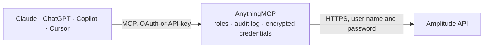

<!-- Generated by scripts/export-github-catalog.mjs in the anythingmcp-website repository. Do not edit by hand. -->

# Amplitude MCP connector

Let your AI read your Amplitude product analytics: event trends, funnels, retention, active and new users, revenue LTV, sessions, saved charts, cohorts, user lookups and the tracking plan, and add chart annotations. The AnythingMCP connector gives Claude, ChatGPT, Microsoft Copilot, Cursor and Gemini 23 MCP tools for Amplitude: 21 read and 2 can change data.

**Category:** [Analytics](../analytics.md) · **Tools:** 23 · **Setup guide:** [anythingmcp.com](https://anythingmcp.com/guides/amplitude-to-mcp) · [Deutsch](https://anythingmcp.com/de/guides/amplitude-to-mcp) · [Italiano](https://anythingmcp.com/it/guides/amplitude-to-mcp) · [Español](https://anythingmcp.com/es/guides/amplitude-to-mcp) · [日本語](https://anythingmcp.com/ja/guides/amplitude-to-mcp) · [Русский](https://anythingmcp.com/ru/guides/amplitude-to-mcp) · [中文](https://anythingmcp.com/zh/guides/amplitude-to-mcp)

## Start without code

No installation and no terminal: AnythingMCP Cloud runs the Amplitude connector for you, operated by helpcode.ai in Frankfurt, Germany.

1. **Click the button above** and create an account or sign in. The Amplitude connector opens, ready to install.
2. **Paste the API key or token from your Amplitude account.** Every click is in the [step-by-step guide](https://anythingmcp.com/guides/amplitude-to-mcp).
3. **Click Install.** AnythingMCP shows the address of your MCP server.
4. **Add that address to your assistant:** [Claude](https://anythingmcp.com/guides/connect-amplitude-to-claude) · [ChatGPT](https://anythingmcp.com/guides/connect-amplitude-to-chatgpt) · [Microsoft Copilot](https://anythingmcp.com/guides/connect-amplitude-to-copilot) · [Cursor](https://anythingmcp.com/guides/connect-amplitude-to-cursor) · [Gemini CLI](https://anythingmcp.com/guides/connect-amplitude-to-gemini) · [Meta Muse](https://anythingmcp.com/guides/connect-amplitude-to-muse).
5. **Ask your first question**, for example: *Find Amplitude ID for user_id PAY-INV-2026-0042 in our project*

Prefer help with the setup? [Talk to us](https://anythingmcp.com/contact).

## How it works

- **The AI client** speaks MCP (Streamable HTTP) to AnythingMCP and only sees tool names, descriptions and results. It never gets the Amplitude credentials.
- **AnythingMCP** checks the client's role, builds the call from the tool definition, adds the credentials (user name and password), calls Amplitude, logs the call and returns the result.
- **Amplitude** sees an ordinary API client with the rights of the account the credentials belong to.

## Tools

| Tool | What it does | Access |
|---|---|---|
| [`amplitude_list_events`](#amplitude_list_events) | List the project's visible event types with this week's totals, as event_type, display name, weekly_totals and the hidden and inactive flags (deleted events… | read |
| [`amplitude_get_event_segmentation`](#amplitude_get_event_segmentation) | Event Segmentation: count one event (or compare two) per day, week or month, optionally filtered by segments and grouped by a property. | read |
| [`amplitude_get_funnel`](#amplitude_get_funnel) | Funnel Analysis: conversion through two or more events in order. | read |
| [`amplitude_get_retention`](#amplitude_get_retention) | Retention Analysis: how many users who did a starting event come back with a return event, per day, week or month after. | read |
| [`amplitude_get_active_users`](#amplitude_get_active_users) | Count active or new users per day, week or month, optionally segmented and grouped by a property. | read |
| [`amplitude_get_realtime_active_users`](#amplitude_get_realtime_active_users) | Active users in 5-minute steps for today and yesterday, for a live view. | read |
| [`amplitude_get_revenue_ltv`](#amplitude_get_revenue_ltv) | Revenue lifetime value of new users per start date: average revenue per user, per paying user, total revenue or paying users after 1 to 90 days. | read |
| [`amplitude_get_session_length_distribution`](#amplitude_get_session_length_distribution) | Number of sessions per session length bucket over a date range. | read |
| [`amplitude_get_average_session_length`](#amplitude_get_average_session_length) | Average session length in seconds for each day of a date range. | read |
| [`amplitude_get_sessions_per_user`](#amplitude_get_sessions_per_user) | Average number of sessions per user for each day of a date range. | read |
| [`amplitude_get_user_composition`](#amplitude_get_user_composition) | User composition: how many distinct users had each value of one user property in a date range (e.g. users per country, platform or app version). | read |
| [`amplitude_get_chart_results`](#amplitude_get_chart_results) | Run a chart saved in Amplitude and return its results, using the chart's saved definition (events, filters, date range). | read |
| [`amplitude_list_cohorts`](#amplitude_list_cohorts) | List the project's discoverable behavioral cohorts with id, name, description, size, owners, last computed time and archived or published flags. | read |
| [`amplitude_search_users`](#amplitude_search_users) | Find users by Amplitude ID, device ID, user ID or the start of a user ID. | read |
| [`amplitude_get_user_activity`](#amplitude_get_user_activity) | One user's summary (userData: first and last seen, event and session counts, revenue, platform, location, user properties) and their most recent or earliest… | read |
| [`amplitude_list_event_types`](#amplitude_list_event_types) | List the event types planned in the project's tracking plan (Amplitude Data) with category, display name, description, active flag, tags and owner. | read |
| [`amplitude_get_event_type`](#amplitude_get_event_type) | Get one planned event type by its exact name: category, display name, description, active and hidden flags, tags and owner. | read |
| [`amplitude_list_event_properties`](#amplitude_list_event_properties) | List the event properties in the tracking plan: for one event type when event_type is given, otherwise the shared event properties. | read |
| [`amplitude_list_user_properties`](#amplitude_list_user_properties) | List the project's user properties with description, type, enum values, array flag and classifications. | read |
| [`amplitude_list_event_categories`](#amplitude_list_event_categories) | List the event categories of the tracking plan (id and name). | read |
| [`amplitude_list_annotations`](#amplitude_list_annotations) | List the chart annotations of the project (releases, campaigns, incidents marked on charts): id, label, details, start and end, category and chart id (null… | read |
| [`amplitude_create_annotation`](#amplitude_create_annotation) | Add an annotation (e.g. a release or campaign) at a point or range in time. | write |
| [`amplitude_delete_annotation`](#amplitude_delete_annotation) | Delete a chart annotation by id; it disappears from every chart for every member and cannot be restored. | write |

## Tool reference

Every parameter as the AI client sees it in `tools/list`. Source: [`packages/backend/src/adapters/intl/amplitude.json`](../../../packages/backend/src/adapters/intl/amplitude.json).

### `amplitude_list_events`

List the project's visible event types with this week's totals, as event_type, display name, weekly_totals and the hidden and inactive flags (deleted events are left out). Start here to learn the exact event names the analysis tools need. Read-only, query cost 1.

**Access:** read · **Call:** `GET /api/2/events/list`

No parameters.

### `amplitude_get_event_segmentation`

Event Segmentation: count one event (or compare two) per day, week or month, optionally filtered by segments and grouped by a property. Returns data.series (one array per group), seriesLabels, seriesCollapsed (totals for the range) and xValues (dates). Dashboard REST API limits per project: 5 concurrent requests, and a query cost budget of 1,000 per 5 minutes and 108,000 per hour (cost = days x conditions x chart cost). This chart costs 1 per event, plus 4 per group by, times days and conditions: keep ranges short and avoid loops. Read-only.

**Access:** read · **Call:** `GET /api/2/events/segmentation`

| Parameter | Type | Required | Description |
|---|---|---|---|
| `event` | string | yes | Event as JSON text: {"event_type":"Sign Up"} with optional "filters" ([{"subprop_type":"event","subprop_key":"plan","subprop_op":"is","subprop_value":["pro"]}]) and "group_by" ([{"type":"event","value":"plan"}], at most 2). Special event types: _active (any active event), _all (any event), revenue_amount (revenue). Use the exact event_type from amplitude_list_events. |
| `second_event` | string | no | Optional second event in the same JSON format, compared with the first or used in a formula as B. |
| `start` | string | yes | First day of the range, inclusive, as YYYYMMDD (e.g. 20261001), in the project's time zone. |
| `end` | string | yes | Last day of the range, inclusive, as YYYYMMDD (e.g. 20261007), in the project's time zone. |
| `metric` | `uniques` \| `totals` \| `pct_dau` \| `average` \| `histogram` \| `sums` \| `value_avg` \| `formula` | no | uniques (default, distinct users), totals (event count), pct_dau (share of daily active users), average (events per user). histogram, sums and value_avg need a property group_by inside the event. formula needs formula. |
| `user_type` | `any` \| `active` | no | Count any users or only active users. |
| `interval` | `-300000` \| `-3600000` \| `1` \| `7` \| `30` | no | Bucket size: -300000 real time (up to 2 days), -3600000 hourly (up to 7 days), 1 daily (default, up to 365 days), 7 weekly, 30 monthly. |
| `segments` | string | no | Optional segment definition as JSON text: an array of filter objects, e.g. [{"prop":"country","op":"is","values":["Germany"]}]. Custom user properties are written gp:name; a behavioral cohort is {"prop":"userdata_cohort","op":"is","values":["<cohort id>"]}. Operators: is, is not, contains, does not contain, less, less or equal, greater, greater or equal, set is, set is not. Each condition adds query cost. |
| `group_by` | string | no | Optional property to group by, e.g. country, platform, version, or gp:plan for a custom user property. Each group by adds 4 to the query cost. |
| `group_by_2` | string | no | Optional second property to group by, same format as group_by. |
| `limit` | integer | no | Maximum number of group by values (Amplitude default 100, at most 1000). |
| `formula` | string | no | Formula when metric is formula, e.g. UNIQUES(A)/UNIQUES(B). |
| `rolling_window` | integer | no | Optional rolling window, in units of the interval. |
| `rolling_average` | integer | no | Optional rolling average, in units of the interval. |

### `amplitude_get_funnel`

Funnel Analysis: conversion through two or more events in order. Returns per group the events, cumulativeRaw (users per step), cumulative and stepByStep (conversion ratios), median and average transition times, and dayFunnels (users per step per day); the per-step histograms are left out to keep the answer small. Dashboard REST API limits per project: 5 concurrent requests, and a query cost budget of 1,000 per 5 minutes and 108,000 per hour (cost = days x conditions x chart cost). A funnel costs 2 per step, plus 4 per group by, times days and conditions. Read-only.

**Access:** read · **Call:** `GET /api/2/funnels`

| Parameter | Type | Required | Description |
|---|---|---|---|
| `events` | string[] | yes | The funnel steps in order, each an event as JSON text, e.g. ["{\"event_type\":\"Sign Up\"}", "{\"event_type\":\"Purchase\"}"]. Event as JSON text: {"event_type":"Sign Up"} with optional "filters" ([{"subprop_type":"event","subprop_key":"plan","subprop_op":"is","subprop_value":["pro"]}]) and "group_by" ([{"type":"event","value":"plan"}], at most 2). Special event types: _active (any active event), _all (any event), revenue_amount (revenue). Use the exact event_type from amplitude_list_events. |
| `start` | string | yes | First day of the range, inclusive, as YYYYMMDD (e.g. 20261001), in the project's time zone. |
| `end` | string | yes | Last day of the range, inclusive, as YYYYMMDD (e.g. 20261007), in the project's time zone. |
| `mode` | `ordered` \| `unordered` \| `sequential` | no | ordered (default): steps in this order; unordered: in any order; sequential: in this order with no other events between. |
| `user_type` | `new` \| `active` | no | Only new users, or active users (default). |
| `interval` | `-300000` \| `-3600000` \| `1` \| `7` \| `30` | no | Bucket size of dayFunnels: -300000 real time, -3600000 hourly, 1 daily (default), 7 weekly, 30 monthly. |
| `segments` | string | no | Optional segment definition as JSON text: an array of filter objects, e.g. [{"prop":"country","op":"is","values":["Germany"]}]. Custom user properties are written gp:name; a behavioral cohort is {"prop":"userdata_cohort","op":"is","values":["<cohort id>"]}. Operators: is, is not, contains, does not contain, less, less or equal, greater, greater or equal, set is, set is not. Each condition adds query cost. |
| `group_by` | string | no | Optional single property to group by, e.g. country or gp:plan. Adds 4 to the query cost. |
| `conversion_window_seconds` | integer | no | Conversion window in seconds. Amplitude default 2592000 (30 days). |
| `limit` | integer | no | Maximum number of group by values (default 100, at most 1000). |

### `amplitude_get_retention`

Retention Analysis: how many users who did a starting event come back with a return event, per day, week or month after. Returns data.series with dates, values (per start date: index 0 is the cohort size, index N+1 is retention N intervals out, each {count, outof, incomplete}) and combined (all start dates together). Dashboard REST API limits per project: 5 concurrent requests, and a query cost budget of 1,000 per 5 minutes and 108,000 per hour (cost = days x conditions x chart cost). A retention query costs 8 times days and conditions. Read-only.

**Access:** read · **Call:** `GET /api/2/retention`

| Parameter | Type | Required | Description |
|---|---|---|---|
| `start_event` | string | yes | Starting event as JSON text, e.g. {"event_type":"Sign Up"}, or {"event_type":"_new"} for new users and {"event_type":"_active"} for any active user. |
| `return_event` | string | yes | Returning event as JSON text, e.g. {"event_type":"Purchase"}, or {"event_type":"_all"} for any event and {"event_type":"_active"} for any active event. |
| `start` | string | yes | First day of the range, inclusive, as YYYYMMDD (e.g. 20261001), in the project's time zone. |
| `end` | string | yes | Last day of the range, inclusive, as YYYYMMDD (e.g. 20261007), in the project's time zone. |
| `retention_mode` | `n-day` \| `rolling` \| `bracket` | no | n-day (default) exact-day retention, rolling (unbounded: on or after), or bracket (needs brackets). |
| `brackets` | string | no | Only for retention_mode bracket: the day ranges as JSON text, e.g. [[0,5]] for Day 0 to Day 4. |
| `interval` | `1` \| `7` \| `30` | no | Bucket size: 1 daily (default), 7 weekly, 30 monthly. |
| `segments` | string | no | Optional segment definition as JSON text: an array of filter objects, e.g. [{"prop":"country","op":"is","values":["Germany"]}]. Custom user properties are written gp:name; a behavioral cohort is {"prop":"userdata_cohort","op":"is","values":["<cohort id>"]}. Operators: is, is not, contains, does not contain, less, less or equal, greater, greater or equal, set is, set is not. Each condition adds query cost. |
| `group_by` | string | no | Optional single property to group by. |

### `amplitude_get_active_users`

Count active or new users per day, week or month, optionally segmented and grouped by a property. Returns data.series (one array per group), seriesMeta (group labels) and xValues (dates). Dashboard REST API limits per project: 5 concurrent requests, and a query cost budget of 1,000 per 5 minutes and 108,000 per hour (cost = days x conditions x chart cost). Read-only.

**Access:** read · **Call:** `GET /api/2/users`

| Parameter | Type | Required | Description |
|---|---|---|---|
| `start` | string | yes | First day of the range, inclusive, as YYYYMMDD (e.g. 20261001), in the project's time zone. |
| `end` | string | yes | Last day of the range, inclusive, as YYYYMMDD (e.g. 20261007), in the project's time zone. |
| `metric` | `active` \| `new` | no | active (default) or new users. |
| `interval` | `1` \| `7` \| `30` | no | Bucket size: 1 daily (default), 7 weekly, 30 monthly. |
| `segments` | string | no | Optional segment definition as JSON text: an array of filter objects, e.g. [{"prop":"country","op":"is","values":["Germany"]}]. Custom user properties are written gp:name; a behavioral cohort is {"prop":"userdata_cohort","op":"is","values":["<cohort id>"]}. Operators: is, is not, contains, does not contain, less, less or equal, greater, greater or equal, set is, set is not. Each condition adds query cost. |
| `group_by` | string | no | Optional property to group by, e.g. country, platform, version, or gp:plan for a custom user property. Each group by adds 4 to the query cost. |

### `amplitude_get_realtime_active_users`

Active users in 5-minute steps for today and yesterday, for a live view. Returns data.xValues (HH:mm), seriesLabels (Today, Yesterday) and series. Read-only, query cost 1.

**Access:** read · **Call:** `GET /api/2/realtime`

No parameters.

### `amplitude_get_revenue_ltv`

Revenue lifetime value of new users per start date: average revenue per user, per paying user, total revenue or paying users after 1 to 90 days. Returns data.series with dates and values (r1d ... r90d, count, paid, total_amount per date). Dashboard REST API limits per project: 5 concurrent requests, and a query cost budget of 1,000 per 5 minutes and 108,000 per hour (cost = days x conditions x chart cost). Read-only.

**Access:** read · **Call:** `GET /api/2/revenue/ltv`

| Parameter | Type | Required | Description |
|---|---|---|---|
| `start` | string | yes | First day of the range, inclusive, as YYYYMMDD (e.g. 20261001), in the project's time zone. |
| `end` | string | yes | Last day of the range, inclusive, as YYYYMMDD (e.g. 20261007), in the project's time zone. |
| `metric` | `0` \| `1` \| `2` \| `3` | no | 0 ARPU (default), 1 ARPPU (per paying user), 2 total revenue, 3 paying users. |
| `interval` | `1` \| `7` \| `30` | no | Bucket size: 1 daily (default), 7 weekly, 30 monthly. |
| `segments` | string | no | Optional segment definition as JSON text: an array of filter objects, e.g. [{"prop":"country","op":"is","values":["Germany"]}]. Custom user properties are written gp:name; a behavioral cohort is {"prop":"userdata_cohort","op":"is","values":["<cohort id>"]}. Operators: is, is not, contains, does not contain, less, less or equal, greater, greater or equal, set is, set is not. Each condition adds query cost. |
| `group_by` | string | no | Optional single property to group by. |

### `amplitude_get_session_length_distribution`

Number of sessions per session length bucket over a date range. Returns data.series (counts) and xValues (buckets like 60s-120s). Custom buckets need bin_min, bin_max and bin_unit; without them Amplitude uses its default buckets. Query cost 4 per day. Read-only.

**Access:** read · **Call:** `GET /api/2/sessions/length`

| Parameter | Type | Required | Description |
|---|---|---|---|
| `start` | string | yes | First day of the range, inclusive, as YYYYMMDD (e.g. 20261001), in the project's time zone. |
| `end` | string | yes | Last day of the range, inclusive, as YYYYMMDD (e.g. 20261007), in the project's time zone. |
| `bin_unit` | `hours` \| `minutes` \| `seconds` | no | Unit of the custom buckets. |
| `bin_min` | number | no | Lower bound of the custom buckets, e.g. 0. |
| `bin_max` | number | no | Upper bound of the custom buckets, e.g. 600. |
| `bin_size` | number | no | Bucket size, e.g. 60. Without it Amplitude picks the size. |

### `amplitude_get_average_session_length`

Average session length in seconds for each day of a date range. Returns data.series and xValues. Query cost 4 per day. Read-only.

**Access:** read · **Call:** `GET /api/2/sessions/average`

| Parameter | Type | Required | Description |
|---|---|---|---|
| `start` | string | yes | First day of the range, inclusive, as YYYYMMDD (e.g. 20261001), in the project's time zone. |
| `end` | string | yes | Last day of the range, inclusive, as YYYYMMDD (e.g. 20261007), in the project's time zone. |

### `amplitude_get_sessions_per_user`

Average number of sessions per user for each day of a date range. Returns data.series and xValues. Query cost 4 per day. Read-only.

**Access:** read · **Call:** `GET /api/2/sessions/peruser`

| Parameter | Type | Required | Description |
|---|---|---|---|
| `start` | string | yes | First day of the range, inclusive, as YYYYMMDD (e.g. 20261001), in the project's time zone. |
| `end` | string | yes | Last day of the range, inclusive, as YYYYMMDD (e.g. 20261007), in the project's time zone. |

### `amplitude_get_user_composition`

User composition: how many distinct users had each value of one user property in a date range (e.g. users per country, platform or app version). Returns data.xValues (property values) and series (user counts). Read-only.

**Access:** read · **Call:** `GET /api/2/composition`

| Parameter | Type | Required | Description |
|---|---|---|---|
| `start` | string | yes | First day of the range, inclusive, as YYYYMMDD (e.g. 20261001), in the project's time zone. |
| `end` | string | yes | Last day of the range, inclusive, as YYYYMMDD (e.g. 20261007), in the project's time zone. |
| `property` | string | yes | The user property: version, country, city, region, DMA, language, platform, os, device, start_version or paying, or gp:name for a custom user property. |

### `amplitude_get_chart_results`

Run a chart saved in Amplitude and return its results, using the chart's saved definition (events, filters, date range). The chart id is the code after /chart/ in the chart's address, e.g. abc123 in https://app.amplitude.com/analytics/demo/chart/abc123. Returns data, the results as CSV text (tab-prefixed cells): the chart title and metric, then a header row (Segment and one column per date or step) and one row per segment or group. The layout follows the chart type. The chart must belong to this project. Read-only; counts against the Dashboard REST API limits like the chart type it runs.

**Access:** read · **Call:** `GET /api/3/chart/{chart_id}/csv`

| Parameter | Type | Required | Description |
|---|---|---|---|
| `chart_id` | string | yes | The saved chart's id from its address, e.g. abc123. |

### `amplitude_list_cohorts`

List the project's discoverable behavioral cohorts with id, name, description, size, owners, last computed time and archived or published flags. Use a cohort id in segments as {"prop":"userdata_cohort","op":"is","values":["<id>"]}. The Behavioral Cohorts API is an add-on on Growth and Enterprise; without it Amplitude refuses the call. Read-only.

**Access:** read · **Call:** `GET /api/3/cohorts`

No parameters.

### `amplitude_search_users`

Find users by Amplitude ID, device ID, user ID or the start of a user ID. Returns matches (user_id and amplitude_id) and the match type; type nomatch with an empty list when nobody matches. Feed amplitude_id to amplitude_get_user_activity. Limited to 10 concurrent and 360 requests per hour, shared with user activity. Read-only.

**Access:** read · **Call:** `GET /api/2/usersearch`

| Parameter | Type | Required | Description |
|---|---|---|---|
| `user` | string | yes | Amplitude ID, device ID, user ID or user ID prefix to look for. |

### `amplitude_get_user_activity`

One user's summary (userData: first and last seen, event and session counts, revenue, platform, location, user properties) and their most recent or earliest events (event type, time, session, event properties, platform, location). Needs the Amplitude ID from amplitude_search_users. Contains personal data: use it for the user the person is asking about. Limited to 10 concurrent and 360 requests per hour. Read-only.

**Access:** read · **Call:** `GET /api/2/useractivity`

| Parameter | Type | Required | Description |
|---|---|---|---|
| `amplitude_id` | string | yes | The user's Amplitude ID (a number), from amplitude_search_users. |
| `limit` | integer | no | Number of events to return (default 50, at most 1000). Amplitude may return a few more to avoid cutting a session. |
| `offset` | integer | no | Zero-based offset from the most recent event, for the next page. |
| `direction` | `latest` \| `earliest` | no | latest (default) starts from the most recent event, earliest from the first. |

### `amplitude_list_event_types`

List the event types planned in the project's tracking plan (Amplitude Data) with category, display name, description, active flag, tags and owner. Hidden events are not listed. Taxonomy API (all plans): up to 4 cost at the same time and 7,200 per hour per project, each read costs 1. Read-only.

**Access:** read · **Call:** `GET /api/2/taxonomy/event`

| Parameter | Type | Required | Description |
|---|---|---|---|
| `show_deleted` | boolean | no | Also list deleted event types. |

### `amplitude_get_event_type`

Get one planned event type by its exact name: category, display name, description, active and hidden flags, tags and owner. Taxonomy API (all plans): up to 4 cost at the same time and 7,200 per hour per project, each read costs 1. Read-only.

**Access:** read · **Call:** `GET /api/2/taxonomy/event/{event_type}`

| Parameter | Type | Required | Description |
|---|---|---|---|
| `event_type` | string | yes | The exact event type name, e.g. Sign Up. Spaces and special characters are encoded for you. |

### `amplitude_list_event_properties`

List the event properties in the tracking plan: for one event type when event_type is given, otherwise the shared event properties. Returns name, description, type, enum values, required and array flags and classifications such as PII. Taxonomy API (all plans): up to 4 cost at the same time and 7,200 per hour per project, each read costs 1. Read-only.

**Access:** read · **Call:** `GET /api/2/taxonomy/event-property`

| Parameter | Type | Required | Description |
|---|---|---|---|
| `event_type` | string | no | Optional event type whose properties to list, e.g. Sign Up. Without it Amplitude lists the shared event properties. |

### `amplitude_list_user_properties`

List the project's user properties with description, type, enum values, array flag and classifications. Custom user properties come back with the gp: prefix, which is also how segments and group by refer to them. Hidden properties are not listed. Taxonomy API (all plans): up to 4 cost at the same time and 7,200 per hour per project, each read costs 1. Read-only.

**Access:** read · **Call:** `GET /api/2/taxonomy/user-property`

| Parameter | Type | Required | Description |
|---|---|---|---|
| `show_deleted` | boolean | no | Also list deleted user properties. |

### `amplitude_list_event_categories`

List the event categories of the tracking plan (id and name). Taxonomy API (all plans): up to 4 cost at the same time and 7,200 per hour per project, each read costs 1. Read-only.

**Access:** read · **Call:** `GET /api/2/taxonomy/category`

No parameters.

### `amplitude_list_annotations`

List the chart annotations of the project (releases, campaigns, incidents marked on charts): id, label, details, start and end, category and chart id (null for annotations shown on every chart). Filter by category or chart (not both) and by time. Read-only.

**Access:** read · **Call:** `GET /api/3/annotations`

| Parameter | Type | Required | Description |
|---|---|---|---|
| `category` | string | no | Only annotations in this category name. Cannot be combined with chart_id. |
| `chart_id` | string | no | Only annotations shown on this chart. Cannot be combined with category. |
| `start` | string | no | Only annotations after this time, ISO 8601 with offset, e.g. 2026-10-01T00:00:00+00:00. |
| `end` | string | no | Only annotations ending before this time, ISO 8601 with offset. |

### `amplitude_create_annotation`

Add an annotation (e.g. a release or campaign) at a point or range in time. Without chart_id it appears on every chart of the project for every member, so confirm the label, time and scope with the user before calling. Returns the new annotation with its id.

**Access:** write · **Call:** `POST /api/3/annotations`

| Parameter | Type | Required | Description |
|---|---|---|---|
| `label` | string | yes | Title shown on the charts, e.g. Release 4.2. |
| `start` | string | yes | Start time, ISO 8601 with offset, e.g. 2026-10-14T09:00:00+00:00. |
| `end` | string | no | Optional end time for a range, ISO 8601 with offset. |
| `details` | string | no | Optional longer text. |
| `category` | string | no | Optional existing annotation category name, e.g. Releases. An unknown name answers 404. |
| `chart_id` | string | no | Optional chart id to annotate only that chart; leave it out for a project-wide annotation. |

### `amplitude_delete_annotation`

Delete a chart annotation by id; it disappears from every chart for every member and cannot be restored. Installed switched off. Show the user the annotation (amplitude_list_annotations) and only call this after they confirm.

**Access:** write · **Call:** `DELETE /api/3/annotations/{annotation_id}`

| Parameter | Type | Required | Description |
|---|---|---|---|
| `annotation_id` | integer | yes | The annotation id from amplitude_list_annotations. |

## Run it yourself

AnythingMCP is open source (AGPL-3.0). [Run it with Docker](../../../README.md#run-it-yourself), open **Connectors → Store**, pick **Amplitude** and enter `AMPLITUDE_API_HOST`, `AMPLITUDE_API_KEY`, `AMPLITUDE_SECRET_KEY`, then add your MCP server URL to the AI client.

[← Analytics connectors](../analytics.md) · [All categories](../README.md)
