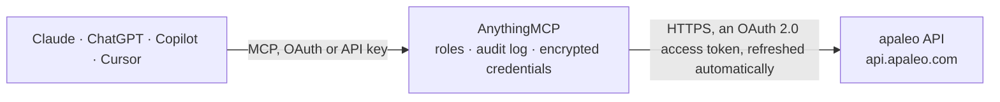

<!-- Generated by scripts/export-github-catalog.mjs in the anythingmcp-website repository. Do not edit by hand. -->

# apaleo MCP connector

Hotel operations in the apaleo cloud property management system: properties, rooms and room types, rate plans and rates, availability and offers, bookings, reservations and guests, groups, folios, … The AnythingMCP connector gives Claude, ChatGPT, Microsoft Copilot, Cursor and Gemini 48 MCP tools for apaleo: 34 read and 14 can change data.

**Category:** [Travel](../travel.md) · **Tools:** 48 · **Setup guide:** [anythingmcp.com](https://anythingmcp.com/guides/apaleo-to-mcp) · [Deutsch](https://anythingmcp.com/de/guides/apaleo-to-mcp) · [Italiano](https://anythingmcp.com/it/guides/apaleo-to-mcp) · [Español](https://anythingmcp.com/es/guides/apaleo-to-mcp) · [日本語](https://anythingmcp.com/ja/guides/apaleo-to-mcp) · [Русский](https://anythingmcp.com/ru/guides/apaleo-to-mcp) · [中文](https://anythingmcp.com/zh/guides/apaleo-to-mcp)

## Start without code

No installation and no terminal: AnythingMCP Cloud runs the apaleo connector for you, operated by helpcode.ai in Frankfurt, Germany.

1. **Click the button above** and create an account or sign in. The apaleo connector opens, ready to install.
2. **Sign in with your apaleo account** when AnythingMCP asks. The first time, an admin creates a small app in the apaleo developer console. Every click is in the [step-by-step guide](https://anythingmcp.com/guides/apaleo-to-mcp).
3. **Click Install.** AnythingMCP shows the address of your MCP server.
4. **Add that address to your assistant:** [Claude](https://anythingmcp.com/guides/connect-apaleo-to-claude) · [ChatGPT](https://anythingmcp.com/guides/connect-apaleo-to-chatgpt) · [Microsoft Copilot](https://anythingmcp.com/guides/connect-apaleo-to-copilot) · [Cursor](https://anythingmcp.com/guides/connect-apaleo-to-cursor) · [Gemini CLI](https://anythingmcp.com/guides/connect-apaleo-to-gemini) · [Meta Muse](https://anythingmcp.com/guides/connect-apaleo-to-muse).
5. **Ask your first question**, for example: *Is invoice INV-2026-045 for reservation 7890 at Hotel Linden GmbH fully paid?*

Prefer help with the setup? [Talk to us](https://anythingmcp.com/contact).

## How it works

- **The AI client** speaks MCP (Streamable HTTP) to AnythingMCP and only sees tool names, descriptions and results. It never gets the apaleo credentials.
- **AnythingMCP** checks the client's role, builds the call from the tool definition, adds the credentials (an OAuth 2.0 access token, refreshed automatically), calls apaleo, logs the call and returns the result.
- **apaleo** sees an ordinary API client with the rights of the account the credentials belong to.

## Tools

| Tool | What it does | Access |
|---|---|---|
| [`apaleo_list_properties`](#apaleo_list_properties) | List the properties (hotels) of the account with id, code, name, address, time zone, currency and status (Test or Live). | read |
| [`apaleo_get_property`](#apaleo_get_property) | One property with address, company and bank details, time zone, currency, payment terms, check-in and check-out times and description. | read |
| [`apaleo_list_unit_groups`](#apaleo_list_unit_groups) | List unit groups (room types and other sellable unit kinds) with code, name, member count, max persons, rank and type. | read |
| [`apaleo_get_unit_group`](#apaleo_get_unit_group) | One unit group with its description, max persons, member count and type. | read |
| [`apaleo_list_units`](#apaleo_list_units) | List units (rooms) with name, unit group, max persons, status (isOccupied, condition Clean, CleanToBeInspected or Dirty, maintenance) and attributes. | read |
| [`apaleo_get_unit`](#apaleo_get_unit) | One unit (room) with its unit group, status, condition, maintenance and attributes. | read |
| [`apaleo_list_rate_plans`](#apaleo_list_rate_plans) | List rate plans with code, name, unit group, channel codes, cancellation and no-show policy, minimum guarantee and whether they are derived from another plan. | read |
| [`apaleo_get_rate_plan`](#apaleo_get_rate_plan) | One rate plan with its pricing rule, restrictions, policies, included services and channels. | read |
| [`apaleo_list_rates`](#apaleo_list_rates) | Prices of one rate plan per time slice (night) in a period: the gross price, restrictions (min and max length of stay, closed, closed on arrival or… | read |
| [`apaleo_list_services`](#apaleo_list_services) | List services (extras such as breakfast or parking, and services included in rate plans) with code, name, default gross price, pricing unit and whether they… | read |
| [`apaleo_list_cancellation_policies`](#apaleo_list_cancellation_policies) | List cancellation policies with name, description, the period before arrival in which a fee applies and the fee. | read |
| [`apaleo_list_companies`](#apaleo_list_companies) | List companies (corporate accounts) with code, name, address, tax id and the rate plans and corporate codes they can book. | read |
| [`apaleo_get_unit_group_availability`](#apaleo_get_unit_group_availability) | Availability per unit group and night for a property: units available to sell, house count, occupied units, blocked units and maintenance. | read |
| [`apaleo_get_unit_availability`](#apaleo_get_unit_availability) | Units (rooms) that are free during the whole period, optionally of one unit group or in one housekeeping condition. | read |
| [`apaleo_list_available_units_for_reservation`](#apaleo_list_available_units_for_reservation) | Units that can be assigned to a reservation for its stay (or for part of it), for choosing a room before apaleo_assign_specific_unit. | read |
| [`apaleo_get_offers`](#apaleo_get_offers) | Bookable offers for one stay: for each rate plan and unit group the total gross amount, the price per night (timeSlices), available units, cancellation and… | read |
| [`apaleo_list_bookings`](#apaleo_list_bookings) | List bookings (the booker plus one or more reservations). | read |
| [`apaleo_get_booking`](#apaleo_get_booking) | One booking with the booker, payment account, comments and its reservations. | read |
| [`apaleo_list_reservations`](#apaleo_list_reservations) | List reservations with status, arrival and departure, adults, primary guest, unit group, assigned unit, rate plan, total gross amount, balance and channel. | read |
| [`apaleo_count_reservations`](#apaleo_count_reservations) | Number of reservations matching the same filters as apaleo_list_reservations, without loading them (for example how many arrivals tomorrow). | read |
| [`apaleo_get_reservation`](#apaleo_get_reservation) | One reservation with primary and additional guests, booker, stay, unit group, assigned units, rate plan, prices per night, services, balance, payment… | read |
| [`apaleo_list_reservation_services`](#apaleo_list_reservation_services) | Services booked for a reservation (included and extras) with dates, count and gross amount. | read |
| [`apaleo_list_groups`](#apaleo_list_groups) | List group bookings with name, booker, property, blocks and status. | read |
| [`apaleo_get_group`](#apaleo_get_group) | One group booking with its booker, comments, payment account, property and blocks. | read |
| [`apaleo_list_blocks`](#apaleo_list_blocks) | List blocks (room allotments of groups) with unit group, rate plan, period, blocked and picked-up units and status (Tentative, Definite, Canceled, Optional). | read |
| [`apaleo_list_folios`](#apaleo_list_folios) | List folios (guest bills) with debitor, reservation, booking, balance, status (Open or Closed) and type. | read |
| [`apaleo_get_folio`](#apaleo_get_folio) | One folio with its charges, transitory charges, payments, allowances, balance, related invoices and allowed actions. | read |
| [`apaleo_list_folio_payments`](#apaleo_list_folio_payments) | Payments posted on a folio with method, amount, status and time. | read |
| [`apaleo_list_invoices`](#apaleo_list_invoices) | List invoices (metadata only) with number, date, recipient, folio, reservation, total, outstanding payment and status (FullyPaid, Unpaid, WrittenOff). | read |
| [`apaleo_get_invoice`](#apaleo_get_invoice) | One invoice with recipient, lines, taxes, payments and totals. | read |
| [`apaleo_list_maintenances`](#apaleo_list_maintenances) | List maintenance windows of units: OutOfService (still sellable but flagged), OutOfOrder (not sellable) or OutOfInventory, with period and description. | read |
| [`apaleo_get_property_performance_report`](#apaleo_get_property_performance_report) | Property performance per period: occupancy, ADR (average daily rate), RevPAR, sold and available units and revenues, optionally per business day. | read |
| [`apaleo_get_revenues_report`](#apaleo_get_revenues_report) | Revenues of a property by account (accommodation, food and beverages, other) with net and gross amounts and VAT, for a period of at most one year. | read |
| [`apaleo_get_arrivals_report`](#apaleo_get_arrivals_report) | Number of arriving reservations per day in one month for a property, for staffing plans. | read |
| [`apaleo_create_booking`](#apaleo_create_booking) | Create a booking with one or more reservations. | write |
| [`apaleo_update_booking`](#apaleo_update_booking) | Change booking fields with JSON Patch operations: replace the booker (the whole object), or add, replace or remove the comment, booker comment or payment… | write |
| [`apaleo_update_reservation`](#apaleo_update_reservation) | Change reservation fields with JSON Patch operations: replace the primary guest (the whole object), add, replace or remove additional guests, comment, guest… | write |
| [`apaleo_amend_reservation`](#apaleo_amend_reservation) | Change the stay of a reservation: arrival, departure, number of guests and the rate plan and price per night. | write |
| [`apaleo_assign_unit`](#apaleo_assign_unit) | Let apaleo pick and assign a free unit (room) of the reserved unit group to a reservation. | write |
| [`apaleo_assign_specific_unit`](#apaleo_assign_specific_unit) | Assign a given unit (room) to a reservation, for the whole stay or part of it. | write |
| [`apaleo_unassign_units`](#apaleo_unassign_units) | Remove the assigned units (rooms) from a reservation, for example before assigning another room. | write |
| [`apaleo_check_in_reservation`](#apaleo_check_in_reservation) | Check in a Confirmed reservation that has a unit assigned: status becomes InHouse and the check-in time is set. | write |
| [`apaleo_revert_check_in`](#apaleo_revert_check_in) | Undo the check-in of a reservation (status back to Confirmed), for a check-in done by mistake. | write |
| [`apaleo_check_out_reservation`](#apaleo_check_out_reservation) | Check out an InHouse reservation: status becomes CheckedOut and all open charges on the folio are posted. | write |
| [`apaleo_cancel_reservation`](#apaleo_cancel_reservation) | Cancel a Confirmed reservation whose arrival is in the future: status becomes Canceled; the cancellation fee of the rate plan's policy applies. | write |
| [`apaleo_set_reservation_no_show`](#apaleo_set_reservation_no_show) | Mark a reservation whose guest did not arrive as NoShow. | write |
| [`apaleo_create_maintenance`](#apaleo_create_maintenance) | Create a maintenance window for a unit: OutOfService (flagged but sellable), OutOfOrder (not sellable) or OutOfInventory (removed from the house count). | write |
| [`apaleo_set_unit_conditions`](#apaleo_set_unit_conditions) | Set the housekeeping condition of one or more units, for example after cleaning. | write |

## Tool reference

Every parameter as the AI client sees it in `tools/list`. Source: [`packages/backend/src/adapters/de/apaleo.json`](../../../packages/backend/src/adapters/de/apaleo.json).

### `apaleo_list_properties`

List the properties (hotels) of the account with id, code, name, address, time zone, currency and status (Test or Live). Archived properties are left out unless include_archived is true.

**Access:** read · **Call:** `GET /inventory/v1/properties`

| Parameter | Type | Required | Description |
|---|---|---|---|
| `status` | string | no | Only these statuses, comma-separated: Test, Live. |
| `include_archived` | boolean | no | Include archived properties. |
| `country_code` | string | no | Only properties in these countries, comma-separated ISO 3166-1 alpha-2 codes (DE, AT, ...). |
| `page_number` | integer | no | Page to read, starting at 1 (default 1). An empty page answers 204 No Content. |
| `page_size` | integer | no | Items per page, at most 500 (default 500). |

### `apaleo_get_property`

One property with address, company and bank details, time zone, currency, payment terms, check-in and check-out times and description.

**Access:** read · **Call:** `GET /inventory/v1/properties/{property_id}`

| Parameter | Type | Required | Description |
|---|---|---|---|
| `property_id` | string | yes | Property id (a short code such as MUC), from apaleo_list_properties. |
| `languages` | string | no | 'all' or comma-separated two-letter language codes for the translated texts. |

### `apaleo_list_unit_groups`

List unit groups (room types and other sellable unit kinds) with code, name, member count, max persons, rank and type.

**Access:** read · **Call:** `GET /inventory/v1/unit-groups`

| Parameter | Type | Required | Description |
|---|---|---|---|
| `property_id` | string | no | Property id (a short code such as MUC), from apaleo_list_properties. |
| `unit_group_types` | string | no | Only these types, comma-separated: BedRoom, MeetingRoom, EventSpace, ParkingLot, Other. |
| `page_number` | integer | no | Page to read, starting at 1 (default 1). An empty page answers 204 No Content. |
| `page_size` | integer | no | Items per page, at most 500 (default 500). |
| `expand` | string | no | Comma-separated embedded objects: property, connectedUnitGroups. |

### `apaleo_get_unit_group`

One unit group with its description, max persons, member count and type.

**Access:** read · **Call:** `GET /inventory/v1/unit-groups/{unit_group_id}`

| Parameter | Type | Required | Description |
|---|---|---|---|
| `unit_group_id` | string | yes | Unit group id (for example MUC-DBL), from apaleo_list_unit_groups. |
| `expand` | string | no | Comma-separated embedded objects: property, connectedUnitGroups. |

### `apaleo_list_units`

List units (rooms) with name, unit group, max persons, status (isOccupied, condition Clean, CleanToBeInspected or Dirty, maintenance) and attributes. Use it for housekeeping views.

**Access:** read · **Call:** `GET /inventory/v1/units`

| Parameter | Type | Required | Description |
|---|---|---|---|
| `property_id` | string | no | Property id (a short code such as MUC), from apaleo_list_properties. |
| `unit_group_ids` | string | no | Only units of these unit groups, comma-separated ids. |
| `unit_attribute_ids` | string | no | Only units with these attributes, comma-separated ids. |
| `is_occupied` | boolean | no | true for occupied units only, false for vacant units only. |
| `maintenance_type` | `OutOfService` \| `OutOfOrder` \| `OutOfInventory` | no | Only units with this maintenance. |
| `condition` | `Clean` \| `CleanToBeInspected` \| `Dirty` | no | Only units in this housekeeping condition. |
| `text_search` | string | no | Case-insensitive text contained in the unit name. |
| `status` | `Active` \| `Archived` \| `All` | no | Active (default), Archived or All. |
| `page_number` | integer | no | Page to read, starting at 1 (default 1). An empty page answers 204 No Content. |
| `page_size` | integer | no | Items per page, at most 500 (default 500). |
| `expand` | string | no | Comma-separated embedded objects: property, unitGroup, connectedUnits. |

### `apaleo_get_unit`

One unit (room) with its unit group, status, condition, maintenance and attributes.

**Access:** read · **Call:** `GET /inventory/v1/units/{unit_id}`

| Parameter | Type | Required | Description |
|---|---|---|---|
| `unit_id` | string | yes | Unit id (for example MUC-101), from apaleo_list_units. |
| `expand` | string | no | Comma-separated embedded objects: property, unitGroup, connectedUnits. |

### `apaleo_list_rate_plans`

List rate plans with code, name, unit group, channel codes, cancellation and no-show policy, minimum guarantee and whether they are derived from another plan.

**Access:** read · **Call:** `GET /rateplan/v1/rate-plans`

| Parameter | Type | Required | Description |
|---|---|---|---|
| `property_id` | string | no | Property id (a short code such as MUC), from apaleo_list_properties. |
| `rate_plan_codes` | string | no | Only these rate plan codes, comma-separated. |
| `channel_codes` | string | no | Only plans sold through these channels, comma-separated: Direct, BookingCom, Ibe, ChannelManager, Expedia, Homelike, Hrs, AltoVita, DesVu, Gimsi. |
| `unit_group_ids` | string | no | Only plans for these unit groups, comma-separated ids. |
| `company_ids` | string | no | Only plans of these companies, comma-separated ids. |
| `promo_codes` | string | no | Only plans with these promo codes, comma-separated. |
| `include_archived` | boolean | no | Include archived rate plans. |
| `page_number` | integer | no | Page to read, starting at 1 (default 1). An empty page answers 204 No Content. |
| `page_size` | integer | no | Items per page, at most 500 (default 500). |
| `expand` | string | no | Comma-separated embedded objects: property, unitGroup, cancellationPolicy, services, bookingPeriods, surcharges, ageCategories. |

### `apaleo_get_rate_plan`

One rate plan with its pricing rule, restrictions, policies, included services and channels.

**Access:** read · **Call:** `GET /rateplan/v1/rate-plans/{rate_plan_id}`

| Parameter | Type | Required | Description |
|---|---|---|---|
| `rate_plan_id` | string | yes | Rate plan id (for example MUC-NONREF-DBL), from apaleo_list_rate_plans. |
| `expand` | string | no | Comma-separated embedded objects: property, cancellationPolicy. |

### `apaleo_list_rates`

Prices of one rate plan per time slice (night) in a period: the gross price, restrictions (min and max length of stay, closed, closed on arrival or departure) and the calculated derived prices.

**Access:** read · **Call:** `GET /rateplan/v1/rate-plans/{rate_plan_id}/rates`

| Parameter | Type | Required | Description |
|---|---|---|---|
| `rate_plan_id` | string | yes | Rate plan id, from apaleo_list_rate_plans. |
| `from` | string | yes | Start of the period. Date (YYYY-MM-DD) or date and time with UTC offset (ISO 8601). |
| `to` | string | yes | End of the period. Date (YYYY-MM-DD) or date and time with UTC offset (ISO 8601). |
| `page_number` | integer | no | Page to read, starting at 1 (default 1). An empty page answers 204 No Content. |
| `page_size` | integer | no | Items per page, at most 500 (default 500). |

### `apaleo_list_services`

List services (extras such as breakfast or parking, and services included in rate plans) with code, name, default gross price, pricing unit and whether they can be sold as extras.

**Access:** read · **Call:** `GET /rateplan/v1/services`

| Parameter | Type | Required | Description |
|---|---|---|---|
| `property_id` | string | no | Property id (a short code such as MUC), from apaleo_list_properties. |
| `text_search` | string | no | Text contained in the service name. |
| `only_sold_as_extras` | boolean | no | true to list only services that can be booked as extras. |
| `service_types` | string | no | Only these types, comma-separated: Other, Accommodation, FoodAndBeverages. |
| `page_number` | integer | no | Page to read, starting at 1 (default 1). An empty page answers 204 No Content. |
| `page_size` | integer | no | Items per page, at most 500 (default 500). |

### `apaleo_list_cancellation_policies`

List cancellation policies with name, description, the period before arrival in which a fee applies and the fee.

**Access:** read · **Call:** `GET /rateplan/v1/cancellation-policies`

| Parameter | Type | Required | Description |
|---|---|---|---|
| `property_id` | string | no | Property id (a short code such as MUC), from apaleo_list_properties. |
| `page_number` | integer | no | Page to read, starting at 1 (default 1). An empty page answers 204 No Content. |
| `page_size` | integer | no | Items per page, at most 500 (default 500). |

### `apaleo_list_companies`

List companies (corporate accounts) with code, name, address, tax id and the rate plans and corporate codes they can book.

**Access:** read · **Call:** `GET /rateplan/v1/companies`

| Parameter | Type | Required | Description |
|---|---|---|---|
| `property_id` | string | no | Property id (a short code such as MUC), from apaleo_list_properties. |
| `text_search` | string | no | Text contained in the company name. |
| `page_number` | integer | no | Page to read, starting at 1 (default 1). An empty page answers 204 No Content. |
| `page_size` | integer | no | Items per page, at most 500 (default 500). |

### `apaleo_get_unit_group_availability`

Availability per unit group and night for a property: units available to sell, house count, occupied units, blocked units and maintenance. Use it for a quick overview of free rooms by room type.

**Access:** read · **Call:** `GET /availability/v1/unit-groups`

| Parameter | Type | Required | Description |
|---|---|---|---|
| `property_id` | string | yes | Property id (a short code such as MUC), from apaleo_list_properties. |
| `from` | string | yes | First night, YYYY-MM-DD (included). |
| `to` | string | yes | Last night, YYYY-MM-DD (included). |
| `unit_group_ids` | string | no | Only these unit groups, comma-separated ids. |
| `unit_group_types` | string | no | Only these types, comma-separated: BedRoom, MeetingRoom, EventSpace, ParkingLot, Other. |
| `adults` | integer | no | Number of adults to check availability for (default 1). |
| `children_ages` | string | no | Ages of the children, comma-separated (for example 4,9). |
| `only_sellable` | boolean | no | true to return only unit groups sold with the time slice template. |
| `time_slice_template` | `DayUse` \| `OverNight` | no | OverNight (default) or DayUse. |
| `page_number` | integer | no | Page to read, starting at 1 (default 1). An empty page answers 204 No Content. |
| `page_size` | integer | no | Items per page, at most 500 (default 500). |

### `apaleo_get_unit_availability`

Units (rooms) that are free during the whole period, optionally of one unit group or in one housekeeping condition.

**Access:** read · **Call:** `GET /availability/v1/units`

| Parameter | Type | Required | Description |
|---|---|---|---|
| `property_id` | string | yes | Property id (a short code such as MUC), from apaleo_list_properties. |
| `from` | string | yes | Start of the stay. Date (YYYY-MM-DD) or date and time with UTC offset (ISO 8601). |
| `to` | string | yes | End of the stay. Date (YYYY-MM-DD) or date and time with UTC offset (ISO 8601). |
| `unit_group_id` | string | no | Only units of this unit group. |
| `unit_condition` | `Clean` \| `CleanToBeInspected` \| `Dirty` | no | Only units in this condition. |
| `include_out_of_service` | boolean | no | Count units that are OutOfService in the period as available. |
| `page_number` | integer | no | Page to read, starting at 1 (default 1). An empty page answers 204 No Content. |
| `page_size` | integer | no | Items per page, at most 500 (default 500). |

### `apaleo_list_available_units_for_reservation`

Units that can be assigned to a reservation for its stay (or for part of it), for choosing a room before apaleo_assign_specific_unit.

**Access:** read · **Call:** `GET /availability/v1/reservations/{reservation_id}/units`

| Parameter | Type | Required | Description |
|---|---|---|---|
| `reservation_id` | string | yes | Reservation id (for example ABCDEF-1), from apaleo_list_reservations. |
| `unit_group_id` | string | no | Only units of this unit group. |
| `from` | string | no | Start of the period to check, default the arrival. Date (YYYY-MM-DD) or date and time with UTC offset (ISO 8601). |
| `to` | string | no | End of the period to check, default the departure. Date (YYYY-MM-DD) or date and time with UTC offset (ISO 8601). |
| `unit_condition` | `Clean` \| `CleanToBeInspected` \| `Dirty` | no | Only units in this condition. |
| `include_out_of_service` | boolean | no | Count OutOfService units as available. |

### `apaleo_get_offers`

Bookable offers for one stay: for each rate plan and unit group the total gross amount, the price per night (timeSlices), available units, cancellation and no-show policy and the minimum guarantee. Run it before apaleo_create_booking and copy ratePlanId and the timeSlices from the chosen offer.

**Access:** read · **Call:** `GET /booking/v1/offers`

| Parameter | Type | Required | Description |
|---|---|---|---|
| `property_id` | string | yes | Property id (a short code such as MUC), from apaleo_list_properties. |
| `arrival` | string | yes | Arrival date, YYYY-MM-DD (or date and time). |
| `departure` | string | yes | Departure date, YYYY-MM-DD (or date and time). |
| `adults` | integer | yes | Number of adults. |
| `children_ages` | string | no | Ages of the children, comma-separated (for example 4,9). |
| `channel_code` | `Direct` \| `BookingCom` \| `Ibe` \| `ChannelManager` \| `Expedia` \| `Homelike` \| `Hrs` \| `AltoVita` \| `DesVu` \| `Gimsi` | no | Channel to price for (default all channels the plan is sold on). |
| `promo_code` | string | no | Promo code of a special offer. |
| `corporate_code` | string | no | Corporate code of a company rate. |
| `unit_group_ids` | string | no | Only these unit groups, comma-separated ids. |
| `unit_group_types` | string | no | Only these types, comma-separated: BedRoom, MeetingRoom, EventSpace, ParkingLot, Other. |
| `include_unavailable` | boolean | no | Also return offers that break a restriction or are sold out. |
| `time_slice_template` | `DayUse` \| `OverNight` | no | OverNight (default) or DayUse. |

### `apaleo_list_bookings`

List bookings (the booker plus one or more reservations). text_search finds a booker by last name, first name, email or company.

**Access:** read · **Call:** `GET /booking/v1/bookings`

| Parameter | Type | Required | Description |
|---|---|---|---|
| `reservation_id` | string | no | Only the booking that holds this reservation. |
| `group_id` | string | no | Only bookings of this group. |
| `channel_code` | string | no | Only bookings with reservations from these channels, comma-separated: Direct, BookingCom, Ibe, ChannelManager, Expedia, Homelike, Hrs, AltoVita, DesVu, Gimsi. |
| `external_code` | string | no | Only bookings with a reservation whose external code starts with this value (for example an OTA confirmation number). |
| `text_search` | string | no | Text in the booker's last name, first name, email or company name. |
| `page_number` | integer | no | Page to read, starting at 1 (default 1). An empty page answers 204 No Content. |
| `page_size` | integer | no | Items per page, at most 500 (default 500). |
| `expand` | string | no | Comma-separated embedded objects: property, unitGroup, ratePlan, services, reservations. |

### `apaleo_get_booking`

One booking with the booker, payment account, comments and its reservations.

**Access:** read · **Call:** `GET /booking/v1/bookings/{booking_id}`

| Parameter | Type | Required | Description |
|---|---|---|---|
| `booking_id` | string | yes | Booking id (for example ABCDEF), from apaleo_list_bookings or a reservation's bookingId. |
| `expand` | string | no | Comma-separated embedded objects: property, unitGroup, ratePlan, services, reservations. |

### `apaleo_list_reservations`

List reservations with status, arrival and departure, adults, primary guest, unit group, assigned unit, rate plan, total gross amount, balance and channel. Combine date_filter with from and to: Arrival for today's arrivals, Departure for departures, Stay for guests in house during a period.

**Access:** read · **Call:** `GET /booking/v1/reservations`

| Parameter | Type | Required | Description |
|---|---|---|---|
| `booking_id` | string | no | Only reservations of this booking. |
| `property_ids` | string | no | Only these properties, comma-separated ids. |
| `status` | string | no | Only these statuses, comma-separated: Confirmed, InHouse, CheckedOut, Canceled, NoShow. |
| `date_filter` | `Arrival` \| `Departure` \| `Stay` \| `Creation` \| `Modification` \| `Cancellation` \| `ArrivalAndCheckIn` \| `DepartureAndCheckOut` | no | Which date from and to filter on: Arrival, Departure, Stay (overlapping the period), Creation, Modification, Cancellation, ArrivalAndCheckIn, DepartureAndCheckOut. |
| `from` | string | no | Start of the date_filter interval. Date (YYYY-MM-DD) or date and time with UTC offset (ISO 8601). |
| `to` | string | no | End of the date_filter interval. Date (YYYY-MM-DD) or date and time with UTC offset (ISO 8601). |
| `unit_ids` | string | no | Only reservations with these assigned units, comma-separated ids. |
| `unit_group_ids` | string | no | Only these unit groups, comma-separated ids. |
| `rate_plan_ids` | string | no | Only these rate plans, comma-separated ids. |
| `company_ids` | string | no | Only these companies, comma-separated ids. |
| `channel_code` | string | no | Only these channels, comma-separated: Direct, BookingCom, Ibe, ChannelManager, Expedia, Homelike, Hrs, AltoVita, DesVu, Gimsi. |
| `external_code` | string | no | Only reservations whose external code starts with this value. |
| `text_search` | string | no | Case-insensitive text in the booker or guest names and email, the reservation id or the external code. Use it to find a guest. |
| `sort` | string | no | Sort fields, comma-separated, each field:asc or field:desc: arrival, departure, created, updated, balance, id, firstname, lastname, unitname. |
| `page_number` | integer | no | Page to read, starting at 1 (default 1). An empty page answers 204 No Content. |
| `page_size` | integer | no | Items per page, at most 500 (default 500). |
| `expand` | string | no | Comma-separated embedded objects: booker, timeSlices, services, assignedUnits, company. |

### `apaleo_count_reservations`

Number of reservations matching the same filters as apaleo_list_reservations, without loading them (for example how many arrivals tomorrow).

**Access:** read · **Call:** `GET /booking/v1/reservations/$count`

| Parameter | Type | Required | Description |
|---|---|---|---|
| `booking_id` | string | no | Only reservations of this booking. |
| `property_ids` | string | no | Only these properties, comma-separated ids. |
| `status` | string | no | Only these statuses, comma-separated: Confirmed, InHouse, CheckedOut, Canceled, NoShow. |
| `date_filter` | `Arrival` \| `Departure` \| `Stay` \| `Creation` \| `Modification` \| `Cancellation` \| `ArrivalAndCheckIn` \| `DepartureAndCheckOut` | no | Which date from and to filter on: Arrival, Departure, Stay (overlapping the period), Creation, Modification, Cancellation, ArrivalAndCheckIn, DepartureAndCheckOut. |
| `from` | string | no | Start of the date_filter interval. Date (YYYY-MM-DD) or date and time with UTC offset (ISO 8601). |
| `to` | string | no | End of the date_filter interval. Date (YYYY-MM-DD) or date and time with UTC offset (ISO 8601). |
| `unit_ids` | string | no | Only reservations with these assigned units, comma-separated ids. |
| `unit_group_ids` | string | no | Only these unit groups, comma-separated ids. |
| `rate_plan_ids` | string | no | Only these rate plans, comma-separated ids. |
| `company_ids` | string | no | Only these companies, comma-separated ids. |
| `channel_code` | string | no | Only these channels, comma-separated: Direct, BookingCom, Ibe, ChannelManager, Expedia, Homelike, Hrs, AltoVita, DesVu, Gimsi. |
| `external_code` | string | no | Only reservations whose external code starts with this value. |
| `text_search` | string | no | Case-insensitive text in the booker or guest names and email, the reservation id or the external code. Use it to find a guest. |

### `apaleo_get_reservation`

One reservation with primary and additional guests, booker, stay, unit group, assigned units, rate plan, prices per night, services, balance, payment account, cancellation fee and allowed actions.

**Access:** read · **Call:** `GET /booking/v1/reservations/{reservation_id}`

| Parameter | Type | Required | Description |
|---|---|---|---|
| `reservation_id` | string | yes | Reservation id (for example ABCDEF-1). |
| `expand` | string | no | Comma-separated embedded objects: timeSlices, services, booker, actions, company, assignedUnits. actions tells which of check-in, check-out, cancel and amend are possible now. |

### `apaleo_list_reservation_services`

Services booked for a reservation (included and extras) with dates, count and gross amount.

**Access:** read · **Call:** `GET /booking/v1/reservations/{reservation_id}/services`

| Parameter | Type | Required | Description |
|---|---|---|---|
| `reservation_id` | string | yes | Reservation id. |

### `apaleo_list_groups`

List group bookings with name, booker, property, blocks and status. text_search looks in group name, booker name, email and company.

**Access:** read · **Call:** `GET /booking/v1/groups`

| Parameter | Type | Required | Description |
|---|---|---|---|
| `text_search` | string | no | Text in group name, booker name, email or company. |
| `property_ids` | string | no | Only these properties, comma-separated ids. |
| `from` | string | no | Only groups with blocks overlapping from this date. Date (YYYY-MM-DD) or date and time with UTC offset (ISO 8601). |
| `to` | string | no | Only groups with blocks overlapping until this date. Date (YYYY-MM-DD) or date and time with UTC offset (ISO 8601). |
| `page_number` | integer | no | Page to read, starting at 1 (default 1). An empty page answers 204 No Content. |
| `page_size` | integer | no | Items per page, at most 500 (default 500). |
| `expand` | string | no | Comma-separated embedded objects: blocks, actions. |

### `apaleo_get_group`

One group booking with its booker, comments, payment account, property and blocks.

**Access:** read · **Call:** `GET /booking/v1/groups/{group_id}`

| Parameter | Type | Required | Description |
|---|---|---|---|
| `group_id` | string | yes | Group id, from apaleo_list_groups. |
| `expand` | string | no | Comma-separated embedded objects: blocks, actions. |

### `apaleo_list_blocks`

List blocks (room allotments of groups) with unit group, rate plan, period, blocked and picked-up units and status (Tentative, Definite, Canceled, Optional).

**Access:** read · **Call:** `GET /booking/v1/blocks`

| Parameter | Type | Required | Description |
|---|---|---|---|
| `group_id` | string | no | Only blocks of this group. |
| `property_ids` | string | no | Only these properties, comma-separated ids. |
| `status` | string | no | Only these statuses, comma-separated: Tentative, Definite, Canceled, Optional. |
| `unit_group_ids` | string | no | Only these unit groups, comma-separated ids. |
| `from` | string | no | Only blocks overlapping from this date. Date (YYYY-MM-DD) or date and time with UTC offset (ISO 8601). |
| `to` | string | no | Only blocks overlapping until this date. Date (YYYY-MM-DD) or date and time with UTC offset (ISO 8601). |
| `page_number` | integer | no | Page to read, starting at 1 (default 1). An empty page answers 204 No Content. |
| `page_size` | integer | no | Items per page, at most 500 (default 500). |
| `expand` | string | no | Comma-separated embedded objects: actions, timeSlices. |

### `apaleo_list_folios`

List folios (guest bills) with debitor, reservation, booking, balance, status (Open or Closed) and type. Use reservation_ids to find the bill of a stay.

**Access:** read · **Call:** `GET /finance/v1/folios`

| Parameter | Type | Required | Description |
|---|---|---|---|
| `property_ids` | string | no | Only these properties, comma-separated ids. |
| `reservation_ids` | string | no | Only folios of these reservations, comma-separated ids. |
| `booking_ids` | string | no | Only folios of these bookings, comma-separated ids. |
| `company_ids` | string | no | Only folios of these companies, comma-separated ids. |
| `type` | `House` \| `Guest` \| `External` \| `Booking` | no | Folio type. |
| `status` | `Open` \| `Closed` | no | Open or Closed. |
| `text_search` | string | no | Text in the debitor's first or last name, company name or the folio id. |
| `only_main` | boolean | no | true to return only main folios. |
| `has_invoices` | boolean | no | true for folios with invoices, false for folios without. |
| `created_from` | string | no | Created at or after this time. Date (YYYY-MM-DD) or date and time with UTC offset (ISO 8601). |
| `created_to` | string | no | Created before this time. Date (YYYY-MM-DD) or date and time with UTC offset (ISO 8601). |
| `sort` | string | no | Comma-separated: created:asc, created:desc, balance:asc, balance:desc. |
| `page_number` | integer | no | Page to read, starting at 1 (default 1). An empty page answers 204 No Content. |
| `page_size` | integer | no | Items per page, at most 500 (default 500). |
| `expand` | string | no | Comma-separated embedded objects: charges, transitoryCharges, payments, allowances, company, allowedActions, warnings. |

### `apaleo_get_folio`

One folio with its charges, transitory charges, payments, allowances, balance, related invoices and allowed actions.

**Access:** read · **Call:** `GET /finance/v1/folios/{folio_id}`

| Parameter | Type | Required | Description |
|---|---|---|---|
| `folio_id` | string | yes | Folio id (for example ABCDEF-1-1), from apaleo_list_folios. |

### `apaleo_list_folio_payments`

Payments posted on a folio with method, amount, status and time.

**Access:** read · **Call:** `GET /finance/v1/folios/{folio_id}/payments`

| Parameter | Type | Required | Description |
|---|---|---|---|
| `folio_id` | string | yes | Folio id. |
| `status_codes` | string | no | Only these statuses, comma-separated: Pending, Success, Failure, Canceled. |
| `page_number` | integer | no | Page to read, starting at 1 (default 1). An empty page answers 204 No Content. |
| `page_size` | integer | no | Items per page, at most 500 (default 500). |

### `apaleo_list_invoices`

List invoices (metadata only) with number, date, recipient, folio, reservation, total, outstanding payment and status (FullyPaid, Unpaid, WrittenOff).

**Access:** read · **Call:** `GET /finance/v1/invoices`

| Parameter | Type | Required | Description |
|---|---|---|---|
| `number` | string | no | Invoice number. |
| `status` | `FullyPaid` \| `Unpaid` \| `WrittenOff` | no | Invoice status. |
| `property_ids` | string | no | Only these properties, comma-separated ids. |
| `reservation_ids` | string | no | Only these reservations, comma-separated ids. |
| `booking_ids` | string | no | Only these bookings, comma-separated ids. |
| `folio_ids` | string | no | Only these folios, comma-separated ids. |
| `company_ids` | string | no | Only these companies, comma-separated ids. |
| `name_search` | string | no | Recipient name or company, at least three characters. |
| `payment_settled` | boolean | no | true for settled invoices, false for invoices with an outstanding payment. |
| `page_number` | integer | no | Page to read, starting at 1 (default 1). An empty page answers 204 No Content. |
| `page_size` | integer | no | Items per page, at most 500 (default 500). |

### `apaleo_get_invoice`

One invoice with recipient, lines, taxes, payments and totals.

**Access:** read · **Call:** `GET /finance/v1/invoices/{invoice_id}`

| Parameter | Type | Required | Description |
|---|---|---|---|
| `invoice_id` | string | yes | Invoice id, from apaleo_list_invoices. |

### `apaleo_list_maintenances`

List maintenance windows of units: OutOfService (still sellable but flagged), OutOfOrder (not sellable) or OutOfInventory, with period and description.

**Access:** read · **Call:** `GET /operations/v1/maintenances`

| Parameter | Type | Required | Description |
|---|---|---|---|
| `property_id` | string | no | Property id (a short code such as MUC), from apaleo_list_properties. |
| `unit_id` | string | no | Only this unit. |
| `from` | string | no | Windows ending after this time. Date (YYYY-MM-DD) or date and time with UTC offset (ISO 8601). |
| `to` | string | no | Windows starting before this time. Date (YYYY-MM-DD) or date and time with UTC offset (ISO 8601). |
| `types` | string | no | Only these types, comma-separated: OutOfService, OutOfOrder, OutOfInventory. |
| `page_number` | integer | no | Page to read, starting at 1 (default 1). An empty page answers 204 No Content. |
| `page_size` | integer | no | Items per page, at most 500 (default 500). |
| `expand` | string | no | unit to embed the unit. |

### `apaleo_get_property_performance_report`

Property performance per period: occupancy, ADR (average daily rate), RevPAR, sold and available units and revenues, optionally per business day.

**Access:** read · **Call:** `GET /reports/v1/reports/property-performance`

| Parameter | Type | Required | Description |
|---|---|---|---|
| `property_id` | string | yes | Property id (a short code such as MUC), from apaleo_list_properties. |
| `from` | string | yes | First business day, YYYY-MM-DD (included). |
| `to` | string | yes | Last business day, YYYY-MM-DD (included). |
| `channel_codes` | string | no | Only these channels, comma-separated. |
| `unit_group_ids` | string | no | Only these unit groups, comma-separated ids. |
| `rate_plan_ids` | string | no | Only these rate plans, comma-separated ids. |
| `company_ids` | string | no | Only these companies, comma-separated ids. |
| `expand` | string | no | businessDays for one row per day. |

### `apaleo_get_revenues_report`

Revenues of a property by account (accommodation, food and beverages, other) with net and gross amounts and VAT, for a period of at most one year.

**Access:** read · **Call:** `GET /reports/v1/reports/revenues`

| Parameter | Type | Required | Description |
|---|---|---|---|
| `property_id` | string | yes | Property id (a short code such as MUC), from apaleo_list_properties. |
| `from` | string | yes | First business day, YYYY-MM-DD (included). |
| `to` | string | yes | End business day, YYYY-MM-DD (excluded). |
| `language_code` | string | no | Language of the account names, for example en or de. |

### `apaleo_get_arrivals_report`

Number of arriving reservations per day in one month for a property, for staffing plans.

**Access:** read · **Call:** `GET /reports/v1/reports/arrivals`

| Parameter | Type | Required | Description |
|---|---|---|---|
| `property_id` | string | yes | Property id (a short code such as MUC), from apaleo_list_properties. |
| `month` | integer | yes | Month, 1 to 12. |
| `year` | integer | yes | Year, for example 2026. |

### `apaleo_create_booking`

Create a booking with one or more reservations. Get an offer first with apaleo_get_offers and pass its ratePlanId and prices in each reservation's timeSlices. Returns the booking id and reservation ids.

**Access:** write · **Call:** `POST /booking/v1/bookings`

| Parameter | Type | Required | Description |
|---|---|---|---|
| `booker` | object | yes | The booker: {"lastName": "Muster", "firstName": "Anna", "email": "anna@example.com", "phone": "+49 ...", "address": {"addressLine1": "...", "postalCode": "...", "city": "...", "countryCode": "DE"}}. lastName is required. |
| `reservations` | object[] | yes | Reservations to create, each {"arrival": "2026-11-20", "departure": "2026-11-22", "adults": 2, "childrenAges": [], "channelCode": "Direct", "primaryGuest": {"firstName": "Anna", "lastName": "Muster", "email": "..."}, "guaranteeType": "CreditCard", "timeSlices": [{"ratePlanId": "MUC-FLEX-DBL", "totalAmount": {"amount": 120.0, "currency": "EUR"}}], "services": [{"serviceId": "MUC-BRKF", "count": 2}], "comment": "..."}. arrival, departure, adults, channelCode and one timeSlice per night are required; channelCode ChannelManager also needs source. |
| `comment` | string | no | Internal comment on the booking. |
| `booker_comment` | string | no | Comment from the booker. |
| `idempotency_key` | string | no | Optional unique key; a retry with the same key returns the first result instead of booking twice. |

### `apaleo_update_booking`

Change booking fields with JSON Patch operations: replace the booker (the whole object), or add, replace or remove the comment, booker comment or payment account. Example: [{"op": "replace", "path": "/comment", "value": "VIP guest"}].

**Access:** write · **Call:** `PATCH /booking/v1/bookings/{booking_id}`

| Parameter | Type | Required | Description |
|---|---|---|---|
| `booking_id` | string | yes | Booking id. |
| `operations` | object[] | yes | JSON Patch operations, each {"op": "add\|replace\|remove", "path": "/...", "value": ...}. Allowed paths: /booker (replace only), /comment, /bookerComment, /paymentAccount. |

### `apaleo_update_reservation`

Change reservation fields with JSON Patch operations: replace the primary guest (the whole object), add, replace or remove additional guests, comment, guest comment, travel purpose, market segment or commission, add a company, mark it pre-checked-in. Example: [{"op": "replace", "path": "/comment", "value": "Late arrival"}]. Stay dates and rate plan change with apaleo_amend_reservation.

**Access:** write · **Call:** `PATCH /booking/v1/reservations/{reservation_id}`

| Parameter | Type | Required | Description |
|---|---|---|---|
| `reservation_id` | string | yes | Reservation id. |
| `operations` | object[] | yes | JSON Patch operations, each {"op": "add\|replace\|remove", "path": "/...", "value": ...}. Allowed paths: /primaryGuest (replace only, the whole guest object), /additionalGuests, /comment, /guestComment, /travelPurpose, /marketSegment, /commission, /company (add only, {"id": ...}), /isPreCheckedIn, /isOpenForCharges. |

### `apaleo_amend_reservation`

Change the stay of a reservation: arrival, departure, number of guests and the rate plan and price per night. Get valid prices from apaleo_get_offers first.

**Access:** write · **Call:** `PUT /booking/v1/reservation-actions/{reservation_id}/amend`

| Parameter | Type | Required | Description |
|---|---|---|---|
| `reservation_id` | string | yes | Reservation id. |
| `arrival` | string | yes | New arrival date, YYYY-MM-DD. |
| `departure` | string | yes | New departure date, YYYY-MM-DD. |
| `adults` | integer | yes | Number of adults. |
| `children_ages` | integer[] | no | Ages of the children. |
| `time_slices` | object[] | yes | One entry per night: {"ratePlanId": "MUC-FLEX-DBL", "totalGrossAmount": {"amount": 120.0, "currency": "EUR"}}. Without totalGrossAmount the current rate is used. |
| `requote` | boolean | no | Re-quote the price of nights whose rate plan does not change. |

### `apaleo_assign_unit`

Let apaleo pick and assign a free unit (room) of the reserved unit group to a reservation.

**Access:** write · **Call:** `PUT /booking/v1/reservation-actions/{reservation_id}/assign-unit`

| Parameter | Type | Required | Description |
|---|---|---|---|
| `reservation_id` | string | yes | Reservation id. |
| `unit_conditions` | string | no | Only pick units in these conditions, comma-separated: Clean, CleanToBeInspected, Dirty. |

### `apaleo_assign_specific_unit`

Assign a given unit (room) to a reservation, for the whole stay or part of it. Find free units with apaleo_list_available_units_for_reservation.

**Access:** write · **Call:** `PUT /booking/v1/reservation-actions/{reservation_id}/assign-unit/{unit_id}`

| Parameter | Type | Required | Description |
|---|---|---|---|
| `reservation_id` | string | yes | Reservation id. |
| `unit_id` | string | yes | Unit id to assign. |
| `from` | string | no | Start of the assignment, default the arrival. Date (YYYY-MM-DD) or date and time with UTC offset (ISO 8601). |
| `to` | string | no | End of the assignment, default the departure. Date (YYYY-MM-DD) or date and time with UTC offset (ISO 8601). |
| `lock_unit` | boolean | no | Lock the unit so automatic reassignment does not move the guest. |

### `apaleo_unassign_units`

Remove the assigned units (rooms) from a reservation, for example before assigning another room.

**Access:** write · **Call:** `PUT /booking/v1/reservation-actions/{reservation_id}/unassign-units`

| Parameter | Type | Required | Description |
|---|---|---|---|
| `reservation_id` | string | yes | Reservation id. |

### `apaleo_check_in_reservation`

Check in a Confirmed reservation that has a unit assigned: status becomes InHouse and the check-in time is set.

**Access:** write · **Call:** `PUT /booking/v1/reservation-actions/{reservation_id}/checkin`

| Parameter | Type | Required | Description |
|---|---|---|---|
| `reservation_id` | string | yes | Reservation id. |
| `with_city_tax` | boolean | no | Add city tax for this reservation (default true). |

### `apaleo_revert_check_in`

Undo the check-in of a reservation (status back to Confirmed), for a check-in done by mistake.

**Access:** write · **Call:** `PUT /booking/v1/reservation-actions/{reservation_id}/revert-checkin`

| Parameter | Type | Required | Description |
|---|---|---|---|
| `reservation_id` | string | yes | Reservation id. |

### `apaleo_check_out_reservation`

Check out an InHouse reservation: status becomes CheckedOut and all open charges on the folio are posted. Only possible when the departure is not later than tomorrow; shorten the stay with apaleo_amend_reservation first otherwise. Check the folio balance before.

**Access:** write · **Call:** `PUT /booking/v1/reservation-actions/{reservation_id}/checkout`

| Parameter | Type | Required | Description |
|---|---|---|---|
| `reservation_id` | string | yes | Reservation id. |

### `apaleo_cancel_reservation`

Cancel a Confirmed reservation whose arrival is in the future: status becomes Canceled; the cancellation fee of the rate plan's policy applies. A canceled reservation cannot be reactivated.

**Access:** write · **Call:** `PUT /booking/v1/reservation-actions/{reservation_id}/cancel`

| Parameter | Type | Required | Description |
|---|---|---|---|
| `reservation_id` | string | yes | Reservation id. |

### `apaleo_set_reservation_no_show`

Mark a reservation whose guest did not arrive as NoShow. The no-show fee of the rate plan's policy is posted to the folio. It cannot be reverted.

**Access:** write · **Call:** `PUT /booking/v1/reservation-actions/{reservation_id}/noshow`

| Parameter | Type | Required | Description |
|---|---|---|---|
| `reservation_id` | string | yes | Reservation id. |

### `apaleo_create_maintenance`

Create a maintenance window for a unit: OutOfService (flagged but sellable), OutOfOrder (not sellable) or OutOfInventory (removed from the house count).

**Access:** write · **Call:** `POST /operations/v1/maintenances`

| Parameter | Type | Required | Description |
|---|---|---|---|
| `unit_id` | string | yes | Unit id. |
| `from` | string | yes | Start, date and time with UTC offset (ISO 8601). |
| `to` | string | yes | End, date and time with UTC offset (ISO 8601). |
| `type` | `OutOfService` \| `OutOfOrder` \| `OutOfInventory` | yes | Maintenance type. |
| `description` | string | no | What is being repaired or why. |
| `idempotency_key` | string | no | Optional unique key so a retry does not create a second window. |

### `apaleo_set_unit_conditions`

Set the housekeeping condition of one or more units, for example after cleaning.

**Access:** write · **Call:** `PUT /operations/v1/units-condition`

| Parameter | Type | Required | Description |
|---|---|---|---|
| `units_conditions` | object[] | yes | List of {"id": "MUC-101", "condition": "Clean"}; condition is Clean, CleanToBeInspected or Dirty. |

## Run it yourself

AnythingMCP is open source (AGPL-3.0). [Run it with Docker](../../../README.md#run-it-yourself), open **Connectors → Store**, pick **apaleo** and enter `APALEO_CLIENT_ID`, `APALEO_CLIENT_SECRET`, then add your MCP server URL to the AI client.

[← Travel connectors](../travel.md) · [All categories](../README.md)
