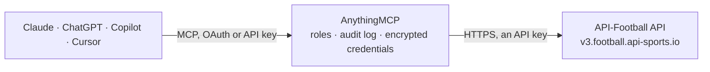

<!-- Generated by scripts/export-github-catalog.mjs in the anythingmcp-website repository. Do not edit by hand. -->

# API-Football MCP connector

Live and historical football (soccer) data from API-Football v3 (API-Sports): leagues, standings, fixtures with live scores & events, teams, players & statistics, predictions, injuries, transfers and betting odds. The AnythingMCP connector gives Claude, ChatGPT, Microsoft Copilot, Cursor and Gemini 40 MCP tools for API-Football, all read-only.

**Category:** [Sports](../sports.md) · **Tools:** 40 · **Setup guide:** [anythingmcp.com](https://anythingmcp.com/guides/api-football-to-mcp) · [Deutsch](https://anythingmcp.com/de/guides/api-football-to-mcp) · [Italiano](https://anythingmcp.com/it/guides/api-football-to-mcp) · [Español](https://anythingmcp.com/es/guides/api-football-to-mcp) · [日本語](https://anythingmcp.com/ja/guides/api-football-to-mcp) · [Русский](https://anythingmcp.com/ru/guides/api-football-to-mcp) · [中文](https://anythingmcp.com/zh/guides/api-football-to-mcp)

## Start without code

No installation and no terminal: AnythingMCP Cloud runs the API-Football connector for you, operated by helpcode.ai in Frankfurt, Germany.

1. **Click the button above** and create an account or sign in. The API-Football connector opens, ready to install.
2. **Paste the API key or token from your API-Football account.** Every click is in the [step-by-step guide](https://anythingmcp.com/guides/api-football-to-mcp).
3. **Click Install.** AnythingMCP shows the address of your MCP server.
4. **Add that address to your assistant:** [Claude](https://anythingmcp.com/guides/connect-api-football-to-claude) · [ChatGPT](https://anythingmcp.com/guides/connect-api-football-to-chatgpt) · [Microsoft Copilot](https://anythingmcp.com/guides/connect-api-football-to-copilot) · [Cursor](https://anythingmcp.com/guides/connect-api-football-to-cursor) · [Gemini CLI](https://anythingmcp.com/guides/connect-api-football-to-gemini) · [Meta Muse](https://anythingmcp.com/guides/connect-api-football-to-muse).
5. **Ask your first question**, for example: *What's the status and current score for fixture 87421 (Cup: Norlandia Cup) right now?*

Prefer help with the setup? [Talk to us](https://anythingmcp.com/contact).

## How it works

- **The AI client** speaks MCP (Streamable HTTP) to AnythingMCP and only sees tool names, descriptions and results. It never gets the API-Football credentials.
- **AnythingMCP** checks the client's role, builds the call from the tool definition, adds the credentials (an API key), calls API-Football, logs the call and returns the result.
- **API-Football** sees an ordinary API client with the rights of the account the credentials belong to.

## Tools

| Tool | What it does | Access |
|---|---|---|
| [`af_analysis_playbook`](#af_analysis_playbook) | START HERE for football analysis (optional but recommended): returns — with NO API call — the exact ordered list of af_* tools to run for a… | read |
| [`af_status`](#af_status) | Account status: subscription plan, daily request limit and current usage. | read |
| [`af_timezone`](#af_timezone) | List of all valid timezone strings accepted by the `timezone` parameter of other endpoints. | read |
| [`af_countries`](#af_countries) | List available countries (name, code, flag). | read |
| [`af_leagues`](#af_leagues) | Find LEAGUES & cups + their available seasons and numeric id (needed by standings/fixtures/topscorers/etc). | read |
| [`af_leagues_seasons`](#af_leagues_seasons) | List of all season years available across the API (e.g. 2010..2024). | read |
| [`af_teams`](#af_teams) | Find TEAMS + their numeric id (needed by almost every other tool). | read |
| [`af_team_statistics`](#af_team_statistics) | A team's season STATISTICS in a competition: form, played, W-D-L, goals for/against (+ averages, home/away split), clean sheets, streaks and scoring-by-minute. | read |
| [`af_team_seasons`](#af_team_seasons) | List of season years for which a given team has data. | read |
| [`af_team_countries`](#af_team_countries) | List of countries available for the teams endpoint. | read |
| [`af_venues`](#af_venues) | Search stadiums/venues (name, address, city, capacity, surface). | read |
| [`af_standings`](#af_standings) | League TABLE / STANDINGS for a season: rank, points, W-D-L, goal difference, form. | read |
| [`af_fixtures`](#af_fixtures) | Football MATCHES & scores. | read |
| [`af_fixtures_rounds`](#af_fixtures_rounds) | List of round names for a league+season (e.g. 'Regular Season - 1'). | read |
| [`af_head_to_head`](#af_head_to_head) | HEAD-TO-HEAD history between two teams (h2h='idA-idB'): past meetings with scores, competitions and venues. | read |
| [`af_fixture_statistics`](#af_fixture_statistics) | Team match STATISTICS for a fixture: shots, shots on target, possession %, corners, fouls, offsides, passes & accuracy. | read |
| [`af_fixture_events`](#af_fixture_events) | Match TIMELINE for a fixture: goals (with assist), cards, substitutions and VAR, each with minute & player. | read |
| [`af_fixture_lineups`](#af_fixture_lineups) | Starting XI, bench, FORMATION and coach for a fixture. | read |
| [`af_fixture_players`](#af_fixture_players) | Per-player match stats & RATINGS for a fixture (goals, shots, passes, duels, rating). | read |
| [`af_injuries`](#af_injuries) | INJURIES & suspensions — who is OUT or doubtful. | read |
| [`af_predictions`](#af_predictions) | THE match-prediction endpoint for one fixture id (win/draw/loss %, advice, predicted winner, and a form/attack/defence comparison of the two teams). | read |
| [`af_coachs`](#af_coachs) | Search coaches and their career. | read |
| [`af_players`](#af_players) | PLAYER statistics for a season: goals, assists, rating, minutes, shots, passes, dribbles, duels, cards. | read |
| [`af_player_seasons`](#af_player_seasons) | Season years available for a player (or all seasons if no player given). | read |
| [`af_player_squads`](#af_player_squads) | Current squad of a team, or the teams a player belongs to. | read |
| [`af_player_teams`](#af_player_teams) | List of teams a player has played for. | read |
| [`af_player_profiles`](#af_player_profiles) | Player personal data (name, age, nationality, height...). | read |
| [`af_topscorers`](#af_topscorers) | TOP SCORERS / golden boot of a competition: goals, penalties, appearances, minutes-per-goal. | read |
| [`af_topassists`](#af_topassists) | Top 20 assist providers of a league+season. | read |
| [`af_topyellowcards`](#af_topyellowcards) | Top 20 players by yellow cards in a league+season. | read |
| [`af_topredcards`](#af_topredcards) | Top 20 players by red cards in a league+season. | read |
| [`af_transfers`](#af_transfers) | Transfer history. | read |
| [`af_trophies`](#af_trophies) | Trophies won. | read |
| [`af_sidelined`](#af_sidelined) | Past absences (injuries/suspensions) for players/coaches. | read |
| [`af_odds_prematch`](#af_odds_prematch) | Pre-match betting ODDS for a fixture across bookmakers & markets (fixture=<id>; optional bookmaker=/bet=). | read |
| [`af_odds_live`](#af_odds_live) | In-play (live) odds updated in real time. | read |
| [`af_odds_live_bets`](#af_odds_live_bets) | Catalogue of available in-play bet (market) types for live odds. | read |
| [`af_odds_mapping`](#af_odds_mapping) | Mapping of fixtures that have pre-match odds available. | read |
| [`af_odds_bookmakers`](#af_odds_bookmakers) | List of available bookmakers (id + name) for the odds endpoints. | read |
| [`af_odds_bets`](#af_odds_bets) | List of available pre-match bet (market) types (id + name). | read |

## Tool reference

Every parameter as the AI client sees it in `tools/list`. Source: [`packages/backend/src/adapters/intl/api-football.json`](../../../packages/backend/src/adapters/intl/api-football.json).

### `af_analysis_playbook`

START HERE for football analysis (optional but recommended): returns — with NO API call — the exact ordered list of af_* tools to run for a pronostico/preview, post-match report, standings, scouting, injuries, transfers, odds or live tracking. If you already know the tool you need, you can also call it directly.

**Access:** read · **Call:** `static /`

No parameters.

### `af_status`

Account status: subscription plan, daily request limit and current usage. Costs 0 requests.

**Access:** read · **Call:** `GET /status`

No parameters.

### `af_timezone`

List of all valid timezone strings accepted by the `timezone` parameter of other endpoints.

**Access:** read · **Call:** `GET /timezone`

No parameters.

### `af_countries`

List available countries (name, code, flag). Filter to discover the value to pass as `country` elsewhere.

**Access:** read · **Call:** `GET /countries`

| Parameter | Type | Required | Description |
|---|---|---|---|
| `name` | string | no | Country name, e.g. 'Germany'. |
| `code` | string | no | 2-letter FR/GB-style country code, e.g. 'DE'. |
| `search` | string | no | Search countries by ≥3 chars. |

### `af_leagues`

Find LEAGUES & cups + their available seasons and numeric id (needed by standings/fixtures/topscorers/etc). Search by name: search='Bundesliga' (World Cup id=1). ALWAYS resolve the league id here first when the user names a competition.

**Access:** read · **Call:** `GET /leagues`

| Parameter | Type | Required | Description |
|---|---|---|---|
| `id` | integer | no | League id. |
| `name` | string | no | League name, e.g. 'Bundesliga'. |
| `country` | string | no | Country name. |
| `code` | string | no | Country code (DE, GB, ...). |
| `season` | integer | no | Season start year, e.g. 2023. |
| `team` | integer | no | Team id — leagues this team plays in. |
| `type` | string | no | 'league' or 'cup'. |
| `current` | string | no | 'true'\|'false' — only current seasons. |
| `search` | string | no | Search league/cup name (≥3 chars). |
| `last` | integer | no | The N last added leagues. |

### `af_leagues_seasons`

List of all season years available across the API (e.g. 2010..2024). Costs 0 requests.

**Access:** read · **Call:** `GET /leagues/seasons`

No parameters.

### `af_teams`

Find TEAMS + their numeric id (needed by almost every other tool). Search by name: search='Argentina' (national sides have national=true). ALWAYS resolve the team id here first when the user names a team.

**Access:** read · **Call:** `GET /teams`

| Parameter | Type | Required | Description |
|---|---|---|---|
| `id` | integer | no | Team id. |
| `name` | string | no | Team name. |
| `league` | integer | no | League id. |
| `season` | integer | no | Season start year. |
| `country` | string | no | Country name. |
| `code` | string | no | 3-letter team code, e.g. 'FCB'. |
| `venue` | integer | no | Venue id. |
| `search` | string | no | Search team name (≥3 chars). |

### `af_team_statistics`

A team's season STATISTICS in a competition: form, played, W-D-L, goals for/against (+ averages, home/away split), clean sheets, streaks and scoring-by-minute. Needs league+season+team. Use for 'team form / how good is / season stats of <team>'.

**Access:** read · **Call:** `GET /teams/statistics`

| Parameter | Type | Required | Description |
|---|---|---|---|
| `league` | integer | yes | League id. |
| `season` | integer | yes | Season start year. |
| `team` | integer | yes | Team id. |
| `date` | string | no | Limit stats up to this date (YYYY-MM-DD). |

### `af_team_seasons`

List of season years for which a given team has data.

**Access:** read · **Call:** `GET /teams/seasons`

| Parameter | Type | Required | Description |
|---|---|---|---|
| `team` | integer | yes | Team id. |

### `af_team_countries`

List of countries available for the teams endpoint.

**Access:** read · **Call:** `GET /teams/countries`

No parameters.

### `af_venues`

Search stadiums/venues (name, address, city, capacity, surface).

**Access:** read · **Call:** `GET /venues`

| Parameter | Type | Required | Description |
|---|---|---|---|
| `id` | integer | no | Venue id. |
| `name` | string | no | Venue name. |
| `city` | string | no | City. |
| `country` | string | no | Country. |
| `search` | string | no | Search venue name/city (≥3 chars). |

### `af_standings`

League TABLE / STANDINGS for a season: rank, points, W-D-L, goal difference, form. league=<id>, season=<year>. For cups & the World Cup it returns one table PER GROUP. Use for 'classifica / table / who is top / group standings / qualification'.

**Access:** read · **Call:** `GET /standings`

| Parameter | Type | Required | Description |
|---|---|---|---|
| `league` | integer | no | League id. |
| `season` | integer | yes | Season start year. |
| `team` | integer | no | Team id (that team's row only). |

### `af_fixtures`

Football MATCHES & scores. A team's NEXT match: team=<id>, next=1 (recent results: last=N). A single day: date=YYYY-MM-DD. A competition's games: league=<id>, season=<year>. Matches LIVE now: live='all'. Returns the fixture id (required by predictions/events/lineups/statistics), both teams (+ids), date, venue, referee, score and status. Use for 'next/last match, when do they play, live scores'.

**Access:** read · **Call:** `GET /fixtures`

| Parameter | Type | Required | Description |
|---|---|---|---|
| `id` | integer | no | Single fixture id. |
| `ids` | string | no | Multiple fixture ids joined by '-', e.g. '215662-215663'. |
| `live` | string | no | 'all' or dash-joined league ids for in-play fixtures. |
| `date` | string | no | Single day (YYYY-MM-DD). |
| `league` | integer | no | League id. |
| `season` | integer | no | Season start year. |
| `team` | integer | no | Team id. |
| `last` | integer | no | The N most recent fixtures. |
| `next` | integer | no | The N upcoming fixtures. |
| `from` | string | no | Range start (YYYY-MM-DD). |
| `to` | string | no | Range end (YYYY-MM-DD). |
| `round` | string | no | Round name, e.g. 'Regular Season - 1'. |
| `status` | string | no | Status short codes, e.g. 'NS-FT-PST'. |
| `venue` | integer | no | Venue id. |
| `timezone` | string | no | Timezone for times (see timezone endpoint). |

### `af_fixtures_rounds`

List of round names for a league+season (e.g. 'Regular Season - 1'). Use with the `round` filter of fixtures.

**Access:** read · **Call:** `GET /fixtures/rounds`

| Parameter | Type | Required | Description |
|---|---|---|---|
| `league` | integer | yes | League id. |
| `season` | integer | yes | Season start year. |
| `current` | string | no | 'true' to return only the current round. |
| `dates` | string | no | 'true' to also return each round's dates. |
| `timezone` | string | no | Timezone. |

### `af_head_to_head`

HEAD-TO-HEAD history between two teams (h2h='idA-idB'): past meetings with scores, competitions and venues. Great for CLUB teams; national-team history is barely covered. Use for '<A> vs <B> history / previous meetings / record between'.

**Access:** read · **Call:** `GET /fixtures/headtohead`

| Parameter | Type | Required | Description |
|---|---|---|---|
| `h2h` | string | yes | Two team ids joined by '-', e.g. '157-165'. |
| `date` | string | no | YYYY-MM-DD. |
| `league` | integer | no | League id. |
| `season` | integer | no | Season start year. |
| `last` | integer | no | N most recent meetings. |
| `next` | integer | no | N upcoming meetings. |
| `from` | string | no | Range start (YYYY-MM-DD). |
| `to` | string | no | Range end (YYYY-MM-DD). |
| `status` | string | no | Status short codes. |
| `venue` | integer | no | Venue id. |
| `timezone` | string | no | Timezone. |

### `af_fixture_statistics`

Team match STATISTICS for a fixture: shots, shots on target, possession %, corners, fouls, offsides, passes & accuracy. Use for 'match stats / possession / shots'.

**Access:** read · **Call:** `GET /fixtures/statistics`

| Parameter | Type | Required | Description |
|---|---|---|---|
| `fixture` | integer | yes | Fixture id. |
| `team` | integer | no | Restrict to one team id. |
| `type` | string | no | Single statistic type, e.g. 'Total Shots'. |
| `half` | string | no | 'true' to include half-time breakdown. |

### `af_fixture_events`

Match TIMELINE for a fixture: goals (with assist), cards, substitutions and VAR, each with minute & player. Use for 'what happened / goals & cards / match events'. (Match should be started/finished.)

**Access:** read · **Call:** `GET /fixtures/events`

| Parameter | Type | Required | Description |
|---|---|---|---|
| `fixture` | integer | yes | Fixture id. |
| `team` | integer | no | Team id. |
| `player` | integer | no | Player id. |
| `type` | string | no | Event type: 'Goal','Card','subst','Var'. |

### `af_fixture_lineups`

Starting XI, bench, FORMATION and coach for a fixture. Use for 'lineups / formation / who's playing'. Confirmed lineups appear ~1h before kickoff.

**Access:** read · **Call:** `GET /fixtures/lineups`

| Parameter | Type | Required | Description |
|---|---|---|---|
| `fixture` | integer | yes | Fixture id. |
| `team` | integer | no | Team id. |
| `player` | integer | no | Player id. |
| `type` | string | no | Filter, e.g. 'startXI'. |

### `af_fixture_players`

Per-player match stats & RATINGS for a fixture (goals, shots, passes, duels, rating). Use for 'player ratings / man of the match / who played best' — MOTM = highest rating.

**Access:** read · **Call:** `GET /fixtures/players`

| Parameter | Type | Required | Description |
|---|---|---|---|
| `fixture` | integer | yes | Fixture id. |
| `team` | integer | no | Team id. |

### `af_injuries`

INJURIES & suspensions — who is OUT or doubtful. Filter by league+season+team, or a fixture, or a date. player.type 'Missing Fixture'=out, 'Questionable'=doubt. Use for 'injuries / who's out / suspended / squad availability'.

**Access:** read · **Call:** `GET /injuries`

| Parameter | Type | Required | Description |
|---|---|---|---|
| `league` | integer | no | League id (requires season). |
| `season` | integer | no | Season start year. |
| `fixture` | integer | no | Fixture id. |
| `team` | integer | no | Team id. |
| `player` | integer | no | Player id. |
| `date` | string | no | YYYY-MM-DD. |
| `ids` | string | no | Fixture ids joined by '-'. |
| `timezone` | string | no | Timezone. |

### `af_predictions`

THE match-prediction endpoint for one fixture id (win/draw/loss %, advice, predicted winner, and a form/attack/defence comparison of the two teams). ⚠️ A 'professional' or 'complete' prediction is NOT finished after this single call. In the SAME turn you MUST ALSO call and combine ALL of: af_odds_prematch(fixture) — market odds; convert to implied % and compare with these prediction %; af_fixture_lineups(fixture) — formations & starting XI (once published); af_team_statistics(league,season,team) for BOTH teams — form, goals for/against, streaks, scoring-by-minute; af_injuries(league,season,team) for BOTH teams — who's out/suspended; af_topscorers + af_topassists(league,season) and af_players(team,league,season) — key individual players & ratings; af_head_to_head(h2h='idA-idB') — previous meetings. Do NOT stop at this one call: gather all of the above, THEN synthesise the professional prediction.

**Access:** read · **Call:** `GET /predictions`

| Parameter | Type | Required | Description |
|---|---|---|---|
| `fixture` | integer | yes | Fixture id. |

### `af_coachs`

Search coaches and their career. Filter by id, team or name.

**Access:** read · **Call:** `GET /coachs`

| Parameter | Type | Required | Description |
|---|---|---|---|
| `id` | integer | no | Coach id. |
| `team` | integer | no | Team id (current & past coaches). |
| `search` | string | no | Search coach name (≥3 chars). |

### `af_players`

PLAYER statistics for a season: goals, assists, rating, minutes, shots, passes, dribbles, duels, cards. Filter by team+league+season, or id+season, or search (needs team/league). Paginated (paging.total). Use for 'player stats / scout / rate a player / best players of <team>'.

**Access:** read · **Call:** `GET /players`

| Parameter | Type | Required | Description |
|---|---|---|---|
| `id` | integer | no | Player id. |
| `team` | integer | no | Team id. |
| `league` | integer | no | League id. |
| `season` | integer | no | Season start year (required with id/team/league). |
| `search` | string | no | Search player name (≥4 chars; needs team or league). |
| `page` | integer | no | Page number (250/page). |

### `af_player_seasons`

Season years available for a player (or all seasons if no player given).

**Access:** read · **Call:** `GET /players/seasons`

| Parameter | Type | Required | Description |
|---|---|---|---|
| `player` | integer | no | Player id. |

### `af_player_squads`

Current squad of a team, or the teams a player belongs to. Give team OR player.

**Access:** read · **Call:** `GET /players/squads`

| Parameter | Type | Required | Description |
|---|---|---|---|
| `team` | integer | no | Team id — returns its squad. |
| `player` | integer | no | Player id — returns their team(s). |

### `af_player_teams`

List of teams a player has played for.

**Access:** read · **Call:** `GET /players/teams`

| Parameter | Type | Required | Description |
|---|---|---|---|
| `player` | integer | yes | Player id. |

### `af_player_profiles`

Player personal data (name, age, nationality, height...). Search or paginate the full index.

**Access:** read · **Call:** `GET /players/profiles`

| Parameter | Type | Required | Description |
|---|---|---|---|
| `player` | integer | no | Player id. |
| `search` | string | no | Search surname (≥3 chars). |
| `page` | integer | no | Page number. |

### `af_topscorers`

TOP SCORERS / golden boot of a competition: goals, penalties, appearances, minutes-per-goal. Needs league+season. Use for 'top scorers / capocannonieri / most goals'. (Top assists: af_topassists; cards: af_topyellowcards/af_topredcards.)

**Access:** read · **Call:** `GET /players/topscorers`

| Parameter | Type | Required | Description |
|---|---|---|---|
| `league` | integer | yes | League id. |
| `season` | integer | yes | Season start year. |

### `af_topassists`

Top 20 assist providers of a league+season.

**Access:** read · **Call:** `GET /players/topassists`

| Parameter | Type | Required | Description |
|---|---|---|---|
| `league` | integer | yes | League id. |
| `season` | integer | yes | Season start year. |

### `af_topyellowcards`

Top 20 players by yellow cards in a league+season.

**Access:** read · **Call:** `GET /players/topyellowcards`

| Parameter | Type | Required | Description |
|---|---|---|---|
| `league` | integer | yes | League id. |
| `season` | integer | yes | Season start year. |

### `af_topredcards`

Top 20 players by red cards in a league+season.

**Access:** read · **Call:** `GET /players/topredcards`

| Parameter | Type | Required | Description |
|---|---|---|---|
| `league` | integer | yes | League id. |
| `season` | integer | yes | Season start year. |

### `af_transfers`

Transfer history. Give player OR team.

**Access:** read · **Call:** `GET /transfers`

| Parameter | Type | Required | Description |
|---|---|---|---|
| `player` | integer | no | Player id. |
| `team` | integer | no | Team id. |

### `af_trophies`

Trophies won. Give player/coach id (or 'players'/'coachs' as dash-joined id lists).

**Access:** read · **Call:** `GET /trophies`

| Parameter | Type | Required | Description |
|---|---|---|---|
| `player` | integer | no | Player id. |
| `coach` | integer | no | Coach id. |
| `players` | string | no | Player ids joined by '-'. |
| `coachs` | string | no | Coach ids joined by '-'. |

### `af_sidelined`

Past absences (injuries/suspensions) for players/coaches. Give player/coach id or dash-joined lists.

**Access:** read · **Call:** `GET /sidelined`

| Parameter | Type | Required | Description |
|---|---|---|---|
| `player` | integer | no | Player id. |
| `coach` | integer | no | Coach id. |
| `players` | string | no | Player ids joined by '-'. |
| `coachs` | string | no | Coach ids joined by '-'. |

### `af_odds_prematch`

Pre-match betting ODDS for a fixture across bookmakers & markets (fixture=<id>; optional bookmaker=/bet=). Informational only, not betting advice. Can be empty for minor/very-early games. Catalogues: af_odds_bookmakers, af_odds_bets.

**Access:** read · **Call:** `GET /odds`

| Parameter | Type | Required | Description |
|---|---|---|---|
| `fixture` | integer | no | Fixture id. |
| `league` | integer | no | League id. |
| `season` | integer | no | Season start year. |
| `date` | string | no | YYYY-MM-DD. |
| `timezone` | string | no | Timezone. |
| `page` | integer | no | Page number. |
| `bookmaker` | integer | no | Bookmaker id. |
| `bet` | integer | no | Bet (market) id. |

### `af_odds_live`

In-play (live) odds updated in real time. Filter by fixture, league or bet.

**Access:** read · **Call:** `GET /odds/live`

| Parameter | Type | Required | Description |
|---|---|---|---|
| `fixture` | integer | no | Fixture id. |
| `league` | integer | no | League id. |
| `bet` | integer | no | Bet (market) id. |

### `af_odds_live_bets`

Catalogue of available in-play bet (market) types for live odds.

**Access:** read · **Call:** `GET /odds/live/bets`

| Parameter | Type | Required | Description |
|---|---|---|---|
| `id` | integer | no | Bet id. |
| `search` | string | no | Search bet name (≥3 chars). |

### `af_odds_mapping`

Mapping of fixtures that have pre-match odds available. Paginated.

**Access:** read · **Call:** `GET /odds/mapping`

| Parameter | Type | Required | Description |
|---|---|---|---|
| `page` | integer | no | Page number. |

### `af_odds_bookmakers`

List of available bookmakers (id + name) for the odds endpoints.

**Access:** read · **Call:** `GET /odds/bookmakers`

| Parameter | Type | Required | Description |
|---|---|---|---|
| `id` | integer | no | Bookmaker id. |
| `search` | string | no | Search bookmaker name (≥3 chars). |

### `af_odds_bets`

List of available pre-match bet (market) types (id + name).

**Access:** read · **Call:** `GET /odds/bets`

| Parameter | Type | Required | Description |
|---|---|---|---|
| `id` | integer | no | Bet id. |
| `search` | string | no | Search bet name (≥3 chars). |

## Run it yourself

AnythingMCP is open source (AGPL-3.0). [Run it with Docker](../../../README.md#run-it-yourself), open **Connectors → Store**, pick **API-Football** and enter `API_FOOTBALL_KEY`, then add your MCP server URL to the AI client.

[← Sports connectors](../sports.md) · [All categories](../README.md)
