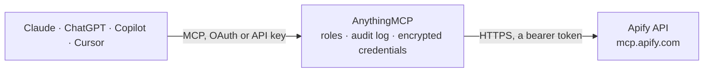

<!-- Generated by scripts/export-github-catalog.mjs in the anythingmcp-website repository. Do not edit by hand. -->

# Apify MCP connector

Find and run Apify's ready-made scrapers for search engines, maps, social media and online shops, and pull their results into Claude, ChatGPT or Copilot through Apify's official MCP server. The AnythingMCP connector gives Claude, ChatGPT, Microsoft Copilot, Cursor and Gemini 15 MCP tools for Apify: 9 read and 6 can change data.

**Category:** [Public Data](../data.md) · **Tools:** 15 · **Setup guide:** [anythingmcp.com](https://anythingmcp.com/guides/apify-to-mcp) · [Deutsch](https://anythingmcp.com/de/guides/apify-to-mcp) · [Italiano](https://anythingmcp.com/it/guides/apify-to-mcp) · [Español](https://anythingmcp.com/es/guides/apify-to-mcp) · [日本語](https://anythingmcp.com/ja/guides/apify-to-mcp) · [Русский](https://anythingmcp.com/ru/guides/apify-to-mcp) · [中文](https://anythingmcp.com/zh/guides/apify-to-mcp)

## Start without code

No installation and no terminal: AnythingMCP Cloud runs the Apify connector for you, operated by helpcode.ai in Frankfurt, Germany.

1. **Click the button above** and create an account or sign in. The Apify connector opens, ready to install.
2. **Paste the API key or token from your Apify account.** Every click is in the [step-by-step guide](https://anythingmcp.com/guides/apify-to-mcp).
3. **Click Install.** AnythingMCP shows the address of your MCP server.
4. **Add that address to your assistant:** [Claude](https://anythingmcp.com/guides/connect-apify-to-claude) · [ChatGPT](https://anythingmcp.com/guides/connect-apify-to-chatgpt) · [Microsoft Copilot](https://anythingmcp.com/guides/connect-apify-to-copilot) · [Cursor](https://anythingmcp.com/guides/connect-apify-to-cursor) · [Gemini CLI](https://anythingmcp.com/guides/connect-apify-to-gemini) · [Meta Muse](https://anythingmcp.com/guides/connect-apify-to-muse).
5. **Ask your first question**, for example: *Does the Actor apify/ebay-scraper exist and what is its latest version and pricing model?*

Prefer help with the setup? [Talk to us](https://anythingmcp.com/contact).

## How it works

- **The AI client** speaks MCP (Streamable HTTP) to AnythingMCP and only sees tool names, descriptions and results. It never gets the Apify credentials.
- **AnythingMCP** checks the client's role, builds the call from the tool definition, adds the credentials (a bearer token), calls Apify, logs the call and returns the result.
- **Apify** sees an ordinary API client with the rights of the account the credentials belong to.

## Tools

| Tool | What it does | Access |
|---|---|---|
| [`apify_search_actors`](#apify_search_actors) | Search the Apify Store to FIND and DISCOVER what scraping tools/Actors exist for specific platforms or use cases. | read |
| [`apify_fetch_actor_details`](#apify_fetch_actor_details) | Get detailed information about an Actor by its ID or full name (format: "username/name", e.g., "apify/rag-web-browser"). | read |
| [`apify_call_actor`](#apify_call_actor) | Call any Actor from the Apify Store. | write |
| [`apify_get_actor_run`](#apify_get_actor_run) | Get detailed information about a specific Actor run. | read |
| [`apify_get_dataset_items`](#apify_get_dataset_items) | Get items (rows) from a dataset, the output/results produced by an Actor run. | read |
| [`apify_get_key_value_store_record`](#apify_get_key_value_store_record) | Get the value stored under a specific key in a key-value store, a single record, not a listing of all keys. | read |
| [`apify_abort_actor_run`](#apify_abort_actor_run) | Abort an Actor run that is currently starting or running. | write |
| [`apify_fetch_actor_mcp_tool_list`](#apify_fetch_actor_mcp_tool_list) | List an Actor's MCP tools with each tool's name, description, input schema, annotations, and metadata, as the server reports them. | write |
| [`apify_call_actor_mcp_tool`](#apify_call_actor_mcp_tool) | Call one tool on an Actor's MCP server and return its result. | write |
| [`apify_send_server_actor_request`](#apify_send_server_actor_request) | Send one HTTP request to an Actor Server: the HTTP API of a Server Actor, documented in its API schema (OpenAPI) and README. | write |
| [`apify_search_apify_docs`](#apify_search_apify_docs) | Search Apify and Crawlee documentation using full-text search. | read |
| [`apify_fetch_apify_docs`](#apify_fetch_apify_docs) | Fetch the full content of an Apify or Crawlee documentation page by its URL. | read |
| [`apify_report_problem`](#apify_report_problem) | Report a problem with Apify's MCP tools or Actors to the Apify team. | write |
| [`apify_web_search`](#apify_web_search) | Runs one web search and returns one page of organic results as JSON: title, URL, snippet and position of each result, with publication date, publisher and… | read |
| [`apify_web_fetch`](#apify_web_fetch) | Fetches one URL and returns its content as a JSON object with a field per requested format, plus metadata such as the final URL, HTTP status, content type… | read |

## Tool reference

Every parameter as the AI client sees it in `tools/list`. Source: [`packages/backend/src/adapters/intl/apify.json`](../../../packages/backend/src/adapters/intl/apify.json).

### `apify_search_actors`

Search the Apify Store to FIND and DISCOVER what scraping tools/Actors exist for specific platforms or use cases. This tool provides INFORMATION about available Actors - it does NOT retrieve actual data or run any scraping tasks. Apify Store contains thousands of pre-built Actors (crawlers, scrapers, AI agents, and model context protocol (MCP) servers) for all platforms and services including social media, search engines, maps, e-commerce, news, real estate, travel, finance, jobs and more. Apify Store lists Actors published by Apify and by independent developers. Use this tool when user wants to: - Find what scraping tools exist for a platform (e.g., "What tools can scrape Instagram?") - Discover available Actors for a use case (e.g., "Find an Actor for Amazon products") - Browse existing solutions (e.g., "Show me scrapers for news sites") - Learn about MCP servers or AI agents available in the Store This tool discovers Actors; it does not retrieve their output. IMPORTANT: When the user wants detailed data from a specific platform or is looking for scraping tools, prefer searching the Store first, a relevant Actor often already exists. When the user names a specific Actor, look up that Actor directly instead of searching. Usage: - Use 1-3 simple terms from the platform and/or data type the user named (e.g. "Instagram posts", "Twitter", "Amazon products"). With neither named, empty keywords return the Store's default ordering. A platform-only query is an option if more specific results do not fit. Important limitations: This tool does not return full Actor documentation or detailed usage instructions - only summary information. Each result lists the Actor's input fields with their types (e.g. `url: string, maxResults?: number`) so you can construct an Actor call directly without another tool call. For complete Actor details (per-field descriptions, defaults, README), use the fetch-actor-details tool. The search is limited to publicly available Actors and excludes rental and restricted Actors. Returns list of Actor cards with the following info: - **Title:** Markdown header linked to the Store page, followed by the full Actor name in code format - **URL:** Direct Store link - **Description:** Actor description or fallback - **Pricing:** Details with pricing link - **Stats:** Total and monthly users - **Rating:** Out of 5 (if available) - **Developed by:** Username linked to profile, marked (Apify) or (community) - **Categories:** Formatted or "Uncategorized" - **Last modified:** Date (if available) - **Input fields:** Inline list of input field names and types (e.g. `url: string, maxResults?: number`); `?` marks optional fields, `... (+N more)` marks a truncated list

**Access:** read · **Call:** `search-actors /`

| Parameter | Type | Required | Description |
|---|---|---|---|
| `keywords` | string | no | Space-separated keywords used to search pre-built solutions (Actors) in the Apify Store. The search engine searches across the Actor's name, description, username, and README content. Pass empty string ("") whenever the user has NOT named a specific platform (Instagram, Amazon, Google Maps) or a specific data type (posts, products, weather, news). Empty keywords return Actors in the Apify Store's default sort order, which is popularity in practice (most-used Actors first). Do NOT use ranking words ("top", "best", "popular") or bare task words ("scraper", "crawler", "extractor") as keyword values, they are not Actor names and produce noisy matches against README content. Otherwise, follow these rules: - Use 1-3 simple keyword terms maximum (e.g., "Instagram posts", "Twitter", "Amazon products") - Actors are named using platform or service name together with the type of data or task they perform - The most effective keywords are specific platform names (Instagram, Twitter, TikTok) and specific data types (posts, products, profiles, weather, news, reviews, comments) - If a user asks about "fetching Instagram posts", use "Instagram posts" as keywords - The goal is to find Actors that specifically handle the platform and data type the user mentioned Examples: ✅ "Instagram posts", "Twitter", "Amazon products", "TikTok comments" ✅ "" (empty), returns the most popular Actors store-wide ❌ "Instagram posts profiles comments hashtags reels stories followers..." (too long) ❌ "top popular actors", "best scrapers", "trending", ranking words aren't Actor keywords; pass "" instead ❌ "scraper", "extractor", "web crawler", bare task words aren't Actor keywords; pass "" instead |
| `limit` | integer | no | The maximum number of Actors to return (max = 10, default = 5). |
| `offset` | integer | no | The number of elements to skip from the start (default = 0). Has no effect when keywords are set: every offset returns the first results. |
| `useCase` | string | no | Optional. One plain sentence on what the user wants to achieve with the Actor, for example "compare competitor prices" (max 1024 characters). Never include personal information (names, emails, phone numbers, addresses, account details), URLs, secrets, API tokens or credentials. Respect the user's privacy: when unsure, leave it out. |

### `apify_fetch_actor_details`

Get detailed information about an Actor by its ID or full name (format: "username/name", e.g., "apify/rag-web-browser"). Requires the exact ID or full name, do not construct a plausible-looking name and call this tool with it. If you only have a description, a partial name, or a name you have not seen in this conversation, find it with search-actors first. Use 'output' to control returned information: - Default: all fields except outputSchema and serverInterface. Server Actors always get a one-line server interface summary unless serverInterface is true or a selector. - Selective: set only the fields you need to true, e.g. output: { inputSchema: true } - Common patterns: inputSchema only, description + readme, serverInterface: true (every operation in full when they fit, an index of them otherwise) or "GET /search" (one operation in full) for Server Actors The 'readme' field returns the summary when available, full README otherwise. Use when querying Actor details, documentation, or input requirements. It does not connect to an MCP server Actor; fetch-actor-mcp-tool-list lists its MCP tools. EXAMPLES: - What does apify/web-fetch do? - What is the input schema for apify/web-scraper? - What HTTP operations does this Server Actor expose?

**Access:** read · **Call:** `fetch-actor-details /`

| Parameter | Type | Required | Description |
|---|---|---|---|
| `actor` | string | yes | Actor ID or full name in the format "username/name", e.g., "apify/rag-web-browser". |
| `output` | object | no | Specify which information to include in the response to save tokens. |

### `apify_call_actor`

Call any Actor from the Apify Store. WORKFLOW: 1. Use fetch-actor-details to get the Actor's input schema 2. Call this tool with the actor name and proper input based on the schema If the actor name is not in "username/name" format, use search-actors to resolve the correct Actor first. An MCP server Actor with no input schema is not run here; call-actor-mcp-tool calls its MCP tools. For Server Actors (Actors with an HTTP API): - This tool starts a batch run and stores the results in a dataset; use it when you need batch results - For one or a few results, send-server-actor-request returns them in the HTTP response, without a batch run - fetch-actor-details with output={ serverInterface: true } lists its HTTP operations IMPORTANT: - Waits up to waitSecs (default 30s) for completion; returns run status and storage IDs, and with waitSecs > 0 also reports dataset field metadata - Use get-dataset-items with the datasetId to fetch results; non-terminal runs include a nextStep with polling instructions There are two ways to use an Actor: 1. Its dedicated tool, when the session has one: a Server Actor's tool sends one HTTP request to its API, an MCP server Actor's tools call its MCP server, and any other Actor's tool starts a run. 2. The generic call-actor tool: starts a run of any Actor and stores the results in a dataset. USAGE: - Prefer the dedicated tool when the session has one for the Actor - call-actor runs an Actor that has no dedicated tool, and batch work whose results belong in a dataset. - Use `waitSecs` (0 to 45) to control how long to wait. Default 30s returns results for fast actors. Use `waitSecs: 0` to start and return immediately for long-running actors. EXAMPLES: - user_input: Get instagram posts using apify/instagram-scraper

**Access:** write · **Call:** `call-actor /`

| Parameter | Type | Required | Description |
|---|---|---|---|
| `actor` | string | yes | The Actor to call: its ID, or its name in the "username/name" form (e.g., "apify/rag-web-browser"). |
| `input` | object | yes | The input JSON to pass to the Actor. Required. |
| `waitSecs` | integer | no | Seconds to wait for completion (0 to 45, default 30). Returns with current run status if not terminal within waitSecs. |
| `callOptions` | object | no | Optional run config: memory (MB), timeout (s), build, maxItems (pay-per-result cap), maxTotalChargeUsd (pay-per-event cap). |

### `apify_get_actor_run`

Get detailed information about a specific Actor run. Returns run result: status, storages (datasets/keyValueStores alias map), stats, summary, nextStep. - summary describes the past (e.g. "SUCCEEDED in 22s. 47 items; 3 fields available."). - nextStep prescribes one primary follow-up action with identifiers interpolated (e.g. "Use get-dataset-items with datasetId=..."). - waitSecs (0 to 45, default 30) waits up to that many seconds for terminal status before returning. USAGE: - Use to check the status of a run started by any Actor-running tool. - Pass waitSecs > 0 to block until terminal (or until the cap elapses). USAGE EXAMPLES: - user_input: Show details of run y2h7sK3Wc - user_input: Wait for run y2h7sK3Wc to finish

**Access:** read · **Call:** `get-actor-run /`

| Parameter | Type | Required | Description |
|---|---|---|---|
| `runId` | string | yes | The ID of the Actor run. |
| `waitSecs` | integer | no | Maximum seconds to wait for the run to reach a terminal state (SUCCEEDED, FAILED, ABORTED, TIMED-OUT). 0 returns immediately with the current status. Cap: 45. Default: 30. |

### `apify_get_dataset_items`

Get items (rows) from a dataset, the output/results produced by an Actor run. Returns the rows themselves, not dataset metadata, counts, or a schema. When the user provides a datasetId and asks to retrieve results, output, data, or rows, call this tool directly. Default limit is 20. Use clean=true to skip empty items and hidden fields. USAGE: - Use when you need to read data from a dataset (all items or only selected fields). USAGE EXAMPLES: - user_input: Retrieve results from dataset abc123 - user_input: Get only metadata.url and title from dataset username~my-dataset

**Access:** read · **Call:** `get-dataset-items /`

| Parameter | Type | Required | Description |
|---|---|---|---|
| `datasetId` | string | yes | Dataset ID, name (resolved against your own datasets), or full name as username~name. |
| `clean` | boolean | no | If true, returns only non-empty items and skips hidden fields (starting with #). Shortcut for skipHidden=true and skipEmpty=true. |
| `offset` | number | no | Number of items to skip at the start. Default is 0. |
| `limit` | integer | no | Maximum number of items to return. Default is 20. |
| `fields` | string | no | Comma-separated list of fields to include in results. Fields in output are sorted as specified. Use dot notation for nested objects (e.g. "metadata.url"); the server auto-flattens parent prefixes. |
| `omit` | string | no | Comma-separated list of fields to exclude from results. |
| `desc` | boolean | no | If true, results are returned in reverse order (newest to oldest). |
| `flatten` | string | no | Comma-separated list of fields to flatten (e.g. flatten="metadata" turns {"metadata":{"url":"x"}} into {"metadata.url":"x"}). Normally derived automatically from dot-notation in `fields`; specify only as a diagnostic override. |

### `apify_get_key_value_store_record`

Get the value stored under a specific key in a key-value store, a single record, not a listing of all keys. Requires the exact key name. The response preserves the original Content-Encoding; most clients handle decompression automatically. USAGE: - Use when you need to retrieve a specific record (JSON, text, or binary) from a store. USAGE EXAMPLES: - user_input: Get record INPUT from store abc123 - user_input: Get record data.json from store username~my-store

**Access:** read · **Call:** `get-key-value-store-record /`

| Parameter | Type | Required | Description |
|---|---|---|---|
| `keyValueStoreId` | string | yes | Key-value store ID, name (resolved against your own key-value stores), or full name as username~name. |
| `recordKey` | string | yes | Key of the record to retrieve. |

### `apify_abort_actor_run`

Abort an Actor run that is currently starting or running. For runs with status SUCCEEDED, FAILED, ABORTING, ABORTED, or TIMED-OUT, this call has no effect. The results will include the updated run details after the abort request. USAGE: - Use when you need to stop a run that is taking too long or misconfigured. USAGE EXAMPLES: - user_input: Abort run y2h7sK3Wc - user_input: Gracefully abort run y2h7sK3Wc

**Access:** write · **Call:** `abort-actor-run /`

| Parameter | Type | Required | Description |
|---|---|---|---|
| `runId` | string | yes | The ID of the Actor run to abort. |
| `gracefully` | boolean | no | If true, the Actor run will abort gracefully with a 30-second timeout. |

### `apify_fetch_actor_mcp_tool_list`

List an Actor's MCP tools with each tool's name, description, input schema, annotations, and metadata, as the server reports them. call-actor-mcp-tool calls one of them by name. Each call asks the server again; nothing is cached. It connects with your Apify API token. Connecting can start a Server Actor run in your account, kept until its idle timeout; a multi-tenant Server Actor charges per event. USAGE: - Use when the user asks which MCP tools an Actor provides, or before calling one of them. USAGE EXAMPLES: - user_input: What tools does username/name provide?

**Access:** write · **Call:** `fetch-actor-mcp-tool-list /`

| Parameter | Type | Required | Description |
|---|---|---|---|
| `actor` | string | yes | The MCP server Actor: its ID, or its name in the "username/name" form. |

### `apify_call_actor_mcp_tool`

Call one tool on an Actor's MCP server and return its result. fetch-actor-mcp-tool-list lists the Actor's MCP tools and their input schemas. It connects with your Apify API token. Connecting can start a Server Actor run in your account, kept until its idle timeout; a multi-tenant Server Actor charges per event. What the tool itself does depends on the Actor. Example call: {"actor": "username/name", "tool": "search", "arguments": {"query": "apify"}} USAGE: - Use when the user asks to call a tool on an Actor's MCP server. USAGE EXAMPLES: - user_input: Use the search tool of username/name to look up apify

**Access:** write · **Call:** `call-actor-mcp-tool /`

| Parameter | Type | Required | Description |
|---|---|---|---|
| `actor` | string | yes | The MCP server Actor: its ID, or its name in the "username/name" form. |
| `tool` | string | yes | The name of the tool on the Actor's MCP server. |
| `arguments` | object | no | The tool's arguments, matching its input schema. Omit for a tool that takes none. |

### `apify_send_server_actor_request`

Send one HTTP request to an Actor Server: the HTTP API of a Server Actor, documented in its API schema (OpenAPI) and README. fetch-actor-details with output.serverInterface returns the documented operations with their parameters. Give the method, the path, and optionally query parameters and a JSON body; the Actor Server's host and your Apify API token are added for you. Only an Actor with an Actor Server and an API schema takes requests here; the Actor accepts or rejects the method and path. A request to a single-tenant Actor Server can start a run of the Actor in your account, kept until its idle timeout; a multi-tenant Actor Server charges per event. The request is sent once, with no retries and without following redirects. A JSON, text, or XML response body is returned as text, cut at 262144 bytes; other content types are not returned. Example call: {"actor": "apify/rag-web-browser", "method": "GET", "path": "/search", "query": {"query": "AI news", "maxResults": 3}} USAGE: - Use when the Actor that fits the user's request has an Actor Server, and its API schema or README names the endpoint for the task. - Fits requests for one or a few results returned in the HTTP response. Larger batches depend on the endpoint and the response size and time limits. USAGE EXAMPLES: - user_input: Search the web for the latest AI news and read the top pages with apify/rag-web-browser - user_input: Read https://docs.apify.com as Markdown with apify/rag-web-browser

**Access:** write · **Call:** `send-server-actor-request /`

| Parameter | Type | Required | Description |
|---|---|---|---|
| `actor` | string | yes | The Actor: its ID, or its name in the "username/name" form, such as "apify/web-fetch". |
| `method` | `GET` \| `POST` \| `PUT` \| `PATCH` \| `DELETE` | yes | HTTP method: GET, POST, PUT, PATCH, or DELETE. The Actor accepts or rejects it. |
| `path` | string | yes | The path of an operation in the Actor API schema, starting with /. Take it from the schema; do not guess it. A query string written into the path is sent too. |
| `query` | object | no | Query parameters of the operation, by name. A boolean is sent as true or false, and an array as a repeated parameter (name=a&name=b), or comma-joined (name=a,b) where the operation documents the parameter so. Added to a query string in the path. |
| `body` | any | no | The JSON request body, sent as application/json. Not allowed with GET. |

### `apify_search_apify_docs`

Search Apify and Crawlee documentation using full-text search. Do not also search the Apify Store unless the user asks to find Actors. You must explicitly select which documentation source to search using the docSource parameter: • docSource="apify" - Apify: Apify Platform documentation including: Platform features, SDKs (JS, Python), CLI, REST API, Academy (web scraping fundamentals), Actor development and deployment • docSource="crawlee-js" - Crawlee (JavaScript): Crawlee is a web scraping library for JavaScript. It handles blocking, crawling, proxies, and browsers for you. • docSource="crawlee-py" - Crawlee (Python): Crawlee is a web scraping library for Python. It handles blocking, crawling, proxies, and browsers for you. The results will include the URL of the documentation page (which may include an anchor), and a limited piece of content that matches the search query. Fetch the full content of the document using the fetch-apify-docs tool by providing the URL. When results contain both platform documentation (`docs.apify.com/platform`) and Academy content (`docs.apify.com/academy`) on the same topic, prefer the platform documentation.

**Access:** read · **Call:** `search-apify-docs /`

| Parameter | Type | Required | Description |
|---|---|---|---|
| `docSource` | `apify` \| `crawlee-js` \| `crawlee-py` | no | Documentation source to search. Defaults to "apify". • "apify" - Apify • "crawlee-js" - Crawlee (JavaScript) • "crawlee-py" - Crawlee (Python) |
| `query` | string | yes | Algolia full-text search query to find relevant documentation pages. Use only keywords, do not use full sentences or questions. For example, "standby actor" will return documentation pages that contain the words "standby" and "actor". |
| `limit` | number | no | Maximum number of search results to return. Defaults to 5. Maximum is 20. You can increase this limit if you need more results, but keep in mind that the search results are limited to the most relevant pages. |
| `offset` | number | no | Offset for the search results. Defaults to 0. Use this to paginate through the search results. For example, if you want to get the next 5 results, set the offset to 5 and limit to 5. |

### `apify_fetch_apify_docs`

Fetch the full content of an Apify or Crawlee documentation page by its URL. Use this after finding a relevant page with the search-apify-docs tool. USAGE: - Use when you need the complete content of a specific docs page for detailed answers. USAGE EXAMPLES: - user_input: Fetch https://docs.apify.com/platform/actors/running#builds - user_input: Fetch https://docs.apify.com/academy - user_input: Fetch https://crawlee.dev/docs/guides/basic-concepts

**Access:** read · **Call:** `fetch-apify-docs /`

| Parameter | Type | Required | Description |
|---|---|---|---|
| `url` | string | yes | URL of the Apify documentation page to fetch. This should be the full URL, including the protocol (e.g., https://docs.apify.com/). |

### `apify_report_problem`

Report a problem with Apify's MCP tools or Actors to the Apify team. Reports can describe missing tools or Actors, errors, timeouts, confusing results, steps that took several attempts, or tasks that the available tools could not complete. Reports help fix the problem for other users. Put what you were doing and what went wrong in "message". Do NOT include personal data, credentials, secrets, or verbatim private conversation content, describe the issue in your own words.

**Access:** write · **Call:** `report-problem /`

| Parameter | Type | Required | Description |
|---|---|---|---|
| `message` | string | yes | What happened: the problem you hit. Required. Keep it to a few sentences (max 2000 characters). |
| `actorId` | string | no | Optional. The Actor this problem is about, e.g. apify/rag-web-browser. |
| `actorRunId` | string | no | Optional. The Actor run this problem is about. |
| `relatedTools` | string[] | no | Optional. Names of the MCP tools involved in this problem (up to 20). |

### `apify_web_search`

Runs one web search and returns one page of organic results as JSON: title, URL, snippet and position of each result, with publication date, publisher and sublinks when the search engine provides them. provider picks google (the default) or duckduckgo; maxResults caps the results, and omitting it returns the whole page, about 10; countryCode and languageCode localize the ranking; dateFrom and dateTo (YYYY-MM-DD) bound the publication date; allowedDomains and blockedDomains (up to 10 hostnames each, subdomains included) restrict or exclude sites. Use it when the user wants links to choose from, wants to know which pages exist for a topic, or asks a question that a result title or snippet answers. It does not fetch page content; it returns links and snippets only. To read a result page, use apify--web-fetch. Example: {"method":"GET","path":"/","query":{"query":"latest AI agent payment protocols","maxResults":5}} multi-tenant: requests are charged per event and start no run in your account. The request is sent once, with no retries and without following redirects. A JSON, text, or XML response body is returned as text, cut at 262144 bytes; other content types are not returned. Use this tool instead of the "send-server-actor-request" if user requests this specific Actor. Operations: - GET / [query:string required, provider:string, maxResults:integer, languageCode:string, countryCode:string, +5 more]: Run a search. - POST / {query:string required, provider:string, maxResults:integer, languageCode:string, countryCode:string, +5 more}: Run a search. fetch-actor-details with {"actor":"apify/web-search","output":{"serverInterface":"GET /"}} returns one operation in full.

**Access:** read · **Call:** `apify--web-search /`

| Parameter | Type | Required | Description |
|---|---|---|---|
| `method` | `GET` \| `POST` | yes | HTTP method of the operation. |
| `path` | string | yes | Always "/". |
| `query` | object | no | query (required; operators such as site: pass through unchecked), provider (google, the default, or duckduckgo), maxResults (integer; omitted returns the whole page), languageCode (ISO 639-1, such as en or pt-BR), countryCode (ISO 3166-1 alpha-2, such as US or CZ), location (a place name, google only), dateFrom and dateTo (YYYY-MM-DD), allowedDomains and blockedDomains (arrays of up to 10 hostnames). |
| `body` | any | no | The JSON request body, sent as application/json. Not allowed with GET. |

### `apify_web_fetch`

Fetches one URL and returns its content as a JSON object with a field per requested format, plus metadata such as the final URL, HTTP status, content type and page title. formats selects markdown, html, text, links (a deduplicated list) or raw (the original bytes); when omitted, an HTML or PDF page comes back as markdown, other text as text and binary content as raw. The page is fetched without running JavaScript unless wait is set, which renders it in a real browser and waits the given milliseconds for late-loaded content; a rendered request is slower. The Actor handles common bot protection and rate limits, so it also retrieves pages where a plain HTTP fetch is blocked. Use it when the user gives a URL and wants its content, data or links, or an answer that requires reading that page. It does not search the web; it needs a URL. To find pages by query, use apify--web-search. Example: {"method":"GET","path":"/","query":{"url":"https://example.com","formats":["markdown"]}} multi-tenant: requests are charged per event and start no run in your account. The request is sent once, with no retries and without following redirects. A JSON, text, or XML response body is returned as text, cut at 262144 bytes; other content types are not returned. Use this tool instead of the "send-server-actor-request" if user requests this specific Actor. Operations: - GET / [url:string required, formats:array, unwrap:boolean, headers:string, wait:integer]: Fetch a URL. - POST / {url:string required, formats:array, unwrap:boolean, headers:object, wait:integer}: Fetch a URL. fetch-actor-details with {"actor":"apify/web-fetch","output":{"serverInterface":"GET /"}} returns one operation in full.

**Access:** read · **Call:** `apify--web-fetch /`

| Parameter | Type | Required | Description |
|---|---|---|---|
| `method` | `GET` \| `POST` | yes | HTTP method of the operation. |
| `path` | string | yes | Always "/". |
| `query` | object | no | url (required; http(s) only - for any other scheme, such as ftp:, tell the user this tool cannot fetch it rather than substituting a different URL), formats (array of markdown, html, text, links, raw), unwrap (boolean; returns the first producible format as the response body instead of a JSON object), headers (extra request headers as a JSON string), wait (milliseconds, 1 to 60000; renders the page in a real browser and waits for late-loaded content). |
| `body` | any | no | The JSON request body, sent as application/json. Not allowed with GET. |

## Run it yourself

AnythingMCP is open source (AGPL-3.0). [Run it with Docker](../../../README.md#run-it-yourself), open **Connectors → Store**, pick **Apify** and enter `APIFY_TOKEN`, then add your MCP server URL to the AI client.

[← Public Data connectors](../data.md) · [All categories](../README.md)
