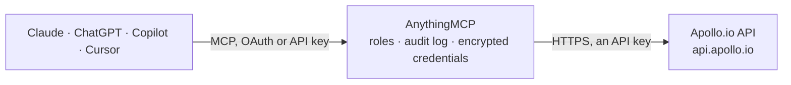

<!-- Generated by scripts/export-github-catalog.mjs in the anythingmcp-website repository. Do not edit by hand. -->

# Apollo.io MCP connector

Drive Apollo.io (B2B sales platform with contact database + enrichment + sequences) from any AI agent: people search, organization search, contact CRUD, deal stages, sequences. 11 tools. The AnythingMCP connector gives Claude, ChatGPT, Microsoft Copilot, Cursor and Gemini 11 MCP tools for Apollo.io: 7 read and 4 can change data.

**Category:** [CRM](../crm.md) · **Tools:** 11 · **Setup guide:** [anythingmcp.com](https://anythingmcp.com/guides/apollo-to-mcp) · [Deutsch](https://anythingmcp.com/de/guides/apollo-to-mcp) · [Italiano](https://anythingmcp.com/it/guides/apollo-to-mcp) · [Español](https://anythingmcp.com/es/guides/apollo-to-mcp) · [日本語](https://anythingmcp.com/ja/guides/apollo-to-mcp) · [Русский](https://anythingmcp.com/ru/guides/apollo-to-mcp) · [中文](https://anythingmcp.com/zh/guides/apollo-to-mcp)

## Start without code

No installation and no terminal: AnythingMCP Cloud runs the Apollo.io connector for you, operated by helpcode.ai in Frankfurt, Germany.

1. **Click the button above** and create an account or sign in. The Apollo.io connector opens, ready to install.
2. **Paste the API key or token from your Apollo.io account.** Every click is in the [step-by-step guide](https://anythingmcp.com/guides/apollo-to-mcp).
3. **Click Install.** AnythingMCP shows the address of your MCP server.
4. **Add that address to your assistant:** [Claude](https://anythingmcp.com/guides/connect-apollo-to-claude) · [ChatGPT](https://anythingmcp.com/guides/connect-apollo-to-chatgpt) · [Microsoft Copilot](https://anythingmcp.com/guides/connect-apollo-to-copilot) · [Cursor](https://anythingmcp.com/guides/connect-apollo-to-cursor) · [Gemini CLI](https://anythingmcp.com/guides/connect-apollo-to-gemini) · [Meta Muse](https://anythingmcp.com/guides/connect-apollo-to-muse).
5. **Ask your first question**, for example: *Find the primary contact at Hansa Verpackungen GmbH in Hamburg, title 'Head of Finance', I need email and phone.*

Prefer help with the setup? [Talk to us](https://anythingmcp.com/contact).

## How it works

- **The AI client** speaks MCP (Streamable HTTP) to AnythingMCP and only sees tool names, descriptions and results. It never gets the Apollo.io credentials.
- **AnythingMCP** checks the client's role, builds the call from the tool definition, adds the credentials (an API key), calls Apollo.io, logs the call and returns the result.
- **Apollo.io** sees an ordinary API client with the rights of the account the credentials belong to.

## Tools

| Tool | What it does | Access |
|---|---|---|
| [`apollo_search_people`](#apollo_search_people) | Search Apollo's 275M+ contact database. | read |
| [`apollo_people_enrich`](#apollo_people_enrich) | Enrich a person — provide ONE of email / first_name+last_name+organization_name / linkedin_url / id. | write |
| [`apollo_search_organizations`](#apollo_search_organizations) | Search Apollo's company database. | read |
| [`apollo_organization_enrich`](#apollo_organization_enrich) | Enrich an organization — provide domain (most common) OR id. | read |
| [`apollo_search_contacts`](#apollo_search_contacts) | Search YOUR Apollo CRM contacts (people already in your account — NOT the public database). | read |
| [`apollo_create_contact`](#apollo_create_contact) | Create or update a contact in YOUR Apollo CRM. | write |
| [`apollo_update_contact`](#apollo_update_contact) | Update an Apollo CRM contact. | write |
| [`apollo_list_contact_stages`](#apollo_list_contact_stages) | List your account's contact stages (Cold/Working/Replied/Customer/etc.). | read |
| [`apollo_list_email_sequences`](#apollo_list_email_sequences) | List outreach sequences. | read |
| [`apollo_add_contact_to_sequence`](#apollo_add_contact_to_sequence) | Enroll a contact in an outreach sequence. | write |
| [`apollo_list_email_accounts`](#apollo_list_email_accounts) | List email accounts connected to Apollo (used as sending identities for sequences). | read |

## Tool reference

Every parameter as the AI client sees it in `tools/list`. Source: [`packages/backend/src/adapters/intl/apollo.json`](../../../packages/backend/src/adapters/intl/apollo.json).

### `apollo_search_people`

Search Apollo's 275M+ contact database. Apollo's flagship feature. Returns paginated people matches with title, organization, location, seniority — email is null unless you enrich (consumes credits). Use filters aggressively to narrow before enriching.

**Access:** read · **Call:** `POST /mixed_people/search`

| Parameter | Type | Required | Description |
|---|---|---|---|
| `q_keywords` | string | no | Free-text search across name, title, company. |
| `person_titles` | any[] | no | Array of title strings — e.g. ['CTO','VP Engineering']. |
| `person_locations` | any[] | no | Array of location strings — e.g. ['San Francisco, CA','Germany']. |
| `person_seniorities` | any[] | no | founder, c_suite, partner, vp, head, director, manager, senior, entry, intern. |
| `organization_num_employees_ranges` | any[] | no | Ranges like ['1,10','11,50','51,200','201,500','501,1000','1001,5000','5001,10000','10001'] (last = '10001+'). |
| `organization_industry_tag_ids` | any[] | no | Apollo industry tag IDs (discover via Apollo UI's industry filter). |
| `contact_email_status` | any[] | no | Filter by email status: ['verified','likely_to_engage','unverified']. |
| `page` | integer | no | 1-based page. |
| `per_page` | integer | no | Per page (default 25, max 100). |

### `apollo_people_enrich`

Enrich a person — provide ONE of email / first_name+last_name+organization_name / linkedin_url / id. Returns full profile including verified email (and often phone). CONSUMES CREDITS.

**Access:** write · **Call:** `POST /people/match`

| Parameter | Type | Required | Description |
|---|---|---|---|
| `email` | string | no | Email to lookup. |
| `first_name` | string | no | First name (combine with last_name + organization_name). |
| `last_name` | string | no | Last name. |
| `organization_name` | string | no | Company name. |
| `linkedin_url` | string | no | LinkedIn profile URL. |
| `id` | string | no | Apollo person ID (24-char hex). |
| `reveal_personal_emails` | boolean | no | If true, also reveal personal email if found (extra credit cost). |
| `reveal_phone_number` | boolean | no | If true, reveal mobile/work phone (extra credits, slower 401 if your plan doesn't include phones). |

### `apollo_search_organizations`

Search Apollo's company database. Returns paginated organizations with industry, employee count, technologies used, funding, location.

**Access:** read · **Call:** `POST /mixed_companies/search`

| Parameter | Type | Required | Description |
|---|---|---|---|
| `q_organization_keyword_tags` | any[] | no | Keyword tags for the company (industry/topic). |
| `q_organization_name` | string | no | Name substring. |
| `organization_locations` | any[] | no | Location strings. |
| `organization_num_employees_ranges` | any[] | no | Employee count ranges. |
| `organization_industry_tag_ids` | any[] | no | Industry tag IDs. |
| `technology_uids` | any[] | no | Apollo tech UIDs (e.g. 'salesforce', 'hubspot' — find via tech filter in UI). |
| `page` | integer | no | Page. |
| `per_page` | integer | no | Per page. |

### `apollo_organization_enrich`

Enrich an organization — provide domain (most common) OR id. Returns full org profile with technographics, funding, employee count, contact patterns.

**Access:** read · **Call:** `GET /organizations/enrich`

| Parameter | Type | Required | Description |
|---|---|---|---|
| `domain` | string | yes | Company domain (e.g. 'acme.com'). |

### `apollo_search_contacts`

Search YOUR Apollo CRM contacts (people already in your account — NOT the public database). Returns contacts you've enriched or added with the labels and stage info.

**Access:** read · **Call:** `POST /contacts/search`

| Parameter | Type | Required | Description |
|---|---|---|---|
| `q_keywords` | string | no | Free-text search. |
| `contact_stage_ids` | any[] | no | Filter by contact stage IDs. |
| `sort_by_field` | string | no | contact_last_activity_date, created_at, name, etc. |
| `sort_ascending` | boolean | no | Sort direction. |
| `page` | integer | no | Page. |
| `per_page` | integer | no | Per page. |

### `apollo_create_contact`

Create or update a contact in YOUR Apollo CRM. Pass first_name + last_name + email at minimum. label_names auto-creates labels.

**Access:** write · **Call:** `POST /contacts`

| Parameter | Type | Required | Description |
|---|---|---|---|
| `first_name` | string | no | First name. |
| `last_name` | string | no | Last name. |
| `email` | string | no | Email. |
| `title` | string | no | Job title. |
| `account_id` | string | no | Apollo account/org ID. |
| `label_names` | any[] | no | Array of label name strings. |
| `contact_stage_id` | string | no | Stage ID. |

### `apollo_update_contact`

Update an Apollo CRM contact.

**Access:** write · **Call:** `PUT /contacts/{contactId}`

| Parameter | Type | Required | Description |
|---|---|---|---|
| `contactId` | string | yes | Contact ID. |
| `first_name` | string | no | New first name. |
| `last_name` | string | no | New last name. |
| `email` | string | no | New email. |
| `title` | string | no | New title. |
| `label_names` | any[] | no | Replace labels. |
| `contact_stage_id` | string | no | Move to a different stage. |

### `apollo_list_contact_stages`

List your account's contact stages (Cold/Working/Replied/Customer/etc.). Required for composing contact_stage_id values.

**Access:** read · **Call:** `GET /contact_stages`

No parameters.

### `apollo_list_email_sequences`

List outreach sequences. Each sequence has id, name, num_steps, status (active/paused/archived), num_active_steps.

**Access:** read · **Call:** `GET /emailer_campaigns`

No parameters.

### `apollo_add_contact_to_sequence`

Enroll a contact in an outreach sequence. Required: contact_ids (array, max 10) + emailer_campaign_id + send_email_from_email_account_id. The send-from email account must be already configured in Apollo.

**Access:** write · **Call:** `POST /emailer_campaigns/{emailer_campaign_id}/add_contact_ids`

| Parameter | Type | Required | Description |
|---|---|---|---|
| `emailer_campaign_id` | string | yes | Sequence ID. |
| `contact_ids` | any[] | yes | Array of contact IDs (max 10 per call). |
| `send_email_from_email_account_id` | string | yes | Email account ID to send from (set up in Apollo UI). |
| `sequence_no_email` | boolean | no | If true, the contact's email is unverified — Apollo skips email-step actions but runs other step types (LinkedIn, calls). |

### `apollo_list_email_accounts`

List email accounts connected to Apollo (used as sending identities for sequences). Returns id, email, user_id, active flag.

**Access:** read · **Call:** `GET /email_accounts`

No parameters.

## Run it yourself

AnythingMCP is open source (AGPL-3.0). [Run it with Docker](../../../README.md#run-it-yourself), open **Connectors → Store**, pick **Apollo.io** and enter `APOLLO_API_KEY`, then add your MCP server URL to the AI client.

[← CRM connectors](../crm.md) · [All categories](../README.md)
