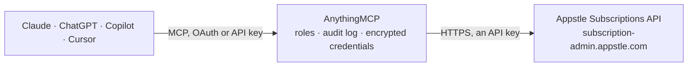

<!-- Generated by scripts/export-github-catalog.mjs in the anythingmcp-website repository. Do not edit by hand. -->

# Appstle Subscriptions MCP connector

Manage Shopify subscriptions in Appstle from any AI agent: find subscription contracts and customers, see upcoming and past renewal orders, pause, resume or cancel, skip and reschedule orders, change … The AnythingMCP connector gives Claude, ChatGPT, Microsoft Copilot, Cursor and Gemini 37 MCP tools for Appstle Subscriptions: 18 read and 19 can change data.

**Category:** [E-commerce](../e-commerce.md) · **Tools:** 37 · **Setup guide:** [anythingmcp.com](https://anythingmcp.com/guides/appstle-subscriptions-to-mcp) · [Deutsch](https://anythingmcp.com/de/guides/appstle-subscriptions-to-mcp) · [Italiano](https://anythingmcp.com/it/guides/appstle-subscriptions-to-mcp) · [Español](https://anythingmcp.com/es/guides/appstle-subscriptions-to-mcp) · [日本語](https://anythingmcp.com/ja/guides/appstle-subscriptions-to-mcp) · [Русский](https://anythingmcp.com/ru/guides/appstle-subscriptions-to-mcp) · [中文](https://anythingmcp.com/zh/guides/appstle-subscriptions-to-mcp)

## Start without code

No installation and no terminal: AnythingMCP Cloud runs the Appstle Subscriptions connector for you, operated by helpcode.ai in Frankfurt, Germany.

1. **Click the button above** and create an account or sign in. The Appstle Subscriptions connector opens, ready to install.
2. **Paste the API key or token from your Appstle Subscriptions account.** Every click is in the [step-by-step guide](https://anythingmcp.com/guides/appstle-subscriptions-to-mcp).
3. **Click Install.** AnythingMCP shows the address of your MCP server.
4. **Add that address to your assistant:** [Claude](https://anythingmcp.com/guides/connect-appstle-subscriptions-to-claude) · [ChatGPT](https://anythingmcp.com/guides/connect-appstle-subscriptions-to-chatgpt) · [Microsoft Copilot](https://anythingmcp.com/guides/connect-appstle-subscriptions-to-copilot) · [Cursor](https://anythingmcp.com/guides/connect-appstle-subscriptions-to-cursor) · [Gemini CLI](https://anythingmcp.com/guides/connect-appstle-subscriptions-to-gemini) · [Meta Muse](https://anythingmcp.com/guides/connect-appstle-subscriptions-to-muse).
5. **Ask your first question**, for example: *Find the subscription contract for order name SUB-2026-045 and show customer and next billing date*

Prefer help with the setup? [Talk to us](https://anythingmcp.com/contact).

## How it works

- **The AI client** speaks MCP (Streamable HTTP) to AnythingMCP and only sees tool names, descriptions and results. It never gets the Appstle Subscriptions credentials.
- **AnythingMCP** checks the client's role, builds the call from the tool definition, adds the credentials (an API key), calls Appstle Subscriptions, logs the call and returns the result.
- **Appstle Subscriptions** sees an ordinary API client with the rights of the account the credentials belong to.

## Tools

| Tool | What it does | Access |
|---|---|---|
| [`appstle_subscriptions_list_subscription_contracts`](#appstle_subscriptions_list_subscription_contracts) | List and search subscription contracts of the shop: contract id, status, customer name and email, next billing date, billing and delivery interval, products… | read |
| [`appstle_subscriptions_get_contract`](#appstle_subscriptions_get_contract) | One subscription contract as Shopify holds it: status, next billing date, billing and delivery policy, lines (with the line ids the line tools need,… | read |
| [`appstle_subscriptions_get_contract_analytics`](#appstle_subscriptions_get_contract_analytics) | Revenue analytics of one contract: total revenue generated, number of successful orders and the formatted revenue. | read |
| [`appstle_subscriptions_get_contract_current_cycle`](#appstle_subscriptions_get_contract_current_cycle) | Current billing cycle number of a contract (how many successful billings so far, the initial order counting as 1). | read |
| [`appstle_subscriptions_get_contract_fulfillments`](#appstle_subscriptions_get_contract_fulfillments) | Fulfillment of the latest successful order of a contract: shipment status, tracking numbers and links, delivery estimate and fulfilled line items. | read |
| [`appstle_subscriptions_get_delivery_options`](#appstle_subscriptions_get_delivery_options) | Delivery methods a contract can switch to, based on its address and products (shipping, local delivery, pickup). | read |
| [`appstle_subscriptions_list_upcoming_orders`](#appstle_subscriptions_list_upcoming_orders) | Upcoming (QUEUED) orders of a contract or a customer, by billing date: billing attempt id, billing date and status. | read |
| [`appstle_subscriptions_list_past_orders`](#appstle_subscriptions_list_past_orders) | Past (processed) renewal orders of the shop, a contract or a customer: successful, failed and skipped billing attempts with order id and name, billing date,… | read |
| [`appstle_subscriptions_get_past_orders_report`](#appstle_subscriptions_get_past_orders_report) | Report of renewal billing attempts across the shop by status (e.g. FAILURE for failed payments, SUCCESS, SKIPPED), with date range, retry count and contract… | read |
| [`appstle_subscriptions_list_customers`](#appstle_subscriptions_list_customers) | Customers that have subscriptions, with name, email, number of subscriptions and their status. | read |
| [`appstle_subscriptions_get_customer`](#appstle_subscriptions_get_customer) | One customer with profile (name, email, phone, addresses), payment methods and a page of their subscription contracts. | read |
| [`appstle_subscriptions_list_customer_subscriptions`](#appstle_subscriptions_list_customer_subscriptions) | All valid (active, paused or otherwise not deleted) subscription contracts of one customer with full details: status, products, billing and delivery… | read |
| [`appstle_subscriptions_get_customer_portal_link`](#appstle_subscriptions_get_customer_portal_link) | Create a time-limited link to the customer portal where a customer manages their own subscriptions. | read |
| [`appstle_subscriptions_list_subscription_groups`](#appstle_subscriptions_list_subscription_groups) | Subscription groups (Shopify selling plan groups) with their selling plans (frequency, discount, prepaid settings) and the products and variants they apply to. | read |
| [`appstle_subscriptions_get_subscription_group`](#appstle_subscriptions_get_subscription_group) | One subscription group (selling plan group) by id with its plans and products. | read |
| [`appstle_subscriptions_list_selling_plans`](#appstle_subscriptions_list_selling_plans) | Every selling plan across all subscription groups in one flat list: selling plan id and name, frequency, discount and group. | read |
| [`appstle_subscriptions_list_product_swaps`](#appstle_subscriptions_list_product_swaps) | Product swap automations of the shop: rules that replace products in subscription orders after a number of cycles, with source and destination variants. | read |
| [`appstle_subscriptions_list_retention_activities`](#appstle_subscriptions_list_retention_activities) | Customer retention activities: each time a customer went through the cancel or pause flow, with the reason, the retention offer shown and whether it was… | read |
| [`appstle_subscriptions_update_contract_status`](#appstle_subscriptions_update_contract_status) | Pause (PAUSED) or resume (ACTIVE) a subscription. | write |
| [`appstle_subscriptions_cancel_contract`](#appstle_subscriptions_cancel_contract) | Cancel a subscription contract now: all future billing and deliveries stop and the customer gets the cancellation email if enabled. | write |
| [`appstle_subscriptions_update_next_billing_date`](#appstle_subscriptions_update_next_billing_date) | Move the next billing (order) date of a contract. | write |
| [`appstle_subscriptions_update_billing_interval`](#appstle_subscriptions_update_billing_interval) | Change how often the customer is charged, e.g. every 2 WEEK or every 1 MONTH. | write |
| [`appstle_subscriptions_update_delivery_interval`](#appstle_subscriptions_update_delivery_interval) | Change how often the subscription is delivered (for prepaid plans this can differ from billing). | write |
| [`appstle_subscriptions_skip_order`](#appstle_subscriptions_skip_order) | Skip one upcoming (QUEUED) order by its billing attempt id; it stays listed as SKIPPED and later orders are not affected. | write |
| [`appstle_subscriptions_skip_upcoming_order`](#appstle_subscriptions_skip_upcoming_order) | Skip the next upcoming order of a contract without knowing its billing attempt id. | write |
| [`appstle_subscriptions_unskip_order`](#appstle_subscriptions_unskip_order) | Restore a skipped order to QUEUED so it is billed and shipped again; only possible before its billing date. | write |
| [`appstle_subscriptions_reschedule_order`](#appstle_subscriptions_reschedule_order) | Move one upcoming order to another date; optionally shift the later orders by the same offset. | write |
| [`appstle_subscriptions_bill_order_now`](#appstle_subscriptions_bill_order_now) | Charge an upcoming order now instead of on its billing date. | write |
| [`appstle_subscriptions_add_line_item`](#appstle_subscriptions_add_line_item) | Add a product variant to a subscription, recurring or only for the next order. | write |
| [`appstle_subscriptions_update_line_item`](#appstle_subscriptions_update_line_item) | Change a product in a subscription: its quantity, price, variant (swap to another product or flavour) and/or selling plan (frequency), in one call. | write |
| [`appstle_subscriptions_remove_line_item`](#appstle_subscriptions_remove_line_item) | Remove a product from a subscription. | write |
| [`appstle_subscriptions_apply_discount_code`](#appstle_subscriptions_apply_discount_code) | Apply an existing Shopify discount code to the future orders of a subscription. | write |
| [`appstle_subscriptions_add_custom_discount`](#appstle_subscriptions_add_custom_discount) | Give a subscription a manual discount: PERCENTAGE (percentage), FIXED amount off or a fixed PRICE (amount), optionally for a limited number of cycles and… | write |
| [`appstle_subscriptions_remove_discount`](#appstle_subscriptions_remove_discount) | Remove a discount from a subscription; future orders are priced without it. | write |
| [`appstle_subscriptions_update_shipping_address`](#appstle_subscriptions_update_shipping_address) | Change the delivery address (or delivery method type) of a subscription for future orders. | write |
| [`appstle_subscriptions_update_order_note`](#appstle_subscriptions_update_order_note) | Set the note added to every future order of a subscription (empty text clears it). | write |
| [`appstle_subscriptions_send_payment_method_update_email`](#appstle_subscriptions_send_payment_method_update_email) | Have Shopify email the customer a secure link to update the payment method of a subscription (e.g. after a failed payment). | write |

## Tool reference

Every parameter as the AI client sees it in `tools/list`. Source: [`packages/backend/src/adapters/intl/appstle-subscriptions.json`](../../../packages/backend/src/adapters/intl/appstle-subscriptions.json).

### `appstle_subscriptions_list_subscription_contracts`

List and search subscription contracts of the shop: contract id, status, customer name and email, next billing date, billing and delivery interval, products (contractDetailsJson), order amount and the initial order. Filter by status, dates, customer, order number, product, variant, selling plan, plan type or amount. The total count is in _headers.x-total-count.

**Access:** read · **Call:** `GET /api/external/v2/subscription-contract-details`

| Parameter | Type | Required | Description |
|---|---|---|---|
| `status` | `ACTIVE` \| `PAUSED` \| `CANCELLED` | no | Only contracts with this status. |
| `customer_name` | string | no | Part of the customer name or email (case-insensitive). |
| `order_name` | string | no | Order number such as #1001 (initial or later orders, partial match). |
| `subscription_contract_id` | string | no | Contract id or part of it. |
| `created_from` | string | no | Created on or after, ISO 8601 with time zone, e.g. 2026-11-01T00:00:00Z. |
| `created_to` | string | no | Created on or before, ISO 8601 with time zone, e.g. 2026-11-01T00:00:00Z. |
| `updated_from` | string | no | Updated on or after, ISO 8601 with time zone, e.g. 2026-11-01T00:00:00Z. |
| `updated_to` | string | no | Updated on or before, ISO 8601 with time zone, e.g. 2026-11-01T00:00:00Z. |
| `next_billing_from` | string | no | Next billing date on or after, ISO 8601 with time zone, e.g. 2026-11-01T00:00:00Z. Needs next_billing_to as well. |
| `next_billing_to` | string | no | Next billing date on or before, ISO 8601 with time zone, e.g. 2026-11-01T00:00:00Z. Needs next_billing_from as well. |
| `delivery_interval` | `DAY` \| `WEEK` \| `MONTH` \| `YEAR` | no | Delivery interval unit (Appstle names this filter billingPolicyInterval). |
| `delivery_interval_count` | integer | no | Delivery interval count (Appstle names this filter billingPolicyIntervalCount). |
| `plan_type` | `prepaid` \| `non-prepaid` | no | prepaid (billed for several deliveries at once) or non-prepaid. |
| `product_id` | integer | no | Only contracts containing this Shopify product id (numeric). |
| `variant_id` | integer | no | Only contracts containing this Shopify variant id (numeric). |
| `selling_plan_id` | integer | no | Only contracts on this selling plan id (numeric). |
| `min_order_amount` | number | no | Lowest order amount (sum of quantity times current price). |
| `max_order_amount` | number | no | Highest order amount. |
| `page` | integer | no | Page number, starting at 0. |
| `size` | integer | no | Items per page (at most 2000). |
| `sort` | string | no | Sort by a database column name and direction, e.g. next_billing_date,asc or created_at,desc (snake_case, not camelCase). |

### `appstle_subscriptions_get_contract`

One subscription contract as Shopify holds it: status, next billing date, billing and delivery policy, lines (with the line ids the line tools need, variant, quantity, price, selling plan), discounts (with discount ids), delivery method and address, customer and payment method.

**Access:** read · **Call:** `GET /api/external/v2/subscription-contracts/contract-external/{contract_id}`

| Parameter | Type | Required | Description |
|---|---|---|---|
| `contract_id` | integer | yes | Subscription contract id (numeric, without the gid://shopify/SubscriptionContract/ prefix), from appstle_subscriptions_list_subscription_contracts. |

### `appstle_subscriptions_get_contract_analytics`

Revenue analytics of one contract: total revenue generated, number of successful orders and the formatted revenue.

**Access:** read · **Call:** `GET /api/external/v2/subscription-contract-details/analytics/{contract_id}`

| Parameter | Type | Required | Description |
|---|---|---|---|
| `contract_id` | integer | yes | Subscription contract id (numeric, without the gid://shopify/SubscriptionContract/ prefix), from appstle_subscriptions_list_subscription_contracts. |

### `appstle_subscriptions_get_contract_current_cycle`

Current billing cycle number of a contract (how many successful billings so far, the initial order counting as 1).

**Access:** read · **Call:** `GET /api/external/v2/subscription-contract-details/current-cycle/{contract_id}`

| Parameter | Type | Required | Description |
|---|---|---|---|
| `contract_id` | integer | yes | Subscription contract id (numeric, without the gid://shopify/SubscriptionContract/ prefix), from appstle_subscriptions_list_subscription_contracts. |

### `appstle_subscriptions_get_contract_fulfillments`

Fulfillment of the latest successful order of a contract: shipment status, tracking numbers and links, delivery estimate and fulfilled line items.

**Access:** read · **Call:** `GET /api/external/v2/subscription-contract-details/subscription-fulfillments/{contract_id}`

| Parameter | Type | Required | Description |
|---|---|---|---|
| `contract_id` | integer | yes | Subscription contract id (numeric, without the gid://shopify/SubscriptionContract/ prefix), from appstle_subscriptions_list_subscription_contracts. |

### `appstle_subscriptions_get_delivery_options`

Delivery methods a contract can switch to, based on its address and products (shipping, local delivery, pickup).

**Access:** read · **Call:** `GET /api/external/v2/data/contract-delivery-options`

| Parameter | Type | Required | Description |
|---|---|---|---|
| `contract_id` | integer | yes | Subscription contract id (numeric, without the gid://shopify/SubscriptionContract/ prefix), from appstle_subscriptions_list_subscription_contracts. |

### `appstle_subscriptions_list_upcoming_orders`

Upcoming (QUEUED) orders of a contract or a customer, by billing date: billing attempt id, billing date and status. The billing attempt id is what the skip, unskip, reschedule and bill-now tools take.

**Access:** read · **Call:** `GET /api/external/v2/subscription-billing-attempts/top-orders`

| Parameter | Type | Required | Description |
|---|---|---|---|
| `contract_id` | integer | no | Subscription contract id (numeric, without the gid://shopify/SubscriptionContract/ prefix), from appstle_subscriptions_list_subscription_contracts. |
| `customer_id` | integer | no | Shopify customer id (numeric, without the gid:// prefix). |

### `appstle_subscriptions_list_past_orders`

Past (processed) renewal orders of the shop, a contract or a customer: successful, failed and skipped billing attempts with order id and name, billing date, status and error. Initial checkout orders are not included.

**Access:** read · **Call:** `GET /api/external/v2/subscription-billing-attempts/past-orders`

| Parameter | Type | Required | Description |
|---|---|---|---|
| `contract_id` | integer | no | Subscription contract id (numeric, without the gid://shopify/SubscriptionContract/ prefix), from appstle_subscriptions_list_subscription_contracts. |
| `customer_id` | integer | no | Shopify customer id (numeric, without the gid:// prefix). |
| `page` | integer | no | Page number, starting at 0. |
| `size` | integer | no | Items per page (at most 2000). |

### `appstle_subscriptions_get_past_orders_report`

Report of renewal billing attempts across the shop by status (e.g. FAILURE for failed payments, SUCCESS, SKIPPED), with date range, retry count and contract status filters: the base for revenue, churn and dunning analysis.

**Access:** read · **Call:** `GET /api/external/v2/subscription-billing-attempts/past-orders/report`

| Parameter | Type | Required | Description |
|---|---|---|---|
| `status` | `SUCCESS` \| `FAILURE` \| `SKIPPED` \| `QUEUED` \| `REQUESTING` \| `PROGRESS` \| `CONTRACT_CANCELLED` \| `CONTRACT_ENDED` \| `CONTRACT_PAUSED` \| `AUTO_CHARGE_DISABLED` \| `SHOPIFY_EXCEPTION` \| `SKIPPED_DUNNING_MGMT` \| `SKIPPED_INVENTORY_MGMT` \| `IMMEDIATE_TRIGGERED` \| `SECURITY_CHALLENGE` \| `CONTRACT_PAUSED_MAX_CYCLES` \| `REFUNDED` \| `PENDING` | yes | Billing attempt status to report on. |
| `from_day` | string | no | From, ISO 8601 with time zone, e.g. 2026-11-01T00:00:00Z. |
| `to_day` | string | no | To, ISO 8601 with time zone, e.g. 2026-11-01T00:00:00Z. |
| `contract_id` | integer | no | Subscription contract id (numeric, without the gid://shopify/SubscriptionContract/ prefix), from appstle_subscriptions_list_subscription_contracts. |
| `contract_status` | string | no | Only contracts with this status, e.g. ACTIVE, PAUSED, CANCELLED. |
| `attempt_count` | integer | no | Only attempts with this retry count. |
| `include_shopify_exception` | boolean | no | Include the Shopify error for failures. |
| `page` | integer | no | Page number, starting at 0. |
| `size` | integer | no | Items per page (at most 2000). |

### `appstle_subscriptions_list_customers`

Customers that have subscriptions, with name, email, number of subscriptions and their status. Filter by name or exact email.

**Access:** read · **Call:** `GET /api/external/v2/subscription-contract-details/customers`

| Parameter | Type | Required | Description |
|---|---|---|---|
| `name` | string | no | Part of the customer name. |
| `email` | string | no | Exact email address. |
| `active_more_than_one_subscription` | boolean | no | Only customers with more than one active subscription. |
| `page` | integer | no | Page number, starting at 0. |
| `size` | integer | no | Items per page (at most 2000). |

### `appstle_subscriptions_get_customer`

One customer with profile (name, email, phone, addresses), payment methods and a page of their subscription contracts. Page the contracts with cursor = pageInfo.endCursor.

**Access:** read · **Call:** `GET /api/external/v2/subscription-customers/{customer_id}`

| Parameter | Type | Required | Description |
|---|---|---|---|
| `customer_id` | integer | yes | Shopify customer id (numeric, without the gid:// prefix). |
| `cursor` | string | no | pageInfo.endCursor from the previous answer. |

### `appstle_subscriptions_list_customer_subscriptions`

All valid (active, paused or otherwise not deleted) subscription contracts of one customer with full details: status, products, billing and delivery schedule, prices.

**Access:** read · **Call:** `GET /api/external/v2/subscription-customers-detail/valid/{customer_id}`

| Parameter | Type | Required | Description |
|---|---|---|---|
| `customer_id` | integer | yes | Shopify customer id (numeric, without the gid:// prefix). |

### `appstle_subscriptions_get_customer_portal_link`

Create a time-limited link to the customer portal where a customer manages their own subscriptions. Look the customer up by id or email. The link logs in as that customer: give it only to that customer.

**Access:** read · **Call:** `GET /api/external/v2/manage-subscription-link`

| Parameter | Type | Required | Description |
|---|---|---|---|
| `customer_id` | integer | no | Shopify customer id (numeric, without the gid:// prefix). |
| `email` | string | no | Customer email, instead of customer_id. |

### `appstle_subscriptions_list_subscription_groups`

Subscription groups (Shopify selling plan groups) with their selling plans (frequency, discount, prepaid settings) and the products and variants they apply to.

**Access:** read · **Call:** `GET /api/external/v2/subscription-groups`

No parameters.

### `appstle_subscriptions_get_subscription_group`

One subscription group (selling plan group) by id with its plans and products.

**Access:** read · **Call:** `GET /api/external/v2/subscription-groups/{group_id}`

| Parameter | Type | Required | Description |
|---|---|---|---|
| `group_id` | integer | yes | Subscription group id (numeric), from appstle_subscriptions_list_subscription_groups. |

### `appstle_subscriptions_list_selling_plans`

Every selling plan across all subscription groups in one flat list: selling plan id and name, frequency, discount and group. Use the id or name with appstle_subscriptions_update_line_item.

**Access:** read · **Call:** `GET /api/external/v2/subscription-groups/all-selling-plans`

No parameters.

### `appstle_subscriptions_list_product_swaps`

Product swap automations of the shop: rules that replace products in subscription orders after a number of cycles, with source and destination variants.

**Access:** read · **Call:** `GET /api/external/v2/product-swaps`

| Parameter | Type | Required | Description |
|---|---|---|---|
| `rule_name` | string | no | Only rules with this name. |
| `source_variants` | string | no | Only rules with these source variant ids. |
| `destination_variants` | string | no | Only rules with these destination variant ids. |

### `appstle_subscriptions_list_retention_activities`

Customer retention activities: each time a customer went through the cancel or pause flow, with the reason, the retention offer shown and whether it was accepted (discount, pause, frequency change, swap) or the customer left. Useful for churn analysis.

**Access:** read · **Call:** `GET /api/external/v2/customer-retention-activities`

| Parameter | Type | Required | Description |
|---|---|---|---|
| `contract_id` | integer | no | Subscription contract id (numeric, without the gid://shopify/SubscriptionContract/ prefix), from appstle_subscriptions_list_subscription_contracts. |
| `event_source` | `PAUSE` \| `CANCELLATION` | no | PAUSE or CANCELLATION flow. |
| `status` | string | no | Outcome status of the activity. |
| `retention_action` | string | no | Retention offer type. |
| `retention_reason` | string | no | Reason the customer gave. |
| `from_day` | string | no | From, ISO 8601 with time zone, e.g. 2026-11-01T00:00:00Z. |
| `to_day` | string | no | To, ISO 8601 with time zone, e.g. 2026-11-01T00:00:00Z. |
| `page` | integer | no | Page number, starting at 0. |
| `size` | integer | no | Items per page (at most 2000). |

### `appstle_subscriptions_update_contract_status`

Pause (PAUSED) or resume (ACTIVE) a subscription. Paused contracts are not billed or shipped until resumed. The customer may get an email. Confirm with the user first.

**Access:** write · **Call:** `PUT /api/external/v2/subscription-contracts-update-status`

| Parameter | Type | Required | Description |
|---|---|---|---|
| `contract_id` | integer | yes | Subscription contract id (numeric, without the gid://shopify/SubscriptionContract/ prefix), from appstle_subscriptions_list_subscription_contracts. |
| `status` | `ACTIVE` \| `PAUSED` | yes | PAUSED to pause, ACTIVE to resume. |

### `appstle_subscriptions_cancel_contract`

Cancel a subscription contract now: all future billing and deliveries stop and the customer gets the cancellation email if enabled. It cannot be resumed. Show the user which contract it is and wait for a yes. Installed switched off.

**Access:** write · **Call:** `DELETE /api/external/v2/subscription-contracts/{contract_id}`

| Parameter | Type | Required | Description |
|---|---|---|---|
| `contract_id` | integer | yes | Subscription contract id (numeric, without the gid://shopify/SubscriptionContract/ prefix), from appstle_subscriptions_list_subscription_contracts. |
| `cancellation_feedback` | string | no | Why the customer cancels, e.g. Too expensive. |
| `cancellation_note` | string | no | Internal note, not shown to the customer. |

### `appstle_subscriptions_update_next_billing_date`

Move the next billing (order) date of a contract. By default the later orders move with it.

**Access:** write · **Call:** `PUT /api/external/v2/subscription-contracts-update-billing-date`

| Parameter | Type | Required | Description |
|---|---|---|---|
| `contract_id` | integer | yes | Subscription contract id (numeric, without the gid://shopify/SubscriptionContract/ prefix), from appstle_subscriptions_list_subscription_contracts. |
| `next_billing_date` | string | yes | New date in the future, ISO 8601 with time zone, e.g. 2026-11-01T00:00:00Z. |
| `reschedule_future_orders` | boolean | no | true (default): later orders follow the new date; false: only the next order moves. |

### `appstle_subscriptions_update_billing_interval`

Change how often the customer is charged, e.g. every 2 WEEK or every 1 MONTH. Billing dates and pricing are recalculated.

**Access:** write · **Call:** `PUT /api/external/v2/subscription-contracts-update-billing-interval`

| Parameter | Type | Required | Description |
|---|---|---|---|
| `contract_id` | integer | yes | Subscription contract id (numeric, without the gid://shopify/SubscriptionContract/ prefix), from appstle_subscriptions_list_subscription_contracts. |
| `interval_count` | integer | yes | Number of units between billings, e.g. 2. |
| `interval` | `DAY` \| `WEEK` \| `MONTH` \| `YEAR` | yes | Interval unit. |

### `appstle_subscriptions_update_delivery_interval`

Change how often the subscription is delivered (for prepaid plans this can differ from billing).

**Access:** write · **Call:** `PUT /api/external/v2/subscription-contracts-update-delivery-interval`

| Parameter | Type | Required | Description |
|---|---|---|---|
| `contract_id` | integer | yes | Subscription contract id (numeric, without the gid://shopify/SubscriptionContract/ prefix), from appstle_subscriptions_list_subscription_contracts. |
| `delivery_interval_count` | integer | yes | Number of units between deliveries. |
| `delivery_interval` | `DAY` \| `WEEK` \| `MONTH` \| `YEAR` | yes | Interval unit. |

### `appstle_subscriptions_skip_order`

Skip one upcoming (QUEUED) order by its billing attempt id; it stays listed as SKIPPED and later orders are not affected.

**Access:** write · **Call:** `PUT /api/external/v2/subscription-billing-attempts/skip-order/{billing_attempt_id}`

| Parameter | Type | Required | Description |
|---|---|---|---|
| `billing_attempt_id` | integer | yes | Billing attempt id (the id of an upcoming order), from appstle_subscriptions_list_upcoming_orders. |
| `contract_id` | integer | no | Subscription contract id (numeric, without the gid://shopify/SubscriptionContract/ prefix), from appstle_subscriptions_list_subscription_contracts. |
| `is_prepaid` | boolean | no | true when the contract is on a prepaid plan. |

### `appstle_subscriptions_skip_upcoming_order`

Skip the next upcoming order of a contract without knowing its billing attempt id.

**Access:** write · **Call:** `PUT /api/external/v2/subscription-billing-attempts/skip-upcoming-order`

| Parameter | Type | Required | Description |
|---|---|---|---|
| `contract_id` | integer | yes | Subscription contract id (numeric, without the gid://shopify/SubscriptionContract/ prefix), from appstle_subscriptions_list_subscription_contracts. |

### `appstle_subscriptions_unskip_order`

Restore a skipped order to QUEUED so it is billed and shipped again; only possible before its billing date.

**Access:** write · **Call:** `PUT /api/external/v2/subscription-billing-attempts/unskip-order/{billing_attempt_id}`

| Parameter | Type | Required | Description |
|---|---|---|---|
| `billing_attempt_id` | integer | yes | Billing attempt id (the id of an upcoming order), from appstle_subscriptions_list_upcoming_orders. |
| `contract_id` | integer | no | Subscription contract id (numeric, without the gid://shopify/SubscriptionContract/ prefix), from appstle_subscriptions_list_subscription_contracts. |

### `appstle_subscriptions_reschedule_order`

Move one upcoming order to another date; optionally shift the later orders by the same offset.

**Access:** write · **Call:** `PUT /api/external/v2/subscription-billing-attempts/reschedule-order/{billing_attempt_id}`

| Parameter | Type | Required | Description |
|---|---|---|---|
| `billing_attempt_id` | integer | yes | Billing attempt id (the id of an upcoming order), from appstle_subscriptions_list_upcoming_orders. |
| `billing_date` | string | yes | New billing date, ISO 8601 with time zone, e.g. 2026-11-01T00:00:00Z. |
| `reschedule_future_orders` | boolean | no | Also move the later orders (default false). |

### `appstle_subscriptions_bill_order_now`

Charge an upcoming order now instead of on its billing date. It charges the customer's card: confirm with the user first. The result arrives later: check appstle_subscriptions_list_past_orders. Installed switched off.

**Access:** write · **Call:** `PUT /api/external/v2/subscription-billing-attempts/attempt-billing/{billing_attempt_id}`

| Parameter | Type | Required | Description |
|---|---|---|---|
| `billing_attempt_id` | integer | yes | Billing attempt id (the id of an upcoming order), from appstle_subscriptions_list_upcoming_orders. |

### `appstle_subscriptions_add_line_item`

Add a product variant to a subscription, recurring or only for the next order.

**Access:** write · **Call:** `PUT /api/external/v2/subscription-contracts-add-line-item`

| Parameter | Type | Required | Description |
|---|---|---|---|
| `contract_id` | integer | yes | Subscription contract id (numeric, without the gid://shopify/SubscriptionContract/ prefix), from appstle_subscriptions_list_subscription_contracts. |
| `variant_id` | string | yes | Shopify variant id, numeric or gid://shopify/ProductVariant/... |
| `quantity` | integer | yes | Quantity, 1 to 999. |
| `one_time` | boolean | no | true: only in the next order; false (default): every order. |

### `appstle_subscriptions_update_line_item`

Change a product in a subscription: its quantity, price, variant (swap to another product or flavour) and/or selling plan (frequency), in one call. Pass only what changes.

**Access:** write · **Call:** `PUT /api/external/v2/subscription-contracts-update-line-item`

| Parameter | Type | Required | Description |
|---|---|---|---|
| `contract_id` | integer | yes | Subscription contract id (numeric, without the gid://shopify/SubscriptionContract/ prefix), from appstle_subscriptions_list_subscription_contracts. |
| `line_id` | string | yes | Line id of the product in the contract, the full GraphQL id such as gid://shopify/SubscriptionLine/abc-123, from appstle_subscriptions_get_contract (lines). |
| `quantity` | integer | no | New quantity. |
| `variant_id` | string | no | New variant, gid://shopify/ProductVariant/..., to swap the product. |
| `price` | number | no | New price in the shop currency. |
| `is_price_per_unit` | boolean | no | Prepaid plans: true = price per delivery, false (default) = total per billing. |
| `selling_plan_name` | string | no | Name of the selling plan to switch to, from appstle_subscriptions_list_selling_plans. |

### `appstle_subscriptions_remove_line_item`

Remove a product from a subscription. Appstle refuses when it would leave the subscription below its minimum. Confirm with the user first.

**Access:** write · **Call:** `PUT /api/external/v2/subscription-contracts-remove-line-item`

| Parameter | Type | Required | Description |
|---|---|---|---|
| `contract_id` | integer | yes | Subscription contract id (numeric, without the gid://shopify/SubscriptionContract/ prefix), from appstle_subscriptions_list_subscription_contracts. |
| `line_id` | string | yes | Line id of the product in the contract, the full GraphQL id such as gid://shopify/SubscriptionLine/abc-123, from appstle_subscriptions_get_contract (lines). |
| `remove_discount` | boolean | no | Also remove discounts that apply only to this line (default true). |

### `appstle_subscriptions_apply_discount_code`

Apply an existing Shopify discount code to the future orders of a subscription.

**Access:** write · **Call:** `PUT /api/external/v2/subscription-contracts-apply-discount`

| Parameter | Type | Required | Description |
|---|---|---|---|
| `contract_id` | integer | yes | Subscription contract id (numeric, without the gid://shopify/SubscriptionContract/ prefix), from appstle_subscriptions_list_subscription_contracts. |
| `discount_code` | string | yes | Active Shopify discount code (case-sensitive). |

### `appstle_subscriptions_add_custom_discount`

Give a subscription a manual discount: PERCENTAGE (percentage), FIXED amount off or a fixed PRICE (amount), optionally for a limited number of cycles and per item.

**Access:** write · **Call:** `PUT /api/external/v2/subscription-contracts-add-discount`

| Parameter | Type | Required | Description |
|---|---|---|---|
| `contract_id` | integer | yes | Subscription contract id (numeric, without the gid://shopify/SubscriptionContract/ prefix), from appstle_subscriptions_list_subscription_contracts. |
| `discount_type` | `PERCENTAGE` \| `FIXED` \| `PRICE` | yes | Kind of discount. |
| `percentage` | integer | no | Percent off, 1 to 100 (PERCENTAGE). |
| `amount` | number | no | Amount in the shop currency (FIXED or PRICE). |
| `discount_title` | string | no | Title shown on orders. |
| `recurring_cycle_limit` | integer | no | Number of billing cycles it applies to; leave empty for no limit. |
| `applies_on_each_item` | boolean | no | true: per line item; false (default): on the order subtotal. |

### `appstle_subscriptions_remove_discount`

Remove a discount from a subscription; future orders are priced without it.

**Access:** write · **Call:** `PUT /api/external/v2/subscription-contracts-remove-discount`

| Parameter | Type | Required | Description |
|---|---|---|---|
| `contract_id` | integer | yes | Subscription contract id (numeric, without the gid://shopify/SubscriptionContract/ prefix), from appstle_subscriptions_list_subscription_contracts. |
| `discount_id` | string | yes | Discount id, the full gid://shopify/SubscriptionManualDiscount/... from appstle_subscriptions_get_contract (discounts). |

### `appstle_subscriptions_update_shipping_address`

Change the delivery address (or delivery method type) of a subscription for future orders. Send the complete address, not only the changed field: read the current one with appstle_subscriptions_get_contract. The customer gets an address-changed email.

**Access:** write · **Call:** `PUT /api/external/v2/subscription-contracts-update-shipping-address`

| Parameter | Type | Required | Description |
|---|---|---|---|
| `contract_id` | integer | yes | Subscription contract id (numeric, without the gid://shopify/SubscriptionContract/ prefix), from appstle_subscriptions_list_subscription_contracts. |
| `first_name` | string | no | First name. |
| `last_name` | string | no | Last name. |
| `company` | string | no | Company. |
| `address1` | string | no | Street and number. |
| `address2` | string | no | Apartment, suite. |
| `city` | string | no | City. |
| `zip` | string | no | Postal code. |
| `province_code` | string | no | Province or state code, e.g. CA. |
| `country_code` | string | no | ISO country code, e.g. US. |
| `phone` | string | no | Phone number. |
| `method_type` | `SHIPPING` \| `LOCAL` \| `PICK_UP` | no | SHIPPING (default), LOCAL or PICK_UP. |
| `location_id` | string | no | Pickup or local delivery location id (for LOCAL and PICK_UP). |

### `appstle_subscriptions_update_order_note`

Set the note added to every future order of a subscription (empty text clears it).

**Access:** write · **Call:** `PUT /api/external/v2/subscription-contracts-update-order-note/{contract_id}`

| Parameter | Type | Required | Description |
|---|---|---|---|
| `contract_id` | integer | yes | Subscription contract id (numeric, without the gid://shopify/SubscriptionContract/ prefix), from appstle_subscriptions_list_subscription_contracts. |
| `order_note` | string | yes | Note text. |

### `appstle_subscriptions_send_payment_method_update_email`

Have Shopify email the customer a secure link to update the payment method of a subscription (e.g. after a failed payment).

**Access:** write · **Call:** `PUT /api/external/v2/subscription-contracts-update-payment-method`

| Parameter | Type | Required | Description |
|---|---|---|---|
| `contract_id` | integer | yes | Subscription contract id (numeric, without the gid://shopify/SubscriptionContract/ prefix), from appstle_subscriptions_list_subscription_contracts. |

## Run it yourself

AnythingMCP is open source (AGPL-3.0). [Run it with Docker](../../../README.md#run-it-yourself), open **Connectors → Store**, pick **Appstle Subscriptions** and enter `APPSTLE_API_KEY`, then add your MCP server URL to the AI client.

[← E-commerce connectors](../e-commerce.md) · [All categories](../README.md)
