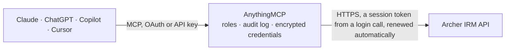

<!-- Generated by scripts/export-github-catalog.mjs in the anythingmcp-website repository. Do not edit by hand. -->

# Archer IRM MCP connector

Read Archer IRM (formerly RSA Archer) GRC data through its REST and Content APIs: applications, levels, fields and values lists, plus risk, control, finding and incident records searched with OData. The AnythingMCP connector gives Claude, ChatGPT, Microsoft Copilot, Cursor and Gemini 14 MCP tools for Archer IRM, all read-only.

**Category:** [Public Data](../data.md) · **Tools:** 14 · **Setup guide:** [anythingmcp.com](https://anythingmcp.com/guides/archer-to-mcp) · [Deutsch](https://anythingmcp.com/de/guides/archer-to-mcp) · [Italiano](https://anythingmcp.com/it/guides/archer-to-mcp) · [Español](https://anythingmcp.com/es/guides/archer-to-mcp) · [日本語](https://anythingmcp.com/ja/guides/archer-to-mcp) · [Русский](https://anythingmcp.com/ru/guides/archer-to-mcp) · [中文](https://anythingmcp.com/zh/guides/archer-to-mcp)

## Start without code

No installation and no terminal: AnythingMCP Cloud runs the Archer IRM connector for you, operated by helpcode.ai in Frankfurt, Germany.

1. **Click the button above** and create an account or sign in. The Archer IRM connector opens, ready to install.
2. **Paste the API key or token from your Archer IRM account.** Every click is in the [step-by-step guide](https://anythingmcp.com/guides/archer-to-mcp).
3. **Click Install.** AnythingMCP shows the address of your MCP server.
4. **Add that address to your assistant:** [Claude](https://anythingmcp.com/guides/connect-archer-to-claude) · [ChatGPT](https://anythingmcp.com/guides/connect-archer-to-chatgpt) · [Microsoft Copilot](https://anythingmcp.com/guides/connect-archer-to-copilot) · [Cursor](https://anythingmcp.com/guides/connect-archer-to-cursor) · [Gemini CLI](https://anythingmcp.com/guides/connect-archer-to-gemini) · [Meta Muse](https://anythingmcp.com/guides/connect-archer-to-muse).
5. **Ask your first question**, for example: *Show me incident tracking 2026-INC-089 with full fields*

Prefer help with the setup? [Talk to us](https://anythingmcp.com/contact).

## How it works

- **The AI client** speaks MCP (Streamable HTTP) to AnythingMCP and only sees tool names, descriptions and results. It never gets the Archer IRM credentials.
- **AnythingMCP** checks the client's role, builds the call from the tool definition, adds the credentials (a session token from a login call, renewed automatically), calls Archer IRM, logs the call and returns the result.
- **Archer IRM** sees an ordinary API client with the rights of the account the credentials belong to.

## Tools

| Tool | What it does | Access |
|---|---|---|
| [`archer_list_applications`](#archer_list_applications) | All applications (modules) of the Archer instance with id, name, alias, type, status and GUID. | read |
| [`archer_get_application`](#archer_get_application) | One application by id: name, alias, description, type, status, whether it is a sub-form or questionnaire, and its GUID. | read |
| [`archer_list_levels`](#archer_list_levels) | The levels of an application. | read |
| [`archer_list_level_fields`](#archer_list_level_fields) | Field definitions of one level: id, name, alias, type (text, numeric, date, values list, cross-reference, user/groups...), key field flag and, for values… | read |
| [`archer_list_application_fields`](#archer_list_application_fields) | Field definitions of every level of an application in one call: id, name, alias, type and related ids. | read |
| [`archer_get_field`](#archer_get_field) | One field definition by id with its type, alias, level, required flag and, for values-list fields, the values list id. | read |
| [`archer_get_values_list`](#archer_get_values_list) | The values of a values list (the choices behind a values-list field) as a flat list with value id, name, numeric value and parent. | read |
| [`archer_get_record`](#archer_get_record) | One record (content) by its content id through the platform API: level id, sequential id and every field value keyed by field id. | read |
| [`archer_get_field_values`](#archer_get_field_values) | Values of chosen fields for chosen records in one call (a POST that only reads). | read |
| [`archer_list_content_endpoints`](#archer_list_content_endpoints) | The levels (and cross-references) published through the Content API that this Archer user can read, with the case-sensitive alias to pass to query_records. | read |
| [`archer_query_records`](#archer_query_records) | Records of one level through the Content API (OData): readable field aliases instead of ids, with $filter, $select, $orderby and paging (at most 1,000… | read |
| [`archer_get_content_record`](#archer_get_content_record) | One record of a level through the Content API by its tracking id, with field values keyed by field alias. | read |
| [`archer_list_users`](#archer_list_users) | Archer user accounts with id, user name, first and last name, display name, account status and last login. | read |
| [`archer_list_groups`](#archer_list_groups) | Archer groups with id, name and description. | read |

## Tool reference

Every parameter as the AI client sees it in `tools/list`. Source: [`packages/backend/src/adapters/intl/archer.json`](../../../packages/backend/src/adapters/intl/archer.json).

### `archer_list_applications`

All applications (modules) of the Archer instance with id, name, alias, type, status and GUID. Start here: the id leads to levels and fields, the alias to the Content API for records.

**Access:** read · **Call:** `GET /api/core/system/application`

| Parameter | Type | Required | Description |
|---|---|---|---|
| `filter` | string | no | OData $filter, e.g. Name eq 'Risk Register' or Status eq 1. Strings in single quotes. |
| `select` | string | no | Comma-separated properties to return, e.g. Id,Name,Alias. |
| `top` | integer | no | Maximum number of items to return. |
| `orderby` | string | no | OData $orderby, e.g. Name asc. |

### `archer_get_application`

One application by id: name, alias, description, type, status, whether it is a sub-form or questionnaire, and its GUID. Use it to confirm which application a record belongs to.

**Access:** read · **Call:** `GET /api/core/system/application/{application_id}`

| Parameter | Type | Required | Description |
|---|---|---|---|
| `application_id` | integer | yes | Numeric application (module) id from list_applications (RequestedObject.Id). |

### `archer_list_levels`

The levels of an application. Single-level applications have one level; leveled applications (e.g. an asset hierarchy) have several. Field definitions are listed per level id.

**Access:** read · **Call:** `GET /api/core/system/level/module/{application_id}`

| Parameter | Type | Required | Description |
|---|---|---|---|
| `application_id` | integer | yes | Numeric application (module) id from list_applications (RequestedObject.Id). |

### `archer_list_level_fields`

Field definitions of one level: id, name, alias, type (text, numeric, date, values list, cross-reference, user/groups...), key field flag and, for values lists, the values list id.

**Access:** read · **Call:** `GET /api/core/system/fielddefinition/level/{level_id}`

| Parameter | Type | Required | Description |
|---|---|---|---|
| `level_id` | integer | yes | Level id from list_levels (RequestedObject.Id). |

### `archer_list_application_fields`

Field definitions of every level of an application in one call: id, name, alias, type and related ids. Use it to map field ids in record answers to readable names.

**Access:** read · **Call:** `GET /api/core/system/fielddefinition/application/{application_id}`

| Parameter | Type | Required | Description |
|---|---|---|---|
| `application_id` | integer | yes | Numeric application (module) id from list_applications (RequestedObject.Id). |

### `archer_get_field`

One field definition by id with its type, alias, level, required flag and, for values-list fields, the values list id. Use it to decode a field id seen in a record.

**Access:** read · **Call:** `GET /api/core/system/fielddefinition/{field_id}`

| Parameter | Type | Required | Description |
|---|---|---|---|
| `field_id` | integer | yes | Field id from list_level_fields or list_application_fields. |

### `archer_get_values_list`

The values of a values list (the choices behind a values-list field) as a flat list with value id, name, numeric value and parent. Use it to turn value ids in records into labels.

**Access:** read · **Call:** `GET /api/core/system/valueslistvalue/flat/valueslist/{values_list_id}`

| Parameter | Type | Required | Description |
|---|---|---|---|
| `values_list_id` | integer | yes | Values list id: the RelatedValuesListId of a values-list field definition. |

### `archer_get_record`

One record (content) by its content id through the platform API: level id, sequential id and every field value keyed by field id. Decode field ids with list_application_fields.

**Access:** read · **Call:** `GET /api/core/content/{content_id}`

| Parameter | Type | Required | Description |
|---|---|---|---|
| `content_id` | integer | yes | Content (record) id, e.g. the <alias>_Id field from query_records or the tracking id shown in Archer. |

### `archer_get_field_values`

Values of chosen fields for chosen records in one call (a POST that only reads). Use it to pull a few fields for many records without loading each record; decode the field ids with list_application_fields.

**Access:** read · **Call:** `POST /api/core/content/fieldcontent`

| Parameter | Type | Required | Description |
|---|---|---|---|
| `field_ids` | integer[] | yes | Field ids to read. |
| `content_ids` | integer[] | yes | Content (record) ids to read them for. |

### `archer_list_content_endpoints`

The levels (and cross-references) published through the Content API that this Archer user can read, with the case-sensitive alias to pass to query_records.

**Access:** read · **Call:** `GET /contentapi/`

No parameters.

### `archer_query_records`

Records of one level through the Content API (OData): readable field aliases instead of ids, with $filter, $select, $orderby and paging (at most 1,000 records per call). The main tool for searching risks, findings, controls, policies or incidents.

**Access:** read · **Call:** `GET /contentapi/{alias}`

| Parameter | Type | Required | Description |
|---|---|---|---|
| `alias` | string | yes | Content API level alias from list_content_endpoints, case-sensitive, e.g. Risk_Register or Findings. |
| `filter` | string | no | OData $filter on field aliases, e.g. Risk_Register_Id eq 107826. Strings in single quotes. |
| `select` | string | no | Comma-separated field aliases to return, e.g. Risk_Register_Id,Risk_Title. |
| `top` | integer | no | Maximum number of records to return (at most 1,000 per call). |
| `orderby` | string | no | OData $orderby on a field alias, e.g. Risk_Register_Id desc. |
| `skip` | integer | no | Number of records to skip, for paging. |

### `archer_get_content_record`

One record of a level through the Content API by its tracking id, with field values keyed by field alias. Use it after query_records to read every field of one record.

**Access:** read · **Call:** `GET /contentapi/{alias}({content_id})`

| Parameter | Type | Required | Description |
|---|---|---|---|
| `alias` | string | yes | Content API level alias from list_content_endpoints, case-sensitive. |
| `content_id` | integer | yes | Tracking (record) id: the <alias>_Id field from query_records, e.g. Risk_Register_Id. |
| `select` | string | no | Comma-separated field aliases to return. |

### `archer_list_users`

Archer user accounts with id, user name, first and last name, display name, account status and last login. Use it to resolve user ids in record fields such as owner or reviewer.

**Access:** read · **Call:** `GET /api/core/system/user`

| Parameter | Type | Required | Description |
|---|---|---|---|
| `filter` | string | no | OData $filter, e.g. Name eq 'Risk Register' or Status eq 1. Strings in single quotes. |
| `select` | string | no | Comma-separated properties to return, e.g. Id,Name,Alias. |
| `top` | integer | no | Maximum number of items to return. |
| `orderby` | string | no | OData $orderby, e.g. Name asc. |

### `archer_list_groups`

Archer groups with id, name and description. Use it to resolve group ids in user/groups fields and to see who is in charge of a record type.

**Access:** read · **Call:** `GET /api/core/system/group`

| Parameter | Type | Required | Description |
|---|---|---|---|
| `filter` | string | no | OData $filter, e.g. Name eq 'Risk Register' or Status eq 1. Strings in single quotes. |
| `select` | string | no | Comma-separated properties to return, e.g. Id,Name,Alias. |
| `top` | integer | no | Maximum number of items to return. |
| `orderby` | string | no | OData $orderby, e.g. Name asc. |

## Run it yourself

AnythingMCP is open source (AGPL-3.0). [Run it with Docker](../../../README.md#run-it-yourself), open **Connectors → Store**, pick **Archer IRM** and enter `ARCHER_URL`, `ARCHER_INSTANCE`, `ARCHER_USERNAME`, `ARCHER_PASSWORD`, then add your MCP server URL to the AI client.

[← Public Data connectors](../data.md) · [All categories](../README.md)
