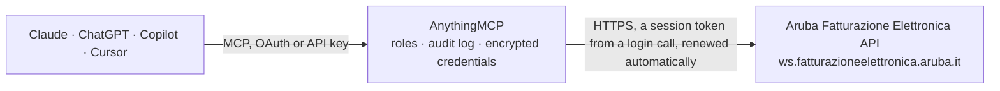

<!-- Generated by scripts/export-github-catalog.mjs in the anythingmcp-website repository. Do not edit by hand. -->

# Aruba Fatturazione Elettronica MCP connector

Aruba Fatturazione Elettronica: send and track Italian e-invoices through the Sistema di Interscambio, read received invoices and their SDI notifications. The AnythingMCP connector gives Claude, ChatGPT, Microsoft Copilot, Cursor and Gemini 6 MCP tools for Aruba Fatturazione Elettronica, all read-only.

**Category:** [Accounting](../accounting.md) · **Tools:** 6 · **Setup guide:** [anythingmcp.com](https://anythingmcp.com/guides/aruba-fatturazione-to-mcp) · [Deutsch](https://anythingmcp.com/de/guides/aruba-fatturazione-to-mcp) · [Italiano](https://anythingmcp.com/it/guides/aruba-fatturazione-to-mcp) · [Español](https://anythingmcp.com/es/guides/aruba-fatturazione-to-mcp) · [日本語](https://anythingmcp.com/ja/guides/aruba-fatturazione-to-mcp) · [Русский](https://anythingmcp.com/ru/guides/aruba-fatturazione-to-mcp) · [中文](https://anythingmcp.com/zh/guides/aruba-fatturazione-to-mcp)

## Start without code

No installation and no terminal: AnythingMCP Cloud runs the Aruba Fatturazione Elettronica connector for you, operated by helpcode.ai in Frankfurt, Germany.

1. **Click the button above** and create an account or sign in. The Aruba Fatturazione Elettronica connector opens, ready to install.
2. **Paste the API key or token from your Aruba Fatturazione Elettronica account.** Every click is in the [step-by-step guide](https://anythingmcp.com/guides/aruba-fatturazione-to-mcp).
3. **Click Install.** AnythingMCP shows the address of your MCP server.
4. **Add that address to your assistant:** [Claude](https://anythingmcp.com/guides/connect-aruba-fatturazione-to-claude) · [ChatGPT](https://anythingmcp.com/guides/connect-aruba-fatturazione-to-chatgpt) · [Microsoft Copilot](https://anythingmcp.com/guides/connect-aruba-fatturazione-to-copilot) · [Cursor](https://anythingmcp.com/guides/connect-aruba-fatturazione-to-cursor) · [Gemini CLI](https://anythingmcp.com/guides/connect-aruba-fatturazione-to-gemini) · [Meta Muse](https://anythingmcp.com/guides/connect-aruba-fatturazione-to-muse).
5. **Ask your first question**, for example: *Do we have invoice INV-2026-058 to Studio Rossi S.r.l. in SDI and what's its current state?*

Prefer help with the setup? [Talk to us](https://anythingmcp.com/contact).

## How it works

- **The AI client** speaks MCP (Streamable HTTP) to AnythingMCP and only sees tool names, descriptions and results. It never gets the Aruba Fatturazione Elettronica credentials.
- **AnythingMCP** checks the client's role, builds the call from the tool definition, adds the credentials (a session token from a login call, renewed automatically), calls Aruba Fatturazione Elettronica, logs the call and returns the result.
- **Aruba Fatturazione Elettronica** sees an ordinary API client with the rights of the account the credentials belong to.

## Tools

| Tool | What it does | Access |
|---|---|---|
| [`aruba_fatturazione_list_sent_invoices`](#aruba_fatturazione_list_sent_invoices) | List invoices sent through the Sistema di Interscambio in a creation-date range, with sender, recipient, number, date, file name, SDI id and current state. | read |
| [`aruba_fatturazione_get_invoice_status`](#aruba_fatturazione_get_invoice_status) | Read where one sent invoice currently stands: its state (Presa in carico, Inviata, Scartata, Non consegnata, Recapito impossibile, Consegnata, Accettata,… | read |
| [`aruba_fatturazione_get_sent_invoice`](#aruba_fatturazione_get_sent_invoice) | Fetch one sent invoice with its file as base64-encoded FatturaPA XML (`file`), the legally binding artefact, plus its state and file name. | read |
| [`aruba_fatturazione_list_received_invoices`](#aruba_fatturazione_list_received_invoices) | List invoices received from suppliers through the SDI in a creation-date range, with sender, number, date, file name and SDI id. | read |
| [`aruba_fatturazione_get_received_invoice`](#aruba_fatturazione_get_received_invoice) | Fetch one received supplier invoice with its file as base64-encoded FatturaPA XML (`file`), for archiving or for feeding into bookkeeping. | read |
| [`aruba_fatturazione_list_notifications`](#aruba_fatturazione_list_notifications) | List the SDI notifications of one sent invoice (RC delivered, NS rejected, MC not delivered, AT undeliverable, NE customer outcome, DT terms elapsed), each… | read |

## Tool reference

Every parameter as the AI client sees it in `tools/list`. Source: [`packages/backend/src/adapters/it/aruba-fatturazione.json`](../../../packages/backend/src/adapters/it/aruba-fatturazione.json).

### `aruba_fatturazione_list_sent_invoices`

List invoices sent through the Sistema di Interscambio in a creation-date range, with sender, recipient, number, date, file name, SDI id and current state. The list carries no file content; read one invoice with aruba_fatturazione_get_sent_invoice.

**Access:** read · **Call:** `GET /invoice/out/findByUsername`

| Parameter | Type | Required | Description |
|---|---|---|---|
| `startDate` | string | no | Creation date from, ISO 8601, e.g. 2026-09-01T00:00:00Z. |
| `endDate` | string | no | Creation date to, ISO 8601, e.g. 2026-09-30T23:59:59Z. |
| `page` | number | no | Page number, starting at 1 (default 1). |
| `size` | number | no | Rows per page, 1-100 (default 10). |
| `countrySender` | string | no | Seller country code, e.g. IT. Required on Premium (multi-company) accounts. |
| `vatcodeSender` | string | no | Seller VAT number (partita IVA). Required on Premium (multi-company) accounts. |
| `vatcodeReceiver` | string | no | Restrict to one customer's VAT number. |

### `aruba_fatturazione_get_invoice_status`

Read where one sent invoice currently stands: its state (Presa in carico, Inviata, Scartata, Non consegnata, Recapito impossibile, Consegnata, Accettata, Rifiutata, Decorrenza termini) and, for Errore elaborazione, the reason. Scartata means it was rejected and has not legally been issued. The SDI notifications themselves come from aruba_fatturazione_list_notifications.

**Access:** read · **Call:** `GET /invoice/out/getByIdSdi`

| Parameter | Type | Required | Description |
|---|---|---|---|
| `idSdi` | string | yes | SDI identifier of the document, returned when it was sent. |

### `aruba_fatturazione_get_sent_invoice`

Fetch one sent invoice with its file as base64-encoded FatturaPA XML (`file`), the legally binding artefact, plus its state and file name. Set includePdf for a PDF rendering in `pdfFile`.

**Access:** read · **Call:** `GET /invoice/out/getByIdSdi`

| Parameter | Type | Required | Description |
|---|---|---|---|
| `idSdi` | string | yes | SDI identifier of the document. |
| `includePdf` | boolean | no | When true, also return a PDF rendering in pdfFile. |

### `aruba_fatturazione_list_received_invoices`

List invoices received from suppliers through the SDI in a creation-date range, with sender, number, date, file name and SDI id. The list carries no file content; read one invoice with aruba_fatturazione_get_received_invoice.

**Access:** read · **Call:** `GET /invoice/in/findByUsername`

| Parameter | Type | Required | Description |
|---|---|---|---|
| `startDate` | string | no | Creation date from, ISO 8601, e.g. 2026-09-01T00:00:00Z. |
| `endDate` | string | no | Creation date to, ISO 8601, e.g. 2026-09-30T23:59:59Z. |
| `page` | number | no | Page number, starting at 1 (default 1). |
| `size` | number | no | Rows per page, 1-100 (default 10). |
| `countryReceiver` | string | no | Your company's country code, e.g. IT. Required on Premium (multi-company) accounts. |
| `vatcodeReceiver` | string | no | Your company's VAT number (partita IVA). Required on Premium (multi-company) accounts. |
| `vatcodeSender` | string | no | Restrict to one supplier's VAT number. |

### `aruba_fatturazione_get_received_invoice`

Fetch one received supplier invoice with its file as base64-encoded FatturaPA XML (`file`), for archiving or for feeding into bookkeeping. Set includePdf for a PDF rendering in `pdfFile`.

**Access:** read · **Call:** `GET /invoice/in/getByIdSdi`

| Parameter | Type | Required | Description |
|---|---|---|---|
| `idSdi` | string | yes | SDI identifier of the received document. |
| `includePdf` | boolean | no | When true, also return a PDF rendering in pdfFile. |

### `aruba_fatturazione_list_notifications`

List the SDI notifications of one sent invoice (RC delivered, NS rejected, MC not delivered, AT undeliverable, NE customer outcome, DT terms elapsed), each with its date, file name and base64 content. Looked up by the invoice's file name, not its SDI id.

**Access:** read · **Call:** `GET /notification/out/getByInvoiceFilename`

| Parameter | Type | Required | Description |
|---|---|---|---|
| `invoiceFilename` | string | yes | File name of the sent invoice as returned by the list/get tools, e.g. IT01879020517_abcde.xml.p7m. |

## Run it yourself

AnythingMCP is open source (AGPL-3.0). [Run it with Docker](../../../README.md#run-it-yourself), open **Connectors → Store**, pick **Aruba Fatturazione Elettronica** and enter `ARUBA_USERNAME`, `ARUBA_PASSWORD`, then add your MCP server URL to the AI client.

[← Accounting connectors](../accounting.md) · [All categories](../README.md)
