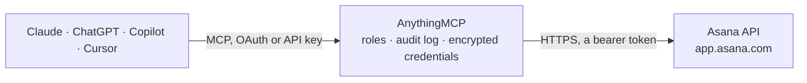

<!-- Generated by scripts/export-github-catalog.mjs in the anythingmcp-website repository. Do not edit by hand. -->

# Asana MCP connector

Asana work management: browse workspaces, projects, sections and tasks, read task comments, search tasks, and create, update or comment on tasks through the REST API. The AnythingMCP connector gives Claude, ChatGPT, Microsoft Copilot, Cursor and Gemini 12 MCP tools for Asana: 9 read and 3 can change data.

**Category:** [Project Management](../project-management.md) · **Tools:** 12 · **Setup guide:** [anythingmcp.com](https://anythingmcp.com/guides/asana-to-mcp) · [Deutsch](https://anythingmcp.com/de/guides/asana-to-mcp) · [Italiano](https://anythingmcp.com/it/guides/asana-to-mcp) · [Español](https://anythingmcp.com/es/guides/asana-to-mcp) · [日本語](https://anythingmcp.com/ja/guides/asana-to-mcp) · [Русский](https://anythingmcp.com/ru/guides/asana-to-mcp) · [中文](https://anythingmcp.com/zh/guides/asana-to-mcp)

## Start without code

No installation and no terminal: AnythingMCP Cloud runs the Asana connector for you, operated by helpcode.ai in Frankfurt, Germany.

1. **Click the button above** and create an account or sign in. The Asana connector opens, ready to install.
2. **Paste the API key or token from your Asana account.** Every click is in the [step-by-step guide](https://anythingmcp.com/guides/asana-to-mcp).
3. **Click Install.** AnythingMCP shows the address of your MCP server.
4. **Add that address to your assistant:** [Claude](https://anythingmcp.com/guides/connect-asana-to-claude) · [ChatGPT](https://anythingmcp.com/guides/connect-asana-to-chatgpt) · [Microsoft Copilot](https://anythingmcp.com/guides/connect-asana-to-copilot) · [Cursor](https://anythingmcp.com/guides/connect-asana-to-cursor) · [Gemini CLI](https://anythingmcp.com/guides/connect-asana-to-gemini) · [Meta Muse](https://anythingmcp.com/guides/connect-asana-to-muse).
5. **Ask your first question**, for example: *Is the invoice task for customer Vireo Solar, invoice INV-2026-042, completed and who is the assignee?*

Prefer help with the setup? [Talk to us](https://anythingmcp.com/contact).

## How it works

- **The AI client** speaks MCP (Streamable HTTP) to AnythingMCP and only sees tool names, descriptions and results. It never gets the Asana credentials.
- **AnythingMCP** checks the client's role, builds the call from the tool definition, adds the credentials (a bearer token), calls Asana, logs the call and returns the result.
- **Asana** sees an ordinary API client with the rights of the account the credentials belong to.

## Tools

| Tool | What it does | Access |
|---|---|---|
| [`asana_get_me`](#asana_get_me) | Get the Asana user behind the access token: gid, name, email and the workspaces it belongs to. | read |
| [`asana_list_workspaces`](#asana_list_workspaces) | List the Asana workspaces and organizations visible to the token's user, with their gids. | read |
| [`asana_list_projects`](#asana_list_projects) | List projects in one Asana workspace, optionally only archived or only active ones. | read |
| [`asana_get_project`](#asana_get_project) | Get one Asana project by gid: description, owner, team, members, dates, latest status update and custom field settings. | read |
| [`asana_list_tasks`](#asana_list_tasks) | List Asana tasks of one project, one section, or one assignee in a workspace. | read |
| [`asana_get_task`](#asana_get_task) | Get one Asana task by gid with its description, assignee, dates, projects and sections, parent, tags, custom field values, followers and subtask count. | read |
| [`asana_search_tasks`](#asana_search_tasks) | Search tasks across an Asana workspace by text, assignee, project, due date, completion and modification time. | read |
| [`asana_list_sections`](#asana_list_sections) | List the sections (list headers or board columns) of an Asana project with their gids, for filtering asana_list_tasks by section. | read |
| [`asana_list_task_stories`](#asana_list_task_stories) | List the comments and activity (stories) of an Asana task. | read |
| [`asana_create_task`](#asana_create_task) | Create a new Asana task. | write |
| [`asana_update_task`](#asana_update_task) | Update an Asana task: rename it, change its description, mark it complete or incomplete, reassign it or move its dates. | write |
| [`asana_add_comment`](#asana_add_comment) | Post a comment on an Asana task as the token's user. | write |

## Tool reference

Every parameter as the AI client sees it in `tools/list`. Source: [`packages/backend/src/adapters/intl/asana.json`](../../../packages/backend/src/adapters/intl/asana.json).

### `asana_get_me`

Get the Asana user behind the access token: gid, name, email and the workspaces it belongs to. Call this first to confirm the connection and pick a workspace gid.

**Access:** read · **Call:** `GET /users/me`

| Parameter | Type | Required | Description |
|---|---|---|---|
| `opt_fields` | string | no | Comma-separated fields to return. Default: name,email,workspaces.name. |

### `asana_list_workspaces`

List the Asana workspaces and organizations visible to the token's user, with their gids. Most other tools need a workspace gid from here.

**Access:** read · **Call:** `GET /workspaces`

| Parameter | Type | Required | Description |
|---|---|---|---|
| `limit` | integer | no | Results per page, 1 to 100. Default 50. |
| `offset` | string | no | Page token: next_page.offset from the previous response. Omit for the first page. |
| `opt_fields` | string | no | Comma-separated fields to return. Default: name,is_organization. |

### `asana_list_projects`

List projects in one Asana workspace, optionally only archived or only active ones. Returns project gids for asana_list_tasks and asana_list_sections. Page with offset = next_page.offset until next_page is null.

**Access:** read · **Call:** `GET /projects`

| Parameter | Type | Required | Description |
|---|---|---|---|
| `workspace` | string | yes | Workspace gid from asana_list_workspaces or asana_get_me. |
| `archived` | boolean | no | true for archived projects only, false for active projects only. Omit for both. |
| `limit` | integer | no | Results per page, 1 to 100. Default 50. |
| `offset` | string | no | Page token: next_page.offset from the previous response. Omit for the first page. |
| `opt_fields` | string | no | Comma-separated fields to return. Default: name,archived,owner,team.name,start_on,due_on,modified_at,permalink_url. |

### `asana_get_project`

Get one Asana project by gid: description, owner, team, members, dates, latest status update and custom field settings.

**Access:** read · **Call:** `GET /projects/{project_gid}`

| Parameter | Type | Required | Description |
|---|---|---|---|
| `project_gid` | string | yes | Project gid from asana_list_projects, e.g. 1204567890123456. |
| `opt_fields` | string | no | Comma-separated fields to return. The default covers description, owner, team, members, dates, status update title and custom field names. |

### `asana_list_tasks`

List Asana tasks of one project, one section, or one assignee in a workspace. Give project, or section, or assignee together with workspace. Use completed_since=now for open tasks only. Page with offset = next_page.offset until next_page is null.

**Access:** read · **Call:** `GET /tasks`

| Parameter | Type | Required | Description |
|---|---|---|---|
| `project` | string | no | Project gid. Lists the project's tasks. |
| `section` | string | no | Section gid from asana_list_sections. Lists the tasks in that section. |
| `assignee` | string | no | User gid, email or me. Requires workspace. |
| `workspace` | string | no | Workspace gid. Only valid together with assignee. |
| `completed_since` | string | no | Only tasks that are incomplete or were completed after this ISO 8601 time; now returns open tasks only. |
| `modified_since` | string | no | Only tasks modified after this ISO 8601 time, e.g. 2026-10-01T00:00:00Z. |
| `limit` | integer | no | Results per page, 1 to 100. Default 50. |
| `offset` | string | no | Page token: next_page.offset from the previous response. Omit for the first page. |
| `opt_fields` | string | no | Comma-separated fields to return. Default: name,completed,assignee.name,due_on,due_at,modified_at,memberships.section.name,permalink_url. |

### `asana_get_task`

Get one Asana task by gid with its description, assignee, dates, projects and sections, parent, tags, custom field values, followers and subtask count.

**Access:** read · **Call:** `GET /tasks/{task_gid}`

| Parameter | Type | Required | Description |
|---|---|---|---|
| `task_gid` | string | yes | Task gid, e.g. 1204567890123456. |
| `opt_fields` | string | no | Comma-separated fields to return. The default covers the task's description, people, dates, placement, tags and custom field values. |

### `asana_search_tasks`

Search tasks across an Asana workspace by text, assignee, project, due date, completion and modification time. Premium only: non-premium users get HTTP 402, then use asana_list_tasks. There is no next_page; sort by created_at and narrow with created_after to see more.

**Access:** read · **Call:** `GET /workspaces/{workspace_gid}/tasks/search`

| Parameter | Type | Required | Description |
|---|---|---|---|
| `workspace_gid` | string | yes | Workspace gid to search in. |
| `text` | string | no | Full-text match on task name and description. |
| `assignee_any` | string | no | Comma-separated user gids, emails or me. |
| `projects_any` | string | no | Comma-separated project gids. |
| `completed` | boolean | no | true for completed tasks only, false for incomplete tasks only. |
| `due_on_before` | string | no | Due before this date, YYYY-MM-DD. |
| `due_on_after` | string | no | Due after this date, YYYY-MM-DD. |
| `created_after` | string | no | Created after this ISO 8601 time; use with sort_by=created_at to page through results. |
| `modified_after` | string | no | Modified after this ISO 8601 time. |
| `is_subtask` | boolean | no | true for subtasks only, false to exclude subtasks. |
| `sort_by` | `due_date` \| `created_at` \| `completed_at` \| `likes` \| `relevance` \| `modified_at` | no | Sort order; Asana's default is modified_at. |
| `sort_ascending` | boolean | no | true for ascending order. Default false. |
| `limit` | integer | no | Results to return, 1 to 100. Default 50. |
| `opt_fields` | string | no | Comma-separated fields to return. Default: name,completed,assignee.name,due_on,projects.name,created_at,modified_at,permalink_url. |

### `asana_list_sections`

List the sections (list headers or board columns) of an Asana project with their gids, for filtering asana_list_tasks by section.

**Access:** read · **Call:** `GET /projects/{project_gid}/sections`

| Parameter | Type | Required | Description |
|---|---|---|---|
| `project_gid` | string | yes | Project gid from asana_list_projects. |
| `limit` | integer | no | Results per page, 1 to 100. Default 50. |
| `offset` | string | no | Page token: next_page.offset from the previous response. Omit for the first page. |
| `opt_fields` | string | no | Comma-separated fields to return. Default: name,created_at. |

### `asana_list_task_stories`

List the comments and activity (stories) of an Asana task. Set resource_subtype=comment_added to skip assignment and date-change activity, and sort_ascending=false with a small limit to read only the latest ones.

**Access:** read · **Call:** `GET /tasks/{task_gid}/stories`

| Parameter | Type | Required | Description |
|---|---|---|---|
| `task_gid` | string | yes | Task gid. |
| `resource_subtype` | `comment_added` | no | comment_added returns comments only. Omit for the full activity feed. |
| `sort_ascending` | boolean | no | true (Asana default) is oldest first, false is newest first. |
| `limit` | integer | no | Results per page, 1 to 100. Default 50. |
| `offset` | string | no | Page token: next_page.offset from the previous response. Omit for the first page. |
| `opt_fields` | string | no | Comma-separated fields to return. Default: created_at,created_by.name,resource_subtype,text. |

### `asana_create_task`

Create a new Asana task. Writes real data visible to the team: show the user the name, project, assignee and due date and get confirmation first. Give projects or workspace. Each call creates another task, so never retry a successful call.

**Access:** write · **Call:** `POST /tasks`

| Parameter | Type | Required | Description |
|---|---|---|---|
| `name` | string | yes | Task name, a short line. |
| `notes` | string | no | Plain-text description. |
| `projects` | string[] | no | Project gids to add the task to, e.g. ["1204567890123456"]. |
| `workspace` | string | no | Workspace gid; needed only when no projects or parent are given. |
| `parent` | string | no | Parent task gid to create a subtask. |
| `assignee` | string | no | User gid, email or me. |
| `due_on` | string | no | Due date, YYYY-MM-DD. Do not combine with due_at. |
| `due_at` | string | no | Due time, ISO 8601 UTC, e.g. 2026-10-20T15:00:00Z. Do not combine with due_on. |
| `start_on` | string | no | Start date, YYYY-MM-DD; needs due_on or due_at. |
| `opt_fields` | string | no | Comma-separated fields to return for the new task. |

### `asana_update_task`

Update an Asana task: rename it, change its description, mark it complete or incomplete, reassign it or move its dates. Only the fields you pass change. Changes real data: confirm the change with the user first.

**Access:** write · **Call:** `PUT /tasks/{task_gid}`

| Parameter | Type | Required | Description |
|---|---|---|---|
| `task_gid` | string | yes | Task gid to update. |
| `name` | string | no | New task name. |
| `notes` | string | no | New plain-text description; replaces the existing one. |
| `completed` | boolean | no | true to mark complete, false to reopen. |
| `assignee` | string | no | New assignee: user gid, email or me. |
| `due_on` | string | no | New due date, YYYY-MM-DD. Do not combine with due_at. |
| `due_at` | string | no | New due time, ISO 8601 UTC. Do not combine with due_on. |
| `start_on` | string | no | New start date, YYYY-MM-DD. |
| `opt_fields` | string | no | Comma-separated fields to return for the updated task. |

### `asana_add_comment`

Post a comment on an Asana task as the token's user. Followers are notified, so show the user the exact text and get confirmation first. Each call posts another comment.

**Access:** write · **Call:** `POST /tasks/{task_gid}/stories`

| Parameter | Type | Required | Description |
|---|---|---|---|
| `task_gid` | string | yes | Task gid to comment on. |
| `text` | string | yes | Plain-text comment. |
| `opt_fields` | string | no | Comma-separated fields to return for the new comment. |

## Run it yourself

AnythingMCP is open source (AGPL-3.0). [Run it with Docker](../../../README.md#run-it-yourself), open **Connectors → Store**, pick **Asana** and enter `ASANA_ACCESS_TOKEN`, then add your MCP server URL to the AI client.

[← Project Management connectors](../project-management.md) · [All categories](../README.md)
