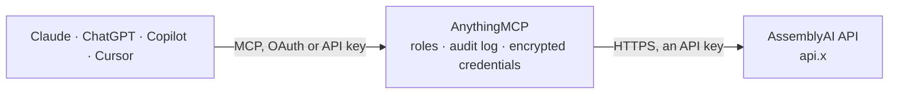

<!-- Generated by scripts/export-github-catalog.mjs in the anythingmcp-website repository. Do not edit by hand. -->

# AssemblyAI MCP connector

Speech to text with AssemblyAI: transcribe audio and video files from a link with speaker labels, language detection, PII redaction, summaries, chapters, entities and sentiment, read transcripts as … The AnythingMCP connector gives Claude, ChatGPT, Microsoft Copilot, Cursor and Gemini 13 MCP tools for AssemblyAI: 9 read and 4 can change data.

**Category:** [Public Data](../data.md) · **Tools:** 13 · **Setup guide:** [anythingmcp.com](https://anythingmcp.com/guides/assemblyai-to-mcp) · [Deutsch](https://anythingmcp.com/de/guides/assemblyai-to-mcp) · [Italiano](https://anythingmcp.com/it/guides/assemblyai-to-mcp) · [Español](https://anythingmcp.com/es/guides/assemblyai-to-mcp) · [日本語](https://anythingmcp.com/ja/guides/assemblyai-to-mcp) · [Русский](https://anythingmcp.com/ru/guides/assemblyai-to-mcp) · [中文](https://anythingmcp.com/zh/guides/assemblyai-to-mcp)

## Start without code

No installation and no terminal: AnythingMCP Cloud runs the AssemblyAI connector for you, operated by helpcode.ai in Frankfurt, Germany.

1. **Click the button above** and create an account or sign in. The AssemblyAI connector opens, ready to install.
2. **Paste the API key or token from your AssemblyAI account.** Every click is in the [step-by-step guide](https://anythingmcp.com/guides/assemblyai-to-mcp).
3. **Click Install.** AnythingMCP shows the address of your MCP server.
4. **Add that address to your assistant:** [Claude](https://anythingmcp.com/guides/connect-assemblyai-to-claude) · [ChatGPT](https://anythingmcp.com/guides/connect-assemblyai-to-chatgpt) · [Microsoft Copilot](https://anythingmcp.com/guides/connect-assemblyai-to-copilot) · [Cursor](https://anythingmcp.com/guides/connect-assemblyai-to-cursor) · [Gemini CLI](https://anythingmcp.com/guides/connect-assemblyai-to-gemini) · [Meta Muse](https://anythingmcp.com/guides/connect-assemblyai-to-muse).
5. **Ask your first question**, for example: *Show the transcript for the customer call about billing from audio URL containing nordic-solar-2026-03.mp3*

Prefer help with the setup? [Talk to us](https://anythingmcp.com/contact).

## How it works

- **The AI client** speaks MCP (Streamable HTTP) to AnythingMCP and only sees tool names, descriptions and results. It never gets the AssemblyAI credentials.
- **AnythingMCP** checks the client's role, builds the call from the tool definition, adds the credentials (an API key), calls AssemblyAI, logs the call and returns the result.
- **AssemblyAI** sees an ordinary API client with the rights of the account the credentials belong to.

## Tools

| Tool | What it does | Access |
|---|---|---|
| [`assemblyai_list_transcripts`](#assemblyai_list_transcripts) | List the transcripts of the account, newest first, with id, status (queued, processing, completed, error), creation and completion time and audio URL. | read |
| [`assemblyai_get_transcript`](#assemblyai_get_transcript) | Get a transcript by id: status (queued, processing, completed or error with the error text), the full text, utterances by speaker, detected language, audio… | read |
| [`assemblyai_get_sentences`](#assemblyai_get_sentences) | The completed transcript split into sentences, each with text, start and end in milliseconds, confidence and speaker. | read |
| [`assemblyai_get_paragraphs`](#assemblyai_get_paragraphs) | The completed transcript split into paragraphs, each with text, start and end in milliseconds and confidence. | read |
| [`assemblyai_get_subtitles`](#assemblyai_get_subtitles) | Export a completed transcript as subtitles in SRT or WebVTT format (plain text, ready to save as .srt or .vtt). | read |
| [`assemblyai_search_words`](#assemblyai_search_words) | Find where words or phrases are said in a completed transcript: per word, the number of matches and their timestamps in milliseconds. | read |
| [`assemblyai_get_redacted_audio`](#assemblyai_get_redacted_audio) | Get the link to the copy of the audio with personal data beeped out, for a transcript submitted with redact_pii_audio. | read |
| [`assemblyai_list_llm_models`](#assemblyai_list_llm_models) | List the language models of AssemblyAI's LLM Gateway (Claude, GPT, Gemini and open models) with id, context length, price per million input (prompt) and… | read |
| [`assemblyai_create_streaming_token`](#assemblyai_create_streaming_token) | Create a temporary token for AssemblyAI real-time streaming transcription (Universal-Streaming WebSocket), to hand to a browser or device so it can stream… | read |
| [`assemblyai_submit_transcript`](#assemblyai_submit_transcript) | Start transcribing an audio or video file from a public URL with AssemblyAI, optionally with speaker labels, language detection, PII redaction, summaries,… | write |
| [`assemblyai_understand_transcript`](#assemblyai_understand_transcript) | Run a Speech Understanding task on a completed transcript without transcribing again: translation into other languages, speaker identification (replace… | write |
| [`assemblyai_ask_transcript`](#assemblyai_ask_transcript) | Ask a language model about a transcript through AssemblyAI's LLM Gateway (the successor of LeMUR): summaries, action items, answers to questions, extraction. | write |
| [`assemblyai_delete_transcript`](#assemblyai_delete_transcript) | Remove a transcript's text and data permanently; the record stays, marked as deleted. | write |

## Tool reference

Every parameter as the AI client sees it in `tools/list`. Source: [`packages/backend/src/adapters/intl/assemblyai.json`](../../../packages/backend/src/adapters/intl/assemblyai.json).

### `assemblyai_list_transcripts`

List the transcripts of the account, newest first, with id, status (queued, processing, completed, error), creation and completion time and audio URL. For older transcripts call again with before_id = the id of the last transcript of the page (page_details.prev_url points to the same page). Free.

**Access:** read · **Call:** `GET /v2/transcript`

| Parameter | Type | Required | Description |
|---|---|---|---|
| `limit` | integer | no | Transcripts per page, 1 to 200 (default 20 here). |
| `status` | `queued` \| `processing` \| `completed` \| `error` | no | Only transcripts with this status. |
| `created_on` | string | no | Only transcripts created on this day, YYYY-MM-DD. |
| `before_id` | string | no | Transcripts created before this transcript id (next page). |
| `after_id` | string | no | Transcripts created after this transcript id. |
| `throttled_only` | boolean | no | Only throttled transcripts (overrides status). |

### `assemblyai_get_transcript`

Get a transcript by id: status (queued, processing, completed or error with the error text), the full text, utterances by speaker, detected language, audio duration in seconds, confidence and the results of every feature requested (summary, chapters, entities, sentiment, highlights, content safety, translations). Word-level timestamps are left out to keep it readable; use assemblyai_get_sentences or assemblyai_get_paragraphs for timed segments. Poll every few seconds until completed. Free.

**Access:** read · **Call:** `GET /v2/transcript/{transcript_id}`

| Parameter | Type | Required | Description |
|---|---|---|---|
| `transcript_id` | string | yes | Transcript id from assemblyai_submit_transcript or assemblyai_list_transcripts. |

### `assemblyai_get_sentences`

The completed transcript split into sentences, each with text, start and end in milliseconds, confidence and speaker. Free.

**Access:** read · **Call:** `GET /v2/transcript/{transcript_id}/sentences`

| Parameter | Type | Required | Description |
|---|---|---|---|
| `transcript_id` | string | yes | Transcript id from assemblyai_submit_transcript or assemblyai_list_transcripts. |

### `assemblyai_get_paragraphs`

The completed transcript split into paragraphs, each with text, start and end in milliseconds and confidence. Free.

**Access:** read · **Call:** `GET /v2/transcript/{transcript_id}/paragraphs`

| Parameter | Type | Required | Description |
|---|---|---|---|
| `transcript_id` | string | yes | Transcript id from assemblyai_submit_transcript or assemblyai_list_transcripts. |

### `assemblyai_get_subtitles`

Export a completed transcript as subtitles in SRT or WebVTT format (plain text, ready to save as .srt or .vtt). Free.

**Access:** read · **Call:** `GET /v2/transcript/{transcript_id}/{subtitle_format}`

| Parameter | Type | Required | Description |
|---|---|---|---|
| `transcript_id` | string | yes | Transcript id from assemblyai_submit_transcript or assemblyai_list_transcripts. |
| `subtitle_format` | `srt` \| `vtt` | yes | srt or vtt. |
| `chars_per_caption` | integer | no | Maximum characters per caption, e.g. 32 or 42. |

### `assemblyai_search_words`

Find where words or phrases are said in a completed transcript: per word, the number of matches and their timestamps in milliseconds. Free.

**Access:** read · **Call:** `GET /v2/transcript/{transcript_id}/word-search`

| Parameter | Type | Required | Description |
|---|---|---|---|
| `transcript_id` | string | yes | Transcript id from assemblyai_submit_transcript or assemblyai_list_transcripts. |
| `words` | string | yes | Comma-separated words or phrases (up to 5 words each), e.g. "budget,next quarter". |

### `assemblyai_get_redacted_audio`

Get the link to the copy of the audio with personal data beeped out, for a transcript submitted with redact_pii_audio. status is redacted_audio_ready when the redacted_audio_url can be downloaded. Free.

**Access:** read · **Call:** `GET /v2/transcript/{transcript_id}/redacted-audio`

| Parameter | Type | Required | Description |
|---|---|---|---|
| `transcript_id` | string | yes | Transcript id from assemblyai_submit_transcript or assemblyai_list_transcripts. |

### `assemblyai_list_llm_models`

List the language models of AssemblyAI's LLM Gateway (Claude, GPT, Gemini and open models) with id, context length, price per million input (prompt) and output (completions) tokens in USD and the regions (us, eu) where each is available. Use an id with assemblyai_ask_transcript. Free.

**Access:** read · **Call:** `GET https://llm-gateway.{{ASSEMBLYAI_DOMAIN}}/v1/models`

No parameters.

### `assemblyai_create_streaming_token`

Create a temporary token for AssemblyAI real-time streaming transcription (Universal-Streaming WebSocket), to hand to a browser or device so it can stream audio without the API key. Creating the token is free; the streaming session is billed by the time the connection stays open.

**Access:** read · **Call:** `GET https://streaming.{{ASSEMBLYAI_DOMAIN}}/v3/token`

| Parameter | Type | Required | Description |
|---|---|---|---|
| `expires_in_seconds` | integer | yes | How long the token can be used to open a connection, 1 to 600 seconds. |
| `max_session_duration_seconds` | integer | no | Maximum length of the session, 60 to 10800 seconds (default 10800). |

### `assemblyai_submit_transcript`

Start transcribing an audio or video file from a public URL with AssemblyAI, optionally with speaker labels, language detection, PII redaction, summaries, chapters, entities, sentiment and translation. Returns the transcript id with status queued; poll assemblyai_get_transcript until completed (usually a fraction of the audio length). COSTS MONEY per hour of audio, pro-rated to the second: Universal-3.5 Pro $0.21/h, Universal-2 $0.15/h, plus add-ons (speaker labels $0.02/h, keyterms or prompt $0.05/h, medical $0.15/h, understanding features extra). New accounts get $50 of free credit. Tell the user the cost for long files.

**Access:** write · **Call:** `POST /v2/transcript`

| Parameter | Type | Required | Description |
|---|---|---|---|
| `audio_url` | string | yes | Public https link to the audio or video file (mp3, wav, m4a, mp4, webm ...; up to 2.2 GB and 10 hours). Links to web pages such as YouTube do not work. |
| `speech_models` | `universal-3-5-pro` \| `universal-2`[] | no | Models in order of preference, default ["universal-3-5-pro", "universal-2"]: Universal-3.5 Pro ($0.21/h, 18 languages) falls back to Universal-2 ($0.15/h, 99 languages) for other languages. |
| `language_code` | string | no | Language of the audio, e.g. en, en_us, de, fr, es, it. Leave empty with language_detection true to detect it. |
| `language_detection` | boolean | no | Detect the language automatically. |
| `speaker_labels` | boolean | no | Tell speakers apart (diarization, +$0.02/h): fills utterances with speaker A, B, ... |
| `speakers_expected` | integer | no | Expected number of speakers, with speaker_labels. |
| `multichannel` | boolean | no | Transcribe each audio channel separately (each channel is billed). |
| `keyterms_prompt` | string[] | no | Names and terms to recognise correctly, e.g. ["AnythingMCP", "Kubernetes"] (up to 1,000 with Universal-3.5 Pro, +$0.05/h). |
| `prompt` | string | no | Plain-language description of the audio (domain, speakers, context) to improve accuracy, Universal-3.5 Pro only (+$0.05/h). |
| `punctuate` | boolean | no | Add punctuation, default true. |
| `format_text` | boolean | no | Format text (casing, numbers), default true. |
| `disfluencies` | boolean | no | Keep filler words such as "um" and "uh". |
| `filter_profanity` | boolean | no | Replace profanity with asterisks. |
| `redact_pii` | boolean | no | Redact personal data in the text; set redact_pii_policies too. |
| `redact_pii_policies` | string[] | no | Kinds of personal data to redact, e.g. ["person_name", "phone_number", "email_address", "credit_card_number", "date_of_birth", "location"]. |
| `redact_pii_sub` | `entity_name` \| `hash` | no | Replace redacted data with its kind, e.g. [PERSON_NAME] (entity_name), or with #### (hash, default). |
| `redact_pii_audio` | boolean | no | Also create a copy of the audio with personal data beeped out (assemblyai_get_redacted_audio). |
| `summarization` | boolean | no | Add a summary (summary_model and summary_type). |
| `summary_model` | `informative` \| `conversational` \| `catchy` | no | Summary style. |
| `summary_type` | `bullets` \| `bullets_verbose` \| `gist` \| `headline` \| `paragraph` | no | Summary format. |
| `auto_chapters` | boolean | no | Split into chapters with summaries (not together with summarization). |
| `auto_highlights` | boolean | no | Extract key phrases. |
| `entity_detection` | boolean | no | Detect names, organisations, locations, dates and more. |
| `sentiment_analysis` | boolean | no | Sentiment per sentence. |
| `iab_categories` | boolean | no | Topic detection with IAB categories. |
| `content_safety` | boolean | no | Flag sensitive content (violence, hate speech ...). |
| `speech_understanding` | object | no | Run Speech Understanding during transcription, e.g. {"request": {"translation": {"target_languages": ["de", "es"]}}} or {"request": {"speaker_identification": {"speaker_type": "name", "known_values": ["Anna", "Ben"]}}}. Billed separately. |
| `audio_start_from` | integer | no | Start transcribing at this point, in milliseconds. |
| `audio_end_at` | integer | no | Stop transcribing at this point, in milliseconds. |
| `domain` | `medical-v1` | no | medical-v1 for Medical Mode (+$0.15/h). |
| `webhook_url` | string | no | Optional URL AssemblyAI calls when the transcript is completed or failed. |

### `assemblyai_understand_transcript`

Run a Speech Understanding task on a completed transcript without transcribing again: translation into other languages, speaker identification (replace speaker A/B with names or roles), custom formatting, or summarization. Returns the transcript with the added results. COSTS MONEY (billed per task by AssemblyAI).

**Access:** write · **Call:** `POST https://llm-gateway.{{ASSEMBLYAI_DOMAIN}}/v1/understanding`

| Parameter | Type | Required | Description |
|---|---|---|---|
| `transcript_id` | string | yes | Transcript id from assemblyai_submit_transcript or assemblyai_list_transcripts. |
| `speech_understanding` | object | yes | The task, e.g. {"request": {"translation": {"target_languages": ["de", "es"], "formal": true}}}, {"request": {"speaker_identification": {"speaker_type": "role", "known_values": ["interviewer", "candidate"]}}}. |

### `assemblyai_ask_transcript`

Ask a language model about a transcript through AssemblyAI's LLM Gateway (the successor of LeMUR): summaries, action items, answers to questions, extraction. Write {{ transcript }} in the prompt where the transcript text goes and pass transcript_id. Returns an OpenAI-style chat completion (answer in choices[0].message.content) with token usage. COSTS MONEY per input and output token at the model's price (assemblyai_list_llm_models); not covered by the free credit.

**Access:** write · **Call:** `POST https://llm-gateway.{{ASSEMBLYAI_DOMAIN}}/v1/chat/completions`

| Parameter | Type | Required | Description |
|---|---|---|---|
| `transcript_id` | string | yes | Transcript id from assemblyai_submit_transcript or assemblyai_list_transcripts. |
| `prompt` | string | yes | The instruction, containing {{ transcript }} where the transcript is inserted, e.g. "List the action items with owners in this meeting: {{ transcript }}". |
| `model` | string | no | Model id from assemblyai_list_llm_models. On the EU endpoint only Claude and Gemini models are available. |
| `max_tokens` | integer | no | Maximum answer length in tokens, default 1000. |
| `temperature` | number | no | Randomness; low for factual answers. |

### `assemblyai_delete_transcript`

Remove a transcript's text and data permanently; the record stays, marked as deleted. Files uploaded to AssemblyAI for it are deleted too. Only on explicit user request.

**Access:** write · **Call:** `DELETE /v2/transcript/{transcript_id}`

| Parameter | Type | Required | Description |
|---|---|---|---|
| `transcript_id` | string | yes | Transcript id from assemblyai_submit_transcript or assemblyai_list_transcripts. |

## Run it yourself

AnythingMCP is open source (AGPL-3.0). [Run it with Docker](../../../README.md#run-it-yourself), open **Connectors → Store**, pick **AssemblyAI** and enter `ASSEMBLYAI_API_KEY`, `ASSEMBLYAI_DOMAIN`, then add your MCP server URL to the AI client.

[← Public Data connectors](../data.md) · [All categories](../README.md)
