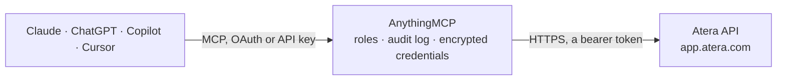

<!-- Generated by scripts/export-github-catalog.mjs in the anythingmcp-website repository. Do not edit by hand. -->

# Atera MCP connector

Atera RMM and help desk: customers, contacts, monitored agents with hardware and patches, agentless devices, alerts, tickets with comments and work hours, contracts and knowledge base. The AnythingMCP connector gives Claude, ChatGPT, Microsoft Copilot, Cursor and Gemini 30 MCP tools for Atera: 25 read and 5 can change data.

**Category:** [IT Service Management](../itsm.md) · **Tools:** 30 · **Setup guide:** [anythingmcp.com](https://anythingmcp.com/guides/atera-to-mcp) · [Deutsch](https://anythingmcp.com/de/guides/atera-to-mcp) · [Italiano](https://anythingmcp.com/it/guides/atera-to-mcp) · [Español](https://anythingmcp.com/es/guides/atera-to-mcp) · [日本語](https://anythingmcp.com/ja/guides/atera-to-mcp) · [Русский](https://anythingmcp.com/ru/guides/atera-to-mcp) · [中文](https://anythingmcp.com/zh/guides/atera-to-mcp)

## Start without code

No installation and no terminal: AnythingMCP Cloud runs the Atera connector for you, operated by helpcode.ai in Frankfurt, Germany.

1. **Click the button above** and create an account or sign in. The Atera connector opens, ready to install.
2. **Paste the API key or token from your Atera account.** Every click is in the [step-by-step guide](https://anythingmcp.com/guides/atera-to-mcp).
3. **Click Install.** AnythingMCP shows the address of your MCP server.
4. **Add that address to your assistant:** [Claude](https://anythingmcp.com/guides/connect-atera-to-claude) · [ChatGPT](https://anythingmcp.com/guides/connect-atera-to-chatgpt) · [Microsoft Copilot](https://anythingmcp.com/guides/connect-atera-to-copilot) · [Cursor](https://anythingmcp.com/guides/connect-atera-to-cursor) · [Gemini CLI](https://anythingmcp.com/guides/connect-atera-to-gemini) · [Meta Muse](https://anythingmcp.com/guides/connect-atera-to-muse).
5. **Ask your first question**, for example: *Show the customer record for BrightSide IT Solutions Ltd and their CustomerID*

Prefer help with the setup? [Talk to us](https://anythingmcp.com/contact).

## How it works

- **The AI client** speaks MCP (Streamable HTTP) to AnythingMCP and only sees tool names, descriptions and results. It never gets the Atera credentials.
- **AnythingMCP** checks the client's role, builds the call from the tool definition, adds the credentials (a bearer token), calls Atera, logs the call and returns the result.
- **Atera** sees an ordinary API client with the rights of the account the credentials belong to.

## Tools

| Tool | What it does | Access |
|---|---|---|
| [`atera_list_customers`](#atera_list_customers) | List the customers (client companies) in Atera with id, name, domain, address and phone. | read |
| [`atera_get_customer`](#atera_get_customer) | Get one customer by CustomerID: name, business number, domain, address, phone, notes and links. | read |
| [`atera_list_contacts`](#atera_list_contacts) | List end-user contacts with EndUserID, customer, name, email, phone, job title and department. | read |
| [`atera_get_contact`](#atera_get_contact) | Get one contact by EndUserID: customer, name, email, phones, job title, department and whether it is the customer's main contact person. | read |
| [`atera_list_agents`](#atera_list_agents) | List all monitored devices (agents) across customers: machine name, customer, online state, last seen, OS, IP and MAC addresses, hardware and logged-in user. | read |
| [`atera_list_customer_agents`](#atera_list_customer_agents) | List the agents (monitored devices) of one customer with online state, OS, hardware and last-seen time. | read |
| [`atera_get_agent`](#atera_get_agent) | Get one agent by AgentID with full hardware and OS inventory: processor, memory, disks, BIOS, serial number, Office version, last reboot and logged-in users. | read |
| [`atera_find_agents_by_machine`](#atera_find_agents_by_machine) | Find agents by machine (computer) name, for example DESKTOP-4F2K. | read |
| [`atera_list_installed_patches`](#atera_list_installed_patches) | List the patches (Windows updates) installed on one agent, identified by its DeviceGuid. | read |
| [`atera_list_available_patches`](#atera_list_available_patches) | List the patches available but not yet installed on one agent, identified by its DeviceGuid. | read |
| [`atera_list_devices`](#atera_list_devices) | List agentless monitored devices of one type (generic ping, SNMP, HTTP or TCP) with name, DeviceID, customer and monitoring agent. | read |
| [`atera_get_device`](#atera_get_device) | Get one agentless monitored device (generic, SNMP, HTTP or TCP) by DeviceID with its monitoring settings, customer and monitoring agent. | read |
| [`atera_list_alerts`](#atera_list_alerts) | List monitoring alerts with title, severity (Information, Warning, Critical), device, customer, creation time and linked ticket. | read |
| [`atera_get_alert`](#atera_get_alert) | Get one alert by AlertID: title, message, severity, category, thresholds, device, customer, snooze end date and linked ticket. | read |
| [`atera_resolve_alert`](#atera_resolve_alert) | Mark one open alert as resolved. | write |
| [`atera_list_tickets`](#atera_list_tickets) | List help desk tickets with number, title, status, priority, type, customer, end user, technician, SLA dates and durations. | read |
| [`atera_get_ticket`](#atera_get_ticket) | Get one ticket by TicketID with status, priority, impact, type, customer, end user, technician, first and last comments, SLA due dates and on/off-site… | read |
| [`atera_list_modified_tickets`](#atera_list_modified_tickets) | List tickets modified since a date (UTC), optionally with their last comments. | read |
| [`atera_list_closed_tickets`](#atera_list_closed_tickets) | List tickets whose status changed to resolved or closed, with their comments by default. | read |
| [`atera_list_ticket_comments`](#atera_list_ticket_comments) | List the comments of one ticket in order: text, date, author (end user or technician, with email and name) and whether the comment is internal. | read |
| [`atera_list_ticket_work_hours`](#atera_list_ticket_work_hours) | List the work-hour records logged on one ticket: technician, start and end time, duration, billable flag and on-site or remote. | read |
| [`atera_get_ticket_billable_duration`](#atera_get_ticket_billable_duration) | Get the billable time totals of one ticket (on-site and off-site) as Atera computes them for invoicing. | read |
| [`atera_list_contracts`](#atera_list_contracts) | List customer contracts with type (retainer, hourly, block hours, block money, remote monitoring, project), active and default flags and start and end dates. | read |
| [`atera_list_customer_contracts`](#atera_list_customer_contracts) | List the contracts of one customer with type, rates, active flag and dates. | read |
| [`atera_get_contract`](#atera_get_contract) | Get one contract by ContractID with its type-specific details (hourly rates, block hours, retainer fee, monitored device rates) and dates. | read |
| [`atera_list_knowledge_base`](#atera_list_knowledge_base) | List the knowledge base articles in Atera with title, content, keywords and visibility. | read |
| [`atera_create_ticket`](#atera_create_ticket) | Create a help desk ticket. | write |
| [`atera_update_ticket`](#atera_update_ticket) | Update a ticket's title, status, type, priority, impact or assigned technician. | write |
| [`atera_add_technician_comment`](#atera_add_technician_comment) | Add a technician comment to a ticket. | write |
| [`atera_add_enduser_comment`](#atera_add_enduser_comment) | Add a comment to a ticket on behalf of the end-user contact, for example to log a reply that arrived by phone. | write |

## Tool reference

Every parameter as the AI client sees it in `tools/list`. Source: [`packages/backend/src/adapters/intl/atera.json`](../../../packages/backend/src/adapters/intl/atera.json).

### `atera_list_customers`

List the customers (client companies) in Atera with id, name, domain, address and phone. Paged. Call this first to get the CustomerID used by the agent, ticket, contract and device tools.

**Access:** read · **Call:** `GET /customers`

| Parameter | Type | Required | Description |
|---|---|---|---|
| `page` | integer | no | Page number, starting at 1. |
| `items_in_page` | integer | no | Items per page. Default 20, at most 50. |

### `atera_get_customer`

Get one customer by CustomerID: name, business number, domain, address, phone, notes and links. Use it after atera_list_customers to read the full record.

**Access:** read · **Call:** `GET /customers/{customer_id}`

| Parameter | Type | Required | Description |
|---|---|---|---|
| `customer_id` | integer | yes | CustomerID from atera_list_customers. |

### `atera_list_contacts`

List end-user contacts with EndUserID, customer, name, email, phone, job title and department. Filter by a whole or partial email or phone to find who opened a ticket.

**Access:** read · **Call:** `GET /contacts`

| Parameter | Type | Required | Description |
|---|---|---|---|
| `page` | integer | no | Page number, starting at 1. |
| `items_in_page` | integer | no | Items per page. Default 20, at most 50. |
| `email` | string | no | Return contacts whose email contains this text (a whole address finds that contact). |
| `phone` | string | no | Return contacts whose phone number contains this text. |

### `atera_get_contact`

Get one contact by EndUserID: customer, name, email, phones, job title, department and whether it is the customer's main contact person.

**Access:** read · **Call:** `GET /contacts/{contact_id}`

| Parameter | Type | Required | Description |
|---|---|---|---|
| `contact_id` | integer | yes | EndUserID from atera_list_contacts or a ticket. |

### `atera_list_agents`

List all monitored devices (agents) across customers: machine name, customer, online state, last seen, OS, IP and MAC addresses, hardware and logged-in user. Paged, at most 50 per page.

**Access:** read · **Call:** `GET /agents`

| Parameter | Type | Required | Description |
|---|---|---|---|
| `page` | integer | no | Page number, starting at 1. |
| `items_in_page` | integer | no | Items per page. Default 20, at most 50. |

### `atera_list_customer_agents`

List the agents (monitored devices) of one customer with online state, OS, hardware and last-seen time. Use it to answer which machines a customer has.

**Access:** read · **Call:** `GET /agents/customer/{customer_id}`

| Parameter | Type | Required | Description |
|---|---|---|---|
| `page` | integer | no | Page number, starting at 1. |
| `items_in_page` | integer | no | Items per page. Default 20, at most 50. |
| `customer_id` | integer | yes | CustomerID from atera_list_customers. |

### `atera_get_agent`

Get one agent by AgentID with full hardware and OS inventory: processor, memory, disks, BIOS, serial number, Office version, last reboot and logged-in users.

**Access:** read · **Call:** `GET /agents/{agent_id}`

| Parameter | Type | Required | Description |
|---|---|---|---|
| `agent_id` | integer | yes | AgentID from atera_list_agents. |

### `atera_find_agents_by_machine`

Find agents by machine (computer) name, for example DESKTOP-4F2K. Returns the matching agents with customer, online state and inventory. Use it when a user names a computer.

**Access:** read · **Call:** `GET /agents/machine/{machine_name}`

| Parameter | Type | Required | Description |
|---|---|---|---|
| `page` | integer | no | Page number, starting at 1. |
| `items_in_page` | integer | no | Items per page. Default 20, at most 50. |
| `machine_name` | string | yes | Machine name as shown in Atera, for example DESKTOP-4F2K. |

### `atera_list_installed_patches`

List the patches (Windows updates) installed on one agent, identified by its DeviceGuid. Use it to check whether a specific update is present on a machine.

**Access:** read · **Call:** `GET /agents/{device_guid}/installed-patches`

| Parameter | Type | Required | Description |
|---|---|---|---|
| `device_guid` | string | yes | DeviceGuid of the agent (field DeviceGuid in atera_list_agents), a GUID. |

### `atera_list_available_patches`

List the patches available but not yet installed on one agent, identified by its DeviceGuid. Use it to see what a machine is missing before a patch run.

**Access:** read · **Call:** `GET /agents/{device_guid}/available-patches`

| Parameter | Type | Required | Description |
|---|---|---|---|
| `device_guid` | string | yes | DeviceGuid of the agent (field DeviceGuid in atera_list_agents), a GUID. |

### `atera_list_devices`

List agentless monitored devices of one type (generic ping, SNMP, HTTP or TCP) with name, DeviceID, customer and monitoring agent. Optionally filter by customer or monitoring agent.

**Access:** read · **Call:** `GET /devices/{device_type}devices`

| Parameter | Type | Required | Description |
|---|---|---|---|
| `page` | integer | no | Page number, starting at 1. |
| `items_in_page` | integer | no | Items per page. Default 20, at most 50. |
| `device_type` | `generic` \| `snmp` \| `http` \| `tcp` | yes | Device type: generic (ping), snmp, http or tcp. |
| `customer_id` | integer | no | Only devices of this CustomerID. |
| `monitoring_agent_id` | integer | no | Only devices monitored by this AgentID. |

### `atera_get_device`

Get one agentless monitored device (generic, SNMP, HTTP or TCP) by DeviceID with its monitoring settings, customer and monitoring agent.

**Access:** read · **Call:** `GET /devices/{device_type}device/{device_id}`

| Parameter | Type | Required | Description |
|---|---|---|---|
| `device_type` | `generic` \| `snmp` \| `http` \| `tcp` | yes | Device type: generic (ping), snmp, http or tcp. |
| `device_id` | integer | yes | DeviceID from atera_list_devices. |

### `atera_list_alerts`

List monitoring alerts with title, severity (Information, Warning, Critical), device, customer, creation time and linked ticket. Filter by status Open, Resolved or Snoozed. Paged.

**Access:** read · **Call:** `GET /alerts`

| Parameter | Type | Required | Description |
|---|---|---|---|
| `page` | integer | no | Page number, starting at 1. |
| `items_in_page` | integer | no | Items per page. Default 20, at most 50. |
| `alert_status` | `Open` \| `Resolved` \| `Snoozed` | no | Only alerts in this state. |

### `atera_get_alert`

Get one alert by AlertID: title, message, severity, category, thresholds, device, customer, snooze end date and linked ticket.

**Access:** read · **Call:** `GET /alerts/{alert_id}`

| Parameter | Type | Required | Description |
|---|---|---|---|
| `alert_id` | integer | yes | AlertID from atera_list_alerts. |

### `atera_resolve_alert`

Mark one open alert as resolved. Use after the underlying problem is fixed; the alert moves to Resolved and disappears from the open list. Returns no content.

**Access:** write · **Call:** `PUT /alerts/{alert_id}`

| Parameter | Type | Required | Description |
|---|---|---|---|
| `alert_id` | integer | yes | AlertID of the alert to resolve. |

### `atera_list_tickets`

List help desk tickets with number, title, status, priority, type, customer, end user, technician, SLA dates and durations. Filter by customer or status. Paged, at most 50 per page.

**Access:** read · **Call:** `GET /tickets`

| Parameter | Type | Required | Description |
|---|---|---|---|
| `page` | integer | no | Page number, starting at 1. |
| `items_in_page` | integer | no | Items per page. Default 20, at most 50. |
| `customer_id` | integer | no | Only tickets of this CustomerID. |
| `ticket_status` | string | no | Only tickets in this status, for example Open, Pending, Resolved or Closed (custom statuses are allowed). |
| `include_relations` | boolean | no | Include parent/child ticket relations (default false). |

### `atera_get_ticket`

Get one ticket by TicketID with status, priority, impact, type, customer, end user, technician, first and last comments, SLA due dates and on/off-site durations.

**Access:** read · **Call:** `GET /tickets/{ticket_id}`

| Parameter | Type | Required | Description |
|---|---|---|---|
| `ticket_id` | integer | yes | TicketID from atera_list_tickets. |
| `include_relations` | boolean | no | Include parent/child ticket relations (default false). |

### `atera_list_modified_tickets`

List tickets modified since a date (UTC), optionally with their last comments. Use it to sync or review what changed recently instead of paging through every ticket.

**Access:** read · **Call:** `GET /tickets/lastmodified`

| Parameter | Type | Required | Description |
|---|---|---|---|
| `page` | integer | no | Page number, starting at 1. |
| `items_in_page` | integer | no | Items per page. Default 20, at most 50. |
| `date` | string | no | Modified on or after this UTC date-time, ISO 8601, for example 2026-10-01T00:00:00Z. Default today. |
| `include_comments` | boolean | no | Include the first and last comments (default false). |
| `include_relations` | boolean | no | Include ticket relations (default false). |

### `atera_list_closed_tickets`

List tickets whose status changed to resolved or closed, with their comments by default. Use it for reports on finished work.

**Access:** read · **Call:** `GET /tickets/statusmodified`

| Parameter | Type | Required | Description |
|---|---|---|---|
| `page` | integer | no | Page number, starting at 1. |
| `items_in_page` | integer | no | Items per page. Default 20, at most 50. |
| `include_comments` | boolean | no | Include first and last comments (default true). |
| `include_relations` | boolean | no | Include ticket relations (default false). |

### `atera_list_ticket_comments`

List the comments of one ticket in order: text, date, author (end user or technician, with email and name) and whether the comment is internal.

**Access:** read · **Call:** `GET /tickets/{ticket_id}/comments`

| Parameter | Type | Required | Description |
|---|---|---|---|
| `page` | integer | no | Page number, starting at 1. |
| `items_in_page` | integer | no | Items per page. Default 20, at most 50. |
| `ticket_id` | integer | yes | TicketID from atera_list_tickets. |

### `atera_list_ticket_work_hours`

List the work-hour records logged on one ticket: technician, start and end time, duration, billable flag and on-site or remote. Use it for time and billing questions.

**Access:** read · **Call:** `GET /tickets/{ticket_id}/workhoursrecords`

| Parameter | Type | Required | Description |
|---|---|---|---|
| `page` | integer | no | Page number, starting at 1. |
| `items_in_page` | integer | no | Items per page. Default 20, at most 50. |
| `ticket_id` | integer | yes | TicketID from atera_list_tickets. |

### `atera_get_ticket_billable_duration`

Get the billable time totals of one ticket (on-site and off-site) as Atera computes them for invoicing.

**Access:** read · **Call:** `GET /tickets/{ticket_id}/billableduration`

| Parameter | Type | Required | Description |
|---|---|---|---|
| `ticket_id` | integer | yes | TicketID from atera_list_tickets. |

### `atera_list_contracts`

List customer contracts with type (retainer, hourly, block hours, block money, remote monitoring, project), active and default flags and start and end dates. Paged.

**Access:** read · **Call:** `GET /contracts`

| Parameter | Type | Required | Description |
|---|---|---|---|
| `page` | integer | no | Page number, starting at 1. |
| `items_in_page` | integer | no | Items per page. Default 20, at most 50. |

### `atera_list_customer_contracts`

List the contracts of one customer with type, rates, active flag and dates. Use it to check how work for that customer is billed.

**Access:** read · **Call:** `GET /contracts/customer/{customer_id}`

| Parameter | Type | Required | Description |
|---|---|---|---|
| `page` | integer | no | Page number, starting at 1. |
| `items_in_page` | integer | no | Items per page. Default 20, at most 50. |
| `customer_id` | integer | yes | CustomerID from atera_list_customers. |

### `atera_get_contract`

Get one contract by ContractID with its type-specific details (hourly rates, block hours, retainer fee, monitored device rates) and dates.

**Access:** read · **Call:** `GET /contracts/{contract_id}`

| Parameter | Type | Required | Description |
|---|---|---|---|
| `contract_id` | integer | yes | ContractID from atera_list_contracts. |

### `atera_list_knowledge_base`

List the knowledge base articles in Atera with title, content, keywords and visibility. Use it to find existing fixes before answering a ticket.

**Access:** read · **Call:** `GET /knowledgebases`

| Parameter | Type | Required | Description |
|---|---|---|---|
| `page` | integer | no | Page number, starting at 1. |
| `items_in_page` | integer | no | Items per page. Default 20, at most 50. |

### `atera_create_ticket`

Create a help desk ticket. Give an existing EndUserID, or first name, last name and email to create the end user with it. Returns the new TicketID.

**Access:** write · **Call:** `POST /tickets`

| Parameter | Type | Required | Description |
|---|---|---|---|
| `title` | string | yes | Ticket title. |
| `description` | string | yes | Ticket description, the first comment. |
| `end_user_id` | integer | no | EndUserID of an existing contact (atera_list_contacts). |
| `end_user_first_name` | string | no | First name, to create a new end user when end_user_id is not given. |
| `end_user_last_name` | string | no | Last name of the new end user. |
| `end_user_email` | string | no | Email of the new end user. |
| `end_user_phone` | string | no | Phone of the new end user. |
| `priority` | `Low` \| `Medium` \| `High` \| `Critical` | no | Ticket priority. |
| `impact` | `NoImpact` \| `SiteDown` \| `ServerIssue` \| `Minor` \| `Major` \| `Crisis` | no | Ticket impact. |
| `type` | `Incident` \| `Problem` \| `Request` \| `Change` | no | Ticket type. |
| `status` | string | no | Initial status, for example Open or Pending. |
| `technician_contact_id` | integer | no | Technician to assign (TechnicianContactID from a ticket). |
| `technician_email` | string | no | Email of the technician to assign, instead of the id. |

### `atera_update_ticket`

Update a ticket's title, status, type, priority, impact or assigned technician. Only the fields passed are changed. Use it to close, reassign or reprioritise a ticket.

**Access:** write · **Call:** `PUT /tickets/{ticket_id}`

| Parameter | Type | Required | Description |
|---|---|---|---|
| `ticket_id` | integer | yes | TicketID to update. |
| `title` | string | no | New title. |
| `status` | string | no | New status, for example Open, Pending, Resolved or Closed. |
| `type` | `Incident` \| `Problem` \| `Request` \| `Change` | no | New type. |
| `priority` | `Low` \| `Medium` \| `High` \| `Critical` | no | New priority. |
| `impact` | `NoImpact` \| `SiteDown` \| `ServerIssue` \| `Minor` \| `Major` \| `Crisis` | no | New impact. |
| `technician_contact_id` | integer | no | TechnicianContactID to assign. |
| `technician_email` | string | no | Email of the technician to assign, instead of the id. |

### `atera_add_technician_comment`

Add a technician comment to a ticket. With is_internal true it is an internal note; with false the end user sees it and is notified by email. Returns the comment id.

**Access:** write · **Call:** `POST /tickets/{ticket_id}/comments`

| Parameter | Type | Required | Description |
|---|---|---|---|
| `ticket_id` | integer | yes | TicketID to comment on. |
| `comment_text` | string | yes | Comment text. |
| `technician_id` | integer | no | Technician's contact id (TechnicianContactID on tickets). |
| `technician_email` | string | no | Technician's email, instead of the id. |
| `is_internal` | boolean | yes | true for an internal note the end user does not see; false for a reply to the end user. |
| `timestamp_utc` | string | no | Optional comment time in UTC, ISO 8601. Default now. |

### `atera_add_enduser_comment`

Add a comment to a ticket on behalf of the end-user contact, for example to log a reply that arrived by phone. Returns the comment id.

**Access:** write · **Call:** `POST /tickets/{ticket_id}/comments`

| Parameter | Type | Required | Description |
|---|---|---|---|
| `ticket_id` | integer | yes | TicketID to comment on. |
| `comment_text` | string | yes | Comment text. |
| `enduser_id` | integer | yes | EndUserID of the contact who wrote it. |
| `timestamp_utc` | string | no | Optional comment time in UTC, ISO 8601. Default now. |

## Run it yourself

AnythingMCP is open source (AGPL-3.0). [Run it with Docker](../../../README.md#run-it-yourself), open **Connectors → Store**, pick **Atera** and enter `ATERA_API_KEY`, then add your MCP server URL to the AI client.

[← IT Service Management connectors](../itsm.md) · [All categories](../README.md)
