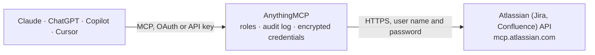

<!-- Generated by scripts/export-github-catalog.mjs in the anythingmcp-website repository. Do not edit by hand. -->

# Atlassian (Jira, Confluence) MCP connector

Work with Jira and Confluence from Claude, ChatGPT or Copilot through Atlassian's official Rovo MCP server: search and update work items, read and write pages, run JQL and CQL, and ask Rovo search … The AnythingMCP connector gives Claude, ChatGPT, Microsoft Copilot, Cursor and Gemini 193 MCP tools for Atlassian (Jira, Confluence): 104 read and 89 can change data.

**Category:** [Project Management](../project-management.md) · **Tools:** 193 · **Setup guide:** [anythingmcp.com](https://anythingmcp.com/guides/atlassian-to-mcp) · [Deutsch](https://anythingmcp.com/de/guides/atlassian-to-mcp) · [Italiano](https://anythingmcp.com/it/guides/atlassian-to-mcp) · [Español](https://anythingmcp.com/es/guides/atlassian-to-mcp) · [日本語](https://anythingmcp.com/ja/guides/atlassian-to-mcp) · [Русский](https://anythingmcp.com/ru/guides/atlassian-to-mcp) · [中文](https://anythingmcp.com/zh/guides/atlassian-to-mcp)

## Start without code

No installation and no terminal: AnythingMCP Cloud runs the Atlassian (Jira, Confluence) connector for you, operated by helpcode.ai in Frankfurt, Germany.

1. **Click the button above** and create an account or sign in. The Atlassian (Jira, Confluence) connector opens, ready to install.
2. **Paste the API key or token from your Atlassian (Jira, Confluence) account.** Every click is in the [step-by-step guide](https://anythingmcp.com/guides/atlassian-to-mcp).
3. **Click Install.** AnythingMCP shows the address of your MCP server.
4. **Add that address to your assistant:** [Claude](https://anythingmcp.com/guides/connect-atlassian-to-claude) · [ChatGPT](https://anythingmcp.com/guides/connect-atlassian-to-chatgpt) · [Microsoft Copilot](https://anythingmcp.com/guides/connect-atlassian-to-copilot) · [Cursor](https://anythingmcp.com/guides/connect-atlassian-to-cursor) · [Gemini CLI](https://anythingmcp.com/guides/connect-atlassian-to-gemini) · [Meta Muse](https://anythingmcp.com/guides/connect-atlassian-to-muse).
5. **Ask your first question**, for example: *Show status and assignee for Jira issue ACCTINV-412 (customer invoice dispute) right now.*

Prefer help with the setup? [Talk to us](https://anythingmcp.com/contact).

## How it works

- **The AI client** speaks MCP (Streamable HTTP) to AnythingMCP and only sees tool names, descriptions and results. It never gets the Atlassian (Jira, Confluence) credentials.
- **AnythingMCP** checks the client's role, builds the call from the tool definition, adds the credentials (user name and password), calls Atlassian (Jira, Confluence), logs the call and returns the result.
- **Atlassian (Jira, Confluence)** sees an ordinary API client with the rights of the account the credentials belong to.

## Tools

| Tool | What it does | Access |
|---|---|---|
| [`atlassian_atlassianUserInfo`](#atlassian_atlassianuserinfo) | Get the current authenticated user's Atlassian account information: account ID, name and email of the user the API token belongs to. | read |
| [`atlassian_getAccessibleAtlassianResources`](#atlassian_getaccessibleatlassianresources) | List the Atlassian sites and apps the authenticated user can reach, with their cloudId values. | read |
| [`atlassian_discover`](#atlassian_discover) | Natural-language search over the Atlassian Rovo MCP server's deferred tool catalogue. | read |
| [`atlassian_executeRead`](#atlassian_executeread) | Execution pathway that runs a deferred read operation of the Atlassian catalogue by name (for example listJiraProjects or getConfluenceSpace). | read |
| [`atlassian_executeWrite`](#atlassian_executewrite) | Execution pathway that runs a deferred write operation of the Atlassian catalogue by name (for example addOrEditJiraIssueWorklog or createConfluenceComment). | write |
| [`atlassian_executeDestructive`](#atlassian_executedestructive) | Execution pathway that runs a deferred destructive operation of the Atlassian catalogue by name, such as permanently deleting a Jira work item, comment or… | write |
| [`atlassian_getContentFormatGuide`](#atlassian_getcontentformatguide) | Returns the rich-content authoring format guidance to support improved document formatting and whiteboard creation, and guidance for Confluence Remix prompts. | read |
| [`atlassian_getJiraIssue`](#atlassian_getjiraissue) | Get a Jira work item by ID or key: summary, description, status, type, priority, labels, assignee, reporter, dates, resolution and space. | read |
| [`atlassian_searchJiraIssuesUsingJql`](#atlassian_searchjiraissuesusingjql) | Search Jira work items using JQL (Jira Query Language), for example project = "PROJ" AND status = "In Progress". | read |
| [`atlassian_createJiraIssue`](#atlassian_createjiraissue) | Create a new Jira work item (task, bug, story, epic or sub-task) in a space, with summary, description, assignee, priority, parent and other fields. | write |
| [`atlassian_editJiraIssue`](#atlassian_editjiraissue) | Edit an existing Jira work item; only fields editable on that work item can be set (summary, description, assignee, priority, labels and other fields). | write |
| [`atlassian_transitionJiraIssue`](#atlassian_transitionjiraissue) | Transition a Jira work item to a new workflow status, and/or assign it to a sprint or the backlog. | write |
| [`atlassian_addOrEditJiraIssueComment`](#atlassian_addoreditjiraissuecomment) | Add a comment to a Jira work item, or edit an existing comment. | write |
| [`atlassian_listJiraProjects`](#atlassian_listjiraprojects) | Get the Jira spaces (projects) visible to the current user. | read |
| [`atlassian_listJiraProjectIssueTypesMetadata`](#atlassian_listjiraprojectissuetypesmetadata) | All work item types available in a Jira space. | read |
| [`atlassian_getJiraIssueTypeMetaWithFields`](#atlassian_getjiraissuetypemetawithfields) | Schema and field metadata for a specific work item type in a space, for creating work items with correct fields. | read |
| [`atlassian_listJiraIssueTransitions`](#atlassian_listjiraissuetransitions) | Available workflow transitions for a Jira work item. | read |
| [`atlassian_listJiraIssueLinkTypes`](#atlassian_listjiraissuelinktypes) | Available work item link types in Jira. | read |
| [`atlassian_listJiraIssueRemoteIssueLinks`](#atlassian_listjiraissueremoteissuelinks) | Remote links associated with a Jira work item. | read |
| [`atlassian_listJiraIssueWorklogs`](#atlassian_listjiraissueworklogs) | Paginated worklogs (logged time) for a Jira work item. | read |
| [`atlassian_lookupJiraAccountId`](#atlassian_lookupjiraaccountid) | Look up a Jira user account ID by display name or email. | read |
| [`atlassian_listJiraIssueAssignableUsers`](#atlassian_listjiraissueassignableusers) | List users assignable to a Jira space or work item. | read |
| [`atlassian_listJiraIssueComments`](#atlassian_listjiraissuecomments) | Paginated comments for a Jira work item, with their bodies (getJiraIssue only counts them). | read |
| [`atlassian_listJiraIssueChangelogs`](#atlassian_listjiraissuechangelogs) | A work item's field-change history, paginated oldest-first. | read |
| [`atlassian_getJiraCurrentUser`](#atlassian_getjiracurrentuser) | Details for the current Jira user (the owner of the API token). | read |
| [`atlassian_getJiraUser`](#atlassian_getjirauser) | Retrieves a Jira user's profile by account ID. | read |
| [`atlassian_listJiraStatuses`](#atlassian_listjirastatuses) | List of statuses a Jira work item can be in. | read |
| [`atlassian_listJiraProjectComponents`](#atlassian_listjiraprojectcomponents) | Components in a space, with IDs, names, work item counts and ownership details. | read |
| [`atlassian_getJiraProjectVersions`](#atlassian_getjiraprojectversions) | A space's releases/versions, or a single version. | read |
| [`atlassian_getJiraProjectVersionRelatedWork`](#atlassian_getjiraprojectversionrelatedwork) | Related work links (evidence) on a space version (release). | read |
| [`atlassian_listJiraBoards`](#atlassian_listjiraboards) | Lists the Jira boards visible to the current user. | read |
| [`atlassian_getJiraBoardConfig`](#atlassian_getjiraboardconfig) | A board's configuration: filter, column layout, and each column's mapped statuses. | read |
| [`atlassian_getJiraBoardIssueData`](#atlassian_getjiraboardissuedata) | The work items on a board, its backlog, or both, with optional count and JQL filtering. | read |
| [`atlassian_getJiraBoardSprintData`](#atlassian_getjiraboardsprintdata) | Resolve a board plus its sprint data in one call; defaults to the active sprint. | read |
| [`atlassian_listJiraBoardSprints`](#atlassian_listjiraboardsprints) | Sprints from a board, optionally filtered to active, future, or closed. | read |
| [`atlassian_listJiraFilters`](#atlassian_listjirafilters) | Search saved filters visible to the current user, returning IDs and JQL. | read |
| [`atlassian_listJiraDashboards`](#atlassian_listjiradashboards) | Dashboards visible to the current user, for discovery and linking workflows. | read |
| [`atlassian_getJiraEntityProperty`](#atlassian_getjiraentityproperty) | Read a property from the key/value store on a work item, comment, worklog, dashboard item, or user. | read |
| [`atlassian_downloadJiraIssueAttachment`](#atlassian_downloadjiraissueattachment) | Get a short-lived download URL for a Jira attachment and a local command to save the file. | read |
| [`atlassian_addOrEditJiraIssueWorklog`](#atlassian_addoreditjiraissueworklog) | Log time on a Jira work item, or edit an existing worklog. | write |
| [`atlassian_createJiraIssueLink`](#atlassian_createjiraissuelink) | Create a link between two Jira work items (for example "blocks" or "relates to"). | write |
| [`atlassian_manageJiraProjectVersion`](#atlassian_managejiraprojectversion) | Create, update, release, or archive a space version (release or fix version). | write |
| [`atlassian_manageJiraProjectVersionRelatedWork`](#atlassian_managejiraprojectversionrelatedwork) | Create or update related work links on a space version. | write |
| [`atlassian_manageJiraSprint`](#atlassian_managejirasprint) | Create, populate, start, update, or close a sprint; closing a sprint moves its unfinished work items for the whole team. | write |
| [`atlassian_createJiraBoard`](#atlassian_createjiraboard) | Create a company-managed board (scrum or kanban) from an existing filter. | write |
| [`atlassian_watchJiraIssue`](#atlassian_watchjiraissue) | Watch or unwatch a Jira work item for the current user. | write |
| [`atlassian_uploadAttachmentToJiraIssue`](#atlassian_uploadattachmenttojiraissue) | Attach a local file to a Jira work item. | write |
| [`atlassian_editJiraEntityProperty`](#atlassian_editjiraentityproperty) | Set a property in the key/value store on a work item, comment, worklog, dashboard item, or user. | write |
| [`atlassian_createJiraIssueRemoteIssueLink`](#atlassian_createjiraissueremoteissuelink) | Create a web link on a Jira work item for a Confluence page or external URL. | write |
| [`atlassian_convertJiraIssueHierarchy`](#atlassian_convertjiraissuehierarchy) | Convert a work item into a sub-task under a parent, or a sub-task back into a standard work item, with preview steps before the change is made. | write |
| [`atlassian_deleteJiraIssue`](#atlassian_deletejiraissue) | Permanently delete a Jira work item. | write |
| [`atlassian_deleteJiraComment`](#atlassian_deletejiracomment) | Permanently delete a comment from a Jira work item. | write |
| [`atlassian_deleteJiraIssueAttachment`](#atlassian_deletejiraissueattachment) | Permanently delete an attachment from a Jira work item. | write |
| [`atlassian_getJiraWorkflows`](#atlassian_getjiraworkflows) | Read a space's workflows in full: every status, every transition, and the rules that gate each one. | read |
| [`atlassian_getJiraWorkflowEditorLink`](#atlassian_getjiraworkfloweditorlink) | Get a link that opens the Jira workflow editor with a requested workflow change pre-filled for review; nothing is applied. | read |
| [`atlassian_getJiraScreen`](#atlassian_getjirascreen) | Inspect a company-managed Create, View, or Edit screen: its tabs, fields, the fields that can be added, and where it is used. | read |
| [`atlassian_createJiraProject`](#atlassian_createjiraproject) | Create a new Jira space from a space template. | write |
| [`atlassian_updateJiraProject`](#atlassian_updatejiraproject) | Update settings on an existing Jira space. | write |
| [`atlassian_updateJiraScreen`](#atlassian_updatejirascreen) | Add existing fields to, or reorder fields on, a company-managed screen. | write |
| [`atlassian_getConfluenceContent`](#atlassian_getconfluencecontent) | Read any Confluence content: page, blog post, live doc, comment, whiteboard, embed, database, or folder. | read |
| [`atlassian_searchConfluence`](#atlassian_searchconfluence) | Search Confluence content with CQL (Confluence Query Language), for example type = page AND title ~ "deployment guide". | read |
| [`atlassian_createConfluenceContent`](#atlassian_createconfluencecontent) | Create a Confluence page, blog post, live doc, whiteboard, database, embed, smart link, or folder in a space or under a parent page. | write |
| [`atlassian_updateConfluenceContent`](#atlassian_updateconfluencecontent) | Update Confluence docs, whiteboards, or databases via full-body replacement or granular edits. | write |
| [`atlassian_listConfluenceContent`](#atlassian_listconfluencecontent) | List Confluence content of one type within a single space. | read |
| [`atlassian_listConfluenceSpaces`](#atlassian_listconfluencespaces) | List the Confluence spaces accessible to the caller. | read |
| [`atlassian_getConfluenceSpace`](#atlassian_getconfluencespace) | Retrieve a Confluence space by ID or key, including enabled content types, optional labels, and configured space instructions. | read |
| [`atlassian_getConfluenceSpaceInstructions`](#atlassian_getconfluencespaceinstructions) | The space instructions configured for a Confluence space, which writes into that space should follow. | read |
| [`atlassian_getConfluencePersonalSpace`](#atlassian_getconfluencepersonalspace) | The current user's personal Confluence space. | read |
| [`atlassian_listConfluenceComments`](#atlassian_listconfluencecomments) | List the footer and inline comments on a Confluence page or blog post. | read |
| [`atlassian_getConfluenceComment`](#atlassian_getconfluencecomment) | A single Confluence comment by ID. | read |
| [`atlassian_listConfluenceContentVersions`](#atlassian_listconfluencecontentversions) | Version history for a page, live doc, or blog post, newest first. | read |
| [`atlassian_getConfluenceContentVersion`](#atlassian_getconfluencecontentversion) | One historical version of a page, live doc, or blog post. | read |
| [`atlassian_diffConfluenceContentVersions`](#atlassian_diffconfluencecontentversions) | A unified diff between two versions of a page, live doc, or blog post. | read |
| [`atlassian_listConfluenceAttachments`](#atlassian_listconfluenceattachments) | Attachment metadata for a Confluence content item. | read |
| [`atlassian_getConfluenceAttachment`](#atlassian_getconfluenceattachment) | Confluence attachment metadata by attachment ID. | read |
| [`atlassian_downloadConfluenceAttachment`](#atlassian_downloadconfluenceattachment) | A Confluence attachment download URL plus a local curl command. | read |
| [`atlassian_exportConfluenceContent`](#atlassian_exportconfluencecontent) | Export Confluence content as PDF or Word and return a download link. | read |
| [`atlassian_getConfluenceContentPermissions`](#atlassian_getconfluencecontentpermissions) | The explicit content-level permission grants on a content entity, each pairing an operation with a principal. | read |
| [`atlassian_getConfluenceContentRestrictionState`](#atlassian_getconfluencecontentrestrictionstate) | General access for a content entity: OPEN, EDIT_RESTRICTED, or fully restricted. | read |
| [`atlassian_getConfluencePublicLinkStatus`](#atlassian_getconfluencepubliclinkstatus) | The external public-link (anonymous share) status of a Confluence page. | read |
| [`atlassian_getConfluenceReactions`](#atlassian_getconfluencereactions) | Emoji reactions on Confluence content. | read |
| [`atlassian_getConfluenceTask`](#atlassian_getconfluencetask) | A single Confluence inline task (action item) by ID. | read |
| [`atlassian_listConfluenceTasks`](#atlassian_listconfluencetasks) | Confluence inline tasks, optionally scoped to a page or blog post and filtered by status. | read |
| [`atlassian_listConfluenceTemplates`](#atlassian_listconfluencetemplates) | List Confluence templates and blueprints. | read |
| [`atlassian_getConfluenceTemplate`](#atlassian_getconfluencetemplate) | The body of a Confluence template. | read |
| [`atlassian_resolveConfluenceContentMacros`](#atlassian_resolveconfluencecontentmacros) | Resolve supported macro wrappers into per-macro HTML as displayed in Confluence web. | read |
| [`atlassian_getConfluenceMauiApp`](#atlassian_getconfluencemauiapp) | Retrieve the source and metadata for a malleable UI (Maui) app owned by a Confluence page. | read |
| [`atlassian_createConfluenceSpace`](#atlassian_createconfluencespace) | Create a Confluence space. | write |
| [`atlassian_setConfluenceSpaceInstructions`](#atlassian_setconfluencespaceinstructions) | Set the space instructions for a Confluence space; every agent writing into that space is told to follow them. | write |
| [`atlassian_copyConfluenceContent`](#atlassian_copyconfluencecontent) | Copy a page, whiteboard, database, folder, or embed to a new parent. | write |
| [`atlassian_moveConfluenceContent`](#atlassian_moveconfluencecontent) | Move a page, whiteboard, database, folder, or embed to a new parent or sibling position. | write |
| [`atlassian_archiveConfluenceContent`](#atlassian_archiveconfluencecontent) | Archive a single Confluence content entity (it can be restored with unarchiveConfluenceContent). | write |
| [`atlassian_unarchiveConfluenceContent`](#atlassian_unarchiveconfluencecontent) | Unarchive (restore) a single Confluence content entity. | write |
| [`atlassian_restoreConfluenceContentVersion`](#atlassian_restoreconfluencecontentversion) | Restore an earlier version of a page as a new latest version. | write |
| [`atlassian_convertConfluenceContentMode`](#atlassian_convertconfluencecontentmode) | Convert a page or live doc between classic page mode and live-doc mode. | write |
| [`atlassian_setConfluenceContentStatus`](#atlassian_setconfluencecontentstatus) | Set the content state (status) of a Confluence page or blog post. | write |
| [`atlassian_createConfluenceComment`](#atlassian_createconfluencecomment) | Create or reply to a footer or inline comment on a Confluence page or blog post. | write |
| [`atlassian_updateConfluenceComment`](#atlassian_updateconfluencecomment) | Update an existing footer or inline comment in Confluence. | write |
| [`atlassian_updateConfluenceCommentResolution`](#atlassian_updateconfluencecommentresolution) | Resolve or reopen a footer or inline comment in Confluence. | write |
| [`atlassian_createConfluenceAttachment`](#atlassian_createconfluenceattachment) | Prepare a Confluence attachment upload and return a local curl command. | write |
| [`atlassian_addLabelsToConfluenceContent`](#atlassian_addlabelstoconfluencecontent) | Add labels to any Confluence content. | write |
| [`atlassian_addConfluenceReaction`](#atlassian_addconfluencereaction) | Add an emoji reaction to Confluence content. | write |
| [`atlassian_addConfluenceContentPermissions`](#atlassian_addconfluencecontentpermissions) | Add content-level permission grants, preserving existing grants for other principals. | write |
| [`atlassian_removeConfluenceContentPermissions`](#atlassian_removeconfluencecontentpermissions) | Remove content-level permission grants, optionally narrowed by operation, principal type, or principal. | write |
| [`atlassian_replaceConfluenceContentPermissions`](#atlassian_replaceconfluencecontentpermissions) | Replace all content-level permission grants with the supplied set. | write |
| [`atlassian_setConfluenceContentRestrictionState`](#atlassian_setconfluencecontentrestrictionstate) | Set the high-level restriction state (open, edit-restricted or fully restricted) for a content entity. | write |
| [`atlassian_enableConfluencePublicLink`](#atlassian_enableconfluencepubliclink) | Enable the external public link (anonymous share) for a Confluence page, so anyone with the link can read it. | write |
| [`atlassian_disableConfluencePublicLink`](#atlassian_disableconfluencepubliclink) | Disable the external public link (anonymous share) for a Confluence page. | write |
| [`atlassian_completeConfluenceTask`](#atlassian_completeconfluencetask) | Marks a Confluence action item on a page as done. | write |
| [`atlassian_reopenConfluenceTask`](#atlassian_reopenconfluencetask) | Marks a completed Confluence action item as not done. | write |
| [`atlassian_starConfluenceContent`](#atlassian_starconfluencecontent) | Stars a Confluence page for the current user. | write |
| [`atlassian_unstarConfluenceContent`](#atlassian_unstarconfluencecontent) | Removes the current user's star from a Confluence page. | write |
| [`atlassian_starConfluenceSpace`](#atlassian_starconfluencespace) | Stars a Confluence space for the current user. | write |
| [`atlassian_unstarConfluenceSpace`](#atlassian_unstarconfluencespace) | Removes the current user's star from a Confluence space. | write |
| [`atlassian_watchConfluenceContent`](#atlassian_watchconfluencecontent) | Subscribes the current user to updates on a Confluence page. | write |
| [`atlassian_unwatchConfluenceContent`](#atlassian_unwatchconfluencecontent) | Unsubscribes the current user from updates on a Confluence page. | write |
| [`atlassian_watchConfluenceSpace`](#atlassian_watchconfluencespace) | Subscribes the current user to updates in a Confluence space. | write |
| [`atlassian_unwatchConfluenceSpace`](#atlassian_unwatchconfluencespace) | Unsubscribes the current user from updates in a Confluence space. | write |
| [`atlassian_watchConfluenceLabel`](#atlassian_watchconfluencelabel) | Subscribes the current user to updates on content carrying a label. | write |
| [`atlassian_unwatchConfluenceLabel`](#atlassian_unwatchconfluencelabel) | Unsubscribes the current user from updates on a label. | write |
| [`atlassian_createConfluenceInfographicForPage`](#atlassian_createconfluenceinfographicforpage) | Generate an infographic image for a Confluence page. | write |
| [`atlassian_editConfluenceInfographicForPage`](#atlassian_editconfluenceinfographicforpage) | Regenerate an existing infographic image on a Confluence page. | write |
| [`atlassian_createConfluenceMauiApp`](#atlassian_createconfluencemauiapp) | Generate an interactive visualization for a Confluence page. | write |
| [`atlassian_editConfluenceMauiApp`](#atlassian_editconfluencemauiapp) | Regenerate an existing interactive visualization on a Confluence page. | write |
| [`atlassian_search`](#atlassian_search) | Rovo search (beta): semantic search across Jira, Confluence, and connected apps using natural language. | read |
| [`atlassian_getTeamworkGraphObject`](#atlassian_getteamworkgraphobject) | Rovo fetch: fetches all available data for one or more objects (Atlassian or third-party) using their ARIs or URLs, for example the objects returned by… | read |
| [`atlassian_getTeamworkGraphContext`](#atlassian_getteamworkgraphcontext) | Retrieves connected context from Teamwork Graph for any Atlassian entity (work items, sprints, pages, goals, people, pull requests, Loom videos and more)… | read |
| [`atlassian_getJsmOpsAlerts`](#atlassian_getjsmopsalerts) | Get a Jira Service Management operations alert by ID or alias, or by search query. | read |
| [`atlassian_getJsmOpsScheduleInfo`](#atlassian_getjsmopsscheduleinfo) | List Jira Service Management on-call schedules, or get the current or next responders. | read |
| [`atlassian_getJsmOpsTeamInfo`](#atlassian_getjsmopsteaminfo) | List Jira Service Management operations teams and team details. | read |
| [`atlassian_updateJsmOpsAlert`](#atlassian_updatejsmopsalert) | Perform Jira Service Management alert actions: acknowledge, unacknowledge, close, or escalate an alert (escalating pages the on-call responders). | write |
| [`atlassian_listBitbucketWorkspaces`](#atlassian_listbitbucketworkspaces) | Bitbucket Cloud workspaces the user is a member of (workspaces linked to the Atlassian organization). | read |
| [`atlassian_getBitbucketWorkspace`](#atlassian_getbitbucketworkspace) | Get a Bitbucket Cloud workspace. | read |
| [`atlassian_listBitbucketRepositories`](#atlassian_listbitbucketrepositories) | Repositories in a Bitbucket Cloud workspace. | read |
| [`atlassian_getBitbucketRepository`](#atlassian_getbitbucketrepository) | Get a Bitbucket Cloud repository. | read |
| [`atlassian_getBitbucketRepoDefaultReviewers`](#atlassian_getbitbucketrepodefaultreviewers) | The effective default reviewers for a Bitbucket repository. | read |
| [`atlassian_getBitbucketRepoFileContent`](#atlassian_getbitbucketrepofilecontent) | Get file or directory content from a Bitbucket repository. | read |
| [`atlassian_getBitbucketRepoBranch`](#atlassian_getbitbucketrepobranch) | Get a branch of a Bitbucket repository. | read |
| [`atlassian_getBitbucketRepoCommit`](#atlassian_getbitbucketrepocommit) | Get a commit of a Bitbucket repository. | read |
| [`atlassian_listBitbucketRepoCommitReports`](#atlassian_listbitbucketrepocommitreports) | List the code-insights reports on a Bitbucket commit. | read |
| [`atlassian_getBitbucketRepoCommitReport`](#atlassian_getbitbucketrepocommitreport) | Get a code-insights report on a Bitbucket commit. | read |
| [`atlassian_getBitbucketRepoCommitReportAnnotations`](#atlassian_getbitbucketrepocommitreportannotations) | The annotations of a Bitbucket commit report. | read |
| [`atlassian_listBitbucketRepoPullRequests`](#atlassian_listbitbucketrepopullrequests) | List the pull requests in a Bitbucket repository. | read |
| [`atlassian_getBitbucketRepoPullRequest`](#atlassian_getbitbucketrepopullrequest) | Get a Bitbucket pull request. | read |
| [`atlassian_getBitbucketRepoPullRequestDiff`](#atlassian_getbitbucketrepopullrequestdiff) | The diff of a Bitbucket pull request. | read |
| [`atlassian_listBitbucketRepoPullRequestComments`](#atlassian_listbitbucketrepopullrequestcomments) | Comments on a Bitbucket pull request. | read |
| [`atlassian_listBitbucketRepoPullRequestTasks`](#atlassian_listbitbucketrepopullrequesttasks) | The tasks on a Bitbucket pull request. | read |
| [`atlassian_listBitbucketRepoPipelines`](#atlassian_listbitbucketrepopipelines) | Pipelines for a Bitbucket repository. | read |
| [`atlassian_getBitbucketRepoPipeline`](#atlassian_getbitbucketrepopipeline) | Get a Bitbucket pipeline. | read |
| [`atlassian_listBitbucketRepoPipelineSteps`](#atlassian_listbitbucketrepopipelinesteps) | The steps of a Bitbucket pipeline. | read |
| [`atlassian_getBitbucketRepoPipelineStep`](#atlassian_getbitbucketrepopipelinestep) | Get a Bitbucket pipeline step. | read |
| [`atlassian_getBitbucketRepoPipelineStepLog`](#atlassian_getbitbucketrepopipelinesteplog) | The log of a Bitbucket pipeline step. | read |
| [`atlassian_listBitbucketRepoDeployments`](#atlassian_listbitbucketrepodeployments) | Deployments for a Bitbucket repository. | read |
| [`atlassian_getBitbucketRepoDeployment`](#atlassian_getbitbucketrepodeployment) | Get a Bitbucket deployment. | read |
| [`atlassian_listBitbucketRepoEnvironments`](#atlassian_listbitbucketrepoenvironments) | Deployment environments for a Bitbucket repository. | read |
| [`atlassian_getBitbucketRepoEnvironment`](#atlassian_getbitbucketrepoenvironment) | Get a Bitbucket deployment environment. | read |
| [`atlassian_createBitbucketRepoPullRequest`](#atlassian_createbitbucketrepopullrequest) | Create a pull request in a Bitbucket repository. | write |
| [`atlassian_updateBitbucketRepoPullRequest`](#atlassian_updatebitbucketrepopullrequest) | Update a Bitbucket pull request (title, description, reviewers). | write |
| [`atlassian_mergeBitbucketRepoPullRequest`](#atlassian_mergebitbucketrepopullrequest) | Merge a Bitbucket pull request into its destination branch. | write |
| [`atlassian_approveBitbucketRepoPullRequest`](#atlassian_approvebitbucketrepopullrequest) | Approve a Bitbucket pull request as the token owner, which can satisfy merge checks. | write |
| [`atlassian_requestChangesOnBitbucketRepoPullRequest`](#atlassian_requestchangesonbitbucketrepopullrequest) | Request changes on a Bitbucket pull request. | write |
| [`atlassian_addBitbucketRepoPullRequestComment`](#atlassian_addbitbucketrepopullrequestcomment) | Add a comment to a Bitbucket pull request. | write |
| [`atlassian_resolveBitbucketRepoPullRequestComment`](#atlassian_resolvebitbucketrepopullrequestcomment) | Resolve a comment thread on a Bitbucket pull request. | write |
| [`atlassian_reopenBitbucketRepoPullRequestComment`](#atlassian_reopenbitbucketrepopullrequestcomment) | Reopen a resolved comment thread on a Bitbucket pull request. | write |
| [`atlassian_createBitbucketRepoPullRequestTask`](#atlassian_createbitbucketrepopullrequesttask) | Create a task on a Bitbucket pull request. | write |
| [`atlassian_setBitbucketRepoPullRequestTaskState`](#atlassian_setbitbucketrepopullrequesttaskstate) | Resolve or reopen a Bitbucket pull request task. | write |
| [`atlassian_createBitbucketRepoBranch`](#atlassian_createbitbucketrepobranch) | Create a branch in a Bitbucket repository. | write |
| [`atlassian_createBitbucketRepoCommit`](#atlassian_createbitbucketrepocommit) | Create a commit in a Bitbucket repository, writing changes to a branch directly. | write |
| [`atlassian_runBitbucketRepoPipeline`](#atlassian_runbitbucketrepopipeline) | Run a Bitbucket pipeline, which can build and deploy and uses build minutes. | write |
| [`atlassian_getLoomVideo`](#atlassian_getloomvideo) | A Loom video's core metadata, and optionally its transcript, comments, AI agent briefs, AI-extracted meeting action items, or attached links. | read |
| [`atlassian_listLoomVideos`](#atlassian_listloomvideos) | The Loom videos you own, most recent first. | read |
| [`atlassian_listLoomVideosSharedWithMe`](#atlassian_listloomvideossharedwithme) | Loom videos others have shared with you, most recent first. | read |
| [`atlassian_getLoomVideoComments`](#atlassian_getloomvideocomments) | Comments on a Loom video, each with author and the in-video timestamp it is anchored to. | read |
| [`atlassian_getLoomMeetingActionItems`](#atlassian_getloommeetingactionitems) | The AI-generated meeting action items Loom extracted from a recording. | read |
| [`atlassian_getLoomVideoDownloadUrl`](#atlassian_getloomvideodownloadurl) | A time-limited signed URL to download the MP4 file of a Loom video. | read |
| [`atlassian_listLoomFolders`](#atlassian_listloomfolders) | Folders in the current Loom workspace a video can be moved into. | read |
| [`atlassian_createLoomVideoUpload`](#atlassian_createloomvideoupload) | Step 1 of 2 for uploading a new Loom video. | write |
| [`atlassian_publishLoomVideo`](#atlassian_publishloomvideo) | Step 2 of 2 for uploading a new Loom video: finalises the video publishing. | write |
| [`atlassian_updateLoomVideoTitle`](#atlassian_updateloomvideotitle) | Rename a Loom video. | write |
| [`atlassian_updateLoomVideoPermissions`](#atlassian_updateloomvideopermissions) | Set the visibility of a Loom video to OWNER, WORKSPACE, or PUBLIC (anyone with the link). | write |
| [`atlassian_shareLoomVideo`](#atlassian_shareloomvideo) | Share a Loom video with specific Atlassian users by notification. | write |
| [`atlassian_createLoomVideoComment`](#atlassian_createloomvideocomment) | Post a comment on a Loom video, anchored to a point in seconds. | write |
| [`atlassian_createLoomVideoReaction`](#atlassian_createloomvideoreaction) | Add an emoji reaction to a Loom video, anchored to a point in the video. | write |
| [`atlassian_createLoomFolder`](#atlassian_createloomfolder) | Create a folder in the current Loom workspace, optionally nested or placed in a space. | write |
| [`atlassian_moveLoomVideoToFolder`](#atlassian_moveloomvideotofolder) | Move a Loom video into a folder in the current workspace. | write |
| [`atlassian_recoverLoomVideo`](#atlassian_recoverloomvideo) | Re-process a Loom video that failed to process or is stuck. | write |
| [`atlassian_searchGoals`](#atlassian_searchgoals) | Find Atlassian goals by text and structured filters. | read |
| [`atlassian_getGoal`](#atlassian_getgoal) | One Atlassian goal by its exact ARI or key, with optional related details. | read |
| [`atlassian_getGoalUpdate`](#atlassian_getgoalupdate) | One goal update by its exact ARI, with optional related details. | read |
| [`atlassian_getGoalTypes`](#atlassian_getgoaltypes) | The goal types available in a site for creating goals and success measures. | read |
| [`atlassian_createGoal`](#atlassian_creategoal) | Create an Atlassian goal or success measure using an enabled goal type. | write |
| [`atlassian_createGoalUpdate`](#atlassian_creategoalupdate) | Create a progress update for an existing Atlassian goal. | write |
| [`atlassian_addConnectionsToGoals`](#atlassian_addconnectionstogoals) | Add one type of connection to one or more Atlassian goals. | write |

## Tool reference

Every parameter as the AI client sees it in `tools/list`. Source: [`packages/backend/src/adapters/intl/atlassian.json`](../../../packages/backend/src/adapters/intl/atlassian.json).

### `atlassian_atlassianUserInfo`

Get the current authenticated user's Atlassian account information: account ID, name and email of the user the API token belongs to.

**Access:** read · **Call:** `atlassianUserInfo /mcp`

No parameters.

### `atlassian_getAccessibleAtlassianResources`

List the Atlassian sites and apps the authenticated user can reach, with their cloudId values. Use it only when the workspace guide names no cloudId for this connector: it may not work with an API token. If it fails or lists nothing, ask the user for their site (for example mycompany.atlassian.net).

**Access:** read · **Call:** `getAccessibleAtlassianResources /mcp`

No parameters.

### `atlassian_discover`

Natural-language search over the Atlassian Rovo MCP server's deferred tool catalogue. Returns potentially related tools, their tool schema and the operation names to run with executeRead, executeWrite or executeDestructive.

**Access:** read · **Call:** `discover /mcp`

| Parameter | Type | Required | Description |
|---|---|---|---|
| `query` | string | yes | What you want to do, in natural language (for example "list the sprints of a board"). The server returns matching operation names and their inputs. |

### `atlassian_executeRead`

Execution pathway that runs a deferred read operation of the Atlassian catalogue by name (for example listJiraProjects or getConfluenceSpace). Find the name and inputs with discover first.

**Access:** read · **Call:** `executeRead /mcp`

| Parameter | Type | Required | Description |
|---|---|---|---|
| `name` | string | yes | The exact operation name to run, as listed on Atlassian's supported tools page or returned by discover (for example "listJiraIssueComments"). |
| `cloudId` | string | no | The cloudId of the site (the one the workspace guide names for this connector), a top-level argument next to name and inputs (never inside inputs). Omit it for operations that take none, such as getContentFormatGuide. |
| `inputs` | object | no | The operation's parameters as one flat object, with the exact parameter names from its schema (unknown names are dropped silently). |

### `atlassian_executeWrite`

Execution pathway that runs a deferred write operation of the Atlassian catalogue by name (for example addOrEditJiraIssueWorklog or createConfluenceComment). Find the name and inputs with discover first.

**Access:** write · **Call:** `executeWrite /mcp`

| Parameter | Type | Required | Description |
|---|---|---|---|
| `name` | string | yes | The exact operation name to run, as listed on Atlassian's supported tools page or returned by discover (for example "listJiraIssueComments"). |
| `cloudId` | string | no | The cloudId of the site (the one the workspace guide names for this connector), a top-level argument next to name and inputs (never inside inputs). Omit it for operations that take none, such as getContentFormatGuide. |
| `inputs` | object | no | The operation's parameters as one flat object, with the exact parameter names from its schema (unknown names are dropped silently). |

### `atlassian_executeDestructive`

Execution pathway that runs a deferred destructive operation of the Atlassian catalogue by name, such as permanently deleting a Jira work item, comment or attachment. Installed switched off.

**Access:** write · **Call:** `executeDestructive /mcp`

| Parameter | Type | Required | Description |
|---|---|---|---|
| `name` | string | yes | The exact operation name to run, as listed on Atlassian's supported tools page or returned by discover (for example "listJiraIssueComments"). |
| `cloudId` | string | no | The cloudId of the site (the one the workspace guide names for this connector), a top-level argument next to name and inputs (never inside inputs). Omit it for operations that take none, such as getContentFormatGuide. |
| `inputs` | object | no | The operation's parameters as one flat object, with the exact parameter names from its schema (unknown names are dropped silently). |

### `atlassian_getContentFormatGuide`

Returns the rich-content authoring format guidance to support improved document formatting and whiteboard creation, and guidance for Confluence Remix prompts. Not a primary tool: when the server lists only its primary tools, call it through executeRead with name "getContentFormatGuide" and its inputs in "inputs".

**Access:** read · **Call:** `getContentFormatGuide /mcp`

| Parameter | Type | Required | Description |
|---|---|---|---|
| `toolName` | string | yes | The tool you are about to write content with, for example "createConfluencePage" or "updateConfluencePage". |

### `atlassian_getJiraIssue`

Get a Jira work item by ID or key: summary, description, status, type, priority, labels, assignee, reporter, dates, resolution and space. It reports how many comments exist; read them with listJiraIssueComments.

**Access:** read · **Call:** `getJiraIssue /mcp`

| Parameter | Type | Required | Description |
|---|---|---|---|
| `cloudId` | string | yes | The cloudId of the Atlassian site to work on. Use the cloudId the workspace guide names for this connector; without one, try getAccessibleAtlassianResources, and if that fails, ask the user for their site (for example mycompany.atlassian.net) and pass that host instead. API tokens are not bound to one site, so pass it on every call. |
| `issueIdOrKey` | string | yes | The work item key or ID, for example "PROJ-123". |

### `atlassian_searchJiraIssuesUsingJql`

Search Jira work items using JQL (Jira Query Language), for example project = "PROJ" AND status = "In Progress". Returns the matching work items with the requested fields.

**Access:** read · **Call:** `searchJiraIssuesUsingJql /mcp`

| Parameter | Type | Required | Description |
|---|---|---|---|
| `cloudId` | string | yes | The cloudId of the Atlassian site to work on. Use the cloudId the workspace guide names for this connector; without one, try getAccessibleAtlassianResources, and if that fails, ask the user for their site (for example mycompany.atlassian.net) and pass that host instead. API tokens are not bound to one site, so pass it on every call. |
| `jql` | string | yes | The JQL query, for example project = "PROJ" AND status = Blocked ORDER BY priority DESC. |
| `fields` | string[] | no | Fields to return for each work item, for example ["summary", "status", "assignee"]. |
| `maxResults` | integer | no | Maximum number of work items to return in one page. |
| `nextPageToken` | string | no | Token from the previous response to fetch the next page. |

### `atlassian_createJiraIssue`

Create a new Jira work item (task, bug, story, epic or sub-task) in a space, with summary, description, assignee, priority, parent and other fields.

**Access:** write · **Call:** `createJiraIssue /mcp`

| Parameter | Type | Required | Description |
|---|---|---|---|
| `cloudId` | string | yes | The cloudId of the Atlassian site to work on. Use the cloudId the workspace guide names for this connector; without one, try getAccessibleAtlassianResources, and if that fails, ask the user for their site (for example mycompany.atlassian.net) and pass that host instead. API tokens are not bound to one site, so pass it on every call. |
| `projectKey` | string | yes | Key of the Jira space to create the work item in, for example "PROJ". |
| `issueType` | string | yes | Work item type name available in that space, for example "Task", "Bug", "Story" or "Epic" (see listJiraProjectIssueTypesMetadata). |
| `summary` | string | yes | One-line summary (title) of the work item. |
| `description` | string | no | Full description of the work item. |
| `assignee` | string | no | Account ID of the assignee (look it up with lookupJiraAccountId). |
| `parent` | string | no | Key of the parent work item, for example the epic "PROJ-123". |
| `priority` | string | no | Priority name, for example "High" or "Medium". |
| `additional_fields` | object | no | Other fields by field ID, for example {"customfield_10001": {"value": "Production"}} (see getJiraIssueTypeMetaWithFields). |

### `atlassian_editJiraIssue`

Edit an existing Jira work item; only fields editable on that work item can be set (summary, description, assignee, priority, labels and other fields).

**Access:** write · **Call:** `editJiraIssue /mcp`

| Parameter | Type | Required | Description |
|---|---|---|---|
| `cloudId` | string | yes | The cloudId of the Atlassian site to work on. Use the cloudId the workspace guide names for this connector; without one, try getAccessibleAtlassianResources, and if that fails, ask the user for their site (for example mycompany.atlassian.net) and pass that host instead. API tokens are not bound to one site, so pass it on every call. |
| `issueIdOrKey` | string | yes | The work item key or ID, for example "PROJ-123". |

### `atlassian_transitionJiraIssue`

Transition a Jira work item to a new workflow status, and/or assign it to a sprint or the backlog. Get the available transitions with listJiraIssueTransitions.

**Access:** write · **Call:** `transitionJiraIssue /mcp`

| Parameter | Type | Required | Description |
|---|---|---|---|
| `cloudId` | string | yes | The cloudId of the Atlassian site to work on. Use the cloudId the workspace guide names for this connector; without one, try getAccessibleAtlassianResources, and if that fails, ask the user for their site (for example mycompany.atlassian.net) and pass that host instead. API tokens are not bound to one site, so pass it on every call. |
| `issueIdOrKey` | string | yes | The work item key or ID, for example "PROJ-123". |

### `atlassian_addOrEditJiraIssueComment`

Add a comment to a Jira work item, or edit an existing comment. The comment is posted as the token owner and is visible to everyone who can see the work item.

**Access:** write · **Call:** `addOrEditJiraIssueComment /mcp`

| Parameter | Type | Required | Description |
|---|---|---|---|
| `cloudId` | string | yes | The cloudId of the Atlassian site to work on. Use the cloudId the workspace guide names for this connector; without one, try getAccessibleAtlassianResources, and if that fails, ask the user for their site (for example mycompany.atlassian.net) and pass that host instead. API tokens are not bound to one site, so pass it on every call. |
| `issueIdOrKey` | string | yes | The work item key or ID, for example "PROJ-123". |
| `commentBody` | string | yes | Text of the comment (Markdown). |

### `atlassian_listJiraProjects`

Get the Jira spaces (projects) visible to the current user. Not a primary tool: when the server lists only its primary tools, call it through executeRead with name "listJiraProjects" and its inputs in "inputs".

**Access:** read · **Call:** `listJiraProjects /mcp`

| Parameter | Type | Required | Description |
|---|---|---|---|
| `cloudId` | string | yes | The cloudId of the Atlassian site to work on. Use the cloudId the workspace guide names for this connector; without one, try getAccessibleAtlassianResources, and if that fails, ask the user for their site (for example mycompany.atlassian.net) and pass that host instead. API tokens are not bound to one site, so pass it on every call. |
| `action` | string | no | Optional purpose filter; pass "create" to list the spaces you can create work items in. |

### `atlassian_listJiraProjectIssueTypesMetadata`

All work item types available in a Jira space. Not a primary tool: when the server lists only its primary tools, call it through executeRead with name "listJiraProjectIssueTypesMetadata" and its inputs in "inputs".

**Access:** read · **Call:** `listJiraProjectIssueTypesMetadata /mcp`

| Parameter | Type | Required | Description |
|---|---|---|---|
| `cloudId` | string | yes | The cloudId of the Atlassian site to work on. Use the cloudId the workspace guide names for this connector; without one, try getAccessibleAtlassianResources, and if that fails, ask the user for their site (for example mycompany.atlassian.net) and pass that host instead. API tokens are not bound to one site, so pass it on every call. |
| `projectIdOrKey` | string | yes | The Jira space (project) key or ID, for example "PROJ". |

### `atlassian_getJiraIssueTypeMetaWithFields`

Schema and field metadata for a specific work item type in a space, for creating work items with correct fields. Not a primary tool: when the server lists only its primary tools, call it through executeRead with name "getJiraIssueTypeMetaWithFields" and its inputs in "inputs".

**Access:** read · **Call:** `getJiraIssueTypeMetaWithFields /mcp`

| Parameter | Type | Required | Description |
|---|---|---|---|
| `cloudId` | string | yes | The cloudId of the Atlassian site to work on. Use the cloudId the workspace guide names for this connector; without one, try getAccessibleAtlassianResources, and if that fails, ask the user for their site (for example mycompany.atlassian.net) and pass that host instead. API tokens are not bound to one site, so pass it on every call. |
| `projectIdOrKey` | string | yes | The Jira space (project) key or ID, for example "PROJ". |
| `issueTypeId` | string | yes | ID of the work item type, for example "10001". |

### `atlassian_listJiraIssueTransitions`

Available workflow transitions for a Jira work item. Not a primary tool: when the server lists only its primary tools, call it through executeRead with name "listJiraIssueTransitions" and its inputs in "inputs".

**Access:** read · **Call:** `listJiraIssueTransitions /mcp`

| Parameter | Type | Required | Description |
|---|---|---|---|
| `cloudId` | string | yes | The cloudId of the Atlassian site to work on. Use the cloudId the workspace guide names for this connector; without one, try getAccessibleAtlassianResources, and if that fails, ask the user for their site (for example mycompany.atlassian.net) and pass that host instead. API tokens are not bound to one site, so pass it on every call. |

### `atlassian_listJiraIssueLinkTypes`

Available work item link types in Jira. Not a primary tool: when the server lists only its primary tools, call it through executeRead with name "listJiraIssueLinkTypes" and its inputs in "inputs".

**Access:** read · **Call:** `listJiraIssueLinkTypes /mcp`

| Parameter | Type | Required | Description |
|---|---|---|---|
| `cloudId` | string | yes | The cloudId of the Atlassian site to work on. Use the cloudId the workspace guide names for this connector; without one, try getAccessibleAtlassianResources, and if that fails, ask the user for their site (for example mycompany.atlassian.net) and pass that host instead. API tokens are not bound to one site, so pass it on every call. |

### `atlassian_listJiraIssueRemoteIssueLinks`

Remote links associated with a Jira work item. Not a primary tool: when the server lists only its primary tools, call it through executeRead with name "listJiraIssueRemoteIssueLinks" and its inputs in "inputs".

**Access:** read · **Call:** `listJiraIssueRemoteIssueLinks /mcp`

| Parameter | Type | Required | Description |
|---|---|---|---|
| `cloudId` | string | yes | The cloudId of the Atlassian site to work on. Use the cloudId the workspace guide names for this connector; without one, try getAccessibleAtlassianResources, and if that fails, ask the user for their site (for example mycompany.atlassian.net) and pass that host instead. API tokens are not bound to one site, so pass it on every call. |

### `atlassian_listJiraIssueWorklogs`

Paginated worklogs (logged time) for a Jira work item. Not a primary tool: when the server lists only its primary tools, call it through executeRead with name "listJiraIssueWorklogs" and its inputs in "inputs".

**Access:** read · **Call:** `listJiraIssueWorklogs /mcp`

| Parameter | Type | Required | Description |
|---|---|---|---|
| `cloudId` | string | yes | The cloudId of the Atlassian site to work on. Use the cloudId the workspace guide names for this connector; without one, try getAccessibleAtlassianResources, and if that fails, ask the user for their site (for example mycompany.atlassian.net) and pass that host instead. API tokens are not bound to one site, so pass it on every call. |

### `atlassian_lookupJiraAccountId`

Look up a Jira user account ID by display name or email. Not a primary tool: when the server lists only its primary tools, call it through executeRead with name "lookupJiraAccountId" and its inputs in "inputs".

**Access:** read · **Call:** `lookupJiraAccountId /mcp`

| Parameter | Type | Required | Description |
|---|---|---|---|
| `cloudId` | string | yes | The cloudId of the Atlassian site to work on. Use the cloudId the workspace guide names for this connector; without one, try getAccessibleAtlassianResources, and if that fails, ask the user for their site (for example mycompany.atlassian.net) and pass that host instead. API tokens are not bound to one site, so pass it on every call. |
| `query` | string | yes | Display name or email address of the person. |

### `atlassian_listJiraIssueAssignableUsers`

List users assignable to a Jira space or work item. Not a primary tool: when the server lists only its primary tools, call it through executeRead with name "listJiraIssueAssignableUsers" and its inputs in "inputs".

**Access:** read · **Call:** `listJiraIssueAssignableUsers /mcp`

| Parameter | Type | Required | Description |
|---|---|---|---|
| `cloudId` | string | yes | The cloudId of the Atlassian site to work on. Use the cloudId the workspace guide names for this connector; without one, try getAccessibleAtlassianResources, and if that fails, ask the user for their site (for example mycompany.atlassian.net) and pass that host instead. API tokens are not bound to one site, so pass it on every call. |

### `atlassian_listJiraIssueComments`

Paginated comments for a Jira work item, with their bodies (getJiraIssue only counts them). Not a primary tool: when the server lists only its primary tools, call it through executeRead with name "listJiraIssueComments" and its inputs in "inputs".

**Access:** read · **Call:** `listJiraIssueComments /mcp`

| Parameter | Type | Required | Description |
|---|---|---|---|
| `cloudId` | string | yes | The cloudId of the Atlassian site to work on. Use the cloudId the workspace guide names for this connector; without one, try getAccessibleAtlassianResources, and if that fails, ask the user for their site (for example mycompany.atlassian.net) and pass that host instead. API tokens are not bound to one site, so pass it on every call. |
| `issueIdOrKey` | string | yes | The work item key or ID, for example "PROJ-123". |
| `startAt` | integer | no | Index of the first comment to return, for paging. |
| `maxResults` | integer | no | Maximum number of comments to return. |

### `atlassian_listJiraIssueChangelogs`

A work item's field-change history, paginated oldest-first. Not a primary tool: when the server lists only its primary tools, call it through executeRead with name "listJiraIssueChangelogs" and its inputs in "inputs".

**Access:** read · **Call:** `listJiraIssueChangelogs /mcp`

| Parameter | Type | Required | Description |
|---|---|---|---|
| `cloudId` | string | yes | The cloudId of the Atlassian site to work on. Use the cloudId the workspace guide names for this connector; without one, try getAccessibleAtlassianResources, and if that fails, ask the user for their site (for example mycompany.atlassian.net) and pass that host instead. API tokens are not bound to one site, so pass it on every call. |

### `atlassian_getJiraCurrentUser`

Details for the current Jira user (the owner of the API token). Not a primary tool: when the server lists only its primary tools, call it through executeRead with name "getJiraCurrentUser" and its inputs in "inputs".

**Access:** read · **Call:** `getJiraCurrentUser /mcp`

| Parameter | Type | Required | Description |
|---|---|---|---|
| `cloudId` | string | yes | The cloudId of the Atlassian site to work on. Use the cloudId the workspace guide names for this connector; without one, try getAccessibleAtlassianResources, and if that fails, ask the user for their site (for example mycompany.atlassian.net) and pass that host instead. API tokens are not bound to one site, so pass it on every call. |

### `atlassian_getJiraUser`

Retrieves a Jira user's profile by account ID. Not a primary tool: when the server lists only its primary tools, call it through executeRead with name "getJiraUser" and its inputs in "inputs".

**Access:** read · **Call:** `getJiraUser /mcp`

| Parameter | Type | Required | Description |
|---|---|---|---|
| `cloudId` | string | yes | The cloudId of the Atlassian site to work on. Use the cloudId the workspace guide names for this connector; without one, try getAccessibleAtlassianResources, and if that fails, ask the user for their site (for example mycompany.atlassian.net) and pass that host instead. API tokens are not bound to one site, so pass it on every call. |

### `atlassian_listJiraStatuses`

List of statuses a Jira work item can be in. Not a primary tool: when the server lists only its primary tools, call it through executeRead with name "listJiraStatuses" and its inputs in "inputs".

**Access:** read · **Call:** `listJiraStatuses /mcp`

| Parameter | Type | Required | Description |
|---|---|---|---|
| `cloudId` | string | yes | The cloudId of the Atlassian site to work on. Use the cloudId the workspace guide names for this connector; without one, try getAccessibleAtlassianResources, and if that fails, ask the user for their site (for example mycompany.atlassian.net) and pass that host instead. API tokens are not bound to one site, so pass it on every call. |

### `atlassian_listJiraProjectComponents`

Components in a space, with IDs, names, work item counts and ownership details. Not a primary tool: when the server lists only its primary tools, call it through executeRead with name "listJiraProjectComponents" and its inputs in "inputs".

**Access:** read · **Call:** `listJiraProjectComponents /mcp`

| Parameter | Type | Required | Description |
|---|---|---|---|
| `cloudId` | string | yes | The cloudId of the Atlassian site to work on. Use the cloudId the workspace guide names for this connector; without one, try getAccessibleAtlassianResources, and if that fails, ask the user for their site (for example mycompany.atlassian.net) and pass that host instead. API tokens are not bound to one site, so pass it on every call. |

### `atlassian_getJiraProjectVersions`

A space's releases/versions, or a single version. Not a primary tool: when the server lists only its primary tools, call it through executeRead with name "getJiraProjectVersions" and its inputs in "inputs".

**Access:** read · **Call:** `getJiraProjectVersions /mcp`

| Parameter | Type | Required | Description |
|---|---|---|---|
| `cloudId` | string | yes | The cloudId of the Atlassian site to work on. Use the cloudId the workspace guide names for this connector; without one, try getAccessibleAtlassianResources, and if that fails, ask the user for their site (for example mycompany.atlassian.net) and pass that host instead. API tokens are not bound to one site, so pass it on every call. |

### `atlassian_getJiraProjectVersionRelatedWork`

Related work links (evidence) on a space version (release). Not a primary tool: when the server lists only its primary tools, call it through executeRead with name "getJiraProjectVersionRelatedWork" and its inputs in "inputs".

**Access:** read · **Call:** `getJiraProjectVersionRelatedWork /mcp`

| Parameter | Type | Required | Description |
|---|---|---|---|
| `cloudId` | string | yes | The cloudId of the Atlassian site to work on. Use the cloudId the workspace guide names for this connector; without one, try getAccessibleAtlassianResources, and if that fails, ask the user for their site (for example mycompany.atlassian.net) and pass that host instead. API tokens are not bound to one site, so pass it on every call. |

### `atlassian_listJiraBoards`

Lists the Jira boards visible to the current user. Not a primary tool: when the server lists only its primary tools, call it through executeRead with name "listJiraBoards" and its inputs in "inputs".

**Access:** read · **Call:** `listJiraBoards /mcp`

| Parameter | Type | Required | Description |
|---|---|---|---|
| `cloudId` | string | yes | The cloudId of the Atlassian site to work on. Use the cloudId the workspace guide names for this connector; without one, try getAccessibleAtlassianResources, and if that fails, ask the user for their site (for example mycompany.atlassian.net) and pass that host instead. API tokens are not bound to one site, so pass it on every call. |

### `atlassian_getJiraBoardConfig`

A board's configuration: filter, column layout, and each column's mapped statuses. Not a primary tool: when the server lists only its primary tools, call it through executeRead with name "getJiraBoardConfig" and its inputs in "inputs".

**Access:** read · **Call:** `getJiraBoardConfig /mcp`

| Parameter | Type | Required | Description |
|---|---|---|---|
| `cloudId` | string | yes | The cloudId of the Atlassian site to work on. Use the cloudId the workspace guide names for this connector; without one, try getAccessibleAtlassianResources, and if that fails, ask the user for their site (for example mycompany.atlassian.net) and pass that host instead. API tokens are not bound to one site, so pass it on every call. |

### `atlassian_getJiraBoardIssueData`

The work items on a board, its backlog, or both, with optional count and JQL filtering. Not a primary tool: when the server lists only its primary tools, call it through executeRead with name "getJiraBoardIssueData" and its inputs in "inputs".

**Access:** read · **Call:** `getJiraBoardIssueData /mcp`

| Parameter | Type | Required | Description |
|---|---|---|---|
| `cloudId` | string | yes | The cloudId of the Atlassian site to work on. Use the cloudId the workspace guide names for this connector; without one, try getAccessibleAtlassianResources, and if that fails, ask the user for their site (for example mycompany.atlassian.net) and pass that host instead. API tokens are not bound to one site, so pass it on every call. |

### `atlassian_getJiraBoardSprintData`

Resolve a board plus its sprint data in one call; defaults to the active sprint. Not a primary tool: when the server lists only its primary tools, call it through executeRead with name "getJiraBoardSprintData" and its inputs in "inputs".

**Access:** read · **Call:** `getJiraBoardSprintData /mcp`

| Parameter | Type | Required | Description |
|---|---|---|---|
| `cloudId` | string | yes | The cloudId of the Atlassian site to work on. Use the cloudId the workspace guide names for this connector; without one, try getAccessibleAtlassianResources, and if that fails, ask the user for their site (for example mycompany.atlassian.net) and pass that host instead. API tokens are not bound to one site, so pass it on every call. |

### `atlassian_listJiraBoardSprints`

Sprints from a board, optionally filtered to active, future, or closed. Not a primary tool: when the server lists only its primary tools, call it through executeRead with name "listJiraBoardSprints" and its inputs in "inputs".

**Access:** read · **Call:** `listJiraBoardSprints /mcp`

| Parameter | Type | Required | Description |
|---|---|---|---|
| `cloudId` | string | yes | The cloudId of the Atlassian site to work on. Use the cloudId the workspace guide names for this connector; without one, try getAccessibleAtlassianResources, and if that fails, ask the user for their site (for example mycompany.atlassian.net) and pass that host instead. API tokens are not bound to one site, so pass it on every call. |

### `atlassian_listJiraFilters`

Search saved filters visible to the current user, returning IDs and JQL. Not a primary tool: when the server lists only its primary tools, call it through executeRead with name "listJiraFilters" and its inputs in "inputs".

**Access:** read · **Call:** `listJiraFilters /mcp`

| Parameter | Type | Required | Description |
|---|---|---|---|
| `cloudId` | string | yes | The cloudId of the Atlassian site to work on. Use the cloudId the workspace guide names for this connector; without one, try getAccessibleAtlassianResources, and if that fails, ask the user for their site (for example mycompany.atlassian.net) and pass that host instead. API tokens are not bound to one site, so pass it on every call. |

### `atlassian_listJiraDashboards`

Dashboards visible to the current user, for discovery and linking workflows. Not a primary tool: when the server lists only its primary tools, call it through executeRead with name "listJiraDashboards" and its inputs in "inputs".

**Access:** read · **Call:** `listJiraDashboards /mcp`

| Parameter | Type | Required | Description |
|---|---|---|---|
| `cloudId` | string | yes | The cloudId of the Atlassian site to work on. Use the cloudId the workspace guide names for this connector; without one, try getAccessibleAtlassianResources, and if that fails, ask the user for their site (for example mycompany.atlassian.net) and pass that host instead. API tokens are not bound to one site, so pass it on every call. |

### `atlassian_getJiraEntityProperty`

Read a property from the key/value store on a work item, comment, worklog, dashboard item, or user. Not a primary tool: when the server lists only its primary tools, call it through executeRead with name "getJiraEntityProperty" and its inputs in "inputs".

**Access:** read · **Call:** `getJiraEntityProperty /mcp`

| Parameter | Type | Required | Description |
|---|---|---|---|
| `cloudId` | string | yes | The cloudId of the Atlassian site to work on. Use the cloudId the workspace guide names for this connector; without one, try getAccessibleAtlassianResources, and if that fails, ask the user for their site (for example mycompany.atlassian.net) and pass that host instead. API tokens are not bound to one site, so pass it on every call. |

### `atlassian_downloadJiraIssueAttachment`

Get a short-lived download URL for a Jira attachment and a local command to save the file. Not a primary tool: when the server lists only its primary tools, call it through executeRead with name "downloadJiraIssueAttachment" and its inputs in "inputs".

**Access:** read · **Call:** `downloadJiraIssueAttachment /mcp`

| Parameter | Type | Required | Description |
|---|---|---|---|
| `cloudId` | string | yes | The cloudId of the Atlassian site to work on. Use the cloudId the workspace guide names for this connector; without one, try getAccessibleAtlassianResources, and if that fails, ask the user for their site (for example mycompany.atlassian.net) and pass that host instead. API tokens are not bound to one site, so pass it on every call. |

### `atlassian_addOrEditJiraIssueWorklog`

Log time on a Jira work item, or edit an existing worklog. Not a primary tool: when the server lists only its primary tools, call it through executeWrite with name "addOrEditJiraIssueWorklog" and its inputs in "inputs".

**Access:** write · **Call:** `addOrEditJiraIssueWorklog /mcp`

| Parameter | Type | Required | Description |
|---|---|---|---|
| `cloudId` | string | yes | The cloudId of the Atlassian site to work on. Use the cloudId the workspace guide names for this connector; without one, try getAccessibleAtlassianResources, and if that fails, ask the user for their site (for example mycompany.atlassian.net) and pass that host instead. API tokens are not bound to one site, so pass it on every call. |

### `atlassian_createJiraIssueLink`

Create a link between two Jira work items (for example "blocks" or "relates to"). Not a primary tool: when the server lists only its primary tools, call it through executeWrite with name "createJiraIssueLink" and its inputs in "inputs".

**Access:** write · **Call:** `createJiraIssueLink /mcp`

| Parameter | Type | Required | Description |
|---|---|---|---|
| `cloudId` | string | yes | The cloudId of the Atlassian site to work on. Use the cloudId the workspace guide names for this connector; without one, try getAccessibleAtlassianResources, and if that fails, ask the user for their site (for example mycompany.atlassian.net) and pass that host instead. API tokens are not bound to one site, so pass it on every call. |

### `atlassian_manageJiraProjectVersion`

Create, update, release, or archive a space version (release or fix version). Not a primary tool: when the server lists only its primary tools, call it through executeWrite with name "manageJiraProjectVersion" and its inputs in "inputs".

**Access:** write · **Call:** `manageJiraProjectVersion /mcp`

| Parameter | Type | Required | Description |
|---|---|---|---|
| `cloudId` | string | yes | The cloudId of the Atlassian site to work on. Use the cloudId the workspace guide names for this connector; without one, try getAccessibleAtlassianResources, and if that fails, ask the user for their site (for example mycompany.atlassian.net) and pass that host instead. API tokens are not bound to one site, so pass it on every call. |

### `atlassian_manageJiraProjectVersionRelatedWork`

Create or update related work links on a space version. Not a primary tool: when the server lists only its primary tools, call it through executeWrite with name "manageJiraProjectVersionRelatedWork" and its inputs in "inputs".

**Access:** write · **Call:** `manageJiraProjectVersionRelatedWork /mcp`

| Parameter | Type | Required | Description |
|---|---|---|---|
| `cloudId` | string | yes | The cloudId of the Atlassian site to work on. Use the cloudId the workspace guide names for this connector; without one, try getAccessibleAtlassianResources, and if that fails, ask the user for their site (for example mycompany.atlassian.net) and pass that host instead. API tokens are not bound to one site, so pass it on every call. |

### `atlassian_manageJiraSprint`

Create, populate, start, update, or close a sprint; closing a sprint moves its unfinished work items for the whole team. Not a primary tool: when the server lists only its primary tools, call it through executeWrite with name "manageJiraSprint" and its inputs in "inputs".

**Access:** write · **Call:** `manageJiraSprint /mcp`

| Parameter | Type | Required | Description |
|---|---|---|---|
| `cloudId` | string | yes | The cloudId of the Atlassian site to work on. Use the cloudId the workspace guide names for this connector; without one, try getAccessibleAtlassianResources, and if that fails, ask the user for their site (for example mycompany.atlassian.net) and pass that host instead. API tokens are not bound to one site, so pass it on every call. |

### `atlassian_createJiraBoard`

Create a company-managed board (scrum or kanban) from an existing filter. Not a primary tool: when the server lists only its primary tools, call it through executeWrite with name "createJiraBoard" and its inputs in "inputs".

**Access:** write · **Call:** `createJiraBoard /mcp`

| Parameter | Type | Required | Description |
|---|---|---|---|
| `cloudId` | string | yes | The cloudId of the Atlassian site to work on. Use the cloudId the workspace guide names for this connector; without one, try getAccessibleAtlassianResources, and if that fails, ask the user for their site (for example mycompany.atlassian.net) and pass that host instead. API tokens are not bound to one site, so pass it on every call. |

### `atlassian_watchJiraIssue`

Watch or unwatch a Jira work item for the current user. Not a primary tool: when the server lists only its primary tools, call it through executeWrite with name "watchJiraIssue" and its inputs in "inputs".

**Access:** write · **Call:** `watchJiraIssue /mcp`

| Parameter | Type | Required | Description |
|---|---|---|---|
| `cloudId` | string | yes | The cloudId of the Atlassian site to work on. Use the cloudId the workspace guide names for this connector; without one, try getAccessibleAtlassianResources, and if that fails, ask the user for their site (for example mycompany.atlassian.net) and pass that host instead. API tokens are not bound to one site, so pass it on every call. |

### `atlassian_uploadAttachmentToJiraIssue`

Attach a local file to a Jira work item. Not a primary tool: when the server lists only its primary tools, call it through executeWrite with name "uploadAttachmentToJiraIssue" and its inputs in "inputs".

**Access:** write · **Call:** `uploadAttachmentToJiraIssue /mcp`

| Parameter | Type | Required | Description |
|---|---|---|---|
| `cloudId` | string | yes | The cloudId of the Atlassian site to work on. Use the cloudId the workspace guide names for this connector; without one, try getAccessibleAtlassianResources, and if that fails, ask the user for their site (for example mycompany.atlassian.net) and pass that host instead. API tokens are not bound to one site, so pass it on every call. |

### `atlassian_editJiraEntityProperty`

Set a property in the key/value store on a work item, comment, worklog, dashboard item, or user. Apps keep their data there. Not a primary tool: when the server lists only its primary tools, call it through executeWrite with name "editJiraEntityProperty" and its inputs in "inputs".

**Access:** write · **Call:** `editJiraEntityProperty /mcp`

| Parameter | Type | Required | Description |
|---|---|---|---|
| `cloudId` | string | yes | The cloudId of the Atlassian site to work on. Use the cloudId the workspace guide names for this connector; without one, try getAccessibleAtlassianResources, and if that fails, ask the user for their site (for example mycompany.atlassian.net) and pass that host instead. API tokens are not bound to one site, so pass it on every call. |

### `atlassian_createJiraIssueRemoteIssueLink`

Create a web link on a Jira work item for a Confluence page or external URL. Not a primary tool: when the server lists only its primary tools, call it through executeWrite with name "createJiraIssueRemoteIssueLink" and its inputs in "inputs".

**Access:** write · **Call:** `createJiraIssueRemoteIssueLink /mcp`

| Parameter | Type | Required | Description |
|---|---|---|---|
| `cloudId` | string | yes | The cloudId of the Atlassian site to work on. Use the cloudId the workspace guide names for this connector; without one, try getAccessibleAtlassianResources, and if that fails, ask the user for their site (for example mycompany.atlassian.net) and pass that host instead. API tokens are not bound to one site, so pass it on every call. |

### `atlassian_convertJiraIssueHierarchy`

Convert a work item into a sub-task under a parent, or a sub-task back into a standard work item, with preview steps before the change is made. Not a primary tool: when the server lists only its primary tools, call it through executeWrite with name "convertJiraIssueHierarchy" and its inputs in "inputs".

**Access:** write · **Call:** `convertJiraIssueHierarchy /mcp`

| Parameter | Type | Required | Description |
|---|---|---|---|
| `cloudId` | string | yes | The cloudId of the Atlassian site to work on. Use the cloudId the workspace guide names for this connector; without one, try getAccessibleAtlassianResources, and if that fails, ask the user for their site (for example mycompany.atlassian.net) and pass that host instead. API tokens are not bound to one site, so pass it on every call. |

### `atlassian_deleteJiraIssue`

Permanently delete a Jira work item. Cannot be undone. Needs the delete_jira permission group, which is off by default at Atlassian. Not a primary tool: when the server lists only its primary tools, call it through executeDestructive with name "deleteJiraIssue" and its inputs in "inputs".

**Access:** write · **Call:** `deleteJiraIssue /mcp`

| Parameter | Type | Required | Description |
|---|---|---|---|
| `cloudId` | string | yes | The cloudId of the Atlassian site to work on. Use the cloudId the workspace guide names for this connector; without one, try getAccessibleAtlassianResources, and if that fails, ask the user for their site (for example mycompany.atlassian.net) and pass that host instead. API tokens are not bound to one site, so pass it on every call. |

### `atlassian_deleteJiraComment`

Permanently delete a comment from a Jira work item. Cannot be undone. Needs the delete_jira permission group. Not a primary tool: when the server lists only its primary tools, call it through executeDestructive with name "deleteJiraComment" and its inputs in "inputs".

**Access:** write · **Call:** `deleteJiraComment /mcp`

| Parameter | Type | Required | Description |
|---|---|---|---|
| `cloudId` | string | yes | The cloudId of the Atlassian site to work on. Use the cloudId the workspace guide names for this connector; without one, try getAccessibleAtlassianResources, and if that fails, ask the user for their site (for example mycompany.atlassian.net) and pass that host instead. API tokens are not bound to one site, so pass it on every call. |

### `atlassian_deleteJiraIssueAttachment`

Permanently delete an attachment from a Jira work item. Cannot be undone. Needs the delete_jira permission group. Not a primary tool: when the server lists only its primary tools, call it through executeDestructive with name "deleteJiraIssueAttachment" and its inputs in "inputs".

**Access:** write · **Call:** `deleteJiraIssueAttachment /mcp`

| Parameter | Type | Required | Description |
|---|---|---|---|
| `cloudId` | string | yes | The cloudId of the Atlassian site to work on. Use the cloudId the workspace guide names for this connector; without one, try getAccessibleAtlassianResources, and if that fails, ask the user for their site (for example mycompany.atlassian.net) and pass that host instead. API tokens are not bound to one site, so pass it on every call. |

### `atlassian_getJiraWorkflows`

Read a space's workflows in full: every status, every transition, and the rules that gate each one. Needs the manage_jira permission group. Not a primary tool: when the server lists only its primary tools, call it through executeRead with name "getJiraWorkflows" and its inputs in "inputs".

**Access:** read · **Call:** `getJiraWorkflows /mcp`

| Parameter | Type | Required | Description |
|---|---|---|---|
| `cloudId` | string | yes | The cloudId of the Atlassian site to work on. Use the cloudId the workspace guide names for this connector; without one, try getAccessibleAtlassianResources, and if that fails, ask the user for their site (for example mycompany.atlassian.net) and pass that host instead. API tokens are not bound to one site, so pass it on every call. |

### `atlassian_getJiraWorkflowEditorLink`

Get a link that opens the Jira workflow editor with a requested workflow change pre-filled for review; nothing is applied. Not a primary tool: when the server lists only its primary tools, call it through executeRead with name "getJiraWorkflowEditorLink" and its inputs in "inputs".

**Access:** read · **Call:** `getJiraWorkflowEditorLink /mcp`

| Parameter | Type | Required | Description |
|---|---|---|---|
| `cloudId` | string | yes | The cloudId of the Atlassian site to work on. Use the cloudId the workspace guide names for this connector; without one, try getAccessibleAtlassianResources, and if that fails, ask the user for their site (for example mycompany.atlassian.net) and pass that host instead. API tokens are not bound to one site, so pass it on every call. |

### `atlassian_getJiraScreen`

Inspect a company-managed Create, View, or Edit screen: its tabs, fields, the fields that can be added, and where it is used. Not a primary tool: when the server lists only its primary tools, call it through executeRead with name "getJiraScreen" and its inputs in "inputs".

**Access:** read · **Call:** `getJiraScreen /mcp`

| Parameter | Type | Required | Description |
|---|---|---|---|
| `cloudId` | string | yes | The cloudId of the Atlassian site to work on. Use the cloudId the workspace guide names for this connector; without one, try getAccessibleAtlassianResources, and if that fails, ask the user for their site (for example mycompany.atlassian.net) and pass that host instead. API tokens are not bound to one site, so pass it on every call. |

### `atlassian_createJiraProject`

Create a new Jira space from a space template. Administration: needs the manage_jira permission group, which is off by default at Atlassian. Not a primary tool: when the server lists only its primary tools, call it through executeWrite with name "createJiraProject" and its inputs in "inputs".

**Access:** write · **Call:** `createJiraProject /mcp`

| Parameter | Type | Required | Description |
|---|---|---|---|
| `cloudId` | string | yes | The cloudId of the Atlassian site to work on. Use the cloudId the workspace guide names for this connector; without one, try getAccessibleAtlassianResources, and if that fails, ask the user for their site (for example mycompany.atlassian.net) and pass that host instead. API tokens are not bound to one site, so pass it on every call. |

### `atlassian_updateJiraProject`

Update settings on an existing Jira space. Administration: needs the manage_jira permission group. Not a primary tool: when the server lists only its primary tools, call it through executeWrite with name "updateJiraProject" and its inputs in "inputs".

**Access:** write · **Call:** `updateJiraProject /mcp`

| Parameter | Type | Required | Description |
|---|---|---|---|
| `cloudId` | string | yes | The cloudId of the Atlassian site to work on. Use the cloudId the workspace guide names for this connector; without one, try getAccessibleAtlassianResources, and if that fails, ask the user for their site (for example mycompany.atlassian.net) and pass that host instead. API tokens are not bound to one site, so pass it on every call. |

### `atlassian_updateJiraScreen`

Add existing fields to, or reorder fields on, a company-managed screen. Returns a plan by default; changes are applied only with an explicit commit. Not a primary tool: when the server lists only its primary tools, call it through executeWrite with name "updateJiraScreen" and its inputs in "inputs".

**Access:** write · **Call:** `updateJiraScreen /mcp`

| Parameter | Type | Required | Description |
|---|---|---|---|
| `cloudId` | string | yes | The cloudId of the Atlassian site to work on. Use the cloudId the workspace guide names for this connector; without one, try getAccessibleAtlassianResources, and if that fails, ask the user for their site (for example mycompany.atlassian.net) and pass that host instead. API tokens are not bound to one site, so pass it on every call. |

### `atlassian_getConfluenceContent`

Read any Confluence content: page, blog post, live doc, comment, whiteboard, embed, database, or folder. Returns a summary by default; set detail to "full" for the body.

**Access:** read · **Call:** `getConfluenceContent /mcp`

| Parameter | Type | Required | Description |
|---|---|---|---|
| `cloudId` | string | yes | The cloudId of the Atlassian site to work on. Use the cloudId the workspace guide names for this connector; without one, try getAccessibleAtlassianResources, and if that fails, ask the user for their site (for example mycompany.atlassian.net) and pass that host instead. API tokens are not bound to one site, so pass it on every call. |
| `content_id` | string | yes | ID of the Confluence content (page, blog post, live doc, whiteboard, database, folder), for example "123456". |
| `content_format` | string | no | Format of the returned body, for example "markdown". |
| `detail` | string | no | "summary" (default) or "full" to include the body. |
| `include_metadata` | boolean | no | Also return metadata such as labels and version. |

### `atlassian_searchConfluence`

Search Confluence content with CQL (Confluence Query Language), for example type = page AND title ~ "deployment guide".

**Access:** read · **Call:** `searchConfluence /mcp`

| Parameter | Type | Required | Description |
|---|---|---|---|
| `cloudId` | string | yes | The cloudId of the Atlassian site to work on. Use the cloudId the workspace guide names for this connector; without one, try getAccessibleAtlassianResources, and if that fails, ask the user for their site (for example mycompany.atlassian.net) and pass that host instead. API tokens are not bound to one site, so pass it on every call. |
| `cql` | string | yes | The CQL query, for example text ~ 'search terms' AND type = page. |

### `atlassian_createConfluenceContent`

Create a Confluence page, blog post, live doc, whiteboard, database, embed, smart link, or folder in a space or under a parent page. Check the space instructions with getConfluenceSpace first.

**Access:** write · **Call:** `createConfluenceContent /mcp`

| Parameter | Type | Required | Description |
|---|---|---|---|
| `cloudId` | string | yes | The cloudId of the Atlassian site to work on. Use the cloudId the workspace guide names for this connector; without one, try getAccessibleAtlassianResources, and if that fails, ask the user for their site (for example mycompany.atlassian.net) and pass that host instead. API tokens are not bound to one site, so pass it on every call. |
| `contentType` | string | yes | Type of content: "page", "blogpost", "live doc", "whiteboard", "database", "embed", "smart link" or "folder" as the server names them; "page" for a normal page. |
| `parent` | object | yes | Where the content goes: {"spaceId": "<numeric space ID>"}, plus "parentContentId" to nest it under an existing page. |
| `title` | string | no | Title of the new content. |
| `body` | object | no | The content body as {"format": "markdown", "value": "..."}. Call getContentFormatGuide for rich content. |

### `atlassian_updateConfluenceContent`

Update Confluence docs, whiteboards, or databases via full-body replacement or granular edits. Needs the snapshotToken from a getConfluenceContent read made just before.

**Access:** write · **Call:** `updateConfluenceContent /mcp`

| Parameter | Type | Required | Description |
|---|---|---|---|
| `cloudId` | string | yes | The cloudId of the Atlassian site to work on. Use the cloudId the workspace guide names for this connector; without one, try getAccessibleAtlassianResources, and if that fails, ask the user for their site (for example mycompany.atlassian.net) and pass that host instead. API tokens are not bound to one site, so pass it on every call. |
| `contentId` | string | yes | ID of the Confluence content (page, blog post, live doc, whiteboard, database, folder), for example "123456". |
| `contentType` | string | no | Type of content: "page", "blogpost", "live doc", "whiteboard", "database", "embed", "smart link" or "folder" as the server names them; "page" for a normal page. |
| `snapshotToken` | string | yes | The snapshotToken returned by the preceding getConfluenceContent call. |
| `body` | object | no | The content body as {"format": "markdown", "value": "..."}. Call getContentFormatGuide for rich content. |
| `versionMessage` | string | no | Short note describing the change, shown in the version history. |

### `atlassian_listConfluenceContent`

List Confluence content of one type within a single space. Not a primary tool: when the server lists only its primary tools, call it through executeRead with name "listConfluenceContent" and its inputs in "inputs".

**Access:** read · **Call:** `listConfluenceContent /mcp`

| Parameter | Type | Required | Description |
|---|---|---|---|
| `cloudId` | string | yes | The cloudId of the Atlassian site to work on. Use the cloudId the workspace guide names for this connector; without one, try getAccessibleAtlassianResources, and if that fails, ask the user for their site (for example mycompany.atlassian.net) and pass that host instead. API tokens are not bound to one site, so pass it on every call. |

### `atlassian_listConfluenceSpaces`

List the Confluence spaces accessible to the caller. Not a primary tool: when the server lists only its primary tools, call it through executeRead with name "listConfluenceSpaces" and its inputs in "inputs".

**Access:** read · **Call:** `listConfluenceSpaces /mcp`

| Parameter | Type | Required | Description |
|---|---|---|---|
| `cloudId` | string | yes | The cloudId of the Atlassian site to work on. Use the cloudId the workspace guide names for this connector; without one, try getAccessibleAtlassianResources, and if that fails, ask the user for their site (for example mycompany.atlassian.net) and pass that host instead. API tokens are not bound to one site, so pass it on every call. |

### `atlassian_getConfluenceSpace`

Retrieve a Confluence space by ID or key, including enabled content types, optional labels, and configured space instructions. Not a primary tool: when the server lists only its primary tools, call it through executeRead with name "getConfluenceSpace" and its inputs in "inputs".

**Access:** read · **Call:** `getConfluenceSpace /mcp`

| Parameter | Type | Required | Description |
|---|---|---|---|
| `cloudId` | string | yes | The cloudId of the Atlassian site to work on. Use the cloudId the workspace guide names for this connector; without one, try getAccessibleAtlassianResources, and if that fails, ask the user for their site (for example mycompany.atlassian.net) and pass that host instead. API tokens are not bound to one site, so pass it on every call. |
| `spaceIdOrKey` | string | yes | ID or key of the space, for example "PHX". |

### `atlassian_getConfluenceSpaceInstructions`

The space instructions configured for a Confluence space, which writes into that space should follow. Not a primary tool: when the server lists only its primary tools, call it through executeRead with name "getConfluenceSpaceInstructions" and its inputs in "inputs".

**Access:** read · **Call:** `getConfluenceSpaceInstructions /mcp`

| Parameter | Type | Required | Description |
|---|---|---|---|
| `cloudId` | string | yes | The cloudId of the Atlassian site to work on. Use the cloudId the workspace guide names for this connector; without one, try getAccessibleAtlassianResources, and if that fails, ask the user for their site (for example mycompany.atlassian.net) and pass that host instead. API tokens are not bound to one site, so pass it on every call. |

### `atlassian_getConfluencePersonalSpace`

The current user's personal Confluence space. Not a primary tool: when the server lists only its primary tools, call it through executeRead with name "getConfluencePersonalSpace" and its inputs in "inputs".

**Access:** read · **Call:** `getConfluencePersonalSpace /mcp`

| Parameter | Type | Required | Description |
|---|---|---|---|
| `cloudId` | string | yes | The cloudId of the Atlassian site to work on. Use the cloudId the workspace guide names for this connector; without one, try getAccessibleAtlassianResources, and if that fails, ask the user for their site (for example mycompany.atlassian.net) and pass that host instead. API tokens are not bound to one site, so pass it on every call. |

### `atlassian_listConfluenceComments`

List the footer and inline comments on a Confluence page or blog post. Not a primary tool: when the server lists only its primary tools, call it through executeRead with name "listConfluenceComments" and its inputs in "inputs".

**Access:** read · **Call:** `listConfluenceComments /mcp`

| Parameter | Type | Required | Description |
|---|---|---|---|
| `cloudId` | string | yes | The cloudId of the Atlassian site to work on. Use the cloudId the workspace guide names for this connector; without one, try getAccessibleAtlassianResources, and if that fails, ask the user for their site (for example mycompany.atlassian.net) and pass that host instead. API tokens are not bound to one site, so pass it on every call. |

### `atlassian_getConfluenceComment`

A single Confluence comment by ID. Not a primary tool: when the server lists only its primary tools, call it through executeRead with name "getConfluenceComment" and its inputs in "inputs".

**Access:** read · **Call:** `getConfluenceComment /mcp`

| Parameter | Type | Required | Description |
|---|---|---|---|
| `cloudId` | string | yes | The cloudId of the Atlassian site to work on. Use the cloudId the workspace guide names for this connector; without one, try getAccessibleAtlassianResources, and if that fails, ask the user for their site (for example mycompany.atlassian.net) and pass that host instead. API tokens are not bound to one site, so pass it on every call. |

### `atlassian_listConfluenceContentVersions`

Version history for a page, live doc, or blog post, newest first. Not a primary tool: when the server lists only its primary tools, call it through executeRead with name "listConfluenceContentVersions" and its inputs in "inputs".

**Access:** read · **Call:** `listConfluenceContentVersions /mcp`

| Parameter | Type | Required | Description |
|---|---|---|---|
| `cloudId` | string | yes | The cloudId of the Atlassian site to work on. Use the cloudId the workspace guide names for this connector; without one, try getAccessibleAtlassianResources, and if that fails, ask the user for their site (for example mycompany.atlassian.net) and pass that host instead. API tokens are not bound to one site, so pass it on every call. |

### `atlassian_getConfluenceContentVersion`

One historical version of a page, live doc, or blog post. Not a primary tool: when the server lists only its primary tools, call it through executeRead with name "getConfluenceContentVersion" and its inputs in "inputs".

**Access:** read · **Call:** `getConfluenceContentVersion /mcp`

| Parameter | Type | Required | Description |
|---|---|---|---|
| `cloudId` | string | yes | The cloudId of the Atlassian site to work on. Use the cloudId the workspace guide names for this connector; without one, try getAccessibleAtlassianResources, and if that fails, ask the user for their site (for example mycompany.atlassian.net) and pass that host instead. API tokens are not bound to one site, so pass it on every call. |

### `atlassian_diffConfluenceContentVersions`

A unified diff between two versions of a page, live doc, or blog post. Not a primary tool: when the server lists only its primary tools, call it through executeRead with name "diffConfluenceContentVersions" and its inputs in "inputs".

**Access:** read · **Call:** `diffConfluenceContentVersions /mcp`

| Parameter | Type | Required | Description |
|---|---|---|---|
| `cloudId` | string | yes | The cloudId of the Atlassian site to work on. Use the cloudId the workspace guide names for this connector; without one, try getAccessibleAtlassianResources, and if that fails, ask the user for their site (for example mycompany.atlassian.net) and pass that host instead. API tokens are not bound to one site, so pass it on every call. |

### `atlassian_listConfluenceAttachments`

Attachment metadata for a Confluence content item. Not a primary tool: when the server lists only its primary tools, call it through executeRead with name "listConfluenceAttachments" and its inputs in "inputs".

**Access:** read · **Call:** `listConfluenceAttachments /mcp`

| Parameter | Type | Required | Description |
|---|---|---|---|
| `cloudId` | string | yes | The cloudId of the Atlassian site to work on. Use the cloudId the workspace guide names for this connector; without one, try getAccessibleAtlassianResources, and if that fails, ask the user for their site (for example mycompany.atlassian.net) and pass that host instead. API tokens are not bound to one site, so pass it on every call. |

### `atlassian_getConfluenceAttachment`

Confluence attachment metadata by attachment ID. Not a primary tool: when the server lists only its primary tools, call it through executeRead with name "getConfluenceAttachment" and its inputs in "inputs".

**Access:** read · **Call:** `getConfluenceAttachment /mcp`

| Parameter | Type | Required | Description |
|---|---|---|---|
| `cloudId` | string | yes | The cloudId of the Atlassian site to work on. Use the cloudId the workspace guide names for this connector; without one, try getAccessibleAtlassianResources, and if that fails, ask the user for their site (for example mycompany.atlassian.net) and pass that host instead. API tokens are not bound to one site, so pass it on every call. |

### `atlassian_downloadConfluenceAttachment`

A Confluence attachment download URL plus a local curl command. Not a primary tool: when the server lists only its primary tools, call it through executeRead with name "downloadConfluenceAttachment" and its inputs in "inputs".

**Access:** read · **Call:** `downloadConfluenceAttachment /mcp`

| Parameter | Type | Required | Description |
|---|---|---|---|
| `cloudId` | string | yes | The cloudId of the Atlassian site to work on. Use the cloudId the workspace guide names for this connector; without one, try getAccessibleAtlassianResources, and if that fails, ask the user for their site (for example mycompany.atlassian.net) and pass that host instead. API tokens are not bound to one site, so pass it on every call. |

### `atlassian_exportConfluenceContent`

Export Confluence content as PDF or Word and return a download link. Not a primary tool: when the server lists only its primary tools, call it through executeRead with name "exportConfluenceContent" and its inputs in "inputs".

**Access:** read · **Call:** `exportConfluenceContent /mcp`

| Parameter | Type | Required | Description |
|---|---|---|---|
| `cloudId` | string | yes | The cloudId of the Atlassian site to work on. Use the cloudId the workspace guide names for this connector; without one, try getAccessibleAtlassianResources, and if that fails, ask the user for their site (for example mycompany.atlassian.net) and pass that host instead. API tokens are not bound to one site, so pass it on every call. |

### `atlassian_getConfluenceContentPermissions`

The explicit content-level permission grants on a content entity, each pairing an operation with a principal. Not a primary tool: when the server lists only its primary tools, call it through executeRead with name "getConfluenceContentPermissions" and its inputs in "inputs".

**Access:** read · **Call:** `getConfluenceContentPermissions /mcp`

| Parameter | Type | Required | Description |
|---|---|---|---|
| `cloudId` | string | yes | The cloudId of the Atlassian site to work on. Use the cloudId the workspace guide names for this connector; without one, try getAccessibleAtlassianResources, and if that fails, ask the user for their site (for example mycompany.atlassian.net) and pass that host instead. API tokens are not bound to one site, so pass it on every call. |

### `atlassian_getConfluenceContentRestrictionState`

General access for a content entity: OPEN, EDIT_RESTRICTED, or fully restricted. Not a primary tool: when the server lists only its primary tools, call it through executeRead with name "getConfluenceContentRestrictionState" and its inputs in "inputs".

**Access:** read · **Call:** `getConfluenceContentRestrictionState /mcp`

| Parameter | Type | Required | Description |
|---|---|---|---|
| `cloudId` | string | yes | The cloudId of the Atlassian site to work on. Use the cloudId the workspace guide names for this connector; without one, try getAccessibleAtlassianResources, and if that fails, ask the user for their site (for example mycompany.atlassian.net) and pass that host instead. API tokens are not bound to one site, so pass it on every call. |

### `atlassian_getConfluencePublicLinkStatus`

The external public-link (anonymous share) status of a Confluence page. Not a primary tool: when the server lists only its primary tools, call it through executeRead with name "getConfluencePublicLinkStatus" and its inputs in "inputs".

**Access:** read · **Call:** `getConfluencePublicLinkStatus /mcp`

| Parameter | Type | Required | Description |
|---|---|---|---|
| `cloudId` | string | yes | The cloudId of the Atlassian site to work on. Use the cloudId the workspace guide names for this connector; without one, try getAccessibleAtlassianResources, and if that fails, ask the user for their site (for example mycompany.atlassian.net) and pass that host instead. API tokens are not bound to one site, so pass it on every call. |

### `atlassian_getConfluenceReactions`

Emoji reactions on Confluence content. Not a primary tool: when the server lists only its primary tools, call it through executeRead with name "getConfluenceReactions" and its inputs in "inputs".

**Access:** read · **Call:** `getConfluenceReactions /mcp`

| Parameter | Type | Required | Description |
|---|---|---|---|
| `cloudId` | string | yes | The cloudId of the Atlassian site to work on. Use the cloudId the workspace guide names for this connector; without one, try getAccessibleAtlassianResources, and if that fails, ask the user for their site (for example mycompany.atlassian.net) and pass that host instead. API tokens are not bound to one site, so pass it on every call. |

### `atlassian_getConfluenceTask`

A single Confluence inline task (action item) by ID. Not a primary tool: when the server lists only its primary tools, call it through executeRead with name "getConfluenceTask" and its inputs in "inputs".

**Access:** read · **Call:** `getConfluenceTask /mcp`

| Parameter | Type | Required | Description |
|---|---|---|---|
| `cloudId` | string | yes | The cloudId of the Atlassian site to work on. Use the cloudId the workspace guide names for this connector; without one, try getAccessibleAtlassianResources, and if that fails, ask the user for their site (for example mycompany.atlassian.net) and pass that host instead. API tokens are not bound to one site, so pass it on every call. |

### `atlassian_listConfluenceTasks`

Confluence inline tasks, optionally scoped to a page or blog post and filtered by status. Not a primary tool: when the server lists only its primary tools, call it through executeRead with name "listConfluenceTasks" and its inputs in "inputs".

**Access:** read · **Call:** `listConfluenceTasks /mcp`

| Parameter | Type | Required | Description |
|---|---|---|---|
| `cloudId` | string | yes | The cloudId of the Atlassian site to work on. Use the cloudId the workspace guide names for this connector; without one, try getAccessibleAtlassianResources, and if that fails, ask the user for their site (for example mycompany.atlassian.net) and pass that host instead. API tokens are not bound to one site, so pass it on every call. |

### `atlassian_listConfluenceTemplates`

List Confluence templates and blueprints. Not a primary tool: when the server lists only its primary tools, call it through executeRead with name "listConfluenceTemplates" and its inputs in "inputs".

**Access:** read · **Call:** `listConfluenceTemplates /mcp`

| Parameter | Type | Required | Description |
|---|---|---|---|
| `cloudId` | string | yes | The cloudId of the Atlassian site to work on. Use the cloudId the workspace guide names for this connector; without one, try getAccessibleAtlassianResources, and if that fails, ask the user for their site (for example mycompany.atlassian.net) and pass that host instead. API tokens are not bound to one site, so pass it on every call. |

### `atlassian_getConfluenceTemplate`

The body of a Confluence template. Not a primary tool: when the server lists only its primary tools, call it through executeRead with name "getConfluenceTemplate" and its inputs in "inputs".

**Access:** read · **Call:** `getConfluenceTemplate /mcp`

| Parameter | Type | Required | Description |
|---|---|---|---|
| `cloudId` | string | yes | The cloudId of the Atlassian site to work on. Use the cloudId the workspace guide names for this connector; without one, try getAccessibleAtlassianResources, and if that fails, ask the user for their site (for example mycompany.atlassian.net) and pass that host instead. API tokens are not bound to one site, so pass it on every call. |

### `atlassian_resolveConfluenceContentMacros`

Resolve supported macro wrappers into per-macro HTML as displayed in Confluence web. Not a primary tool: when the server lists only its primary tools, call it through executeRead with name "resolveConfluenceContentMacros" and its inputs in "inputs".

**Access:** read · **Call:** `resolveConfluenceContentMacros /mcp`

| Parameter | Type | Required | Description |
|---|---|---|---|
| `cloudId` | string | yes | The cloudId of the Atlassian site to work on. Use the cloudId the workspace guide names for this connector; without one, try getAccessibleAtlassianResources, and if that fails, ask the user for their site (for example mycompany.atlassian.net) and pass that host instead. API tokens are not bound to one site, so pass it on every call. |

### `atlassian_getConfluenceMauiApp`

Retrieve the source and metadata for a malleable UI (Maui) app owned by a Confluence page. Not a primary tool: when the server lists only its primary tools, call it through executeRead with name "getConfluenceMauiApp" and its inputs in "inputs".

**Access:** read · **Call:** `getConfluenceMauiApp /mcp`

| Parameter | Type | Required | Description |
|---|---|---|---|
| `cloudId` | string | yes | The cloudId of the Atlassian site to work on. Use the cloudId the workspace guide names for this connector; without one, try getAccessibleAtlassianResources, and if that fails, ask the user for their site (for example mycompany.atlassian.net) and pass that host instead. API tokens are not bound to one site, so pass it on every call. |

### `atlassian_createConfluenceSpace`

Create a Confluence space. The response includes its ID, key, and homepage ID. Not a primary tool: when the server lists only its primary tools, call it through executeWrite with name "createConfluenceSpace" and its inputs in "inputs".

**Access:** write · **Call:** `createConfluenceSpace /mcp`

| Parameter | Type | Required | Description |
|---|---|---|---|
| `cloudId` | string | yes | The cloudId of the Atlassian site to work on. Use the cloudId the workspace guide names for this connector; without one, try getAccessibleAtlassianResources, and if that fails, ask the user for their site (for example mycompany.atlassian.net) and pass that host instead. API tokens are not bound to one site, so pass it on every call. |

### `atlassian_setConfluenceSpaceInstructions`

Set the space instructions for a Confluence space; every agent writing into that space is told to follow them. Not a primary tool: when the server lists only its primary tools, call it through executeWrite with name "setConfluenceSpaceInstructions" and its inputs in "inputs".

**Access:** write · **Call:** `setConfluenceSpaceInstructions /mcp`

| Parameter | Type | Required | Description |
|---|---|---|---|
| `cloudId` | string | yes | The cloudId of the Atlassian site to work on. Use the cloudId the workspace guide names for this connector; without one, try getAccessibleAtlassianResources, and if that fails, ask the user for their site (for example mycompany.atlassian.net) and pass that host instead. API tokens are not bound to one site, so pass it on every call. |

### `atlassian_copyConfluenceContent`

Copy a page, whiteboard, database, folder, or embed to a new parent. Not a primary tool: when the server lists only its primary tools, call it through executeWrite with name "copyConfluenceContent" and its inputs in "inputs".

**Access:** write · **Call:** `copyConfluenceContent /mcp`

| Parameter | Type | Required | Description |
|---|---|---|---|
| `cloudId` | string | yes | The cloudId of the Atlassian site to work on. Use the cloudId the workspace guide names for this connector; without one, try getAccessibleAtlassianResources, and if that fails, ask the user for their site (for example mycompany.atlassian.net) and pass that host instead. API tokens are not bound to one site, so pass it on every call. |

### `atlassian_moveConfluenceContent`

Move a page, whiteboard, database, folder, or embed to a new parent or sibling position. Not a primary tool: when the server lists only its primary tools, call it through executeWrite with name "moveConfluenceContent" and its inputs in "inputs".

**Access:** write · **Call:** `moveConfluenceContent /mcp`

| Parameter | Type | Required | Description |
|---|---|---|---|
| `cloudId` | string | yes | The cloudId of the Atlassian site to work on. Use the cloudId the workspace guide names for this connector; without one, try getAccessibleAtlassianResources, and if that fails, ask the user for their site (for example mycompany.atlassian.net) and pass that host instead. API tokens are not bound to one site, so pass it on every call. |

### `atlassian_archiveConfluenceContent`

Archive a single Confluence content entity (it can be restored with unarchiveConfluenceContent). Not a primary tool: when the server lists only its primary tools, call it through executeWrite with name "archiveConfluenceContent" and its inputs in "inputs".

**Access:** write · **Call:** `archiveConfluenceContent /mcp`

| Parameter | Type | Required | Description |
|---|---|---|---|
| `cloudId` | string | yes | The cloudId of the Atlassian site to work on. Use the cloudId the workspace guide names for this connector; without one, try getAccessibleAtlassianResources, and if that fails, ask the user for their site (for example mycompany.atlassian.net) and pass that host instead. API tokens are not bound to one site, so pass it on every call. |

### `atlassian_unarchiveConfluenceContent`

Unarchive (restore) a single Confluence content entity. Not a primary tool: when the server lists only its primary tools, call it through executeWrite with name "unarchiveConfluenceContent" and its inputs in "inputs".

**Access:** write · **Call:** `unarchiveConfluenceContent /mcp`

| Parameter | Type | Required | Description |
|---|---|---|---|
| `cloudId` | string | yes | The cloudId of the Atlassian site to work on. Use the cloudId the workspace guide names for this connector; without one, try getAccessibleAtlassianResources, and if that fails, ask the user for their site (for example mycompany.atlassian.net) and pass that host instead. API tokens are not bound to one site, so pass it on every call. |

### `atlassian_restoreConfluenceContentVersion`

Restore an earlier version of a page as a new latest version. Not a primary tool: when the server lists only its primary tools, call it through executeWrite with name "restoreConfluenceContentVersion" and its inputs in "inputs".

**Access:** write · **Call:** `restoreConfluenceContentVersion /mcp`

| Parameter | Type | Required | Description |
|---|---|---|---|
| `cloudId` | string | yes | The cloudId of the Atlassian site to work on. Use the cloudId the workspace guide names for this connector; without one, try getAccessibleAtlassianResources, and if that fails, ask the user for their site (for example mycompany.atlassian.net) and pass that host instead. API tokens are not bound to one site, so pass it on every call. |

### `atlassian_convertConfluenceContentMode`

Convert a page or live doc between classic page mode and live-doc mode. Not a primary tool: when the server lists only its primary tools, call it through executeWrite with name "convertConfluenceContentMode" and its inputs in "inputs".

**Access:** write · **Call:** `convertConfluenceContentMode /mcp`

| Parameter | Type | Required | Description |
|---|---|---|---|
| `cloudId` | string | yes | The cloudId of the Atlassian site to work on. Use the cloudId the workspace guide names for this connector; without one, try getAccessibleAtlassianResources, and if that fails, ask the user for their site (for example mycompany.atlassian.net) and pass that host instead. API tokens are not bound to one site, so pass it on every call. |

### `atlassian_setConfluenceContentStatus`

Set the content state (status) of a Confluence page or blog post. Not a primary tool: when the server lists only its primary tools, call it through executeWrite with name "setConfluenceContentStatus" and its inputs in "inputs".

**Access:** write · **Call:** `setConfluenceContentStatus /mcp`

| Parameter | Type | Required | Description |
|---|---|---|---|
| `cloudId` | string | yes | The cloudId of the Atlassian site to work on. Use the cloudId the workspace guide names for this connector; without one, try getAccessibleAtlassianResources, and if that fails, ask the user for their site (for example mycompany.atlassian.net) and pass that host instead. API tokens are not bound to one site, so pass it on every call. |

### `atlassian_createConfluenceComment`

Create or reply to a footer or inline comment on a Confluence page or blog post. Not a primary tool: when the server lists only its primary tools, call it through executeWrite with name "createConfluenceComment" and its inputs in "inputs".

**Access:** write · **Call:** `createConfluenceComment /mcp`

| Parameter | Type | Required | Description |
|---|---|---|---|
| `cloudId` | string | yes | The cloudId of the Atlassian site to work on. Use the cloudId the workspace guide names for this connector; without one, try getAccessibleAtlassianResources, and if that fails, ask the user for their site (for example mycompany.atlassian.net) and pass that host instead. API tokens are not bound to one site, so pass it on every call. |

### `atlassian_updateConfluenceComment`

Update an existing footer or inline comment in Confluence. Not a primary tool: when the server lists only its primary tools, call it through executeWrite with name "updateConfluenceComment" and its inputs in "inputs".

**Access:** write · **Call:** `updateConfluenceComment /mcp`

| Parameter | Type | Required | Description |
|---|---|---|---|
| `cloudId` | string | yes | The cloudId of the Atlassian site to work on. Use the cloudId the workspace guide names for this connector; without one, try getAccessibleAtlassianResources, and if that fails, ask the user for their site (for example mycompany.atlassian.net) and pass that host instead. API tokens are not bound to one site, so pass it on every call. |

### `atlassian_updateConfluenceCommentResolution`

Resolve or reopen a footer or inline comment in Confluence. Not a primary tool: when the server lists only its primary tools, call it through executeWrite with name "updateConfluenceCommentResolution" and its inputs in "inputs".

**Access:** write · **Call:** `updateConfluenceCommentResolution /mcp`

| Parameter | Type | Required | Description |
|---|---|---|---|
| `cloudId` | string | yes | The cloudId of the Atlassian site to work on. Use the cloudId the workspace guide names for this connector; without one, try getAccessibleAtlassianResources, and if that fails, ask the user for their site (for example mycompany.atlassian.net) and pass that host instead. API tokens are not bound to one site, so pass it on every call. |

### `atlassian_createConfluenceAttachment`

Prepare a Confluence attachment upload and return a local curl command. Not a primary tool: when the server lists only its primary tools, call it through executeWrite with name "createConfluenceAttachment" and its inputs in "inputs".

**Access:** write · **Call:** `createConfluenceAttachment /mcp`

| Parameter | Type | Required | Description |
|---|---|---|---|
| `cloudId` | string | yes | The cloudId of the Atlassian site to work on. Use the cloudId the workspace guide names for this connector; without one, try getAccessibleAtlassianResources, and if that fails, ask the user for their site (for example mycompany.atlassian.net) and pass that host instead. API tokens are not bound to one site, so pass it on every call. |

### `atlassian_addLabelsToConfluenceContent`

Add labels to any Confluence content. Not a primary tool: when the server lists only its primary tools, call it through executeWrite with name "addLabelsToConfluenceContent" and its inputs in "inputs".

**Access:** write · **Call:** `addLabelsToConfluenceContent /mcp`

| Parameter | Type | Required | Description |
|---|---|---|---|
| `cloudId` | string | yes | The cloudId of the Atlassian site to work on. Use the cloudId the workspace guide names for this connector; without one, try getAccessibleAtlassianResources, and if that fails, ask the user for their site (for example mycompany.atlassian.net) and pass that host instead. API tokens are not bound to one site, so pass it on every call. |

### `atlassian_addConfluenceReaction`

Add an emoji reaction to Confluence content. Not a primary tool: when the server lists only its primary tools, call it through executeWrite with name "addConfluenceReaction" and its inputs in "inputs".

**Access:** write · **Call:** `addConfluenceReaction /mcp`

| Parameter | Type | Required | Description |
|---|---|---|---|
| `cloudId` | string | yes | The cloudId of the Atlassian site to work on. Use the cloudId the workspace guide names for this connector; without one, try getAccessibleAtlassianResources, and if that fails, ask the user for their site (for example mycompany.atlassian.net) and pass that host instead. API tokens are not bound to one site, so pass it on every call. |

### `atlassian_addConfluenceContentPermissions`

Add content-level permission grants, preserving existing grants for other principals. Not a primary tool: when the server lists only its primary tools, call it through executeWrite with name "addConfluenceContentPermissions" and its inputs in "inputs".

**Access:** write · **Call:** `addConfluenceContentPermissions /mcp`

| Parameter | Type | Required | Description |
|---|---|---|---|
| `cloudId` | string | yes | The cloudId of the Atlassian site to work on. Use the cloudId the workspace guide names for this connector; without one, try getAccessibleAtlassianResources, and if that fails, ask the user for their site (for example mycompany.atlassian.net) and pass that host instead. API tokens are not bound to one site, so pass it on every call. |

### `atlassian_removeConfluenceContentPermissions`

Remove content-level permission grants, optionally narrowed by operation, principal type, or principal. Not a primary tool: when the server lists only its primary tools, call it through executeWrite with name "removeConfluenceContentPermissions" and its inputs in "inputs".

**Access:** write · **Call:** `removeConfluenceContentPermissions /mcp`

| Parameter | Type | Required | Description |
|---|---|---|---|
| `cloudId` | string | yes | The cloudId of the Atlassian site to work on. Use the cloudId the workspace guide names for this connector; without one, try getAccessibleAtlassianResources, and if that fails, ask the user for their site (for example mycompany.atlassian.net) and pass that host instead. API tokens are not bound to one site, so pass it on every call. |

### `atlassian_replaceConfluenceContentPermissions`

Replace all content-level permission grants with the supplied set. Grants absent from the request are removed. Not a primary tool: when the server lists only its primary tools, call it through executeWrite with name "replaceConfluenceContentPermissions" and its inputs in "inputs".

**Access:** write · **Call:** `replaceConfluenceContentPermissions /mcp`

| Parameter | Type | Required | Description |
|---|---|---|---|
| `cloudId` | string | yes | The cloudId of the Atlassian site to work on. Use the cloudId the workspace guide names for this connector; without one, try getAccessibleAtlassianResources, and if that fails, ask the user for their site (for example mycompany.atlassian.net) and pass that host instead. API tokens are not bound to one site, so pass it on every call. |

### `atlassian_setConfluenceContentRestrictionState`

Set the high-level restriction state (open, edit-restricted or fully restricted) for a content entity. Not a primary tool: when the server lists only its primary tools, call it through executeWrite with name "setConfluenceContentRestrictionState" and its inputs in "inputs".

**Access:** write · **Call:** `setConfluenceContentRestrictionState /mcp`

| Parameter | Type | Required | Description |
|---|---|---|---|
| `cloudId` | string | yes | The cloudId of the Atlassian site to work on. Use the cloudId the workspace guide names for this connector; without one, try getAccessibleAtlassianResources, and if that fails, ask the user for their site (for example mycompany.atlassian.net) and pass that host instead. API tokens are not bound to one site, so pass it on every call. |

### `atlassian_enableConfluencePublicLink`

Enable the external public link (anonymous share) for a Confluence page, so anyone with the link can read it. Not a primary tool: when the server lists only its primary tools, call it through executeWrite with name "enableConfluencePublicLink" and its inputs in "inputs".

**Access:** write · **Call:** `enableConfluencePublicLink /mcp`

| Parameter | Type | Required | Description |
|---|---|---|---|
| `cloudId` | string | yes | The cloudId of the Atlassian site to work on. Use the cloudId the workspace guide names for this connector; without one, try getAccessibleAtlassianResources, and if that fails, ask the user for their site (for example mycompany.atlassian.net) and pass that host instead. API tokens are not bound to one site, so pass it on every call. |

### `atlassian_disableConfluencePublicLink`

Disable the external public link (anonymous share) for a Confluence page. Not a primary tool: when the server lists only its primary tools, call it through executeWrite with name "disableConfluencePublicLink" and its inputs in "inputs".

**Access:** write · **Call:** `disableConfluencePublicLink /mcp`

| Parameter | Type | Required | Description |
|---|---|---|---|
| `cloudId` | string | yes | The cloudId of the Atlassian site to work on. Use the cloudId the workspace guide names for this connector; without one, try getAccessibleAtlassianResources, and if that fails, ask the user for their site (for example mycompany.atlassian.net) and pass that host instead. API tokens are not bound to one site, so pass it on every call. |

### `atlassian_completeConfluenceTask`

Marks a Confluence action item on a page as done. Not a primary tool: when the server lists only its primary tools, call it through executeWrite with name "completeConfluenceTask" and its inputs in "inputs".

**Access:** write · **Call:** `completeConfluenceTask /mcp`

| Parameter | Type | Required | Description |
|---|---|---|---|
| `cloudId` | string | yes | The cloudId of the Atlassian site to work on. Use the cloudId the workspace guide names for this connector; without one, try getAccessibleAtlassianResources, and if that fails, ask the user for their site (for example mycompany.atlassian.net) and pass that host instead. API tokens are not bound to one site, so pass it on every call. |

### `atlassian_reopenConfluenceTask`

Marks a completed Confluence action item as not done. Not a primary tool: when the server lists only its primary tools, call it through executeWrite with name "reopenConfluenceTask" and its inputs in "inputs".

**Access:** write · **Call:** `reopenConfluenceTask /mcp`

| Parameter | Type | Required | Description |
|---|---|---|---|
| `cloudId` | string | yes | The cloudId of the Atlassian site to work on. Use the cloudId the workspace guide names for this connector; without one, try getAccessibleAtlassianResources, and if that fails, ask the user for their site (for example mycompany.atlassian.net) and pass that host instead. API tokens are not bound to one site, so pass it on every call. |

### `atlassian_starConfluenceContent`

Stars a Confluence page for the current user. Not a primary tool: when the server lists only its primary tools, call it through executeWrite with name "starConfluenceContent" and its inputs in "inputs".

**Access:** write · **Call:** `starConfluenceContent /mcp`

| Parameter | Type | Required | Description |
|---|---|---|---|
| `cloudId` | string | yes | The cloudId of the Atlassian site to work on. Use the cloudId the workspace guide names for this connector; without one, try getAccessibleAtlassianResources, and if that fails, ask the user for their site (for example mycompany.atlassian.net) and pass that host instead. API tokens are not bound to one site, so pass it on every call. |

### `atlassian_unstarConfluenceContent`

Removes the current user's star from a Confluence page. Not a primary tool: when the server lists only its primary tools, call it through executeWrite with name "unstarConfluenceContent" and its inputs in "inputs".

**Access:** write · **Call:** `unstarConfluenceContent /mcp`

| Parameter | Type | Required | Description |
|---|---|---|---|
| `cloudId` | string | yes | The cloudId of the Atlassian site to work on. Use the cloudId the workspace guide names for this connector; without one, try getAccessibleAtlassianResources, and if that fails, ask the user for their site (for example mycompany.atlassian.net) and pass that host instead. API tokens are not bound to one site, so pass it on every call. |

### `atlassian_starConfluenceSpace`

Stars a Confluence space for the current user. Not a primary tool: when the server lists only its primary tools, call it through executeWrite with name "starConfluenceSpace" and its inputs in "inputs".

**Access:** write · **Call:** `starConfluenceSpace /mcp`

| Parameter | Type | Required | Description |
|---|---|---|---|
| `cloudId` | string | yes | The cloudId of the Atlassian site to work on. Use the cloudId the workspace guide names for this connector; without one, try getAccessibleAtlassianResources, and if that fails, ask the user for their site (for example mycompany.atlassian.net) and pass that host instead. API tokens are not bound to one site, so pass it on every call. |

### `atlassian_unstarConfluenceSpace`

Removes the current user's star from a Confluence space. Not a primary tool: when the server lists only its primary tools, call it through executeWrite with name "unstarConfluenceSpace" and its inputs in "inputs".

**Access:** write · **Call:** `unstarConfluenceSpace /mcp`

| Parameter | Type | Required | Description |
|---|---|---|---|
| `cloudId` | string | yes | The cloudId of the Atlassian site to work on. Use the cloudId the workspace guide names for this connector; without one, try getAccessibleAtlassianResources, and if that fails, ask the user for their site (for example mycompany.atlassian.net) and pass that host instead. API tokens are not bound to one site, so pass it on every call. |

### `atlassian_watchConfluenceContent`

Subscribes the current user to updates on a Confluence page. Not a primary tool: when the server lists only its primary tools, call it through executeWrite with name "watchConfluenceContent" and its inputs in "inputs".

**Access:** write · **Call:** `watchConfluenceContent /mcp`

| Parameter | Type | Required | Description |
|---|---|---|---|
| `cloudId` | string | yes | The cloudId of the Atlassian site to work on. Use the cloudId the workspace guide names for this connector; without one, try getAccessibleAtlassianResources, and if that fails, ask the user for their site (for example mycompany.atlassian.net) and pass that host instead. API tokens are not bound to one site, so pass it on every call. |

### `atlassian_unwatchConfluenceContent`

Unsubscribes the current user from updates on a Confluence page. Not a primary tool: when the server lists only its primary tools, call it through executeWrite with name "unwatchConfluenceContent" and its inputs in "inputs".

**Access:** write · **Call:** `unwatchConfluenceContent /mcp`

| Parameter | Type | Required | Description |
|---|---|---|---|
| `cloudId` | string | yes | The cloudId of the Atlassian site to work on. Use the cloudId the workspace guide names for this connector; without one, try getAccessibleAtlassianResources, and if that fails, ask the user for their site (for example mycompany.atlassian.net) and pass that host instead. API tokens are not bound to one site, so pass it on every call. |

### `atlassian_watchConfluenceSpace`

Subscribes the current user to updates in a Confluence space. Not a primary tool: when the server lists only its primary tools, call it through executeWrite with name "watchConfluenceSpace" and its inputs in "inputs".

**Access:** write · **Call:** `watchConfluenceSpace /mcp`

| Parameter | Type | Required | Description |
|---|---|---|---|
| `cloudId` | string | yes | The cloudId of the Atlassian site to work on. Use the cloudId the workspace guide names for this connector; without one, try getAccessibleAtlassianResources, and if that fails, ask the user for their site (for example mycompany.atlassian.net) and pass that host instead. API tokens are not bound to one site, so pass it on every call. |

### `atlassian_unwatchConfluenceSpace`

Unsubscribes the current user from updates in a Confluence space. Not a primary tool: when the server lists only its primary tools, call it through executeWrite with name "unwatchConfluenceSpace" and its inputs in "inputs".

**Access:** write · **Call:** `unwatchConfluenceSpace /mcp`

| Parameter | Type | Required | Description |
|---|---|---|---|
| `cloudId` | string | yes | The cloudId of the Atlassian site to work on. Use the cloudId the workspace guide names for this connector; without one, try getAccessibleAtlassianResources, and if that fails, ask the user for their site (for example mycompany.atlassian.net) and pass that host instead. API tokens are not bound to one site, so pass it on every call. |

### `atlassian_watchConfluenceLabel`

Subscribes the current user to updates on content carrying a label. Not a primary tool: when the server lists only its primary tools, call it through executeWrite with name "watchConfluenceLabel" and its inputs in "inputs".

**Access:** write · **Call:** `watchConfluenceLabel /mcp`

| Parameter | Type | Required | Description |
|---|---|---|---|
| `cloudId` | string | yes | The cloudId of the Atlassian site to work on. Use the cloudId the workspace guide names for this connector; without one, try getAccessibleAtlassianResources, and if that fails, ask the user for their site (for example mycompany.atlassian.net) and pass that host instead. API tokens are not bound to one site, so pass it on every call. |

### `atlassian_unwatchConfluenceLabel`

Unsubscribes the current user from updates on a label. Not a primary tool: when the server lists only its primary tools, call it through executeWrite with name "unwatchConfluenceLabel" and its inputs in "inputs".

**Access:** write · **Call:** `unwatchConfluenceLabel /mcp`

| Parameter | Type | Required | Description |
|---|---|---|---|
| `cloudId` | string | yes | The cloudId of the Atlassian site to work on. Use the cloudId the workspace guide names for this connector; without one, try getAccessibleAtlassianResources, and if that fails, ask the user for their site (for example mycompany.atlassian.net) and pass that host instead. API tokens are not bound to one site, so pass it on every call. |

### `atlassian_createConfluenceInfographicForPage`

Generate an infographic image for a Confluence page. A typical request uses 15 to 30 Rovo credits; meant for guided page workflows, not standalone use. Not a primary tool: when the server lists only its primary tools, call it through executeWrite with name "createConfluenceInfographicForPage" and its inputs in "inputs".

**Access:** write · **Call:** `createConfluenceInfographicForPage /mcp`

| Parameter | Type | Required | Description |
|---|---|---|---|
| `cloudId` | string | yes | The cloudId of the Atlassian site to work on. Use the cloudId the workspace guide names for this connector; without one, try getAccessibleAtlassianResources, and if that fails, ask the user for their site (for example mycompany.atlassian.net) and pass that host instead. API tokens are not bound to one site, so pass it on every call. |

### `atlassian_editConfluenceInfographicForPage`

Regenerate an existing infographic image on a Confluence page. A typical request uses 15 to 30 Rovo credits. Not a primary tool: when the server lists only its primary tools, call it through executeWrite with name "editConfluenceInfographicForPage" and its inputs in "inputs".

**Access:** write · **Call:** `editConfluenceInfographicForPage /mcp`

| Parameter | Type | Required | Description |
|---|---|---|---|
| `cloudId` | string | yes | The cloudId of the Atlassian site to work on. Use the cloudId the workspace guide names for this connector; without one, try getAccessibleAtlassianResources, and if that fails, ask the user for their site (for example mycompany.atlassian.net) and pass that host instead. API tokens are not bound to one site, so pass it on every call. |

### `atlassian_createConfluenceMauiApp`

Generate an interactive visualization for a Confluence page. A typical request uses 15 to 30 Rovo credits. Not a primary tool: when the server lists only its primary tools, call it through executeWrite with name "createConfluenceMauiApp" and its inputs in "inputs".

**Access:** write · **Call:** `createConfluenceMauiApp /mcp`

| Parameter | Type | Required | Description |
|---|---|---|---|
| `cloudId` | string | yes | The cloudId of the Atlassian site to work on. Use the cloudId the workspace guide names for this connector; without one, try getAccessibleAtlassianResources, and if that fails, ask the user for their site (for example mycompany.atlassian.net) and pass that host instead. API tokens are not bound to one site, so pass it on every call. |

### `atlassian_editConfluenceMauiApp`

Regenerate an existing interactive visualization on a Confluence page. A typical request uses 15 to 30 Rovo credits. Not a primary tool: when the server lists only its primary tools, call it through executeWrite with name "editConfluenceMauiApp" and its inputs in "inputs".

**Access:** write · **Call:** `editConfluenceMauiApp /mcp`

| Parameter | Type | Required | Description |
|---|---|---|---|
| `cloudId` | string | yes | The cloudId of the Atlassian site to work on. Use the cloudId the workspace guide names for this connector; without one, try getAccessibleAtlassianResources, and if that fails, ask the user for their site (for example mycompany.atlassian.net) and pass that host instead. API tokens are not bound to one site, so pass it on every call. |

### `atlassian_search`

Rovo search (beta): semantic search across Jira, Confluence, and connected apps using natural language. Pass plain language, not JQL or CQL. May use up to 10 Rovo credits per call.

**Access:** read · **Call:** `search /mcp`

| Parameter | Type | Required | Description |
|---|---|---|---|
| `cloudId` | string | yes | The cloudId of the Atlassian site to work on. Use the cloudId the workspace guide names for this connector; without one, try getAccessibleAtlassianResources, and if that fails, ask the user for their site (for example mycompany.atlassian.net) and pass that host instead. API tokens are not bound to one site, so pass it on every call. |
| `query` | string | yes | What to look for, in natural language (for example "quarterly planning pages"). JQL or CQL here gives poor results. |

### `atlassian_getTeamworkGraphObject`

Rovo fetch: fetches all available data for one or more objects (Atlassian or third-party) using their ARIs or URLs, for example the objects returned by search or getTeamworkGraphContext.

**Access:** read · **Call:** `getTeamworkGraphObject /mcp`

| Parameter | Type | Required | Description |
|---|---|---|---|
| `cloudId` | string | yes | The cloudId of the Atlassian site to work on. Use the cloudId the workspace guide names for this connector; without one, try getAccessibleAtlassianResources, and if that fails, ask the user for their site (for example mycompany.atlassian.net) and pass that host instead. API tokens are not bound to one site, so pass it on every call. |

### `atlassian_getTeamworkGraphContext`

Retrieves connected context from Teamwork Graph for any Atlassian entity (work items, sprints, pages, goals, people, pull requests, Loom videos and more) with all relationships and linked objects in one traversal. May use up to 10 Rovo credits per call.

**Access:** read · **Call:** `getTeamworkGraphContext /mcp`

| Parameter | Type | Required | Description |
|---|---|---|---|
| `cloudId` | string | yes | The cloudId of the Atlassian site to work on. Use the cloudId the workspace guide names for this connector; without one, try getAccessibleAtlassianResources, and if that fails, ask the user for their site (for example mycompany.atlassian.net) and pass that host instead. API tokens are not bound to one site, so pass it on every call. |

### `atlassian_getJsmOpsAlerts`

Get a Jira Service Management operations alert by ID or alias, or by search query. API token authentication only. Not a primary tool: when the server lists only its primary tools, call it through executeRead with name "getJsmOpsAlerts" and its inputs in "inputs".

**Access:** read · **Call:** `getJsmOpsAlerts /mcp`

| Parameter | Type | Required | Description |
|---|---|---|---|
| `cloudId` | string | yes | The cloudId of the Atlassian site to work on. Use the cloudId the workspace guide names for this connector; without one, try getAccessibleAtlassianResources, and if that fails, ask the user for their site (for example mycompany.atlassian.net) and pass that host instead. API tokens are not bound to one site, so pass it on every call. |

### `atlassian_getJsmOpsScheduleInfo`

List Jira Service Management on-call schedules, or get the current or next responders. API token authentication only. Not a primary tool: when the server lists only its primary tools, call it through executeRead with name "getJsmOpsScheduleInfo" and its inputs in "inputs".

**Access:** read · **Call:** `getJsmOpsScheduleInfo /mcp`

| Parameter | Type | Required | Description |
|---|---|---|---|
| `cloudId` | string | yes | The cloudId of the Atlassian site to work on. Use the cloudId the workspace guide names for this connector; without one, try getAccessibleAtlassianResources, and if that fails, ask the user for their site (for example mycompany.atlassian.net) and pass that host instead. API tokens are not bound to one site, so pass it on every call. |

### `atlassian_getJsmOpsTeamInfo`

List Jira Service Management operations teams and team details. API token authentication only. Not a primary tool: when the server lists only its primary tools, call it through executeRead with name "getJsmOpsTeamInfo" and its inputs in "inputs".

**Access:** read · **Call:** `getJsmOpsTeamInfo /mcp`

| Parameter | Type | Required | Description |
|---|---|---|---|
| `cloudId` | string | yes | The cloudId of the Atlassian site to work on. Use the cloudId the workspace guide names for this connector; without one, try getAccessibleAtlassianResources, and if that fails, ask the user for their site (for example mycompany.atlassian.net) and pass that host instead. API tokens are not bound to one site, so pass it on every call. |

### `atlassian_updateJsmOpsAlert`

Perform Jira Service Management alert actions: acknowledge, unacknowledge, close, or escalate an alert (escalating pages the on-call responders). Not a primary tool: when the server lists only its primary tools, call it through executeWrite with name "updateJsmOpsAlert" and its inputs in "inputs".

**Access:** write · **Call:** `updateJsmOpsAlert /mcp`

| Parameter | Type | Required | Description |
|---|---|---|---|
| `cloudId` | string | yes | The cloudId of the Atlassian site to work on. Use the cloudId the workspace guide names for this connector; without one, try getAccessibleAtlassianResources, and if that fails, ask the user for their site (for example mycompany.atlassian.net) and pass that host instead. API tokens are not bound to one site, so pass it on every call. |

### `atlassian_listBitbucketWorkspaces`

Bitbucket Cloud workspaces the user is a member of (workspaces linked to the Atlassian organization). Not a primary tool: when the server lists only its primary tools, call it through executeRead with name "listBitbucketWorkspaces" and its inputs in "inputs".

**Access:** read · **Call:** `listBitbucketWorkspaces /mcp`

| Parameter | Type | Required | Description |
|---|---|---|---|
| `cloudId` | string | yes | The cloudId of the Atlassian site to work on. Use the cloudId the workspace guide names for this connector; without one, try getAccessibleAtlassianResources, and if that fails, ask the user for their site (for example mycompany.atlassian.net) and pass that host instead. API tokens are not bound to one site, so pass it on every call. |

### `atlassian_getBitbucketWorkspace`

Get a Bitbucket Cloud workspace. Not a primary tool: when the server lists only its primary tools, call it through executeRead with name "getBitbucketWorkspace" and its inputs in "inputs".

**Access:** read · **Call:** `getBitbucketWorkspace /mcp`

| Parameter | Type | Required | Description |
|---|---|---|---|
| `cloudId` | string | yes | The cloudId of the Atlassian site to work on. Use the cloudId the workspace guide names for this connector; without one, try getAccessibleAtlassianResources, and if that fails, ask the user for their site (for example mycompany.atlassian.net) and pass that host instead. API tokens are not bound to one site, so pass it on every call. |

### `atlassian_listBitbucketRepositories`

Repositories in a Bitbucket Cloud workspace. Not a primary tool: when the server lists only its primary tools, call it through executeRead with name "listBitbucketRepositories" and its inputs in "inputs".

**Access:** read · **Call:** `listBitbucketRepositories /mcp`

| Parameter | Type | Required | Description |
|---|---|---|---|
| `cloudId` | string | yes | The cloudId of the Atlassian site to work on. Use the cloudId the workspace guide names for this connector; without one, try getAccessibleAtlassianResources, and if that fails, ask the user for their site (for example mycompany.atlassian.net) and pass that host instead. API tokens are not bound to one site, so pass it on every call. |

### `atlassian_getBitbucketRepository`

Get a Bitbucket Cloud repository. Not a primary tool: when the server lists only its primary tools, call it through executeRead with name "getBitbucketRepository" and its inputs in "inputs".

**Access:** read · **Call:** `getBitbucketRepository /mcp`

| Parameter | Type | Required | Description |
|---|---|---|---|
| `cloudId` | string | yes | The cloudId of the Atlassian site to work on. Use the cloudId the workspace guide names for this connector; without one, try getAccessibleAtlassianResources, and if that fails, ask the user for their site (for example mycompany.atlassian.net) and pass that host instead. API tokens are not bound to one site, so pass it on every call. |

### `atlassian_getBitbucketRepoDefaultReviewers`

The effective default reviewers for a Bitbucket repository. Not a primary tool: when the server lists only its primary tools, call it through executeRead with name "getBitbucketRepoDefaultReviewers" and its inputs in "inputs".

**Access:** read · **Call:** `getBitbucketRepoDefaultReviewers /mcp`

| Parameter | Type | Required | Description |
|---|---|---|---|
| `cloudId` | string | yes | The cloudId of the Atlassian site to work on. Use the cloudId the workspace guide names for this connector; without one, try getAccessibleAtlassianResources, and if that fails, ask the user for their site (for example mycompany.atlassian.net) and pass that host instead. API tokens are not bound to one site, so pass it on every call. |

### `atlassian_getBitbucketRepoFileContent`

Get file or directory content from a Bitbucket repository. Not a primary tool: when the server lists only its primary tools, call it through executeRead with name "getBitbucketRepoFileContent" and its inputs in "inputs".

**Access:** read · **Call:** `getBitbucketRepoFileContent /mcp`

| Parameter | Type | Required | Description |
|---|---|---|---|
| `cloudId` | string | yes | The cloudId of the Atlassian site to work on. Use the cloudId the workspace guide names for this connector; without one, try getAccessibleAtlassianResources, and if that fails, ask the user for their site (for example mycompany.atlassian.net) and pass that host instead. API tokens are not bound to one site, so pass it on every call. |

### `atlassian_getBitbucketRepoBranch`

Get a branch of a Bitbucket repository. Not a primary tool: when the server lists only its primary tools, call it through executeRead with name "getBitbucketRepoBranch" and its inputs in "inputs".

**Access:** read · **Call:** `getBitbucketRepoBranch /mcp`

| Parameter | Type | Required | Description |
|---|---|---|---|
| `cloudId` | string | yes | The cloudId of the Atlassian site to work on. Use the cloudId the workspace guide names for this connector; without one, try getAccessibleAtlassianResources, and if that fails, ask the user for their site (for example mycompany.atlassian.net) and pass that host instead. API tokens are not bound to one site, so pass it on every call. |

### `atlassian_getBitbucketRepoCommit`

Get a commit of a Bitbucket repository. Not a primary tool: when the server lists only its primary tools, call it through executeRead with name "getBitbucketRepoCommit" and its inputs in "inputs".

**Access:** read · **Call:** `getBitbucketRepoCommit /mcp`

| Parameter | Type | Required | Description |
|---|---|---|---|
| `cloudId` | string | yes | The cloudId of the Atlassian site to work on. Use the cloudId the workspace guide names for this connector; without one, try getAccessibleAtlassianResources, and if that fails, ask the user for their site (for example mycompany.atlassian.net) and pass that host instead. API tokens are not bound to one site, so pass it on every call. |

### `atlassian_listBitbucketRepoCommitReports`

List the code-insights reports on a Bitbucket commit. Not a primary tool: when the server lists only its primary tools, call it through executeRead with name "listBitbucketRepoCommitReports" and its inputs in "inputs".

**Access:** read · **Call:** `listBitbucketRepoCommitReports /mcp`

| Parameter | Type | Required | Description |
|---|---|---|---|
| `cloudId` | string | yes | The cloudId of the Atlassian site to work on. Use the cloudId the workspace guide names for this connector; without one, try getAccessibleAtlassianResources, and if that fails, ask the user for their site (for example mycompany.atlassian.net) and pass that host instead. API tokens are not bound to one site, so pass it on every call. |

### `atlassian_getBitbucketRepoCommitReport`

Get a code-insights report on a Bitbucket commit. Not a primary tool: when the server lists only its primary tools, call it through executeRead with name "getBitbucketRepoCommitReport" and its inputs in "inputs".

**Access:** read · **Call:** `getBitbucketRepoCommitReport /mcp`

| Parameter | Type | Required | Description |
|---|---|---|---|
| `cloudId` | string | yes | The cloudId of the Atlassian site to work on. Use the cloudId the workspace guide names for this connector; without one, try getAccessibleAtlassianResources, and if that fails, ask the user for their site (for example mycompany.atlassian.net) and pass that host instead. API tokens are not bound to one site, so pass it on every call. |

### `atlassian_getBitbucketRepoCommitReportAnnotations`

The annotations of a Bitbucket commit report. Not a primary tool: when the server lists only its primary tools, call it through executeRead with name "getBitbucketRepoCommitReportAnnotations" and its inputs in "inputs".

**Access:** read · **Call:** `getBitbucketRepoCommitReportAnnotations /mcp`

| Parameter | Type | Required | Description |
|---|---|---|---|
| `cloudId` | string | yes | The cloudId of the Atlassian site to work on. Use the cloudId the workspace guide names for this connector; without one, try getAccessibleAtlassianResources, and if that fails, ask the user for their site (for example mycompany.atlassian.net) and pass that host instead. API tokens are not bound to one site, so pass it on every call. |

### `atlassian_listBitbucketRepoPullRequests`

List the pull requests in a Bitbucket repository. Not a primary tool: when the server lists only its primary tools, call it through executeRead with name "listBitbucketRepoPullRequests" and its inputs in "inputs".

**Access:** read · **Call:** `listBitbucketRepoPullRequests /mcp`

| Parameter | Type | Required | Description |
|---|---|---|---|
| `cloudId` | string | yes | The cloudId of the Atlassian site to work on. Use the cloudId the workspace guide names for this connector; without one, try getAccessibleAtlassianResources, and if that fails, ask the user for their site (for example mycompany.atlassian.net) and pass that host instead. API tokens are not bound to one site, so pass it on every call. |

### `atlassian_getBitbucketRepoPullRequest`

Get a Bitbucket pull request. Not a primary tool: when the server lists only its primary tools, call it through executeRead with name "getBitbucketRepoPullRequest" and its inputs in "inputs".

**Access:** read · **Call:** `getBitbucketRepoPullRequest /mcp`

| Parameter | Type | Required | Description |
|---|---|---|---|
| `cloudId` | string | yes | The cloudId of the Atlassian site to work on. Use the cloudId the workspace guide names for this connector; without one, try getAccessibleAtlassianResources, and if that fails, ask the user for their site (for example mycompany.atlassian.net) and pass that host instead. API tokens are not bound to one site, so pass it on every call. |

### `atlassian_getBitbucketRepoPullRequestDiff`

The diff of a Bitbucket pull request. Not a primary tool: when the server lists only its primary tools, call it through executeRead with name "getBitbucketRepoPullRequestDiff" and its inputs in "inputs".

**Access:** read · **Call:** `getBitbucketRepoPullRequestDiff /mcp`

| Parameter | Type | Required | Description |
|---|---|---|---|
| `cloudId` | string | yes | The cloudId of the Atlassian site to work on. Use the cloudId the workspace guide names for this connector; without one, try getAccessibleAtlassianResources, and if that fails, ask the user for their site (for example mycompany.atlassian.net) and pass that host instead. API tokens are not bound to one site, so pass it on every call. |

### `atlassian_listBitbucketRepoPullRequestComments`

Comments on a Bitbucket pull request. Not a primary tool: when the server lists only its primary tools, call it through executeRead with name "listBitbucketRepoPullRequestComments" and its inputs in "inputs".

**Access:** read · **Call:** `listBitbucketRepoPullRequestComments /mcp`

| Parameter | Type | Required | Description |
|---|---|---|---|
| `cloudId` | string | yes | The cloudId of the Atlassian site to work on. Use the cloudId the workspace guide names for this connector; without one, try getAccessibleAtlassianResources, and if that fails, ask the user for their site (for example mycompany.atlassian.net) and pass that host instead. API tokens are not bound to one site, so pass it on every call. |

### `atlassian_listBitbucketRepoPullRequestTasks`

The tasks on a Bitbucket pull request. Not a primary tool: when the server lists only its primary tools, call it through executeRead with name "listBitbucketRepoPullRequestTasks" and its inputs in "inputs".

**Access:** read · **Call:** `listBitbucketRepoPullRequestTasks /mcp`

| Parameter | Type | Required | Description |
|---|---|---|---|
| `cloudId` | string | yes | The cloudId of the Atlassian site to work on. Use the cloudId the workspace guide names for this connector; without one, try getAccessibleAtlassianResources, and if that fails, ask the user for their site (for example mycompany.atlassian.net) and pass that host instead. API tokens are not bound to one site, so pass it on every call. |

### `atlassian_listBitbucketRepoPipelines`

Pipelines for a Bitbucket repository. Not a primary tool: when the server lists only its primary tools, call it through executeRead with name "listBitbucketRepoPipelines" and its inputs in "inputs".

**Access:** read · **Call:** `listBitbucketRepoPipelines /mcp`

| Parameter | Type | Required | Description |
|---|---|---|---|
| `cloudId` | string | yes | The cloudId of the Atlassian site to work on. Use the cloudId the workspace guide names for this connector; without one, try getAccessibleAtlassianResources, and if that fails, ask the user for their site (for example mycompany.atlassian.net) and pass that host instead. API tokens are not bound to one site, so pass it on every call. |

### `atlassian_getBitbucketRepoPipeline`

Get a Bitbucket pipeline. Not a primary tool: when the server lists only its primary tools, call it through executeRead with name "getBitbucketRepoPipeline" and its inputs in "inputs".

**Access:** read · **Call:** `getBitbucketRepoPipeline /mcp`

| Parameter | Type | Required | Description |
|---|---|---|---|
| `cloudId` | string | yes | The cloudId of the Atlassian site to work on. Use the cloudId the workspace guide names for this connector; without one, try getAccessibleAtlassianResources, and if that fails, ask the user for their site (for example mycompany.atlassian.net) and pass that host instead. API tokens are not bound to one site, so pass it on every call. |

### `atlassian_listBitbucketRepoPipelineSteps`

The steps of a Bitbucket pipeline. Not a primary tool: when the server lists only its primary tools, call it through executeRead with name "listBitbucketRepoPipelineSteps" and its inputs in "inputs".

**Access:** read · **Call:** `listBitbucketRepoPipelineSteps /mcp`

| Parameter | Type | Required | Description |
|---|---|---|---|
| `cloudId` | string | yes | The cloudId of the Atlassian site to work on. Use the cloudId the workspace guide names for this connector; without one, try getAccessibleAtlassianResources, and if that fails, ask the user for their site (for example mycompany.atlassian.net) and pass that host instead. API tokens are not bound to one site, so pass it on every call. |

### `atlassian_getBitbucketRepoPipelineStep`

Get a Bitbucket pipeline step. Not a primary tool: when the server lists only its primary tools, call it through executeRead with name "getBitbucketRepoPipelineStep" and its inputs in "inputs".

**Access:** read · **Call:** `getBitbucketRepoPipelineStep /mcp`

| Parameter | Type | Required | Description |
|---|---|---|---|
| `cloudId` | string | yes | The cloudId of the Atlassian site to work on. Use the cloudId the workspace guide names for this connector; without one, try getAccessibleAtlassianResources, and if that fails, ask the user for their site (for example mycompany.atlassian.net) and pass that host instead. API tokens are not bound to one site, so pass it on every call. |

### `atlassian_getBitbucketRepoPipelineStepLog`

The log of a Bitbucket pipeline step. Not a primary tool: when the server lists only its primary tools, call it through executeRead with name "getBitbucketRepoPipelineStepLog" and its inputs in "inputs".

**Access:** read · **Call:** `getBitbucketRepoPipelineStepLog /mcp`

| Parameter | Type | Required | Description |
|---|---|---|---|
| `cloudId` | string | yes | The cloudId of the Atlassian site to work on. Use the cloudId the workspace guide names for this connector; without one, try getAccessibleAtlassianResources, and if that fails, ask the user for their site (for example mycompany.atlassian.net) and pass that host instead. API tokens are not bound to one site, so pass it on every call. |

### `atlassian_listBitbucketRepoDeployments`

Deployments for a Bitbucket repository. Not a primary tool: when the server lists only its primary tools, call it through executeRead with name "listBitbucketRepoDeployments" and its inputs in "inputs".

**Access:** read · **Call:** `listBitbucketRepoDeployments /mcp`

| Parameter | Type | Required | Description |
|---|---|---|---|
| `cloudId` | string | yes | The cloudId of the Atlassian site to work on. Use the cloudId the workspace guide names for this connector; without one, try getAccessibleAtlassianResources, and if that fails, ask the user for their site (for example mycompany.atlassian.net) and pass that host instead. API tokens are not bound to one site, so pass it on every call. |

### `atlassian_getBitbucketRepoDeployment`

Get a Bitbucket deployment. Not a primary tool: when the server lists only its primary tools, call it through executeRead with name "getBitbucketRepoDeployment" and its inputs in "inputs".

**Access:** read · **Call:** `getBitbucketRepoDeployment /mcp`

| Parameter | Type | Required | Description |
|---|---|---|---|
| `cloudId` | string | yes | The cloudId of the Atlassian site to work on. Use the cloudId the workspace guide names for this connector; without one, try getAccessibleAtlassianResources, and if that fails, ask the user for their site (for example mycompany.atlassian.net) and pass that host instead. API tokens are not bound to one site, so pass it on every call. |

### `atlassian_listBitbucketRepoEnvironments`

Deployment environments for a Bitbucket repository. Not a primary tool: when the server lists only its primary tools, call it through executeRead with name "listBitbucketRepoEnvironments" and its inputs in "inputs".

**Access:** read · **Call:** `listBitbucketRepoEnvironments /mcp`

| Parameter | Type | Required | Description |
|---|---|---|---|
| `cloudId` | string | yes | The cloudId of the Atlassian site to work on. Use the cloudId the workspace guide names for this connector; without one, try getAccessibleAtlassianResources, and if that fails, ask the user for their site (for example mycompany.atlassian.net) and pass that host instead. API tokens are not bound to one site, so pass it on every call. |

### `atlassian_getBitbucketRepoEnvironment`

Get a Bitbucket deployment environment. Not a primary tool: when the server lists only its primary tools, call it through executeRead with name "getBitbucketRepoEnvironment" and its inputs in "inputs".

**Access:** read · **Call:** `getBitbucketRepoEnvironment /mcp`

| Parameter | Type | Required | Description |
|---|---|---|---|
| `cloudId` | string | yes | The cloudId of the Atlassian site to work on. Use the cloudId the workspace guide names for this connector; without one, try getAccessibleAtlassianResources, and if that fails, ask the user for their site (for example mycompany.atlassian.net) and pass that host instead. API tokens are not bound to one site, so pass it on every call. |

### `atlassian_createBitbucketRepoPullRequest`

Create a pull request in a Bitbucket repository. Not a primary tool: when the server lists only its primary tools, call it through executeWrite with name "createBitbucketRepoPullRequest" and its inputs in "inputs".

**Access:** write · **Call:** `createBitbucketRepoPullRequest /mcp`

| Parameter | Type | Required | Description |
|---|---|---|---|
| `cloudId` | string | yes | The cloudId of the Atlassian site to work on. Use the cloudId the workspace guide names for this connector; without one, try getAccessibleAtlassianResources, and if that fails, ask the user for their site (for example mycompany.atlassian.net) and pass that host instead. API tokens are not bound to one site, so pass it on every call. |

### `atlassian_updateBitbucketRepoPullRequest`

Update a Bitbucket pull request (title, description, reviewers). Not a primary tool: when the server lists only its primary tools, call it through executeWrite with name "updateBitbucketRepoPullRequest" and its inputs in "inputs".

**Access:** write · **Call:** `updateBitbucketRepoPullRequest /mcp`

| Parameter | Type | Required | Description |
|---|---|---|---|
| `cloudId` | string | yes | The cloudId of the Atlassian site to work on. Use the cloudId the workspace guide names for this connector; without one, try getAccessibleAtlassianResources, and if that fails, ask the user for their site (for example mycompany.atlassian.net) and pass that host instead. API tokens are not bound to one site, so pass it on every call. |

### `atlassian_mergeBitbucketRepoPullRequest`

Merge a Bitbucket pull request into its destination branch. Not a primary tool: when the server lists only its primary tools, call it through executeWrite with name "mergeBitbucketRepoPullRequest" and its inputs in "inputs".

**Access:** write · **Call:** `mergeBitbucketRepoPullRequest /mcp`

| Parameter | Type | Required | Description |
|---|---|---|---|
| `cloudId` | string | yes | The cloudId of the Atlassian site to work on. Use the cloudId the workspace guide names for this connector; without one, try getAccessibleAtlassianResources, and if that fails, ask the user for their site (for example mycompany.atlassian.net) and pass that host instead. API tokens are not bound to one site, so pass it on every call. |

### `atlassian_approveBitbucketRepoPullRequest`

Approve a Bitbucket pull request as the token owner, which can satisfy merge checks. Not a primary tool: when the server lists only its primary tools, call it through executeWrite with name "approveBitbucketRepoPullRequest" and its inputs in "inputs".

**Access:** write · **Call:** `approveBitbucketRepoPullRequest /mcp`

| Parameter | Type | Required | Description |
|---|---|---|---|
| `cloudId` | string | yes | The cloudId of the Atlassian site to work on. Use the cloudId the workspace guide names for this connector; without one, try getAccessibleAtlassianResources, and if that fails, ask the user for their site (for example mycompany.atlassian.net) and pass that host instead. API tokens are not bound to one site, so pass it on every call. |

### `atlassian_requestChangesOnBitbucketRepoPullRequest`

Request changes on a Bitbucket pull request. Not a primary tool: when the server lists only its primary tools, call it through executeWrite with name "requestChangesOnBitbucketRepoPullRequest" and its inputs in "inputs".

**Access:** write · **Call:** `requestChangesOnBitbucketRepoPullRequest /mcp`

| Parameter | Type | Required | Description |
|---|---|---|---|
| `cloudId` | string | yes | The cloudId of the Atlassian site to work on. Use the cloudId the workspace guide names for this connector; without one, try getAccessibleAtlassianResources, and if that fails, ask the user for their site (for example mycompany.atlassian.net) and pass that host instead. API tokens are not bound to one site, so pass it on every call. |

### `atlassian_addBitbucketRepoPullRequestComment`

Add a comment to a Bitbucket pull request. Not a primary tool: when the server lists only its primary tools, call it through executeWrite with name "addBitbucketRepoPullRequestComment" and its inputs in "inputs".

**Access:** write · **Call:** `addBitbucketRepoPullRequestComment /mcp`

| Parameter | Type | Required | Description |
|---|---|---|---|
| `cloudId` | string | yes | The cloudId of the Atlassian site to work on. Use the cloudId the workspace guide names for this connector; without one, try getAccessibleAtlassianResources, and if that fails, ask the user for their site (for example mycompany.atlassian.net) and pass that host instead. API tokens are not bound to one site, so pass it on every call. |

### `atlassian_resolveBitbucketRepoPullRequestComment`

Resolve a comment thread on a Bitbucket pull request. Not a primary tool: when the server lists only its primary tools, call it through executeWrite with name "resolveBitbucketRepoPullRequestComment" and its inputs in "inputs".

**Access:** write · **Call:** `resolveBitbucketRepoPullRequestComment /mcp`

| Parameter | Type | Required | Description |
|---|---|---|---|
| `cloudId` | string | yes | The cloudId of the Atlassian site to work on. Use the cloudId the workspace guide names for this connector; without one, try getAccessibleAtlassianResources, and if that fails, ask the user for their site (for example mycompany.atlassian.net) and pass that host instead. API tokens are not bound to one site, so pass it on every call. |

### `atlassian_reopenBitbucketRepoPullRequestComment`

Reopen a resolved comment thread on a Bitbucket pull request. Not a primary tool: when the server lists only its primary tools, call it through executeWrite with name "reopenBitbucketRepoPullRequestComment" and its inputs in "inputs".

**Access:** write · **Call:** `reopenBitbucketRepoPullRequestComment /mcp`

| Parameter | Type | Required | Description |
|---|---|---|---|
| `cloudId` | string | yes | The cloudId of the Atlassian site to work on. Use the cloudId the workspace guide names for this connector; without one, try getAccessibleAtlassianResources, and if that fails, ask the user for their site (for example mycompany.atlassian.net) and pass that host instead. API tokens are not bound to one site, so pass it on every call. |

### `atlassian_createBitbucketRepoPullRequestTask`

Create a task on a Bitbucket pull request. Not a primary tool: when the server lists only its primary tools, call it through executeWrite with name "createBitbucketRepoPullRequestTask" and its inputs in "inputs".

**Access:** write · **Call:** `createBitbucketRepoPullRequestTask /mcp`

| Parameter | Type | Required | Description |
|---|---|---|---|
| `cloudId` | string | yes | The cloudId of the Atlassian site to work on. Use the cloudId the workspace guide names for this connector; without one, try getAccessibleAtlassianResources, and if that fails, ask the user for their site (for example mycompany.atlassian.net) and pass that host instead. API tokens are not bound to one site, so pass it on every call. |

### `atlassian_setBitbucketRepoPullRequestTaskState`

Resolve or reopen a Bitbucket pull request task. Not a primary tool: when the server lists only its primary tools, call it through executeWrite with name "setBitbucketRepoPullRequestTaskState" and its inputs in "inputs".

**Access:** write · **Call:** `setBitbucketRepoPullRequestTaskState /mcp`

| Parameter | Type | Required | Description |
|---|---|---|---|
| `cloudId` | string | yes | The cloudId of the Atlassian site to work on. Use the cloudId the workspace guide names for this connector; without one, try getAccessibleAtlassianResources, and if that fails, ask the user for their site (for example mycompany.atlassian.net) and pass that host instead. API tokens are not bound to one site, so pass it on every call. |

### `atlassian_createBitbucketRepoBranch`

Create a branch in a Bitbucket repository. Not a primary tool: when the server lists only its primary tools, call it through executeWrite with name "createBitbucketRepoBranch" and its inputs in "inputs".

**Access:** write · **Call:** `createBitbucketRepoBranch /mcp`

| Parameter | Type | Required | Description |
|---|---|---|---|
| `cloudId` | string | yes | The cloudId of the Atlassian site to work on. Use the cloudId the workspace guide names for this connector; without one, try getAccessibleAtlassianResources, and if that fails, ask the user for their site (for example mycompany.atlassian.net) and pass that host instead. API tokens are not bound to one site, so pass it on every call. |

### `atlassian_createBitbucketRepoCommit`

Create a commit in a Bitbucket repository, writing changes to a branch directly. Not a primary tool: when the server lists only its primary tools, call it through executeWrite with name "createBitbucketRepoCommit" and its inputs in "inputs".

**Access:** write · **Call:** `createBitbucketRepoCommit /mcp`

| Parameter | Type | Required | Description |
|---|---|---|---|
| `cloudId` | string | yes | The cloudId of the Atlassian site to work on. Use the cloudId the workspace guide names for this connector; without one, try getAccessibleAtlassianResources, and if that fails, ask the user for their site (for example mycompany.atlassian.net) and pass that host instead. API tokens are not bound to one site, so pass it on every call. |

### `atlassian_runBitbucketRepoPipeline`

Run a Bitbucket pipeline, which can build and deploy and uses build minutes. Not a primary tool: when the server lists only its primary tools, call it through executeWrite with name "runBitbucketRepoPipeline" and its inputs in "inputs".

**Access:** write · **Call:** `runBitbucketRepoPipeline /mcp`

| Parameter | Type | Required | Description |
|---|---|---|---|
| `cloudId` | string | yes | The cloudId of the Atlassian site to work on. Use the cloudId the workspace guide names for this connector; without one, try getAccessibleAtlassianResources, and if that fails, ask the user for their site (for example mycompany.atlassian.net) and pass that host instead. API tokens are not bound to one site, so pass it on every call. |

### `atlassian_getLoomVideo`

A Loom video's core metadata, and optionally its transcript, comments, AI agent briefs, AI-extracted meeting action items, or attached links. Only Loom workspaces linked to an Atlassian site.

**Access:** read · **Call:** `getLoomVideo /mcp`

| Parameter | Type | Required | Description |
|---|---|---|---|
| `cloudId` | string | yes | The cloudId of the Atlassian site to work on. Use the cloudId the workspace guide names for this connector; without one, try getAccessibleAtlassianResources, and if that fails, ask the user for their site (for example mycompany.atlassian.net) and pass that host instead. API tokens are not bound to one site, so pass it on every call. |

### `atlassian_listLoomVideos`

The Loom videos you own, most recent first. Not a primary tool: when the server lists only its primary tools, call it through executeRead with name "listLoomVideos" and its inputs in "inputs".

**Access:** read · **Call:** `listLoomVideos /mcp`

| Parameter | Type | Required | Description |
|---|---|---|---|
| `cloudId` | string | yes | The cloudId of the Atlassian site to work on. Use the cloudId the workspace guide names for this connector; without one, try getAccessibleAtlassianResources, and if that fails, ask the user for their site (for example mycompany.atlassian.net) and pass that host instead. API tokens are not bound to one site, so pass it on every call. |

### `atlassian_listLoomVideosSharedWithMe`

Loom videos others have shared with you, most recent first. Not a primary tool: when the server lists only its primary tools, call it through executeRead with name "listLoomVideosSharedWithMe" and its inputs in "inputs".

**Access:** read · **Call:** `listLoomVideosSharedWithMe /mcp`

| Parameter | Type | Required | Description |
|---|---|---|---|
| `cloudId` | string | yes | The cloudId of the Atlassian site to work on. Use the cloudId the workspace guide names for this connector; without one, try getAccessibleAtlassianResources, and if that fails, ask the user for their site (for example mycompany.atlassian.net) and pass that host instead. API tokens are not bound to one site, so pass it on every call. |

### `atlassian_getLoomVideoComments`

Comments on a Loom video, each with author and the in-video timestamp it is anchored to. Not a primary tool: when the server lists only its primary tools, call it through executeRead with name "getLoomVideoComments" and its inputs in "inputs".

**Access:** read · **Call:** `getLoomVideoComments /mcp`

| Parameter | Type | Required | Description |
|---|---|---|---|
| `cloudId` | string | yes | The cloudId of the Atlassian site to work on. Use the cloudId the workspace guide names for this connector; without one, try getAccessibleAtlassianResources, and if that fails, ask the user for their site (for example mycompany.atlassian.net) and pass that host instead. API tokens are not bound to one site, so pass it on every call. |

### `atlassian_getLoomMeetingActionItems`

The AI-generated meeting action items Loom extracted from a recording. Not a primary tool: when the server lists only its primary tools, call it through executeRead with name "getLoomMeetingActionItems" and its inputs in "inputs".

**Access:** read · **Call:** `getLoomMeetingActionItems /mcp`

| Parameter | Type | Required | Description |
|---|---|---|---|
| `cloudId` | string | yes | The cloudId of the Atlassian site to work on. Use the cloudId the workspace guide names for this connector; without one, try getAccessibleAtlassianResources, and if that fails, ask the user for their site (for example mycompany.atlassian.net) and pass that host instead. API tokens are not bound to one site, so pass it on every call. |

### `atlassian_getLoomVideoDownloadUrl`

A time-limited signed URL to download the MP4 file of a Loom video. Not a primary tool: when the server lists only its primary tools, call it through executeRead with name "getLoomVideoDownloadUrl" and its inputs in "inputs".

**Access:** read · **Call:** `getLoomVideoDownloadUrl /mcp`

| Parameter | Type | Required | Description |
|---|---|---|---|
| `cloudId` | string | yes | The cloudId of the Atlassian site to work on. Use the cloudId the workspace guide names for this connector; without one, try getAccessibleAtlassianResources, and if that fails, ask the user for their site (for example mycompany.atlassian.net) and pass that host instead. API tokens are not bound to one site, so pass it on every call. |

### `atlassian_listLoomFolders`

Folders in the current Loom workspace a video can be moved into. Not a primary tool: when the server lists only its primary tools, call it through executeRead with name "listLoomFolders" and its inputs in "inputs".

**Access:** read · **Call:** `listLoomFolders /mcp`

| Parameter | Type | Required | Description |
|---|---|---|---|
| `cloudId` | string | yes | The cloudId of the Atlassian site to work on. Use the cloudId the workspace guide names for this connector; without one, try getAccessibleAtlassianResources, and if that fails, ask the user for their site (for example mycompany.atlassian.net) and pass that host instead. API tokens are not bound to one site, so pass it on every call. |

### `atlassian_createLoomVideoUpload`

Step 1 of 2 for uploading a new Loom video. Not a primary tool: when the server lists only its primary tools, call it through executeWrite with name "createLoomVideoUpload" and its inputs in "inputs".

**Access:** write · **Call:** `createLoomVideoUpload /mcp`

| Parameter | Type | Required | Description |
|---|---|---|---|
| `cloudId` | string | yes | The cloudId of the Atlassian site to work on. Use the cloudId the workspace guide names for this connector; without one, try getAccessibleAtlassianResources, and if that fails, ask the user for their site (for example mycompany.atlassian.net) and pass that host instead. API tokens are not bound to one site, so pass it on every call. |

### `atlassian_publishLoomVideo`

Step 2 of 2 for uploading a new Loom video: finalises the video publishing. Not a primary tool: when the server lists only its primary tools, call it through executeWrite with name "publishLoomVideo" and its inputs in "inputs".

**Access:** write · **Call:** `publishLoomVideo /mcp`

| Parameter | Type | Required | Description |
|---|---|---|---|
| `cloudId` | string | yes | The cloudId of the Atlassian site to work on. Use the cloudId the workspace guide names for this connector; without one, try getAccessibleAtlassianResources, and if that fails, ask the user for their site (for example mycompany.atlassian.net) and pass that host instead. API tokens are not bound to one site, so pass it on every call. |

### `atlassian_updateLoomVideoTitle`

Rename a Loom video. The change is immediate and visible to all viewers. Not a primary tool: when the server lists only its primary tools, call it through executeWrite with name "updateLoomVideoTitle" and its inputs in "inputs".

**Access:** write · **Call:** `updateLoomVideoTitle /mcp`

| Parameter | Type | Required | Description |
|---|---|---|---|
| `cloudId` | string | yes | The cloudId of the Atlassian site to work on. Use the cloudId the workspace guide names for this connector; without one, try getAccessibleAtlassianResources, and if that fails, ask the user for their site (for example mycompany.atlassian.net) and pass that host instead. API tokens are not bound to one site, so pass it on every call. |

### `atlassian_updateLoomVideoPermissions`

Set the visibility of a Loom video to OWNER, WORKSPACE, or PUBLIC (anyone with the link). Not a primary tool: when the server lists only its primary tools, call it through executeWrite with name "updateLoomVideoPermissions" and its inputs in "inputs".

**Access:** write · **Call:** `updateLoomVideoPermissions /mcp`

| Parameter | Type | Required | Description |
|---|---|---|---|
| `cloudId` | string | yes | The cloudId of the Atlassian site to work on. Use the cloudId the workspace guide names for this connector; without one, try getAccessibleAtlassianResources, and if that fails, ask the user for their site (for example mycompany.atlassian.net) and pass that host instead. API tokens are not bound to one site, so pass it on every call. |

### `atlassian_shareLoomVideo`

Share a Loom video with specific Atlassian users by notification. Notifies people; does not change visibility. Not a primary tool: when the server lists only its primary tools, call it through executeWrite with name "shareLoomVideo" and its inputs in "inputs".

**Access:** write · **Call:** `shareLoomVideo /mcp`

| Parameter | Type | Required | Description |
|---|---|---|---|
| `cloudId` | string | yes | The cloudId of the Atlassian site to work on. Use the cloudId the workspace guide names for this connector; without one, try getAccessibleAtlassianResources, and if that fails, ask the user for their site (for example mycompany.atlassian.net) and pass that host instead. API tokens are not bound to one site, so pass it on every call. |

### `atlassian_createLoomVideoComment`

Post a comment on a Loom video, anchored to a point in seconds. Not a primary tool: when the server lists only its primary tools, call it through executeWrite with name "createLoomVideoComment" and its inputs in "inputs".

**Access:** write · **Call:** `createLoomVideoComment /mcp`

| Parameter | Type | Required | Description |
|---|---|---|---|
| `cloudId` | string | yes | The cloudId of the Atlassian site to work on. Use the cloudId the workspace guide names for this connector; without one, try getAccessibleAtlassianResources, and if that fails, ask the user for their site (for example mycompany.atlassian.net) and pass that host instead. API tokens are not bound to one site, so pass it on every call. |

### `atlassian_createLoomVideoReaction`

Add an emoji reaction to a Loom video, anchored to a point in the video. Not a primary tool: when the server lists only its primary tools, call it through executeWrite with name "createLoomVideoReaction" and its inputs in "inputs".

**Access:** write · **Call:** `createLoomVideoReaction /mcp`

| Parameter | Type | Required | Description |
|---|---|---|---|
| `cloudId` | string | yes | The cloudId of the Atlassian site to work on. Use the cloudId the workspace guide names for this connector; without one, try getAccessibleAtlassianResources, and if that fails, ask the user for their site (for example mycompany.atlassian.net) and pass that host instead. API tokens are not bound to one site, so pass it on every call. |

### `atlassian_createLoomFolder`

Create a folder in the current Loom workspace, optionally nested or placed in a space. Not a primary tool: when the server lists only its primary tools, call it through executeWrite with name "createLoomFolder" and its inputs in "inputs".

**Access:** write · **Call:** `createLoomFolder /mcp`

| Parameter | Type | Required | Description |
|---|---|---|---|
| `cloudId` | string | yes | The cloudId of the Atlassian site to work on. Use the cloudId the workspace guide names for this connector; without one, try getAccessibleAtlassianResources, and if that fails, ask the user for their site (for example mycompany.atlassian.net) and pass that host instead. API tokens are not bound to one site, so pass it on every call. |

### `atlassian_moveLoomVideoToFolder`

Move a Loom video into a folder in the current workspace. Not a primary tool: when the server lists only its primary tools, call it through executeWrite with name "moveLoomVideoToFolder" and its inputs in "inputs".

**Access:** write · **Call:** `moveLoomVideoToFolder /mcp`

| Parameter | Type | Required | Description |
|---|---|---|---|
| `cloudId` | string | yes | The cloudId of the Atlassian site to work on. Use the cloudId the workspace guide names for this connector; without one, try getAccessibleAtlassianResources, and if that fails, ask the user for their site (for example mycompany.atlassian.net) and pass that host instead. API tokens are not bound to one site, so pass it on every call. |

### `atlassian_recoverLoomVideo`

Re-process a Loom video that failed to process or is stuck. Not a primary tool: when the server lists only its primary tools, call it through executeWrite with name "recoverLoomVideo" and its inputs in "inputs".

**Access:** write · **Call:** `recoverLoomVideo /mcp`

| Parameter | Type | Required | Description |
|---|---|---|---|
| `cloudId` | string | yes | The cloudId of the Atlassian site to work on. Use the cloudId the workspace guide names for this connector; without one, try getAccessibleAtlassianResources, and if that fails, ask the user for their site (for example mycompany.atlassian.net) and pass that host instead. API tokens are not bound to one site, so pass it on every call. |

### `atlassian_searchGoals`

Find Atlassian goals by text and structured filters. Not a primary tool: when the server lists only its primary tools, call it through executeRead with name "searchGoals" and its inputs in "inputs".

**Access:** read · **Call:** `searchGoals /mcp`

| Parameter | Type | Required | Description |
|---|---|---|---|
| `cloudId` | string | yes | The cloudId of the Atlassian site to work on. Use the cloudId the workspace guide names for this connector; without one, try getAccessibleAtlassianResources, and if that fails, ask the user for their site (for example mycompany.atlassian.net) and pass that host instead. API tokens are not bound to one site, so pass it on every call. |

### `atlassian_getGoal`

One Atlassian goal by its exact ARI or key, with optional related details. Not a primary tool: when the server lists only its primary tools, call it through executeRead with name "getGoal" and its inputs in "inputs".

**Access:** read · **Call:** `getGoal /mcp`

| Parameter | Type | Required | Description |
|---|---|---|---|
| `cloudId` | string | yes | The cloudId of the Atlassian site to work on. Use the cloudId the workspace guide names for this connector; without one, try getAccessibleAtlassianResources, and if that fails, ask the user for their site (for example mycompany.atlassian.net) and pass that host instead. API tokens are not bound to one site, so pass it on every call. |

### `atlassian_getGoalUpdate`

One goal update by its exact ARI, with optional related details. Not a primary tool: when the server lists only its primary tools, call it through executeRead with name "getGoalUpdate" and its inputs in "inputs".

**Access:** read · **Call:** `getGoalUpdate /mcp`

| Parameter | Type | Required | Description |
|---|---|---|---|
| `cloudId` | string | yes | The cloudId of the Atlassian site to work on. Use the cloudId the workspace guide names for this connector; without one, try getAccessibleAtlassianResources, and if that fails, ask the user for their site (for example mycompany.atlassian.net) and pass that host instead. API tokens are not bound to one site, so pass it on every call. |

### `atlassian_getGoalTypes`

The goal types available in a site for creating goals and success measures. Not a primary tool: when the server lists only its primary tools, call it through executeRead with name "getGoalTypes" and its inputs in "inputs".

**Access:** read · **Call:** `getGoalTypes /mcp`

| Parameter | Type | Required | Description |
|---|---|---|---|
| `cloudId` | string | yes | The cloudId of the Atlassian site to work on. Use the cloudId the workspace guide names for this connector; without one, try getAccessibleAtlassianResources, and if that fails, ask the user for their site (for example mycompany.atlassian.net) and pass that host instead. API tokens are not bound to one site, so pass it on every call. |

### `atlassian_createGoal`

Create an Atlassian goal or success measure using an enabled goal type. Not a primary tool: when the server lists only its primary tools, call it through executeWrite with name "createGoal" and its inputs in "inputs".

**Access:** write · **Call:** `createGoal /mcp`

| Parameter | Type | Required | Description |
|---|---|---|---|
| `cloudId` | string | yes | The cloudId of the Atlassian site to work on. Use the cloudId the workspace guide names for this connector; without one, try getAccessibleAtlassianResources, and if that fails, ask the user for their site (for example mycompany.atlassian.net) and pass that host instead. API tokens are not bound to one site, so pass it on every call. |

### `atlassian_createGoalUpdate`

Create a progress update for an existing Atlassian goal. Not a primary tool: when the server lists only its primary tools, call it through executeWrite with name "createGoalUpdate" and its inputs in "inputs".

**Access:** write · **Call:** `createGoalUpdate /mcp`

| Parameter | Type | Required | Description |
|---|---|---|---|
| `cloudId` | string | yes | The cloudId of the Atlassian site to work on. Use the cloudId the workspace guide names for this connector; without one, try getAccessibleAtlassianResources, and if that fails, ask the user for their site (for example mycompany.atlassian.net) and pass that host instead. API tokens are not bound to one site, so pass it on every call. |

### `atlassian_addConnectionsToGoals`

Add one type of connection to one or more Atlassian goals. Not a primary tool: when the server lists only its primary tools, call it through executeWrite with name "addConnectionsToGoals" and its inputs in "inputs".

**Access:** write · **Call:** `addConnectionsToGoals /mcp`

| Parameter | Type | Required | Description |
|---|---|---|---|
| `cloudId` | string | yes | The cloudId of the Atlassian site to work on. Use the cloudId the workspace guide names for this connector; without one, try getAccessibleAtlassianResources, and if that fails, ask the user for their site (for example mycompany.atlassian.net) and pass that host instead. API tokens are not bound to one site, so pass it on every call. |

## Run it yourself

AnythingMCP is open source (AGPL-3.0). [Run it with Docker](../../../README.md#run-it-yourself), open **Connectors → Store**, pick **Atlassian (Jira, Confluence)** and enter `ATLASSIAN_EMAIL`, `ATLASSIAN_API_TOKEN`, then add your MCP server URL to the AI client.

[← Project Management connectors](../project-management.md) · [All categories](../README.md)
