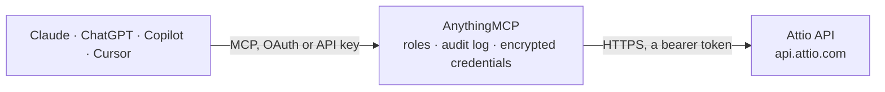

<!-- Generated by scripts/export-github-catalog.mjs in the anythingmcp-website repository. Do not edit by hand. -->

# Attio MCP connector

Drive Attio (modern relationship-graph CRM) from any AI agent: records (people, companies, deals, custom objects), lists, tasks, notes. 12 tools, Bearer auth. The AnythingMCP connector gives Claude, ChatGPT, Microsoft Copilot, Cursor and Gemini 12 MCP tools for Attio: 6 read and 6 can change data.

**Category:** [CRM](../crm.md) · **Tools:** 12 · **Setup guide:** [anythingmcp.com](https://anythingmcp.com/guides/attio-to-mcp) · [Deutsch](https://anythingmcp.com/de/guides/attio-to-mcp) · [Italiano](https://anythingmcp.com/it/guides/attio-to-mcp) · [Español](https://anythingmcp.com/es/guides/attio-to-mcp) · [日本語](https://anythingmcp.com/ja/guides/attio-to-mcp) · [Русский](https://anythingmcp.com/ru/guides/attio-to-mcp) · [中文](https://anythingmcp.com/zh/guides/attio-to-mcp)

## Start without code

No installation and no terminal: AnythingMCP Cloud runs the Attio connector for you, operated by helpcode.ai in Frankfurt, Germany.

1. **Click the button above** and create an account or sign in. The Attio connector opens, ready to install.
2. **Paste the API key or token from your Attio account.** Every click is in the [step-by-step guide](https://anythingmcp.com/guides/attio-to-mcp).
3. **Click Install.** AnythingMCP shows the address of your MCP server.
4. **Add that address to your assistant:** [Claude](https://anythingmcp.com/guides/connect-attio-to-claude) · [ChatGPT](https://anythingmcp.com/guides/connect-attio-to-chatgpt) · [Microsoft Copilot](https://anythingmcp.com/guides/connect-attio-to-copilot) · [Cursor](https://anythingmcp.com/guides/connect-attio-to-cursor) · [Gemini CLI](https://anythingmcp.com/guides/connect-attio-to-gemini) · [Meta Muse](https://anythingmcp.com/guides/connect-attio-to-muse).
5. **Ask your first question**, for example: *Show me the company record for 'Helios Solar Solutions GmbH' and the primary contact info.*

Prefer help with the setup? [Talk to us](https://anythingmcp.com/contact).

## How it works

- **The AI client** speaks MCP (Streamable HTTP) to AnythingMCP and only sees tool names, descriptions and results. It never gets the Attio credentials.
- **AnythingMCP** checks the client's role, builds the call from the tool definition, adds the credentials (a bearer token), calls Attio, logs the call and returns the result.
- **Attio** sees an ordinary API client with the rights of the account the credentials belong to.

## Tools

| Tool | What it does | Access |
|---|---|---|
| [`attio_self`](#attio_self) | Return the token's identity (workspace_id, workspace_name, access_token id, permissions). | read |
| [`attio_list_objects`](#attio_list_objects) | List all objects defined in the workspace (built-in + custom). | read |
| [`attio_list_object_attributes`](#attio_list_object_attributes) | List attributes (fields) on an object. | read |
| [`attio_query_records`](#attio_query_records) | Query records on an object with filters + sorting. | write |
| [`attio_get_record`](#attio_get_record) | Fetch a single record by object + record_id. | read |
| [`attio_create_record`](#attio_create_record) | Create a record. | write |
| [`attio_update_record`](#attio_update_record) | Update a record (PATCH semantics — only updates passed values). | write |
| [`attio_assert_record`](#attio_assert_record) | Upsert by a unique attribute (e.g. email). | write |
| [`attio_list_lists`](#attio_list_lists) | List the workspace's lists (views/collections of records). | read |
| [`attio_add_record_to_list`](#attio_add_record_to_list) | Add a record (as a list entry) to a list. | write |
| [`attio_list_notes`](#attio_list_notes) | List notes on records. | read |
| [`attio_create_note`](#attio_create_note) | Add a note to a record. | write |

## Tool reference

Every parameter as the AI client sees it in `tools/list`. Source: [`packages/backend/src/adapters/intl/attio.json`](../../../packages/backend/src/adapters/intl/attio.json).

### `attio_self`

Return the token's identity (workspace_id, workspace_name, access_token id, permissions).

**Access:** read · **Call:** `GET /self`

No parameters.

### `attio_list_objects`

List all objects defined in the workspace (built-in + custom). Returns id, api_slug, singular_noun, plural_noun, created_at.

**Access:** read · **Call:** `GET /objects`

No parameters.

### `attio_list_object_attributes`

List attributes (fields) on an object. Returns id, api_slug, title, type (text/number/date/status/select/email-address/...), is_required, is_unique.

**Access:** read · **Call:** `GET /objects/{objectSlug}/attributes`

| Parameter | Type | Required | Description |
|---|---|---|---|
| `objectSlug` | string | yes | Object api slug (e.g. 'people', 'companies'). |

### `attio_query_records`

Query records on an object with filters + sorting.

**Access:** write · **Call:** `POST /objects/{objectSlug}/records/query`

| Parameter | Type | Required | Description |
|---|---|---|---|
| `objectSlug` | string | yes | Object api slug. |
| `filter` | object | no | Attio filter object, e.g. {email_addresses:{email_address:{contains:'@acme.com'}}}. |
| `sorts` | any[] | no | [{attribute:'last_interaction', field:'interacted_at', direction:'desc'}]. |
| `limit` | integer | no | Per page (default 100, max 1000). |
| `offset` | integer | no | Offset. |

### `attio_get_record`

Fetch a single record by object + record_id.

**Access:** read · **Call:** `GET /objects/{objectSlug}/records/{recordId}`

| Parameter | Type | Required | Description |
|---|---|---|---|
| `objectSlug` | string | yes | Object slug. |
| `recordId` | string | yes | Record UUID. |

### `attio_create_record`

Create a record. Values are nested under `values` and keyed by attribute api_slug. Most attributes accept ARRAYS even for single-value (Attio's design for multi-value support).

**Access:** write · **Call:** `POST /objects/{objectSlug}/records`

| Parameter | Type | Required | Description |
|---|---|---|---|
| `objectSlug` | string | yes | Object slug. |
| `data` | object | yes | {values: {api_slug: <value or [array of typed values]>, ...}}. E.g. for a person: {name:[{first_name:'Jane',last_name:'Doe'}], email_addresses:[{email_address:'a@b.com'}]}. |

### `attio_update_record`

Update a record (PATCH semantics — only updates passed values). Use append=true to add to multi-value, false to replace.

**Access:** write · **Call:** `PATCH /objects/{objectSlug}/records/{recordId}`

| Parameter | Type | Required | Description |
|---|---|---|---|
| `objectSlug` | string | yes | Object slug. |
| `recordId` | string | yes | Record UUID. |
| `data` | object | yes | {values:{...}} — only attributes to update. |

### `attio_assert_record`

Upsert by a unique attribute (e.g. email). Required: matching_attribute parameter to identify the unique attribute. Creates if missing, updates if exists.

**Access:** write · **Call:** `PUT /objects/{objectSlug}/records`

| Parameter | Type | Required | Description |
|---|---|---|---|
| `objectSlug` | string | yes | Object slug. |
| `data` | object | yes | {values:{...}} as in create. |
| `matching_attribute` | string | yes | Attribute api_slug used for matching (e.g. 'email_addresses'). |

### `attio_list_lists`

List the workspace's lists (views/collections of records). Returns id, name, parent_object, workspace_access.

**Access:** read · **Call:** `GET /lists`

No parameters.

### `attio_add_record_to_list`

Add a record (as a list entry) to a list. Required: listId + parent_record_id (the source record).

**Access:** write · **Call:** `POST /lists/{listId}/entries`

| Parameter | Type | Required | Description |
|---|---|---|---|
| `listId` | string | yes | List ID. |
| `data` | object | yes | {parent_object: 'people', parent_record_id: 'uuid', entry_values?: {stage?:[{value:'New'}], ...} — list-specific attributes}. |

### `attio_list_notes`

List notes on records.

**Access:** read · **Call:** `GET /notes`

| Parameter | Type | Required | Description |
|---|---|---|---|
| `limit` | integer | no | Per page. |
| `offset` | integer | no | Offset. |
| `parent_object` | string | no | Filter to notes on a specific object slug. |
| `parent_record_id` | string | no | Filter to notes on a specific record. |

### `attio_create_note`

Add a note to a record. format='plaintext' (default) or 'markdown'.

**Access:** write · **Call:** `POST /notes`

| Parameter | Type | Required | Description |
|---|---|---|---|
| `data` | object | yes | {parent_object: 'people', parent_record_id: 'uuid', title?: 'Meeting notes', format:'plaintext'\|'markdown', content:'Discussed Q3...'}. |

## Run it yourself

AnythingMCP is open source (AGPL-3.0). [Run it with Docker](../../../README.md#run-it-yourself), open **Connectors → Store**, pick **Attio** and enter `ATTIO_ACCESS_TOKEN`, then add your MCP server URL to the AI client.

[← CRM connectors](../crm.md) · [All categories](../README.md)
