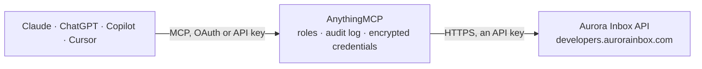

<!-- Generated by scripts/export-github-catalog.mjs in the anythingmcp-website repository. Do not edit by hand. -->

# Aurora Inbox MCP connector

Aurora Inbox WhatsApp CRM and shared inbox (Latin America), read-only: sales funnel and pipeline stages per team, chats with tags and opportunities, contacts and companies, users, WhatsApp channels … The AnythingMCP connector gives Claude, ChatGPT, Microsoft Copilot, Cursor and Gemini 18 MCP tools for Aurora Inbox, all read-only.

**Category:** [CRM](../crm.md) · **Tools:** 18 · **Setup guide:** [anythingmcp.com](https://anythingmcp.com/guides/aurora-inbox-to-mcp) · [Deutsch](https://anythingmcp.com/de/guides/aurora-inbox-to-mcp) · [Italiano](https://anythingmcp.com/it/guides/aurora-inbox-to-mcp) · [Español](https://anythingmcp.com/es/guides/aurora-inbox-to-mcp) · [日本語](https://anythingmcp.com/ja/guides/aurora-inbox-to-mcp) · [Русский](https://anythingmcp.com/ru/guides/aurora-inbox-to-mcp) · [中文](https://anythingmcp.com/zh/guides/aurora-inbox-to-mcp)

## Start without code

No installation and no terminal: AnythingMCP Cloud runs the Aurora Inbox connector for you, operated by helpcode.ai in Frankfurt, Germany.

1. **Click the button above** and create an account or sign in. The Aurora Inbox connector opens, ready to install.
2. **Paste the API key or token from your Aurora Inbox account.** Every click is in the [step-by-step guide](https://anythingmcp.com/guides/aurora-inbox-to-mcp).
3. **Click Install.** AnythingMCP shows the address of your MCP server.
4. **Add that address to your assistant:** [Claude](https://anythingmcp.com/guides/connect-aurora-inbox-to-claude) · [ChatGPT](https://anythingmcp.com/guides/connect-aurora-inbox-to-chatgpt) · [Microsoft Copilot](https://anythingmcp.com/guides/connect-aurora-inbox-to-copilot) · [Cursor](https://anythingmcp.com/guides/connect-aurora-inbox-to-cursor) · [Gemini CLI](https://anythingmcp.com/guides/connect-aurora-inbox-to-gemini) · [Meta Muse](https://anythingmcp.com/guides/connect-aurora-inbox-to-muse).
5. **Ask your first question**, for example: *Find the contact record for client 'Panificadora La Nueva' and give phone, email and creation date*

Prefer help with the setup? [Talk to us](https://anythingmcp.com/contact).

## How it works

- **The AI client** speaks MCP (Streamable HTTP) to AnythingMCP and only sees tool names, descriptions and results. It never gets the Aurora Inbox credentials.
- **AnythingMCP** checks the client's role, builds the call from the tool definition, adds the credentials (an API key), calls Aurora Inbox, logs the call and returns the result.
- **Aurora Inbox** sees an ordinary API client with the rights of the account the credentials belong to.

## Tools

| Tool | What it does | Access |
|---|---|---|
| [`aurora_inbox_list_teams`](#aurora_inbox_list_teams) | List the teams (sales or support pipelines) with id, name, whether deal amounts are on and the members (id, name, role, assignable). | read |
| [`aurora_inbox_list_team_stages`](#aurora_inbox_list_team_stages) | List the pipeline stages of a team in order: id, name, description, position and status (open, won, lost). | read |
| [`aurora_inbox_get_funnel_report`](#aurora_inbox_get_funnel_report) | Get the sales funnel of a team: total opportunities and deal amount, and per stage the number of opportunities, deal amount and share. | read |
| [`aurora_inbox_list_users`](#aurora_inbox_list_users) | List the users (agents) of the account with id, name and e-mail. | read |
| [`aurora_inbox_list_tags`](#aurora_inbox_list_tags) | List the chat tags of the account with id and name, optionally with the number of chats carrying each tag. | read |
| [`aurora_inbox_search_chats`](#aurora_inbox_search_chats) | Search chats (WhatsApp, Messenger and other conversations), 25 per page, latest activity first: id, name, contact, phone, e-mail, company, last message and… | read |
| [`aurora_inbox_get_chat`](#aurora_inbox_get_chat) | Get one chat: contact, channel, assigned agents and team, status and latest activity. | read |
| [`aurora_inbox_list_chat_tags`](#aurora_inbox_list_chat_tags) | List the tags on one chat (id and name), to see how the team classified the conversation. | read |
| [`aurora_inbox_list_chat_opportunities`](#aurora_inbox_list_chat_opportunities) | List the sales opportunities (deals) linked to one chat: team, stage, amount, assigned user and dates. | read |
| [`aurora_inbox_list_contacts`](#aurora_inbox_list_contacts) | List contacts, up to 100 per page: id, name, e-mail, phone, company and creation date. | read |
| [`aurora_inbox_get_contact`](#aurora_inbox_get_contact) | Get one contact with its details and custom property values. | read |
| [`aurora_inbox_list_custom_properties`](#aurora_inbox_list_custom_properties) | List the custom property definitions for contacts or sales products: id, name, key (nameId), type (text, number, boolean, datetime, choice) and the options… | read |
| [`aurora_inbox_list_companies`](#aurora_inbox_list_companies) | List companies, up to 100 per page, with id, name and details; search by keyword. | read |
| [`aurora_inbox_list_channels`](#aurora_inbox_list_channels) | List the connected channels of one kind: WhatsApp Business (app), WhatsApp Cloud API or Messenger, with id, name and number or page. | read |
| [`aurora_inbox_list_whatsapp_templates`](#aurora_inbox_list_whatsapp_templates) | List the WhatsApp message templates of the account, up to 100 per page: name, category (MARKETING, UTILITY, AUTHENTICATION), language, status and content. | read |
| [`aurora_inbox_list_calendar_events`](#aurora_inbox_list_calendar_events) | List events of the Aurora calendar (including synced external calendars): either every event of one chat (chat_id), or the events between from and to,… | read |
| [`aurora_inbox_list_bookings`](#aurora_inbox_list_bookings) | List appointment bookings of the scheduling module: service, location, provider, customer chat, start and end, status (0 pending, 1 confirmed, 2 completed,… | read |
| [`aurora_inbox_list_scheduling_setup`](#aurora_inbox_list_scheduling_setup) | List the scheduling set-up: Services (duration, buffers, capacity, price), Locations or Providers (the people or resources that can be booked), with ids for… | read |

## Tool reference

Every parameter as the AI client sees it in `tools/list`. Source: [`packages/backend/src/adapters/intl/aurora-inbox.json`](../../../packages/backend/src/adapters/intl/aurora-inbox.json).

### `aurora_inbox_list_teams`

List the teams (sales or support pipelines) with id, name, whether deal amounts are on and the members (id, name, role, assignable). The id is what the funnel, stages and chat filters take. Use it to check the connection.

**Access:** read · **Call:** `GET /Teams`

No parameters.

### `aurora_inbox_list_team_stages`

List the pipeline stages of a team in order: id, name, description, position and status (open, won, lost).

**Access:** read · **Call:** `GET /Teams/{team_id}/Stages`

| Parameter | Type | Required | Description |
|---|---|---|---|
| `team_id` | string | yes | Team id (UUID) from aurora_inbox_list_teams. |

### `aurora_inbox_get_funnel_report`

Get the sales funnel of a team: total opportunities and deal amount, and per stage the number of opportunities, deal amount and share. Filter by opportunity creation date and by one assigned user.

**Access:** read · **Call:** `GET /Teams/{team_id}/FunnelReport`

| Parameter | Type | Required | Description |
|---|---|---|---|
| `team_id` | string | yes | Team id (UUID). |
| `from` | string | no | Opportunities created at or after. ISO 8601, e.g. 2026-10-01T00:00:00Z. |
| `to` | string | no | Opportunities created at or before. ISO 8601, e.g. 2026-10-01T00:00:00Z. |
| `user_id` | string | no | Only opportunities assigned to this user (UUID from aurora_inbox_list_users). |

### `aurora_inbox_list_users`

List the users (agents) of the account with id, name and e-mail.

**Access:** read · **Call:** `GET /Users`

No parameters.

### `aurora_inbox_list_tags`

List the chat tags of the account with id and name, optionally with the number of chats carrying each tag.

**Access:** read · **Call:** `GET /Tags`

| Parameter | Type | Required | Description |
|---|---|---|---|
| `include_room_count` | boolean | no | true to add the number of chats per tag. |

### `aurora_inbox_search_chats`

Search chats (WhatsApp, Messenger and other conversations), 25 per page, latest activity first: id, name, contact, phone, e-mail, company, last message and time, unread count, unanswered flag. Filter by text, channel, team, unread or unanswered. Read-only, although it is a POST.

**Access:** read · **Call:** `POST /Chats/Search`

| Parameter | Type | Required | Description |
|---|---|---|---|
| `search_term` | string | no | Text to look for in names, phone numbers and messages. |
| `team_id` | string | no | Only chats of this team (UUID). |
| `channel_id` | string | no | Only chats of this channel (UUID from aurora_inbox_list_channels). |
| `unread` | boolean | no | true for chats with unread messages only. |
| `unanswered` | boolean | no | true for chats waiting for an answer only. |
| `page` | integer | no | Page, starting at 1. |

### `aurora_inbox_get_chat`

Get one chat: contact, channel, assigned agents and team, status and latest activity.

**Access:** read · **Call:** `GET /Chats/{chat_id}`

| Parameter | Type | Required | Description |
|---|---|---|---|
| `chat_id` | string | yes | Chat id (UUID) from aurora_inbox_search_chats. |

### `aurora_inbox_list_chat_tags`

List the tags on one chat (id and name), to see how the team classified the conversation.

**Access:** read · **Call:** `GET /Chats/{chat_id}/Tags`

| Parameter | Type | Required | Description |
|---|---|---|---|
| `chat_id` | string | yes | Chat id (UUID). |

### `aurora_inbox_list_chat_opportunities`

List the sales opportunities (deals) linked to one chat: team, stage, amount, assigned user and dates.

**Access:** read · **Call:** `GET /Chats/{chat_id}/Opportunities`

| Parameter | Type | Required | Description |
|---|---|---|---|
| `chat_id` | string | yes | Chat id (UUID). |

### `aurora_inbox_list_contacts`

List contacts, up to 100 per page: id, name, e-mail, phone, company and creation date. Search by keyword and filter by creation date. totalCount and totalPages tell how many there are.

**Access:** read · **Call:** `GET /Contacts`

| Parameter | Type | Required | Description |
|---|---|---|---|
| `search` | string | no | Name, phone or e-mail to look for. |
| `created_after` | string | no | Created at or after. ISO 8601, e.g. 2026-10-01T00:00:00Z. |
| `created_before` | string | no | Created at or before. ISO 8601, e.g. 2026-10-01T00:00:00Z. |
| `page` | integer | no | Page, starting at 1. |
| `page_size` | integer | no | Contacts per page, 1 to 100. |

### `aurora_inbox_get_contact`

Get one contact with its details and custom property values.

**Access:** read · **Call:** `GET /Contacts/{contact_id}`

| Parameter | Type | Required | Description |
|---|---|---|---|
| `contact_id` | string | yes | Contact id (UUID). |

### `aurora_inbox_list_custom_properties`

List the custom property definitions for contacts or sales products: id, name, key (nameId), type (text, number, boolean, datetime, choice) and the options of choice fields.

**Access:** read · **Call:** `GET /CustomProperties`

| Parameter | Type | Required | Description |
|---|---|---|---|
| `entity` | `Contact` \| `SalesProduct` | yes | Which entity. |

### `aurora_inbox_list_companies`

List companies, up to 100 per page, with id, name and details; search by keyword.

**Access:** read · **Call:** `GET /Companies`

| Parameter | Type | Required | Description |
|---|---|---|---|
| `search` | string | no | Company name to look for. |
| `page` | integer | no | Page, starting at 1. |
| `page_size` | integer | no | Companies per page, 1 to 100. |

### `aurora_inbox_list_channels`

List the connected channels of one kind: WhatsApp Business (app), WhatsApp Cloud API or Messenger, with id, name and number or page. The id is what channel_id takes in aurora_inbox_search_chats.

**Access:** read · **Call:** `GET /Channels/{channel_type}`

| Parameter | Type | Required | Description |
|---|---|---|---|
| `channel_type` | `WhatsAppBusiness` \| `WhatsAppCloudAPI` \| `Messenger` | yes | Kind of channel. |

### `aurora_inbox_list_whatsapp_templates`

List the WhatsApp message templates of the account, up to 100 per page: name, category (MARKETING, UTILITY, AUTHENTICATION), language, status and content. Status reflects the last sync with Meta.

**Access:** read · **Call:** `GET /Channels/Whatsapp/Templates`

| Parameter | Type | Required | Description |
|---|---|---|---|
| `category` | `MARKETING` \| `UTILITY` \| `AUTHENTICATION` | no | Template category. |
| `language` | string | no | Language code, e.g. es, pt_BR. |
| `status` | string | no | Template status, e.g. APPROVED. |
| `search` | string | no | Text to look for. |
| `page` | integer | no | Page, starting at 1. |
| `page_size` | integer | no | Templates per page, 1 to 100. |

### `aurora_inbox_list_calendar_events`

List events of the Aurora calendar (including synced external calendars): either every event of one chat (chat_id), or the events between from and to, optionally of one user.

**Access:** read · **Call:** `GET /Calendar/Events`

| Parameter | Type | Required | Description |
|---|---|---|---|
| `from` | string | no | Start of the range. ISO 8601, e.g. 2026-10-01T00:00:00Z. |
| `to` | string | no | End of the range. ISO 8601, e.g. 2026-10-01T00:00:00Z. |
| `user_id` | string | no | Only this user's events (UUID). |
| `chat_id` | string | no | Every event attached to this chat (UUID); no date range needed. |

### `aurora_inbox_list_bookings`

List appointment bookings of the scheduling module: service, location, provider, customer chat, start and end, status (0 pending, 1 confirmed, 2 completed, 3 cancelled, 4 no-show, 5 rescheduled). Filter by start window, service, location, provider, chat or status.

**Access:** read · **Call:** `GET /Scheduling/Bookings`

| Parameter | Type | Required | Description |
|---|---|---|---|
| `from` | string | no | Bookings starting at or after. ISO 8601, e.g. 2026-10-01T00:00:00Z. |
| `to` | string | no | Bookings starting at or before. ISO 8601, e.g. 2026-10-01T00:00:00Z. |
| `service_id` | string | no | Service id (UUID). |
| `location_id` | string | no | Location id (UUID). |
| `service_provider_id` | string | no | Service provider id (UUID). |
| `chat_id` | string | no | Chat id (UUID). |
| `status` | `0` \| `1` \| `2` \| `3` \| `4` \| `5` | no | 0 pending, 1 confirmed, 2 completed, 3 cancelled, 4 no-show, 5 rescheduled. |
| `timezone` | string | no | IANA time zone for the returned times, e.g. America/Bogota. |

### `aurora_inbox_list_scheduling_setup`

List the scheduling set-up: Services (duration, buffers, capacity, price), Locations or Providers (the people or resources that can be booked), with ids for aurora_inbox_list_bookings.

**Access:** read · **Call:** `GET /Scheduling/{resource}`

| Parameter | Type | Required | Description |
|---|---|---|---|
| `resource` | `Services` \| `Locations` \| `Providers` | yes | What to list. |

## Run it yourself

AnythingMCP is open source (AGPL-3.0). [Run it with Docker](../../../README.md#run-it-yourself), open **Connectors → Store**, pick **Aurora Inbox** and enter `AURORA_INBOX_API_KEY`, then add your MCP server URL to the AI client.

[← CRM connectors](../crm.md) · [All categories](../README.md)
