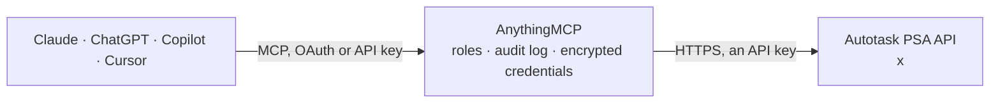

<!-- Generated by scripts/export-github-catalog.mjs in the anythingmcp-website repository. Do not edit by hand. -->

# Autotask PSA MCP connector

Autotask PSA by Datto (Kaseya): query companies, contacts, tickets and notes, time entries, projects and tasks, resources, contracts and configuration items; create and update tickets, add notes and log time. The AnythingMCP connector gives Claude, ChatGPT, Microsoft Copilot, Cursor and Gemini 23 MCP tools for Autotask PSA: 19 read and 4 can change data.

**Category:** [IT Service Management](../itsm.md) · **Tools:** 23 · **Setup guide:** [anythingmcp.com](https://anythingmcp.com/guides/autotask-to-mcp) · [Deutsch](https://anythingmcp.com/de/guides/autotask-to-mcp) · [Italiano](https://anythingmcp.com/it/guides/autotask-to-mcp) · [Español](https://anythingmcp.com/es/guides/autotask-to-mcp) · [日本語](https://anythingmcp.com/ja/guides/autotask-to-mcp) · [Русский](https://anythingmcp.com/ru/guides/autotask-to-mcp) · [中文](https://anythingmcp.com/zh/guides/autotask-to-mcp)

## Start without code

No installation and no terminal: AnythingMCP Cloud runs the Autotask PSA connector for you, operated by helpcode.ai in Frankfurt, Germany.

1. **Click the button above** and create an account or sign in. The Autotask PSA connector opens, ready to install.
2. **Paste the API key or token from your Autotask PSA account.** Every click is in the [step-by-step guide](https://anythingmcp.com/guides/autotask-to-mcp).
3. **Click Install.** AnythingMCP shows the address of your MCP server.
4. **Add that address to your assistant:** [Claude](https://anythingmcp.com/guides/connect-autotask-to-claude) · [ChatGPT](https://anythingmcp.com/guides/connect-autotask-to-chatgpt) · [Microsoft Copilot](https://anythingmcp.com/guides/connect-autotask-to-copilot) · [Cursor](https://anythingmcp.com/guides/connect-autotask-to-cursor) · [Gemini CLI](https://anythingmcp.com/guides/connect-autotask-to-gemini) · [Meta Muse](https://anythingmcp.com/guides/connect-autotask-to-muse).
5. **Ask your first question**, for example: *What's the companyID and primary phone for GreenLeaf GmbH in our Autotask DB?*

Prefer help with the setup? [Talk to us](https://anythingmcp.com/contact).

## How it works

- **The AI client** speaks MCP (Streamable HTTP) to AnythingMCP and only sees tool names, descriptions and results. It never gets the Autotask PSA credentials.
- **AnythingMCP** checks the client's role, builds the call from the tool definition, adds the credentials (an API key), calls Autotask PSA, logs the call and returns the result.
- **Autotask PSA** sees an ordinary API client with the rights of the account the credentials belong to.

## Tools

| Tool | What it does | Access |
|---|---|---|
| [`autotask_query_companies`](#autotask_query_companies) | Query companies (customers, prospects, vendors) with an Autotask filter: name, type, phone, address, owner resource and active flag. | read |
| [`autotask_get_company`](#autotask_get_company) | Get one company by id with all standard fields and user-defined fields. | read |
| [`autotask_query_contacts`](#autotask_query_contacts) | Query contacts (people at customer companies) with an Autotask filter: name, email, phone, company and active flag. | read |
| [`autotask_get_contact`](#autotask_get_contact) | Get one contact by id: name, company, email addresses, phones, title and active flag. | read |
| [`autotask_query_tickets`](#autotask_query_tickets) | Query service desk tickets with an Autotask filter: number, title, status, priority, queue, company, contact, assigned resource, due date and SLA fields. | read |
| [`autotask_count_tickets`](#autotask_count_tickets) | Count the tickets matching an Autotask filter without returning them, for example open tickets per queue. | read |
| [`autotask_get_ticket`](#autotask_get_ticket) | Get one ticket by id with all fields: title, description, status, priority, queue, issue and sub-issue type, company, contact, assigned resource, dates and… | read |
| [`autotask_query_ticket_notes`](#autotask_query_ticket_notes) | Query ticket notes with an Autotask filter, usually by ticketID: title, description, note type, publish (who can see it), creator and date. | read |
| [`autotask_query_time_entries`](#autotask_query_time_entries) | Query time entries with an Autotask filter: resource, ticket or task, date worked, start and end time, hours worked and to bill, role, billing code and notes. | read |
| [`autotask_get_time_entry`](#autotask_get_time_entry) | Get one time entry by id: resource, ticket or task, dates, hours worked, hours to bill, role, billing code, summary and internal notes. | read |
| [`autotask_query_projects`](#autotask_query_projects) | Query projects with an Autotask filter: name, number, company, status, type, project lead, start and end dates, estimated and actual hours. | read |
| [`autotask_get_project`](#autotask_get_project) | Get one project by id with status, type, company, lead resource, dates, hours, revenue fields and user-defined fields. | read |
| [`autotask_query_tasks`](#autotask_query_tasks) | Query project tasks with an Autotask filter, usually by projectID: title, status, assigned resource, phase, start and end dates, estimated and remaining hours. | read |
| [`autotask_query_resources`](#autotask_query_resources) | Query resources (Autotask users: technicians, employees) with an Autotask filter: name, email, title, active flag and default service desk role. | read |
| [`autotask_get_resource`](#autotask_get_resource) | Get one resource (Autotask user) by id: name, email, title, active flag, location, license type and default role. | read |
| [`autotask_query_contracts`](#autotask_query_contracts) | Query customer contracts with an Autotask filter: name, number, company, type (time and materials, fixed price, block hours, retainer, recurring service),… | read |
| [`autotask_query_configuration_items`](#autotask_query_configuration_items) | Query configuration items (managed devices and assets) with an Autotask filter: reference title, serial number, company, product, install date and active flag. | read |
| [`autotask_get_entity_fields`](#autotask_get_entity_fields) | Describe the fields of an entity: name, data type, whether it is required or read-only, and for picklists the allowed values with their numeric ids and labels. | read |
| [`autotask_query`](#autotask_query) | Query any Autotask entity that has no dedicated tool (for example Roles, BillingCodes, ServiceCalls, Opportunities, Invoices, Quotes) with an Autotask filter. | read |
| [`autotask_create_ticket`](#autotask_create_ticket) | Create a service desk ticket for a company. | write |
| [`autotask_update_ticket`](#autotask_update_ticket) | Change fields of an existing ticket: status, priority, queue, assigned resource, due date, title or description. | write |
| [`autotask_create_ticket_note`](#autotask_create_ticket_note) | Add a note to a ticket. | write |
| [`autotask_create_time_entry`](#autotask_create_time_entry) | Log time worked on a ticket or task for a resource: date, start and end time or hours, role, summary and internal notes. | write |

## Tool reference

Every parameter as the AI client sees it in `tools/list`. Source: [`packages/backend/src/adapters/intl/autotask.json`](../../../packages/backend/src/adapters/intl/autotask.json).

### `autotask_query_companies`

Query companies (customers, prospects, vendors) with an Autotask filter: name, type, phone, address, owner resource and active flag. Up to 500 per call. Read-only POST search.

**Access:** read · **Call:** `POST /Companies/query`

| Parameter | Type | Required | Description |
|---|---|---|---|
| `filter` | object[] | no | Autotask filter array, combined with AND. Each item is {"op": "<operator>", "field": "<field name>", "value": <value>}. Operators: eq, noteq, gt, gte, lt, lte, beginsWith, endsWith, contains, exist, notExist, in, notIn (value is an array for in/notIn). Group with {"op": "or", "items": [...]}; user-defined fields need "udf": true. Default matches every record: [{"op": "gte", "field": "id", "value": 0}]. Example: [{"op": "contains", "field": "companyName", "value": "Acme"}] |
| `max_records` | integer | no | Records per call, 1 to 500. Default 500. |
| `include_fields` | string[] | no | Return only these fields, for example ["id", "title", "status"]. Smaller answers; default all fields. |

### `autotask_get_company`

Get one company by id with all standard fields and user-defined fields. Use it after autotask_query_companies or when another record carries a companyID.

**Access:** read · **Call:** `GET /Companies/{id}`

| Parameter | Type | Required | Description |
|---|---|---|---|
| `id` | integer | yes | Company id (companyID on tickets, contacts and projects). |

### `autotask_query_contacts`

Query contacts (people at customer companies) with an Autotask filter: name, email, phone, company and active flag. Use it to find the contactID for a ticket. Read-only POST search.

**Access:** read · **Call:** `POST /Contacts/query`

| Parameter | Type | Required | Description |
|---|---|---|---|
| `filter` | object[] | no | Autotask filter array, combined with AND. Each item is {"op": "<operator>", "field": "<field name>", "value": <value>}. Operators: eq, noteq, gt, gte, lt, lte, beginsWith, endsWith, contains, exist, notExist, in, notIn (value is an array for in/notIn). Group with {"op": "or", "items": [...]}; user-defined fields need "udf": true. Default matches every record: [{"op": "gte", "field": "id", "value": 0}]. Example: [{"op": "eq", "field": "emailAddress", "value": "jane@example.com"}] |
| `max_records` | integer | no | Records per call, 1 to 500. Default 500. |
| `include_fields` | string[] | no | Return only these fields, for example ["id", "title", "status"]. Smaller answers; default all fields. |

### `autotask_get_contact`

Get one contact by id: name, company, email addresses, phones, title and active flag. Use it when a ticket or note carries a contactID.

**Access:** read · **Call:** `GET /Contacts/{id}`

| Parameter | Type | Required | Description |
|---|---|---|---|
| `id` | integer | yes | Contact id (contactID on tickets). |

### `autotask_query_tickets`

Query service desk tickets with an Autotask filter: number, title, status, priority, queue, company, contact, assigned resource, due date and SLA fields. Up to 500 per call. Read-only POST search.

**Access:** read · **Call:** `POST /Tickets/query`

| Parameter | Type | Required | Description |
|---|---|---|---|
| `filter` | object[] | no | Autotask filter array, combined with AND. Each item is {"op": "<operator>", "field": "<field name>", "value": <value>}. Operators: eq, noteq, gt, gte, lt, lte, beginsWith, endsWith, contains, exist, notExist, in, notIn (value is an array for in/notIn). Group with {"op": "or", "items": [...]}; user-defined fields need "udf": true. Default matches every record: [{"op": "gte", "field": "id", "value": 0}]. Example: [{"op": "eq", "field": "companyID", "value": 174}, {"op": "notIn", "field": "status", "value": [5]}] |
| `max_records` | integer | no | Records per call, 1 to 500. Default 500. |
| `include_fields` | string[] | no | Return only these fields, for example ["id", "title", "status"]. Smaller answers; default all fields. |

### `autotask_count_tickets`

Count the tickets matching an Autotask filter without returning them, for example open tickets per queue. Answers {queryCount}. Read-only POST search.

**Access:** read · **Call:** `POST /Tickets/query/count`

| Parameter | Type | Required | Description |
|---|---|---|---|
| `filter` | object[] | no | Autotask filter array, combined with AND. Each item is {"op": "<operator>", "field": "<field name>", "value": <value>}. Operators: eq, noteq, gt, gte, lt, lte, beginsWith, endsWith, contains, exist, notExist, in, notIn (value is an array for in/notIn). Group with {"op": "or", "items": [...]}; user-defined fields need "udf": true. Default matches every record: [{"op": "gte", "field": "id", "value": 0}]. Example: |

### `autotask_get_ticket`

Get one ticket by id with all fields: title, description, status, priority, queue, issue and sub-issue type, company, contact, assigned resource, dates and user-defined fields.

**Access:** read · **Call:** `GET /Tickets/{id}`

| Parameter | Type | Required | Description |
|---|---|---|---|
| `id` | integer | yes | Ticket id (not the ticket number T20261006.0001; query by ticketNumber to get the id). |

### `autotask_query_ticket_notes`

Query ticket notes with an Autotask filter, usually by ticketID: title, description, note type, publish (who can see it), creator and date. Read-only POST search.

**Access:** read · **Call:** `POST /TicketNotes/query`

| Parameter | Type | Required | Description |
|---|---|---|---|
| `filter` | object[] | no | Autotask filter array, combined with AND. Each item is {"op": "<operator>", "field": "<field name>", "value": <value>}. Operators: eq, noteq, gt, gte, lt, lte, beginsWith, endsWith, contains, exist, notExist, in, notIn (value is an array for in/notIn). Group with {"op": "or", "items": [...]}; user-defined fields need "udf": true. Default matches every record: [{"op": "gte", "field": "id", "value": 0}]. Example: [{"op": "eq", "field": "ticketID", "value": 12345}] |
| `max_records` | integer | no | Records per call, 1 to 500. Default 500. |
| `include_fields` | string[] | no | Return only these fields, for example ["id", "title", "status"]. Smaller answers; default all fields. |

### `autotask_query_time_entries`

Query time entries with an Autotask filter: resource, ticket or task, date worked, start and end time, hours worked and to bill, role, billing code and notes. Read-only POST search.

**Access:** read · **Call:** `POST /TimeEntries/query`

| Parameter | Type | Required | Description |
|---|---|---|---|
| `filter` | object[] | no | Autotask filter array, combined with AND. Each item is {"op": "<operator>", "field": "<field name>", "value": <value>}. Operators: eq, noteq, gt, gte, lt, lte, beginsWith, endsWith, contains, exist, notExist, in, notIn (value is an array for in/notIn). Group with {"op": "or", "items": [...]}; user-defined fields need "udf": true. Default matches every record: [{"op": "gte", "field": "id", "value": 0}]. Example: [{"op": "eq", "field": "resourceID", "value": 29682885}, {"op": "gte", "field": "dateWorked", "value": "2026-10-01"}] |
| `max_records` | integer | no | Records per call, 1 to 500. Default 500. |
| `include_fields` | string[] | no | Return only these fields, for example ["id", "title", "status"]. Smaller answers; default all fields. |

### `autotask_get_time_entry`

Get one time entry by id: resource, ticket or task, dates, hours worked, hours to bill, role, billing code, summary and internal notes.

**Access:** read · **Call:** `GET /TimeEntries/{id}`

| Parameter | Type | Required | Description |
|---|---|---|---|
| `id` | integer | yes | Time entry id from autotask_query_time_entries. |

### `autotask_query_projects`

Query projects with an Autotask filter: name, number, company, status, type, project lead, start and end dates, estimated and actual hours. Read-only POST search.

**Access:** read · **Call:** `POST /Projects/query`

| Parameter | Type | Required | Description |
|---|---|---|---|
| `filter` | object[] | no | Autotask filter array, combined with AND. Each item is {"op": "<operator>", "field": "<field name>", "value": <value>}. Operators: eq, noteq, gt, gte, lt, lte, beginsWith, endsWith, contains, exist, notExist, in, notIn (value is an array for in/notIn). Group with {"op": "or", "items": [...]}; user-defined fields need "udf": true. Default matches every record: [{"op": "gte", "field": "id", "value": 0}]. Example: [{"op": "eq", "field": "companyID", "value": 174}] |
| `max_records` | integer | no | Records per call, 1 to 500. Default 500. |
| `include_fields` | string[] | no | Return only these fields, for example ["id", "title", "status"]. Smaller answers; default all fields. |

### `autotask_get_project`

Get one project by id with status, type, company, lead resource, dates, hours, revenue fields and user-defined fields.

**Access:** read · **Call:** `GET /Projects/{id}`

| Parameter | Type | Required | Description |
|---|---|---|---|
| `id` | integer | yes | Project id from autotask_query_projects. |

### `autotask_query_tasks`

Query project tasks with an Autotask filter, usually by projectID: title, status, assigned resource, phase, start and end dates, estimated and remaining hours. Read-only POST search.

**Access:** read · **Call:** `POST /Tasks/query`

| Parameter | Type | Required | Description |
|---|---|---|---|
| `filter` | object[] | no | Autotask filter array, combined with AND. Each item is {"op": "<operator>", "field": "<field name>", "value": <value>}. Operators: eq, noteq, gt, gte, lt, lte, beginsWith, endsWith, contains, exist, notExist, in, notIn (value is an array for in/notIn). Group with {"op": "or", "items": [...]}; user-defined fields need "udf": true. Default matches every record: [{"op": "gte", "field": "id", "value": 0}]. Example: [{"op": "eq", "field": "projectID", "value": 2981}] |
| `max_records` | integer | no | Records per call, 1 to 500. Default 500. |
| `include_fields` | string[] | no | Return only these fields, for example ["id", "title", "status"]. Smaller answers; default all fields. |

### `autotask_query_resources`

Query resources (Autotask users: technicians, employees) with an Autotask filter: name, email, title, active flag and default service desk role. Use it to get the resourceID. Read-only POST search.

**Access:** read · **Call:** `POST /Resources/query`

| Parameter | Type | Required | Description |
|---|---|---|---|
| `filter` | object[] | no | Autotask filter array, combined with AND. Each item is {"op": "<operator>", "field": "<field name>", "value": <value>}. Operators: eq, noteq, gt, gte, lt, lte, beginsWith, endsWith, contains, exist, notExist, in, notIn (value is an array for in/notIn). Group with {"op": "or", "items": [...]}; user-defined fields need "udf": true. Default matches every record: [{"op": "gte", "field": "id", "value": 0}]. Example: [{"op": "eq", "field": "isActive", "value": true}] |
| `max_records` | integer | no | Records per call, 1 to 500. Default 500. |
| `include_fields` | string[] | no | Return only these fields, for example ["id", "title", "status"]. Smaller answers; default all fields. |

### `autotask_get_resource`

Get one resource (Autotask user) by id: name, email, title, active flag, location, license type and default role.

**Access:** read · **Call:** `GET /Resources/{id}`

| Parameter | Type | Required | Description |
|---|---|---|---|
| `id` | integer | yes | Resource id (assignedResourceID on tickets, resourceID on time entries). |

### `autotask_query_contracts`

Query customer contracts with an Autotask filter: name, number, company, type (time and materials, fixed price, block hours, retainer, recurring service), status and dates. Read-only POST search.

**Access:** read · **Call:** `POST /Contracts/query`

| Parameter | Type | Required | Description |
|---|---|---|---|
| `filter` | object[] | no | Autotask filter array, combined with AND. Each item is {"op": "<operator>", "field": "<field name>", "value": <value>}. Operators: eq, noteq, gt, gte, lt, lte, beginsWith, endsWith, contains, exist, notExist, in, notIn (value is an array for in/notIn). Group with {"op": "or", "items": [...]}; user-defined fields need "udf": true. Default matches every record: [{"op": "gte", "field": "id", "value": 0}]. Example: [{"op": "eq", "field": "companyID", "value": 174}, {"op": "eq", "field": "status", "value": 1}] |
| `max_records` | integer | no | Records per call, 1 to 500. Default 500. |
| `include_fields` | string[] | no | Return only these fields, for example ["id", "title", "status"]. Smaller answers; default all fields. |

### `autotask_query_configuration_items`

Query configuration items (managed devices and assets) with an Autotask filter: reference title, serial number, company, product, install date and active flag. Read-only POST search.

**Access:** read · **Call:** `POST /ConfigurationItems/query`

| Parameter | Type | Required | Description |
|---|---|---|---|
| `filter` | object[] | no | Autotask filter array, combined with AND. Each item is {"op": "<operator>", "field": "<field name>", "value": <value>}. Operators: eq, noteq, gt, gte, lt, lte, beginsWith, endsWith, contains, exist, notExist, in, notIn (value is an array for in/notIn). Group with {"op": "or", "items": [...]}; user-defined fields need "udf": true. Default matches every record: [{"op": "gte", "field": "id", "value": 0}]. Example: [{"op": "contains", "field": "referenceTitle", "value": "SRV"}] |
| `max_records` | integer | no | Records per call, 1 to 500. Default 500. |
| `include_fields` | string[] | no | Return only these fields, for example ["id", "title", "status"]. Smaller answers; default all fields. |

### `autotask_get_entity_fields`

Describe the fields of an entity: name, data type, whether it is required or read-only, and for picklists the allowed values with their numeric ids and labels. Call it before filtering or writing status, priority, queue or type fields.

**Access:** read · **Call:** `GET /{entity}/entityInformation/fields`

| Parameter | Type | Required | Description |
|---|---|---|---|
| `entity` | string | yes | Entity name in the REST URL, for example Tickets, Companies, Contacts, TimeEntries, Projects, Tasks, Resources, Contracts, ConfigurationItems, TicketNotes. |

### `autotask_query`

Query any Autotask entity that has no dedicated tool (for example Roles, BillingCodes, ServiceCalls, Opportunities, Invoices, Quotes) with an Autotask filter. Read-only POST search.

**Access:** read · **Call:** `POST /{entity}/query`

| Parameter | Type | Required | Description |
|---|---|---|---|
| `entity` | string | yes | Entity name in the REST URL, for example Roles, BillingCodes, ServiceCalls, Opportunities, Invoices. |
| `filter` | object[] | no | Autotask filter array, combined with AND. Each item is {"op": "<operator>", "field": "<field name>", "value": <value>}. Operators: eq, noteq, gt, gte, lt, lte, beginsWith, endsWith, contains, exist, notExist, in, notIn (value is an array for in/notIn). Group with {"op": "or", "items": [...]}; user-defined fields need "udf": true. Default matches every record: [{"op": "gte", "field": "id", "value": 0}]. Example: [{"op": "eq", "field": "isActive", "value": true}] |
| `max_records` | integer | no | Records per call, 1 to 500. Default 500. |
| `include_fields` | string[] | no | Return only these fields, for example ["id", "title", "status"]. Smaller answers; default all fields. |

### `autotask_create_ticket`

Create a service desk ticket for a company. Status, priority, queue and type values are numeric picklist ids from autotask_get_entity_fields on Tickets. Returns the new ticket id as itemId.

**Access:** write · **Call:** `POST /Tickets`

| Parameter | Type | Required | Description |
|---|---|---|---|
| `company_id` | integer | yes | companyID of the customer. |
| `title` | string | yes | Ticket title, at most 255 characters. |
| `description` | string | no | Ticket description. |
| `status` | integer | yes | Status picklist id, for example 1 = New in a default setup. |
| `priority` | integer | yes | Priority picklist id. |
| `queue_id` | integer | no | Queue picklist id. Autotask needs a queue or an assigned resource. |
| `due_date_time` | string | no | Due date and time in UTC, ISO 8601, for example 2026-10-08T16:00:00Z. |
| `contact_id` | integer | no | contactID of the person who reported it. |
| `assigned_resource_id` | integer | no | Resource to assign. Requires assigned_resource_role_id. |
| `assigned_resource_role_id` | integer | no | Role of the assigned resource (from autotask_query with entity Roles). |
| `issue_type` | integer | no | Issue type picklist id. |
| `sub_issue_type` | integer | no | Sub-issue type picklist id. |
| `ticket_type` | integer | no | Ticket type picklist id (service request, incident, problem, change request, alert). |
| `source` | integer | no | Source picklist id (phone, email, web portal, ...). |
| `configuration_item_id` | integer | no | Configuration item the ticket is about. |
| `contract_id` | integer | no | Contract to bill the work against. |

### `autotask_update_ticket`

Change fields of an existing ticket: status, priority, queue, assigned resource, due date, title or description. Only the fields passed are changed (PATCH). Returns the ticket id.

**Access:** write · **Call:** `PATCH /Tickets`

| Parameter | Type | Required | Description |
|---|---|---|---|
| `id` | integer | yes | Ticket id. |
| `title` | string | no | New title. |
| `description` | string | no | New description. |
| `status` | integer | no | New status picklist id, for example 5 = Complete in a default setup. |
| `priority` | integer | no | New priority picklist id. |
| `queue_id` | integer | no | New queue picklist id. |
| `due_date_time` | string | no | New due date and time in UTC, ISO 8601. |
| `assigned_resource_id` | integer | no | Resource to assign. Requires assigned_resource_role_id. |
| `assigned_resource_role_id` | integer | no | Role of the assigned resource. |
| `resolution` | string | no | Resolution text, usually set when completing the ticket. |

### `autotask_create_ticket_note`

Add a note to a ticket. publish 1 makes it visible to all Autotask users and the customer portal, 2 to internal users only. Customers may be notified by workflow rules.

**Access:** write · **Call:** `POST /Tickets/{ticket_id}/Notes`

| Parameter | Type | Required | Description |
|---|---|---|---|
| `ticket_id` | integer | yes | Ticket id. |
| `title` | string | yes | Note title. |
| `description` | string | yes | Note text, at most 32000 characters. |
| `note_type` | integer | yes | Note type picklist id from autotask_get_entity_fields on TicketNotes, for example 1 = Task Detail. |
| `publish` | integer | yes | Visibility picklist id: 1 = All Autotask Users, 2 = Internal Only (default setup). |

### `autotask_create_time_entry`

Log time worked on a ticket or task for a resource: date, start and end time or hours, role, summary and internal notes. Returns the new time entry id.

**Access:** write · **Call:** `POST /TimeEntries`

| Parameter | Type | Required | Description |
|---|---|---|---|
| `resource_id` | integer | yes | Resource who did the work. |
| `ticket_id` | integer | no | Ticket worked on (give ticket_id or task_id). |
| `task_id` | integer | no | Project task worked on. |
| `role_id` | integer | yes | Role the work is billed as. |
| `date_worked` | string | yes | Date worked, ISO 8601, for example 2026-10-06. |
| `start_date_time` | string | no | Start in UTC, ISO 8601. |
| `end_date_time` | string | no | End in UTC, ISO 8601. |
| `hours_worked` | number | no | Hours worked, when start and end are not given. |
| `summary_notes` | string | yes | Summary shown on the ticket and invoice. |
| `internal_notes` | string | no | Internal notes, not shown to the customer. |
| `billing_code_id` | integer | no | Work type (billing code) id. |
| `is_non_billable` | boolean | no | true to mark the time as non-billable. |

## Run it yourself

AnythingMCP is open source (AGPL-3.0). [Run it with Docker](../../../README.md#run-it-yourself), open **Connectors → Store**, pick **Autotask PSA** and enter `AUTOTASK_ZONE_HOST`, `AUTOTASK_USERNAME`, `AUTOTASK_SECRET`, `AUTOTASK_INTEGRATION_CODE`, then add your MCP server URL to the AI client.

[← IT Service Management connectors](../itsm.md) · [All categories](../README.md)
