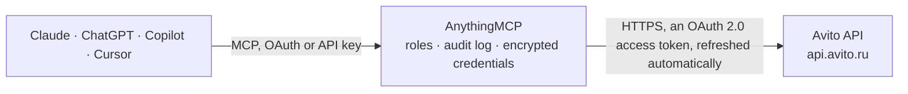

<!-- Generated by scripts/export-github-catalog.mjs in the anythingmcp-website repository. Do not edit by hand. -->

# Avito MCP connector

Let your AI work with your Avito business account: list your ads and change their prices, read views, contacts and calls statistics, check autoload uploads and their errors, the feed format and your … The AnythingMCP connector gives Claude, ChatGPT, Microsoft Copilot, Cursor and Gemini 25 MCP tools for Avito: 20 read and 5 can change data.

**Category:** [E-commerce](../e-commerce.md) · **Tools:** 25 · **Setup guide:** [anythingmcp.com](https://anythingmcp.com/guides/avito-to-mcp) · [Deutsch](https://anythingmcp.com/de/guides/avito-to-mcp) · [Italiano](https://anythingmcp.com/it/guides/avito-to-mcp) · [Español](https://anythingmcp.com/es/guides/avito-to-mcp) · [日本語](https://anythingmcp.com/ja/guides/avito-to-mcp) · [Русский](https://anythingmcp.com/ru/guides/avito-to-mcp) · [中文](https://anythingmcp.com/zh/guides/avito-to-mcp)

## Start without code

No installation and no terminal: AnythingMCP Cloud runs the Avito connector for you, operated by helpcode.ai in Frankfurt, Germany.

1. **Click the button above** and create an account or sign in. The Avito connector opens, ready to install.
2. **Sign in with your Avito account** when AnythingMCP asks. The first time, an admin creates a small app in the Avito developer console. Every click is in the [step-by-step guide](https://anythingmcp.com/guides/avito-to-mcp).
3. **Click Install.** AnythingMCP shows the address of your MCP server.
4. **Add that address to your assistant:** [Claude](https://anythingmcp.com/guides/connect-avito-to-claude) · [ChatGPT](https://anythingmcp.com/guides/connect-avito-to-chatgpt) · [Microsoft Copilot](https://anythingmcp.com/guides/connect-avito-to-copilot) · [Cursor](https://anythingmcp.com/guides/connect-avito-to-cursor) · [Gemini CLI](https://anythingmcp.com/guides/connect-avito-to-gemini) · [Meta Muse](https://anythingmcp.com/guides/connect-avito-to-muse).
5. **Ask your first question**, for example: *What's the status, URL and current price for my ad 76543 (office chair) on Avito?*

Prefer help with the setup? [Talk to us](https://anythingmcp.com/contact).

## How it works

- **The AI client** speaks MCP (Streamable HTTP) to AnythingMCP and only sees tool names, descriptions and results. It never gets the Avito credentials.
- **AnythingMCP** checks the client's role, builds the call from the tool definition, adds the credentials (an OAuth 2.0 access token, refreshed automatically), calls Avito, logs the call and returns the result.
- **Avito** sees an ordinary API client with the rights of the account the credentials belong to.

## Tools

| Tool | What it does | Access |
|---|---|---|
| [`avito_get_self`](#avito_get_self) | Read the Avito account the credentials belong to: its user id, name, email and profile URL. | read |
| [`avito_get_balance`](#avito_get_balance) | Read the Avito wallet balance of the account: real money (real) and bonus funds (bonus), in rubles. | read |
| [`avito_get_operations_history`](#avito_get_operations_history) | Read the wallet operations of the account (charges for listings and promotion services, top-ups, refunds) between two moments: amount in rubles and bonuses,… | read |
| [`avito_list_items`](#avito_list_items) | List the account's ads (items): id, title, price in rubles (null when none is set), status, category, address and URL. | read |
| [`avito_get_item`](#avito_get_item) | Read one ad of the account: status, URL, start and finish time, the autoload id from the feed file, and the paid promotion services applied (vip, highlight,… | read |
| [`avito_update_item_price`](#avito_update_item_price) | Change the price of one Avito ad, in whole rubles. | write |
| [`avito_get_item_stats`](#avito_get_item_stats) | Read views, contacts and favourites of up to 200 of the account's ads per day, week or month: uniqViews (unique viewers), uniqContacts (unique users who… | read |
| [`avito_get_calls_stats`](#avito_get_calls_stats) | Read call statistics of the account per ad and per day: calls, answered, new and newAnswered calls, optionally only for some ads. | read |
| [`avito_get_autoload_profile`](#avito_get_autoload_profile) | Read the account's autoload (bulk upload) settings: whether autoload is on, the feed files and their URLs, the report email and the upload schedule… | read |
| [`avito_update_autoload_profile`](#avito_update_autoload_profile) | Replace the account's autoload settings: on or off, feed files, report email and schedule. | write |
| [`avito_start_autoload_upload`](#avito_start_autoload_upload) | Start an upload of the feed file configured in the autoload settings now. | write |
| [`avito_list_autoload_uploads`](#avito_list_autoload_uploads) | List past autoload uploads, newest first: upload id, status (processing, success, success_warning, error and others), source (Url, Email, Web, Api), start… | read |
| [`avito_get_current_autoload_upload`](#avito_get_current_autoload_upload) | Read the current autoload upload: the latest one that processed at least one ad. | read |
| [`avito_list_current_autoload_upload_items`](#avito_list_current_autoload_upload_items) | List the ads of the current autoload upload with their feed id (ad_id), Avito id, status on Avito, URL, report section and messages (errors, warnings). | read |
| [`avito_get_last_successful_autoload_upload`](#avito_get_last_successful_autoload_upload) | Read the last autoload upload that processed every ad of the feed: status, start time, feed files, events and ad counts per report section. | read |
| [`avito_list_last_successful_autoload_upload_items`](#avito_list_last_successful_autoload_upload_items) | List the ads of the last completed autoload upload with their feed id (ad_id), Avito id, status on Avito, URL, report section and messages (errors, warnings). | read |
| [`avito_get_autoload_category_tree`](#avito_get_autoload_category_tree) | Read Avito's category tree for autoload feeds: category names, nested subcategories and the slug of each leaf, which avito_get_autoload_category_fields takes. | read |
| [`avito_get_autoload_category_fields`](#avito_get_autoload_category_fields) | Read the feed fields of one Avito category: each tag with its label, whether it is required (also depending on other fields), data type, allowed values or… | read |
| [`avito_get_feed_ids_by_avito_ids`](#avito_get_feed_ids_by_avito_ids) | Translate Avito ad ids into the ids the ads have in the autoload feed file (the Id field). | read |
| [`avito_get_avito_ids_by_feed_ids`](#avito_get_avito_ids_by_feed_ids) | Translate ids from the autoload feed file (the Id field) into Avito ad ids. | read |
| [`avito_list_chats`](#avito_list_chats) | List the account's Avito Messenger chats, newest activity first: chat id, the ad it is about (title, price, URL), the other user's name, and the last… | read |
| [`avito_get_chat`](#avito_get_chat) | Read one Avito Messenger chat: the ad it is about (title, price, URL, status), the users and the last message. | read |
| [`avito_list_messages`](#avito_list_messages) | Read the messages of one Avito Messenger chat, newest first: id, author id, direction (in from the buyer, out from the account), type (text, image, link,… | read |
| [`avito_mark_chat_read`](#avito_mark_chat_read) | Mark an Avito Messenger chat as read, as if the seller had opened it. | write |
| [`avito_send_message`](#avito_send_message) | Send a text message (at most 1,000 characters) in an Avito Messenger chat, on behalf of the account. | write |

## Tool reference

Every parameter as the AI client sees it in `tools/list`. Source: [`packages/backend/src/adapters/intl/avito.json`](../../../packages/backend/src/adapters/intl/avito.json).

### `avito_get_self`

Read the Avito account the credentials belong to: its user id, name, email and profile URL. Call it first: every tool that takes user_id needs this id.

**Access:** read · **Call:** `GET /core/v1/accounts/self`

No parameters.

### `avito_get_balance`

Read the Avito wallet balance of the account: real money (real) and bonus funds (bonus), in rubles.

**Access:** read · **Call:** `GET /core/v1/accounts/{user_id}/balance/`

| Parameter | Type | Required | Description |
|---|---|---|---|
| `user_id` | integer | yes | Your Avito user (account) id: the id returned by avito_get_self. |

### `avito_get_operations_history`

Read the wallet operations of the account (charges for listings and promotion services, top-ups, refunds) between two moments: amount in rubles and bonuses, operation type, service and item id. The window may be at most one week long and at most one year back. Read-only, although it is a POST.

**Access:** read · **Call:** `POST /core/v1/accounts/operations_history/`

| Parameter | Type | Required | Description |
|---|---|---|---|
| `dateTimeFrom` | string | yes | Start, as YYYY-MM-DDTHH:MM:SS (Moscow time), e.g. 2026-10-01T00:00:00. |
| `dateTimeTo` | string | yes | End, at most 7 days after dateTimeFrom, same format. |

### `avito_list_items`

List the account's ads (items): id, title, price in rubles (null when none is set), status, category, address and URL. Active ads by default; status takes several values separated by commas. Ads of employee sub-accounts are not listed. At most 25 requests a minute.

**Access:** read · **Call:** `GET /core/v1/items`

| Parameter | Type | Required | Description |
|---|---|---|---|
| `status` | string | no | Ad status, one or several separated by commas: active (default), removed, old (expired), blocked, rejected. |
| `category` | integer | no | Optional Avito category id to filter by, from Avito's category catalogue (catalog-categories.xml). |
| `updatedAtFrom` | string | no | Optional: only ads updated or edited on or after this day, YYYY-MM-DD. |
| `per_page` | integer | no | Ads per page (default 25, below 100). |
| `page` | integer | no | Page number, from 1. When a page returns fewer ads than per_page it is the last. |

### `avito_get_item`

Read one ad of the account: status, URL, start and finish time, the autoload id from the feed file, and the paid promotion services applied (vip, highlight, pushup, premium, xl) with their end dates. For views and contacts use avito_get_item_stats.

**Access:** read · **Call:** `GET /core/v1/accounts/{user_id}/items/{item_id}/`

| Parameter | Type | Required | Description |
|---|---|---|---|
| `user_id` | integer | yes | Your Avito user (account) id: the id returned by avito_get_self. |
| `item_id` | integer | yes | Avito item (ad) id, the number at the end of the ad's URL and the id in avito_list_items. |

### `avito_update_item_price`

Change the price of one Avito ad, in whole rubles. Works for goods, spare parts, cars and real estate (not short-term rentals). The new price is public at once. Before calling, tell the user the ad, the old price and the new one and wait for their confirmation. If the ad comes from an autoload feed, the next upload may set the feed's price again. At most 150 requests a minute.

**Access:** write · **Call:** `POST /core/v1/items/{item_id}/update_price`

| Parameter | Type | Required | Description |
|---|---|---|---|
| `item_id` | integer | yes | Avito item (ad) id, the number at the end of the ad's URL and the id in avito_list_items. |
| `price` | integer | yes | New price in whole rubles, e.g. 15000. |

### `avito_get_item_stats`

Read views, contacts and favourites of up to 200 of the account's ads per day, week or month: uniqViews (unique viewers), uniqContacts (unique users who asked for the phone or wrote) and uniqFavorites. At most 270 days back. Read-only, although it is a POST.

**Access:** read · **Call:** `POST /stats/v1/accounts/{user_id}/items`

| Parameter | Type | Required | Description |
|---|---|---|---|
| `user_id` | integer | yes | Your Avito user (account) id: the id returned by avito_get_self. |
| `itemIds` | integer[] | yes | Ad ids, at most 200, e.g. [123456789, 987654321]. |
| `dateFrom` | string | yes | First day, YYYY-MM-DD, at most 270 days ago. |
| `dateTo` | string | yes | Last day, YYYY-MM-DD (inclusive). |
| `fields` | `uniqViews` \| `uniqContacts` \| `uniqFavorites`[] | no | Counters to return; default all three. |
| `periodGrouping` | `day` \| `week` \| `month` | no | Sum per day (default), week (date is the first day of the week) or month. |

### `avito_get_calls_stats`

Read call statistics of the account per ad and per day: calls, answered, new and newAnswered calls, optionally only for some ads. itemId 0 means a call not attributed to an ad. Read-only, although it is a POST.

**Access:** read · **Call:** `POST /core/v1/accounts/{user_id}/calls/stats/`

| Parameter | Type | Required | Description |
|---|---|---|---|
| `user_id` | integer | yes | Your Avito user (account) id: the id returned by avito_get_self. |
| `dateFrom` | string | yes | First day, YYYY-MM-DD. |
| `dateTo` | string | yes | Last day, YYYY-MM-DD. |
| `itemIds` | integer[] | no | Optional ad ids; leave out for all ads. |

### `avito_get_autoload_profile`

Read the account's autoload (bulk upload) settings: whether autoload is on, the feed files and their URLs, the report email and the upload schedule (weekdays 0 Monday to 6 Sunday, hour slots 0 to 23, ads per slot).

**Access:** read · **Call:** `GET /autoload/v2/profile`

No parameters.

### `avito_update_autoload_profile`

Replace the account's autoload settings: on or off, feed files, report email and schedule. Every field is replaced, so read avito_get_autoload_profile first and send it back with only the requested change. Switching autoload off or changing a feed URL changes what Avito publishes. Switched off at install; tell the user exactly what will change and wait for their confirmation.

**Access:** write · **Call:** `POST /autoload/v2/profile`

| Parameter | Type | Required | Description |
|---|---|---|---|
| `autoload_enabled` | boolean | yes | true to keep regular uploads running, false to stop them. |
| `feeds_data` | object[] | yes | Feed files, each {feed_name, feed_url}. |
| `report_email` | string | yes | Email that receives the upload reports. |
| `schedule` | object[] | yes | Upload schedule, as returned by avito_get_autoload_profile. |
| `agreement` | boolean | no | Acceptance of Avito's autoload rules; required by Avito when the profile is created. |

### `avito_start_autoload_upload`

Start an upload of the feed file configured in the autoload settings now. Every ad in the file that can be published or activated will be, ignoring the per-slot limits of the schedule, which can cost listing fees. Only one such upload per hour. Switched off at install; tell the user what will happen and wait for their confirmation.

**Access:** write · **Call:** `POST /autoload/v1/upload`

No parameters.

### `avito_list_autoload_uploads`

List past autoload uploads, newest first: upload id, status (processing, success, success_warning, error and others), source (Url, Email, Web, Api), start time, feed files, events and the count of ads per report section.

**Access:** read · **Call:** `GET /autoload/v4/uploads`

| Parameter | Type | Required | Description |
|---|---|---|---|
| `dateFrom` | string | no | Optional: uploads from this moment, RFC 3339, e.g. 2026-10-01T00:00:00Z. |
| `dateTo` | string | no | Optional: uploads up to this moment, RFC 3339. |
| `perPage` | integer | no | Uploads per page (default 10, at most 50). |
| `page` | integer | no | Page number, from 1; meta.pages says how many there are. |

### `avito_get_current_autoload_upload`

Read the current autoload upload: the latest one that processed at least one ad. Its numbers can still change while it runs; for stable results use avito_get_last_successful_autoload_upload. Returns status, start time, feed files, events and ad counts per report section.

**Access:** read · **Call:** `GET /autoload/v4/uploads/current`

No parameters.

### `avito_list_current_autoload_upload_items`

List the ads of the current autoload upload with their feed id (ad_id), Avito id, status on Avito, URL, report section and messages (errors, warnings). Filter by feed ids or report sections. 404 when there is no such upload.

**Access:** read · **Call:** `GET /autoload/v4/uploads/current/items`

| Parameter | Type | Required | Description |
|---|---|---|---|
| `query` | string | no | Optional: only these ads, as ids from your feed file (the Id field) separated by commas or \|. |
| `sections` | string | no | Optional: only these report sections, as section slugs separated by commas (the slugs come from the upload's stats). |
| `perPage` | integer | no | Ads per page (default 20, at most 100). |
| `page` | integer | no | Page number, from 1; meta.pages says how many there are. |

### `avito_get_last_successful_autoload_upload`

Read the last autoload upload that processed every ad of the feed: status, start time, feed files, events and ad counts per report section. 404 when there is none yet.

**Access:** read · **Call:** `GET /autoload/v4/uploads/last_successful`

No parameters.

### `avito_list_last_successful_autoload_upload_items`

List the ads of the last completed autoload upload with their feed id (ad_id), Avito id, status on Avito, URL, report section and messages (errors, warnings). Filter by feed ids or report sections. 404 when there is no such upload.

**Access:** read · **Call:** `GET /autoload/v4/uploads/last_successful/items`

| Parameter | Type | Required | Description |
|---|---|---|---|
| `query` | string | no | Optional: only these ads, as ids from your feed file (the Id field) separated by commas or \|. |
| `sections` | string | no | Optional: only these report sections, as section slugs separated by commas (the slugs come from the upload's stats). |
| `perPage` | integer | no | Ads per page (default 20, at most 100). |
| `page` | integer | no | Page number, from 1; meta.pages says how many there are. |

### `avito_get_autoload_category_tree`

Read Avito's category tree for autoload feeds: category names, nested subcategories and the slug of each leaf, which avito_get_autoload_category_fields takes. Large; the answer is cut at about 100 KB.

**Access:** read · **Call:** `GET /autoload/v1/user-docs/tree`

No parameters.

### `avito_get_autoload_category_fields`

Read the feed fields of one Avito category: each tag with its label, whether it is required (also depending on other fields), data type, allowed values or links to value catalogues, and warnings. Use it to build or fix a feed file.

**Access:** read · **Call:** `GET /autoload/v1/user-docs/node/{node_slug}/fields`

| Parameter | Type | Required | Description |
|---|---|---|---|
| `node_slug` | string | yes | Category slug from avito_get_autoload_category_tree. |

### `avito_get_feed_ids_by_avito_ids`

Translate Avito ad ids into the ids the ads have in the autoload feed file (the Id field). Returns pairs of avito_id and ad_id.

**Access:** read · **Call:** `GET /autoload/v2/items/ad_ids`

| Parameter | Type | Required | Description |
|---|---|---|---|
| `query` | string | yes | Avito ad ids separated by commas or \|, e.g. 2841234567,2841234568. |

### `avito_get_avito_ids_by_feed_ids`

Translate ids from the autoload feed file (the Id field) into Avito ad ids. Returns pairs of ad_id and avito_id; avito_id is missing for ads not published yet.

**Access:** read · **Call:** `GET /autoload/v2/items/avito_ids`

| Parameter | Type | Required | Description |
|---|---|---|---|
| `query` | string | yes | Feed ids separated by commas or \|, e.g. sku-1001,sku-1002. |

### `avito_list_chats`

List the account's Avito Messenger chats, newest activity first: chat id, the ad it is about (title, price, URL), the other user's name, and the last message with its direction (in or out) and time (Unix seconds). Filter by ads or unread chats. Needs a tariff with Messenger API access.

**Access:** read · **Call:** `GET /messenger/v2/accounts/{user_id}/chats`

| Parameter | Type | Required | Description |
|---|---|---|---|
| `user_id` | integer | yes | Your Avito user (account) id: the id returned by avito_get_self. |
| `item_ids` | string | no | Optional: only chats about these ad ids, separated by commas. |
| `unread_only` | boolean | no | true for unread chats only. |
| `chat_types` | string | no | Optional chat types separated by commas: u2i about ads (Avito's default), u2u between users, a2u from Avito. |
| `limit` | integer | no | Chats per page (default 20 here, at most 100). |
| `offset` | integer | no | Chats to skip, for the next page (at most 1000). |

### `avito_get_chat`

Read one Avito Messenger chat: the ad it is about (title, price, URL, status), the users and the last message.

**Access:** read · **Call:** `GET /messenger/v2/accounts/{user_id}/chats/{chat_id}`

| Parameter | Type | Required | Description |
|---|---|---|---|
| `user_id` | integer | yes | Your Avito user (account) id: the id returned by avito_get_self. |
| `chat_id` | string | yes | Chat id as returned by avito_list_chats, e.g. u2i-AbCdEf123. |

### `avito_list_messages`

Read the messages of one Avito Messenger chat, newest first: id, author id, direction (in from the buyer, out from the account), type (text, image, link, item, location, call, voice, system, deleted), time (Unix seconds), whether it was read, and the content. Reading does not mark the chat as read.

**Access:** read · **Call:** `GET /messenger/v3/accounts/{user_id}/chats/{chat_id}/messages/`

| Parameter | Type | Required | Description |
|---|---|---|---|
| `user_id` | integer | yes | Your Avito user (account) id: the id returned by avito_get_self. |
| `chat_id` | string | yes | Chat id as returned by avito_list_chats, e.g. u2i-AbCdEf123. |
| `limit` | integer | no | Messages per page (default 50 here, at most 100). |
| `offset` | integer | no | Messages to skip, for older ones (at most 1000). |

### `avito_mark_chat_read`

Mark an Avito Messenger chat as read, as if the seller had opened it. The unread badge disappears for the people working in the account, so they may miss the message. Switched off at install; confirm with the user first.

**Access:** write · **Call:** `POST /messenger/v1/accounts/{user_id}/chats/{chat_id}/read`

| Parameter | Type | Required | Description |
|---|---|---|---|
| `user_id` | integer | yes | Your Avito user (account) id: the id returned by avito_get_self. |
| `chat_id` | string | yes | Chat id as returned by avito_list_chats, e.g. u2i-AbCdEf123. |

### `avito_send_message`

Send a text message (at most 1,000 characters) in an Avito Messenger chat, on behalf of the account. The buyer receives it at once and it cannot be unsent here. Switched off at install; show the user the exact text and the chat and wait for their confirmation.

**Access:** write · **Call:** `POST /messenger/v1/accounts/{user_id}/chats/{chat_id}/messages`

| Parameter | Type | Required | Description |
|---|---|---|---|
| `user_id` | integer | yes | Your Avito user (account) id: the id returned by avito_get_self. |
| `chat_id` | string | yes | Chat id as returned by avito_list_chats, e.g. u2i-AbCdEf123. |
| `text` | string | yes | Message text, at most 1,000 characters. |

## Run it yourself

AnythingMCP is open source (AGPL-3.0). [Run it with Docker](../../../README.md#run-it-yourself), open **Connectors → Store**, pick **Avito** and enter `AVITO_CLIENT_ID`, `AVITO_CLIENT_SECRET`, then add your MCP server URL to the AI client.

[← E-commerce connectors](../e-commerce.md) · [All categories](../README.md)
