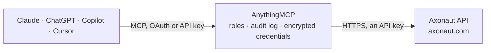

<!-- Generated by scripts/export-github-catalog.mjs in the anythingmcp-website repository. Do not edit by hand. -->

# Axonaut MCP connector

Axonaut — French all-in-one CRM, invoicing and expense management for very small businesses: companies, employees, invoices, quotations, expenses, products and projects. The AnythingMCP connector gives Claude, ChatGPT, Microsoft Copilot, Cursor and Gemini 9 MCP tools for Axonaut, all read-only.

**Category:** [ERP](../erp.md) · **Tools:** 9 · **Setup guide:** [anythingmcp.com](https://anythingmcp.com/guides/axonaut-to-mcp) · [Deutsch](https://anythingmcp.com/de/guides/axonaut-to-mcp) · [Italiano](https://anythingmcp.com/it/guides/axonaut-to-mcp) · [Español](https://anythingmcp.com/es/guides/axonaut-to-mcp) · [日本語](https://anythingmcp.com/ja/guides/axonaut-to-mcp) · [Русский](https://anythingmcp.com/ru/guides/axonaut-to-mcp) · [中文](https://anythingmcp.com/zh/guides/axonaut-to-mcp)

## Start without code

No installation and no terminal: AnythingMCP Cloud runs the Axonaut connector for you, operated by helpcode.ai in Frankfurt, Germany.

1. **Click the button above** and create an account or sign in. The Axonaut connector opens, ready to install.
2. **Paste the API key or token from your Axonaut account.** Every click is in the [step-by-step guide](https://anythingmcp.com/guides/axonaut-to-mcp).
3. **Click Install.** AnythingMCP shows the address of your MCP server.
4. **Add that address to your assistant:** [Claude](https://anythingmcp.com/guides/connect-axonaut-to-claude) · [ChatGPT](https://anythingmcp.com/guides/connect-axonaut-to-chatgpt) · [Microsoft Copilot](https://anythingmcp.com/guides/connect-axonaut-to-copilot) · [Cursor](https://anythingmcp.com/guides/connect-axonaut-to-cursor) · [Gemini CLI](https://anythingmcp.com/guides/connect-axonaut-to-gemini) · [Meta Muse](https://anythingmcp.com/guides/connect-axonaut-to-muse).
5. **Ask your first question**, for example: *Show invoice INV-2026-112 for Solaria SAS: date, total, status and payments recorded.*

Prefer help with the setup? [Talk to us](https://anythingmcp.com/contact).

## How it works

- **The AI client** speaks MCP (Streamable HTTP) to AnythingMCP and only sees tool names, descriptions and results. It never gets the Axonaut credentials.
- **AnythingMCP** checks the client's role, builds the call from the tool definition, adds the credentials (an API key), calls Axonaut, logs the call and returns the result.
- **Axonaut** sees an ordinary API client with the rights of the account the credentials belong to.

## Tools

| Tool | What it does | Access |
|---|---|---|
| [`axonaut_list_companies`](#axonaut_list_companies) | List companies — Axonaut's clients and prospects — with their name, SIRET, address, category and assigned user. | read |
| [`axonaut_get_company`](#axonaut_get_company) | Read one company in full: its addresses, custom fields, the employees attached to it and its accounting identifiers. | read |
| [`axonaut_list_employees`](#axonaut_list_employees) | List employees — the *people* attached to client companies, not your own staff — with their name, e-mail, phone and role. | read |
| [`axonaut_list_invoices`](#axonaut_list_invoices) | List invoices with their number, date, company, pre-tax and total amounts and payment state. | read |
| [`axonaut_get_invoice`](#axonaut_get_invoice) | Read one invoice in full: every product line with quantity, price and VAT, the totals, and the payments recorded against it. | read |
| [`axonaut_list_quotations`](#axonaut_list_quotations) | List quotations (devis) with their number, date, company, total and whether they have been accepted. | read |
| [`axonaut_list_expenses`](#axonaut_list_expenses) | List expenses and supplier invoices with their date, supplier, category, pre-tax amount and VAT — the cost side of the ledger. | read |
| [`axonaut_list_products`](#axonaut_list_products) | List catalogue products with their reference, name, pre-tax price, VAT rate and stock quantity. | read |
| [`axonaut_list_projects`](#axonaut_list_projects) | List projects with their name, company, budget, status and dates — the anchor for time and profitability questions. | read |

## Tool reference

Every parameter as the AI client sees it in `tools/list`. Source: [`packages/backend/src/adapters/fr/axonaut.json`](../../../packages/backend/src/adapters/fr/axonaut.json).

### `axonaut_list_companies`

List companies — Axonaut's clients and prospects — with their name, SIRET, address, category and assigned user. 100 rows per page, no page size.

**Access:** read · **Call:** `GET /companies`

| Parameter | Type | Required | Description |
|---|---|---|---|
| `page` | number | no | Page number, starting at 1 (100 rows per page). Sent as the `page` HTTP header, which is where Axonaut reads it. |
| `name` | string | no | Name fragment: returns companies whose name contains this text (sent as Axonaut's `search` filter). |

### `axonaut_get_company`

Read one company in full: its addresses, custom fields, the employees attached to it and its accounting identifiers.

**Access:** read · **Call:** `GET /companies/{companyId}`

| Parameter | Type | Required | Description |
|---|---|---|---|
| `companyId` | number | yes | Numeric Axonaut company id. |

### `axonaut_list_employees`

List employees — the *people* attached to client companies, not your own staff — with their name, e-mail, phone and role.

**Access:** read · **Call:** `GET /employees`

| Parameter | Type | Required | Description |
|---|---|---|---|
| `page` | number | no | Page number, starting at 1 (100 rows per page). Sent as the `page` HTTP header, which is where Axonaut reads it. |

### `axonaut_list_invoices`

List invoices with their number, date, company, pre-tax and total amounts and payment state. Dates in the filters are DD/MM/YYYY, not ISO.

**Access:** read · **Call:** `GET /invoices`

| Parameter | Type | Required | Description |
|---|---|---|---|
| `page` | number | no | Page number, starting at 1 (100 rows per page). Sent as the `page` HTTP header, which is where Axonaut reads it. |
| `date_before` | string | no | Latest invoice date, DD/MM/YYYY — French format, not ISO. |
| `date_after` | string | no | Earliest invoice date, DD/MM/YYYY — French format, not ISO. |

### `axonaut_get_invoice`

Read one invoice in full: every product line with quantity, price and VAT, the totals, and the payments recorded against it.

**Access:** read · **Call:** `GET /invoices/{invoiceId}`

| Parameter | Type | Required | Description |
|---|---|---|---|
| `invoiceId` | number | yes | Numeric Axonaut invoice id. |

### `axonaut_list_quotations`

List quotations (devis) with their number, date, company, total and whether they have been accepted.

**Access:** read · **Call:** `GET /quotations`

| Parameter | Type | Required | Description |
|---|---|---|---|
| `page` | number | no | Page number, starting at 1 (100 rows per page). Sent as the `page` HTTP header, which is where Axonaut reads it. |
| `date_after` | string | no | Earliest quotation date, YYYY-MM-DD — unlike invoices and expenses, Axonaut's quotations filter takes ISO dates. |

### `axonaut_list_expenses`

List expenses and supplier invoices with their date, supplier, category, pre-tax amount and VAT — the cost side of the ledger.

**Access:** read · **Call:** `GET /expenses`

| Parameter | Type | Required | Description |
|---|---|---|---|
| `page` | number | no | Page number, starting at 1 (100 rows per page). Sent as the `page` HTTP header, which is where Axonaut reads it. |
| `date_after` | string | no | Earliest expense date, DD/MM/YYYY. |

### `axonaut_list_products`

List catalogue products with their reference, name, pre-tax price, VAT rate and stock quantity.

**Access:** read · **Call:** `GET /products`

| Parameter | Type | Required | Description |
|---|---|---|---|
| `page` | number | no | Page number, starting at 1 (100 rows per page). Sent as the `page` HTTP header, which is where Axonaut reads it. |

### `axonaut_list_projects`

List projects with their name, company, budget, status and dates — the anchor for time and profitability questions.

**Access:** read · **Call:** `GET /projects`

| Parameter | Type | Required | Description |
|---|---|---|---|
| `page` | number | no | Page number, starting at 1 (100 rows per page). Sent as the `page` HTTP header, which is where Axonaut reads it. |

## Run it yourself

AnythingMCP is open source (AGPL-3.0). [Run it with Docker](../../../README.md#run-it-yourself), open **Connectors → Store**, pick **Axonaut** and enter `AXONAUT_API_KEY`, then add your MCP server URL to the AI client.

[← ERP connectors](../erp.md) · [All categories](../README.md)
