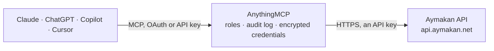

<!-- Generated by scripts/export-github-catalog.mjs in the anythingmcp-website repository. Do not edit by hand. -->

# Aymakan MCP connector

Aymakan courier (Saudi Arabia) from an AI agent: track shipments by tracking number or order reference, list your shipments, AWB label links, pickup requests and time slots, cities, PUDO points, … The AnythingMCP connector gives Claude, ChatGPT, Microsoft Copilot, Cursor and Gemini 17 MCP tools for Aymakan: 13 read and 4 can change data.

**Category:** [Logistics](../logistics.md) · **Tools:** 17 · **Setup guide:** [anythingmcp.com](https://anythingmcp.com/guides/aymakan-to-mcp) · [Deutsch](https://anythingmcp.com/de/guides/aymakan-to-mcp) · [Italiano](https://anythingmcp.com/it/guides/aymakan-to-mcp) · [Español](https://anythingmcp.com/es/guides/aymakan-to-mcp) · [日本語](https://anythingmcp.com/ja/guides/aymakan-to-mcp) · [Русский](https://anythingmcp.com/ru/guides/aymakan-to-mcp) · [中文](https://anythingmcp.com/zh/guides/aymakan-to-mcp)

## Start without code

No installation and no terminal: AnythingMCP Cloud runs the Aymakan connector for you, operated by helpcode.ai in Frankfurt, Germany.

1. **Click the button above** and create an account or sign in. The Aymakan connector opens, ready to install.
2. **Paste the API key or token from your Aymakan account.** Every click is in the [step-by-step guide](https://anythingmcp.com/guides/aymakan-to-mcp).
3. **Click Install.** AnythingMCP shows the address of your MCP server.
4. **Add that address to your assistant:** [Claude](https://anythingmcp.com/guides/connect-aymakan-to-claude) · [ChatGPT](https://anythingmcp.com/guides/connect-aymakan-to-chatgpt) · [Microsoft Copilot](https://anythingmcp.com/guides/connect-aymakan-to-copilot) · [Cursor](https://anythingmcp.com/guides/connect-aymakan-to-cursor) · [Gemini CLI](https://anythingmcp.com/guides/connect-aymakan-to-gemini) · [Meta Muse](https://anythingmcp.com/guides/connect-aymakan-to-muse).
5. **Ask your first question**, for example: *What's the status and COD for order reference ORD-2026-412?*

Prefer help with the setup? [Talk to us](https://anythingmcp.com/contact).

## How it works

- **The AI client** speaks MCP (Streamable HTTP) to AnythingMCP and only sees tool names, descriptions and results. It never gets the Aymakan credentials.
- **AnythingMCP** checks the client's role, builds the call from the tool definition, adds the credentials (an API key), calls Aymakan, logs the call and returns the result.
- **Aymakan** sees an ordinary API client with the rights of the account the credentials belong to.

## Tools

| Tool | What it does | Access |
|---|---|---|
| [`aymakan_ping`](#aymakan_ping) | Check the Aymakan API status and the API key: returns status, environment (production) and logged_in Yes or No. | read |
| [`aymakan_get_tracking`](#aymakan_get_tracking) | Track one or more Aymakan shipments by tracking number: full shipment data with delivery and collection details, COD amount, weight and pieces, current… | read |
| [`aymakan_get_shipments_by_reference`](#aymakan_get_shipments_by_reference) | Get Aymakan shipments by your own order reference (the reference given when the shipment was created): full shipment data, tracking_info and the AWB label URL. | read |
| [`aymakan_list_shipments`](#aymakan_list_shipments) | List every shipment of the account, 100 per page (fixed by Aymakan): tracking number, reference, service type, COD flag and amount, pieces, delivery name,… | read |
| [`aymakan_get_awb_label`](#aymakan_get_awb_label) | Get the link to the PDF AWB label of one shipment by tracking number. | read |
| [`aymakan_get_bulk_awb_labels`](#aymakan_get_bulk_awb_labels) | Get one PDF link with the AWB labels of several shipments. | read |
| [`aymakan_list_pickup_requests`](#aymakan_list_pickup_requests) | List the pickup requests of the account with id, pickup code, type, contact, city and address, number of shipments and picked shipments, time slot, pickup… | read |
| [`aymakan_list_pickup_cities`](#aymakan_list_pickup_cities) | List the cities where Aymakan accepts pickup requests, in English and Arabic. | read |
| [`aymakan_get_time_slots`](#aymakan_get_time_slots) | Get the pickup time slots available to the account on a date (e.g. morning, afternoon, evening with their hours). | read |
| [`aymakan_list_cities`](#aymakan_list_cities) | List the cities Aymakan delivers to, in English (city_en) and Arabic (city_ar). | read |
| [`aymakan_list_pudo_locations`](#aymakan_list_pudo_locations) | List PUDO (pickup and drop-off) points such as lockers and partner shops with id, name in English and Arabic, address, city, coordinates, provider, type and… | read |
| [`aymakan_list_dropoff_locations`](#aymakan_list_dropoff_locations) | List Aymakan's warehouses where shipments can be dropped off: name, city, address, manager, phone, e-mail and coordinates. | read |
| [`aymakan_list_addresses`](#aymakan_list_addresses) | List the collection addresses saved on the Aymakan account: id, title, name, e-mail, city, address, postcode, neighbourhood, phone, country and description. | read |
| [`aymakan_create_shipment`](#aymakan_create_shipment) | Create a new Aymakan shipment. | write |
| [`aymakan_cancel_shipment`](#aymakan_cancel_shipment) | Cancel an Aymakan shipment by tracking number. | write |
| [`aymakan_create_pickup_request`](#aymakan_create_pickup_request) | Book a courier pickup: date (today or later), time slot from aymakan_get_time_slots, city from aymakan_list_pickup_cities, contact name and phone, address… | write |
| [`aymakan_cancel_pickup_request`](#aymakan_cancel_pickup_request) | Cancel a pickup request by its id (from aymakan_list_pickup_requests). | write |

## Tool reference

Every parameter as the AI client sees it in `tools/list`. Source: [`packages/backend/src/adapters/intl/aymakan.json`](../../../packages/backend/src/adapters/intl/aymakan.json).

### `aymakan_ping`

Check the Aymakan API status and the API key: returns status, environment (production) and logged_in Yes or No. Costs nothing; use it to test the connection.

**Access:** read · **Call:** `GET /ping`

No parameters.

### `aymakan_get_tracking`

Track one or more Aymakan shipments by tracking number: full shipment data with delivery and collection details, COD amount, weight and pieces, current status and status_label, and tracking_info with every status code (AY-0001 and later), description in English and Arabic and time.

**Access:** read · **Call:** `GET /shipping/track/{tracking_numbers}`

| Parameter | Type | Required | Description |
|---|---|---|---|
| `tracking_numbers` | string | yes | One or more tracking numbers, comma-separated without spaces, e.g. AY2866494373,AY2866494374. |

### `aymakan_get_shipments_by_reference`

Get Aymakan shipments by your own order reference (the reference given when the shipment was created): full shipment data, tracking_info and the AWB label URL. Several references comma-separated. A reference that does not exist answers 422 No Shipments Found.

**Access:** read · **Call:** `GET /shipping/by_reference/{references}`

| Parameter | Type | Required | Description |
|---|---|---|---|
| `references` | string | yes | One or more order references, comma-separated without spaces. |

### `aymakan_list_shipments`

List every shipment of the account, 100 per page (fixed by Aymakan): tracking number, reference, service type, COD flag and amount, pieces, delivery name, city, address and phone, collection city, attempts, status_code and status_label, and the submission, pickup, delivery and update times. Page with page up to last_page.

**Access:** read · **Call:** `GET /customer/shipments`

| Parameter | Type | Required | Description |
|---|---|---|---|
| `page` | integer | no | Page number, starting at 1. |

### `aymakan_get_awb_label`

Get the link to the PDF AWB label of one shipment by tracking number. Aymakan returns the link only while the shipment is in status AY-0001 (created, not yet picked up); otherwise 422 Not found.

**Access:** read · **Call:** `GET /shipping/awb/tracking/{tracking_number}`

| Parameter | Type | Required | Description |
|---|---|---|---|
| `tracking_number` | string | yes | Tracking number, e.g. AY2866494373. |

### `aymakan_get_bulk_awb_labels`

Get one PDF link with the AWB labels of several shipments. Every shipment must be in status AY-0001; otherwise 422 lists the tracking numbers that were not found.

**Access:** read · **Call:** `GET /shipping/bulk_awb/trackings/{tracking_numbers}`

| Parameter | Type | Required | Description |
|---|---|---|---|
| `tracking_numbers` | string | yes | Tracking numbers, comma-separated without spaces. |

### `aymakan_list_pickup_requests`

List the pickup requests of the account with id, pickup code, type, contact, city and address, number of shipments and picked shipments, time slot, pickup date, warehouse and status (pending, processing, completed, cancelled). 20 per page.

**Access:** read · **Call:** `GET /pickup_request/list`

| Parameter | Type | Required | Description |
|---|---|---|---|
| `page` | integer | no | Page number, starting at 1. |

### `aymakan_list_pickup_cities`

List the cities where Aymakan accepts pickup requests, in English and Arabic. Use the English name in aymakan_create_pickup_request.

**Access:** read · **Call:** `GET /pickup_request/cities`

No parameters.

### `aymakan_get_time_slots`

Get the pickup time slots available to the account on a date (e.g. morning, afternoon, evening with their hours). The date must be today or later.

**Access:** read · **Call:** `GET /time_slots/{pickup_date}`

| Parameter | Type | Required | Description |
|---|---|---|---|
| `pickup_date` | string | yes | Pickup date, YYYY-MM-DD, today or later. |

### `aymakan_list_cities`

List the cities Aymakan delivers to, in English (city_en) and Arabic (city_ar). Use city_en exactly as delivery_city or collection_city of a shipment. Public list; read it once per conversation.

**Access:** read · **Call:** `GET /cities`

No parameters.

### `aymakan_list_pudo_locations`

List PUDO (pickup and drop-off) points such as lockers and partner shops with id, name in English and Arabic, address, city, coordinates, provider, type and opening hours per weekday. The id is the pudo_location_id of a shipment with service LOC.

**Access:** read · **Call:** `GET /pudo/locations`

| Parameter | Type | Required | Description |
|---|---|---|---|
| `city` | string | no | Only points in this city, English name, e.g. Riyadh. |

### `aymakan_list_dropoff_locations`

List Aymakan's warehouses where shipments can be dropped off: name, city, address, manager, phone, e-mail and coordinates.

**Access:** read · **Call:** `GET /dropoff_locations`

No parameters.

### `aymakan_list_addresses`

List the collection addresses saved on the Aymakan account: id, title, name, e-mail, city, address, postcode, neighbourhood, phone, country and description.

**Access:** read · **Call:** `GET /address/list`

No parameters.

### `aymakan_create_shipment`

Create a new Aymakan shipment. Required: requested_by, declared_value, delivery_name, delivery_city (from aymakan_list_cities), delivery_address, delivery_country, delivery_phone, collection_name, collection_city, collection_address, collection_country, collection_phone and pieces; for cash on delivery is_cod 1 and cod_amount. Returns the tracking number. Installed switched off; books a real shipment: show the user every field and get a yes first.

**Access:** write · **Call:** `POST /shipping/create`

| Parameter | Type | Required | Description |
|---|---|---|---|
| `shipment` | object | yes | Shipment fields as Aymakan names them. |

### `aymakan_cancel_shipment`

Cancel an Aymakan shipment by tracking number. Only possible while the shipment is in status AY-0001 (created); otherwise 422 This shipping can not be cancelled. Installed switched off; get a yes from the user first.

**Access:** write · **Call:** `POST /shipping/cancel`

| Parameter | Type | Required | Description |
|---|---|---|---|
| `tracking_number` | string | yes | Tracking number of the shipment to cancel. |

### `aymakan_create_pickup_request`

Book a courier pickup: date (today or later), time slot from aymakan_get_time_slots, city from aymakan_list_pickup_cities, contact name and phone, address and number of shipments. Aymakan limits pickup requests per customer and day. Installed switched off; get a yes from the user first.

**Access:** write · **Call:** `POST /pickup_request/create`

| Parameter | Type | Required | Description |
|---|---|---|---|
| `pickup_date` | string | yes | YYYY-MM-DD. |
| `time_slot` | string | yes | Slot key from aymakan_get_time_slots, e.g. morning. |
| `city` | string | yes | English city name from aymakan_list_pickup_cities. |
| `contact_name` | string | yes | Name of the contact at the pickup address. |
| `contact_phone` | string | yes | Phone of that contact. |
| `address` | string | yes | Pickup address. |
| `shipments` | integer | yes | Number of shipments to pick up. |
| `reference` | string | no | Tracking number of the shipment, required when shipments is 1. |

### `aymakan_cancel_pickup_request`

Cancel a pickup request by its id (from aymakan_list_pickup_requests). Only pending or processing requests can be cancelled. Installed switched off; get a yes from the user first.

**Access:** write · **Call:** `POST /pickup_request/cancel`

| Parameter | Type | Required | Description |
|---|---|---|---|
| `pickup_request_id` | integer | yes | Pickup request id. |

## Run it yourself

AnythingMCP is open source (AGPL-3.0). [Run it with Docker](../../../README.md#run-it-yourself), open **Connectors → Store**, pick **Aymakan** and enter `AYMAKAN_API_KEY`, then add your MCP server URL to the AI client.

[← Logistics connectors](../logistics.md) · [All categories](../README.md)
