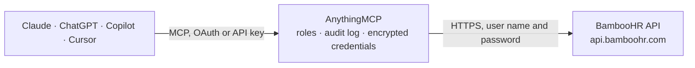

<!-- Generated by scripts/export-github-catalog.mjs in the anythingmcp-website repository. Do not edit by hand. -->

# BambooHR MCP connector

Manage BambooHR (employees, time-off, custom reports, fields, files) from any AI agent. 9 tools, basic-auth. The AnythingMCP connector gives Claude, ChatGPT, Microsoft Copilot, Cursor and Gemini 9 MCP tools for BambooHR: 7 read and 2 can change data.

**Category:** [HR](../hr.md) · **Tools:** 9 · **Setup guide:** [anythingmcp.com](https://anythingmcp.com/guides/bamboohr-to-mcp) · [Deutsch](https://anythingmcp.com/de/guides/bamboohr-to-mcp) · [Italiano](https://anythingmcp.com/it/guides/bamboohr-to-mcp) · [Español](https://anythingmcp.com/es/guides/bamboohr-to-mcp) · [日本語](https://anythingmcp.com/ja/guides/bamboohr-to-mcp) · [Русский](https://anythingmcp.com/ru/guides/bamboohr-to-mcp) · [中文](https://anythingmcp.com/zh/guides/bamboohr-to-mcp)

## Start without code

No installation and no terminal: AnythingMCP Cloud runs the BambooHR connector for you, operated by helpcode.ai in Frankfurt, Germany.

1. **Click the button above** and create an account or sign in. The BambooHR connector opens, ready to install.
2. **Paste the API key or token from your BambooHR account.** Every click is in the [step-by-step guide](https://anythingmcp.com/guides/bamboohr-to-mcp).
3. **Click Install.** AnythingMCP shows the address of your MCP server.
4. **Add that address to your assistant:** [Claude](https://anythingmcp.com/guides/connect-bamboohr-to-claude) · [ChatGPT](https://anythingmcp.com/guides/connect-bamboohr-to-chatgpt) · [Microsoft Copilot](https://anythingmcp.com/guides/connect-bamboohr-to-copilot) · [Cursor](https://anythingmcp.com/guides/connect-bamboohr-to-cursor) · [Gemini CLI](https://anythingmcp.com/guides/connect-bamboohr-to-gemini) · [Meta Muse](https://anythingmcp.com/guides/connect-bamboohr-to-muse).
5. **Ask your first question**, for example: *Show contact, job title, department and supervisor for employee ID 2047, include customField4000010.*

Prefer help with the setup? [Talk to us](https://anythingmcp.com/contact).

## How it works

- **The AI client** speaks MCP (Streamable HTTP) to AnythingMCP and only sees tool names, descriptions and results. It never gets the BambooHR credentials.
- **AnythingMCP** checks the client's role, builds the call from the tool definition, adds the credentials (user name and password), calls BambooHR, logs the call and returns the result.
- **BambooHR** sees an ordinary API client with the rights of the account the credentials belong to.

## Tools

| Tool | What it does | Access |
|---|---|---|
| [`bamboohr_list_employees_directory`](#bamboohr_list_employees_directory) | Returns the company directory: every employee's id, displayName, jobTitle, workEmail, department, division, location, supervisor. | read |
| [`bamboohr_get_employee`](#bamboohr_get_employee) | Get one employee by ID. | read |
| [`bamboohr_add_employee`](#bamboohr_add_employee) | Create a new employee. | write |
| [`bamboohr_update_employee`](#bamboohr_update_employee) | Update employee fields. | write |
| [`bamboohr_who_is_out`](#bamboohr_who_is_out) | Returns the company-wide who's-out list for a date range. | read |
| [`bamboohr_list_time_off_requests`](#bamboohr_list_time_off_requests) | List time-off requests. | read |
| [`bamboohr_list_meta_fields`](#bamboohr_list_meta_fields) | List every field defined in this account (built-in + custom). | read |
| [`bamboohr_run_custom_report`](#bamboohr_run_custom_report) | Run a pre-defined custom report by its numeric ID. | read |
| [`bamboohr_get_employee_files`](#bamboohr_get_employee_files) | List files in an employee's record categorized by section. | read |

## Tool reference

Every parameter as the AI client sees it in `tools/list`. Source: [`packages/backend/src/adapters/intl/bamboohr.json`](../../../packages/backend/src/adapters/intl/bamboohr.json).

### `bamboohr_list_employees_directory`

Returns the company directory: every employee's id, displayName, jobTitle, workEmail, department, division, location, supervisor.

**Access:** read · **Call:** `GET /{BAMBOOHR_SUBDOMAIN}/v1/employees/directory`

No parameters.

### `bamboohr_get_employee`

Get one employee by ID. Pass `fields` (comma-separated) to control what's returned — by default only id+name.

**Access:** read · **Call:** `GET /{BAMBOOHR_SUBDOMAIN}/v1/employees/{employee_id}`

| Parameter | Type | Required | Description |
|---|---|---|---|
| `employee_id` | string | yes | Employee ID. |
| `fields` | string | no | Comma-separated field IDs. |

### `bamboohr_add_employee`

Create a new employee. Required: firstName + lastName. Returns the new employee URL in the Location header.

**Access:** write · **Call:** `POST /{BAMBOOHR_SUBDOMAIN}/v1/employees/`

| Parameter | Type | Required | Description |
|---|---|---|---|
| `firstName` | string | yes | First name. |
| `lastName` | string | yes | Last name. |
| `jobTitle` | string | no | Job title. |
| `department` | string | no | Department. |
| `workEmail` | string | no | Work email. |
| `hireDate` | string | no | YYYY-MM-DD. |
| `supervisorEmail` | string | no | Supervisor's work email. |
| `employeeNumber` | string | no | Internal employee number. |

### `bamboohr_update_employee`

Update employee fields.

**Access:** write · **Call:** `POST /{BAMBOOHR_SUBDOMAIN}/v1/employees/{employee_id}`

| Parameter | Type | Required | Description |
|---|---|---|---|
| `employee_id` | string | yes | Employee ID. |
| `fields` | object | yes | Field-id → value map (e.g. {jobTitle:'Sr Engineer', workEmail:'new@x.com'}). |

### `bamboohr_who_is_out`

Returns the company-wide who's-out list for a date range.

**Access:** read · **Call:** `GET /{BAMBOOHR_SUBDOMAIN}/v1/time_off/whos_out`

| Parameter | Type | Required | Description |
|---|---|---|---|
| `start` | string | no | YYYY-MM-DD. |
| `end` | string | no | YYYY-MM-DD. |

### `bamboohr_list_time_off_requests`

List time-off requests. Filter by employee, date range, status.

**Access:** read · **Call:** `GET /{BAMBOOHR_SUBDOMAIN}/v1/time_off/requests/`

| Parameter | Type | Required | Description |
|---|---|---|---|
| `employeeId` | string | no | Filter by employee. |
| `start` | string | no | YYYY-MM-DD. |
| `end` | string | no | YYYY-MM-DD. |
| `status` | string | no | approved, denied, superceded, requested, canceled. |

### `bamboohr_list_meta_fields`

List every field defined in this account (built-in + custom). Use to discover field IDs.

**Access:** read · **Call:** `GET /{BAMBOOHR_SUBDOMAIN}/v1/meta/fields`

No parameters.

### `bamboohr_run_custom_report`

Run a pre-defined custom report by its numeric ID. Returns the rows as JSON.

**Access:** read · **Call:** `GET /{BAMBOOHR_SUBDOMAIN}/v1/reports/{report_id}`

| Parameter | Type | Required | Description |
|---|---|---|---|
| `report_id` | integer | yes | Report ID. |

### `bamboohr_get_employee_files`

List files in an employee's record categorized by section.

**Access:** read · **Call:** `GET /{BAMBOOHR_SUBDOMAIN}/v1/employees/{employee_id}/files/view/`

| Parameter | Type | Required | Description |
|---|---|---|---|
| `employee_id` | string | yes | Employee ID. |

## Run it yourself

AnythingMCP is open source (AGPL-3.0). [Run it with Docker](../../../README.md#run-it-yourself), open **Connectors → Store**, pick **BambooHR** and enter `BAMBOOHR_SUBDOMAIN`, `BAMBOOHR_API_KEY`, then add your MCP server URL to the AI client.

[← HR connectors](../hr.md) · [All categories](../README.md)
