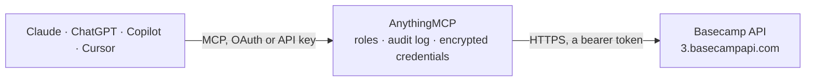

<!-- Generated by scripts/export-github-catalog.mjs in the anythingmcp-website repository. Do not edit by hand. -->

# Basecamp MCP connector

Drive Basecamp 4 (project & team collaboration) from any AI agent: projects, todo lists, todos, messages, comments, people. 12 tools, OAuth2 Bearer auth. The AnythingMCP connector gives Claude, ChatGPT, Microsoft Copilot, Cursor and Gemini 12 MCP tools for Basecamp: 7 read and 5 can change data.

**Category:** [Project Management](../project-management.md) · **Tools:** 12 · **Setup guide:** [anythingmcp.com](https://anythingmcp.com/guides/basecamp-to-mcp) · [Deutsch](https://anythingmcp.com/de/guides/basecamp-to-mcp) · [Italiano](https://anythingmcp.com/it/guides/basecamp-to-mcp) · [Español](https://anythingmcp.com/es/guides/basecamp-to-mcp) · [日本語](https://anythingmcp.com/ja/guides/basecamp-to-mcp) · [Русский](https://anythingmcp.com/ru/guides/basecamp-to-mcp) · [中文](https://anythingmcp.com/zh/guides/basecamp-to-mcp)

## Start without code

No installation and no terminal: AnythingMCP Cloud runs the Basecamp connector for you, operated by helpcode.ai in Frankfurt, Germany.

1. **Click the button above** and create an account or sign in. The Basecamp connector opens, ready to install.
2. **Paste the API key or token from your Basecamp account.** Every click is in the [step-by-step guide](https://anythingmcp.com/guides/basecamp-to-mcp).
3. **Click Install.** AnythingMCP shows the address of your MCP server.
4. **Add that address to your assistant:** [Claude](https://anythingmcp.com/guides/connect-basecamp-to-claude) · [ChatGPT](https://anythingmcp.com/guides/connect-basecamp-to-chatgpt) · [Microsoft Copilot](https://anythingmcp.com/guides/connect-basecamp-to-copilot) · [Cursor](https://anythingmcp.com/guides/connect-basecamp-to-cursor) · [Gemini CLI](https://anythingmcp.com/guides/connect-basecamp-to-gemini) · [Meta Muse](https://anythingmcp.com/guides/connect-basecamp-to-muse).
5. **Ask your first question**, for example: *Get the project id and message_board id for 'Q4 Product Launch — Marketing'.*

Prefer help with the setup? [Talk to us](https://anythingmcp.com/contact).

## How it works

- **The AI client** speaks MCP (Streamable HTTP) to AnythingMCP and only sees tool names, descriptions and results. It never gets the Basecamp credentials.
- **AnythingMCP** checks the client's role, builds the call from the tool definition, adds the credentials (a bearer token), calls Basecamp, logs the call and returns the result.
- **Basecamp** sees an ordinary API client with the rights of the account the credentials belong to.

## Tools

| Tool | What it does | Access |
|---|---|---|
| [`basecamp_get_my_profile`](#basecamp_get_my_profile) | Return the authenticated user's profile (id, name, email_address, time_zone, avatar_url, can_manage_projects, etc.). | read |
| [`basecamp_list_projects`](#basecamp_list_projects) | List active projects (Basecamps) the user has access to. | read |
| [`basecamp_get_project`](#basecamp_get_project) | Fetch a single project with its dock — the array of tools (todoset, message_board, etc.) each with an `id` and `url`. | read |
| [`basecamp_list_todolists`](#basecamp_list_todolists) | List todolists within a project's todoset. | read |
| [`basecamp_list_todos`](#basecamp_list_todos) | List todos in a todolist. | read |
| [`basecamp_create_todo`](#basecamp_create_todo) | Create a todo in a todolist. | write |
| [`basecamp_complete_todo`](#basecamp_complete_todo) | Mark a todo as completed. | write |
| [`basecamp_uncomplete_todo`](#basecamp_uncomplete_todo) | Reopen a completed todo. | write |
| [`basecamp_list_messages`](#basecamp_list_messages) | List messages on the project's message board. | read |
| [`basecamp_post_message`](#basecamp_post_message) | Post a new message on the project's message board. | write |
| [`basecamp_add_comment`](#basecamp_add_comment) | Add a comment to a recording (todo, message, document, etc.). | write |
| [`basecamp_get_people`](#basecamp_get_people) | List all people in the Basecamp account. | read |

## Tool reference

Every parameter as the AI client sees it in `tools/list`. Source: [`packages/backend/src/adapters/intl/basecamp.json`](../../../packages/backend/src/adapters/intl/basecamp.json).

### `basecamp_get_my_profile`

Return the authenticated user's profile (id, name, email_address, time_zone, avatar_url, can_manage_projects, etc.).

**Access:** read · **Call:** `GET /my/profile.json`

No parameters.

### `basecamp_list_projects`

List active projects (Basecamps) the user has access to. Each project has id, name, description, dock[], purpose ('topic' or 'team').

**Access:** read · **Call:** `GET /projects.json`

| Parameter | Type | Required | Description |
|---|---|---|---|
| `status` | string | no | active or archived or trashed. |

### `basecamp_get_project`

Fetch a single project with its dock — the array of tools (todoset, message_board, etc.) each with an `id` and `url`. You'll grab the todoset_id and message_board_id from here.

**Access:** read · **Call:** `GET /projects/{projectId}.json`

| Parameter | Type | Required | Description |
|---|---|---|---|
| `projectId` | string | yes | Project ID. |

### `basecamp_list_todolists`

List todolists within a project's todoset. Get the todoset_id from basecamp_get_project's dock[type=todoset].id.

**Access:** read · **Call:** `GET /buckets/{projectId}/todosets/{todosetId}/todolists.json`

| Parameter | Type | Required | Description |
|---|---|---|---|
| `projectId` | string | yes | Project ID. |
| `todosetId` | string | yes | Todoset ID (from project dock). |

### `basecamp_list_todos`

List todos in a todolist. Pass status=completed to see done items, archived to see archived.

**Access:** read · **Call:** `GET /buckets/{projectId}/todolists/{todolistId}/todos.json`

| Parameter | Type | Required | Description |
|---|---|---|---|
| `projectId` | string | yes | Project ID. |
| `todolistId` | string | yes | Todolist ID. |
| `status` | string | no | completed or archived. Omit for active. |

### `basecamp_create_todo`

Create a todo in a todolist. Required: content. Assignees + notify are arrays of person IDs.

**Access:** write · **Call:** `POST /buckets/{projectId}/todolists/{todolistId}/todos.json`

| Parameter | Type | Required | Description |
|---|---|---|---|
| `projectId` | string | yes | Project ID. |
| `todolistId` | string | yes | Todolist ID. |
| `content` | string | yes | Todo content (title). |
| `description` | string | no | Longer description (HTML or rich-text). |
| `assignee_ids` | any[] | no | Array of person IDs to assign. |
| `completion_subscriber_ids` | any[] | no | People to notify on completion. |
| `notify` | boolean | no | If true, notify assignees on create. |
| `due_on` | string | no | Due date YYYY-MM-DD. |
| `starts_on` | string | no | Start date YYYY-MM-DD. |

### `basecamp_complete_todo`

Mark a todo as completed. Use basecamp_uncomplete_todo to reopen.

**Access:** write · **Call:** `POST /buckets/{projectId}/todos/{todoId}/completion.json`

| Parameter | Type | Required | Description |
|---|---|---|---|
| `projectId` | string | yes | Project ID. |
| `todoId` | string | yes | Todo ID. |

### `basecamp_uncomplete_todo`

Reopen a completed todo.

**Access:** write · **Call:** `DELETE /buckets/{projectId}/todos/{todoId}/completion.json`

| Parameter | Type | Required | Description |
|---|---|---|---|
| `projectId` | string | yes | Project ID. |
| `todoId` | string | yes | Todo ID. |

### `basecamp_list_messages`

List messages on the project's message board. Get the message_board_id from basecamp_get_project's dock[type=message_board].id.

**Access:** read · **Call:** `GET /buckets/{projectId}/message_boards/{messageBoardId}/messages.json`

| Parameter | Type | Required | Description |
|---|---|---|---|
| `projectId` | string | yes | Project ID. |
| `messageBoardId` | string | yes | Message Board ID. |

### `basecamp_post_message`

Post a new message on the project's message board.

**Access:** write · **Call:** `POST /buckets/{projectId}/message_boards/{messageBoardId}/messages.json`

| Parameter | Type | Required | Description |
|---|---|---|---|
| `projectId` | string | yes | Project ID. |
| `messageBoardId` | string | yes | Message Board ID. |
| `subject` | string | yes | Message subject (title). |
| `content` | string | yes | Message body (HTML/rich-text). |
| `status` | string | no | active (default) or draft. |
| `category_id` | integer | no | Optional message category ID. |
| `subscriptions` | any[] | no | Array of person IDs to subscribe to replies. |

### `basecamp_add_comment`

Add a comment to a recording (todo, message, document, etc.). recordingId is the ID of whatever you're commenting on.

**Access:** write · **Call:** `POST /buckets/{projectId}/recordings/{recordingId}/comments.json`

| Parameter | Type | Required | Description |
|---|---|---|---|
| `projectId` | string | yes | Project ID. |
| `recordingId` | string | yes | ID of the recording to comment on. |
| `content` | string | yes | Comment body (HTML/rich-text). |

### `basecamp_get_people`

List all people in the Basecamp account. Returns id, name, email_address, time_zone, can_manage_projects, can_manage_people.

**Access:** read · **Call:** `GET /people.json`

No parameters.

## Run it yourself

AnythingMCP is open source (AGPL-3.0). [Run it with Docker](../../../README.md#run-it-yourself), open **Connectors → Store**, pick **Basecamp** and enter `BASECAMP_ACCESS_TOKEN`, `BASECAMP_ACCOUNT_ID`, then add your MCP server URL to the AI client.

[← Project Management connectors](../project-management.md) · [All categories](../README.md)
