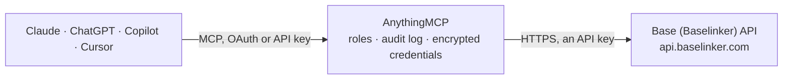

<!-- Generated by scripts/export-github-catalog.mjs in the anythingmcp-website repository. Do not edit by hand. -->

# Base (Baselinker) MCP connector

Let your AI work in Base (Baselinker): find orders across shops and marketplaces, check statuses and shipments, move orders between statuses, and look up products, prices and stock per warehouse. The AnythingMCP connector gives Claude, ChatGPT, Microsoft Copilot, Cursor and Gemini 16 MCP tools for Base (Baselinker): 12 read and 4 can change data.

**Category:** [E-commerce](../e-commerce.md) · **Tools:** 16 · **Setup guide:** [anythingmcp.com](https://anythingmcp.com/guides/baselinker-to-mcp) · [Deutsch](https://anythingmcp.com/de/guides/baselinker-to-mcp) · [Italiano](https://anythingmcp.com/it/guides/baselinker-to-mcp) · [Español](https://anythingmcp.com/es/guides/baselinker-to-mcp) · [日本語](https://anythingmcp.com/ja/guides/baselinker-to-mcp) · [Русский](https://anythingmcp.com/ru/guides/baselinker-to-mcp) · [中文](https://anythingmcp.com/zh/guides/baselinker-to-mcp)

## Start without code

No installation and no terminal: AnythingMCP Cloud runs the Base (Baselinker) connector for you, operated by helpcode.ai in Frankfurt, Germany.

1. **Click the button above** and create an account or sign in. The Base (Baselinker) connector opens, ready to install.
2. **Paste the API key or token from your Base (Baselinker) account.** Every click is in the [step-by-step guide](https://anythingmcp.com/guides/baselinker-to-mcp).
3. **Click Install.** AnythingMCP shows the address of your MCP server.
4. **Add that address to your assistant:** [Claude](https://anythingmcp.com/guides/connect-baselinker-to-claude) · [ChatGPT](https://anythingmcp.com/guides/connect-baselinker-to-chatgpt) · [Microsoft Copilot](https://anythingmcp.com/guides/connect-baselinker-to-copilot) · [Cursor](https://anythingmcp.com/guides/connect-baselinker-to-cursor) · [Gemini CLI](https://anythingmcp.com/guides/connect-baselinker-to-gemini) · [Meta Muse](https://anythingmcp.com/guides/connect-baselinker-to-muse).
5. **Ask your first question**, for example: *Show order with shop order ID HF-2026-178 for customer Nordic Furnishings, I need status and items.*

Prefer help with the setup? [Talk to us](https://anythingmcp.com/contact).

## How it works

- **The AI client** speaks MCP (Streamable HTTP) to AnythingMCP and only sees tool names, descriptions and results. It never gets the Base (Baselinker) credentials.
- **AnythingMCP** checks the client's role, builds the call from the tool definition, adds the credentials (an API key), calls Base (Baselinker), logs the call and returns the result.
- **Base (Baselinker)** sees an ordinary API client with the rights of the account the credentials belong to.

## Tools

| Tool | What it does | Access |
|---|---|---|
| [`baselinker_get_order_status_list`](#baselinker_get_order_status_list) | List the order statuses defined in the order manager: id, name, color, group id and the name shown to customers. | read |
| [`baselinker_get_order_sources`](#baselinker_get_order_sources) | List order sources grouped by type (personal, shop, allegro, amazon, ebay and other marketplaces): per source its id and name. | read |
| [`baselinker_get_orders`](#baselinker_get_orders) | Get orders from the order manager with buyer, delivery and invoice data, payment, status, products and prices. | read |
| [`baselinker_get_journal_list`](#baselinker_get_journal_list) | List order events of the last 3 days (created, confirmed, paid, status changed, package created, ...) with event id, order id, type and date, to see what… | read |
| [`baselinker_get_order_packages`](#baselinker_get_order_packages) | List the shipments created for an order: package id, consignment (tracking) number, courier code, tracking status (0 unknown, 1 label created, 2 shipped, 3… | read |
| [`baselinker_set_order_status`](#baselinker_set_order_status) | Move an order to another status. | write |
| [`baselinker_add_order`](#baselinker_add_order) | Create an order in the order manager, with buyer, delivery and invoice data and products. | write |
| [`baselinker_get_inventories`](#baselinker_get_inventories) | List the product catalogs (inventories): inventory id, name, description, languages, price group ids and default price group, warehouse ids and default… | read |
| [`baselinker_get_inventory_warehouses`](#baselinker_get_inventory_warehouses) | List warehouses: type (bl for own warehouses, shop, warehouse, fulfillment), id, name, address, whether stock may be edited by hand and whether it is the… | read |
| [`baselinker_get_inventory_products_list`](#baselinker_get_inventory_products_list) | List or search products of a catalog with id, parent id, SKU, EAN, name, gross prices per price group and stock per warehouse. | read |
| [`baselinker_get_inventory_products_data`](#baselinker_get_inventory_products_data) | Get full data of selected products: SKU, EAN, tax rate, weight and size, category, manufacturer, prices per price group, stock and locations per warehouse,… | read |
| [`baselinker_get_inventory_products_stock`](#baselinker_get_inventory_products_stock) | Get stock (and reservations, where enabled) per warehouse for the products of a catalog, variants included, optionally filtered. | read |
| [`baselinker_update_inventory_products_stock`](#baselinker_update_inventory_products_stock) | Set the stock of products or variants in a catalog's own warehouses to absolute quantities (not a delta); connected shops and marketplaces pick the new… | write |
| [`baselinker_get_couriers_list`](#baselinker_get_couriers_list) | List the couriers available in the account, with the courier code (e.g. dpd, inpost, gls) and name. | read |
| [`baselinker_get_courier_fields`](#baselinker_get_courier_fields) | Get the form fields a courier needs to create a shipment (id, name, type, options, defaults) and the package fields (weight, size), plus whether it supports… | read |
| [`baselinker_create_package`](#baselinker_create_package) | Create a shipment with a courier for an order, which orders a real label and may be charged by the courier. | write |

## Tool reference

Every parameter as the AI client sees it in `tools/list`. Source: [`packages/backend/src/adapters/intl/baselinker.json`](../../../packages/backend/src/adapters/intl/baselinker.json).

### `baselinker_get_order_status_list`

List the order statuses defined in the order manager: id, name, color, group id and the name shown to customers. Status ids are what getOrders filters and setOrderStatus take.

**Access:** read · **Call:** `POST /connector.php`

No parameters.

### `baselinker_get_order_sources`

List order sources grouped by type (personal, shop, allegro, amazon, ebay and other marketplaces): per source its id and name. The type matches order_source in orders, the id order_source_id.

**Access:** read · **Call:** `POST /connector.php`

No parameters.

### `baselinker_get_orders`

Get orders from the order manager with buyer, delivery and invoice data, payment, status, products and prices. At most 100 orders per call, oldest first: to page, call again with date_confirmed_from set to the last order's date_confirmed plus 1 until fewer than 100 come back. Dates are Unix timestamps in seconds.

**Access:** read · **Call:** `POST /connector.php`

| Parameter | Type | Required | Description |
|---|---|---|---|
| `order_id` | integer | no | Get this one order. |
| `date_confirmed_from` | integer | no | Orders confirmed at or after this Unix time (seconds). The recommended paging key. |
| `date_from` | integer | no | Orders created at or after this Unix time (seconds). |
| `id_from` | integer | no | Orders with an id from this number on. |
| `status_id` | integer | no | Only orders in this status (id from baselinker_get_order_status_list). |
| `filter_email` | string | no | Only orders with this buyer email. |
| `filter_order_source` | string | no | Only orders from this source type, e.g. "shop", "allegro", "amazon", "ebay", "personal". |
| `filter_order_source_id` | integer | no | Only orders from this source id (with filter_order_source). |
| `filter_shop_order_id` | integer | no | Only the order with this id in the online shop. |
| `filter_external_order_id` | string | no | Only the order with this marketplace order id. |
| `get_unconfirmed_orders` | boolean | no | true to include unconfirmed (possibly incomplete) orders (default false). |
| `include_custom_extra_fields` | boolean | no | true to add custom extra field values. |
| `include_commissions` | boolean | no | true to add marketplace commission data. |

### `baselinker_get_journal_list`

List order events of the last 3 days (created, confirmed, paid, status changed, package created, ...) with event id, order id, type and date, to see what changed since a known event. Must be enabled in the account's API settings, otherwise the list is empty.

**Access:** read · **Call:** `POST /connector.php`

| Parameter | Type | Required | Description |
|---|---|---|---|
| `last_log_id` | integer | no | Only events after this event id (the last id you processed). |
| `logs_types` | integer[] | no | Only these event types, e.g. [1, 18]: 1 created, 2 confirmed, 3 paid, 9 package created, 18 status changed, 22 package status changed. |
| `order_id` | integer | no | Only events of this order. |

### `baselinker_get_order_packages`

List the shipments created for an order: package id, consignment (tracking) number, courier code, tracking status (0 unknown, 1 label created, 2 shipped, 3 not delivered, 4 out for delivery, 5 delivered, 6 return, 7 aviso, 8 waiting at point, 9 lost, 10 canceled, 11 on the way), tracking URL and whether it is a return.

**Access:** read · **Call:** `POST /connector.php`

| Parameter | Type | Required | Description |
|---|---|---|---|
| `order_id` | integer | yes | Order id. |

### `baselinker_set_order_status`

Move an order to another status. Status changes can start automatic actions configured in the account (customer emails, invoices, marketplace updates), so show the user the order and target status and wait for confirmation.

**Access:** write · **Call:** `POST /connector.php`

| Parameter | Type | Required | Description |
|---|---|---|---|
| `order_id` | integer | yes | Order id. |
| `status_id` | integer | yes | Target status id from baselinker_get_order_status_list. |

### `baselinker_add_order`

Create an order in the order manager, with buyer, delivery and invoice data and products. Returns the new order_id. Installed switched off: turn it on only if the AI should create orders, and confirm every order with the user.

**Access:** write · **Call:** `POST /connector.php`

| Parameter | Type | Required | Description |
|---|---|---|---|
| `order` | object | yes | The order. Required: order_status_id, date_add (Unix seconds), currency (e.g. "EUR"), payment_method, payment_method_cod (bool), paid (bool), user_comments, admin_comments, email, phone, user_login, delivery_method, delivery_price, delivery_fullname, delivery_company, delivery_address, delivery_postcode, delivery_city, delivery_state, delivery_country_code, delivery_point_id, delivery_point_name, delivery_point_address, delivery_point_postcode, delivery_point_city, invoice_fullname, invoice_company, invoice_nip, invoice_address, invoice_postcode, invoice_city, invoice_state, invoice_country_code, want_invoice (bool), extra_field_1, extra_field_2 (empty strings where unknown). Optional: custom_source_id, custom_extra_fields. products: [{storage: "db", storage_id: 0, product_id, variant_id, name, sku, ean, location, warehouse_id, attributes, price_brutto, tax_rate, quantity, weight}]. |

### `baselinker_get_inventories`

List the product catalogs (inventories): inventory id, name, description, languages, price group ids and default price group, warehouse ids and default warehouse, and whether it is the default catalog.

**Access:** read · **Call:** `POST /connector.php`

No parameters.

### `baselinker_get_inventory_warehouses`

List warehouses: type (bl for own warehouses, shop, warehouse, fulfillment), id, name, address, whether stock may be edited by hand and whether it is the default. Stock keys elsewhere are "<type>_<id>", e.g. bl_123.

**Access:** read · **Call:** `POST /connector.php`

No parameters.

### `baselinker_get_inventory_products_list`

List or search products of a catalog with id, parent id, SKU, EAN, name, gross prices per price group and stock per warehouse. 1000 products per page; page from 1 until fewer come back.

**Access:** read · **Call:** `POST /connector.php`

| Parameter | Type | Required | Description |
|---|---|---|---|
| `inventory_id` | integer | yes | Catalog (inventory) id from baselinker_get_inventories. |
| `filter_id` | integer | no | Only this product id. |
| `filter_category_id` | integer | no | Only products in this category. |
| `filter_ean` | string | no | Only products with this EAN (additional EANs included). |
| `filter_sku` | string | no | Only products with this SKU. |
| `filter_name` | string | no | Products whose name contains this text. |
| `filter_price_from` | number | no | Minimum price. |
| `filter_price_to` | number | no | Maximum price. |
| `filter_stock_from` | integer | no | Minimum stock. |
| `filter_stock_to` | integer | no | Maximum stock. |
| `filter_sort` | `id ASC` \| `id DESC` | no | Sort order. |
| `include_variants` | boolean | no | true to list variants too. |
| `page` | integer | no | Page number, starting at 1 (1000 products per page). |

### `baselinker_get_inventory_products_data`

Get full data of selected products: SKU, EAN, tax rate, weight and size, category, manufacturer, prices per price group, stock and locations per warehouse, names and descriptions (text_fields), images, links to shops and variants.

**Access:** read · **Call:** `POST /connector.php`

| Parameter | Type | Required | Description |
|---|---|---|---|
| `inventory_id` | integer | yes | Catalog (inventory) id from baselinker_get_inventories. |
| `products` | integer[] | yes | Product ids, e.g. [1234, 5678]. Keep it to about 100 per call. |
| `include_suppliers` | boolean | no | true to add supplier data. |
| `include_relations` | boolean | no | true to add related, substitute and cross-sell products. |

### `baselinker_get_inventory_products_stock`

Get stock (and reservations, where enabled) per warehouse for the products of a catalog, variants included, optionally filtered. 1000 products per page.

**Access:** read · **Call:** `POST /connector.php`

| Parameter | Type | Required | Description |
|---|---|---|---|
| `inventory_id` | integer | yes | Catalog (inventory) id from baselinker_get_inventories. |
| `filter_id` | integer | no | Only this product id. |
| `filter_sku` | string | no | Only products with this SKU. |
| `filter_ean` | string | no | Only products with this EAN. |
| `filter_name` | string | no | Products whose name contains this text. |
| `filter_category_id` | integer | no | Only products in this category. |
| `filter_stock_from` | integer | no | Minimum stock. |
| `filter_stock_to` | integer | no | Maximum stock. |
| `page` | integer | no | Page number, starting at 1 (1000 products per page). |

### `baselinker_update_inventory_products_stock`

Set the stock of products or variants in a catalog's own warehouses to absolute quantities (not a delta); connected shops and marketplaces pick the new stock up. Up to 1000 products per call. Returns the number updated and warnings per product. Installed switched off: turn it on only if the AI should change stock, and confirm the quantities with the user.

**Access:** write · **Call:** `POST /connector.php`

| Parameter | Type | Required | Description |
|---|---|---|---|
| `inventory_id` | integer | yes | Catalog (inventory) id from baselinker_get_inventories. |
| `products` | object | yes | Product or variant id mapped to new stock per warehouse, e.g. {"1234": {"bl_1": 10}, "5678": {"bl_1": 0, "bl_2": 4}}. Warehouse keys from baselinker_get_inventory_warehouses; warehouses created for shops or wholesalers cannot be set. |

### `baselinker_get_couriers_list`

List the couriers available in the account, with the courier code (e.g. dpd, inpost, gls) and name. The code is what package tools take.

**Access:** read · **Call:** `POST /connector.php`

No parameters.

### `baselinker_get_courier_fields`

Get the form fields a courier needs to create a shipment (id, name, type, options, defaults) and the package fields (weight, size), plus whether it supports multi-parcel shipments. Needed before baselinker_create_package.

**Access:** read · **Call:** `POST /connector.php`

| Parameter | Type | Required | Description |
|---|---|---|---|
| `courier_code` | string | yes | Courier code from baselinker_get_couriers_list. |

### `baselinker_create_package`

Create a shipment with a courier for an order, which orders a real label and may be charged by the courier. Returns package id and consignment number. Installed switched off: turn it on only if the AI should book shipments, and confirm every shipment with the user.

**Access:** write · **Call:** `POST /connector.php`

| Parameter | Type | Required | Description |
|---|---|---|---|
| `order_id` | integer | yes | Order id. |
| `courier_code` | string | yes | Courier code from baselinker_get_couriers_list. |
| `account_id` | integer | no | Courier account id; the first account when left out. |
| `fields` | object[] | no | Form fields from baselinker_get_courier_fields as [{"id": "service", "value": "..."}]; repeat an id for each checked option. Dates as Unix time. |
| `packages` | object[] | yes | Parcels with the package fields, weight in kg and sizes in cm, e.g. [{"weight": 1.5, "length": 30, "width": 20, "height": 10}]. |

## Run it yourself

AnythingMCP is open source (AGPL-3.0). [Run it with Docker](../../../README.md#run-it-yourself), open **Connectors → Store**, pick **Base (Baselinker)** and enter `BASELINKER_TOKEN`, then add your MCP server URL to the AI client.

[← E-commerce connectors](../e-commerce.md) · [All categories](../README.md)
