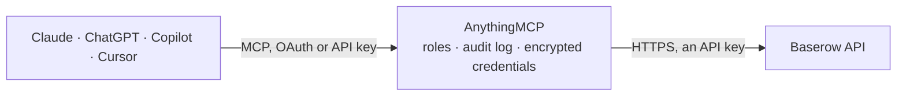

<!-- Generated by scripts/export-github-catalog.mjs in the anythingmcp-website repository. Do not edit by hand. -->

# Baserow MCP connector

Read Baserow tables, fields, and rows from Baserow Cloud or a self-hosted instance. 4 generic read-only tools using database-token authentication. The AnythingMCP connector gives Claude, ChatGPT, Microsoft Copilot, Cursor and Gemini 4 MCP tools for Baserow, all read-only.

**Category:** [Public Data](../data.md) · **Tools:** 4 · **Setup guide:** [anythingmcp.com](https://anythingmcp.com/guides/baserow-to-mcp) · [Deutsch](https://anythingmcp.com/de/guides/baserow-to-mcp) · [Italiano](https://anythingmcp.com/it/guides/baserow-to-mcp) · [Español](https://anythingmcp.com/es/guides/baserow-to-mcp) · [日本語](https://anythingmcp.com/ja/guides/baserow-to-mcp) · [Русский](https://anythingmcp.com/ru/guides/baserow-to-mcp) · [中文](https://anythingmcp.com/zh/guides/baserow-to-mcp)

## Start without code

No installation and no terminal: AnythingMCP Cloud runs the Baserow connector for you, operated by helpcode.ai in Frankfurt, Germany.

1. **Click the button above** and create an account or sign in. The Baserow connector opens, ready to install.
2. **Paste the API key or token from your Baserow account.** Every click is in the [step-by-step guide](https://anythingmcp.com/guides/baserow-to-mcp).
3. **Click Install.** AnythingMCP shows the address of your MCP server.
4. **Add that address to your assistant:** [Claude](https://anythingmcp.com/guides/connect-baserow-to-claude) · [ChatGPT](https://anythingmcp.com/guides/connect-baserow-to-chatgpt) · [Microsoft Copilot](https://anythingmcp.com/guides/connect-baserow-to-copilot) · [Cursor](https://anythingmcp.com/guides/connect-baserow-to-cursor) · [Gemini CLI](https://anythingmcp.com/guides/connect-baserow-to-gemini) · [Meta Muse](https://anythingmcp.com/guides/connect-baserow-to-muse).
5. **Ask your first question**, for example: *Show me invoice INV-2026-042 details, I need customer, total, due date and status.*

Prefer help with the setup? [Talk to us](https://anythingmcp.com/contact).

## How it works

- **The AI client** speaks MCP (Streamable HTTP) to AnythingMCP and only sees tool names, descriptions and results. It never gets the Baserow credentials.
- **AnythingMCP** checks the client's role, builds the call from the tool definition, adds the credentials (an API key), calls Baserow, logs the call and returns the result.
- **Baserow** sees an ordinary API client with the rights of the account the credentials belong to.

## Tools

| Tool | What it does | Access |
|---|---|---|
| [`baserow_list_tables`](#baserow_list_tables) | List every table visible to the configured database token. | read |
| [`baserow_list_fields`](#baserow_list_fields) | List the fields in one Baserow table so later row queries can use the real human-readable field names and understand their types. | read |
| [`baserow_list_rows`](#baserow_list_rows) | List rows from one Baserow table using human-readable field names. | read |
| [`baserow_get_row`](#baserow_get_row) | Get one row by numeric row ID from a Baserow table, returning human-readable field names. | read |

## Tool reference

Every parameter as the AI client sees it in `tools/list`. Source: [`packages/backend/src/adapters/intl/baserow.json`](../../../packages/backend/src/adapters/intl/baserow.json).

### `baserow_list_tables`

List every table visible to the configured database token. Call this first to discover table IDs and names, for example table id 42 named Tasks.

**Access:** read · **Call:** `GET /api/database/tables/all-tables/`

No parameters.

### `baserow_list_fields`

List the fields in one Baserow table so later row queries can use the real human-readable field names and understand their types.

**Access:** read · **Call:** `GET /api/database/fields/table/{table_id}/`

| Parameter | Type | Required | Description |
|---|---|---|---|
| `table_id` | integer | yes | Numeric table ID returned by baserow_list_tables, for example 42. |

### `baserow_list_rows`

List rows from one Baserow table using human-readable field names. Supports free-text search and page/size pagination; use baserow_list_fields first when the schema is unknown.

**Access:** read · **Call:** `GET /api/database/rows/table/{table_id}/`

| Parameter | Type | Required | Description |
|---|---|---|---|
| `table_id` | integer | yes | Numeric table ID returned by baserow_list_tables, for example 42. |
| `search` | string | no | Optional free-text search across searchable fields, for example overdue. |
| `page` | integer | no | 1-based page number. Start with 1. |
| `size` | integer | no | Number of rows per page. Use a modest page size such as 20 unless more rows are required. |

### `baserow_get_row`

Get one row by numeric row ID from a Baserow table, returning human-readable field names. Use baserow_list_rows to discover row IDs.

**Access:** read · **Call:** `GET /api/database/rows/table/{table_id}/{row_id}/`

| Parameter | Type | Required | Description |
|---|---|---|---|
| `table_id` | integer | yes | Numeric table ID returned by baserow_list_tables, for example 42. |
| `row_id` | integer | yes | Numeric row ID to retrieve, for example 123. |

## Run it yourself

AnythingMCP is open source (AGPL-3.0). [Run it with Docker](../../../README.md#run-it-yourself), open **Connectors → Store**, pick **Baserow** and enter `BASEROW_URL`, `BASEROW_API_TOKEN`, then add your MCP server URL to the AI client.

[← Public Data connectors](../data.md) · [All categories](../README.md)
