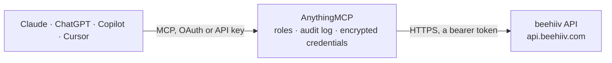

<!-- Generated by scripts/export-github-catalog.mjs in the anythingmcp-website repository. Do not edit by hand. -->

# beehiiv MCP connector

Drive beehiiv (modern newsletter platform) from any AI agent: publications, posts, subscriptions, segments, custom fields. 11 tools, Bearer auth. The AnythingMCP connector gives Claude, ChatGPT, Microsoft Copilot, Cursor and Gemini 11 MCP tools for beehiiv: 7 read and 4 can change data.

**Category:** [Publishing](../publishing.md) · **Tools:** 11 · **Setup guide:** [anythingmcp.com](https://anythingmcp.com/guides/beehiiv-to-mcp) · [Deutsch](https://anythingmcp.com/de/guides/beehiiv-to-mcp) · [Italiano](https://anythingmcp.com/it/guides/beehiiv-to-mcp) · [Español](https://anythingmcp.com/es/guides/beehiiv-to-mcp) · [日本語](https://anythingmcp.com/ja/guides/beehiiv-to-mcp) · [Русский](https://anythingmcp.com/ru/guides/beehiiv-to-mcp) · [中文](https://anythingmcp.com/zh/guides/beehiiv-to-mcp)

## Start without code

No installation and no terminal: AnythingMCP Cloud runs the beehiiv connector for you, operated by helpcode.ai in Frankfurt, Germany.

1. **Click the button above** and create an account or sign in. The beehiiv connector opens, ready to install.
2. **Paste the API key or token from your beehiiv account.** Every click is in the [step-by-step guide](https://anythingmcp.com/guides/beehiiv-to-mcp).
3. **Click Install.** AnythingMCP shows the address of your MCP server.
4. **Add that address to your assistant:** [Claude](https://anythingmcp.com/guides/connect-beehiiv-to-claude) · [ChatGPT](https://anythingmcp.com/guides/connect-beehiiv-to-chatgpt) · [Microsoft Copilot](https://anythingmcp.com/guides/connect-beehiiv-to-copilot) · [Cursor](https://anythingmcp.com/guides/connect-beehiiv-to-cursor) · [Gemini CLI](https://anythingmcp.com/guides/connect-beehiiv-to-gemini) · [Meta Muse](https://anythingmcp.com/guides/connect-beehiiv-to-muse).
5. **Ask your first question**, for example: *What is the subscription record for emma.niemi@brightfield.fi — status, tier, signup date, and custom fields?*

Prefer help with the setup? [Talk to us](https://anythingmcp.com/contact).

## How it works

- **The AI client** speaks MCP (Streamable HTTP) to AnythingMCP and only sees tool names, descriptions and results. It never gets the beehiiv credentials.
- **AnythingMCP** checks the client's role, builds the call from the tool definition, adds the credentials (a bearer token), calls beehiiv, logs the call and returns the result.
- **beehiiv** sees an ordinary API client with the rights of the account the credentials belong to.

## Tools

| Tool | What it does | Access |
|---|---|---|
| [`beehiiv_get_publication`](#beehiiv_get_publication) | Get the publication metadata (name, organization_name, referral_program_enabled, created). | read |
| [`beehiiv_list_posts`](#beehiiv_list_posts) | List posts (newsletter issues). | read |
| [`beehiiv_get_post`](#beehiiv_get_post) | Fetch a single post with full content. | read |
| [`beehiiv_list_subscriptions`](#beehiiv_list_subscriptions) | List subscribers with filters. | read |
| [`beehiiv_get_subscription`](#beehiiv_get_subscription) | Fetch a subscriber by ID or email. | read |
| [`beehiiv_create_subscription`](#beehiiv_create_subscription) | Create a subscription (subscribe an email). | write |
| [`beehiiv_update_subscription`](#beehiiv_update_subscription) | Update a subscriber (custom fields, UTM tags, tier). | write |
| [`beehiiv_delete_subscription`](#beehiiv_delete_subscription) | Permanently delete a subscriber (GDPR friendly). | write |
| [`beehiiv_list_segments`](#beehiiv_list_segments) | List segments (saved subscriber queries). | read |
| [`beehiiv_list_custom_fields`](#beehiiv_list_custom_fields) | List custom fields defined on subscribers. | read |
| [`beehiiv_send_test_email`](#beehiiv_send_test_email) | Send a test email of a post to specific addresses. | write |

## Tool reference

Every parameter as the AI client sees it in `tools/list`. Source: [`packages/backend/src/adapters/intl/beehiiv.json`](../../../packages/backend/src/adapters/intl/beehiiv.json).

### `beehiiv_get_publication`

Get the publication metadata (name, organization_name, referral_program_enabled, created).

**Access:** read

No parameters.

### `beehiiv_list_posts`

List posts (newsletter issues). Filter by status / audience / platform.

**Access:** read · **Call:** `GET /posts`

| Parameter | Type | Required | Description |
|---|---|---|---|
| `expand` | string | no | Comma-separated: free_email_click_count, free_email_open_count, free_web_view_count, premium_email_click_count, etc. |
| `audience` | string | no | free, premium, all. |
| `platform` | string | no | web, email, both, all. |
| `status` | string | no | draft, confirmed, archived, scheduled. |
| `content_tags` | string | no | Comma-separated tag names. |
| `limit` | integer | no | Per page (max 100). |
| `page` | integer | no | Page. |
| `order_by` | string | no | created, publish_date, displayed_date. |
| `direction` | string | no | asc or desc. |

### `beehiiv_get_post`

Fetch a single post with full content.

**Access:** read · **Call:** `GET /posts/{postId}`

| Parameter | Type | Required | Description |
|---|---|---|---|
| `postId` | string | yes | Post ID. |
| `expand` | string | no | Comma-separated expansions. |

### `beehiiv_list_subscriptions`

List subscribers with filters.

**Access:** read · **Call:** `GET /subscriptions`

| Parameter | Type | Required | Description |
|---|---|---|---|
| `email` | string | no | Filter by exact email. |
| `status` | string | no | active, validating, inactive, pending, needs_attention. |
| `tier` | string | no | free, premium. |
| `limit` | integer | no | Per page. |
| `page` | integer | no | Page. |
| `order_by` | string | no | created, email. |
| `direction` | string | no | asc or desc. |

### `beehiiv_get_subscription`

Fetch a subscriber by ID or email.

**Access:** read · **Call:** `GET /subscriptions/{identifier}`

| Parameter | Type | Required | Description |
|---|---|---|---|
| `identifier` | string | yes | Subscription ID OR URL-encoded email. |

### `beehiiv_create_subscription`

Create a subscription (subscribe an email). Idempotent — re-subscribing an existing email returns the existing record.

**Access:** write · **Call:** `POST /subscriptions`

| Parameter | Type | Required | Description |
|---|---|---|---|
| `email` | string | yes | Subscriber email. |
| `reactivate_existing` | boolean | no | If true, reactivate inactive subscriber. |
| `send_welcome_email` | boolean | no | If true, trigger welcome email. |
| `utm_source` | string | no | Attribution. |
| `utm_medium` | string | no | Attribution. |
| `utm_campaign` | string | no | Attribution. |
| `referring_site` | string | no | Referring URL. |
| `custom_fields` | any[] | no | [{name, value}] — custom field overrides. |

### `beehiiv_update_subscription`

Update a subscriber (custom fields, UTM tags, tier).

**Access:** write · **Call:** `PATCH /subscriptions/{subscriptionId}`

| Parameter | Type | Required | Description |
|---|---|---|---|
| `subscriptionId` | string | yes | Subscription ID. |
| `tier` | string | no | free, premium. |
| `stripe_customer_id` | string | no | Stripe customer link. |
| `unsubscribe` | boolean | no | If true, mark unsubscribed. |
| `custom_fields` | any[] | no | [{name, value}]. |

### `beehiiv_delete_subscription`

Permanently delete a subscriber (GDPR friendly).

**Access:** write · **Call:** `DELETE /subscriptions/{subscriptionId}`

| Parameter | Type | Required | Description |
|---|---|---|---|
| `subscriptionId` | string | yes | Subscription ID. |

### `beehiiv_list_segments`

List segments (saved subscriber queries).

**Access:** read · **Call:** `GET /segments`

| Parameter | Type | Required | Description |
|---|---|---|---|
| `limit` | integer | no | Per page. |
| `page` | integer | no | Page. |
| `status` | string | no | completed, calculating, pending. |

### `beehiiv_list_custom_fields`

List custom fields defined on subscribers.

**Access:** read · **Call:** `GET /custom_fields`

| Parameter | Type | Required | Description |
|---|---|---|---|
| `limit` | integer | no | Per page. |
| `page` | integer | no | Page. |

### `beehiiv_send_test_email`

Send a test email of a post to specific addresses. Useful for previewing before scheduling.

**Access:** write · **Call:** `POST /posts/{postId}/test`

| Parameter | Type | Required | Description |
|---|---|---|---|
| `postId` | string | yes | Post ID. |
| `emails` | any[] | yes | Array of email strings to send to (max 5). |

## Run it yourself

AnythingMCP is open source (AGPL-3.0). [Run it with Docker](../../../README.md#run-it-yourself), open **Connectors → Store**, pick **beehiiv** and enter `BEEHIIV_API_KEY`, `BEEHIIV_PUBLICATION_ID`, then add your MCP server URL to the AI client.

[← Publishing connectors](../publishing.md) · [All categories](../README.md)
