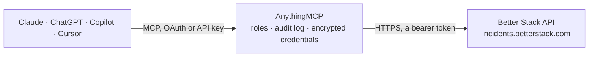

<!-- Generated by scripts/export-github-catalog.mjs in the anythingmcp-website repository. Do not edit by hand. -->

# Better Stack MCP connector

Better Stack uptime monitoring and incident management: monitors and heartbeats with availability and response times, incidents with acknowledge, escalate and resolve, on-call calendars, escalation … The AnythingMCP connector gives Claude, ChatGPT, Microsoft Copilot, Cursor and Gemini 46 MCP tools for Better Stack: 31 read and 15 can change data.

**Category:** [Monitoring](../monitoring.md) · **Tools:** 46 · **Setup guide:** [anythingmcp.com](https://anythingmcp.com/guides/better-stack-to-mcp) · [Deutsch](https://anythingmcp.com/de/guides/better-stack-to-mcp) · [Italiano](https://anythingmcp.com/it/guides/better-stack-to-mcp) · [Español](https://anythingmcp.com/es/guides/better-stack-to-mcp) · [日本語](https://anythingmcp.com/ja/guides/better-stack-to-mcp) · [Русский](https://anythingmcp.com/ru/guides/better-stack-to-mcp) · [中文](https://anythingmcp.com/zh/guides/better-stack-to-mcp)

## Start without code

No installation and no terminal: AnythingMCP Cloud runs the Better Stack connector for you, operated by helpcode.ai in Frankfurt, Germany.

1. **Click the button above** and create an account or sign in. The Better Stack connector opens, ready to install.
2. **Paste the API key or token from your Better Stack account.** Every click is in the [step-by-step guide](https://anythingmcp.com/guides/better-stack-to-mcp).
3. **Click Install.** AnythingMCP shows the address of your MCP server.
4. **Add that address to your assistant:** [Claude](https://anythingmcp.com/guides/connect-better-stack-to-claude) · [ChatGPT](https://anythingmcp.com/guides/connect-better-stack-to-chatgpt) · [Microsoft Copilot](https://anythingmcp.com/guides/connect-better-stack-to-copilot) · [Cursor](https://anythingmcp.com/guides/connect-better-stack-to-cursor) · [Gemini CLI](https://anythingmcp.com/guides/connect-better-stack-to-gemini) · [Meta Muse](https://anythingmcp.com/guides/connect-better-stack-to-muse).
5. **Ask your first question**, for example: *What's the current status and last check for monitor URL https://webapp-eu.nordiccloud.fi?*

Prefer help with the setup? [Talk to us](https://anythingmcp.com/contact).

## How it works

- **The AI client** speaks MCP (Streamable HTTP) to AnythingMCP and only sees tool names, descriptions and results. It never gets the Better Stack credentials.
- **AnythingMCP** checks the client's role, builds the call from the tool definition, adds the credentials (a bearer token), calls Better Stack, logs the call and returns the result.
- **Better Stack** sees an ordinary API client with the rights of the account the credentials belong to.

## Tools

| Tool | What it does | Access |
|---|---|---|
| [`better_stack_list_monitors`](#better_stack_list_monitors) | List the team's uptime monitors with their status (up, down, paused, validating, maintenance), URL, type, check frequency, regions and last check time. | read |
| [`better_stack_get_monitor`](#better_stack_get_monitor) | Get one monitor with its full configuration: type, URL, status, check frequency, regions, alert channels, escalation policy, maintenance window and timestamps. | read |
| [`better_stack_create_monitor`](#better_stack_create_monitor) | Create an uptime monitor: an HTTP check (status, expected status code, keyword present or absent), a server or port check (ping, TCP, UDP, SMTP, POP, IMAP,… | write |
| [`better_stack_update_monitor`](#better_stack_update_monitor) | Change a monitor: only the fields you pass are updated (URL, name, frequency, regions, alert channels, escalation policy, group, maintenance window, paused… | write |
| [`better_stack_pause_monitor`](#better_stack_pause_monitor) | Pause a monitor: Better Stack stops checking it and sends no alerts until it is resumed. | write |
| [`better_stack_resume_monitor`](#better_stack_resume_monitor) | Resume a paused monitor: checks and alerts start again with the monitor's existing settings. | write |
| [`better_stack_get_monitor_availability`](#better_stack_get_monitor_availability) | Availability summary (SLA) of a monitor for a date range: availability percentage, total downtime in seconds, number of incidents, longest and average incident. | read |
| [`better_stack_get_monitor_response_times`](#better_stack_get_monitor_response_times) | Response times of a monitor's checks over the last 24 hours, per region, oldest first: the total response time in seconds for each check. | read |
| [`better_stack_list_monitor_groups`](#better_stack_list_monitor_groups) | List the monitor groups (the folders monitors are sorted into on the dashboard), with their name, paused flag and team. | read |
| [`better_stack_get_monitor_group`](#better_stack_get_monitor_group) | Get one monitor group by id: its name, sort index, paused flag, team and timestamps. | read |
| [`better_stack_list_monitor_group_monitors`](#better_stack_list_monitor_group_monitors) | List the monitors inside one monitor group, with the same fields as better_stack_list_monitors; paged with page and per_page. | read |
| [`better_stack_list_heartbeats`](#better_stack_list_heartbeats) | List heartbeat (cron job) monitors: name, status, expected period and grace in seconds, the ping URL the job must call, paused flag and group. | read |
| [`better_stack_get_heartbeat`](#better_stack_get_heartbeat) | Get one heartbeat monitor with its ping URL, period, grace, status, alert channels, escalation policy and maintenance window. | read |
| [`better_stack_create_heartbeat`](#better_stack_create_heartbeat) | Create a heartbeat monitor for a cron job or background task. | write |
| [`better_stack_update_heartbeat`](#better_stack_update_heartbeat) | Change a heartbeat monitor: name, period, grace, alert channels, group, escalation policy, or pause and resume it with paused. | write |
| [`better_stack_get_heartbeat_availability`](#better_stack_get_heartbeat_availability) | Availability summary of a heartbeat for a date range: availability percentage, total downtime in seconds, number of incidents, longest and average incident. | read |
| [`better_stack_list_heartbeat_groups`](#better_stack_list_heartbeat_groups) | List the heartbeat groups, with their name, paused flag, sort index and team. | read |
| [`better_stack_list_incidents`](#better_stack_list_incidents) | List incidents, newest first: name, cause, status (Started, Acknowledged, Resolved), start, acknowledge and resolve times and who did it, the monitor or… | read |
| [`better_stack_get_incident`](#better_stack_get_incident) | Get one incident with its cause, status, timestamps, who acknowledged and resolved it, alert channels, escalation policy, metadata and the failing response. | read |
| [`better_stack_get_incident_timeline`](#better_stack_get_incident_timeline) | Timeline of an incident, newest first: alerts sent, acknowledgements, escalations, comments, status page updates and the captured responses. | read |
| [`better_stack_create_incident`](#better_stack_create_incident) | Open a manual incident and alert the on-call person through the chosen channels (call, SMS, e-mail, push), optionally escalating with a given policy. | write |
| [`better_stack_acknowledge_incident`](#better_stack_acknowledge_incident) | Acknowledge an ongoing incident: further escalation stops while the incident stays open until it is resolved. | write |
| [`better_stack_resolve_incident`](#better_stack_resolve_incident) | Resolve an ongoing incident. | write |
| [`better_stack_reopen_incident`](#better_stack_reopen_incident) | Reopen a resolved incident, for example when the problem came back right after it was marked as resolved. | write |
| [`better_stack_escalate_incident`](#better_stack_escalate_incident) | Escalate an ongoing incident to a team member, a team, an on-call calendar, an escalation policy or the whole organization, choosing the alert channels. | write |
| [`better_stack_list_incident_comments`](#better_stack_list_incident_comments) | List the comments posted on an incident, with their text (Markdown), author and timestamps. | read |
| [`better_stack_add_incident_comment`](#better_stack_add_incident_comment) | Post a comment on an incident, for example a status note or the root cause; it appears in the incident timeline. | write |
| [`better_stack_list_on_call_calendars`](#better_stack_list_on_call_calendars) | List on-call calendars (schedules) with their name, team and whether each is the team's default, plus who is on call right now. | read |
| [`better_stack_get_on_call_calendar`](#better_stack_get_on_call_calendar) | Who is on call on a calendar, now or at a given date and time: names, e-mails, phone numbers and holiday status of the on-call users. | read |
| [`better_stack_list_on_call_events`](#better_stack_list_on_call_events) | List the shifts of an on-call calendar in a time window: who is on call (e-mails), start and end time, and whether the shift is an override. | read |
| [`better_stack_list_escalation_policies`](#better_stack_list_escalation_policies) | List escalation policies with their steps (who is alerted, after how many minutes, with which severity), repeat settings and fallback policy. | read |
| [`better_stack_get_escalation_policy`](#better_stack_get_escalation_policy) | Get one escalation policy with its ordered steps, step members (users, on-call, Slack, webhooks), wait times, repeat count and fallback policy. | read |
| [`better_stack_list_severities`](#better_stack_list_severities) | List the severities (urgencies) of the team, with the alert channels each one uses (call, SMS, e-mail, push, critical alert). | read |
| [`better_stack_list_status_pages`](#better_stack_list_status_pages) | List the status pages: company name, subdomain and custom domain, published flag, overall state (operational, degraded, downtime, maintenance), time zone… | read |
| [`better_stack_get_status_page`](#better_stack_get_status_page) | Get one status page with its domain, overall state, published and subscribable flags, history length, design and access settings. | read |
| [`better_stack_list_status_page_resources`](#better_stack_list_status_page_resources) | List the resources shown on a status page (monitors, heartbeats, groups) with their public name, current status, availability and daily status history. | read |
| [`better_stack_list_status_reports`](#better_stack_list_status_reports) | List the status reports (incident announcements and maintenance windows) on a status page with title, type, start and end, affected resources and overall state. | read |
| [`better_stack_get_status_report`](#better_stack_get_status_report) | Get one status report on a status page with its type, start and end, affected resources, overall state and its status updates (in `included`). | read |
| [`better_stack_create_status_report`](#better_stack_create_status_report) | Publish a status report on a public status page: an incident announcement or a planned maintenance, with the affected resources and a first message. | write |
| [`better_stack_update_status_report`](#better_stack_update_status_report) | Change a status report's title or its start and end time, for example to reschedule a maintenance. | write |
| [`better_stack_list_status_updates`](#better_stack_list_status_updates) | List the status updates posted on a status report, with message, publish time, affected resources and whether subscribers were notified. | read |
| [`better_stack_add_status_update`](#better_stack_add_status_update) | Post a new update on a status report, e.g. investigating, identified, monitoring or resolved; set every affected resource to `resolved` to close the report. | write |
| [`better_stack_list_incoming_webhooks`](#better_stack_list_incoming_webhooks) | List the incoming webhook integrations that open and resolve incidents from other tools, with their name, URL and the rules for starting and resolving… | read |
| [`better_stack_list_outgoing_webhooks`](#better_stack_list_outgoing_webhooks) | List the outgoing webhook integrations that Better Stack calls on incident and monitor events, with their name, target URL and triggers. | read |
| [`better_stack_list_slack_integrations`](#better_stack_list_slack_integrations) | List the Slack integrations of the team: workspace, channel and the kinds of notifications sent there. | read |
| [`better_stack_list_metadata`](#better_stack_list_metadata) | List metadata records (key and values) attached to monitors, heartbeats, incidents and integrations, e.g. service owner or environment; filter by owner type… | read |

## Tool reference

Every parameter as the AI client sees it in `tools/list`. Source: [`packages/backend/src/adapters/intl/better-stack.json`](../../../packages/backend/src/adapters/intl/better-stack.json).

### `better_stack_list_monitors`

List the team's uptime monitors with their status (up, down, paused, validating, maintenance), URL, type, check frequency, regions and last check time. Filter by exact URL or name; paged with page and per_page.

**Access:** read · **Call:** `GET /v2/monitors`

| Parameter | Type | Required | Description |
|---|---|---|---|
| `team_name` | string | no | Only with a global API token: the team name to filter by (or, on create, the team that owns the new resource). Leave empty with a team-scoped Incidents API token. |
| `url` | string | no | Only monitors with exactly this URL. |
| `pronounceable_name` | string | no | Only monitors with exactly this name. |
| `page` | integer | no | Page number, starting at 1. Take it from the `page` value in `pagination.next`. |
| `per_page` | integer | no | Results per page, 1-250 (default 50). |

### `better_stack_get_monitor`

Get one monitor with its full configuration: type, URL, status, check frequency, regions, alert channels, escalation policy, maintenance window and timestamps.

**Access:** read · **Call:** `GET /v2/monitors/{monitor_id}`

| Parameter | Type | Required | Description |
|---|---|---|---|
| `monitor_id` | string | yes | Monitor id, from `better_stack_list_monitors` (`data[].id`). |

### `better_stack_create_monitor`

Create an uptime monitor: an HTTP check (status, expected status code, keyword present or absent), a server or port check (ping, TCP, UDP, SMTP, POP, IMAP, DNS) or a Playwright scenario, with frequency, regions and alert channels.

**Access:** write · **Call:** `POST /v2/monitors`

| Parameter | Type | Required | Description |
|---|---|---|---|
| `team_name` | string | no | Only with a global API token: the team name to filter by (or, on create, the team that owns the new resource). Leave empty with a team-scoped Incidents API token. |
| `monitor_type` | `status` \| `expected_status_code` \| `keyword` \| `keyword_absence` \| `ping` \| `tcp` \| `udp` \| `smtp` \| `pop` \| `imap` \| `dns` \| `playwright` | no | What to check: `status` (any 2xx, the default), `expected_status_code` (one of `expected_status_codes`), `keyword` / `keyword_absence` (text present or absent in the page), `ping`, `tcp`, `udp`, `smtp`, `pop`, `imap`, `dns`, `playwright` (a browser scenario). |
| `url` | string | no | The URL to check, or for server and port monitors the host without protocol. Required for every type except `playwright`. |
| `pronounceable_name` | string | no | Monitor name, read out in phone calls, so keep it easy to pronounce. |
| `check_frequency` | integer | no | Seconds between checks: 30, 45, 60, 120, 180, 300, 600, 900 or 1800 (Playwright: 60 up to 86400). |
| `regions` | `us` \| `eu` \| `as` \| `au`[] | no | Regions to check from (us, eu, as, au). Empty means all. |
| `required_keyword` | string | no | Keyword to look for; required for `keyword`, `keyword_absence` and `udp` monitors. |
| `expected_status_codes` | integer[] | no | HTTP status codes (100-599) counted as up; required for `expected_status_code` monitors. |
| `http_method` | `GET` \| `HEAD` \| `POST` \| `PUT` \| `PATCH` \| `OPTIONS` | no | HTTP method of the check (default GET). |
| `request_timeout` | integer | no | Request timeout: seconds for HTTP monitors (2-60), milliseconds for server and port monitors. |
| `request_body` | string | no | Body for POST, PUT and PATCH checks; for `dns` monitors the domain to resolve. |
| `request_headers` | object[] | no | Custom headers as [{name, value}]. Sending the list replaces all existing headers. |
| `port` | string | no | Port; required for `tcp`, `udp`, `smtp`, `pop` and `imap` monitors. |
| `follow_redirects` | boolean | no | Follow HTTP redirects (default true). |
| `verify_ssl` | boolean | no | Fail on an invalid SSL certificate (default true). |
| `ssl_expiration` | integer | no | Alert this many days before the SSL certificate expires: 1, 2, 3, 7, 14, 30 or 60. |
| `domain_expiration` | integer | no | Alert this many days before the domain expires: 1, 2, 3, 7, 14, 30 or 60. |
| `confirmation_period` | integer | no | Seconds to wait after a failure before opening an incident (max 86400). |
| `recovery_period` | integer | no | Seconds the monitor must be up again before the incident resolves itself: 0, 60, 180, 300, 900, 1800, 3600 or 7200. |
| `policy_id` | string | no | Escalation policy id from `better_stack_list_escalation_policies`. |
| `monitor_group_id` | string | no | Monitor group id from `better_stack_list_monitor_groups`. |
| `team_wait` | integer | no | Seconds before the incident is escalated to the whole team; empty disables it. |
| `call` | boolean | no | Phone call the on-call person. |
| `sms` | boolean | no | Send an SMS the on-call person. |
| `email` | boolean | no | Send an e-mail the on-call person. |
| `push` | boolean | no | Send a push notification the on-call person. |
| `critical_alert` | boolean | no | Send a critical push notification that ignores mute and Do Not Disturb. |
| `paused` | boolean | no | true pauses the monitor (no checks, no alerts), false resumes it. |
| `maintenance_days` | `mon` \| `tue` \| `wed` \| `thu` \| `fri` \| `sat` \| `sun`[] | no | Days the daily maintenance window applies. |
| `maintenance_from` | string | no | Start of the daily maintenance window, e.g. 01:00. |
| `maintenance_to` | string | no | End of the daily maintenance window, e.g. 03:00. |
| `maintenance_timezone` | string | no | Time zone of the maintenance window, a Rails time zone name such as `Amsterdam` or `UTC` (default UTC). |
| `scenario_name` | string | no | Playwright monitors: the scenario name shown in the dashboard (required for `playwright` on create). |
| `playwright_script` | string | no | Playwright monitors: the JavaScript source of the scenario. |

### `better_stack_update_monitor`

Change a monitor: only the fields you pass are updated (URL, name, frequency, regions, alert channels, escalation policy, group, maintenance window, paused flag, ...).

**Access:** write · **Call:** `PATCH /v2/monitors/{monitor_id}`

| Parameter | Type | Required | Description |
|---|---|---|---|
| `monitor_id` | string | yes | Monitor id, from `better_stack_list_monitors` (`data[].id`). |
| `monitor_type` | `status` \| `expected_status_code` \| `keyword` \| `keyword_absence` \| `ping` \| `tcp` \| `udp` \| `smtp` \| `pop` \| `imap` \| `dns` \| `playwright` | no | What to check: `status` (any 2xx, the default), `expected_status_code` (one of `expected_status_codes`), `keyword` / `keyword_absence` (text present or absent in the page), `ping`, `tcp`, `udp`, `smtp`, `pop`, `imap`, `dns`, `playwright` (a browser scenario). |
| `url` | string | no | New URL, or host for server and port monitors. |
| `pronounceable_name` | string | no | Monitor name, read out in phone calls, so keep it easy to pronounce. |
| `check_frequency` | integer | no | Seconds between checks: 30, 45, 60, 120, 180, 300, 600, 900 or 1800 (Playwright: 60 up to 86400). |
| `regions` | `us` \| `eu` \| `as` \| `au`[] | no | Regions to check from (us, eu, as, au). Empty means all. |
| `required_keyword` | string | no | Keyword to look for; required for `keyword`, `keyword_absence` and `udp` monitors. |
| `expected_status_codes` | integer[] | no | HTTP status codes (100-599) counted as up; required for `expected_status_code` monitors. |
| `http_method` | `GET` \| `HEAD` \| `POST` \| `PUT` \| `PATCH` \| `OPTIONS` | no | HTTP method of the check (default GET). |
| `request_timeout` | integer | no | Request timeout: seconds for HTTP monitors (2-60), milliseconds for server and port monitors. |
| `request_body` | string | no | Body for POST, PUT and PATCH checks; for `dns` monitors the domain to resolve. |
| `request_headers` | object[] | no | Custom headers as [{name, value}]. Sending the list replaces all existing headers. |
| `port` | string | no | Port; required for `tcp`, `udp`, `smtp`, `pop` and `imap` monitors. |
| `follow_redirects` | boolean | no | Follow HTTP redirects (default true). |
| `verify_ssl` | boolean | no | Fail on an invalid SSL certificate (default true). |
| `ssl_expiration` | integer | no | Alert this many days before the SSL certificate expires: 1, 2, 3, 7, 14, 30 or 60. |
| `domain_expiration` | integer | no | Alert this many days before the domain expires: 1, 2, 3, 7, 14, 30 or 60. |
| `confirmation_period` | integer | no | Seconds to wait after a failure before opening an incident (max 86400). |
| `recovery_period` | integer | no | Seconds the monitor must be up again before the incident resolves itself: 0, 60, 180, 300, 900, 1800, 3600 or 7200. |
| `policy_id` | string | no | Escalation policy id from `better_stack_list_escalation_policies`. |
| `monitor_group_id` | string | no | Monitor group id from `better_stack_list_monitor_groups`. |
| `team_wait` | integer | no | Seconds before the incident is escalated to the whole team; empty disables it. |
| `call` | boolean | no | Phone call the on-call person. |
| `sms` | boolean | no | Send an SMS the on-call person. |
| `email` | boolean | no | Send an e-mail the on-call person. |
| `push` | boolean | no | Send a push notification the on-call person. |
| `critical_alert` | boolean | no | Send a critical push notification that ignores mute and Do Not Disturb. |
| `paused` | boolean | no | true pauses the monitor (no checks, no alerts), false resumes it. |
| `maintenance_days` | `mon` \| `tue` \| `wed` \| `thu` \| `fri` \| `sat` \| `sun`[] | no | Days the daily maintenance window applies. |
| `maintenance_from` | string | no | Start of the daily maintenance window, e.g. 01:00. |
| `maintenance_to` | string | no | End of the daily maintenance window, e.g. 03:00. |
| `maintenance_timezone` | string | no | Time zone of the maintenance window, a Rails time zone name such as `Amsterdam` or `UTC` (default UTC). |
| `scenario_name` | string | no | Playwright monitors: the scenario name shown in the dashboard (required for `playwright` on create). |
| `playwright_script` | string | no | Playwright monitors: the JavaScript source of the scenario. |

### `better_stack_pause_monitor`

Pause a monitor: Better Stack stops checking it and sends no alerts until it is resumed. Use for planned work on the checked service.

**Access:** write · **Call:** `PATCH /v2/monitors/{monitor_id}`

| Parameter | Type | Required | Description |
|---|---|---|---|
| `monitor_id` | string | yes | Monitor id, from `better_stack_list_monitors` (`data[].id`). |

### `better_stack_resume_monitor`

Resume a paused monitor: checks and alerts start again with the monitor's existing settings.

**Access:** write · **Call:** `PATCH /v2/monitors/{monitor_id}`

| Parameter | Type | Required | Description |
|---|---|---|---|
| `monitor_id` | string | yes | Monitor id, from `better_stack_list_monitors` (`data[].id`). |

### `better_stack_get_monitor_availability`

Availability summary (SLA) of a monitor for a date range: availability percentage, total downtime in seconds, number of incidents, longest and average incident.

**Access:** read · **Call:** `GET /v2/monitors/{monitor_id}/sla`

| Parameter | Type | Required | Description |
|---|---|---|---|
| `monitor_id` | string | yes | Monitor id, from `better_stack_list_monitors` (`data[].id`). |
| `from` | string | no | Start date, YYYY-MM-DD. |
| `to` | string | no | End date, YYYY-MM-DD. |

### `better_stack_get_monitor_response_times`

Response times of a monitor's checks over the last 24 hours, per region, oldest first: the total response time in seconds for each check.

**Access:** read · **Call:** `GET /v2/monitors/{monitor_id}/response-times`

| Parameter | Type | Required | Description |
|---|---|---|---|
| `monitor_id` | string | yes | Monitor id, from `better_stack_list_monitors` (`data[].id`). |

### `better_stack_list_monitor_groups`

List the monitor groups (the folders monitors are sorted into on the dashboard), with their name, paused flag and team.

**Access:** read · **Call:** `GET /v2/monitor-groups`

| Parameter | Type | Required | Description |
|---|---|---|---|
| `team_name` | string | no | Only with a global API token: the team name to filter by (or, on create, the team that owns the new resource). Leave empty with a team-scoped Incidents API token. |
| `page` | integer | no | Page number, starting at 1. Take it from the `page` value in `pagination.next`. |
| `per_page` | integer | no | Results per page, 1-250 (default 50). |

### `better_stack_get_monitor_group`

Get one monitor group by id: its name, sort index, paused flag, team and timestamps.

**Access:** read · **Call:** `GET /v2/monitor-groups/{monitor_group_id}`

| Parameter | Type | Required | Description |
|---|---|---|---|
| `monitor_group_id` | string | yes | Monitor group id from `better_stack_list_monitor_groups`. |

### `better_stack_list_monitor_group_monitors`

List the monitors inside one monitor group, with the same fields as better_stack_list_monitors; paged with page and per_page.

**Access:** read · **Call:** `GET /v2/monitor-groups/{monitor_group_id}/monitors`

| Parameter | Type | Required | Description |
|---|---|---|---|
| `monitor_group_id` | string | yes | Monitor group id from `better_stack_list_monitor_groups`. |
| `page` | integer | no | Page number, starting at 1. Take it from the `page` value in `pagination.next`. |
| `per_page` | integer | no | Results per page, 1-250 (default 50). |

### `better_stack_list_heartbeats`

List heartbeat (cron job) monitors: name, status, expected period and grace in seconds, the ping URL the job must call, paused flag and group.

**Access:** read · **Call:** `GET /v2/heartbeats`

| Parameter | Type | Required | Description |
|---|---|---|---|
| `team_name` | string | no | Only with a global API token: the team name to filter by (or, on create, the team that owns the new resource). Leave empty with a team-scoped Incidents API token. |
| `page` | integer | no | Page number, starting at 1. Take it from the `page` value in `pagination.next`. |
| `per_page` | integer | no | Results per page, 1-250 (default 50). |

### `better_stack_get_heartbeat`

Get one heartbeat monitor with its ping URL, period, grace, status, alert channels, escalation policy and maintenance window.

**Access:** read · **Call:** `GET /v2/heartbeats/{heartbeat_id}`

| Parameter | Type | Required | Description |
|---|---|---|---|
| `heartbeat_id` | string | yes | Heartbeat id, from `better_stack_list_heartbeats`. |

### `better_stack_create_heartbeat`

Create a heartbeat monitor for a cron job or background task. The answer holds the ping URL the job must request after each run; a missed beat opens an incident.

**Access:** write · **Call:** `POST /v2/heartbeats`

| Parameter | Type | Required | Description |
|---|---|---|---|
| `team_name` | string | no | Only with a global API token: the team name to filter by (or, on create, the team that owns the new resource). Leave empty with a team-scoped Incidents API token. |
| `name` | string | yes | Name of the service sending the heartbeat. |
| `period` | integer | yes | Expected interval between beats, in seconds (min 30). |
| `grace` | integer | yes | Seconds a beat may be late before it counts as missed (about 20% of period is a good value). |
| `call` | boolean | no | Phone call the on-call person. |
| `sms` | boolean | no | Send an SMS the on-call person. |
| `email` | boolean | no | Send an e-mail the on-call person. |
| `push` | boolean | no | Send a push notification the on-call person. |
| `critical_alert` | boolean | no | Send a critical push notification that ignores mute and Do Not Disturb. |
| `team_wait` | integer | no | Seconds before the incident is escalated to the whole team; empty disables it. |
| `heartbeat_group_id` | string | no | Heartbeat group id from `better_stack_list_heartbeat_groups`. |
| `policy_id` | string | no | Escalation policy id from `better_stack_list_escalation_policies`. |
| `paused` | boolean | no | true pauses the heartbeat (no alerts), false resumes it. |
| `server_timezone` | string | no | IANA time zone (e.g. Europe/Berlin) for DST-aware missed-beat detection; needs a period of at least 3600. |

### `better_stack_update_heartbeat`

Change a heartbeat monitor: name, period, grace, alert channels, group, escalation policy, or pause and resume it with paused. Only the fields you pass change.

**Access:** write · **Call:** `PATCH /v2/heartbeats/{heartbeat_id}`

| Parameter | Type | Required | Description |
|---|---|---|---|
| `heartbeat_id` | string | yes | Heartbeat id, from `better_stack_list_heartbeats`. |
| `name` | string | no | Name of the service sending the heartbeat. |
| `period` | integer | no | Expected interval between beats, in seconds (min 30). |
| `grace` | integer | no | Seconds a beat may be late before it counts as missed (about 20% of period is a good value). |
| `call` | boolean | no | Phone call the on-call person. |
| `sms` | boolean | no | Send an SMS the on-call person. |
| `email` | boolean | no | Send an e-mail the on-call person. |
| `push` | boolean | no | Send a push notification the on-call person. |
| `critical_alert` | boolean | no | Send a critical push notification that ignores mute and Do Not Disturb. |
| `team_wait` | integer | no | Seconds before the incident is escalated to the whole team; empty disables it. |
| `heartbeat_group_id` | string | no | Heartbeat group id from `better_stack_list_heartbeat_groups`. |
| `policy_id` | string | no | Escalation policy id from `better_stack_list_escalation_policies`. |
| `paused` | boolean | no | true pauses the heartbeat (no alerts), false resumes it. |
| `server_timezone` | string | no | IANA time zone (e.g. Europe/Berlin) for DST-aware missed-beat detection; needs a period of at least 3600. |

### `better_stack_get_heartbeat_availability`

Availability summary of a heartbeat for a date range: availability percentage, total downtime in seconds, number of incidents, longest and average incident.

**Access:** read · **Call:** `GET /v2/heartbeats/{heartbeat_id}/availability`

| Parameter | Type | Required | Description |
|---|---|---|---|
| `heartbeat_id` | string | yes | Heartbeat id, from `better_stack_list_heartbeats`. |
| `from` | string | no | Start date, YYYY-MM-DD. |
| `to` | string | no | End date, YYYY-MM-DD. |

### `better_stack_list_heartbeat_groups`

List the heartbeat groups, with their name, paused flag, sort index and team. Use the id as heartbeat_group_id when creating or moving heartbeats.

**Access:** read · **Call:** `GET /v2/heartbeat-groups`

| Parameter | Type | Required | Description |
|---|---|---|---|
| `team_name` | string | no | Only with a global API token: the team name to filter by (or, on create, the team that owns the new resource). Leave empty with a team-scoped Incidents API token. |
| `page` | integer | no | Page number, starting at 1. Take it from the `page` value in `pagination.next`. |
| `per_page` | integer | no | Results per page, 1-250 (default 50). |

### `better_stack_list_incidents`

List incidents, newest first: name, cause, status (Started, Acknowledged, Resolved), start, acknowledge and resolve times and who did it, the monitor or heartbeat behind it. Filter by date range, monitor, heartbeat, resolved and acknowledged.

**Access:** read · **Call:** `GET /v3/incidents`

| Parameter | Type | Required | Description |
|---|---|---|---|
| `team_name` | string | no | Only with a global API token: the team name to filter by (or, on create, the team that owns the new resource). Leave empty with a team-scoped Incidents API token. |
| `from` | string | no | Only incidents from this date, YYYY-MM-DD. |
| `to` | string | no | Only incidents until this date, YYYY-MM-DD. |
| `monitor_id` | string | no | Only incidents of this monitor. |
| `heartbeat_id` | string | no | Only incidents of this heartbeat. |
| `resolved` | boolean | no | false lists only open incidents, true only resolved ones; empty lists both. |
| `acknowledged` | boolean | no | false lists only unacknowledged incidents, true only acknowledged ones; empty lists both. |
| `page` | integer | no | Page number, starting at 1. Take it from the `page` value in `pagination.next`. |
| `per_page` | integer | no | Results per page, 1-50 (default 10). |

### `better_stack_get_incident`

Get one incident with its cause, status, timestamps, who acknowledged and resolved it, alert channels, escalation policy, metadata and the failing response.

**Access:** read · **Call:** `GET /v3/incidents/{incident_id}`

| Parameter | Type | Required | Description |
|---|---|---|---|
| `incident_id` | string | yes | Incident id, from `better_stack_list_incidents`. |

### `better_stack_get_incident_timeline`

Timeline of an incident, newest first: alerts sent, acknowledgements, escalations, comments, status page updates and the captured responses.

**Access:** read · **Call:** `GET /v3/incidents/{incident_id}/timeline`

| Parameter | Type | Required | Description |
|---|---|---|---|
| `incident_id` | string | yes | Incident id, from `better_stack_list_incidents`. |

### `better_stack_create_incident`

Open a manual incident and alert the on-call person through the chosen channels (call, SMS, e-mail, push), optionally escalating with a given policy.

**Access:** write · **Call:** `POST /v3/incidents`

| Parameter | Type | Required | Description |
|---|---|---|---|
| `team_name` | string | no | Only with a global API token: the team name to filter by (or, on create, the team that owns the new resource). Leave empty with a team-scoped Incidents API token. |
| `requester_email` | string | yes | E-mail of the team member reporting the incident (required with an API token). |
| `name` | string | no | Short name of the incident. |
| `summary` | string | yes | Brief summary, sent in the alerts. |
| `description` | string | no | Full description of the incident. |
| `call` | boolean | no | Phone call the on-call person. |
| `sms` | boolean | no | Send an SMS the on-call person. |
| `email` | boolean | no | Send an e-mail the on-call person. |
| `push` | boolean | no | Send a push notification the on-call person. |
| `critical_alert` | boolean | no | Send a critical push notification that ignores mute and Do Not Disturb. |
| `team_wait` | integer | no | Seconds before the incident is escalated to the whole team; empty disables it. |
| `policy_id` | string | no | Escalation policy id to escalate with, from `better_stack_list_escalation_policies`. |

### `better_stack_acknowledge_incident`

Acknowledge an ongoing incident: further escalation stops while the incident stays open until it is resolved.

**Access:** write · **Call:** `POST /v3/incidents/{incident_id}/acknowledge`

| Parameter | Type | Required | Description |
|---|---|---|---|
| `incident_id` | string | yes | Incident id, from `better_stack_list_incidents`. |
| `acknowledged_by` | string | no | E-mail or name of who acknowledges it (shown in the timeline). |

### `better_stack_resolve_incident`

Resolve an ongoing incident. A monitor that is still failing opens a new incident on its next check.

**Access:** write · **Call:** `POST /v3/incidents/{incident_id}/resolve`

| Parameter | Type | Required | Description |
|---|---|---|---|
| `incident_id` | string | yes | Incident id, from `better_stack_list_incidents`. |
| `resolved_by` | string | no | E-mail or name of who resolves it (shown in the timeline). |

### `better_stack_reopen_incident`

Reopen a resolved incident, for example when the problem came back right after it was marked as resolved.

**Access:** write · **Call:** `POST /v3/incidents/{incident_id}/reopen`

| Parameter | Type | Required | Description |
|---|---|---|---|
| `incident_id` | string | yes | Incident id, from `better_stack_list_incidents`. |
| `reopened_by` | string | no | E-mail or name of who reopens it (shown in the timeline). |

### `better_stack_escalate_incident`

Escalate an ongoing incident to a team member, a team, an on-call calendar, an escalation policy or the whole organization, choosing the alert channels.

**Access:** write · **Call:** `POST /v3/incidents/{incident_id}/escalate`

| Parameter | Type | Required | Description |
|---|---|---|---|
| `incident_id` | string | yes | Incident id, from `better_stack_list_incidents`. |
| `escalation_type` | `User` \| `Team` \| `Schedule` \| `Policy` \| `Organization` | yes | Whom to escalate to. |
| `user_email` | string | no | For User: the team member's e-mail. |
| `team_name` | string | no | For Team: the team's name. |
| `schedule_id` | integer | no | For Schedule: on-call calendar id from `better_stack_list_on_call_calendars`. |
| `policy_id` | integer | no | For Policy: escalation policy id from `better_stack_list_escalation_policies`. |
| `call` | boolean | no | Phone call (User, Team, Schedule or Organization). |
| `sms` | boolean | no | Send an SMS (User, Team, Schedule or Organization). |
| `email` | boolean | no | Send an e-mail (User, Team, Schedule or Organization). |
| `push` | boolean | no | Send a push notification (User, Team, Schedule or Organization). |
| `critical_alert` | boolean | no | Send a critical push notification that ignores mute and Do Not Disturb. |
| `escalated_by` | string | no | E-mail or name of who escalates it (shown in the timeline). |

### `better_stack_list_incident_comments`

List the comments posted on an incident, with their text (Markdown), author and timestamps.

**Access:** read · **Call:** `GET /v2/incidents/{incident_id}/comments`

| Parameter | Type | Required | Description |
|---|---|---|---|
| `incident_id` | string | yes | Incident id, from `better_stack_list_incidents`. |

### `better_stack_add_incident_comment`

Post a comment on an incident, for example a status note or the root cause; it appears in the incident timeline.

**Access:** write · **Call:** `POST /v2/incidents/{incident_id}/comments`

| Parameter | Type | Required | Description |
|---|---|---|---|
| `incident_id` | string | yes | Incident id, from `better_stack_list_incidents`. |
| `content` | string | yes | Comment text; Markdown is supported. |
| `user_email` | string | no | E-mail of a team member to tag in the comment. |

### `better_stack_list_on_call_calendars`

List on-call calendars (schedules) with their name, team and whether each is the team's default, plus who is on call right now.

**Access:** read · **Call:** `GET /v2/on-calls`

| Parameter | Type | Required | Description |
|---|---|---|---|
| `team_name` | string | no | Only with a global API token: the team name to filter by (or, on create, the team that owns the new resource). Leave empty with a team-scoped Incidents API token. |
| `page` | integer | no | Page number, starting at 1. Take it from the `page` value in `pagination.next`. |
| `per_page` | integer | no | Results per page, 1-250 (default 50). |

### `better_stack_get_on_call_calendar`

Who is on call on a calendar, now or at a given date and time: names, e-mails, phone numbers and holiday status of the on-call users.

**Access:** read · **Call:** `GET /v2/on-calls/{schedule_id}`

| Parameter | Type | Required | Description |
|---|---|---|---|
| `schedule_id` | string | yes | On-call calendar id from `better_stack_list_on_call_calendars`, or `default` for the team's default calendar. |
| `date` | string | no | ISO 8601 date or date-time to see who is on call then; empty means now. |

### `better_stack_list_on_call_events`

List the shifts of an on-call calendar in a time window: who is on call (e-mails), start and end time, and whether the shift is an override.

**Access:** read · **Call:** `GET /v2/on-calls/{schedule_id}/events`

| Parameter | Type | Required | Description |
|---|---|---|---|
| `schedule_id` | string | yes | On-call calendar id from `better_stack_list_on_call_calendars`, or `default` for the team's default calendar. |
| `starts_at` | string | no | Only shifts starting at or after this ISO 8601 date-time, e.g. 2026-11-01T00:00:00Z. |
| `ends_at` | string | no | Only shifts ending at or before this ISO 8601 date-time. |

### `better_stack_list_escalation_policies`

List escalation policies with their steps (who is alerted, after how many minutes, with which severity), repeat settings and fallback policy.

**Access:** read · **Call:** `GET /v3/policies`

| Parameter | Type | Required | Description |
|---|---|---|---|
| `team_name` | string | no | Only with a global API token: the team name to filter by (or, on create, the team that owns the new resource). Leave empty with a team-scoped Incidents API token. |
| `page` | integer | no | Page number, starting at 1. Take it from the `page` value in `pagination.next`. |
| `per_page` | integer | no | Results per page, 1-250 (default 50). |

### `better_stack_get_escalation_policy`

Get one escalation policy with its ordered steps, step members (users, on-call, Slack, webhooks), wait times, repeat count and fallback policy.

**Access:** read · **Call:** `GET /v3/policies/{policy_id}`

| Parameter | Type | Required | Description |
|---|---|---|---|
| `policy_id` | string | yes | Escalation policy id from `better_stack_list_escalation_policies`. |

### `better_stack_list_severities`

List the severities (urgencies) of the team, with the alert channels each one uses (call, SMS, e-mail, push, critical alert). Escalation policy steps refer to them.

**Access:** read · **Call:** `GET /v2/urgencies`

| Parameter | Type | Required | Description |
|---|---|---|---|
| `team_name` | string | no | Only with a global API token: the team name to filter by (or, on create, the team that owns the new resource). Leave empty with a team-scoped Incidents API token. |
| `page` | integer | no | Page number, starting at 1. Take it from the `page` value in `pagination.next`. |
| `per_page` | integer | no | Results per page, 1-250 (default 50). |

### `better_stack_list_status_pages`

List the status pages: company name, subdomain and custom domain, published flag, overall state (operational, degraded, downtime, maintenance), time zone and settings.

**Access:** read · **Call:** `GET /v2/status-pages`

| Parameter | Type | Required | Description |
|---|---|---|---|
| `page` | integer | no | Page number, starting at 1. Take it from the `page` value in `pagination.next`. |
| `per_page` | integer | no | Results per page, 1-250 (default 50). |

### `better_stack_get_status_page`

Get one status page with its domain, overall state, published and subscribable flags, history length, design and access settings.

**Access:** read · **Call:** `GET /v2/status-pages/{status_page_id}`

| Parameter | Type | Required | Description |
|---|---|---|---|
| `status_page_id` | string | yes | Status page id, from `better_stack_list_status_pages`. |

### `better_stack_list_status_page_resources`

List the resources shown on a status page (monitors, heartbeats, groups) with their public name, current status, availability and daily status history. The ids go into affected_resources of status reports.

**Access:** read · **Call:** `GET /v2/status-pages/{status_page_id}/resources`

| Parameter | Type | Required | Description |
|---|---|---|---|
| `status_page_id` | string | yes | Status page id, from `better_stack_list_status_pages`. |
| `page` | integer | no | Page number, starting at 1. Take it from the `page` value in `pagination.next`. |
| `per_page` | integer | no | Results per page, 1-250 (default 50). |

### `better_stack_list_status_reports`

List the status reports (incident announcements and maintenance windows) on a status page with title, type, start and end, affected resources and overall state.

**Access:** read · **Call:** `GET /v2/status-pages/{status_page_id}/status-reports`

| Parameter | Type | Required | Description |
|---|---|---|---|
| `status_page_id` | string | yes | Status page id, from `better_stack_list_status_pages`. |
| `page` | integer | no | Page number, starting at 1. Take it from the `page` value in `pagination.next`. |
| `per_page` | integer | no | Results per page, 1-250 (default 50). |

### `better_stack_get_status_report`

Get one status report on a status page with its type, start and end, affected resources, overall state and its status updates (in `included`).

**Access:** read · **Call:** `GET /v2/status-pages/{status_page_id}/status-reports/{status_report_id}`

| Parameter | Type | Required | Description |
|---|---|---|---|
| `status_page_id` | string | yes | Status page id, from `better_stack_list_status_pages`. |
| `status_report_id` | string | yes | Status report id, from `better_stack_list_status_reports`. |

### `better_stack_create_status_report`

Publish a status report on a public status page: an incident announcement or a planned maintenance, with the affected resources and a first message. Subscribers are e-mailed unless notify_subscribers is false.

**Access:** write · **Call:** `POST /v2/status-pages/{status_page_id}/status-reports`

| Parameter | Type | Required | Description |
|---|---|---|---|
| `status_page_id` | string | yes | Status page id, from `better_stack_list_status_pages`. |
| `title` | string | yes | Title of the report shown on the status page. |
| `message` | string | yes | Text of the first status update. |
| `report_type` | `manual` \| `maintenance` | no | `manual` (default) for an incident announcement, `maintenance` for planned maintenance. |
| `affected_resources` | object[] | no | Resources shown as affected: [{status_page_resource_id, status}], ids from `better_stack_list_status_page_resources`. Status is `degraded`, `downtime` or `resolved` (`maintenance` or `not_affected` for maintenance reports). |
| `notify_subscribers` | boolean | no | E-mail the status page subscribers (default true). |
| `published_at` | string | no | ISO 8601 time shown for the first update (default now). |
| `starts_at` | string | no | Maintenance only: ISO 8601 start of the maintenance (default now). |
| `ends_at` | string | no | ISO 8601 end; required for maintenance, not before starts_at. |

### `better_stack_update_status_report`

Change a status report's title or its start and end time, for example to reschedule a maintenance. To post news, use better_stack_add_status_update.

**Access:** write · **Call:** `PATCH /v2/status-pages/{status_page_id}/status-reports/{status_report_id}`

| Parameter | Type | Required | Description |
|---|---|---|---|
| `status_page_id` | string | yes | Status page id, from `better_stack_list_status_pages`. |
| `status_report_id` | string | yes | Status report id, from `better_stack_list_status_reports`. |
| `title` | string | no | New title of the report. |
| `starts_at` | string | no | New ISO 8601 start time. |
| `ends_at` | string | no | New ISO 8601 end time (reschedules a maintenance end). |

### `better_stack_list_status_updates`

List the status updates posted on a status report, with message, publish time, affected resources and whether subscribers were notified.

**Access:** read · **Call:** `GET /v2/status-pages/{status_page_id}/status-reports/{status_report_id}/status-updates`

| Parameter | Type | Required | Description |
|---|---|---|---|
| `status_page_id` | string | yes | Status page id, from `better_stack_list_status_pages`. |
| `status_report_id` | string | yes | Status report id, from `better_stack_list_status_reports`. |
| `page` | integer | no | Page number, starting at 1. Take it from the `page` value in `pagination.next`. |
| `per_page` | integer | no | Results per page, 1-250 (default 50). |

### `better_stack_add_status_update`

Post a new update on a status report, e.g. investigating, identified, monitoring or resolved; set every affected resource to `resolved` to close the report.

**Access:** write · **Call:** `POST /v2/status-pages/{status_page_id}/status-reports/{status_report_id}/status-updates`

| Parameter | Type | Required | Description |
|---|---|---|---|
| `status_page_id` | string | yes | Status page id, from `better_stack_list_status_pages`. |
| `status_report_id` | string | yes | Status report id, from `better_stack_list_status_reports`. |
| `message` | string | yes | Text of the update. |
| `affected_resources` | object[] | no | Resources shown as affected: [{status_page_resource_id, status}], ids from `better_stack_list_status_page_resources`. Status is `degraded`, `downtime` or `resolved` (`maintenance` or `not_affected` for maintenance reports). |
| `notify_subscribers` | boolean | no | E-mail the status page subscribers (default true). |
| `published_at` | string | no | ISO 8601 time shown for the update (default now). |

### `better_stack_list_incoming_webhooks`

List the incoming webhook integrations that open and resolve incidents from other tools, with their name, URL and the rules for starting and resolving incidents.

**Access:** read · **Call:** `GET /v2/incoming-webhooks`

| Parameter | Type | Required | Description |
|---|---|---|---|
| `team_name` | string | no | Only with a global API token: the team name to filter by (or, on create, the team that owns the new resource). Leave empty with a team-scoped Incidents API token. |
| `page` | integer | no | Page number, starting at 1. Take it from the `page` value in `pagination.next`. |
| `per_page` | integer | no | Results per page, 1-250 (default 50). |

### `better_stack_list_outgoing_webhooks`

List the outgoing webhook integrations that Better Stack calls on incident and monitor events, with their name, target URL and triggers.

**Access:** read · **Call:** `GET /v2/outgoing-webhooks`

| Parameter | Type | Required | Description |
|---|---|---|---|
| `team_name` | string | no | Only with a global API token: the team name to filter by (or, on create, the team that owns the new resource). Leave empty with a team-scoped Incidents API token. |
| `page` | integer | no | Page number, starting at 1. Take it from the `page` value in `pagination.next`. |
| `per_page` | integer | no | Results per page, 1-250 (default 50). |

### `better_stack_list_slack_integrations`

List the Slack integrations of the team: workspace, channel and the kinds of notifications sent there.

**Access:** read · **Call:** `GET /v2/slack-integrations`

| Parameter | Type | Required | Description |
|---|---|---|---|
| `team_name` | string | no | Only with a global API token: the team name to filter by (or, on create, the team that owns the new resource). Leave empty with a team-scoped Incidents API token. |
| `page` | integer | no | Page number, starting at 1. Take it from the `page` value in `pagination.next`. |
| `per_page` | integer | no | Results per page, 1-250 (default 50). |

### `better_stack_list_metadata`

List metadata records (key and values) attached to monitors, heartbeats, incidents and integrations, e.g. service owner or environment; filter by owner type and id.

**Access:** read · **Call:** `GET /v3/metadata`

| Parameter | Type | Required | Description |
|---|---|---|---|
| `team_name` | string | no | Only with a global API token: the team name to filter by (or, on create, the team that owns the new resource). Leave empty with a team-scoped Incidents API token. |
| `owner_type` | `Monitor` \| `Heartbeat` \| `Incident` \| `WebhookIntegration` \| `EmailIntegration` \| `IncomingWebhook` \| `AmazonSnsIntegration` \| `CallRouting` | no | Only metadata of this resource type. |
| `owner_id` | string | no | Only metadata of this resource id (use with owner_type). |
| `page` | integer | no | Page number, starting at 1. Take it from the `page` value in `pagination.next`. |
| `per_page` | integer | no | Results per page, 1-250 (default 50). |

## Run it yourself

AnythingMCP is open source (AGPL-3.0). [Run it with Docker](../../../README.md#run-it-yourself), open **Connectors → Store**, pick **Better Stack** and enter `BETTER_STACK_API_TOKEN`, then add your MCP server URL to the AI client.

[← Monitoring connectors](../monitoring.md) · [All categories](../README.md)
