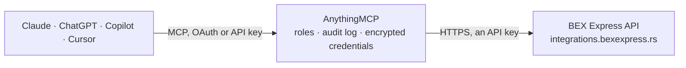

<!-- Generated by scripts/export-github-catalog.mjs in the anythingmcp-website repository. Do not edit by hand. -->

# BEX Express MCP connector

BEX Express courier (Serbia) from an AI agent: shipment status history by shipment number, address labels as PDF, the BEX address directory of municipalities, places and streets, and parcel shops and depots. The AnythingMCP connector gives Claude, ChatGPT, Microsoft Copilot, Cursor and Gemini 8 MCP tools for BEX Express: 6 read and 2 can change data.

**Category:** [Logistics](../logistics.md) · **Tools:** 8 · **Setup guide:** [anythingmcp.com](https://anythingmcp.com/guides/bex-express-to-mcp) · [Deutsch](https://anythingmcp.com/de/guides/bex-express-to-mcp) · [Italiano](https://anythingmcp.com/it/guides/bex-express-to-mcp) · [Español](https://anythingmcp.com/es/guides/bex-express-to-mcp) · [日本語](https://anythingmcp.com/ja/guides/bex-express-to-mcp) · [Русский](https://anythingmcp.com/ru/guides/bex-express-to-mcp) · [中文](https://anythingmcp.com/zh/guides/bex-express-to-mcp)

## Start without code

No installation and no terminal: AnythingMCP Cloud runs the BEX Express connector for you, operated by helpcode.ai in Frankfurt, Germany.

1. **Click the button above** and create an account or sign in. The BEX Express connector opens, ready to install.
2. **Paste the API key or token from your BEX Express account.** Every click is in the [step-by-step guide](https://anythingmcp.com/guides/bex-express-to-mcp).
3. **Click Install.** AnythingMCP shows the address of your MCP server.
4. **Add that address to your assistant:** [Claude](https://anythingmcp.com/guides/connect-bex-express-to-claude) · [ChatGPT](https://anythingmcp.com/guides/connect-bex-express-to-chatgpt) · [Microsoft Copilot](https://anythingmcp.com/guides/connect-bex-express-to-copilot) · [Cursor](https://anythingmcp.com/guides/connect-bex-express-to-cursor) · [Gemini CLI](https://anythingmcp.com/guides/connect-bex-express-to-gemini) · [Meta Muse](https://anythingmcp.com/guides/connect-bex-express-to-muse).
5. **Ask your first question**, for example: *Track shipment 206897445 — what's its current status and next expected event?*

Prefer help with the setup? [Talk to us](https://anythingmcp.com/contact).

## How it works

- **The AI client** speaks MCP (Streamable HTTP) to AnythingMCP and only sees tool names, descriptions and results. It never gets the BEX Express credentials.
- **AnythingMCP** checks the client's role, builds the call from the tool definition, adds the credentials (an API key), calls BEX Express, logs the call and returns the result.
- **BEX Express** sees an ordinary API client with the rights of the account the credentials belong to.

## Tools

| Tool | What it does | Access |
|---|---|---|
| [`bex_express_get_shipment_history`](#bex_express_get_shipment_history) | Get the status history of a BEX shipment by its shipment number: every scan with status name, scan and reason code, date, place, timestamp and time zone,… | read |
| [`bex_express_get_label`](#bex_express_get_label) | Get the address labels of a shipment as a Base64-encoded PDF (parcelLabel), with state true on success or false and an err text. | read |
| [`bex_express_list_municipalities`](#bex_express_list_municipalities) | List the municipalities (opštine) in the BEX address directory with id and name. | read |
| [`bex_express_list_settlements`](#bex_express_list_settlements) | List the places (mesta) of one municipality in the BEX address directory with id, name, postcode and municipality id. | read |
| [`bex_express_list_streets`](#bex_express_list_streets) | List the streets of one place in the BEX address directory with id, name, old name and place id. | read |
| [`bex_express_list_parcel_shops`](#bex_express_list_parcel_shops) | List BEX parcel shops and depots with code, region, name, city, street and house number, opening hours on weekdays and Saturday, and coordinates. | read |
| [`bex_express_create_shipments`](#bex_express_create_shipments) | Create shipments and announce them to BEX for pickup by a courier (postShipments). | write |
| [`bex_express_cancel_shipment`](#bex_express_cancel_shipment) | Cancel (delete) an announced BEX shipment by its shipment number. | write |

## Tool reference

Every parameter as the AI client sees it in `tools/list`. Source: [`packages/backend/src/adapters/intl/bex-express.json`](../../../packages/backend/src/adapters/intl/bex-express.json).

### `bex_express_get_shipment_history`

Get the status history of a BEX shipment by its shipment number: every scan with status name, scan and reason code, date, place, timestamp and time zone, plus eventPrediction, the next expected event. Status 1 registered, 11 picked up, 21 delivered, 25 to be returned, 30 returned to sender, -21 address check, -51 at customs.

**Access:** read · **Call:** `GET /Shipments/shipmentHistory`

| Parameter | Type | Required | Description |
|---|---|---|---|
| `shipment_number` | string | yes | BEX shipment number, e.g. 206897445, as on the label or returned by bex_express_create_shipments. |

### `bex_express_get_label`

Get the address labels of a shipment as a Base64-encoded PDF (parcelLabel), with state true on success or false and an err text. page_size 6 = one A6 label per page, 4 = four labels per A4 page. The PDF is large: call only when the user wants to print or save the label.

**Access:** read · **Call:** `GET /Shipments/getLabelWithProperties`

| Parameter | Type | Required | Description |
|---|---|---|---|
| `shipment_id` | integer | yes | BEX shipment number (returned by bex_express_create_shipments). |
| `page_size` | `4` \| `6` | no | 6 for A6 labels (one per page), 4 for four labels on an A4 sheet. |
| `page_position` | integer | no | Only with page_size 4: the slot on the A4 sheet to start printing at, 0 to 3. |
| `parcel_no` | integer | no | 0 prints the labels of every parcel of the shipment; a parcel number prints only that parcel. |

### `bex_express_list_municipalities`

List the municipalities (opštine) in the BEX address directory with id and name. The id goes into the Municipalities field of a shipment address and filters bex_express_list_settlements. Changes rarely: read it once per conversation.

**Access:** read · **Call:** `GET /Addresses/Municipalities`

No parameters.

### `bex_express_list_settlements`

List the places (mesta) of one municipality in the BEX address directory with id, name, postcode and municipality id. The place id goes into the Place field of a shipment address (AdressType 2 or 3) and filters bex_express_list_streets.

**Access:** read · **Call:** `GET /Addresses/Settlements`

| Parameter | Type | Required | Description |
|---|---|---|---|
| `municipality_id` | integer | yes | Municipality id from bex_express_list_municipalities. |

### `bex_express_list_streets`

List the streets of one place in the BEX address directory with id, name, old name and place id. The street id goes into the Street field of a shipment address with AdressType 3.

**Access:** read · **Call:** `GET /Addresses/Streets`

| Parameter | Type | Required | Description |
|---|---|---|---|
| `settlement_id` | integer | yes | Place id from bex_express_list_settlements. |

### `bex_express_list_parcel_shops`

List BEX parcel shops and depots with code, region, name, city, street and house number, opening hours on weekdays and Saturday, and coordinates. The code goes into the ParcelShop field of a shipment task. Read-only, although BEX takes it as a POST.

**Access:** read · **Call:** `POST https://api.bex.rs:62503/ship/api/Ship/listParcelShop`

| Parameter | Type | Required | Description |
|---|---|---|---|
| `region_id` | integer | no | Only parcel shops of this BEX region; 0 lists all. |

### `bex_express_create_shipments`

Create shipments and announce them to BEX for pickup by a courier (postShipments). Each shipment needs every field of the BEX structure (0 or an empty string when unused): shipmentId 0, serviceSpeed 1, shipmentType, shipmentCategory, totalPackages, shipmentContents, payType, cash on delivery and insurance amounts, the flags, and tasks with the sender (Type 1) and receiver (Type 2) addresses. Returns the new shipment numbers. Installed switched off; acts on real courier orders: show the user every shipment and get a yes first.

**Access:** write · **Call:** `POST https://api.bex.rs:62503/ship/api/Ship/postShipments`

| Parameter | Type | Required | Description |
|---|---|---|---|
| `shipments` | object[] | yes | Shipments in the BEX postShipments format. |

### `bex_express_cancel_shipment`

Cancel (delete) an announced BEX shipment by its shipment number. Returns state true and the shipment number, or false and an err text, e.g. when the courier has already picked it up. Installed switched off; show the user the shipment and get a yes first.

**Access:** write · **Call:** `POST https://api.bex.rs:62503/ship/api/Ship/deleteShipments`

| Parameter | Type | Required | Description |
|---|---|---|---|
| `shipment_id` | integer | yes | BEX shipment number to cancel. |

## Run it yourself

AnythingMCP is open source (AGPL-3.0). [Run it with Docker](../../../README.md#run-it-yourself), open **Connectors → Store**, pick **BEX Express** and enter `BEX_API_TOKEN`, then add your MCP server URL to the AI client.

[← Logistics connectors](../logistics.md) · [All categories](../README.md)
