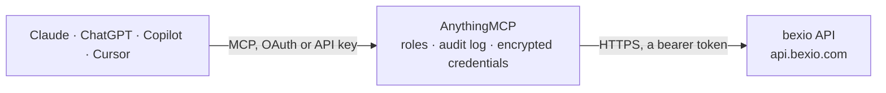

<!-- Generated by scripts/export-github-catalog.mjs in the anythingmcp-website repository. Do not edit by hand. -->

# bexio MCP connector

bexio — the Swiss SMB business suite used by 100,000+ companies: contacts, invoices, quotes, orders, articles, projects and timesheets. The AnythingMCP connector gives Claude, ChatGPT, Microsoft Copilot, Cursor and Gemini 12 MCP tools for bexio: 11 read and 1 can change data.

**Category:** [Accounting](../accounting.md) · **Tools:** 12 · **Setup guide:** [anythingmcp.com](https://anythingmcp.com/guides/bexio-to-mcp) · [Deutsch](https://anythingmcp.com/de/guides/bexio-to-mcp) · [Italiano](https://anythingmcp.com/it/guides/bexio-to-mcp) · [Español](https://anythingmcp.com/es/guides/bexio-to-mcp) · [日本語](https://anythingmcp.com/ja/guides/bexio-to-mcp) · [Русский](https://anythingmcp.com/ru/guides/bexio-to-mcp) · [中文](https://anythingmcp.com/zh/guides/bexio-to-mcp)

## Start without code

No installation and no terminal: AnythingMCP Cloud runs the bexio connector for you, operated by helpcode.ai in Frankfurt, Germany.

1. **Click the button above** and create an account or sign in. The bexio connector opens, ready to install.
2. **Paste the API key or token from your bexio account.** Every click is in the [step-by-step guide](https://anythingmcp.com/guides/bexio-to-mcp).
3. **Click Install.** AnythingMCP shows the address of your MCP server.
4. **Add that address to your assistant:** [Claude](https://anythingmcp.com/guides/connect-bexio-to-claude) · [ChatGPT](https://anythingmcp.com/guides/connect-bexio-to-chatgpt) · [Microsoft Copilot](https://anythingmcp.com/guides/connect-bexio-to-copilot) · [Cursor](https://anythingmcp.com/guides/connect-bexio-to-cursor) · [Gemini CLI](https://anythingmcp.com/guides/connect-bexio-to-gemini) · [Meta Muse](https://anythingmcp.com/guides/connect-bexio-to-muse).
5. **Ask your first question**, for example: *Show me the bexio contact for Glacier Bikes GmbH — I need address and primary e-mail.*

Prefer help with the setup? [Talk to us](https://anythingmcp.com/contact).

## How it works

- **The AI client** speaks MCP (Streamable HTTP) to AnythingMCP and only sees tool names, descriptions and results. It never gets the bexio credentials.
- **AnythingMCP** checks the client's role, builds the call from the tool definition, adds the credentials (a bearer token), calls bexio, logs the call and returns the result.
- **bexio** sees an ordinary API client with the rights of the account the credentials belong to.

## Tools

| Tool | What it does | Access |
|---|---|---|
| [`bexio_get_company_profile`](#bexio_get_company_profile) | Read the company profile of the connected bexio account: legal name, address, VAT number and country. | read |
| [`bexio_list_contacts`](#bexio_list_contacts) | List contacts (customers, suppliers, private persons) with paging and sorting. | read |
| [`bexio_search_contacts`](#bexio_search_contacts) | Find contacts by an exact or partial field match — the right tool when you know a name, customer number or e-mail and need the bexio contact id. | read |
| [`bexio_get_contact`](#bexio_get_contact) | Read one contact by its bexio id, including both name lines, address, contact group membership and the assigned user. | read |
| [`bexio_list_invoices`](#bexio_list_invoices) | List invoices (Rechnungen) with their document number, total, currency and payment state. | read |
| [`bexio_get_invoice`](#bexio_get_invoice) | Read one invoice in full, including every position with its article, quantity, unit price, discount and tax, plus the totals and the due date. | read |
| [`bexio_list_quotes`](#bexio_list_quotes) | List quotes (Offerten) with their number, addressee, total and status, to see what is out with customers and not yet won. | read |
| [`bexio_list_orders`](#bexio_list_orders) | List orders (Aufträge) with their number, customer, total and whether they have already been invoiced. | read |
| [`bexio_list_articles`](#bexio_list_articles) | List articles from the bexio product catalogue with their internal code, purchase and sale price, stock level and unit. | read |
| [`bexio_list_projects`](#bexio_list_projects) | List projects with their client, responsible user, start and end date and current status — the anchor for any timesheet question. | read |
| [`bexio_list_timesheets`](#bexio_list_timesheets) | List tracked time entries with their user, date, duration, project and billability — the raw data behind 'how much did we spend on this client'. | read |
| [`bexio_create_contact`](#bexio_create_contact) | Create a contact in the live bexio company. | write |

## Tool reference

Every parameter as the AI client sees it in `tools/list`. Source: [`packages/backend/src/adapters/ch/bexio.json`](../../../packages/backend/src/adapters/ch/bexio.json).

### `bexio_get_company_profile`

Read the company profile of the connected bexio account: legal name, address, VAT number and country. Fast call with no parameters — use it to verify the token.

**Access:** read · **Call:** `GET /2.0/company_profile`

No parameters.

### `bexio_list_contacts`

List contacts (customers, suppliers, private persons) with paging and sorting. Contact type 1 is a company, 2 a private person.

**Access:** read · **Call:** `GET /2.0/contact`

| Parameter | Type | Required | Description |
|---|---|---|---|
| `limit` | number | no | Maximum rows to return (default 500, max 2000). |
| `offset` | number | no | Rows to skip, for paging. |
| `order_by` | string | no | Field to sort by: `id`, `nr`, `name_1` or `updated_at`; append `_desc` for descending, e.g. `id_desc`. |

### `bexio_search_contacts`

Find contacts by an exact or partial field match — the right tool when you know a name, customer number or e-mail and need the bexio contact id.

**Access:** read · **Call:** `POST /2.0/contact/search`

| Parameter | Type | Required | Description |
|---|---|---|---|
| `field` | string | yes | Field to match: `name_1`, `name_2`, `mail`, `nr`, `contact_group_ids` or `contact_type_id`. |
| `value` | string | yes | Value to match against that field. |
| `criteria` | string | no | Match mode: `=`, `like`, `not_like`, `is_null` or `not_null`. Defaults to `like`. |

### `bexio_get_contact`

Read one contact by its bexio id, including both name lines, address, contact group membership and the assigned user.

**Access:** read · **Call:** `GET /2.0/contact/{id}`

| Parameter | Type | Required | Description |
|---|---|---|---|
| `id` | number | yes | Numeric bexio contact id. |

### `bexio_list_invoices`

List invoices (Rechnungen) with their document number, total, currency and payment state. Sort by `id_desc` for the most recent first.

**Access:** read · **Call:** `GET /2.0/kb_invoice`

| Parameter | Type | Required | Description |
|---|---|---|---|
| `limit` | number | no | Maximum rows to return (default 500, max 2000). |
| `offset` | number | no | Rows to skip, for paging. |
| `order_by` | string | no | Field to sort by: `id`, `total`, `total_net`, `total_gross` or `updated_at`; append `_desc` for descending, e.g. `id_desc`. Comma-separate several. |

### `bexio_get_invoice`

Read one invoice in full, including every position with its article, quantity, unit price, discount and tax, plus the totals and the due date.

**Access:** read · **Call:** `GET /2.0/kb_invoice/{id}`

| Parameter | Type | Required | Description |
|---|---|---|---|
| `id` | number | yes | Numeric invoice id. |

### `bexio_list_quotes`

List quotes (Offerten) with their number, addressee, total and status, to see what is out with customers and not yet won.

**Access:** read · **Call:** `GET /2.0/kb_offer`

| Parameter | Type | Required | Description |
|---|---|---|---|
| `limit` | number | no | Maximum rows to return (default 500, max 2000). |
| `offset` | number | no | Rows to skip, for paging. |
| `order_by` | string | no | Field to sort by: `id`, `total`, `total_net`, `total_gross` or `updated_at`; append `_desc` for descending, e.g. `id_desc`. Comma-separate several. |

### `bexio_list_orders`

List orders (Aufträge) with their number, customer, total and whether they have already been invoiced.

**Access:** read · **Call:** `GET /2.0/kb_order`

| Parameter | Type | Required | Description |
|---|---|---|---|
| `limit` | number | no | Maximum rows to return (default 500, max 2000). |
| `offset` | number | no | Rows to skip, for paging. |
| `order_by` | string | no | Field to sort by: `id`, `total`, `total_net`, `total_gross` or `updated_at`; append `_desc` for descending, e.g. `id_desc`. Comma-separate several. |

### `bexio_list_articles`

List articles from the bexio product catalogue with their internal code, purchase and sale price, stock level and unit.

**Access:** read · **Call:** `GET /2.0/article`

| Parameter | Type | Required | Description |
|---|---|---|---|
| `limit` | number | no | Maximum rows to return (default 500, max 2000). |
| `offset` | number | no | Rows to skip, for paging. |
| `order_by` | string | no | Field to sort by: `id` or `intern_name`; append `_desc` for descending, e.g. `intern_name_desc`. |

### `bexio_list_projects`

List projects with their client, responsible user, start and end date and current status — the anchor for any timesheet question.

**Access:** read · **Call:** `GET /2.0/pr_project`

| Parameter | Type | Required | Description |
|---|---|---|---|
| `limit` | number | no | Maximum rows to return (default 500, max 2000). |
| `offset` | number | no | Rows to skip, for paging. |

### `bexio_list_timesheets`

List tracked time entries with their user, date, duration, project and billability — the raw data behind 'how much did we spend on this client'.

**Access:** read · **Call:** `GET /2.0/timesheet`

| Parameter | Type | Required | Description |
|---|---|---|---|
| `limit` | number | no | Maximum rows to return (default 500, max 2000). |
| `offset` | number | no | Rows to skip, for paging. |
| `order_by` | string | no | Field to sort by: `id` or `date`; append `_desc` for descending, e.g. `date_desc`. |

### `bexio_create_contact`

Create a contact in the live bexio company. Search with bexio_search_contacts first — bexio does not deduplicate, and a second 'Muster AG' is painful to unwind.

**Access:** write · **Call:** `POST /2.0/contact`

| Parameter | Type | Required | Description |
|---|---|---|---|
| `contact_type_id` | number | yes | 1 for a company, 2 for a private person. |
| `name_1` | string | yes | Company name, or family name for a private person. |
| `name_2` | string | no | Second name line: given name, or a department. |
| `street_name` | string | no | Street name without the house number. Required when house_number or address_addition is set. |
| `house_number` | string | no | House number. |
| `address_addition` | string | no | Address addition, e.g. c/o or a P.O. box line. |
| `postcode` | string | no | Postal code. |
| `city` | string | no | City. |
| `country_id` | number | no | bexio country id; 1 is Switzerland. |
| `mail` | string | no | Primary e-mail address. |
| `phone_fixed` | string | no | Landline phone number. |
| `user_id` | number | yes | bexio user id the contact is assigned to. |

## Run it yourself

AnythingMCP is open source (AGPL-3.0). [Run it with Docker](../../../README.md#run-it-yourself), open **Connectors → Store**, pick **bexio** and enter `BEXIO_API_TOKEN`, then add your MCP server URL to the AI client.

[← Accounting connectors](../accounting.md) · [All categories](../README.md)
