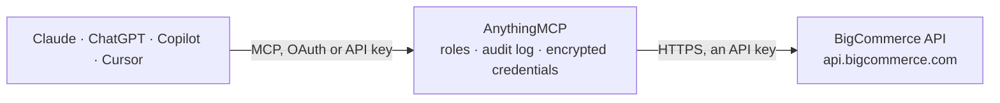

<!-- Generated by scripts/export-github-catalog.mjs in the anythingmcp-website repository. Do not edit by hand. -->

# BigCommerce MCP connector

Drive BigCommerce (SaaS e-commerce platform) from any AI agent: products, variants, orders, customers, categories. 14 tools, API-key (X-Auth-Token) auth, per-store base URL. The AnythingMCP connector gives Claude, ChatGPT, Microsoft Copilot, Cursor and Gemini 14 MCP tools for BigCommerce: 8 read and 6 can change data.

**Category:** [E-commerce](../e-commerce.md) · **Tools:** 14 · **Setup guide:** [anythingmcp.com](https://anythingmcp.com/guides/bigcommerce-to-mcp) · [Deutsch](https://anythingmcp.com/de/guides/bigcommerce-to-mcp) · [Italiano](https://anythingmcp.com/it/guides/bigcommerce-to-mcp) · [Español](https://anythingmcp.com/es/guides/bigcommerce-to-mcp) · [日本語](https://anythingmcp.com/ja/guides/bigcommerce-to-mcp) · [Русский](https://anythingmcp.com/ru/guides/bigcommerce-to-mcp) · [中文](https://anythingmcp.com/zh/guides/bigcommerce-to-mcp)

## Start without code

No installation and no terminal: AnythingMCP Cloud runs the BigCommerce connector for you, operated by helpcode.ai in Frankfurt, Germany.

1. **Click the button above** and create an account or sign in. The BigCommerce connector opens, ready to install.
2. **Paste the API key or token from your BigCommerce account.** Every click is in the [step-by-step guide](https://anythingmcp.com/guides/bigcommerce-to-mcp).
3. **Click Install.** AnythingMCP shows the address of your MCP server.
4. **Add that address to your assistant:** [Claude](https://anythingmcp.com/guides/connect-bigcommerce-to-claude) · [ChatGPT](https://anythingmcp.com/guides/connect-bigcommerce-to-chatgpt) · [Microsoft Copilot](https://anythingmcp.com/guides/connect-bigcommerce-to-copilot) · [Cursor](https://anythingmcp.com/guides/connect-bigcommerce-to-cursor) · [Gemini CLI](https://anythingmcp.com/guides/connect-bigcommerce-to-gemini) · [Meta Muse](https://anythingmcp.com/guides/connect-bigcommerce-to-muse).
5. **Ask your first question**, for example: *Show me order 23045: invoice amount, date created, status, and customer id*

Prefer help with the setup? [Talk to us](https://anythingmcp.com/contact).

## How it works

- **The AI client** speaks MCP (Streamable HTTP) to AnythingMCP and only sees tool names, descriptions and results. It never gets the BigCommerce credentials.
- **AnythingMCP** checks the client's role, builds the call from the tool definition, adds the credentials (an API key), calls BigCommerce, logs the call and returns the result.
- **BigCommerce** sees an ordinary API client with the rights of the account the credentials belong to.

## Tools

| Tool | What it does | Access |
|---|---|---|
| [`bigcommerce_list_products`](#bigcommerce_list_products) | List products with filters. | read |
| [`bigcommerce_get_product`](#bigcommerce_get_product) | Fetch a single product. | read |
| [`bigcommerce_create_product`](#bigcommerce_create_product) | Create a product. | write |
| [`bigcommerce_update_product`](#bigcommerce_update_product) | Update a product. | write |
| [`bigcommerce_delete_product`](#bigcommerce_delete_product) | Permanently delete a product. | write |
| [`bigcommerce_list_product_variants`](#bigcommerce_list_product_variants) | List variants (SKUs) for a product. | read |
| [`bigcommerce_update_variant_inventory`](#bigcommerce_update_variant_inventory) | Update a variant's inventory_level (stock quantity). | write |
| [`bigcommerce_list_categories`](#bigcommerce_list_categories) | List categories with parent/tree structure. | read |
| [`bigcommerce_list_orders`](#bigcommerce_list_orders) | List orders (uses v2 endpoint — V3 doesn't fully cover orders yet). | read |
| [`bigcommerce_get_order`](#bigcommerce_get_order) | Fetch one order (v2). | read |
| [`bigcommerce_get_order_products`](#bigcommerce_get_order_products) | List line items on an order. | read |
| [`bigcommerce_update_order_status`](#bigcommerce_update_order_status) | Update an order's status (use status code from instructions). | write |
| [`bigcommerce_list_customers`](#bigcommerce_list_customers) | List customers (V3). | read |
| [`bigcommerce_create_customer`](#bigcommerce_create_customer) | Create a customer. | write |

## Tool reference

Every parameter as the AI client sees it in `tools/list`. Source: [`packages/backend/src/adapters/intl/bigcommerce.json`](../../../packages/backend/src/adapters/intl/bigcommerce.json).

### `bigcommerce_list_products`

List products with filters. Each product has id, name, sku, type, price, cost_price, retail_price, weight, inventory_level, inventory_tracking, brand_id, categories[], date_created, date_modified.

**Access:** read · **Call:** `GET /v3/catalog/products`

| Parameter | Type | Required | Description |
|---|---|---|---|
| `id_in` | string | no | Comma-separated product IDs. |
| `name` | string | no | Substring filter on name. |
| `sku` | string | no | Exact SKU match. |
| `categories_in` | string | no | Comma-separated category IDs. |
| `is_visible` | boolean | no | Filter to visible products. |
| `is_featured` | boolean | no | Filter to featured. |
| `include` | string | no | Side-load: variants,images,custom_fields,bulk_pricing_rules,modifiers,options,videos,primary_image,reviews. |
| `include_fields` | string | no | Comma-separated fields to return (sparse). |
| `page` | integer | no | 1-based page. |
| `limit` | integer | no | Per page (default 50, max 250). |
| `sort` | string | no | id, name, sku, price, date_modified, date_created, inventory_level, is_visible, total_sold. |
| `direction` | string | no | asc or desc. |

### `bigcommerce_get_product`

Fetch a single product. Use include for variants/images/custom_fields.

**Access:** read · **Call:** `GET /v3/catalog/products/{productId}`

| Parameter | Type | Required | Description |
|---|---|---|---|
| `productId` | integer | yes | Product ID. |
| `include` | string | no | Side-load. |

### `bigcommerce_create_product`

Create a product. Required: name + price + categories + weight + type (physical or digital).

**Access:** write · **Call:** `POST /v3/catalog/products`

| Parameter | Type | Required | Description |
|---|---|---|---|
| `name` | string | yes | Product name. |
| `type` | string | yes | physical or digital. |
| `sku` | string | no | SKU. |
| `description` | string | no | HTML description. |
| `weight` | number | yes | Weight (in store's unit). |
| `price` | number | yes | Price. |
| `cost_price` | number | no | Cost basis. |
| `retail_price` | number | no | Compare-at retail. |
| `sale_price` | number | no | Sale price. |
| `categories` | any[] | yes | Array of category IDs. |
| `brand_id` | integer | no | Brand ID. |
| `inventory_level` | integer | no | Stock on hand. |
| `inventory_tracking` | string | no | none, product, variant. |
| `is_visible` | boolean | no | Visible on storefront. |
| `is_featured` | boolean | no | Featured. |
| `tax_class_id` | integer | no | Tax class. |

### `bigcommerce_update_product`

Update a product. Common: price, inventory_level, is_visible.

**Access:** write · **Call:** `PUT /v3/catalog/products/{productId}`

| Parameter | Type | Required | Description |
|---|---|---|---|
| `productId` | integer | yes | Product ID. |
| `name` | string | no | New name. |
| `price` | number | no | New price. |
| `sale_price` | number | no | Sale price. |
| `inventory_level` | integer | no | New stock. |
| `is_visible` | boolean | no | Visibility. |
| `description` | string | no | New description. |
| `categories` | any[] | no | Replace categories. |

### `bigcommerce_delete_product`

Permanently delete a product.

**Access:** write · **Call:** `DELETE /v3/catalog/products/{productId}`

| Parameter | Type | Required | Description |
|---|---|---|---|
| `productId` | integer | yes | Product ID. |

### `bigcommerce_list_product_variants`

List variants (SKUs) for a product.

**Access:** read · **Call:** `GET /v3/catalog/products/{productId}/variants`

| Parameter | Type | Required | Description |
|---|---|---|---|
| `productId` | integer | yes | Product ID. |
| `page` | integer | no | Page. |
| `limit` | integer | no | Per page. |

### `bigcommerce_update_variant_inventory`

Update a variant's inventory_level (stock quantity).

**Access:** write · **Call:** `PUT /v3/catalog/products/{productId}/variants/{variantId}`

| Parameter | Type | Required | Description |
|---|---|---|---|
| `productId` | integer | yes | Parent product ID. |
| `variantId` | integer | yes | Variant ID. |
| `inventory_level` | integer | yes | New stock. |

### `bigcommerce_list_categories`

List categories with parent/tree structure.

**Access:** read · **Call:** `GET /v3/catalog/categories`

| Parameter | Type | Required | Description |
|---|---|---|---|
| `name` | string | no | Substring filter. |
| `parent_id` | integer | no | Filter by parent. |
| `page` | integer | no | Page. |
| `limit` | integer | no | Per page. |

### `bigcommerce_list_orders`

List orders (uses v2 endpoint — V3 doesn't fully cover orders yet).

**Access:** read · **Call:** `GET /v2/orders`

| Parameter | Type | Required | Description |
|---|---|---|---|
| `min_id` | integer | no | Min order ID. |
| `max_id` | integer | no | Max order ID. |
| `min_total` | number | no | Min total. |
| `max_total` | number | no | Max total. |
| `customer_id` | integer | no | Filter by customer. |
| `email` | string | no | Filter by billing email. |
| `status_id` | integer | no | Filter by status code (see instructions). |
| `min_date_created` | string | no | RFC 2822 date string. |
| `max_date_created` | string | no | RFC 2822 date string. |
| `page` | integer | no | Page. |
| `limit` | integer | no | Per page (max 250). |
| `sort` | string | no | id:asc, id:desc, total:asc, etc. |

### `bigcommerce_get_order`

Fetch one order (v2). Returns customer, billing/shipping addresses, products via separate /products endpoint.

**Access:** read · **Call:** `GET /v2/orders/{orderId}`

| Parameter | Type | Required | Description |
|---|---|---|---|
| `orderId` | integer | yes | Order ID. |

### `bigcommerce_get_order_products`

List line items on an order.

**Access:** read · **Call:** `GET /v2/orders/{orderId}/products`

| Parameter | Type | Required | Description |
|---|---|---|---|
| `orderId` | integer | yes | Order ID. |

### `bigcommerce_update_order_status`

Update an order's status (use status code from instructions).

**Access:** write · **Call:** `PUT /v2/orders/{orderId}`

| Parameter | Type | Required | Description |
|---|---|---|---|
| `orderId` | integer | yes | Order ID. |
| `status_id` | integer | yes | New status code. |

### `bigcommerce_list_customers`

List customers (V3).

**Access:** read · **Call:** `GET /v3/customers`

| Parameter | Type | Required | Description |
|---|---|---|---|
| `email_in` | string | no | Comma-separated emails. |
| `name` | string | no | Substring on name. |
| `company` | string | no | Company filter. |
| `customer_group_id` | integer | no | Filter by group. |
| `page` | integer | no | Page. |
| `limit` | integer | no | Per page. |
| `include` | string | no | addresses, attributes, formfields, storecredit, _consents. |

### `bigcommerce_create_customer`

Create a customer.

**Access:** write · **Call:** `POST /v3/customers`

| Parameter | Type | Required | Description |
|---|---|---|---|
| `customers` | any[] | yes | [{first_name, last_name, email, company?, phone?, notes?, tax_exempt_category?, customer_group_id?, addresses?:[{...}], authentication?:{new_password?,force_password_reset?}}]. Wrap inside array. |

## Run it yourself

AnythingMCP is open source (AGPL-3.0). [Run it with Docker](../../../README.md#run-it-yourself), open **Connectors → Store**, pick **BigCommerce** and enter `BIGCOMMERCE_STORE_HASH`, `BIGCOMMERCE_ACCESS_TOKEN`, then add your MCP server URL to the AI client.

[← E-commerce connectors](../e-commerce.md) · [All categories](../README.md)
