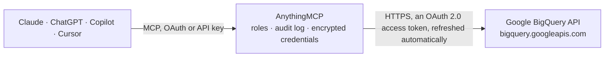

<!-- Generated by scripts/export-github-catalog.mjs in the anythingmcp-website repository. Do not edit by hand. -->

# Google BigQuery MCP connector

Let your AI explore and query Google BigQuery: list projects, datasets and tables, read schemas, preview rows for free, estimate a query's cost with a dry run before running it, page through results … The AnythingMCP connector gives Claude, ChatGPT, Microsoft Copilot, Cursor and Gemini 11 MCP tools for Google BigQuery: 9 read and 2 can change data.

**Category:** [Databases](../database.md) · **Tools:** 11 · **Setup guide:** [anythingmcp.com](https://anythingmcp.com/guides/bigquery-to-mcp) · [Deutsch](https://anythingmcp.com/de/guides/bigquery-to-mcp) · [Italiano](https://anythingmcp.com/it/guides/bigquery-to-mcp) · [Español](https://anythingmcp.com/es/guides/bigquery-to-mcp) · [日本語](https://anythingmcp.com/ja/guides/bigquery-to-mcp) · [Русский](https://anythingmcp.com/ru/guides/bigquery-to-mcp) · [中文](https://anythingmcp.com/zh/guides/bigquery-to-mcp)

## Start without code

No installation and no terminal: AnythingMCP Cloud runs the Google BigQuery connector for you, operated by helpcode.ai in Frankfurt, Germany.

1. **Click the button above** and create an account or sign in. The Google BigQuery connector opens, ready to install.
2. **Sign in with your Google BigQuery account** when AnythingMCP asks. The first time, an admin creates a small app in the Google Cloud console. Every click is in the [step-by-step guide](https://anythingmcp.com/guides/bigquery-to-mcp).
3. **Click Install.** AnythingMCP shows the address of your MCP server.
4. **Add that address to your assistant:** [Claude](https://anythingmcp.com/guides/connect-bigquery-to-claude) · [ChatGPT](https://anythingmcp.com/guides/connect-bigquery-to-chatgpt) · [Microsoft Copilot](https://anythingmcp.com/guides/connect-bigquery-to-copilot) · [Cursor](https://anythingmcp.com/guides/connect-bigquery-to-cursor) · [Gemini CLI](https://anythingmcp.com/guides/connect-bigquery-to-gemini) · [Meta Muse](https://anythingmcp.com/guides/connect-bigquery-to-muse).
5. **Ask your first question**, for example: *Show order ORD-2026-0457 for customer Kauppa Tekstiilit Oy — order date, items and total EUR.*

Prefer help with the setup? [Talk to us](https://anythingmcp.com/contact).

## How it works

- **The AI client** speaks MCP (Streamable HTTP) to AnythingMCP and only sees tool names, descriptions and results. It never gets the Google BigQuery credentials.
- **AnythingMCP** checks the client's role, builds the call from the tool definition, adds the credentials (an OAuth 2.0 access token, refreshed automatically), calls Google BigQuery, logs the call and returns the result.
- **Google BigQuery** sees an ordinary API client with the rights of the account the credentials belong to.

## Tools

| Tool | What it does | Access |
|---|---|---|
| [`bigquery_list_projects`](#bigquery_list_projects) | List the Google Cloud projects the signed-in account can use in BigQuery, with project id, name and number. | read |
| [`bigquery_list_datasets`](#bigquery_list_datasets) | List the datasets of a project with their location and labels. | read |
| [`bigquery_get_dataset`](#bigquery_get_dataset) | Get one dataset: description, location, creation and modification times, default table expiration and labels. | read |
| [`bigquery_list_tables`](#bigquery_list_tables) | List the tables, views and materialized views of a dataset with type, partitioning and clustering. | read |
| [`bigquery_get_table`](#bigquery_get_table) | Get a table's schema (column names, types, modes, descriptions, nested fields), row count, size in bytes, partitioning, clustering, whether a partition… | read |
| [`bigquery_preview_table_rows`](#bigquery_preview_table_rows) | Read the first rows of a table directly, without running a query: FREE, no bytes are billed. | read |
| [`bigquery_run_query`](#bigquery_run_query) | Run a GoogleSQL query (jobs.query). | write |
| [`bigquery_get_query_results`](#bigquery_get_query_results) | Get the result rows of a query job, page by page, or wait for a query that was still running (jobComplete false). | read |
| [`bigquery_list_jobs`](#bigquery_list_jobs) | List recent BigQuery jobs of a project (queries, loads, copies, exports), newest first, with state, SQL, bytes processed and errors. | read |
| [`bigquery_get_job`](#bigquery_get_job) | Get one job: its SQL, state (PENDING, RUNNING, DONE), errors, start and end times, bytes processed and billed, slot time, cache hit and rows changed by DML. | read |
| [`bigquery_cancel_job`](#bigquery_cancel_job) | Ask BigQuery to cancel a running job. | write |

## Tool reference

Every parameter as the AI client sees it in `tools/list`. Source: [`packages/backend/src/adapters/intl/bigquery.json`](../../../packages/backend/src/adapters/intl/bigquery.json).

### `bigquery_list_projects`

List the Google Cloud projects the signed-in account can use in BigQuery, with project id, name and number. Start here to find the project id for every other tool.

**Access:** read · **Call:** `GET /projects`

| Parameter | Type | Required | Description |
|---|---|---|---|
| `maxResults` | integer | no | Projects per page, default 50. |
| `pageToken` | string | no | nextPageToken from the previous page. |

### `bigquery_list_datasets`

List the datasets of a project with their location and labels. Free: no bytes are scanned.

**Access:** read · **Call:** `GET /projects/{project_id}/datasets`

| Parameter | Type | Required | Description |
|---|---|---|---|
| `project_id` | string | yes | Google Cloud project id that owns the data or runs the job, e.g. 'my-company-analytics'. bigquery_list_projects lists them. For Google's public datasets use 'bigquery-public-data' as the data project and your own project to run queries. |
| `maxResults` | integer | no | Datasets per page, default 100. |
| `pageToken` | string | no | nextPageToken from the previous page. |
| `filter` | string | no | Label filter, e.g. 'labels.department:sales'. |
| `all` | boolean | no | Also list hidden datasets (names starting with an underscore). |

### `bigquery_get_dataset`

Get one dataset: description, location, creation and modification times, default table expiration and labels. Access lists are left out.

**Access:** read · **Call:** `GET /projects/{project_id}/datasets/{dataset_id}`

| Parameter | Type | Required | Description |
|---|---|---|---|
| `project_id` | string | yes | Google Cloud project id that owns the data or runs the job, e.g. 'my-company-analytics'. bigquery_list_projects lists them. For Google's public datasets use 'bigquery-public-data' as the data project and your own project to run queries. |
| `dataset_id` | string | yes | Dataset id, e.g. 'sales'. bigquery_list_datasets lists them. |

### `bigquery_list_tables`

List the tables, views and materialized views of a dataset with type, partitioning and clustering. Free: no bytes are scanned. Use bigquery_get_table for columns and size.

**Access:** read · **Call:** `GET /projects/{project_id}/datasets/{dataset_id}/tables`

| Parameter | Type | Required | Description |
|---|---|---|---|
| `project_id` | string | yes | Google Cloud project id that owns the data or runs the job, e.g. 'my-company-analytics'. bigquery_list_projects lists them. For Google's public datasets use 'bigquery-public-data' as the data project and your own project to run queries. |
| `dataset_id` | string | yes | Dataset id, e.g. 'sales'. bigquery_list_datasets lists them. |
| `maxResults` | integer | no | Tables per page, default 100. |
| `pageToken` | string | no | nextPageToken from the previous page. |

### `bigquery_get_table`

Get a table's schema (column names, types, modes, descriptions, nested fields), row count, size in bytes, partitioning, clustering, whether a partition filter is required, and a view's SQL. Free. Check numBytes here before querying a table.

**Access:** read · **Call:** `GET /projects/{project_id}/datasets/{dataset_id}/tables/{table_id}`

| Parameter | Type | Required | Description |
|---|---|---|---|
| `project_id` | string | yes | Google Cloud project id that owns the data or runs the job, e.g. 'my-company-analytics'. bigquery_list_projects lists them. For Google's public datasets use 'bigquery-public-data' as the data project and your own project to run queries. |
| `dataset_id` | string | yes | Dataset id, e.g. 'sales'. bigquery_list_datasets lists them. |
| `table_id` | string | yes | Table or view id inside the dataset, e.g. 'orders'. |

### `bigquery_preview_table_rows`

Read the first rows of a table directly, without running a query: FREE, no bytes are billed. Use it to look at sample data instead of SELECT * ... LIMIT, which scans the whole table. Does not work on views. Returns at most 100 rows per call.

**Access:** read · **Call:** `GET /projects/{project_id}/datasets/{dataset_id}/tables/{table_id}/data`

| Parameter | Type | Required | Description |
|---|---|---|---|
| `project_id` | string | yes | Google Cloud project id that owns the data or runs the job, e.g. 'my-company-analytics'. bigquery_list_projects lists them. For Google's public datasets use 'bigquery-public-data' as the data project and your own project to run queries. |
| `dataset_id` | string | yes | Dataset id, e.g. 'sales'. bigquery_list_datasets lists them. |
| `table_id` | string | yes | Table or view id inside the dataset, e.g. 'orders'. |
| `maxResults` | integer | no | Rows to read, default 10, at most 100. |
| `startIndex` | string | no | Zero-based row to start from, as a number in a string, e.g. '100'. |
| `selectedFields` | string | no | Comma-separated columns to return, e.g. 'order_id,amount'. Nested fields as 'address.city'. Default all columns. |
| `pageToken` | string | no | pageToken from the previous answer, to continue. |

### `bigquery_run_query`

Run a GoogleSQL query (jobs.query). With dryRun true it only validates the SQL and returns the estimated bytes (totalBytesProcessed) for FREE: always dry-run first on unknown tables, tell the user the estimate, and ask before running scans above 10 GB, because BigQuery bills scanned bytes (about US$6.25 per TiB on demand). Statements that change data or tables (INSERT, UPDATE, DELETE, MERGE, CREATE, ALTER, DROP) need the user's explicit confirmation first. Returns the schema and up to maxResults rows.

**Access:** write · **Call:** `POST /projects/{project_id}/queries`

| Parameter | Type | Required | Description |
|---|---|---|---|
| `project_id` | string | yes | Project that runs and pays for the query (needs BigQuery Job User there). It can read tables of other projects. |
| `query` | string | yes | GoogleSQL statement. Qualify tables as `project.dataset.table` with backticks. |
| `dryRun` | boolean | no | true = only validate and estimate bytes, nothing runs and nothing is billed. Default false. |
| `maxResults` | integer | no | Rows returned in this answer, default 100, at most 1000. Page further with bigquery_get_query_results. |
| `timeoutMs` | integer | no | How long to wait for the result, in milliseconds. Default 20000, at most 25000. If the query is not done, jobComplete is false: poll bigquery_get_query_results. |
| `maximumBytesBilled` | string | no | Cost cap in bytes as a number in a string, e.g. '10737418240' for 10 GiB. A query that would bill more fails without charge. Recommended: slightly above the dry-run estimate. |
| `defaultDataset` | object | no | Dataset for unqualified table names: {"projectId": "my-project", "datasetId": "sales"}. |
| `queryParameters` | object[] | no | Named parameters for @name placeholders, e.g. [{"name": "country", "parameterType": {"type": "STRING"}, "parameterValue": {"value": "DE"}}]. |
| `parameterMode` | `NAMED` \| `POSITIONAL` | no | NAMED when queryParameters use @name placeholders, POSITIONAL for ? placeholders. Required together with queryParameters. |
| `location` | string | no | Location to run the job in, e.g. 'EU' or 'europe-west3'. Usually inferred from the tables; set it when the data is outside the US and EU. |
| `useQueryCache` | boolean | no | Reuse a cached result of the identical query for free. Default true. |
| `labels` | object | no | Job labels for cost tracking, e.g. {"source": "ai-assistant"}. |

### `bigquery_get_query_results`

Get the result rows of a query job, page by page, or wait for a query that was still running (jobComplete false). Use the jobId and location from the jobReference of bigquery_run_query, and pageToken to continue. Reading results costs nothing extra.

**Access:** read · **Call:** `GET /projects/{project_id}/queries/{job_id}`

| Parameter | Type | Required | Description |
|---|---|---|---|
| `project_id` | string | yes | Project that ran the job (jobReference.projectId). |
| `job_id` | string | yes | jobReference.jobId of the query. |
| `location` | string | no | Location the job ran in, e.g. 'US', 'EU' or 'europe-west3'. Required for jobs outside the US and EU multi-regions; use jobReference.location from the earlier answer. |
| `pageToken` | string | no | pageToken from the previous answer. |
| `maxResults` | integer | no | Rows per page, default 100, at most 1000. |
| `startIndex` | string | no | Zero-based row to start from, as a number in a string. Use pageToken instead when paging. |
| `timeoutMs` | integer | no | How long to wait for a running query, in milliseconds. Default 20000, at most 25000. |

### `bigquery_list_jobs`

List recent BigQuery jobs of a project (queries, loads, copies, exports), newest first, with state, SQL, bytes processed and errors. Your own jobs by default; allUsers lists everyone's with the right permission. Free.

**Access:** read · **Call:** `GET /projects/{project_id}/jobs`

| Parameter | Type | Required | Description |
|---|---|---|---|
| `project_id` | string | yes | Google Cloud project id that owns the data or runs the job, e.g. 'my-company-analytics'. bigquery_list_projects lists them. For Google's public datasets use 'bigquery-public-data' as the data project and your own project to run queries. |
| `maxResults` | integer | no | Jobs per page, default 20. |
| `pageToken` | string | no | nextPageToken from the previous page. |
| `allUsers` | boolean | no | List jobs of all users (needs BigQuery Resource Viewer or Admin). Default false. |
| `stateFilter` | `done` \| `pending` \| `running`[] | no | Only jobs in these states: done, pending, running. |
| `minCreationTime` | string | no | Only jobs created after this time, in milliseconds since 1970, as a string. |
| `maxCreationTime` | string | no | Only jobs created before this time, in milliseconds since 1970, as a string. |

### `bigquery_get_job`

Get one job: its SQL, state (PENDING, RUNNING, DONE), errors, start and end times, bytes processed and billed, slot time, cache hit and rows changed by DML. Use it to follow a long query or explain its cost.

**Access:** read · **Call:** `GET /projects/{project_id}/jobs/{job_id}`

| Parameter | Type | Required | Description |
|---|---|---|---|
| `project_id` | string | yes | Project that ran the job. |
| `job_id` | string | yes | The job id (jobReference.jobId). |
| `location` | string | no | Location the job ran in, e.g. 'US', 'EU' or 'europe-west3'. Required for jobs outside the US and EU multi-regions; use jobReference.location from the earlier answer. |

### `bigquery_cancel_job`

Ask BigQuery to cancel a running job. Confirm with the user first. Cancellation is best effort: the job may still finish, and bytes already scanned may be billed. Check the outcome with bigquery_get_job.

**Access:** write · **Call:** `POST /projects/{project_id}/jobs/{job_id}/cancel`

| Parameter | Type | Required | Description |
|---|---|---|---|
| `project_id` | string | yes | Project that runs the job. |
| `job_id` | string | yes | The job id (jobReference.jobId). |
| `location` | string | no | Location the job ran in, e.g. 'US', 'EU' or 'europe-west3'. Required for jobs outside the US and EU multi-regions; use jobReference.location from the earlier answer. |

## Run it yourself

AnythingMCP is open source (AGPL-3.0). [Run it with Docker](../../../README.md#run-it-yourself), open **Connectors → Store**, pick **Google BigQuery** and enter `GOOGLE_CLIENT_ID`, `GOOGLE_CLIENT_SECRET`, then add your MCP server URL to the AI client.

[← Databases connectors](../database.md) · [All categories](../README.md)
