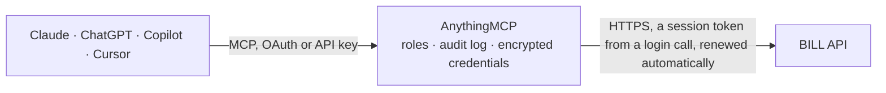

<!-- Generated by scripts/export-github-catalog.mjs in the anythingmcp-website repository. Do not edit by hand. -->

# BILL MCP connector

BILL (Bill.com) accounts payable and receivable: vendors, bills, recurring bills, vendor credits, bill approvals and approval policies, AP payments, customers, invoices, credit memos and received payments. The AnythingMCP connector gives Claude, ChatGPT, Microsoft Copilot, Cursor and Gemini 20 MCP tools for BILL: 19 read and 1 can change data.

**Category:** [Accounting](../accounting.md) · **Tools:** 20 · **Setup guide:** [anythingmcp.com](https://anythingmcp.com/guides/bill-com-to-mcp) · [Deutsch](https://anythingmcp.com/de/guides/bill-com-to-mcp) · [Italiano](https://anythingmcp.com/it/guides/bill-com-to-mcp) · [Español](https://anythingmcp.com/es/guides/bill-com-to-mcp) · [日本語](https://anythingmcp.com/ja/guides/bill-com-to-mcp) · [Русский](https://anythingmcp.com/ru/guides/bill-com-to-mcp) · [中文](https://anythingmcp.com/zh/guides/bill-com-to-mcp)

## Start without code

No installation and no terminal: AnythingMCP Cloud runs the BILL connector for you, operated by helpcode.ai in Frankfurt, Germany.

1. **Click the button above** and create an account or sign in. The BILL connector opens, ready to install.
2. **Paste the API key or token from your BILL account.** Every click is in the [step-by-step guide](https://anythingmcp.com/guides/bill-com-to-mcp).
3. **Click Install.** AnythingMCP shows the address of your MCP server.
4. **Add that address to your assistant:** [Claude](https://anythingmcp.com/guides/connect-bill-com-to-claude) · [ChatGPT](https://anythingmcp.com/guides/connect-bill-com-to-chatgpt) · [Microsoft Copilot](https://anythingmcp.com/guides/connect-bill-com-to-copilot) · [Cursor](https://anythingmcp.com/guides/connect-bill-com-to-cursor) · [Gemini CLI](https://anythingmcp.com/guides/connect-bill-com-to-gemini) · [Meta Muse](https://anythingmcp.com/guides/connect-bill-com-to-muse).
5. **Ask your first question**, for example: *Show me the vendor record for Nordic Supplies Oy and their current balance and payment method*

Prefer help with the setup? [Talk to us](https://anythingmcp.com/contact).

## How it works

- **The AI client** speaks MCP (Streamable HTTP) to AnythingMCP and only sees tool names, descriptions and results. It never gets the BILL credentials.
- **AnythingMCP** checks the client's role, builds the call from the tool definition, adds the credentials (a session token from a login call, renewed automatically), calls BILL, logs the call and returns the result.
- **BILL** sees an ordinary API client with the rights of the account the credentials belong to.

## Tools

| Tool | What it does | Access |
|---|---|---|
| [`bill_com_get_session`](#bill_com_get_session) | Get the current API session: organization id, user id and whether the session is MFA trusted. | read |
| [`bill_com_list_organizations`](#bill_com_list_organizations) | List the BILL organizations the signed-in user can access, with organization id and name, including Accountant Console organizations. | read |
| [`bill_com_list_vendors`](#bill_com_list_vendors) | List vendors (payees) with id, name, contact, address, payment details status, bill currency and balance. | read |
| [`bill_com_get_vendor`](#bill_com_get_vendor) | Get one vendor by id with contact data, address, payment method and network status, bill currency, balance and accounting links. | read |
| [`bill_com_list_customers`](#bill_com_list_customers) | List customers (AR) with id, name, contact, address, invoice currency, balance and whether they can be charged. | read |
| [`bill_com_get_customer`](#bill_com_get_customer) | Get one customer by id with contact data, billing and shipping address, payment terms, invoice currency and balance. | read |
| [`bill_com_list_bills`](#bill_com_list_bills) | List bills (AP invoices from vendors) with id, vendor, invoice number and date, due date, amount, due amount, payment and approval status. | read |
| [`bill_com_get_bill`](#bill_com_get_bill) | Get one bill by id with vendor, invoice number, dates, line items with accounts and classifications, amounts, payment status and approval status. | read |
| [`bill_com_list_recurring_bills`](#bill_com_list_recurring_bills) | List recurring bill templates with vendor, schedule, amount and next due date. | read |
| [`bill_com_list_vendor_credits`](#bill_com_list_vendor_credits) | List vendor credits (amounts a vendor owes back) with vendor, credit date, amount, applied amount and status. | read |
| [`bill_com_list_invoices`](#bill_com_list_invoices) | List AR invoices with id, customer, invoice number and date, due date, total, due amount and status. | read |
| [`bill_com_get_invoice`](#bill_com_get_invoice) | Get one AR invoice by id with customer, number, dates, line items, totals, amount due, status and payment link details. | read |
| [`bill_com_list_credit_memos`](#bill_com_list_credit_memos) | List AR credit memos with customer, reference number, credit date, amount, applied amount and status. | read |
| [`bill_com_list_payments`](#bill_com_list_payments) | List AP payments made to vendors with id, vendor, amount, process date, disbursement type, status and the bills paid. | read |
| [`bill_com_get_payment`](#bill_com_get_payment) | Get one AP payment by id with vendor, amount, funding account, process and expected arrival dates, status, disbursement type and bills paid. | read |
| [`bill_com_list_received_payments`](#bill_com_list_received_payments) | List payments received from customers (AR) with customer, amount, payment date, type, status and the invoices they settle. | read |
| [`bill_com_get_received_payment`](#bill_com_get_received_payment) | Get one received payment by id with customer, amount, payment date, method, status and the invoices it was applied to. | read |
| [`bill_com_list_pending_approvals`](#bill_com_list_pending_approvals) | List the bills waiting for approval by the signed-in user, with bill, vendor, amount and due date. | read |
| [`bill_com_list_approval_policies`](#bill_com_list_approval_policies) | List the bill approval policies of the organization: rules (for example amount thresholds or vendors) and the approvers in order. | read |
| [`bill_com_approve_or_deny_bills`](#bill_com_approve_or_deny_bills) | Approve or deny bills waiting for the signed-in user's approval, with an optional comment per bill. | write |

## Tool reference

Every parameter as the AI client sees it in `tools/list`. Source: [`packages/backend/src/adapters/intl/bill-com.json`](../../../packages/backend/src/adapters/intl/bill-com.json).

### `bill_com_get_session`

Get the current API session: organization id, user id and whether the session is MFA trusted. No parameters; use it to check the sign-in.

**Access:** read · **Call:** `GET /v3/login/session`

No parameters.

### `bill_com_list_organizations`

List the BILL organizations the signed-in user can access, with organization id and name, including Accountant Console organizations. Up to 100 per page.

**Access:** read · **Call:** `GET /v3/login/organizations`

| Parameter | Type | Required | Description |
|---|---|---|---|
| `page` | string | no | nextPage value from the previous answer. |

### `bill_com_list_vendors`

List vendors (payees) with id, name, contact, address, payment details status, bill currency and balance. Filter by name, archived, payment status or change time.

**Access:** read · **Call:** `GET /v3/vendors`

| Parameter | Type | Required | Description |
|---|---|---|---|
| `filters` | string | no | Comma-separated field:operator:value conditions, e.g. name:sw:"Acme",archived:eq:false or updatedTime:gte:"2026-09-01". Quote values with commas or times. |
| `sort` | string | no | field:asc or field:desc, comma-separated, e.g. name:asc or createdTime:desc. |
| `max` | integer | no | Results per page, up to 100 (default 20). |
| `page` | string | no | nextPage or prevPage value from the previous answer. Send it without filters and sort. |

### `bill_com_get_vendor`

Get one vendor by id with contact data, address, payment method and network status, bill currency, balance and accounting links.

**Access:** read · **Call:** `GET /v3/vendors/{vendor_id}`

| Parameter | Type | Required | Description |
|---|---|---|---|
| `vendor_id` | string | yes | Vendor id, starting with 009. |

### `bill_com_list_customers`

List customers (AR) with id, name, contact, address, invoice currency, balance and whether they can be charged. Filter by name, archived or change time.

**Access:** read · **Call:** `GET /v3/customers`

| Parameter | Type | Required | Description |
|---|---|---|---|
| `filters` | string | no | Comma-separated field:operator:value conditions, e.g. name:sw:"Acme",archived:eq:false. Quote values with commas or times. |
| `sort` | string | no | field:asc or field:desc, comma-separated, e.g. name:asc. |
| `max` | integer | no | Results per page, up to 100 (default 20). |
| `page` | string | no | nextPage or prevPage value from the previous answer. Send it without filters and sort. |

### `bill_com_get_customer`

Get one customer by id with contact data, billing and shipping address, payment terms, invoice currency and balance.

**Access:** read · **Call:** `GET /v3/customers/{customer_id}`

| Parameter | Type | Required | Description |
|---|---|---|---|
| `customer_id` | string | yes | Customer id, starting with 0cu. |

### `bill_com_list_bills`

List bills (AP invoices from vendors) with id, vendor, invoice number and date, due date, amount, due amount, payment and approval status. Filter by vendor, due date, payment status or archived.

**Access:** read · **Call:** `GET /v3/bills`

| Parameter | Type | Required | Description |
|---|---|---|---|
| `filters` | string | no | Comma-separated field:operator:value conditions, e.g. vendorId:eq:"009...",paymentStatus:in:"UNPAID,PARTIALLY_PAID",dueDate:lte:"2026-10-31". Quote values with commas or times. |
| `sort` | string | no | field:asc or field:desc, comma-separated, e.g. dueDate:asc. |
| `max` | integer | no | Results per page, up to 100 (default 20). |
| `page` | string | no | nextPage or prevPage value from the previous answer. Send it without filters and sort. |

### `bill_com_get_bill`

Get one bill by id with vendor, invoice number, dates, line items with accounts and classifications, amounts, payment status and approval status.

**Access:** read · **Call:** `GET /v3/bills/{bill_id}`

| Parameter | Type | Required | Description |
|---|---|---|---|
| `bill_id` | string | yes | Bill id, starting with 00n. |

### `bill_com_list_recurring_bills`

List recurring bill templates with vendor, schedule, amount and next due date. Filter by vendor or archived.

**Access:** read · **Call:** `GET /v3/recurringbills`

| Parameter | Type | Required | Description |
|---|---|---|---|
| `filters` | string | no | Comma-separated field:operator:value conditions, e.g. vendorId:eq:"009...". Quote values with commas or times. |
| `sort` | string | no | Only archived:asc or archived:desc; recurring bills sort by no other field. |
| `max` | integer | no | Results per page, up to 100 (default 20). |
| `page` | string | no | nextPage or prevPage value from the previous answer. Send it without filters and sort. |

### `bill_com_list_vendor_credits`

List vendor credits (amounts a vendor owes back) with vendor, credit date, amount, applied amount and status. Filter by vendor, date or status.

**Access:** read · **Call:** `GET /v3/vendor-credits`

| Parameter | Type | Required | Description |
|---|---|---|---|
| `filters` | string | no | Comma-separated field:operator:value conditions, e.g. vendorId:eq:"009...",creditDate:gte:"2026-01-01". Quote values with commas or times. |
| `sort` | string | no | field:asc or field:desc, comma-separated, e.g. creditDate:desc. |
| `max` | integer | no | Results per page, up to 100 (default 20). |
| `page` | string | no | nextPage or prevPage value from the previous answer. Send it without filters and sort. |

### `bill_com_list_invoices`

List AR invoices with id, customer, invoice number and date, due date, total, due amount and status. Filter by customer, status or change time.

**Access:** read · **Call:** `GET /v3/invoices`

| Parameter | Type | Required | Description |
|---|---|---|---|
| `filters` | string | no | Comma-separated field:operator:value conditions, e.g. customerId:eq:"0cu...",status:in:"OPEN,PARTIAL_PAYMENT". Quote values with commas or times. |
| `sort` | string | no | field:asc or field:desc, comma-separated, e.g. dueDate:asc or createdTime:desc. |
| `max` | integer | no | Results per page, up to 100 (default 20). |
| `page` | string | no | nextPage or prevPage value from the previous answer. Send it without filters and sort. |

### `bill_com_get_invoice`

Get one AR invoice by id with customer, number, dates, line items, totals, amount due, status and payment link details.

**Access:** read · **Call:** `GET /v3/invoices/{invoice_id}`

| Parameter | Type | Required | Description |
|---|---|---|---|
| `invoice_id` | string | yes | Invoice id, starting with 00e. |

### `bill_com_list_credit_memos`

List AR credit memos with customer, reference number, credit date, amount, applied amount and status.

**Access:** read · **Call:** `GET /v3/credit-memos`

| Parameter | Type | Required | Description |
|---|---|---|---|
| `filters` | string | no | Comma-separated field:operator:value conditions, e.g. customerId:eq:"0cu...",status:in:"NOT_APPLIED,PARTIALLY_APPLIED". Quote values with commas or times. |
| `sort` | string | no | field:asc or field:desc, comma-separated, e.g. creditDate:desc. |
| `max` | integer | no | Results per page, up to 100 (default 20). |
| `page` | string | no | nextPage or prevPage value from the previous answer. Send it without filters and sort. |

### `bill_com_list_payments`

List AP payments made to vendors with id, vendor, amount, process date, disbursement type, status and the bills paid. Filter by vendor, process date, amount or status.

**Access:** read · **Call:** `GET /v3/payments`

| Parameter | Type | Required | Description |
|---|---|---|---|
| `filters` | string | no | Comma-separated field:operator:value conditions, e.g. vendorId:eq:"009...",processDate:gte:"2026-10-01",status:eq:"SCHEDULED". Quote values with commas or times. |
| `sort` | string | no | field:asc or field:desc, comma-separated, e.g. processDate:desc. |
| `max` | integer | no | Results per page, up to 100 (default 20). |
| `page` | string | no | nextPage or prevPage value from the previous answer. Send it without filters and sort. |

### `bill_com_get_payment`

Get one AP payment by id with vendor, amount, funding account, process and expected arrival dates, status, disbursement type and bills paid.

**Access:** read · **Call:** `GET /v3/payments/{payment_id}`

| Parameter | Type | Required | Description |
|---|---|---|---|
| `payment_id` | string | yes | Payment id, starting with stp. |

### `bill_com_list_received_payments`

List payments received from customers (AR) with customer, amount, payment date, type, status and the invoices they settle. Filter by customer, date or status.

**Access:** read · **Call:** `GET /v3/receivable-payments`

| Parameter | Type | Required | Description |
|---|---|---|---|
| `filters` | string | no | Comma-separated field:operator:value conditions, e.g. customerId:eq:"0cu...",paymentDate:gte:"2026-10-01". Quote values with commas or times. |
| `sort` | string | no | field:asc or field:desc on amount, createdTime or updatedTime, e.g. createdTime:desc. |
| `max` | integer | no | Results per page, up to 100 (default 20). |
| `page` | string | no | nextPage or prevPage value from the previous answer. Send it without filters and sort. |

### `bill_com_get_received_payment`

Get one received payment by id with customer, amount, payment date, method, status and the invoices it was applied to.

**Access:** read · **Call:** `GET /v3/receivable-payments/{received_payment_id}`

| Parameter | Type | Required | Description |
|---|---|---|---|
| `received_payment_id` | string | yes | Received payment id. |

### `bill_com_list_pending_approvals`

List the bills waiting for approval by the signed-in user, with bill, vendor, amount and due date. Use it before approving or denying bills.

**Access:** read · **Call:** `GET /v3/bill-approvals/pending-user-approvals`

No parameters.

### `bill_com_list_approval_policies`

List the bill approval policies of the organization: rules (for example amount thresholds or vendors) and the approvers in order.

**Access:** read · **Call:** `GET /v3/bill-approvals/policies`

No parameters.

### `bill_com_approve_or_deny_bills`

Approve or deny bills waiting for the signed-in user's approval, with an optional comment per bill. Approved bills can then be paid. Returns the result per bill.

**Access:** write · **Call:** `POST /v3/bill-approvals/actions`

| Parameter | Type | Required | Description |
|---|---|---|---|
| `actions` | object[] | yes | One entry per bill: [{"billId": "00n...", "action": "APPROVE" or "DENY", "comment": "reason"}]. |

## Run it yourself

AnythingMCP is open source (AGPL-3.0). [Run it with Docker](../../../README.md#run-it-yourself), open **Connectors → Store**, pick **BILL** and enter `BILL_API_URL`, `BILL_DEV_KEY`, `BILL_ORGANIZATION_ID`, `BILL_USERNAME`, `BILL_PASSWORD`, then add your MCP server URL to the AI client.

[← Accounting connectors](../accounting.md) · [All categories](../README.md)
